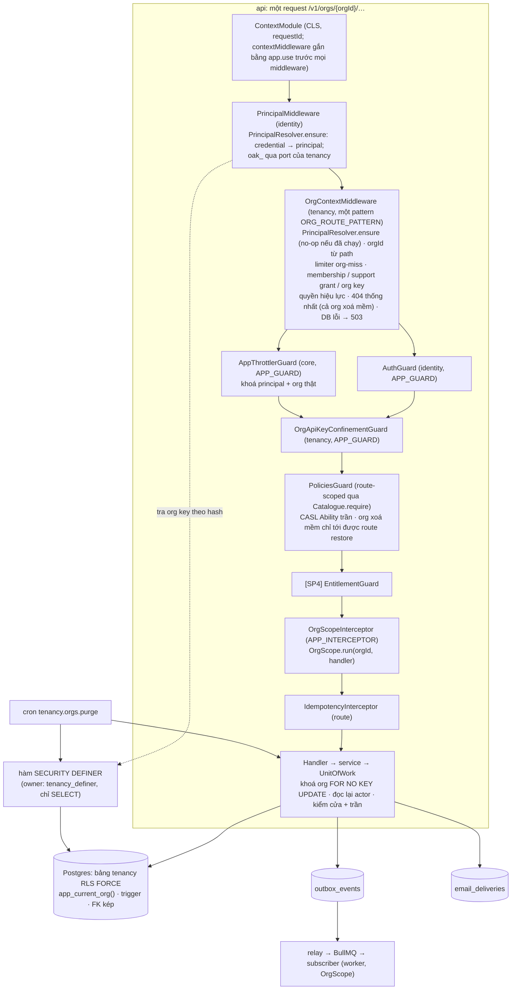
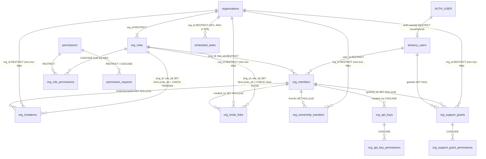

# Sub-project 3 — Tenancy & Access + RLS

- **Ngày:** 2026-09-28.
- **Trạng thái:** Bản thiết kế **r8**, **đã chốt 2026-09-28** (controller chốt theo uỷ quyền "tự chốt, tự làm hết" của Sếp; các giả định chưa chạy của 3D được kiểm bằng spike ở đầu plan 3D) (sau review vòng 1–8: bảo mật, dữ liệu/RLS/đồng thời, tích hợp, review chéo mô hình của Codex ở vòng 2 và 3, review adversarial ở vòng 4–8, review hội tụ nhất quán ở vòng 5, 7 và 8). Năm phần thiết kế (mô hình dữ liệu, pipeline request, role/quyền, lời mời/vòng đời, registry user/API key/external) đã được Sếp duyệt từng phần trong brainstorm (`.superpowers/sp3-brainstorm-notes.md`). Các quyết định S3-Q1–S3-Q6, quyết định "tự xây + CASL", 6 quyết định quyền S3-P1–S3-P6 (Sếp chốt 2026-09-28), quyết định "frontend không phụ thuộc SDK nào, chỉ REST + OpenAPI", quyết định chia 4 plan (3A–3D), hai quyết định **P-1** (nhân viên hỗ trợ chỉ định bằng `staffUserId`) và **P-2** (support grant v1 chỉ đọc, bỏ chế độ ghi, cron/event/thư hết hạn), và quyết định **P-3** (limiter org-miss: `peek` chỉ đọc trước khi tra, lần trúng không bao giờ ghi limiter, chỉ lần trượt thật được đếm; quyết định kỹ thuật được giao, đã chốt 2026-09-28) không bàn lại ở đây. Mục 23 liệt kê các quyết định kỹ thuật em tự chốt; mục 24 là nhật ký sửa r1; mục 25 là nhật ký sửa r2; mục 26 là nhật ký sửa r3; mục 27 là nhật ký sửa r4 (gồm việc thiết kế lại bảo đảm 2FA của nhân viên, mục 9.7 và 27.1); mục 28 là nhật ký sửa r5 (gate step-up TOTP cho mọi đường quyền nền tảng của nhân viên, lockout consume trước, dấu ghi phương thức, lệnh CLI reset 2FA); mục 29 là nhật ký sửa r6 (nhân viên chưa có factor không đổi được mật khẩu qua HTTP; lệnh reset gỡ liên kết IdP và bộ đếm lockout, đòi ticket và xác nhận tương tác, ghi marker bền, và là đường nâng quyền duy nhất; `/token` của nhân viên đòi step-up; admin cuối cùng không tự hạ quyền); mục 30 là nhật ký sửa r7 (hook và handler xác định cùng một subject: cách chọn token đặt lại, vị từ "admin", id đích sau ép kiểu; luật (7) kiểm cả lúc ghi mật khẩu; lệnh reset kiểm lại sau commit, xoá API key, chạy lại được với `--for-promotion`, có handle pool; `down` của migration marker có lối ra; thứ tự khoá của transaction lệnh là bất biến); mục 31 là nhật ký sửa r8 (lệnh reset rút gọn: câu ghi mật khẩu nằm trong transaction duy nhất nên exit `1` đúng nghĩa "DB không đổi", chế độ quyết định ở bước 0 theo trạng thái nhân viên, bước 3 chỉ đọc hash và factor; hàng rào sau ghi cho credential của nhân viên chưa có factor đóng T-42 và T-43; luật (7) kiểm mọi token và cả ba path lúc ghi; id đích `/admin/*` phải ở dạng chữ thường chuẩn; `down` của migration marker nguyên tử và chặn cả thư còn trong hàng đợi; đo kích thước image ghi ADR 0013). Không còn việc nào chờ Sếp chốt.
- **Chia plan:** một spec, bốn plan theo thứ tự phụ thuộc (mục 22.3): **3A** nền, **3B** role tuỳ biến + chống leo quyền, **3C** thu nhận (lời mời, invite link, chuyển quyền sở hữu), **3D** ủy quyền (org API key, support grant). 3C và 3D chạy song song sau 3B.
- **Spec cha:** `2026-09-24-saas-core-architecture-design.md`. Spec này đi sâu phần Tenancy & Access. Chỗ nào lệch spec cha thì ghi ở mục 22.2 và file `parent-spec-amendments.md` đi kèm.
- **ADR mới:** ADR 0017 "Module tenancy tự xây + CASL, không dùng plugin organization của Better Auth" (file `adr-0017-tenancy-own-module.md` đi kèm).
- **Nguồn bằng chứng:**
  - `.superpowers/sp3-research-org-plugin.md` (plugin organization 1.7.6, trích `org/…:dòng`);
  - `.superpowers/sp3-research-casl-rls.md` (hạ tầng RLS hiện có, CASL, khoảng trống; trích "research RLS §n");
  - `.superpowers/sp3-reeval-hardened-plugin.md` (đánh giá lại bản gia cố và các phương án khác);
  - `.superpowers/sp3-permission-design-research.md` (prior art về RBAC và chống leo quyền, probe CASL 7.0.1; khuyến nghị trích là **PR1–PR22**, ma trận test trích theo mã U/R/B/O/X/K/S/G).
- **Nền tảng code:** SP1 (`src/core/*`: `OrgScope`, `app_current_org()`, `UnitOfWork`, `dbErrorMapper` + `defineConstraintErrors`, `isDbInfraError`, deadline pool, outbox/`EventPublisher`, `defineCron`), SP2 (`src/modules/identity`: `PrincipalMiddleware`, `AuthGuard`, `AuthState`, `AuthProvider`, `IdentityDirectory`, `@SessionOnly()`; `src/modules/notifications`: `EmailNotifications`, `email_deliveries`), `test/integration/core/database/rls-catalog.spec.ts`, ADR 0005/0007/0009/0010.

**Ký hiệu quyết định:**
- **S3-Q1…S3-Q6**: quyết định của Sếp trong brainstorm (Q1 nhiều org/user, khoá single-org bằng config; Q2 role hệ thống + role tuỳ biến theo org; Q3 org trong path; Q4 lời mời email + invite link, domain-join hoãn; Q5 A1/B1/C vòng đời; Q6 support grant do owner cấp).
- **PR1–PR22**: khuyến nghị của research quyền (bắt buộc đưa vào spec theo chỉ đạo).
- **S3-P1–S3-P6**: 6 quyết định quyền Sếp chốt ngày 2026-09-28 theo đề xuất của research quyền: (P1) chỉ owner quản lý admin; (P2) `billing.write` (tức `billing.manage` của research) là `ownerOnly`; (P3) support grant chỉ hiệu lực khi owner đã cấp vẫn là owner; (P4) service principal: chốt hình dạng bảng ở SP3, cài đặt sau; (P5) role owner không bao giờ gán được qua lời mời hay link; (P6) dùng `Ability` trần của CASL, không `createMongoAbility`.
- **S3-A1…S3-A89**: quyết định kỹ thuật em tự chốt, mục 23.1 (S3-A31 trở đi thêm ở r1, S3-A41 trở đi thêm ở r2, S3-A56 trở đi thêm ở r3, S3-A61 trở đi thêm ở r4, S3-A68 trở đi thêm ở r5, S3-A73 trở đi thêm ở r6, S3-A77 trở đi thêm ở r7, S3-A83 trở đi thêm ở r8).
- **Mã finding review r1** (mục 24): `SEC-*` (review bảo mật), `DB-*` (review dữ liệu/RLS/đồng thời), `INT-*` (review tích hợp).
- **Mã finding review r2** (mục 25): `SEC2-N*` (bảo mật), `DB2-N*`/`DB2-M*` (dữ liệu/RLS/đồng thời), `INT2-N-*` (tích hợp), `CDX-*` (Codex, đánh số theo thứ tự trong báo cáo).
- **Mã finding review r3** (mục 26): `SEC3-1…3` (bảo mật, = N3-1…N3-3 của báo cáo), `R3-DB-1…4` (dữ liệu/RLS/đồng thời, giữ mã của báo cáo), `INT3-1…7` (tích hợp, = N3-1…N3-7 của báo cáo), `CDX3-1…3` (Codex, theo thứ tự trong báo cáo).
- **Mã finding review r4** (mục 27): `R4C-N4-1…4` (review Claude hội tụ, giữ số N4-n của báo cáo), `R4A-N1…5` (review adversarial, giữ số Nn của báo cáo).
- **Mã finding review r5** (mục 28): `N5-1…5` (review bảo mật adversarial, giữ số của báo cáo), `R5-C1…4` (review hội tụ nhất quán, giữ số của báo cáo).
- **Mã finding review r6** (mục 29): `N6-1…7` (review bảo mật adversarial, giữ số của báo cáo).
- **Mã finding review r7** (mục 30): `N7-1…6` (review bảo mật), `R7-C1…8` (review nhất quán, DB và chia plan), giữ số của báo cáo.
- **Mã finding review r8** (mục 31): `R8-S1…6` (review bảo mật), `R8-C1…5` (review nhất quán, DB và chia plan), giữ số của báo cáo.

---

## 1. Mục tiêu và tiêu chí hoàn thành

Sau sub-project này, dự án clone từ boilerplate có sẵn:
- tổ chức (org) nhiều thành viên, mỗi user thuộc được nhiều org (hoặc một, theo config);
- role hệ thống `OWNER`/`ADMIN`/`MEMBER` cố định trong code, role tuỳ biến theo org lưu trong DB, catalogue quyền trong code;
- phân quyền theo route bằng CASL 7, cô lập tenant bằng RLS fail-closed;
- mời thành viên bằng email và bằng link dùng chung;
- vòng đời org: tạo có giới hạn, xoá mềm có thời gian ân hạn, khôi phục, cron xoá cứng;
- API key theo org (credential máy chạy ở cả ba `AUTH_MODE`);
- quyền truy cập hỗ trợ có thời hạn do owner cấp cho nhân viên nền tảng.

Mọi tiêu chí dưới đây phải được chứng minh bằng test chạy trên hạ tầng thật (Postgres 18 + PgBouncer + Redis + Mailpit qua Testcontainers), cộng một lượt chạy prod-like trên image thật bằng compose `--profile app` (memory "Verify prod-like in Docker").

1. **Cô lập tenant bằng RLS, đo được.** Với **mỗi** bảng tenant của SP3 (mục 6), chạy bằng `app_user` qua app thật: từ `OrgScope(A)`, `SELECT`/`UPDATE`/`DELETE` dòng của org B trả 0 dòng; `INSERT` dòng có `org_id = B` bị `42501` (→ `404`); không có org context thì `P0001`; dòng con ở A trỏ tới cha ở B bị `23503`. Test catalog (`rls-catalog.spec.ts` mở rộng, mục 18.1) xanh: mọi bảng có `org_id` và `organizations` đều RLS + FORCE + policy `app_current_org()` giới hạn `TO app_user`.
2. **Org lấy từ path, không bao giờ từ session.** Mọi route tenant nằm dưới `/v1/orgs/{orgId}/…`. Principal không phải thành viên (và không có support grant hợp lệ) nhận `404 not_found` **giống hệt** org không tồn tại và org đã xoá mềm (so sánh nguyên văn status, **mọi** header trừ `Date`/`X-Request-Id`, body trừ `instance`/`requestId`/`timestamp`). Cả ba nhánh trả 404 từ **cùng một chỗ** (`OrgContextMiddleware`, trước throttler), nên không nhánh nào có `X-RateLimit-*` (mục 7.1 bước 3.7). Principal dò org id bị giới hạn bởi limiter "org miss" theo principal (`429` khi vượt, mục 7.1 bước 3.5); limiter **chỉ đếm lần trượt thật** (không consume trước rồi refund), nên member gửi `2 × TENANCY_ORG_MISS_RATE_LIMIT` request song song vào org của mình không bao giờ nhận `429` từ bucket này. Khoá throttle và idempotency mang org thật (không còn `none`) cho mọi request tenant được cấp quyền.
3. **Không route tenant nào lọt khỏi phân quyền.** Lúc khởi động, app duyệt mọi handler bằng `DiscoveryService`; path của handler (class + method, đã chuẩn hoá) được phân loại bằng **một** matcher dùng chung với `OrgScopeInterceptor` (mục 7.4). Handler tenant thiếu decorator quyền của catalogue (`<Catalogue>.require(...)`, mục 8.2) hoặc `@OrgMemberOnly()`, tham số org khác tên `orgId`, segment tĩnh ngay sau `v1/orgs/`, hoặc route tenant có `@PublicRoute()` đều làm app **không khởi động**. Route duy nhất tới được với org đã xoá mềm là hằng `ORG_RESTORE_TEMPLATE` (không có decorator mở cửa, mục 7.4). Ở runtime, request tenant không có quyết định phân quyền bị từ chối (fail-closed), không bao giờ cho qua.
4. **Không leo quyền.** Toàn bộ ma trận ở mục 18.3 xanh: luật tập hợp là unit test có generator, trigger/`CHECK` là integration với seed SQL, e2e là bảng role × route (G-6) cộng một ca đại diện cho mỗi đường gán. Mọi đường gán role (đổi role, lời mời, invite link, chuyển quyền sở hữu, API key, support grant) gọi cùng một hàm miền `assertCanBind`/`assertDelegable`, lời mời/link được kiểm lại **cửa và trần** lúc chấp nhận, và sửa role đang có người giữ đòi actor trội hẳn **cả tập cũ lẫn tập mới** (luật 1). Luật 2a so trên **tập quyền**: mọi thao tác tạo/sửa/xoá role, gán role hay quản lý người khác mà tập đích (hoặc tập cũ/mới của role) chứa toàn bộ `perms(ADMIN)` đều chỉ owner làm được; test dùng một role tuỳ biến tương đương ADMIN (B-23, B-24, R-19).
5. **Org luôn còn ít nhất một owner, kể cả khi đua.** Hai owner hạ quyền/xoá/rời nhau đồng thời qua API, lặp 50 lần: đúng một bên thành công, org còn ≥ 1 owner. Hai kết nối `app_user` xoá hai owner bằng SQL trực tiếp **không** khoá org, lặp 50 lần: org luôn còn ≥ 1 owner (trigger tự khoá dòng org, mục 6.6). Xoá tài khoản (identity) của owner cuối của một org đang hoạt động bị từ chối **trước khi Better Auth xoá bất cứ thứ gì**: `auth."user"`, `auth.account`, `auth.session` của user còn nguyên (mục 9.6).
6. **Lời mời email:** token 256 bit chỉ lưu SHA-256; chấp nhận đúng một lần (hai request chấp nhận song song: một `201`, một `404`); bắt buộc email đã xác thực của principal trùng email được mời; tra token không lộ trạng thái (không tồn tại, hết hạn, đã dùng, đã thu hồi đều `404 invitation_not_found` như nhau).
7. **Invite link:** `N + k` request join song song vào link `max_uses = N` → đúng `N` membership, `k` lỗi `404 invite_link_not_found`; `use_count` không bao giờ vượt `max_uses` (DB `CHECK`).
8. **Xoá mềm chặn truy cập ngay:** request kế tiếp sau commit của `DELETE /v1/orgs/{orgId}`: member và support grant nhận `404 not_found`; org API key nhận `401 unauthenticated` (key đã bị thu hồi trong cùng transaction xoá mềm, và mọi lỗi của chính credential là 401, mục 10). Lịch (`scheduled_tasks`) của org bị treo trong cùng transaction và khôi phục khi restore; lịch tạo **trong hoặc sau** khi xoá mềm cũng bị treo (trigger, race T-32). Job tenant đã nằm trong queue từ trước (waiting/delayed/retry) mà bắt đầu chạy sau khi xoá mềm commit bị bỏ qua ở bước kiểm lúc bắt đầu job, trong `OrgScope` (mục 9.4; trừ job khai báo chạy được trên org không hoạt động: job purge, job chuyển tiếp và giao event, job gửi thư đã nhận, và mọi job enqueue để phản ứng với event vòng đời org như dọn object storage sau purge, R4A-N4). Event phát trong hoặc ngay trước khi xoá mềm/purge (`tenancy.org.deleted`, `tenancy.org.purged`, …) vẫn tới subscriber (test xuyên suốt outbox → relay → dispatch → deliver). Chỉ owner gọi được `POST …/restore` trong thời gian ân hạn; cron xoá cứng xoá org quá hạn cùng mọi dữ liệu tenant, không đụng org khác, chạy lại an toàn.
9. **API key theo org:** chỉ dùng được trên path của đúng org (key hợp lệ trên path org khác → `404`); quyền hiệu lực = phạm vi key ∩ quyền **hiện tại** của người tạo ∩ tính đủ điều kiện, tính ở **mỗi** request (hạ role người tạo → key thu hẹp ngay ở request kế tiếp). Mọi lỗi của chính credential → `401`: key không tồn tại, thu hồi, hết hạn, người tạo rời org (dòng key bị `CASCADE`), user của người tạo bị ban hoặc chưa xác thực email. API key của user (Better Auth) bị từ chối trên mọi route tenant; key Better Auth không bao giờ mang được tiền tố `oak_`.
10. **Support grant:** chỉ owner cấp, người nhận là nhân viên nền tảng và không phải thành viên, có hạn, chỉ đọc (P-2), không bao giờ chứa quyền quản trị; mỗi request qua grant đòi **chính session đó** đã **step-up 2FA** (verify mã TOTP hoặc backup code của factor **hiện tại** ngay trong session, mục 9.7) trong vòng `TENANCY_SUPPORT_STEP_UP_MAX_AGE_SEC`; thiếu hoặc quá hạn → `403 second_factor_required` (chỉ grantee của một grant hợp lệ tới được nhánh này, nên mã này không lộ gì cho người khác). Dấu step-up tham chiếu session và dòng factor bằng FK `ON DELETE CASCADE`, nên thu hồi session hoặc gỡ/thay factor làm dấu mất trong cùng câu lệnh (race T-35, T-37). Session của nhân viên chưa step-up bằng **TOTP** trong `AUTH_SESSION_FRESH_AGE_SEC` không dùng được đường quyền nền tảng nào: đọc factor (`get-totp-uri`, `generate-backup-codes`), **mọi** endpoint `/api/auth/admin/*`, `/api/auth/token` (r6), Bull Board → `403 second_factor_required` (dấu ghi phương thức; step-up bằng backup code chỉ mở support grant, N5-1, N5-3); step-up bị lockout theo user **consume trước khi verify** (đúng `AUTH_LOCKOUT_MAX_FAILURES` lần thử mỗi cửa sổ, kể cả gửi song song, N5-2); nhân viên không tự tắt 2FA (`disable` → `403`), thay factor chỉ qua lệnh CLI reset của vận hành, chạy được cả khi không còn admin nào đăng nhập được (mục 9.7, N5-4); lệnh đòi ticket và xác nhận tương tác, đặt mật khẩu tạm, gỡ liên kết IdP và bộ đếm lockout của user (và, khi user đã là nhân viên ở bước 0, mọi API key Better Auth của user; r7 N7-5, r8 R8-C1), ghi marker bền `operator_reset` (chủ tài khoản nhận thư), tất cả trong **một** transaction (r8: exit `1` đúng nghĩa "DB không đổi", R8-S6), kiểm lại hash và factor sau commit và không giao mật khẩu tạm khi chúng đã bị đổi (r7, N7-4), và nâng user thành nhân viên cũng chỉ qua lệnh này (`--for-promotion`; N6-2, N6-3, N6-5); nhân viên **chưa có factor** không đặt lại hay đổi mật khẩu được qua HTTP (`/reset-password`, `/change-password`, `/admin/set-user-password`), nên chỉ người giữ mật khẩu do vận hành đặt đăng ký được factor (N6-1; r7: token chọn đúng như handler, N7-1; r8: mọi token có trong request, cả ba path kiểm lại trước **và** sau câu ghi mật khẩu, R8-S1, R8-S4); với nhân viên chưa có factor, mọi credential mới (session, liên kết IdP, API key Better Auth, mật khẩu) mà một request đang bay tạo ra đều bị **hàng rào sau ghi** gỡ, trừ session đăng nhập bằng đúng mật khẩu hiện tại và session xoay từ một session còn sống của chính user, nên không request nào đã xác thực trước lệnh giữ được credential sau lệnh (r8, T-42, T-43, R8-S5); admin cuối cùng không tự hạ quyền được, với "admin" đúng định nghĩa của plugin và id đích ở dạng UUID chữ thường chuẩn, để hook và phép so thô của plugin đọc cùng một chuỗi (N6-5, N7-2, N7-3, R8-S2); `/admin/update-user` không đổi được `twoFactorEnabled`; đổi role nền tảng của một user qua `/admin/set-role` hoặc `/admin/update-user` thu hồi mọi support grant chưa thu hồi của user đó, nên grant không "sống lại" khi hạ rồi nâng lại quyền **qua `/admin/*`** (N5-1); nâng quyền bằng lệnh reset `--for-promotion` không đi qua đường này, là ngoại lệ có tên (ranh giới (iv) mục 9.7; r7, R7-C6). Step-up chạy trong mọi loại session (mật khẩu, IdP, bearer, trình duyệt đã "tin thiết bị"), nên không ai bị khoá; user không phải nhân viên giữ nguyên hành vi SP2. Route cấp grant không phải oracle dò email (người nhận chỉ định bằng id nền tảng, mục 9.7); mọi owner nhận thông báo; mọi request qua grant có `org.access.via=SUPPORT_GRANT` và `org.access.ref=<id grant>` trong log; RLS vẫn áp dụng.
11. **Event `tenancy.*`** ghi outbox **cùng transaction** với thay đổi, mang `orgId` đúng và actor đúng theo mục 14 (user/service cho thao tác trực tiếp, `system` có tên cho chuyển trạng thái ngầm); test giết process giữa handler và commit không để lại event mồ côi hay thay đổi thiếu event.
12. **DB lỗi → `503`, không bao giờ `500`**, trên đường tra membership (middleware), đường xác thực org key và mọi thao tác tenancy (Toxiproxy cắt DB, `DB_QUERY_TIMEOUT_MS` hết hạn).
13. **Ba `AUTH_MODE` đều có test e2e cho tenancy** (`local`, `hybrid`, `external`), gồm FK tới user ở cả ba mode qua `tenancy_users` (mục 6.2). Cấu hình external hiện có (e2e `external-mode`, smoke) khởi động được **không cần thêm env nào** khi `TenancyModule` vào `APP_MODULES` (mục 13).
14. **Catalogue quyền trong code khớp bảng `permissions`:** lệch (key trong code thiếu ở DB, khác cờ, khác `requires`, khác trạng thái deprecate) làm api và worker không khởi động; key chỉ có ở DB (orphan, không catalogue nào đã nạp khai báo) chỉ log WARN một lần lúc boot và tăng `tenancy_catalogue_orphan_keys`, app vẫn khởi động (R-X21); test integration so cùng điều kiện.
15. **Chuẩn hoá:** bảng chuẩn hoá mục 6.12 bao phủ mọi cột của mọi bảng SP3; test inventory (`normalization-inventory.spec.ts` mở rộng) fail khi có cột chưa phân tích.
16. **Không PII trong log, metric, span, failed reason:** không email, không token, không id user làm label; có test đường lỗi (lời mời sai email, token sai, SMTP lỗi).
17. **Pipeline xanh như SP2 ở từng plan:** lint, type-check, unit, integration, migration up → down → up **và sweep từng bước S2-R57 với migration của chính plan đó** (mỗi plan có migration riêng, down đối xứng, mục 6.13), `oasdiff` (chỉ thêm), luật kiến trúc mục 18.6 kèm fixture phải fail; đo lại thời gian khởi động (bước kiểm route + catalogue < 200 ms).
18. **Mọi route tenancy có tác dụng ghi (method khác `GET`; controller tenancy chỉ được khai `GET`/`POST`/`PUT`/`PATCH`/`DELETE`, nên `@All()` và method mở rộng làm app không khởi động, R4A-N5) mang đúng một trong hai marker** (danh sách đầy đủ ở mục 12, cột "Loại"; trừ hai route preview chỉ đọc), kiểm lúc boot (G-8):
    - `@SensitiveTenancyAction()` (session mới + email đã xác thực + `@SessionOnly()`, **bất kể** `AUTH_REQUIRE_EMAIL_VERIFICATION`) cho mọi mutation **không** nằm trong danh sách thu hẹp dưới đây, tức mutation cấp hoặc mở rộng quyền (tạo org, đổi role, tạo/sửa role, lời mời, link, chuyển quyền, chấp nhận/join, tạo key/grant), phá huỷ (xoá/khôi phục org, xoá member khác, xoá role) hoặc sửa dữ liệu org (đổi tên). Mặc định là nhạy cảm: route ghi mới không tự rơi vào nhóm thu hẹp. Ở `external`, "session mới" là claim `auth_time`; thiếu claim → `403 reauthentication_required` (fail closed, không fallback `iat`).
    - `@NarrowingTenancyAction()` (chỉ `@SessionOnly()`, không đòi session mới hay email đã xác thực, như `/revoke-session(s)` và `/api-key/delete` của SP2) cho mutation **chỉ thu hồi hoặc thu hẹp**: thu hồi lời mời, thu hồi link, thu hồi key (của mình và của người khác), thu hồi grant, rời org, từ chối và huỷ chuyển quyền. Session cũ (kể cả `external` không có `auth_time`) vẫn thu hồi được ngay khi có sự cố (SEC3-2).

---

## 2. Phạm vi

**Trong phạm vi:**
- `src/modules/tenancy` (mới): domain (org, member, role, invitation, invite link, ownership transfer, org API key, support grant), catalogue quyền, CASL ability, middleware/guard/interceptor, controller `/v1/orgs/**`, `/v1/invitations/*`, `/v1/invite-links/*`, `/v1/permissions`, cron xoá cứng, subscriber gửi thông báo cho owner.
- Migration **chia theo plan** (mục 6.13): mỗi plan có migration riêng trong `src/migrations/tenancy/`, `src/migrations/core/` (3A: cột `scheduled_tasks.suspended_at`), `src/migrations/notifications/` (3A: bảng tra cứu `email_templates` thay `CHECK` template; 3C, 3D: mỗi plan chèn dòng template của mình) và `src/migrations/identity/` (3D: bảng dấu step-up `auth.session_second_factor`, FK `CASCADE` tới session và factor, cột `method`, không trigger); script init thêm role `tenancy_definer` (3A).
- Thay đổi tối thiểu ở `core/`, `modules/identity` (gồm lệnh vận hành `pnpm identity:staff-2fa-reset`, 3D) và `modules/notifications` (mục 5.2). Không đổi hành vi SP1/SP2 ngoài những dòng liệt kê; test SP1/SP2 phải sửa được liệt kê ở mục 5.3.
- `@casl/ability` 7.0.1 (package mới duy nhất).
- ADR 0017; cập nhật ADR 0005, 0007, 0009, 0010; danh sách sửa spec cha.
- **Frontend:** thiết kế không phụ thuộc SDK nào (quyết định của Sếp). Hợp đồng duy nhất là REST + OpenAPI (`oasdiff` chỉ thêm); client nào cũng sinh được từ OpenAPI.

**Ngoài phạm vi** (điểm mở rộng ở mục 19): tự vào org theo domain đã xác minh (S3-Q4 C), teams, ABAC có điều kiện, số ghế (SP4), audit log (SP6), service principal (chỉ chốt hình dạng bảng, S3-P4), SCIM/đồng bộ nhóm từ IdP, hộp thư "lời mời của tôi", dọn lời mời cũ theo thời hạn, cache ability, role `app_admin`, client SDK kiểu `authClient.organization.*`, support grant **ghi**, cron/event/thư báo support grant hết hạn (P-2, Sếp chốt), xoá cứng theo lô qua nhiều transaction (mục 9.5).

---

## 3. Ràng buộc toàn cục (bắt buộc cho plan và code)

Giữ nguyên mục 3 của spec SP1 và SP2. Riêng sub-project này:

1. **Package-first:** chỉ cài `@casl/ability` (`pnpm view @casl/ability dist-tags peerDependencies`, rồi `pnpm add @casl/ability` không ghi version; mong đợi 7.0.1). Không cài `nest-casl` (peer CASL 6), `@ucast/sql` (peer MikroORM 6), `casbin`, SDK FGA (research RLS §2.1, reeval §4). Token và hash dùng `node:crypto` (`randomBytes`, `createHash('sha256')`). Lệnh cài ra version khác thì dừng, đọc changelog, cập nhật spec, báo Sếp.
2. **Generator:** `nest g module|controller|service|guard|interceptor|middleware`, `mikro-orm migration:create --blank --path src/migrations/tenancy`.
3. **Không đoán API:** CASL theo mục 8.7 (đã probe trên tarball 7.0.1); option nào khác thì đọc `.d.ts` trước. TDD, không `any`, không tắt lint.
4. **Bất biến nằm ở DB:** mọi bất biến có thể biểu diễn bằng `CHECK`, `UNIQUE`, partial `UNIQUE`, `FOREIGN KEY`, trigger (kể cả `CONSTRAINT TRIGGER … DEFERRABLE INITIALLY DEFERRED`) thì phải nằm ở DB; kiểm ở app chỉ để trả lỗi đẹp. Mỗi vi phạm từ trigger được `RAISE … USING ERRCODE = 'check_violation', CONSTRAINT = '<tên>'` để đi qua `defineConstraintErrors` sẵn có (không thêm mapper mới).
5. **Kiểu dữ liệu:** PK `BIGINT GENERATED ALWAYS AS IDENTITY` + `public_id UUID DEFAULT uuidv7()` cho mọi bảng có định danh ra ngoài; ngoại lệ duy nhất `organizations.id UUID` (S3-A1). Thời gian `TIMESTAMPTZ`. Enum `TEXT` + `CHECK`. Mọi bảng có `created_at`/`updated_at`.
6. **FK có chủ đích:** mặc định `RESTRICT`; `CASCADE` chỉ cho dòng con thuộc hẳn cha (bảng nối quyền, API key thuộc membership ủy quyền); `SET NULL (cột)` (PG ≥ 15) cho tham chiếu lịch sử tới member đã rời, và tới role đã xoá từ lời mời/link đã kết thúc (có `CHECK` gắn trạng thái, mục 6.7–6.8). Không `CASCADE` từ `organizations`: xoá cứng xoá con tường minh theo thứ tự (mục 9.5).
7. **Mọi index gắn với một query** (ghi ở mục 6); index của bảng tenant bắt đầu bằng `org_id`, trừ index phục vụ hàm `SECURITY DEFINER` quét nhiều org (ghi lý do).
8. **Migration:** SQL (`addSql`), có `down` **đối xứng** đã test (CI up → down → up và sweep từng bước S2-R57), grant theo bảng (và theo cột cho `UPDATE`), không `ALTER DEFAULT PRIVILEGES`. Runner chạy **mọi** migration còn chờ trong **một** transaction (`migrator.ts`: `transactional: true, allOrNothing: true`; MikroORM 7.2.1 `AbstractMigrator.js:551-557`), nên mọi lock giữ tới khi cả lô commit, có `lock_timeout` 5 s của runner làm chặn; `NOT VALID` + `VALIDATE` trong cùng lô không đem lại gì nên không dùng (mục 6.13). Mỗi plan mang migration riêng (mục 6.13); migration của plan sau là file mới, không sửa migration đã merge. Quy tắc bắt buộc (mục 6.13):
   - `down` xoá **mọi** đối tượng `up` tạo, gồm hàm trigger (DROP TABLE không xoá hàm); test quét: mỗi `CREATE FUNCTION` của `up` có `DROP FUNCTION` tương ứng trong `down`.
   - Hàm do `tenancy_definer` sở hữu chỉ được tạo/sửa/xoá dưới `SET LOCAL ROLE tenancy_definer; …; RESET ROLE` trong cùng migration (S3-A31).
   - **Mọi** câu đọc/ghi dữ liệu trên bảng `FORCE ROW LEVEL SECURITY` trong migration (up **hoặc** down, không chỉ migration catalogue) theo mẫu `NO FORCE … FORCE` + khẳng định cuối (mục 8.8), vì `app_owner` không có policy nào và đọc 0 dòng mà không báo.
   - Không migration nào override `isTransactional()` thành `false` (test quét): mẫu `NO FORCE` chỉ an toàn khi nằm trong transaction của lô.
   - `SET CONSTRAINTS` không được rò sang migration kế tiếp: migration nào đổi chế độ phải trả mọi constraint deferrable về chế độ khai báo trước khi kết thúc (mục 8.8).
9. **Mọi race có tên và cơ chế chặn** (mục 17). Check-then-insert không bao giờ là cơ chế.
10. **Không hard-code:** giới hạn, thời hạn, cron, URL lấy từ config (mục 13); hằng số định dạng (tiền tố key, độ dài token, độ dài tên) là hằng số có tên, dùng chung giữa zod và `CHECK`.
11. **Fail loud:** thiếu metadata phân quyền, catalogue lệch DB, route tenant tới guard mà không có `orgAccess`, key quyền không có trong catalogue, hàm definer nhận tham số ngoài biên hoặc `NULL` đều ném lỗi có log, không trả giá trị sai.
12. **Chuẩn hoá:** mọi bảng ≥ 3NF, ưu tiên BCNF; ngoại lệ duy nhất là cột `org_id` lặp lại cho RLS + FK kép (E1): nó làm ba bảng nối quyền chỉ đạt 1NF hình thức (vi phạm 2NF) và các bảng con khác dừng ở 3NF; có lý do và cơ chế giữ nhất quán ở DB (mục 6.12).
13. **Khoá dòng: `FOR NO KEY UPDATE`, không bao giờ `FOR UPDATE`** (trừ khi Postgres tự nâng lúc `DELETE` dòng). Lý do: mọi INSERT của bảng con có FK tới `organizations` (kể cả bảng của `features/`, amendment B5) và tới `tenancy_users` lấy `FOR KEY SHARE` trên dòng cha; khoá này xung đột với `FOR UPDATE` nhưng **không** xung đột với `FOR NO KEY UPDATE`. Hai giao dịch cùng lấy `FOR NO KEY UPDATE` trên một dòng vẫn loại trừ nhau, nên mọi race dựa trên khoá tuần tự hoá (T-1, T-6, T-7, T-12) giữ nguyên đúng đắn. Mọi khoá dòng yêu cầu quyền `UPDATE` trên ít nhất một cột của bảng (mục 6.2 cho `tenancy_users`).
14. **Thứ tự khoá cố định** (PR15): `organizations` → `tenancy_users` → `org_roles` → `org_members` (tăng dần theo `id`) → bảng còn lại. Mọi transaction quản trị khoá dòng org `FOR NO KEY UPDATE` trước tiên. Trong một org, khoá dòng org đã tuần tự hoá mọi giao dịch quản trị, nên thứ tự các khoá sau đó (ví dụ khoá lời mời trước khi đọc member người mời `FOR SHARE`) không gây deadlock. Thứ tự chỉ có ý nghĩa với tài nguyên xuyên org (`tenancy_users`) và với các đường **không** khoá org theo thứ tự này: cập nhật `first_used_at` của grant, INSERT của `features/`, ba trigger hoãn owner/bootstrap/khôi phục (mục 6.6: `SECURITY DEFINER` thuộc `tenancy_definer`, tự tuần tự hoá bằng `pg_advisory_xact_lock(tenancy_org_lock_key(org))` chứ không khoá dòng — dưới FORCE RLS một trigger chạy quyền caller không đọc lại được trạng thái mà connection khác vừa giữ, nên không thể tự khoá dòng org rồi đọc lại; các hàm này đòi `READ COMMITTED`, ném lỗi khi isolation khác), trigger grantee (3D) khoá dòng org lúc INSERT theo cơ chế riêng, và `DELETE tenancy_users` khi xoá tài khoản (hành động FK `SET NULL` trên `organizations.created_by_user_id` sẽ khoá dòng org **sau** dòng `tenancy_users`, tức đảo thứ tự; mục 9.6 gỡ tham chiếu đó trước trong từng transaction theo org, nên câu `DELETE` không còn chạm dòng org nào, và chạy trong `UnitOfWork` để `40P01` còn sót được retry).
15. **Thời điểm kiểm hạn sau khi chờ khoá:** mọi so sánh hết hạn chạy **sau** khi đã lấy khoá dòng (join link, chấp nhận lời mời/chuyển quyền, khôi phục, purge, thu hồi lời mời đã hết hạn khi xoá role) dùng `clock_timestamp()` (giờ thật lúc câu chạy), không `now()` (giờ bắt đầu transaction, có thể trước cả lúc chờ khoá). `now()` chỉ dùng cho giá trị ghi (`updated_at`, `resolved_at`, `deleted_at`) và cho đọc không chờ khoá (hàm definer, tra quyền ở middleware).

---

## 4. Spike (bước đầu tiên, bắt buộc)

Chỉ gồm câu hỏi phải chạy code mới trả lời được. Kết quả ghi vào ADR 0017. Mỗi spike chạy ở plan có đủ điều kiện tiên quyết: T1–T6 và T8 ở **3A**, T7 ở **3D** (cần bảng `auth.session_second_factor` và nhánh support grant).

| # | Câu hỏi | Tiêu chí đạt | Fallback |
|---|---|---|---|
| T1 | CASL 7.0.1 import ESM dưới SWC/`nodenext`; `new Ability(rules, { anyAction, anySubjectType })` với sentinel làm `manage`/`all` vô hiệu; `ForbiddenError.from(ability).throwUnlessCan(action, subject)` có trong 7.0.1 (đọc `.d.ts`) và lỗi nhận bằng `instanceof` sau build | Probe PR/§4 tái hiện trong repo (U8, G-5) | Không có fallback package: nếu `anyAction` không nhận, validator catalogue chặn `manage`/`all` là lớp duy nhất, ghi ADR 0017 |
| T2 | Role `tenancy_definer NOLOGIN NOBYPASSRLS`; `GRANT tenancy_definer TO app_owner WITH INHERIT FALSE, SET TRUE`; migration tạo hàm dưới `SET LOCAL ROLE tenancy_definer` (hàm sinh ra đã thuộc `tenancy_definer`, `REVOKE`/`GRANT EXECUTE` chạy trước `RESET ROLE`); hàm `SECURITY DEFINER SET search_path = ''` đọc được bảng FORCE RLS nhờ policy `FOR SELECT TO tenancy_definer USING (true)` trong khi `app_user` gọi không có org context | Hàm trả đúng dòng; `app_user` đọc thẳng bảng vẫn `P0001`; `app_owner` không thừa hưởng policy của definer (INHERIT FALSE); **`down` (`SET LOCAL ROLE tenancy_definer; DROP FUNCTION …; RESET ROLE`) xanh; sweep S2-R57 (`migrations.spec.ts:105-131`) xanh**; từ PG 16, `app_owner` không còn được coi là owner của hàm (INHERIT FALSE), nên `DROP`/`CREATE OR REPLACE` chạy bằng `app_owner` trần phải `42501` (test chứng minh lý do của quy tắc) | Hàm do `app_owner` sở hữu và policy `TO app_owner` (app_owner không bao giờ là role runtime); ghi ADR 0005 |
| T3 | `CONSTRAINT TRIGGER … DEFERRABLE INITIALLY DEFERRED` + `RAISE USING ERRCODE='check_violation', CONSTRAINT='x'` lúc `COMMIT`: lỗi tới `commitFailure` là lớp 23 (đã chứng minh rollback), `pgFields` lấy được `constraint`, `defineConstraintErrors` map đúng; trigger chạy `SELECT … FROM organizations … FOR NO KEY UPDATE` lúc commit dưới `app_user` | Hạ owner cuối → `409 last_owner` (không phải `503 commit_outcome_unknown`); hai kết nối SQL trực tiếp không khoá org xoá hai owner ×50 → org luôn còn ≥ 1 owner; khối `DO` đặt `IMMEDIATE` theo tên, mở đầu bằng kiểm tên constraint deferrable trùng trong schema (mục 8.8 bước 4, R4C-N4-4) và khối `DO` "trả mọi constraint deferrable về chế độ khai báo" (bước 5) chạy được (`SET CONSTRAINTS` qua `EXECUTE` trong plpgsql); sau đó một câu `DELETE`+`INSERT` nhiều bước trên bảng có trigger hoãn, **kể cả constraint trigger tạo sau bước 4 trong cùng transaction**, vẫn chỉ bị kiểm lúc commit (R3-DB-2: `SET CONSTRAINTS ALL` giữ cờ ở mức transaction và rò sang constraint tạo sau) | Trigger `BEFORE` không defer + khoá org (đủ đúng vì mọi đường đổi owner của app đã khoá org; mất lớp chặn SQL trực tiếp không khoá, ghi ADR 0017) |
| T4 | FK xuyên schema `public.tenancy_users.auth_user_id → auth."user"(id) ON DELETE RESTRICT`: `auth_user` (không có quyền trên `public`) xoá user bị `23001`; không cần grant mới cho `auth_user`; test catalog quyền vẫn xanh | Lỗi `23001` (constraint `tenancy_users_auth_user_fk`) tới `onAPIError.onError` của identity, và được đổi thành `409 user_deletion_blocked` (T8) | Bỏ FK, giữ port `UserDeletionGuard` (mục 9.6) là lớp duy nhất; ghi rủi ro |
| T5 | Mọi đường xoá user của Better Auth 1.7.6 (liệt kê từ source ở mục 9.6: `/admin/remove-user`, `/delete-user`, `/delete-user/callback`; `anonymous` không bật): `hooks.before` của identity chạy **trước** handler, nên từ chối ở đó không xoá gì; thứ tự xoá thật là session → account → user (`plugins/admin/routes.mjs:781-782`, `db/internal-adapter.mjs:232-246`) | Owner cuối bị từ chối ở `hooks.before` → `409 user_deletion_blocked`; `auth."user"`, `auth.account`, `auth.session` của user còn nguyên; `/delete-user` và `/delete-user/callback` trả 404 của Better Auth vì SP2 không bật `user.deleteUser` (`update-user.mjs:278,366`) | Không có fallback: nếu `hooks.before` không chạy trước xoá, dừng và báo Sếp (mất credential khi bị từ chối là không chấp nhận được) |
| T6 | Xác định principal **idempotent** (mục 7.1 bước 2): `PrincipalResolver.ensure(req, res)` chạy từ cả `PrincipalMiddleware` lẫn `OrgContextMiddleware`, lần sau là no-op. Lý do: Nest 12.1 sắp middleware theo `distance` của module (`middleware-module.js:82-96`), `distance` là độ sâu **lớn nhất** trong cây import, nên Tenancy import Identity có thể đẩy `PrincipalMiddleware` ra **sau** `OrgContextMiddleware`; đăng ký lại middleware ở Tenancy thì chạy hai lần | E2E: mỗi request tenant đúng **một** span `identity.authenticate`, một lần `preAuth.consume`, không nhân đôi `Set-Cookie`, ở cả hai thứ tự đăng ký (test ép thứ tự bằng module fixture) | Không cần: cơ chế không phụ thuộc thứ tự |
| T7 (plan 3D) | Step-up 2FA trong session (mục 9.7): (a) ở Better Auth 1.7.6, `POST /two-factor/verify-totp` và `/two-factor/verify-backup-code` gửi **khi đã có session** (cookie, hoặc chỉ `Authorization: Bearer`) với factor đã bật chỉ kiểm mã và trả `{ token, user }` của **chính** session đó: không tạo session, không đổi cờ (`verify-two-factor.mjs:101-115`; `totp/index.mjs:205-224` bỏ qua nhánh bật khi `verified = true`; `backup-codes/index.mjs` tiêu thụ mã); (b) hook `before` của identity thấy session đó qua `d.session(headers)` (`auth.api.getSession`, đi qua hook `bearer`). `getSessionFromCtx` trong hook `before` của user **không** thấy bearer (hook của user chạy trước hook `bearer` của plugin, header chỉ được áp sau khi mọi hook `before` xong: `dispatch.mjs:141-166, 210-220`; SP2 đã ghi ở `auth-hooks.ts:308-313`; R4C-N4-1); (c) hook `after` của user đọc được thành công hay `INVALID_CODE`/`INVALID_BACKUP_CODE` từ `ctx.context.returned` (cách SP2 đã đọc `ACCOUNT_TEMPORARILY_LOCKED`); (d) `/two-factor/disable` của Better Auth (`adapter.delete` theo `userId`, `index.mjs:217-224`) và câu `DELETE` của lệnh reset bằng `auth_user` kích hoạt `ON DELETE CASCADE` sang `auth.session_second_factor`; (e) (r5) mọi path `/admin/*` đi qua cùng hook `before` với session đọc bằng `d.session(headers)` (SP2 đã đọc cho tiền tố `/admin/`), kể cả bearer không cookie; `/admin/set-user-password` và `/admin/set-role` đòi session (`adminMiddleware`, `plugins/admin/routes.mjs:17-21`), nên không lời gọi HTTP nào tới được handler mà không qua gate; (f) (r6) `GET /token` (`plugins/jwt/index.mjs:141-158`, `sessionMiddleware`) đi qua cùng hook với session đã đọc (`/token` thuộc `VERIFIED_OWNER_PATHS`, `auth-hooks.ts:116`); payload mặc định là `session.user`, gồm `role` (`plugins/jwt/sign.mjs:118-127`; SP2 không cấu hình `definePayload`), và đây là đường HTTP duy nhất mint JWT (`/get-session` không ký vì `disableSettingJwtHeader`, `auth-schema.ts:98`; `signJWT` là `serverOnly`, `plugins/jwt/index.mjs:160`); (g) (r7, N7-1, N7-4) request state của Better Auth (`defineRequestState`, như `AuthRequestState` của SP2) đặt ở hook `before` của `/reset-password` đọc được trong `databaseHooks.account.update.before`/`create.before` của **cùng** lời gọi; hook đó nhận `context.path = '/reset-password'` (`tryGetCurrentAuthEndpointContext`, `db/with-hooks.mjs`) và `data = { password }` (không có `userId`: `updateManyWithHooks` chỉ truyền `data`), và ném `APIError` ở đó thì câu `UPDATE` không chạy; r8 (R8-S1): cùng điều đó ở `/change-password` (`updateAccount` → `updateWithHooks`, `api/routes/update-user.mjs:172`) và `/admin/set-user-password` (`plugins/admin/routes.mjs:833-839`); (h) (r8, T-42, T-43) `databaseHooks.session.create.after`, `account.create.after`, `account.update.after` chạy **sau** câu ghi đã autocommit (hoặc sau commit của transaction Better Auth, `queueAfterTransactionHook`, `db/with-hooks.mjs:34, 70, 106`), nhận endpoint context (`path`, `body`, `context.session`), và lỗi ném ở đó đi ngược qua `createSession`/`createAccount`/`updatePassword` nên handler không trả `Set-Cookie` hay response thành công (cách `createSessionFence` của SP2 đã dựa vào, `auth-hooks.ts:219-241`); `hooks.after` của `/api-key/create` đọc được `id` và `referenceId` của key vừa tạo (`@better-auth/api-key` `dist/index.mjs:849-857`) và thay response bằng lỗi | Ca dương: nhân viên step-up bằng TOTP, bằng backup code, qua cookie và qua bearer không cookie → dấu có `two_factor_id` = factor hiện tại, `verified_at` ≈ now; session giữ nguyên (cùng `token`). Ca âm, không có dấu: đăng nhập mật khẩu + TOTP (nhánh không session: đăng nhập không ghi dấu), IdP, thiết bị tin cậy, nhánh bật 2FA (`verified = false`), user không phải nhân viên, mã sai. Xoá dòng `two_factor` → dấu mất; thu hồi session → dấu mất. **Race T-37:** step-up ∥ xoá factor ×50 → không dấu nào còn sau khi xoá commit. Gate quản lý factor (mục 9.7) với bearer không cookie → `403`. Ghi dấu lỗi → verify vẫn `200`, không có dấu (fail closed), log ERROR. (r5) Dấu có `method` đúng path (`totp`/`backup_code`); dấu `backup_code` → `/admin/set-role` và `get-totp-uri` `403`, grant `200`; dấu `totp` → cả ba `200`; `AUTH_LOCKOUT_MAX_FAILURES + 20` lần step-up song song → đúng `AUTH_LOCKOUT_MAX_FAILURES` lần tới handler; (r6) `/token` bằng session nhân viên không dấu TOTP → `403`, sau step-up TOTP → `200`; (r7) `/reset-password` của nhân viên chưa có factor với thứ tự ép bằng barrier (hook `before` cho qua khi user còn là user thường, lệnh reset `--for-promotion` commit, rồi handler ghi) → `400`, mật khẩu tạm còn nguyên; (r8) cùng ca cho `/change-password` và `/admin/set-user-password`; (h): barrier giữ transaction của lệnh mở, một lần đăng nhập bằng mật khẩu cũ ghi session → hàng rào chờ, lệnh commit, session bị xoá, `401`, không `Set-Cookie`; `/api-key/create` bằng session trước lệnh → key bị xoá, `403` | Không đạt (a) hoặc (b): support grant tắt ở mọi mode (`TENANCY_SUPPORT_GRANTS=on` → không khởi động), ghi ADR 0017. Không đạt (g): bỏ lớp chặn trước câu ghi, giữ hook `before`, hàng rào sau ghi và bước kiểm sau commit của lệnh reset (mật khẩu tạm có thể bị vô hiệu trong đua thay vì được giữ; không có lỗ bảo mật mới), ghi ADR 0017. Không đạt (h) ở một điểm hook nào: dừng 3D và báo Sếp (T-42/T-43 mở lại ở đường đó) |
| T8 (plan 3A) | Lỗi `23001` khi Better Auth xoá `auth."user"` (FK `tenancy_users_auth_user_fk`) tới client là `409 user_deletion_blocked`, không phải 500: `onAPIError.onError` (`auth-options.ts:236`) đổi lỗi **trước** khi gọi `onApiError` ghi log/đếm 5xx (hiện tại `onApiError` log `better_auth_unhandled_error` mức ERROR trước, `auth-instance.ts:271-291`) | Kịch bản tất định, chỉ cần bảng của 3A: seed `tenancy_users` cho user U; app **không** cài `UserDeletionGuard` (`@Optional`, lớp duy nhất còn lại là FK); `/admin/remove-user` U → `409 user_deletion_blocked`, không có log ERROR `better_auth_unhandled_error`, không đếm 5xx. **Ca âm (INT3-4):** `23001` trên một path **không** thuộc `USER_DELETION_PATHS` vẫn là 500 như cũ. **Path lấy từ đâu:** `onError(error, ctx: AuthContext)` không có request (`@better-auth/core` `init-options.d.mts:1450-1463`; router gọi `options.onAPIError.onError(e, ctx)` sau khi endpoint thoát, `better-auth/dist/api/index.mjs:195-200`), nên mount ghi path Better Auth (đã bỏ `basePath`) vào scope `runWithAuthDbFailureScope` mà nó đã mở cho mỗi request (`auth-mount.middleware.ts:254`, `AsyncLocalStorage` còn hiệu lực khi router gọi `onError`), và `onError` đọc path từ scope đó (`recordedAuthPath()`) | Better Auth không chuyển nguyên lỗi pg tới `onError`: dùng scope lỗi pool auth của SP2 — trên path (đọc từ scope) thuộc `USER_DELETION_PATHS`, `recordedAuthDbError()?.code === '23001'` (`auth-db-failures.ts:47`, mang SQLSTATE qua `safeErrorFields`) → `409`. Lỗi `23001` từ pool `auth_user` trên các path đó chỉ có thể đến từ FK trỏ vào `auth."user"` từ ngoài schema `auth` (identity không cần biết tên constraint của tenancy) |

---

## 5. Kiến trúc tổng quan

### 5.1 Vị trí module và luồng

```
src/modules/tenancy/
  index.ts · tenancy.module.ts · tenancy.config.ts · errors.ts · events.ts · jobs.ts · permissions.ts
  domain/        organization.ts · member.ts · role.ts · invitation.ts · invite-link.ts
                 ownership-transfer.ts · org-api-key.ts · support-grant.ts          (state machine, value object)
                 permission-set.ts (closure, ⊊, eligibility) · escalation.ts (assertCanBind, assertDominates,
                 assertDelegable) · catalogue.ts (definePermissionCatalogue, kiểm catalogue)
  application/   authz/ability.factory.ts · authz/effective-permissions.ts
                 org.service.ts · member.service.ts · role.service.ts · invitation.service.ts
                 invite-link.service.ts · ownership-transfer.service.ts · org-api-key.service.ts
                 support-grant.service.ts · user-deletion.service.ts · member-admission.ts
                 purge-orgs.handler.ts · notify-owners.subscriber.ts
                 catalogue-check.ts · org-route-inventory.ts · permission-catalogue.registry.ts
                 org-purge-participant.registry.ts (quét marker Discovery, mục 8.2) · tenancy-features.ts
                 (resolveTenancyFeatures, mục 13) · org-activity.gate.ts (cài OrgActivityGate của core)
  ports/         org-repository.ts · membership-reader.ts · … (mỗi aggregate root một port) · org-purge-participant.ts
                 tenancy-test-hooks.ts (seam X-4 và O-18, mặc định no-op, mục 18.0)
  http/          org-route.ts (matcher route tenant dùng chung, mục 7.4) · org-context.middleware.ts
                 policies.guard.ts · org-scope.interceptor.ts · org-api-key-confinement.guard.ts
                 decorators.ts (@OrgMemberOnly, @SensitiveTenancyAction, @NarrowingTenancyAction, @PermissionCatalogueContributor, @OrgPurgeParticipantContributor) · *.controller.ts · schemas.ts
  infra/sql/     sql-*.repository.ts (Db.execute trên EM đang gắn, không import @mikro-orm ngoài infra)
  infra/identity/ tenancy-identity-ports.module.ts (@Global, cài hai port của identity, chỉ forApi(), mục 5.2)
                 org-api-key.authenticator.ts · user-deletion.guard.ts
  infra/queue/   tenancy-queue-ports.module.ts (@Global, cài OrgActivityGate của core, có trong forWorker(), mục 5.2)
src/migrations/tenancy/ · src/migrations/core/ (suspended_at) · src/migrations/identity/ (session_second_factor)
src/migrations/notifications/ (bảng email_templates, dòng template) · docker/postgres/init/01-roles.sh (thêm tenancy_definer)
```

Hướng phụ thuộc: `tenancy → identity (index) → core`, `tenancy → notifications (index)`, `features → tenancy (index)`. Identity và notifications **không** import tenancy; identity mở hai port để tenancy cắm vào (mục 5.2), theo mẫu `@Global()` + `@Optional()` đã có trong repo (`QueueDashboardAuthorizer`, `queue-dashboard.server.ts:79`). Controller mỏng: parse → service/`CommandBus` → `serialize`.





### 5.2 Thay đổi ở `core/`, `modules/identity` và `modules/notifications`

Chỉ những gì tenancy không tự làm được. Mỗi dòng có test riêng. Cột "Plan" chỉ plan mang thay đổi đó (mục 22.3).

| Chỗ sửa | Thay đổi | Lý do | Plan |
|---|---|---|---|
| `core/context/principal.ts` | `CREDENTIAL_KINDS` thêm `'ORG_API_KEY'`. `Credential` thêm `orgId?: string` (chỉ có với `ORG_API_KEY`). `Principal.type` giữ nguyên union, SP3 bắt đầu sinh `'api_key'` | Org API key là principal riêng (`{ type: 'api_key', id: <public_id của key> }`), gắn cứng một org (S3-A8) | 3D |
| `modules/identity/http/credential-detector.ts` | `DetectedCredential.kind` đổi kiểu thành `DetectedCredentialKind = Exclude<CredentialKind, 'ORG_API_KEY'>`. Detector không đổi hành vi: header API key luôn cho `API_KEY`; việc tách `oak_` làm ở `PrincipalResolver` | Ba `switch` vét cạn trên kind của credential **đã phát hiện** — `better-auth.provider.ts:90`, `infra/better-auth/sign-out.ts:65`, `infra/jwks/jwks.provider.ts:90` — **không phải sửa**: kiểu hẹp làm `ORG_API_KEY` không bao giờ tới đó, compiler chứng minh. `infra/better-auth/auth-mount.middleware.ts:288` vẫn từ chối mọi header API key trên `/api/auth/*` (kể cả `oak_`, `400 api_key_not_accepted`); `infra/dashboard/platform-admin.authorizer.ts:75-76` (Bull Board) từ chối **mọi** credential `API_KEY` (kể cả `oak_`) bằng `403 forbidden` trước khi gọi provider, nên `oak_` không bao giờ tới Better Auth ở đó (dashboard không phải route tenant; không cần sửa) | 3D |
| `core/context/request-context.ts`, `context.keys.ts` | Khoá `core:orgAccess`: `setOrgAccess(a)`/`orgAccess()` với `OrgAccess = { via: 'MEMBERSHIP' \| 'SUPPORT_GRANT' \| 'ORG_API_KEY'; ref: string; permissions: readonly string[]; orgDeleted: boolean }` (`ref` là public id của member/grant/key, không phải PII). Log `mixin()` ghi `org.access.via` và `org.access.ref` | Quyền hiệu lực tính một lần ở middleware, guard đọc lại (SEC-M11: log có `ref` ở mọi nơi) | 3A |
| `core/http` (mới, export ở `index.ts`) | `RateLimitBuckets` (injectable, trong `HttpModule`): `register({ owner, name, ttlMs, limit, refundable })` gọi **một lần** lúc khởi tạo provider của module chủ, trả một **handle** `{ peek(key), consume(key), refund?(key) }`; không có API nào thao tác bucket theo tên. Tên lưu trong storage là `<owner>.<name>` (có dấu `.`, nên không bao giờ trùng tên throttler của `@Throttle`/`default`, vốn không chứa `.`); đăng ký trùng `<owner>.<name>` → ném lúc boot. `refund` chỉ có trên handle đăng ký `refundable: true`. `peek` = `get` của rate-limiter-flexible (chỉ đọc, không tăng; `rate-limiter-flexible` 11.2.1 `RateLimiterStoreAbstract.js:226`, lỗi Redis rơi sang insurance như `consume`, `RateLimiterInsuredAbstract.js:26-40`) trả `{ blocked, retryAfterSec }`; `consume` = `increment` hiện có. Cùng storage `RateLimiterThrottlerStorage` của SP1 (băm khoá `rateLimitKey`, problem `429` + `Retry-After`, insurance theo pod khi Redis lỗi, `503` chỉ khi cả Redis lẫn insurance lỗi). `PreAuthRateLimiter` viết lại trên nó với `owner: 'core', name: 'pre-auth', refundable: true` (hành vi S2-R51/R53 không đổi; đổi tên limiter trong storage làm bộ đếm pre-auth về 0 một lần lúc deploy, chấp nhận được) | Tenancy cần hai limiter không phải `@Throttle`: `@nestjs/throttler` chỉ được import trong `core/http` (depcruise `http-libs-only-in-core-http`), và tham số decorator được đánh giá lúc import, trước khi config nạp. Hai bucket của tenancy: `tenancy.org-miss` (khoá principal, **không** refundable: chỉ đếm lần trượt thật, mục 7.1 bước 3.5) và `tenancy.token-preview` (khoá IP qua `clientIpTracker` đã export, không refundable). Chủ tên bucket rõ ràng nên không module nào hoàn điểm được bucket của module khác (SEC2-N5) | 3A |
| `core/queue` | `JobDef` thêm trường tuỳ chọn `onInactiveOrg: 'skip' \| 'run'` (mặc định `'skip'`). Port mới `abstract class OrgActivityGate { abstract check(): Promise<OrgActivity> }` với `OrgActivity = { kind: 'ACTIVE' } \| { kind: 'DELETED'; deletedAt: Date } \| { kind: 'GONE' }` (export ở `core/index.ts`; r4 trả lý do thay cho `boolean` để khai báo sai không im lặng, R4A-N4; `WorkerHost` `switch` vét cạn), `WorkerHost` inject `@Optional()`; trong `process`, **bên trong** `OrgScope.run(meta.orgId, …)` và trước `handle`, nếu job có `meta.orgId`, `onInactiveOrg = 'skip'` và gate có mặt: `check()` khác `ACTIVE` → không gọi handler, job kết thúc `completed`, log INFO `{ event: 'job_skipped_org_inactive', job, jobId }`, hoặc WARN `job_skipped_org_inactive_after_delete` khi `GONE` hay khi `job.timestamp` (lúc enqueue) muộn hơn `deletedAt` (mục 9.4), metric `queue_jobs_skipped_total{reason="org_inactive"}`. Gate lỗi hạ tầng → ném (BullMQ retry theo backoff). Job khai báo `onInactiveOrg: 'run'`: **`core.event.dispatch`** (INT3-1, CDX3-2: relay enqueue `DispatchEventJob` với `meta.orgId = row.org_id` rồi đánh dấu dòng outbox `published`, `outbox.relay.ts:262-276,361-366`; tên job ở `outbox.jobs.ts:9`; handler của nó mới enqueue `core.event.deliver` cho từng subscriber hoặc job hoãn `core.job.deferred`, `event-dispatch.handlers.ts:207-258`. Bị bỏ qua ở bước này thì event mất vĩnh viễn: `tenancy.org.deleted` ghi cùng transaction với `deleted_at`, `tenancy.org.purged` ghi khi dòng org đã bị xoá, và mọi event/job hoãn của org phát ngay trước khi xoá mềm. Dispatch chỉ chuyển tiếp; mỗi job con tự chịu `onInactiveOrg` của chính nó), `core.event.deliver` (event của chính thao tác xoá mềm như `tenancy.org.deleted` phải tới subscriber và audit SP6; subscriber chỉ ghi DB), `notifications.send-email` (dòng `email_deliveries` đã nhận phải tới trạng thái cuối, không thì reconcile enqueue lại mãi), `tenancy.org.purge`. Job hoãn qua outbox (`core.job.deferred`) được dispatch thành job thật và bị gate ở bước của **chính nó**. Job mà subscriber enqueue để phản ứng với event vòng đời org (`tenancy.org.deleted`/`.purged`) phải khai `'run'` (mục 9.4, R4A-N4) | Xoá mềm phải chặn cả job tenant **đã nằm trong queue** (CDX-6): `suspended_at` và gỡ scheduler chỉ ngăn lần lên lịch sau, còn `worker-host.ts:244-246` gọi handler trong `OrgScope` mà không kiểm org còn hoạt động. Core không import tenancy, nên dùng port `@Optional` (mẫu `queue-dashboard.server.ts:79`). **Nơi cung cấp gate (INT3-5b):** `@Optional()` vắng provider thì gate tắt **âm thầm**, nên tenancy cung cấp `OrgActivityGate` từ module `@Global()` `TenancyQueuePortsModule` nằm trong `TenancyModule.forWorker()` (process chạy `WorkerHost`), không phải từ `TenancyIdentityPortsModule` (chỉ api); X-10 chạy trên composition `AppWorkerModule` thật để bắt thiếu provider | 3A |
| `core/scheduler` | Migration core thêm `scheduled_tasks.suspended_at TIMESTAMPTZ NULL`. `ScheduledTaskService.suspendAllForCurrentOrg()`, `resumeAllForCurrentOrg()`, `removeAllForCurrentOrg()` (mỗi hàm trả `Promise<number>`, **chỉ** ghi DB trong transaction của caller, trong OrgScope) và `syncCurrentOrg()` (đồng bộ job scheduler Redis của org hiện tại theo DB; caller gọi **sau** commit). `ScheduleReconciler` đọc `WHERE enabled AND suspended_at IS NULL`; `upsert` thêm `RETURNING suspended_at` và không đẩy lên Redis khi dòng đang treo; nhánh `ON CONFLICT DO UPDATE` **không** ghi `suspended_at` (chỉ nền tảng ghi cột này). Lịch **mới** tạo trong/sau xoá mềm được treo bởi trigger `scheduled_tasks_suspend_if_org_deleted` do migration tenancy 3A thêm (mục 6.13, race T-32), nên `upsert` nhận `suspended_at` khác `NULL` qua `RETURNING` và không đẩy lên Redis | Org xoá mềm không được chạy lịch trong thời gian ân hạn (DB-I10); `enabled` là ý định của feature, `suspended_at` là trạng thái của nền tảng, tách hai cột để restore trả đúng ý định cũ. Redis sau commit hoặc để reconciler dọn (reconciler đã xoá id mồ côi: `schedule-reconciler.ts:104-108`) | 3A |
| `modules/identity/http/principal.middleware.ts` → `principal-resolver.ts` (mới, export) | Thân `use()` hiện tại chuyển thành `PrincipalResolver.ensure(req, res): Promise<void>`, **idempotent theo request**: lần đầu chạy (phát hiện credential, CSRF, `preAuth`, `authenticate`, `AuthState.set`, `setPrincipal`, chuyển tiếp `Set-Cookie`), các lần sau trong cùng CLS là no-op. Dấu "đã chạy" là khoá CLS riêng `identity:principalResolved`, đặt **ngay khi lần chạy đầu bắt đầu** (không suy từ `AuthState`: `AuthState.get()` trả `ANONYMOUS` cả khi khoá chưa đặt, `auth-state.ts:18-19`, và nhánh không credential cũng đặt `ANONYMOUS`). Lần đầu ném lỗi (ambiguous, CSRF, `429` pre-auth) thì `ensure` ném (không `next(err)`), request kết thúc ở đó, không có lần chạy thứ hai. `PrincipalMiddleware.use` = `ensure` rồi `next`; unit test gọi `ensure` hai lần ở nhánh `ANONYMOUS` và nhánh ném lỗi. Credential `API_KEY` có giá trị bắt đầu bằng `ORG_API_KEY_PREFIX` được chuyển cho port `OrgCredentialAuthenticator` (ở cả ba mode), **không bao giờ** rơi xuống Better Auth; `preAuth.consume/refund` áp cho cả `oak_` | Nest 12.1 không bảo đảm thứ tự middleware giữa module (T6, INT-I1); `OrgContextMiddleware` gọi `ensure` trước khi đọc principal nên thứ tự đăng ký không còn quan trọng | 3A |
| `modules/identity/ports/auth-provider.ts` | Nhánh `AUTHENTICATED` thêm: `authenticatedAt: Date \| undefined` (local/hybrid: `session.createdAt`, khớp cách Better Auth tính freshness ở `session.mjs:337-340`; external: claim `auth_time`, **không** fallback `iat`; API key: `undefined`); `emailVerified: boolean` (local/hybrid: `user.emailVerified`; external: `true`, lý do ở mục 11; API key: `false`); `verifiedEmail: string \| undefined` (email chuẩn hoá khi đã xác thực: local/hybrid từ user, external từ claim `AUTH_EXTERNAL_EMAIL_CLAIM` khi claim verified `=== true`). **Không** có field 2FA: dữ liệu đó chỉ đọc lười ở nhánh support grant (hàng `AuthFacts` dưới; DB2-N8) | `AuthFacts` cần dữ liệu thật (INT-I10); các field này sinh ở provider từ dữ liệu provider đã có (`getSession`, claim), không thêm query | 3A |
| `infra/better-auth/better-auth.provider.ts`, `infra/jwks/jwks.provider.ts` | Điền ba field trên. Better Auth provider giữ thêm `session.id` (đã có trong kết quả `getSession`, không query thêm) vào trạng thái CLS **nội bộ** của identity cho `AuthFacts.secondFactorVerifiedAt()` (3D). Jwks: đọc `auth_time` (số giây, kiểm kiểu), claim email + claim verified | như trên | 3A (`session.id`: 3D) |
| `modules/identity/http/auth.guard.ts` | Nhánh `@SessionOnly()` từ chối cả `ORG_API_KEY` (không chỉ `API_KEY`) | Thao tác quản trị không bao giờ chạy bằng key (PR8, B-17). Ở 3A `'ORG_API_KEY'` chưa có trong `CREDENTIAL_KINDS` nên phép so không compile được; vì vậy thuộc 3D (INT2-N-8). Từ 3A tới 3D, `oak_` chỉ ra `REJECTED` (401) nên không tới được guard | 3D |
| `modules/identity` (mới, export) | `AuthFacts` (CLS, chỉ đọc): `isPlatformAdmin()`, `authenticatedAt()`, `emailVerified()`, `verifiedEmail()` (đồng bộ, từ `AUTHENTICATED`), và `secondFactorVerifiedAt(): Promise<Date \| undefined>` (3D) **đọc lười**: chỉ khi được gọi (duy nhất ở nhánh support grant của `OrgContextMiddleware`, sau khi đã tìm thấy grant), một câu trên pool `auth_user` theo `session.id` nội bộ và user của session, nhận dấu của **mọi** `method` (TOTP hoặc backup code: grant chỉ đọc và có hạn, mục 9.7): `SELECT ssf.verified_at FROM auth.session_second_factor ssf JOIN auth.two_factor tf ON tf.id = ssf.two_factor_id JOIN auth."user" u ON u.id = tf.user_id WHERE ssf.session_id = $1 AND u.id = $2 AND tf.verified AND u.two_factor_enabled`; kết quả cache trong CLS của request; credential không phải session → `undefined`; **0 dòng** (chưa step-up, factor đã bị gỡ/thay, session vừa bị thu hồi: dấu `CASCADE` theo cả hai) → `undefined` (fail closed; không đọc `rows[0]` rỗng thành `TypeError`/500); lỗi hạ tầng → ném lỗi hạ tầng (middleware trả `503`). Câu tra theo khoá của dấu, không đi qua dòng `auth.session`, nên không có nhánh "0 dòng = cho qua" (R4A-N3). Mọi request khác không chạm bảng này (DB2-N8: lỗi của câu thêm không lan ra mọi request có session). Decorator `@RequireFreshSession()` (`authenticatedAt` thiếu hoặc cũ hơn `AUTH_SESSION_FRESH_AGE_SEC` → `403 reauthentication_required`) và `@RequireVerifiedEmail()` (`emailVerified() === false` → `403 email_not_verified`), cả hai **không phụ thuộc** `AUTH_REQUIRE_EMAIL_VERIFICATION` | Tenancy không được đọc `AuthState` nội bộ (luật `modules-only-index-of-other-modules`); S2-R76 "không mint credential/không đổi membership khi chưa xác thực, bất kể cờ" (SEC-I4) | 3A |
| `modules/identity` (port mới, export ở `index.ts`) | `abstract class OrgCredentialAuthenticator { abstract authenticate(rawKey: string): Promise<AuthResult> }`. `abstract class UserDeletionGuard { abstract check(authUserId: string): Promise<UserDeletionCheck>; abstract release(authUserId: string): Promise<UserDeletionRelease> }` với `UserDeletionCheck = { kind: 'ALLOWED' } \| { kind: 'BLOCKED_LAST_OWNER'; orgCount: number }` và `UserDeletionRelease = { kind: 'RELEASED' } \| { kind: 'BLOCKED_RACE'; reason: 'MEMBERSHIP_CREATED' \| 'LAST_OWNER' }` (DB2-N6: `23001` của `org_members_user_fk` và `check_violation` `org_members_last_owner_ck` do đua được đổi thành kết quả có tên, không ném ra hook; identity dựng `APIError` 409). Identity `switch` vét cạn trên cả hai kiểu (kiểm `never`). Identity inject cả hai bằng `@Optional()`; tenancy cung cấp qua module `@Global()` `TenancyIdentityPortsModule` (chỉ trong process api). Vắng authenticator → `oak_` trả `REJECTED` (401); vắng guard → hook bỏ qua, chỉ còn lớp FK (worker dựng Better Auth nhưng không có route xoá user) | Nest resolve provider theo scope module: provider mặc định ở identity sẽ che provider của tenancy (INT-I6). Mẫu `@Global()` + `@Optional()` đã có (`queue-dashboard.server.ts:79`) | authenticator: 3D; guard: 3A |
| `modules/identity/errors.ts` | Mã mới `USER_DELETION_BLOCKED` (409, `user_deletion_blocked`), **identity sở hữu**. `AUTH_CODE_MAP` thêm `USER_DELETION_BLOCKED`. Plan 3D thêm `SECOND_FACTOR_REQUIRED` (403, `second_factor_required`) và (r6, N6-5) `LAST_PLATFORM_ADMIN` (409, `last_platform_admin`) vào `IdentityErrors` (đã export ở `index.ts`; tenancy dùng lại ở nhánh support grant, mục 7.1 bước 3.7). Gate nhân viên (quản lý factor và `/admin/*`) trả mã này bằng `problem()` trong `hooks.before`, như `EMAIL_NOT_VERIFIED` (`auth-hooks.ts:523`), nên không cần `AUTH_CODE_MAP`; Bull Board trả bằng `deny()` của authorizer | `defineErrorCodes` ném khi trùng mã (`error-codes.ts:25`), identity không import tenancy; `last_owner` của tenancy chỉ dùng trên route tenancy (INT-I7). Mã riêng thay vì `reauthentication_required`: đăng nhập lại không tạo dấu; client cần biết phải step-up (gửi mã 2FA trong session, mục 9.7) | 3A (`second_factor_required`, `last_platform_admin`: 3D) |
| `modules/identity/infra/better-auth/auth-hooks.ts` | `hooks.before` với path ∈ `USER_DELETION_PATHS = ['/admin/remove-user', '/delete-user', '/delete-user/callback']` (mục 9.6): chỉ khi caller được phép (admin path: session là platform admin và id đích khác chính mình; hai path còn lại: subject là user của session) mới gọi `UserDeletionGuard.check(subject)`. **Id đích (r7, N7-3)** đọc bằng `adminTargetUserId(body)` (export từ `auth-hooks.ts`, 3D dùng lại ở luật (6)–(8)): ép `body.userId` bằng đúng `z.coerce.string()` mà schema của plugin dùng (`plugins/admin/routes.mjs:26, 215, 739, 787`; zod 4.6.5: `["<id>"]` thành `"<id>"`, số thành chuỗi), rồi đòi dạng UUID (`z.uuid()`) **và** đòi chuỗi đó bằng đúng dạng chữ thường của nó; không chuẩn hoá (r8, R8-S2); không đạt → `422 validation_failed` (chỉ đọc khi session là platform admin, như điều kiện chạy hook ở mục 9.6, nên người không có quyền vẫn nhận lỗi của Better Auth), trước khi gọi guard. Lý do từ chối thay vì hạ chữ thường: cột `auth."user".id` là `uuid`, Postgres so không phân biệt hoa thường, nên plugin tìm đúng user của `"<ID VIẾT HOA>"`, còn mọi phép so "chính mình" của plugin là so chuỗi thô với `session.user.id` (luôn chữ thường; `plugins/admin/routes.mjs:286, 533, 779`). r7 hạ chữ thường ở hook, nên với id của chính mình viết hoa, hook coi là "chính mình" và bỏ qua guard trong khi plugin không coi là chính mình và vẫn xoá session, account (R8-S2). Chỉ nhận dạng chữ thường chuẩn thì chuỗi hook đọc, chuỗi plugin so và user Postgres khớp là một; `BLOCKED_LAST_OWNER` → `APIError` 409 mã `USER_DELETION_BLOCKED` (nằm trong `AUTH_CODE_MAP`), trước khi Better Auth xoá bất cứ thứ gì. `hooks.before` của `/api-key/create`: `body.prefix` bắt đầu bằng `ORG_API_KEY_PREFIX` (không phân biệt hoa thường) → `422 validation_failed` | DB-C1, SEC-M14; r7 N7-3: hook đọc `body.userId` thô trong khi plugin ép kiểu, nên `userId: ["<id owner cuối>"]` bỏ qua guard mà plugin vẫn xoá session và account (đúng lỗi DB-C1 mở lại); r8 R8-S2: chuẩn hoá chữ thường của r7 tạo lệch mới với phép so thô của plugin; INT-I9/SEC-M1: `/api-key/create` nhận `prefix` từ client (`@better-auth/api-key` `dist/index.mjs:584,729,793-804`); `/api-key/update` không có trường `prefix` (`dist/index.mjs:1337-1352`) nên không cần luật. Hook `prefix` đi **cùng plan** với việc định tuyến `oak_` của `PrincipalResolver` (3A), nếu không từ 3A tới 3D user tạo được key Better Auth mang `oak_` và key đó hỏng âm thầm (INT2-N-6) | 3A |
| `modules/identity/infra/better-auth/auth-options.ts` | `databaseHooks.user.delete.before` gọi `UserDeletionGuard.release(user.id)` (mục 9.6 bước 3); `BLOCKED_RACE` → ném `APIError` 409 mã `USER_DELETION_BLOCKED`. `onAPIError.onError` (`auth-options.ts:236`) **đổi lỗi trước khi** gọi `input.onApiError` (hiện tại log ERROR `better_auth_unhandled_error` + đếm 5xx trước, `auth-instance.ts:271-291`): trên path thuộc `USER_DELETION_PATHS` (path **đọc từ scope** `runWithAuthDbFailureScope`: chữ ký là `onError(error, ctx: AuthContext)`, không có request, nên `auth-mount.middleware.ts` ghi path Better Auth đã bỏ `basePath` vào scope trước khi gọi handler, và `auth-db-failures.ts` thêm `recordedAuthPath()`; ngoài scope → không có path → không đổi lỗi, INT3-4), lỗi pg `23001` (hoặc, nếu Better Auth không chuyển nguyên lỗi, `recordedAuthDbError()?.code === '23001'`) → log WARN `{ event: 'user_deletion_blocked_race' }` rồi ném `APIError` 409 `USER_DELETION_BLOCKED`, không đếm 5xx (T8). Không so tên constraint: identity không được biết tên constraint của tenancy (DB2-M7) | Hook `delete.before` chạy **sau** khi Better Auth đã xoá session và account (`internal-adapter.mjs:232-246`), nên nó chỉ làm việc dọn, không bao giờ là chỗ từ chối chính. Body 409 trong trường hợp đua ghi rõ "credential đã bị gỡ, xem runbook" (mục 9.6), không để admin hiểu là chưa có gì bị xoá | 3A |
| `modules/identity` migration + `auth-hooks.ts` + `login-lockout.ts` + `auth-schema.ts` | **Bảo đảm 2FA của nhân viên bằng step-up trong session (r4 thiết kế lại, r5 và r6 mở rộng; bất biến, lý do và phương án đã loại ở mục 9.7).** Bảng `auth.session_second_factor (session_id uuid PRIMARY KEY REFERENCES auth.session(id) ON DELETE CASCADE, two_factor_id uuid NOT NULL REFERENCES auth.two_factor(id) ON DELETE CASCADE, method text NOT NULL CONSTRAINT session_second_factor_method_ck CHECK (method IN ('totp', 'backup_code')), verified_at timestamptz NOT NULL, created_at, updated_at)`; index `session_second_factor_two_factor_idx (two_factor_id)` (phục vụ câu `DELETE … WHERE two_factor_id = $1` của hành động `CASCADE` khi xoá factor); grant `auth_user` `SELECT, INSERT, UPDATE, DELETE`; hằng `SESSION_SECOND_FACTOR_TABLE` thêm vào `AUTH_TABLES` (`auth-schema.ts:18-30`, như `USER_RECLAIM_TABLE`, `SECURITY_NOTICE_TABLE` của SP2), vì `rls-catalog.spec.ts:107-110` và `auth-schema.spec.ts:58-62` so tập bảng của schema `auth` bằng đúng hằng này (R5-C2). Không trigger, không hàm. "Nhân viên" = `hasAdminRole(session.user.role)` (r7, N7-2: `hasAdminRole` bỏ `trim` để trùng `hasPermission` của plugin, hàng `identity-directory.ts` dưới); mọi nhánh dưới dùng `session` = `d.session(headers)` mà hook SP2 đã đọc cho tiền tố `/two-factor/` và `/admin/` (`requiresVerifiedOwner`), không `getSessionFromCtx` (R4C-N4-1); các kiểm của nhân viên chạy ngay sau kiểm email S2-R76, trước kiểm độ mới. **Câu dấu TOTP** (module `staff-step-up.ts` của identity, dùng chung cho hook và Bull Board): `SELECT ssf.verified_at FROM auth.two_factor tf JOIN auth."user" u ON u.id = tf.user_id JOIN auth.session_second_factor ssf ON ssf.two_factor_id = tf.id AND ssf.session_id = $2 WHERE tf.user_id = $1 AND tf.verified AND u.two_factor_enabled AND ssf.method = 'totp'` (r6, N6-6: cùng định nghĩa "factor hiện tại" với câu chụp `factorId` dưới và với `AuthFacts.secondFactorVerifiedAt()`, nên không câu nào của `src` phải nới cho helper test); cho qua **chỉ khi** có dòng và `verified_at` không cũ hơn `AUTH_SESSION_FRESH_AGE_SEC`; mọi trường hợp khác (0 dòng: không có factor, factor đang chờ verify, chưa step-up, step-up bằng backup code, session vừa bị thu hồi; hoặc dấu cũ) → `403 second_factor_required`. Cùng module có hai câu nữa (r6): **"nhân viên chưa có factor"** (N6-1) `SELECT u.role, CASE WHEN u.two_factor_enabled THEN (SELECT tf.id FROM auth.two_factor tf WHERE tf.user_id = u.id AND tf.verified) END AS factor_id FROM auth."user" u WHERE u.id = $1 FOR SHARE OF u` (r7, N7-4: câu khoá đọc, nên khi transaction của lệnh reset đang giữ dòng user thì câu này chờ lệnh commit rồi thấy bản đã commit; `auth_user` có `UPDATE` trên `"user"` nên được khoá đọc; r8 trả `factor_id` thay cho `has_factor` để hàng rào (9)(iv) so được factor trước và sau câu ghi, `two_factor_user_id_unique` bảo đảm ≤ 1 dòng. Subquery đọc snapshot cũ của câu lệnh, nên quyết định phải đi qua cờ `u.two_factor_enabled` của dòng đã khoá, và lệnh luôn ghi cờ `false`: không được bỏ cờ khỏi câu này, xác nhận của hai review r8), và `staffLacksFactor(userId)` = có dòng, `hasAdminRole(role)` và `factor_id IS NULL`; **"còn admin khác"** (N6-5) `SELECT EXISTS (SELECT 1 FROM auth."user" u WHERE u.id <> $1 AND 'admin' = ANY (string_to_array(u.role, ',')) AND NOT (u.banned IS TRUE AND (u.ban_expires IS NULL OR u.ban_expires > now())))` (r7, N7-2: cùng vị từ với `hasAdminRole` đã bỏ `trim`, tức đúng `hasPermission` của plugin: tách theo `,`, so khớp đúng phần tử `admin`, không `btrim`; cùng điều kiện của `isBanned`, `identity-directory.ts:33-38`). Thay đổi ở `auth-hooks.ts`: **(1)** `before` của `STEP_UP_PATHS = ['/two-factor/verify-totp', '/two-factor/verify-backup-code']` với session của nhân viên: `d.lockout.guard({ kind: 'step-up', userId })` **trước** khi verify, đúng mẫu `guard()` của SP2 (`auth-hooks.ts:377-392`, "consume TRƯỚC khi xác minh": bị khoá → `429` + `Retry-After` qua `rateLimited()`, storage lỗi → `503`, không bao giờ cho qua). `LoginLockout` (`login-lockout.ts`) là `RateLimiterPostgres` trên pool auth, tăng đếm nguyên tử bằng một câu upsert, nên N request song song không lọt quá ngưỡng (N5-2); `LockoutScope` thêm kind `{ kind: 'step-up'; userId: string }` với khoá `step-up:<userId>`, và `accountKey` có kiểm `never` nên compiler bắt mọi nhánh thiếu. (r6, N6-2) `accountKey` thành hàm thuần cấp module và `login-lockout.ts` export thêm `lockoutRowKeys(scope): { exact: string[]; prefixes: string[] }` dựng từ chính `ATTEMPTS_PREFIX`/`BLOCKS_PREFIX`/`TICKETS_PREFIX` (exact: `blocks:<accountKey>`; prefixes: `attempts:<accountKey>:`, `tickets:<accountKey>:`, theo `getKey` = `<keyPrefix>:<key>` của `rate-limiter-flexible`, `RateLimiterAbstract.js:106-108`, và khoá ticket của `issueTicket`; `issueTicket` và `lockoutRowKeys` dùng chung một hàm dựng khoá ticket), để lệnh reset xoá đúng dòng lockout mà không chép tiền tố hay `accountKey`. Định dạng `<keyPrefix>:<key>` là của thư viện và vẫn được viết lại ở đây (r7, R7-C7: r6 ghi "không chép định dạng khoá" là quá lời), nên S-22 dựng dòng lockout bằng `LoginLockout.guard()` thật và khẳng định `lockoutRowKeys` phủ đúng mọi khoá mà `guard()` đã ghi; dựng dòng bằng SQL theo cùng định dạng tự viết thì test thành vòng tròn. Hook **không** lưu ticket và không refund: mọi lần thử đều đếm, nên `AUTH_LOCKOUT_MAX_FAILURES` là số lần step-up mỗi `AUTH_LOCKOUT_WINDOW_SEC` (mặc định 10 mỗi 900 s, dư cho nhân viên step-up mỗi `AUTH_SESSION_FRESH_AGE_SEC`); ticket do `guard` ghi hết hạn cùng cửa sổ và được housekeeping `login_attempts` của SP2 dọn. Rồi chụp `factorId` bằng `SELECT tf.id FROM auth.two_factor tf JOIN auth."user" u ON u.id = tf.user_id WHERE tf.user_id = $1 AND tf.verified AND u.two_factor_enabled` và lưu `{ sessionId, factorId, method }` vào request state (`defineRequestState`, như `setTwoFactorUser`); `method` suy từ path (`verify-totp` → `totp`, `verify-backup-code` → `backup_code`, hằng `STEP_UP_METHOD_BY_PATH`); **(2)** `after` của cùng path: thành công và có `factorId` → `INSERT INTO auth.session_second_factor (session_id, two_factor_id, method, verified_at, created_at, updated_at) SELECT s.id, tf.id, $3, now(), now(), now() FROM auth.session s JOIN auth.two_factor tf ON tf.user_id = s.user_id WHERE s.id = $1 AND tf.id = $2 ON CONFLICT (session_id) DO UPDATE SET two_factor_id = EXCLUDED.two_factor_id, method = EXCLUDED.method, verified_at = EXCLUDED.verified_at, updated_at = EXCLUDED.updated_at`; 0 dòng, `23503` (session hay factor vừa mất) hoặc `40P01` (đua với transaction của lệnh reset, T-37) → không dấu, log INFO `second_factor_mark_skipped`; lỗi khác → log ERROR, response giữ nguyên, không dấu (fail closed); **(3)** `before` của `/two-factor/get-totp-uri`, `/two-factor/generate-backup-codes`, `/token` (r6, N6-7) **và mọi path có tiền tố `/admin/`** với session của nhân viên: câu dấu TOTP (R4A-N2(a), R4A-N3; r5 mở rộng sang `/admin/*` và thêm điều kiện `method = 'totp'`, N5-1, N5-3). Dấu `backup_code` không mở các path này: một mã dùng một lần không được đổi thành secret TOTP, bộ mã mới hay quyền quản trị nền tảng; **(4)** `before` của `/two-factor/disable` với session của nhân viên → `403 forbidden` (detail: nhân viên thay factor qua lệnh reset của vận hành); **(5)** `before` của `/admin/update-user`: `body.data` có khoá `twoFactorEnabled` (so không phân biệt hoa thường, bỏ `_`) → `422 validation_failed` (R4A-N2(b)); **(6)** (r5, N5-1) `after` của `/admin/set-role`, và của `/admin/update-user` khi `body.data` có khoá `role`, thành công → `PlatformRoleChangeListener.onPlatformRoleChanged(adminTargetUserId(body))` (port hàng dưới; id đã ép kiểu như plugin và ở dạng chữ thường chuẩn, r7 N7-3, r8 R8-S2); port ném → log ERROR `{ event: 'platform_role_change_listener_failed' }` rồi `503 service_unavailable` (role đã ghi; gọi lại cùng request là idempotent và hoàn tất việc thu hồi); vắng port → không làm gì; **(7)** (r6, N6-1) đổi hay đặt lại mật khẩu của **nhân viên chưa có factor** (`staffLacksFactor`) không có đường HTTP: `before` của `/reset-password` (r7, N7-1; r8, R8-S4): hook phân giải **mọi** chuỗi token khác rỗng có trong request, tối đa hai (`stringField(body, 'token')` và `stringField(query, 'token')`; query lặp khoá thành mảng thì `stringField` bỏ qua, còn zod `z.string()` của handler từ chối trước khi handler chạy, `better-call` `router.mjs:52-56`); mỗi token đọc dòng `verification` `reset-password:<token>` **bất kể hạn** (token hết hạn thì handler cũng từ chối, nên luật không dựa vào phép so hạn của hook); tập subject (`verification.value` của các dòng tìm thấy, 0–2 phần tử) ghi vào request state (`AuthRequestState.setPasswordWriteSubjects`, như `setTwoFactorUser`); **bất kỳ** subject nào `staffLacksFactor` → `400 invalid_or_expired_token` (cùng lỗi với token sai, không thêm oracle; token không bị tiêu thụ vì handler của Better Auth chưa chạy), log WARN `{ event: 'staff_password_change_refused', path, userId, stage: 'hook' }`, **trước** reclaim. Hook kiểm mọi token mà handler có thể chọn, nên thứ tự chọn của handler (body trước hay query trước) không còn ảnh hưởng tới luật (r7 chỉ kiểm token mà biểu thức hiện tại chọn, R8-S4). `resetPasswordToken(body, query)` = `stringField(body, 'token') \|\| stringField(query, 'token')` (đúng biểu thức của handler, `api/routes/password.mjs:149`; export từ `auth-hooks.ts`) vẫn là cách chọn **một** token cho reclaim S2-R40 (PR #2 của SP2 đã sửa reclaim sang `\|\|`; 3D tách biểu thức ra hàm này), và reclaim giữ điều kiện "còn hạn" của SP2. Test drift đọc `password.mjs` của bản đã cài (mẫu `better-auth-hardening.spec.ts:217-253`) khoá **ba** chỗ mà hook dựa vào: schema `token` của `query` và `body` là `z.string()` không ép kiểu (`:132`, `:135`), biểu thức chọn token (`:149`), và identifier `` `reset-password:${token}` `` (`:154`). Không có token nào hay không có dòng nào thì handler, với cùng identifier, cũng ném `INVALID_TOKEN` trước khi ghi gì. `before` của `/change-password`: subject = user của session, ghi vào request state; `staffLacksFactor` → `403 second_factor_required` (client biết phải `enable` + `verify-totp` trước). `before` của `/admin/set-user-password` (sau gate (3) và kiểm id chuẩn): subject = `adminTargetUserId(body)`, ghi vào request state; `staffLacksFactor` → `403 forbidden` (detail: dùng lệnh reset). **Lớp chặn trước câu ghi** (r7, N7-1, N7-4; r8 mở ra cả ba path, R8-S1): `databaseHooks.account.update.before` và `account.create.before` (ghép sau `createImplicitLinkGuard`) khi `context.path ∈ PASSWORD_WRITE_PATHS = ['/reset-password', '/change-password', '/admin/set-user-password']` và `data` có `password`. Cả ba handler ghi mật khẩu ngoài mọi transaction của Better Auth (`api/routes/password.mjs:161-167` `createAccount`/`updatePassword`; `api/routes/update-user.mjs:172` `updateAccount`; `plugins/admin/routes.mjs:833-839`), nên câu kiểm trên pool auth không gặp bẫy giữ hai connection mà `createImplicitLinkGuard` ghi ở N1. Tập subject lấy từ request state (`data` của `updatePassword`/`updateAccount` chỉ có `{ password }`); tập rỗng, hoặc `create.before` có `data.userId` không thuộc tập → log ERROR `{ event: 'password_write_subject_unresolved', path }` rồi ném `500` (handler ghi cho một subject mà hook `before` không thấy: fail closed); **mọi** subject của tập chạy `staffLacksFactor` (câu `FOR SHARE`, chờ transaction đang mở của lệnh reset), và `factor_id` đọc được của từng subject ghi vào request state cho hàng rào (9)(iv); có subject chưa có factor → ném lỗi của path (`400 invalid_or_expired_token` / `403 second_factor_required` / `403 forbidden`), WARN `staff_password_change_refused` với `stage: 'write'`, mật khẩu không bị ghi. Ở `/change-password` câu ghi đứng **trước** `deleteUserSessions` + `createSession` (`update-user.mjs:172-182`), nên bị chặn thì handler không tạo session mới (R8-S1: r7 chỉ có lớp này ở `/reset-password`, còn `/change-password` có cùng khe hook → ghi, rộng hơn vì gồm hai lần băm). Khe còn lại giữa câu kiểm và câu ghi được **hàng rào sau ghi** (9) đóng. `setPassword` của Better Auth là `serverOnly` (`api/routes/update-user.mjs:189`) và `/admin/update-user` chặn `password` (`plugins/admin/routes.mjs:259`), nên ba path này là mọi đường HTTP ghi mật khẩu của một user đã có. Nhân viên đã có factor giữ hành vi SP2 ở cả ba path (đặt lại xong vẫn phải qua thử thách 2FA); **(8)** (r6, N6-5) `before` của `/admin/set-role`, và của `/admin/update-user` khi `body.data` có khoá `role`, sau gate (3): `adminTargetUserId(body)` là user của session, role mới (`body.role` hoặc `body.data.role`; mảng nối bằng `,` như `parseRoles` của plugin; role không phải chuỗi hay mảng chuỗi thì plugin tự từ chối trước khi ghi: zod ở `set-role`, `INVALID_ROLE_TYPE` ở `update-user`, `plugins/admin/routes.mjs:25-28, 264-273`) không chứa `admin` theo `hasAdminRole`, và câu "còn admin khác" trả `false` → `409 last_platform_admin`, role không đổi, log INFO `{ event: 'last_platform_admin_refused', userId }`. **(9)** (r8, T-42, T-43, R8-S5) **Hàng rào sau ghi cho credential của nhân viên chưa có factor** (module `staff-credential-fence.ts` của identity, dùng lại câu `staffLacksFactor` `FOR SHARE OF u`). Mỗi điểm dưới chạy **sau** câu ghi, khi câu ghi đã commit; câu đầu tiên luôn là `staffLacksFactor(subject)`, nên nếu transaction của lệnh reset đang mở thì hàng rào chờ nó commit rồi thấy bản đã commit. Subject không phải nhân viên chưa có factor → không làm gì (đúng một câu, hành vi SP2 giữ nguyên). Nhân viên chưa có factor → gỡ đúng thứ vừa ghi, trừ ngoại lệ có tên, rồi ném lỗi, log WARN `{ event: 'staff_credential_fenced', kind, path, userId }`. Hàng rào lỗi DB → log ERROR `{ event: 'staff_credential_fence_failed', kind, path, userId }` và ném `503` (fail closed): session hay API key vừa ghi vô dụng vì token/secret chưa bao giờ được giao; liên kết IdP thì trực gỡ theo log. Các điểm: (i) `session.create.after` (mọi path; ghép **sau** `createSessionFence` của SP2): giữ session khi (a) `context.path === '/sign-in/email'` và `context.context.password.verify({ hash, password: body.password })` đúng với hash `credential` hiện tại (đọc trong cùng transaction với câu khoá), hoặc (b) request mang session của **chính** user đó (`context.context.session`) và dòng session đó còn tồn tại, tức session xoay từ một session còn sống (nhánh bật 2FA của `verify-totp` ghi session mới **trước** khi đặt `verified = true`, `plugins/two-factor/totp/index.mjs:205-222`). Không đạt → `DELETE FROM auth.session WHERE id = $1`, ném `401` (ở `/sign-in/email` dùng đúng lỗi `INVALID_EMAIL_OR_PASSWORD` của sai mật khẩu, không thêm oracle); context `null` → xoá. Chỉ nhân viên chưa có factor mới tốn thêm một lần verify mật khẩu; (ii) `account.create.after` với `providerId <> 'credential'` (liên kết IdP qua `/link-social` hay callback): xoá dòng, ném `403 second_factor_required` (nhân viên liên kết lại IdP **sau** khi có factor, runbook bước 4); (iii) `hooks.after` của `/api-key/create` thành công: subject = `referenceId` của key vừa tạo; xoá dòng `auth.apikey` theo `id`, thay response bằng `403 second_factor_required` (plugin ghi key bằng `ctx.context.adapter.create`, không qua `databaseHooks`: `@better-auth/api-key` `dist/index.mjs:849-852`); (iv) `account.update.after`/`account.create.after` (`credential`) trên `PASSWORD_WRITE_PATHS`, với tập subject và `factor_id` mà lớp chặn trước câu ghi đã ghi: subject là nhân viên **và** (chưa có factor, **hoặc** `factor_id` khác lúc lớp chặn trước kiểm) nghĩa là câu ghi đã lọt qua khe giữa lớp chặn trước và câu ghi (T-42), hoặc ai đó vừa đăng ký factor bằng chính mật khẩu vừa ghi. Hàng rào gỡ **mọi** credential của subject trong một transaction mở đầu bằng câu khoá dòng user `FOR NO KEY UPDATE`: đặt `two_factor_enabled = false`, `UPDATE auth.account SET password = NULL, updated_at = now() WHERE user_id = $1 AND provider_id = 'credential'`, rồi đúng các câu xoá của bước 2 lệnh reset (factor, thiết bị tin cậy và token đặt lại, liên kết IdP, API key Better Auth, session; hàm dùng chung `revokeUserCredentials(client, userId, { apiKeys: true })`, đặt ở `staff-step-up.ts` để cả hook lẫn lệnh import mà lệnh không kéo hook theo, nên hai nơi không lệch nhau), không ghi `role`, không chèn marker; log ERROR `{ event: 'staff_password_write_neutralized', path, userId }`, ném lỗi của path. `40P01`/`40001` (đua với câu ghi dấu step-up, như T-37) → chạy lại transaction, tối đa `STAFF_RESET_TX_ATTEMPTS` lần; vẫn lỗi, hoặc lỗi hạ tầng → log ERROR `{ event: 'staff_password_write_neutralize_failed', path, userId }` (cảnh báo trực: chạy lại lệnh reset cho user đó ngay) và `503`; mật khẩu vừa ghi khi đó còn hiệu lực tới khi lệnh chạy lại, đây là nhánh duy nhất hàng rào không tự đóng được (ranh giới (viii)). Factor giữ nguyên `factor_id` (trường hợp duy nhất một nhân viên có factor đặt lại mật khẩu qua thư theo hành vi SP2) → không làm gì. Mật khẩu tạm của lệnh cũng mất (đã bị ghi đè): lệnh phát hiện ở bước 3, hoặc nhân viên báo mật khẩu tạm không dùng được, và vận hành chạy lại lệnh (ranh giới (viii)). **Vì sao đủ, không phụ thuộc thời điểm:** câu đầu của transaction lệnh giữ `FOR NO KEY UPDATE` trên dòng user tới commit, xung đột với `FOR SHARE`. Một câu ghi commit trước snapshot của câu xoá tương ứng trong transaction thì bị chính transaction xoá hoặc ghi đè. Một câu ghi commit sau snapshot đó có hàng rào chạy **sau** nó, và hàng rào thấy trạng thái sau lệnh (nhân viên chưa có factor) dù nó bắt đầu trước hay sau commit. Trạng thái đó chỉ kết thúc khi factor được verify, mà verify cần một session được (a) hoặc (b) cho qua, tức một session của người giữ mật khẩu hiện tại. Thời gian băm hay độ trễ của event loop không mở lại khe nào (r7 ước khe T-43 là "process dừng giữa hai câu", thực tế là cả thời gian verify mật khẩu của lần đăng nhập, R8-S5). **Quy tắc chung (r7, N7-3; r8, R8-S2):** hook chỉ ra quyết định trên đúng giá trị mà handler dùng. Với session của nhân viên, **mọi** path tiền tố `/admin/` mà body có khoá `userId` (ở 1.7.6: `set-role`, `update-user`, `set-user-password`, `remove-user`, `ban-user`, `unban-user`, `impersonate-user`, `revoke-user-sessions`, `list-user-sessions`, và `has-permission`, nơi `userId` bị bỏ qua khi có session nhưng kiểm vẫn vô hại) chạy `adminTargetUserId(body)` ngay sau gate (3), trước mọi luật khác; không phải UUID chữ thường chuẩn → `422 validation_failed`. Theo tiền tố như gate (3), nên endpoint admin mới có `userId` tự rơi vào luật. Nhờ vậy phép so "chính mình" của plugin (tự ban, tự xoá, `routes.mjs:286, 533, 779`) và của hook (luật (8), hook xoá user) so cùng một chuỗi, và luật (8) dựa được vào việc plugin tự chặn tự ban, tự xoá. Luật (6)–(8) dùng lại giá trị đó. User không phải nhân viên: hành vi SP2 giữ nguyên ở (1)–(5), (7) và (9) (một câu thêm ở (9)). Đăng nhập (nhánh không session, cookie `two_factor`) không ghi dấu | Support grant cần sự thật "chính session này vừa chứng minh factor hiện tại" (SEC-I5, ADR 0010 M4), không phải cờ `twoFactorEnabled` hay lịch sử đăng nhập. r2–r3 ghi dấu ở bước đăng nhập và vá từng lỗ của gate; r4 thay bằng step-up trong session vì ít phần hơn và không khoá ai (mục 9.7, 27.1). r5: session admin chưa step-up còn dùng được `/admin/*` để tự hạ quyền rồi thay factor như user thường, hoặc chiếm tài khoản owner để vòng qua grant (N5-1); gate đặt trên mọi đường quyền nền tảng thay vì liệt kê endpoint. Dòng thuộc hẳn session và factor nên `CASCADE` ở cả hai FK. r6: nhân viên chưa có factor là cửa sổ mà kẻ giữ hộp thư chiếm được qua thư đặt lại mật khẩu (N6-1); `/token` mint JWT mang `role` từ session chưa step-up (N6-7); admin cuối cùng tự hạ quyền để lại hệ thống không có admin (N6-5). r7: hook và handler phải xác định cùng một subject, nên cách chọn token (N7-1), vị từ "admin" (N7-2) và id đích sau ép kiểu (N7-3) đều trùng plugin; kiểm lúc ghi thu race T-42 từ cả thời gian băm về khe giữa hai câu lệnh (N7-4). r8: `/change-password` có cùng khe (R8-S1); lớp chặn chỉ kiểm token mà biểu thức hiện tại chọn (R8-S4); khe giữa câu kiểm và câu ghi (T-42) và session tạo bằng mật khẩu cũ (T-43) phụ thuộc thời điểm, nên hàng rào (9) chạy **sau** câu ghi và quyết định trên trạng thái đã commit, không trên thời điểm; chuẩn hoá id của r7 lệch với phép so thô của plugin (R8-S2) | 3D |
| `modules/identity` (port mới, export ở `index.ts`) | `abstract class PlatformRoleChangeListener { abstract onPlatformRoleChanged(authUserId: string): Promise<void> }`, `@Global()` + `@Optional()` như `UserDeletionGuard`; tenancy cung cấp trong `TenancyIdentityPortsModule` (chỉ process api): thu hồi mọi support grant chưa thu hồi của user ở mọi org (mục 9.7 (6)). Port chỉ ném với lỗi hạ tầng hoặc lỗi lập trình | Grant không được "sống lại" khi nhân viên bị hạ rồi được nâng lại (N5-1). Thu hồi ở **mọi** lần ghi role qua `/admin/*` (không chỉ khi hạ) để không phải đọc role cũ, và để một lần nâng lại qua `/admin/set-role` (nếu có) cũng dọn grant sót do đua (T-40); đường nâng quyền được hỗ trợ là lệnh reset `--for-promotion`, không đi qua port này (ranh giới (iv) mục 9.7; r7, R7-C6); identity không import tenancy | 3D |
| `modules/identity/infra/dashboard/platform-admin.authorizer.ts` | Nhánh `AUTHENTICATED` + `isPlatformAdmin` với credential `SESSION_COOKIE`/`BEARER_SESSION` (local/hybrid): đọc session bằng `auth.api.getSession({ headers })` (cùng lời gọi `d.session` của hook; không có session → `401 unauthenticated`, fail closed) rồi chạy câu dấu TOTP của `staff-step-up.ts`; thiếu hoặc cũ → `403 second_factor_required` qua `deny()` (đếm `reason`). Credential `EXTERNAL_*` giữ hành vi SP2: ở `external` không có Better Auth, MFA của nhân viên do IdP chịu (cùng lý do support grant tắt ở `external`). Khi IdP đó là một deployment của chính boilerplate này, JWT mang `role` chỉ mint được qua `/token` sau step-up TOTP (gate (3), r6, N6-7), nên "MFA do IdP chịu" đúng cả với IdP này; JWT sống tới `AUTH_JWT_EXPIRES_IN_SEC` (≤ 3600 s) sau lần mint (ranh giới mục 9.7) | Bull Board cho nhân viên xem dữ liệu job của mọi tenant, tức một đường quyền nền tảng vòng qua support grant; bất biến mục 9.7 áp như `/admin/*` (N5-1). Tốn thêm một `getSession` mỗi request của dashboard (bề mặt chỉ nhân viên, ít tải) | 3D |
| `modules/identity/infra/better-auth/staff-2fa-reset.cli.ts` (entry mỏng) + `staff-2fa-reset.ts` (logic, export `runStaffTwoFactorReset(args, terminal, { auth, pool })`) + `auth.cli-config.ts` export thêm `pool` (r7) + script `package.json` `"identity:staff-2fa-reset": "node dist/modules/identity/infra/better-auth/staff-2fa-reset.cli.js"` | Lệnh vận hành reset 2FA nhân viên và nâng quyền (runbook mục 9.7 (5)), **không** có đường HTTP; cần đúng env như `pnpm auth:create-admin` (ADR 0010). **Tham số** (r6; `node:util` `parseArgs`, `strict: true`): `--user-id <id>` và `--ticket <id>` bắt buộc (ticket 1–`STAFF_RESET_TICKET_MAX_LENGTH` ký tự in được, không xuống dòng; thiếu hoặc sai → exit 1, N6-3); `--for-promotion` (**bắt buộc** khi user chưa là nhân viên; với user đã là nhân viên luôn được nhận và không đổi gì, nên chạy lại đúng lệnh luôn chạy được; N6-3, N6-5, r7 N7-6, r8 R8-C1); `--password-file <path>` (N6-4). **Terminal** (r6, N6-3, N6-4): `process.stdin.isTTY !== true` → exit 1 (xác nhận luôn tương tác, không có `--yes`: đây là thao tác phá kính, chạy qua `docker compose run --rm` hoặc `kubectl exec -it`, không qua Job hay CI); `process.stdout.isTTY !== true` mà không có `--password-file` → exit 1 (stdout khi đó thường là log). Kiểm tham số và terminal chạy trước khi nạp `auth.cli-config.js` (`import()` động), nên lỗi cách dùng không phụ thuộc env và không chạm DB. Có `--password-file` → mở file **trước** mọi thay đổi DB bằng `fs.open(path, 'wx', 0o600)` (`O_CREAT \| O_EXCL`; file đã có → exit 1); lệnh thất bại sau đó thì xoá file do chính nó tạo. **Trình tự** (r8 rút gọn; từng câu SQL ở mục 9.7 (5)): (0) chỉ đọc: `email`, `role`, trạng thái factor (câu "nhân viên chưa có factor" của `staff-step-up.ts`), số API key Better Auth; không có user → exit 1. **Chế độ quyết định ở đây, theo trạng thái nhân viên lúc này** (`hasAdminRole(role)`), không theo cờ (r8, R8-C1): user chưa là nhân viên + `--for-promotion` → `PROMOTE` (ghi `role = 'admin'`, giữ API key Better Auth: đó là key của một user thường, không bao giờ mang quyền nền tảng, `better-auth.provider.ts:209`); user chưa là nhân viên, thiếu cờ → exit 1; user đã là nhân viên, có hay không có cờ → `RESET` (không ghi `role`, xoá mọi API key Better Auth). In ra stderr `email`, `role`, trạng thái factor, ticket, chế độ và số API key sẽ bị xoá (`RESET`) hoặc giữ (`PROMOTE`), rồi đòi vận hành **gõ lại đúng email**; khác → exit 1. (1) Sinh mật khẩu tạm (`randomBytes`, `STAFF_RESET_PASSWORD_BYTES`) và băm bằng `(await auth.$context).password.hash` của `auth` export từ `auth.cli-config.ts` (cùng bộ băm với runtime); bước này không chạm DB. (2) **Một** transaction trên `pool` (pool `auth_user` mà `auth.cli-config.ts` tạo cho `auth`, export thêm; r7, R7-C8), và đây là nơi **duy nhất** lệnh ghi DB: câu đầu khoá dòng user và đọc lại `email`, `role` (khác bước 0 → `ROLLBACK`, exit 1: user đổi sau khi vận hành xác nhận), rồi các câu của mục 9.7 (5) bước 2 **đúng thứ tự** (bất biến, R7-C3), trong đó câu ghi mật khẩu tạm (upsert account `credential` bằng SQL; r8, R8-S6 ≡ R8-C2) đứng ngay sau câu ghi dòng user; `40P01`/`40001` → chạy lại transaction, tối đa `STAFF_RESET_TX_ATTEMPTS = 3` lần (N5-5). (3) **Kiểm sau commit, chỉ đọc** (r7, N7-4; r8 rút gọn để tất định): một câu đọc hash của account `credential` (`FOR SHARE OF a`: chờ một câu ghi mật khẩu đang chạy trên dòng đó) và trạng thái factor (`two_factor_enabled`, hoặc có dòng `two_factor` đã verify). Hash khác hash của lệnh (kể cả `NULL` do hàng rào (9) của hàng `auth-hooks.ts` vô hiệu) → `reason: 'password_changed'`; có factor → `reason: 'factor_present'`; khi đó không giao mật khẩu, log WARN `{ event: 'identity_staff_2fa_reset_raced', userId, ticket, reason }`, exit `2`. Bước này không đọc session hay API key: hàng rào (9) gỡ chúng ngay tại nguồn, nên kết quả của bước 3 không phụ thuộc hàng rào chạy trước hay sau nó (r7 đếm session, nên exit `0` hay `2` tuỳ thứ tự với fence OAuth, R8-C4). (4) Ghi mật khẩu tạm ra file (rồi `fsync`, đóng) hoặc ra stdout **một lần**, không log; log WARN có cấu trúc `{ event: 'identity_staff_2fa_reset', userId, ticket, mode, apiKeysDeleted }` (không secret, không email); in ra stderr số API key đã xoá. **Mã thoát** (r8, R8-S6 ≡ R8-C2): `STAFF_RESET_EXIT_NOT_COMMITTED = 1` = **DB không đổi**, đúng nghĩa đen vì mọi câu ghi nằm trong transaction ở (2): lỗi tham số, terminal hay xác nhận; user đổi sau khi xác nhận; transaction lỗi hoặc hết số lần thử (đã `ROLLBACK`). File của `--password-file` (nếu có) đã bị xoá. `STAFF_RESET_EXIT_COMMITTED = 2` = **DB có thể đã đổi, mật khẩu tạm chưa được giao**: kiểm ở (3) thất bại; ghi file, `fsync` hay stdout lỗi; hoặc mất kết nối trong lúc `COMMIT` đang bay (không biết đã commit hay chưa). File do lệnh tạo bị xoá; thông điệp không bao giờ có secret. Chạy lại **đúng** lệnh là an toàn ở cả hai mã: sau exit `2`, user đã là nhân viên nên bước 0 chọn `RESET` (có hay không có `--for-promotion`); lần chạy lại đặt mật khẩu tạm mới, xoá mọi thứ mới phát sinh (factor, liên kết IdP, API key, session) và thêm một marker. `terminal` là tham số (`{ stdinIsTTY, stdoutIsTTY, confirm(prompt), writeSecret(secret) }`) để test integration chạy logic thật trên DB thật mà không cần pseudo-TTY (S-22); entry `.cli.ts` chỉ nối `process.*`, `readline/promises` và `process.exitCode`, và gọi `pool.end()` trong `finally` trên mọi đường thoát (r7, R7-C8: pool còn client rảnh giữ process sống thêm `idleTimeoutMillis`; `auth.cli-config.ts:37-39` hiện chỉ export `auth`) | `/admin/set-user-password` đòi session admin (`adminMiddleware`), nên runbook HTTP không cứu được admin cuối cùng hoặc khi mọi admin đều mất factor (N5-4); lệnh CLI không cần session, không mở bề mặt HTTP mới. r6: lệnh đặt được mật khẩu cho **bất kỳ** user (luồng nâng quyền cần vậy), nên phải có ticket, xác nhận, marker bền và thư cho chủ tài khoản (N6-3); gỡ liên kết IdP và lockout để kẻ giữ IdP không khoá được bước đăng ký factor mới (N6-2); nâng quyền trong cùng transaction để không có khoảng "đã reset nhưng chưa là nhân viên" mà kẻ giữ hộp thư dùng được (N6-5). r7: lệnh báo thành công cả khi một lần đặt lại mật khẩu qua thư vừa ghi đè mật khẩu tạm (N7-4); API key của user sống qua lệnh "nghi lộ" (N7-5); chạy lại sau lỗi xảy ra sau commit bị luật `--for-promotion` từ chối (N7-6, R7-C5); lệnh không có handle pool cho transaction của mình và không đóng pool (R7-C8). r8: câu ghi mật khẩu ngoài transaction làm "exit 1 = DB không đổi" sai, và lỗi ở bước 2 để lại mật khẩu bị thay mà không có marker (R8-S6 ≡ R8-C2); chế độ theo cờ làm lần chạy lại trong sự cố T-42 bị từ chối (nhân viên vừa có factor của kẻ tấn công) và giữ API key kẻ tấn công vừa tạo (R8-C1); đếm session ở bước 3 không tất định (R8-C4) | 3D |
| `modules/identity` migration `…_security_notice_operator_reset` + `ports/security-notice-ledger.ts` + `application/auth-emails.ts` + `modules/notifications/templates.ts` và template `two-factor-changed` | (r6, N6-3) `auth.security_notice` nhận kind thứ ba `operator_reset` và cột `ticket text NULL`: `security_notice_kind_check` thay bằng danh sách ba giá trị; `security_notice_ticket_check CHECK ((kind = 'operator_reset') = (ticket IS NOT NULL) AND (ticket IS NULL OR char_length(ticket) BETWEEN 1 AND 128))` (128 = `STAFF_RESET_TICKET_MAX_LENGTH`). `SECURITY_NOTICE_KINDS` thêm `operator_reset` (zod `Row` của `PgSecurityNoticeLedger` đọc từ hằng này). `twoFactorEnabledBy` của `auth-emails.ts:19-30` (`switch` có kiểm `never`, nên compiler bắt kind mới) đổi thành ánh xạ kind → tham số thư: `two_factor_enabled` → `{ enabled: true }`, `two_factor_disabled` → `{ enabled: false }`, `operator_reset` → `{ enabled: false, operatorReset: true }`. `TEMPLATE_PARAMS['two-factor-changed']` **thêm** `operatorReset: z.boolean().optional()` (không đổi `enabled`: `send-email.handler.ts:206` parse lại tham số đã lưu lúc gửi, nên đổi tên tham số làm hỏng thư đang chờ lúc deploy); ba file template có nhánh "vận hành đã đặt lại mật khẩu và 2FA của bạn". Lệnh reset chèn marker **trong** transaction bước 2 (`auth_user` đã có `INSERT`); cron `identity.reconcile-security-notices` có sẵn gửi thư sau `AUTH_SECURITY_NOTICE_RECONCILE_GRACE_SEC` (lệnh không dựng Nest nên không có đường gửi nhanh). User đang có 2FA còn nhận thư `two_factor_disabled` do trigger `user_two_factor_notice_trg` ghi cùng câu `UPDATE` (hai thư, cả hai đúng sự thật) | Lệnh reset r5 không để lại dấu vết bền nào, và marker `two_factor_*` chỉ ghi khi cờ đổi (`Migration20260928082958_security_notice.ts:68,100`), nên owner chưa bật 2FA bị đặt mật khẩu âm thầm (N6-3). Dùng lại sổ marker + cron + template của SP2 (S2-R75) thay bảng audit mới: đây là cơ chế bền duy nhất của identity ghi được trong transaction của pool `auth_user` (`auth_user` không có quyền trên `outbox_events`, `Migration20260925032035_outbox_inbox.ts:56`). Marker không phải audit SP6 (ranh giới mục 9.7) | 3D |
| `modules/identity/ports/identity-directory.ts` (`hasAdminRole`, r7) | (N7-2) Bỏ `.map((r) => r.trim())`: `hasAdminRole(role) = (role ?? '').split(',').includes(ADMIN_ROLE)`, đúng `hasPermission` của plugin admin (`plugins/admin/has-permission.mjs`: tách theo `,`, **không** trim, tra `defaultRoles` phân biệt hoa thường; `null` rơi về `defaultRole`) với cấu hình của SP2 (`auth-schema.ts:100`: `adminRoles: ['admin']`, `defaultRole: 'user'`, không `roles`, không `adminUserIds`). Mọi chỗ dùng (`isPlatformAdmin` của provider, gate nhân viên, `staffLacksFactor`, luật (8), luật `--for-promotion`, điều kiện grantee) theo đó. **Test (r8 viết lại, R8-S3 ≡ R8-C4):** (1) **assert cấu hình**: `options` của plugin `admin` trên **chính** instance runtime (`auth.options.plugins.find((p) => p.id === 'admin').options`; plugin trả nguyên `options` người dùng truyền, không phải `opts` đã điền mặc định, `plugins/admin/admin.mjs:87`; SP2 truyền `{ adminRoles: [ADMIN_ROLE], defaultRole: DEFAULT_ROLE }`, `auth-schema.ts:100`) có `roles === undefined`, `adminUserIds === undefined`, `adminRoles` bằng đúng `[ADMIN_ROLE]` và `defaultRole === DEFAULT_ROLE`; sai → test đỏ với thông điệp "vị từ nhân viên (`hasAdminRole`, câu 'còn admin khác') phải đổi theo cấu hình plugin admin". Đây là lớp bắt thay đổi cấu hình: `adminUserIds` chỉ có hiệu lực khi lời gọi mang `userId` (`has-permission.mjs`), nên test tương đương theo `role` không bao giờ thấy nó, mà một user trong `adminUserIds` dùng được mọi `/admin/*` trong khi `hasAdminRole` trả `false`; (2) **test tương đương trên role khác rỗng**: với bảng (`admin`, `user`, `user,admin`, `admin,user`, `user, admin`, ` admin`, `admin `, `Admin`, `administrator`, `admin,`, `,admin`), `hasAdminRole(r)` bằng `success` của `auth.api.userHasPermission({ body: { role: r, permissions: { user: ['set-role'] } } })` trên instance runtime (lời gọi server không header, `plugins/admin/routes.mjs:890-910`); (3) `''` và `null` là ca riêng, so với kỳ vọng tường minh `hasAdminRole = false` (plugin rơi về `defaultRole = 'user'`: `input.role \|\| defaultRole`), **không** gọi endpoint, vì `userHasPermission` ném `BAD_REQUEST "user id or role is required"` với `role: ''` (`routes.mjs:894`). `directory-ledger.spec.ts:76-78` vẫn xanh | "Admin" của gate, của luật (8) và của `isPlatformAdmin` phải là "admin" của plugin (người dùng được `/admin/*`). `trim` làm định nghĩa của SP2 rộng hơn: một user role `user, admin` được đếm là "còn admin khác" mà không dùng được `/admin/*`, nên hệ thống còn 0 admin dùng được mà không nhận `409`, và `--for-promotion` coi user đó là nhân viên (N7-2). Thu hẹp là chiều an toàn: không đường nào của plugin ghi role có khoảng trắng (`parseRoles` nối bằng `,`), `auth:create-admin` ghi `admin`. Không cấu hình `roles` của plugin (đề xuất của review): vị từ trùng nhau đã đủ giữ bất biến; `roles` đổi hành vi `set-role`/`update-user` của SP2 (role lạ → 400) và vẫn nhận khoá prototype như `toString` (`routes.mjs:71-75` tra `roles[role]`) | 3D |
| `modules/identity/ports/identity-directory.ts` | `findUsers(ids: readonly string[]): Promise<DirectoryUser[]>` (một query `WHERE id = ANY($1)`, tối đa `AUTH_DIRECTORY_BATCH_MAX`) | Danh sách member không N+1 | 3A |
| `modules/identity` external (`identity.config.ts`) | Env mới `AUTH_EXTERNAL_EMAIL_CLAIM` (trống = tắt), `AUTH_EXTERNAL_EMAIL_VERIFIED_CLAIM` (mặc định `email_verified`), `AUTH_DIRECTORY_BATCH_MAX` (`100`, 1–1000; luật mọi môi trường `≥ PAGINATION_MAX_PAGE_SIZE`) | Lời mời email ở `external` cần email đã xác thực (mục 11); tiền tố `AUTH_` theo quy ước identity (INT-M6) | 3A (claim email: 3C) |
| `modules/notifications` | Template mới `org-invitation` (`inviterName` **optional**: `null` ở external), `ownership-transfer-requested`, `support-access-notice` (biến `kind`: `granted` \| `used` \| `revoked`); mỗi template đủ `subject.hbs`/`body.mjml`/`text.hbs` cho locale mặc định. **Bảng tra cứu `email_templates`** thay cho `CHECK` danh sách đóng (mục 6.13): 3A tạo bảng + FK `email_deliveries.template → email_templates(key)` và bỏ `email_deliveries_template_check`; 3C và 3D mỗi plan **chèn** dòng template của mình. Test integration: tập `key` của `email_templates` bằng đúng `TEMPLATE_KEYS` | Thư đi qua `EmailNotifications` sẵn có, cùng transaction; schema template `.strict()` (`templates.ts`) nên field optional phải khai báo (INT-M3). Bảng tra cứu làm việc thêm template là **chèn dòng** (cộng dồn), nên 3C ∥ 3D không ghi đè nhau như khi cả hai viết lại một `CHECK` danh sách đầy đủ (INT2-N-3) | 3A (bảng), 3C (`org-invitation`, `ownership-transfer-requested`), 3D (`support-access-notice`) |
| `test/.../rls-catalog.spec.ts` | Mục 18.1 | | 3A |
| `.dependency-cruiser.cjs` | Luật mục 18.6 | | 3A |

### 5.3 Test SP1/SP2 phải sửa (INT-I10, INT-I11, DB-I9)

| Test | Vì sao đỏ | Sửa |
|---|---|---|
| `test/integration/core/scheduler/scheduler.spec.ts` (dòng 201, 259, 342, 370) | Ghi `scheduled_tasks` cho org `randomUUID()` (v4, không có dòng `organizations`): sau FK `scheduled_tasks_org_fk` → `23503` | Dùng helper `seedOrg()` (dưới); `afterAll` xoá lịch và org đã seed |
| `test/integration/core/database/sp1-normalization-followups.spec.ts:24-26` | Như trên | Như trên |
| `test/integration/core/database/migrations.spec.ts` (round-trip và sweep S2-R57) | **Chẩn đoán r1 sai** (DB2-N3): dòng `scheduled_tasks` còn sót không phá được `ADD FOREIGN KEY`, vì `down 0` đã `DROP TABLE scheduled_tasks` nên mỗi vòng `up` bắt đầu từ bảng rỗng. Nguồn đỏ thật là các `down` **phụ thuộc dữ liệu** mà SP3 thêm (xoá dòng `email_templates` của 3C/3D bị FK `RESTRICT` chặn khi `email_deliveries` còn thư mời/thư support do test khác để lại; `down` của `suspended_at` từ chối khi còn lịch đang treo), chạy trên DB dùng chung với mọi test integration (`getInfra()`, `fileParallelism: false`), nên xanh/đỏ tuỳ thứ tự file | Spec chạy trên **database riêng** tạo cho mỗi lần chạy, qua `docker exec` vào container Postgres (cùng cơ chế `containerId` mà `rls-catalog.spec.ts:303-310` dùng để chạy lại script init): (1) `CREATE DATABASE migrations_<pid> TEMPLATE template0` bằng superuser bootstrap, **không** `OWNER` (R4C-N4-2): owner là bootstrap superuser, như `POSTGRES_DB` do image tạo và như database production. r3 ghi `OWNER app_owner`, làm `app_owner` thành `pg_database_owner` của DB test: owner hiệu lực của `public`, có `CREATE` trên database, và `DROP` được hàm do `tenancy_definer` sở hữu (reviewer đã chạy trên PG 18.6). Khi đó một `down` quên `SET LOCAL ROLE tenancy_definer` trước `DROP FUNCTION` xanh trong CI nhưng `42501` ở production, đúng lúc cần rollback; (2) **bootstrap theo database** (R3-DB-1, CDX3-3): chạy lại **chính** script init cho DB mới, `bash -c 'POSTGRES_DB=migrations_<pid> bash /docker-entrypoint-initdb.d/01-roles.sh'` (script idempotent theo S2-R18 và dùng `$POSTGRES_DB` cho cả `--dbname` lẫn `:"db"`; env mật khẩu có sẵn trong container). Lý do: role là của cluster, nhưng phần lớn thứ `01-roles.sh` tạo là **theo database**: `CREATE SCHEMA auth AUTHORIZATION app_owner` (không migration nào tạo schema; `app_owner` không có `CREATE` trên database, nên `Migration20260927163904_better_auth_schema` fail ngay), `GRANT … ON SCHEMA public/auth` (gồm `USAGE, CREATE ON SCHEMA public TO tenancy_definer` của 3A, thiếu thì `CREATE FUNCTION` dưới `SET LOCAL ROLE tenancy_definer` ném `42501`), `ALTER DEFAULT PRIVILEGES FOR ROLE app_owner REVOKE EXECUTE ON FUNCTIONS FROM PUBLIC` (`pg_default_acl` là catalog theo database), `REVOKE CONNECT, TEMPORARY … FROM PUBLIC`, `ALTER DATABASE … SET lc_messages TO 'C'`; DB từ `template0` không có gì trong số đó. Chạy đúng script của DBA trên database có owner như production nên DB test khớp production (assert ở bước (3) chứng minh); (3) assert trước migration đầu tiên: có schema `auth` thuộc `app_owner`, `has_schema_privilege('tenancy_definer', 'public', 'CREATE')` (từ 3A), `pg_default_acl` có dòng của `app_owner`, `pg_get_userbyid(datdba)` của DB mới bằng của DB chính, và khi nối vào DB mới: `NOT pg_has_role('app_owner', 'pg_database_owner', 'USAGE')`, `NOT has_database_privilege('app_owner', current_database(), 'CREATE')` (R4C-N4-2); (4) `vi.stubEnv('DB_NAME', …)` cho `runMigrations` (`databaseConfig()` đọc env mỗi lần gọi), `catalogSnapshot()` nối vào DB đó; (5) `DROP DATABASE … WITH (FORCE)` ở `afterAll` (pool còn sót không làm DROP fail). Bỏ assert "`scheduled_tasks` rỗng" của r1. r2 ghi "role là của cluster nên grant vẫn đúng": sai với mọi quyền theo database (R3-DB-1). Plan 3A kiểm cơ chế tạo DB trước khi viết migration đầu tiên |
| `test/integration/core/database/rls-catalog.spec.ts` | Bảng, role, hàm, grant mới | Mục 18.1 |
| `test/integration/core/database/normalization-inventory.spec.ts` | 14 bảng mới + cột `scheduled_tasks.suspended_at` + `auth.session_second_factor` + cột `auth.security_notice.ticket` (3D; r7, R7-C2: `:123` liệt kê đúng tập cột của `auth.security_notice` và so bằng `toEqual`, `:148-155`) | Mục 6.12 |
| Test unit/integration của `PrincipalMiddleware`, `AuthGuard`, `BetterAuthProvider`, `JwksAuthProvider` | Hình dạng `AUTHENTICATED` mới, `PrincipalResolver` | Cập nhật fixture; thêm ca `ORG_API_KEY` |
| `test/unit/architecture/rules.spec.ts` + `test/architecture/fixtures/**` | Luật 17, 18, 19 mới (mục 18.6) | Fixture phải fail; dùng lại `test/architecture/fixtures/src/modules/tenancy/deep.ts` đã có |
| Test của `WorkerHost` (`test/integration/core/queue/*`) | Bước gate mới (mục 5.2 hàng `core/queue`) | Thêm ca: không có gate → hành vi cũ; gate `DELETED`/`GONE` + `onInactiveOrg: 'skip'` → handler không chạy, job `completed`, log INFO khi job enqueue trước `deletedAt`, WARN khi `GONE` hoặc enqueue sau `deletedAt` (R4A-N4); `'run'` → handler chạy |
| `test/integration/identity/auth-schema.spec.ts:58-95` và `test/integration/core/database/rls-catalog.spec.ts:107-110` (R5-C2) | So tập bảng của schema `auth` bằng đúng `AUTH_TABLES`; `auth.session_second_factor` (3D) không có trong hằng | 3D thêm `SESSION_SECOND_FACTOR_TABLE` vào `AUTH_TABLES` (mục 5.2); grant `SELECT, INSERT, UPDATE, DELETE` khớp luật "library-shaped" có sẵn của `auth-schema.spec.ts`. `auth check schema` chỉ báo phần thiếu nên không bị ảnh hưởng |
| `test/integration/identity/auth-schema.spec.ts:243-258` (r7, R7-C2) | Assert **nguyên văn** danh sách `pg_get_constraintdef` của `auth.security_notice`, gồm `security_notice_kind_check` hai giá trị; 3D đổi `CHECK` đó và thêm `security_notice_ticket_check` | 3D sửa danh sách mong đợi (kind ba giá trị, `CHECK` ticket), thêm ca chèn `operator_reset` thiếu ticket, kind khác kèm ticket, ticket rỗng, ticket 129 ký tự → `23514`; thêm assert: tập giá trị của `security_notice_kind_check` bằng `SECURITY_NOTICE_KINDS`, và cận trên `char_length(ticket)` trong `security_notice_ticket_check` bằng `STAFF_RESET_TICKET_MAX_LENGTH` (migration viết cứng hai thứ này vì không import code; cùng mẫu test "`email_templates` = `TEMPLATE_KEYS`") |
| Test SP2 gọi `/api/auth/admin/*` hoặc Bull Board bằng session admin (N5-1): `test/e2e/identity/auth-mount.e2e.spec.ts` (`/admin/ban-user` user không tồn tại → 404), `test/e2e/identity/web-mobile.e2e.spec.ts` (`/admin/ban-user`, `/admin/remove-user`), `test/e2e/identity/queue-dashboard-access.e2e.spec.ts`, `test/integration/identity/auth-hooks.spec.ts:791-830` (S2-R75 M4), `test/smoke/dashboard.smoke.spec.ts:150` (Bull Board bằng admin, r6); plan 3D quét `test/` tìm `admin/`, dashboard, `/token`, `/change-password`, `/reset-password` và `set-role` lên chính mình để không sót (r6), cùng mọi test mà user role `admin` **chưa có factor** gọi `/api-key/create`, `/link-social`, đăng nhập IdP hay `impersonate-user` lên một user như vậy (r8, hàng rào (9) của hàng `auth-hooks.ts`), và mọi test gửi `userId` viết hoa tới `/admin/*` (r8, R8-S2) | Session admin chưa có dấu TOTP → `403 second_factor_required`. (r8) User `admin` chưa có factor: session không đến từ `/sign-in/email` bằng mật khẩu hiện tại hay từ một session còn sống của chính user → `401`; liên kết IdP, API key Better Auth → `403`. Riêng ca S2-R75 M4 lật `twoFactorEnabled` bằng `/admin/update-user`, bị luật (5) của r4 chặn (`422`) | Admin của test lấy dấu TOTP qua helper `test/support/seed-staff-step-up.ts` (3D; r6 đổi tên từ `staff-step-up.ts` để không nhầm với module cùng tên ở `src`, N6-6): chèn thẳng dòng `auth.two_factor` đã verify nếu chưa có **và** đặt `auth."user".two_factor_enabled = true` (user mới: ngay trong `INSERT`, nên trigger `AFTER UPDATE OF two_factor_enabled` không chạy; user đã có, như admin của `test/support/identity-app.ts:106`: `UPDATE` cờ rồi đánh dấu marker vừa sinh là đã gửi, `notified_at = GREATEST(clock_timestamp(), created_at)`, để cron không gửi thư thật trong e2e), rồi dòng `auth.session_second_factor` `method = 'totp'` cho session của test. Helper chỉ dựng trạng thái mà production có sau `enable` + `verify-totp`; không câu SQL nào của `src` được nới cho test xanh. Luật depcruise `not-to-test` có sẵn (`.dependency-cruiser.cjs:303-315`) chặn `src` import helper. Ca M4 đổi sang lệnh reset, gọi `runStaffTwoFactorReset(args, terminal, { auth, pool })` với terminal giả (cờ `true → false` bằng SQL của lệnh; trigger SP2 ghi marker `two_factor_disabled`, cron gửi bù), giữ ý định "đường ngoài endpoint 2FA vẫn có thông báo". (r8) Admin của test có factor qua helper, nên hàng rào (9) không áp cho họ; ca nào cần admin chưa có factor thì dựng bằng lệnh reset thật hoặc `auth:create-admin`, và đăng nhập bằng `/sign-in/email` |
| Test notifications về `CHECK` template (`email_deliveries`) | `CHECK` thay bằng FK tới `email_templates` | Ca "template lạ → `23514`" thành "`23503`"; mapper lỗi của notifications đổi tên constraint tương ứng |
| `.env.example`, `test/support/env.ts`, `smoke-app-env.ts`, compose | Không đỏ (mọi env tenancy có mặc định an toàn, mục 13); chỉ thêm URL để **bật** lời mời/link trong e2e/smoke | `pnpm env:example` sinh lại |

**Helper test `test/support/tenancy-seed.ts`** (chỉ ở `test/`, không ở `src`): `seedOrg(db, opts?)` chạy **một** transaction bằng `app_user` trong `OrgScope(id)`: sinh id v7 (`uuid` v7 của core), `INSERT tenancy_users (external_subject = 'test:' || <uuid>)` (không cần `auth."user"`), `organizations`, 3 role hệ thống, một member `OWNER`; trigger bootstrap đạt. Trả `{ orgId, ownerMemberId, dispose() }`. **`dispose()`** (DB2-N7: xoá thẳng một org đang hoạt động bị `org_roles_system_immutable` chặn, và `scheduled_tasks` phải đi trước `organizations` vì FK `RESTRICT`) = **một** transaction bằng `app_user` trong `OrgScope(orgId)`:
1. `UPDATE organizations SET deleted_at = now(), purge_after = now() + interval '1 second'` (org thành "đang xoá cứng", trigger role hệ thống cho xoá; trigger owner cuối miễn org đã xoá mềm);
2. `DELETE FROM scheduled_tasks`;
3. xoá các bảng tenancy **đang tồn tại ở plan hiện tại** theo đúng thứ tự purge (mục 9.5), bằng chính hàm SQL mà job purge dùng (`sql-org-purge.repository.ts`), để helper và purge không lệch nhau;
4. `DELETE FROM organizations`;
5. `DELETE FROM tenancy_users` của các user chỉ helper tạo (`external_subject LIKE 'test:%'` và không còn membership).
Có test riêng cho helper (seed → dispose → mọi bảng về như trước). `test/core` được phép dùng helper này (phụ thuộc chỉ ở test).

**Helper seed principal e2e** (`test/support/tenancy-principals.ts`): chèn thẳng `auth."user"` (email đã xác thực) **kèm `registered_event_emitted_at = now()`** (chèn thẳng bỏ qua `databaseHooks.user.create.after`, nên nếu để `NULL`, `ReconcileRegisteredHandler` sẽ phát `identity.user.registered` thừa cho user seed, `pg-registration-ledger.ts:18`, INT2-N-14) + `auth.session`, rồi dùng bearer. Principal external: `fake-jwks.sign(claims)` nhận claim tuỳ ý, test **tự truyền** `auth_time` (helper không tự thêm). Principal nhân viên cho G-6 thuộc **3D** (bảng `auth.session_second_factor` chỉ có từ 3D, R5-C3): 3D thêm vào helper này hàm dựng user `role = 'admin'`, `two_factor_enabled = true` rồi gọi `test/support/seed-staff-step-up.ts` (một dòng `auth.two_factor` với secret giả, không dùng, và một dấu `method = 'totp'` chèn thẳng; r6, N6-6); các ca S-* đi qua `verify-totp` thật.

---

## 6. Mô hình dữ liệu

### 6.1 Quy ước chung cho mọi bảng tenant

- `org_id UUID NOT NULL`; bảng nào có con tham chiếu thì có `UNIQUE (org_id, id)`; FK tới cha là FK kép `(org_id, <cột>) → cha(org_id, id)` (ADR 0005 "FK kép").
- **Neo org trực tiếp (DB-I8):** bảng tenant nào mà mọi FK kép tới cha đều có thể `NULL` (`org_invitations`, `org_invite_links`, `org_ownership_transfers`, `org_support_grants`) có thêm `org_id REFERENCES organizations(id) ON DELETE RESTRICT`, kiểm FK dùng index `UNIQUE (org_id, public_id)` sẵn có. Nhờ vậy amendment B5 ("mọi bảng tenant có FK `org_id → organizations RESTRICT`") đúng cho cả bảng của tenancy: purge thiếu bước xoá thì fail to (`23001`), không để dòng mồ côi. Bảng có FK kép `NOT NULL` tới cha (`org_roles` có FK trực tiếp; `org_members`, `org_api_keys`, bảng nối) được neo bắc cầu. Ngoại lệ có tên: `outbox_events` (hạ tầng, event của org đã purge phải còn relay được).
- Transaction tenancy chạy ở `READ COMMITTED` (mặc định SP1). Trigger dựa vào snapshot mới sau khi khoá (mục 6.4 `organizations_restore_owner_ck`, 6.6) kiểm `current_setting('transaction_isolation') = 'read committed'` và ném `check_violation` nếu khác (fail loud thay vì âm thầm sai dưới `REPEATABLE READ`).
- `ENABLE` + `FORCE ROW LEVEL SECURITY`; policy `<bảng>_tenant` **`TO app_user`** `USING (org_id = app_current_org()) WITH CHECK (org_id = app_current_org())`. Giới hạn `TO app_user` là bắt buộc: bảng nào `tenancy_definer` cần đọc có thêm policy `<bảng>_definer_read FOR SELECT TO tenancy_definer USING (true)`, và nếu policy tenant áp cho `PUBLIC` thì câu đọc của definer sẽ gọi `app_current_org()` và ném `P0001` (S3-A3).
- `created_at`, `updated_at TIMESTAMPTZ NOT NULL DEFAULT now()`; repository đặt `updated_at = now()` ở mọi `UPDATE` (quy ước SP1/SP2, không trigger).
- Aggregate thay đổi được có `version INT NOT NULL DEFAULT 1 CHECK (version >= 1)`, tăng ở mỗi `UPDATE`, dùng cho `ETag`/`If-Match` và `aggregate.version` của event.
- `org_id`, `id`, `public_id`, `created_at` và mọi cột "snapshot" không bao giờ có grant `UPDATE` (grant theo cột như `email_deliveries` của SP2): `org_id` bất biến là điều kiện để bản sao `org_id` ở bảng con luôn đúng (mục 6.12).
- `app_user` có `DELETE` trên mọi bảng tenancy vì xoá cứng org chạy bằng `app_user` trong OrgScope (không có `app_admin`).

### 6.2 `tenancy_users` (global, registry principal)

Cho FK tới user ở cả ba `AUTH_MODE`: `local`/`hybrid` có `auth."user"`, `external` chỉ có `sub` của IdP.

| Cột | Kiểu | Ràng buộc |
|---|---|---|
| `id` | `BIGINT GENERATED ALWAYS AS IDENTITY` | PK |
| `public_id` | `UUID NOT NULL DEFAULT uuidv7()` | `UNIQUE`; là `userId` trong API của tenancy (S3-A27) |
| `auth_user_id` | `UUID NULL` | `UNIQUE`; `REFERENCES auth."user"(id) ON DELETE RESTRICT` |
| `external_subject` | `TEXT NULL` | `UNIQUE`; `CHECK (char_length(external_subject) BETWEEN 1 AND 255)` (khớp hợp đồng `sub` của SP2 §5.6.3) |
| `created_at`, `updated_at` | `TIMESTAMPTZ` | |
| | | `CHECK (num_nonnulls(auth_user_id, external_subject) = 1)` |

- Dòng tạo lười ở lần đầu principal chạm tenancy (tạo org, chấp nhận lời mời, join link, được cấp support grant): `INSERT … ON CONFLICT (auth_user_id) DO NOTHING` ở `local`/`hybrid` hoặc `ON CONFLICT (external_subject) DO NOTHING` ở `external` (cột đích theo mode, không bao giờ `ON CONFLICT` không cột), rồi `SELECT … FOR NO KEY UPDATE`. Hai request đầu tiên song song của cùng subject: bên sau chờ index unique của bên đầu, rồi đọc và khoá cùng dòng (race T-25). Nếu câu `SELECT … FOR NO KEY UPDATE` không thấy dòng nào (bước `release` của xoá tài khoản vừa xoá nó giữa hai câu, DB2-M10), repository ném `TenancyUserVanishedError` có tên; service đổi thành `409 conflict` (principal đang bị xoá tài khoản), không bao giờ rơi xuống lỗi `NOT NULL`/`23503` mơ hồ, và không tự thử lại (thử lại sẽ tạo lại dòng cho một user đang bị xoá). Ở `local`/`hybrid` subject là `principal.id` (uuid của `auth."user"`), ở `external` là `sub`. Upsert chỉ chạy sau khi mọi điều kiện của thao tác đã đạt (không tạo dòng cho người nhận support grant không đủ điều kiện, SEC-I9).
- **FK xuyên schema** `tenancy_users_auth_user_fk`: `auth_user_id → auth."user"(id) RESTRICT`: là ràng buộc DB, không phải đọc chéo bảng ở code (ngoại lệ có tên với "không context nào đọc thẳng bảng của context khác", ghi ở mục 22.2). Là lớp chặn sau cùng khi xoá user (mục 9.6). Kiểm tra RI chạy bằng quyền owner bảng tham chiếu nên `auth_user` không cần quyền gì trên `public` (T4).
- **Giả định có tên (DB-M10):** migration của identity chạy ở **mọi** mode (`distMigrations` quét mọi thư mục), nên `auth."user"` luôn tồn tại, kể cả ở `external` (rỗng); FK tạo được và `auth_user_id` luôn `NULL` ở `external`. Migration tenancy có timestamp **sau** `Migration20260927163904_better_auth_schema` (test sweep kiểm thứ tự).
- Không RLS: không chứa dữ liệu tenant, chỉ ánh xạ subject → id nội bộ. Nằm trong `GLOBAL_TABLES` của test catalog kèm lý do.
- Grant `app_user`: `SELECT, INSERT, DELETE, UPDATE (updated_at)`. `UPDATE (updated_at)` **chỉ để khoá dòng**: Postgres đòi quyền `UPDATE` trên ít nhất một cột cho `SELECT … FOR NO KEY UPDATE`, không có thì `42501` (SEC-I2); không code nào cập nhật dòng này (subject bất biến), test catalog khẳng định `UPDATE` chỉ có trên `updated_at`. Không dùng `pg_advisory_xact_lock(hashtext(…))`: khoá advisory không gắn với dòng nào (không ai thấy nó khi đọc schema), `hashtext` đụng nhau làm hai user không liên quan chờ nhau, và khoá dòng đã là cơ chế của mọi race khác trong spec. `tenancy_definer`: không cần.
- Index: `UNIQUE (auth_user_id)` và `UNIQUE (external_subject)` phục vụ tra principal → id ở mọi request tenant; `UNIQUE (public_id)` phục vụ tra theo id của API.
- Đổi `AUTH_MODE` trên DB đã có dữ liệu không được hỗ trợ tự động (subject khác loại); README ghi runbook.

### 6.3 `permissions` và `permission_requires` (global, catalogue)

`permissions`:

| Cột | Kiểu | Ràng buộc |
|---|---|---|
| `id` | `BIGINT` identity | PK |
| `resource` | `TEXT NOT NULL` | `CHECK (resource ~ '^[a-z][a-z_]{0,31}$' AND resource <> 'all')` |
| `action` | `TEXT NOT NULL` | `CHECK (action ~ '^[a-z][a-z_]{0,31}(\.[a-z][a-z_]{0,31})?$' AND action <> 'manage')` |
| `key` | `TEXT GENERATED ALWAYS AS (resource \|\| '.' \|\| action) STORED` | `UNIQUE` |
| `owner_only` | `BOOLEAN NOT NULL` | |
| `api_key_eligible` | `BOOLEAN NOT NULL` | |
| `support_eligible` | `BOOLEAN NOT NULL` | |
| `deprecated_at` | `TIMESTAMPTZ NULL` | |
| `created_at`, `updated_at` | | |
| | | `CHECK (NOT owner_only OR (NOT api_key_eligible AND NOT support_eligible))`. Không có `UNIQUE (resource, action)` riêng: `key` là hàm đơn ánh của `(resource, action)` (`resource` không chứa `.`), nên `UNIQUE (key)` đã ép khoá ứng viên đó (DB-M1) |

`permission_requires` (đồ thị phụ thuộc, PR5):

| Cột | Kiểu | Ràng buộc |
|---|---|---|
| `permission_id` | `BIGINT NOT NULL` | `REFERENCES permissions(id) ON DELETE CASCADE` (cạnh thuộc hẳn quyền phụ thuộc) |
| `required_permission_id` | `BIGINT NOT NULL` | `REFERENCES permissions(id) ON DELETE RESTRICT` (không xoá được quyền còn bị yêu cầu) |
| `created_at`, `updated_at` | | PK `(permission_id, required_permission_id)`; `CHECK (permission_id <> required_permission_id)` |

- Chỉ migration (`app_owner`) ghi hai bảng này (PR9). `app_user`: `SELECT`. Index: `UNIQUE (key)` cho tra theo key; `(required_permission_id)` cho kiểm FK `RESTRICT` và trigger closure. Không RLS (global, `GLOBAL_TABLES`).
- `resource` và `action` tách cột (không parse chuỗi `members.role.assign` lúc chạy, PR/§4). `manage` và `all` bị cấm ở DB vì là wildcard sống của CASL (PR6).
- **Bất biến sentinel (SEC-M10):** regex của `resource` và `action` bắt đầu bằng `[a-z]`, nên không key nào trùng được sentinel `__no_wildcard__` của ability (mục 8.7). Probe CASL 7.0.1 cho thấy rule có action bằng sentinel hoạt động như wildcard; an toàn chỉ nhờ bất biến này, nên nó được ghi ở đây, ở validator catalogue và ở test U12.
- Không phải bảng tenant nên không có `org_id`. Đồ thị không chu trình kiểm ở unit test catalogue (U2), không ở DB.

### 6.4 `organizations`

| Cột | Kiểu | Ràng buộc |
|---|---|---|
| `id` | `UUID` | PK; `CHECK (uuid_extract_version(id) = 7)`; sinh ở app bằng `uuid` v7 **trước** INSERT (cần để mở `OrgScope(id)` cho `WITH CHECK`) |
| `name` | `TEXT NOT NULL` | `CHECK (name = btrim(name) AND char_length(name) BETWEEN 1 AND 100)` (`ORG_NAME_MAX_LENGTH = 100`) |
| `created_by_user_id` | `BIGINT NULL` | `REFERENCES tenancy_users(id) ON DELETE SET NULL` |
| `version` | `INT` | |
| `deleted_at` | `TIMESTAMPTZ NULL` | |
| `purge_after` | `TIMESTAMPTZ NULL` | `CHECK ((deleted_at IS NULL) = (purge_after IS NULL))`, `CHECK (purge_after > deleted_at)` |
| `created_at`, `updated_at` | | |

- **S3-A1:** PK là `UUID`, không `BIGINT` + `public_id`. Lý do: org id là khoá tenant đã có từ SP1 (`app_current_org()` trả `uuid`, `scheduled_tasks.org_id`, `outbox_events.org_id`, `meta.orgId` của job, key S3 `{orgId}/…`, ADR 0009 "Org ID dùng UUID"). Thêm `BIGINT` làm PK thì mọi FK kép phải trỏ vào cột không phải PK, và có hai định danh cho cùng một org.
- `purge_after` là lời hứa lúc xoá (ghi vào thư/response: "sẽ xoá hẳn lúc X"), không dẫn xuất được từ `deleted_at` vì config ân hạn có thể đổi sau đó.
- Trạng thái (mục 9.4): `ACTIVE` (`deleted_at IS NULL`) → `DELETED` → `ACTIVE` (khôi phục) | dòng bị xoá (xoá cứng). Domain dùng enum + `switch` vét cạn; DB giữ hai cột thời gian có `CHECK` ép nhất quán (không có cột trạng thái trùng thông tin).
- Trigger `organizations_bootstrap_ck` (`CONSTRAINT TRIGGER AFTER INSERT … DEFERRABLE INITIALLY DEFERRED`): lúc commit, org mới (nếu còn tồn tại) có đúng ba role hệ thống và ≥ 1 member giữ role `OWNER`. Tạo org thiếu owner là không thể (khác plugin: `crud-org.mjs:74,100` ghi org và owner ngoài transaction).
- Trigger `organizations_restore_owner_ck` (`CONSTRAINT TRIGGER AFTER UPDATE OF deleted_at … DEFERRABLE INITIALLY DEFERRED`, DB-M6): khi `deleted_at` chuyển từ khác `NULL` về `NULL`, lúc commit org phải còn ≥ 1 member `OWNER` → không thì `check_violation` constraint `organizations_restore_owner_ck` → `409 last_owner`. Org xoá mềm có thể về 0 owner qua đường xoá tài khoản (mục 9.6); API không khôi phục được org đó, trigger chặn cả runbook SQL. Thân trigger **trước tiên** kiểm `transaction_isolation = 'read committed'`, rồi lấy khoá advisory của org `pg_advisory_xact_lock(public.tenancy_org_lock_key(NEW.id))` (cùng khoá với `org_members_last_owner_ck`, mục 6.6), rồi mới đọc: khôi phục song song với việc xoá owner cuối của org xoá mềm thì bên kiểm sau thấy phần đã commit của bên trước.
- **Ba trigger hoãn là `SECURITY DEFINER` thuộc `tenancy_definer`** (`organizations_bootstrap_ck`, `organizations_restore_owner_ck`, `org_members_last_owner_ck`; plan 3A Task 13 vòng sửa 1): `SET search_path = ''`, mọi tên ghi `public.`, tạo dưới `SET LOCAL ROLE tenancy_definer`, `REVOKE ALL … FROM PUBLIC`, `GRANT EXECUTE … TO app_owner` (chỉ vì `CREATE TRIGGER` đòi `EXECUTE`; lúc trigger bắn không kiểm `EXECUTE`, nên `app_user` không có grant). **Vì sao:** dưới quyền caller (`app_user`, `FORCE RLS`), câu kiểm lúc COMMIT chỉ thấy dòng của `app.org_id` **lúc COMMIT**; transaction đổi `app.org_id` sang org khác trước COMMIT làm câu kiểm không thấy org cần kiểm và đạt âm thầm (org 0 owner, org thiếu role hệ thống, khôi phục org không owner). Dưới `tenancy_definer` câu kiểm đọc qua policy `_definer_read` và thấy trạng thái thật, không phụ thuộc ngữ cảnh org của caller. `org_roles_system_immutable` giữ quyền caller: dòng role thấy được thì org của nó cũng thấy được (cùng `app_current_org()`); org bị giấu thì câu miễn trừ sai → từ chối (fail closed).
- RLS: `organizations_tenant TO app_user USING (id = app_current_org()) WITH CHECK (id = app_current_org())`; `organizations_definer_read FOR SELECT TO tenancy_definer USING (true)`.
- Grant `app_user`: `SELECT, INSERT, DELETE, UPDATE (name, version, deleted_at, purge_after, created_by_user_id, updated_at)`. `UPDATE (created_by_user_id)` chỉ để bước `release` của xoá tài khoản gỡ tham chiếu **trong transaction đã khoá org** (mục 9.6), thay cho hành động FK `SET NULL` chạy lúc `DELETE tenancy_users` (khoá org sau `tenancy_users`, đảo thứ tự khoá, DB2-N6). `tenancy_definer`: `SELECT (id, name, created_by_user_id, deleted_at, purge_after)` (không `created_at`: không hàm nào trả hay lọc theo cột này, DB-M4).
- Index: PK (mọi tra cứu trong OrgScope); `organizations_deleted_idx (id) WHERE deleted_at IS NOT NULL` → `tenancy_orgs_due_for_purge` (quét keyset theo `id` trong tập org xoá mềm, lọc `purge_after` trên heap; tập này nhỏ); `organizations_created_by_idx (created_by_user_id)` → `tenancy_count_orgs_created_by`, `tenancy_user_related_org_ids` và FK `SET NULL` khi xoá `tenancy_users`. Hai index sau không bắt đầu bằng `org_id` vì chỉ phục vụ hàm definer quét nhiều org / FK từ bảng global.

### 6.5 `org_roles` và `org_role_permissions`

`org_roles`:

| Cột | Kiểu | Ràng buộc |
|---|---|---|
| `id` | `BIGINT` identity | PK |
| `public_id` | `UUID NOT NULL DEFAULT uuidv7()` | `UNIQUE (org_id, public_id)` |
| `org_id` | `UUID NOT NULL` | `REFERENCES organizations(id) ON DELETE RESTRICT` |
| `system_key` | `TEXT NULL` | `CHECK (system_key IN ('OWNER','ADMIN','MEMBER'))`; `UNIQUE (org_id, system_key)` (NULL không đụng nhau) |
| `name` | `TEXT NULL` | `CHECK (name = btrim(name) AND char_length(name) BETWEEN 1 AND 64)` |
| `description` | `TEXT NULL` | `CHECK (char_length(description) <= 500)` |
| `version`, `created_at`, `updated_at` | | |
| | | `CHECK ((system_key IS NULL) = (name IS NOT NULL))`; `CHECK (system_key IS NULL OR description IS NULL)`; `UNIQUE (org_id, id)` |

- Role hệ thống là **dòng** (để `org_members.role_id` có FK), ba dòng mỗi org, tạo cùng transaction tạo org. Tên hiển thị của role hệ thống lấy từ i18n theo `system_key`, không lưu.
- **S3-A5:** tập quyền của role hệ thống tính trong code từ `system_key` (mục 8.3), **không** lưu ở `org_role_permissions`. Lý do: một nguồn sự thật; đổi allow-list của `ADMIN` không phải cập nhật 10.000 org.
- Trigger `org_roles_system_immutable` (`BEFORE UPDATE OR DELETE`): dòng có `system_key` không được sửa; chỉ được xoá khi org đã xoá mềm (`deleted_at IS NOT NULL`, tức đang xoá cứng). Vi phạm → `check_violation`, constraint `org_roles_system_immutable` → `409 system_role_immutable`.
- Index: `UNIQUE (org_id, id)` (đích FK kép, và phục vụ FK `org_id`); `UNIQUE (org_id, public_id)` (API); `UNIQUE (org_id, system_key)` (tra id role `OWNER` khi đếm owner, tạo org); `org_roles_name_uq UNIQUE (org_id, lower(name)) WHERE system_key IS NULL` (tên role tuỳ biến không trùng, không phân biệt hoa thường → `409 role_name_taken`).
- RLS tenant + `org_roles_definer_read` (definer cần `system_key`, `name`, `public_id` cho "org của tôi"). Grant `app_user`: `SELECT, INSERT, DELETE, UPDATE (name, description, version, updated_at)`. `tenancy_definer`: `SELECT (id, org_id, public_id, system_key, name)`.

`org_role_permissions` (chỉ cho role tuỳ biến):

| Cột | Kiểu | Ràng buộc |
|---|---|---|
| `org_id` | `UUID NOT NULL` | |
| `role_id` | `BIGINT NOT NULL` | FK `(org_id, role_id) → org_roles(org_id, id) ON DELETE CASCADE` (bảng nối thuộc hẳn role) |
| `permission_id` | `BIGINT NOT NULL` | `REFERENCES permissions(id) ON DELETE RESTRICT` (xoá quyền khỏi catalogue mà quên migration dữ liệu → fail loud, PR10) |
| `created_at`, `updated_at` | | PK `(org_id, role_id, permission_id)` |

- Trigger `org_role_permissions_guard` (`BEFORE INSERT`): role phải là role tuỳ biến (`system_key IS NULL`); quyền không `owner_only`, không `deprecated_at` → `check_violation` với constraint `org_role_permissions_custom_only` (→ `409 system_role_immutable`) / `org_role_permissions_not_delegable` / `org_role_permissions_deprecated`.
- Trigger `org_role_permissions_closed_ck` (`CONSTRAINT TRIGGER AFTER INSERT OR DELETE … DEFERRABLE INITIALLY DEFERRED`): lúc commit, với mỗi role bị chạm (còn tồn tại), mọi quyền nó giữ có đủ mọi `required_permission_id` (PR5 "tập lưu ở dạng đóng"). App đã từ chối tập không đóng bằng `422 missing_dependencies` (có danh sách); trigger là lớp chặn cuối. Cùng hàm trigger `public.tenancy_permission_scope_closed_ck()` (tạo ở migration 3B, đọc tên bảng/cột qua `TG_TABLE_NAME`/`TG_ARGV`) gắn trên hai bảng phạm vi của key và grant (`org_api_key_permissions_closed_ck`, `org_support_grant_permissions_closed_ck`, SEC-M4) ở migration 3D; `down` của 3D chỉ xoá trigger của nó, hàm thuộc `down` của 3B. Migration dữ liệu catalogue chạy trigger này **trước** khi bật lại `FORCE` (mục 8.8), vì dưới `FORCE` `app_owner` không thấy dòng nào và trigger sẽ đạt âm thầm.
- Không `UPDATE` (sửa role = xoá/thêm dòng). Grant `app_user`: `SELECT, INSERT, DELETE`. Index: PK (đọc tập quyền của role ở mỗi request tenant: `WHERE org_id = $1 AND role_id = $2`); `(permission_id)` cho FK `RESTRICT` và migration xoá quyền.

### 6.6 `org_members`

| Cột | Kiểu | Ràng buộc |
|---|---|---|
| `id` | `BIGINT` identity | PK |
| `public_id` | `UUID NOT NULL DEFAULT uuidv7()` | `UNIQUE (org_id, public_id)` |
| `org_id` | `UUID NOT NULL` | (qua FK kép tới `org_roles`, org tồn tại được bảo đảm bắc cầu) |
| `user_id` | `BIGINT NOT NULL` | `REFERENCES tenancy_users(id) ON DELETE RESTRICT` |
| `role_id` | `BIGINT NOT NULL` | FK `(org_id, role_id) → org_roles(org_id, id) ON DELETE RESTRICT` (xoá role đang dùng → `409 role_in_use`, PR17) |
| `version`, `created_at`, `updated_at` | | |
| | | `org_members_org_user_uq UNIQUE (org_id, user_id)` (spec cha §5 "nhận lời mời hai lần"); `UNIQUE (org_id, id)`; FK đặt tên `org_members_role_fk`, `org_members_user_fk` |

- Rời org / bị xoá khỏi org = `DELETE` dòng (S3-A19). Lịch sử nằm ở event `tenancy.member.removed` (SP6 audit tiêu thụ).
- Trigger `org_members_last_owner_ck` (`CONSTRAINT TRIGGER AFTER UPDATE OF role_id OR DELETE … DEFERRABLE INITIALLY DEFERRED FOR EACH ROW`, `SECURITY DEFINER` thuộc `tenancy_definer`, mục 6.4): lúc commit, thân trigger kiểm `transaction_isolation`, **rồi** lấy khoá advisory của org `PERFORM pg_advisory_xact_lock(public.tenancy_org_lock_key(OLD.org_id))` (DB-I1), rồi mới đọc `deleted_at` và đếm: nếu org còn tồn tại **và** `deleted_at IS NULL` mà không còn member nào giữ role `system_key = 'OWNER'` → `check_violation`, constraint `org_members_last_owner_ck` → `409 last_owner`.
  - **Vì sao trigger tự khoá:** dưới `READ COMMITTED`, mỗi câu trong PL/pgSQL lấy snapshot mới, nên câu đếm chạy **sau** khi có khoá thấy phần đã commit của giao dịch kia (khoá giao dịch được nhả sau khi commit đã hiện). Hai giao dịch SQL trực tiếp (không khoá org ở code) cùng xoá hai owner: bên kiểm sau chờ khoá của bên trước, rồi đếm thấy 0 owner và bị từ chối. Bất biến nằm ở DB, không phụ thuộc kỷ luật của app (§3.4). Trigger kiểm `transaction_isolation` (mục 6.1).
  - **Vì sao khoá advisory, không khoá dòng org (plan 3A Task 13 vòng sửa 1):** trigger phải là `SECURITY DEFINER` (mục 6.4), mà `tenancy_definer` chỉ có `SELECT` theo cột và policy `FOR SELECT`, nên `FOR NO KEY UPDATE`/`FOR KEY SHARE` trên `organizations` bị `42501` (đã chạy trên PG18). Cấp `UPDATE` cho definer thì nới quyền của cả sáu hàm đọc (mục 6.14). Khoá advisory đủ vì **mọi** thay đổi làm giảm owner của org đang hoạt động đều bắn một trong hai trigger dùng chung khoá (`org_members_last_owner_ck`: xoá member, đổi `role_id`; `organizations_restore_owner_ck`: org xoá mềm quay lại hoạt động), còn xoá role `OWNER` bị `org_roles_system_immutable` chặn. Khoá định nghĩa ở **một** chỗ: `public.tenancy_org_lock_key(uuid) → bigint` (`hashtextextended(org_id::text, 3171)`, thuộc `tenancy_definer`, không ai có `EXECUTE` ngoài owner; tham số `NULL` → `RAISE`, không `STRICT` vì `pg_advisory_xact_lock(NULL)` bỏ khoá âm thầm). Seed `3171` chỉ đổi giá trị băm, **không** tạo không gian khoá riêng: mọi advisory lock dạng một `bigint` dùng chung một không gian, nên va chạm với người dùng advisory lock `bigint` khác chỉ là khó xảy ra (~2^-64 cho mỗi cặp khoá), không bị loại trừ; va chạm chỉ làm transaction chờ thêm, không làm câu kiểm sai; xấu nhất là COMMIT chờ tới `statement_timeout` (trùng với một advisory lock `bigint` mức session giữ lâu: `57014`, app thấy `commit_outcome_unknown`) hoặc deadlock `40P01` do Postgres phát hiện và huỷ một bên. Tính năng sau dùng advisory lock nên dùng seed khác (giảm trùng có hệ thống) hoặc dạng hai khoá `int4` (không gian tách hẳn với dạng `bigint`). Đường app vẫn khoá dòng org ở đầu transaction (mục 8.6) để tuần tự hoá mutation quản trị; khoá advisory chỉ nối các câu kiểm lúc commit với nhau.
  - Org đã xoá mềm được miễn (không còn đường truy cập nào ngoài khôi phục, mà khôi phục đòi owner qua `organizations_restore_owner_ck`; xoá tài khoản vì vậy không bị chặn bởi org đã xoá, S3-A12). Lúc purge, dòng org đã bị xoá ở cuối transaction nên câu đọc không thấy dòng và trigger bỏ qua.
  - **`COMMIT` có thể chờ khoá (DB2-M11):** câu kiểm lấy khoá advisory của org lúc commit, nên `COMMIT` chờ câu kiểm owner đang chạy của transaction khác cùng org (chỉ trong khoảng commit của bên đó, không chờ mutation quản trị đang giữ khoá dòng org) và có thể hết `statement_timeout` (`57014`). `commitFailure` của SP1 xếp lỗi đó là `commit_outcome_unknown` (`db-errors.ts:24-30`) dù transaction đã rollback. Một transaction đổi owner của nhiều org lấy khoá theo thứ tự dòng bị chạm; hai transaction chạm hai org theo thứ tự ngược nhau có thể deadlock (`40P01`, một bên rollback), như với khoá dòng trước đây.
- Index: `UNIQUE (org_id, user_id)` → tra membership ở mỗi request tenant; `UNIQUE (org_id, id)` → đích FK kép; `UNIQUE (org_id, public_id)` → API; `(org_id, role_id)` → đếm owner trong trigger, FK `RESTRICT` khi xoá role, liệt kê member theo role; `(user_id)` → hàm definer "org của tôi"/owner duy nhất và FK `RESTRICT` từ `tenancy_users` (không bắt đầu bằng `org_id`: truy vấn theo user xuyên org).
- Trigger `org_members_no_active_support_grant` (`BEFORE INSERT`, DB-M7; plan 3D): thân trigger **trước tiên** `PERFORM 1 FROM public.organizations WHERE id = NEW.org_id FOR NO KEY UPDATE`, kiểm `transaction_isolation = 'read committed'`, **rồi** mới tìm grant chưa thu hồi (`revoked_at IS NULL`) cho cùng `(org_id, user_id)` → `check_violation` constraint `org_members_no_active_support_grant`. Trigger `org_support_grants_grantee_not_member` ở chiều kia làm đúng như vậy (khoá dòng org, kiểm isolation, rồi tìm member). **Vì sao race-safe (DB2-M5, CDX-10):** hai kết nối SQL trực tiếp cùng org, một `INSERT` member, một `INSERT` grant cho cùng user: bên chạy trigger sau chờ khoá dòng org của bên trước tới khi bên đó commit, rồi câu tìm (snapshot mới của câu sau dưới `READ COMMITTED`, như trigger owner cuối) thấy dòng đã commit và bị từ chối. Đường app đã khoá org ở đầu transaction nên lệnh khoá là no-op; `MemberAdmission` thu hồi grant trước khi `INSERT` (mục 9.1, 9.2), nên trigger chỉ bắn khi code quên hoặc SQL tay. Test T-19 dùng hai kết nối **không** khoá org ở caller, lặp ×50.
- Grant `app_user`: `SELECT, INSERT, DELETE, UPDATE (role_id, version, updated_at)`. `tenancy_definer`: `SELECT (id, public_id, org_id, user_id, role_id, created_at)`.

### 6.7 `org_invitations`

| Cột | Kiểu | Ràng buộc |
|---|---|---|
| `id` | `BIGINT` identity | PK |
| `public_id` | `UUID NOT NULL DEFAULT uuidv7()` | `UNIQUE (org_id, public_id)` |
| `org_id` | `UUID NOT NULL` | `org_invitations_org_fk REFERENCES organizations(id) ON DELETE RESTRICT` (neo trực tiếp, mục 6.1) |
| `email` | `TEXT NOT NULL` | `CHECK (email = lower(btrim(email)) AND email IS NFC NORMALIZED AND char_length(email) <= 254)` (cùng dạng chuẩn `user_email_canonical_ck` của SP2) |
| `role_id` | `BIGINT NULL` | FK `org_invitations_role_fk (org_id, role_id) → org_roles(org_id, id) ON DELETE SET NULL (role_id)` |
| `inviter_member_id` | `BIGINT NULL` | FK `(org_id, inviter_member_id) → org_members(org_id, id) ON DELETE SET NULL (inviter_member_id)` |
| `status` | `TEXT NOT NULL` | `CHECK (status IN ('PENDING','ACCEPTED','REVOKED','EXPIRED','INVALIDATED'))` |
| `token_hash` | `BYTEA NULL` | `UNIQUE`; `CHECK (octet_length(token_hash) = 32)` |
| `expires_at` | `TIMESTAMPTZ NOT NULL` | `CHECK (expires_at > created_at)` |
| `resolved_at` | `TIMESTAMPTZ NULL` | `CHECK (resolved_at >= created_at)` (DB-M12) |
| `accepted_member_id` | `BIGINT NULL` | FK `(org_id, accepted_member_id) → org_members(org_id, id) ON DELETE SET NULL (accepted_member_id)` |
| `version`, `created_at`, `updated_at` | | |
| | | `CHECK ((status = 'PENDING') = (token_hash IS NOT NULL))`; `CHECK ((status = 'PENDING') = (resolved_at IS NULL))`; `CHECK (status = 'ACCEPTED' OR accepted_member_id IS NULL)`; `org_invitations_pending_role_ck CHECK (status <> 'PENDING' OR role_id IS NOT NULL)` |

- **Role của lời mời đã kết thúc không giữ role (DB-I2).** `role_id` được `NULL` và FK là `ON DELETE SET NULL (role_id)` (PG ≥ 15, chỉ cột `role_id`, `org_id` giữ nguyên). Lời mời đã kết thúc (`ACCEPTED`/`REVOKED`/`EXPIRED`/`INVALIDATED`) giữ tới khi org bị purge (mục 19); nếu FK là `RESTRICT` thì một role từng được mời một lần sẽ trả `409 role_in_use` mãi mãi. Xoá role còn lời mời `PENDING` → hành động `SET NULL` vi phạm `org_invitations_pending_role_ck` (`23514`) → map `409 role_in_use` (mục 15). `RoleService.delete` chuyển lời mời `PENDING` **đã hết hạn** (`expires_at <= clock_timestamp()`, mục 3.15) của role đó sang `EXPIRED` trước khi xoá, trong cùng transaction (chuyển trạng thái ngầm, không event, mục 14.1).
- Token bị xoá (`token_hash = NULL`) khi lời mời rời `PENDING`: token đã dùng không còn tồn tại ở đâu. Trigger `org_invitations_token_clear_only` (`BEFORE UPDATE OF token_hash`, DB-M12): `token_hash` chỉ được đổi thành `NULL` → không thì `check_violation`.
- Trigger `org_invitations_role_not_owner` (`BEFORE INSERT OR UPDATE OF role_id`): role không được là `OWNER` (S3-P5) → `check_violation` constraint `org_invitations_role_not_owner` → `422 owner_not_invitable`. Trigger **cho qua ngay khi `NEW.role_id IS NULL`** (DB2-M1): hành động FK `SET NULL (role_id)` lúc xoá role là một `UPDATE` có `role_id` trong target list nên kích hoạt trigger; nếu trigger tra role rồi ném khi không thấy (fail loud) thì mọi lần xoá role còn lời mời đã kết thúc sẽ fail. Test R-18 phủ ca này; `org_invite_links_role_not_owner` giống hệt.
- Không có `UNIQUE (org_id, id)`: không bảng nào có FK kép trỏ tới lời mời (DB-M1).
- Index: `UNIQUE (token_hash)` → `tenancy_find_invitation`; `org_invitations_pending_email_uq UNIQUE (org_id, email) WHERE status = 'PENDING'` → chặn mời trùng song song (`409 invitation_pending_exists`); `(org_id, created_at)` → liệt kê; `(org_id, role_id)` → FK `SET NULL` khi xoá role; `(org_id, inviter_member_id)`, `(org_id, accepted_member_id)` → FK `SET NULL` khi xoá member; `UNIQUE (org_id, public_id)` → API và FK `org_id` khi xoá org.
- Grant `app_user`: `SELECT, INSERT, DELETE, UPDATE (status, token_hash, resolved_at, accepted_member_id, version, updated_at)` (hành động FK `SET NULL` chạy bằng quyền owner, không cần grant). `tenancy_definer`: `SELECT (id, org_id, token_hash, status)`.

### 6.8 `org_invite_links`

| Cột | Kiểu | Ràng buộc |
|---|---|---|
| `id`, `public_id`, `org_id` | | như trên; `UNIQUE (org_id, public_id)`; `org_invite_links_org_fk org_id REFERENCES organizations(id) ON DELETE RESTRICT` |
| `role_id` | `BIGINT NULL` | FK `org_invite_links_role_fk` kép `ON DELETE SET NULL (role_id)`; trigger `org_invite_links_role_not_owner` (S3-P5) |
| `created_by_member_id` | `BIGINT NULL` | FK kép `ON DELETE SET NULL (created_by_member_id)` |
| `token_hash` | `BYTEA NOT NULL` | `UNIQUE`; `CHECK (octet_length(token_hash) = 32)` |
| `max_uses` | `INT NOT NULL` | `CHECK (max_uses >= 1)` |
| `use_count` | `INT NOT NULL DEFAULT 0` | `CHECK (use_count >= 0 AND use_count <= max_uses)` |
| `expires_at` | `TIMESTAMPTZ NOT NULL` | `CHECK (expires_at > created_at)` |
| `revoked_at` | `TIMESTAMPTZ NULL` | `CHECK (revoked_at >= created_at)` |
| `version`, `created_at`, `updated_at` | | |
| | | `org_invite_links_active_role_ck CHECK (revoked_at IS NOT NULL OR role_id IS NOT NULL)` |

- Trạng thái suy ra, không lưu (mục 9.2): `REVOKED` (`revoked_at` có) > `EXPIRED` (`expires_at <= now()`) > `EXHAUSTED` (`use_count = max_uses`) > `ACTIVE`.
- **"Đang mở" (DB-M2)** = `revoked_at IS NULL AND expires_at > now() AND use_count < max_uses` (cùng định nghĩa cho trần mỗi org, preview, join). Link hết hạn hoặc hết lượt mà chưa thu hồi không chiếm trần.
- Role: như lời mời (DB-I2). Xoá role còn link chưa thu hồi → `org_invite_links_active_role_ck` → `409 role_in_use`; `RoleService.delete` thu hồi trước các link **không còn mở** (hết hạn theo `clock_timestamp()` hoặc hết lượt) của role đó trong cùng transaction, nên chỉ link đang mở mới chặn; mỗi link bị thu hồi như vậy phát `tenancy.invite_link.revoked { reason: 'ROLE_DELETED' }` (mục 14.1, DB2-M3): khác lời mời hết hạn (trạng thái suy ra từ thời gian, không event), việc thu hồi link là ghi `revoked_at`, tức một thay đổi thật mà audit phải thấy.
- `use_count` là bộ đếm (không dẫn xuất được: member có thể rời sau khi join), cập nhật bằng câu điều kiện atomic (mục 9.2). Trigger `org_invite_links_use_count_monotonic` (`BEFORE UPDATE OF use_count`, DB-M12): chỉ được tăng.
- Index: `UNIQUE (token_hash)` → `tenancy_find_invite_link`; `(org_id, created_at)` → liệt kê; `org_invite_links_active_idx (org_id) WHERE revoked_at IS NULL` → đếm link đang mở (partial index lọc `revoked_at`, phần còn lại lọc trên heap); `(org_id, role_id)`, `(org_id, created_by_member_id)` → FK; `UNIQUE (org_id, public_id)` → API và FK `org_id`.
- Grant `app_user`: `SELECT, INSERT, DELETE, UPDATE (use_count, revoked_at, version, updated_at)`. `tenancy_definer`: `SELECT (id, org_id, token_hash, revoked_at)`.

### 6.9 `org_ownership_transfers` (PR13)

| Cột | Kiểu | Ràng buộc |
|---|---|---|
| `id`, `public_id`, `org_id` | | `UNIQUE (org_id, public_id)`; `org_ownership_transfers_org_fk org_id REFERENCES organizations(id) ON DELETE RESTRICT` (DB-I8) |
| `from_member_id`, `to_member_id` | `BIGINT NULL` | FK kép `ON DELETE SET NULL (<cột>)` |
| `step_down_to` | `TEXT NULL` | `CHECK (step_down_to IN ('ADMIN','MEMBER'))` (role hệ thống người khởi tạo nhận sau khi chuyển; NULL = vẫn là owner) |
| `status` | `TEXT NOT NULL` | `CHECK (status IN ('PENDING','ACCEPTED','DECLINED','CANCELLED','EXPIRED'))` |
| `expires_at` | `TIMESTAMPTZ NOT NULL` | `CHECK (expires_at > created_at)` |
| `resolved_at` | `TIMESTAMPTZ NULL` | `CHECK ((status = 'PENDING') = (resolved_at IS NULL))` |
| `version`, `created_at`, `updated_at` | | |
| | | `CHECK (status <> 'PENDING' OR (from_member_id IS NOT NULL AND to_member_id IS NOT NULL))`; `CHECK (from_member_id IS DISTINCT FROM to_member_id OR from_member_id IS NULL)` |

- `CHECK` thứ nhất làm việc xoá member đang tham gia một yêu cầu `PENDING` thất bại to (`23514`) trừ khi service huỷ yêu cầu trước trong cùng transaction (mục 9.3). `step_down_to` là key role hệ thống, không FK, nên không chặn xoá role tuỳ biến.
- Index: `org_ownership_transfers_pending_uq UNIQUE (org_id) WHERE status = 'PENDING'` (một yêu cầu đang chờ mỗi org → `409 ownership_transfer_pending`); `(org_id, from_member_id)`, `(org_id, to_member_id)` → FK `SET NULL` và `GET …/ownership-transfers`; `UNIQUE (org_id, public_id)` → API và FK `org_id`.
- Grant `app_user`: `SELECT, INSERT, DELETE, UPDATE (status, resolved_at, version, updated_at)`.

### 6.10 `org_api_keys` và `org_api_key_permissions`

`org_api_keys`:

| Cột | Kiểu | Ràng buộc |
|---|---|---|
| `id`, `public_id`, `org_id` | | `UNIQUE (org_id, public_id)`, `UNIQUE (org_id, id)` |
| `created_by_member_id` | `BIGINT NOT NULL` | FK `(org_id, created_by_member_id) → org_members(org_id, id) ON DELETE CASCADE` (ủy quyền không sống lâu hơn membership của người ủy quyền, PR/§2.1) |
| `name` | `TEXT NOT NULL` | `CHECK (name = btrim(name) AND char_length(name) BETWEEN 1 AND 64)` |
| `token_hash` | `BYTEA NOT NULL` | `UNIQUE`; `CHECK (octet_length(token_hash) = 32)` |
| `key_hint` | `TEXT NOT NULL` | `CHECK (key_hint ~ '^oak_[A-Za-z0-9_-]{6}$')` |
| `expires_at` | `TIMESTAMPTZ NOT NULL` | `CHECK (expires_at > created_at)` |
| `revoked_at` | `TIMESTAMPTZ NULL` | `CHECK (revoked_at >= created_at)` |
| `version`, `created_at`, `updated_at` | | |

`org_api_key_permissions`: `org_id`, `api_key_id`, `permission_id`, `created_at`, `updated_at`; PK `(org_id, api_key_id, permission_id)`; FK `(org_id, api_key_id) → org_api_keys(org_id, id) ON DELETE CASCADE`; `permission_id → permissions RESTRICT`; trigger `org_api_key_permissions_guard` (`BEFORE INSERT`): quyền phải `api_key_eligible`, không `owner_only`, không deprecated → `422 permission_not_api_key_eligible`; trigger hoãn `org_api_key_permissions_closed_ck` (phạm vi đóng theo `requires`, SEC-M4). Phạm vi bất biến sau khi tạo (không `UPDATE`, không `DELETE` lẻ ngoài xoá cứng/migration catalogue).

- Index: `UNIQUE (token_hash)` → `tenancy_find_org_api_key` ở mỗi request mang key; `(org_id, created_by_member_id)` → liệt kê key của tôi, giới hạn mỗi member, FK `CASCADE`; `(org_id, created_at)` → liệt kê mọi key; PK bảng nối → đọc phạm vi; `(permission_id)` → FK.
- Grant `app_user`: `org_api_keys`: `SELECT, INSERT, DELETE, UPDATE (revoked_at, version, updated_at)` (không `UPDATE (name)`: không có route đổi tên key, DB-M4); bảng nối: `SELECT, INSERT, DELETE`. `tenancy_definer`: `SELECT (id, public_id, org_id, token_hash, revoked_at, expires_at)` trên `org_api_keys` (`public_id` để authenticator dựng principal, SEC-M2).
- Key **không bao giờ** là member, không có role, không được đếm là owner (PR14 mục 6): không có cột nào nối key với `org_roles`.

### 6.11 `org_support_grants` và `org_support_grant_permissions`

`org_support_grants`:

| Cột | Kiểu | Ràng buộc |
|---|---|---|
| `id`, `public_id`, `org_id` | | `UNIQUE (org_id, public_id)`, `UNIQUE (org_id, id)`; `org_support_grants_org_fk org_id REFERENCES organizations(id) ON DELETE RESTRICT` (DB-I8) |
| `grantee_user_id` | `BIGINT NULL` | `REFERENCES tenancy_users(id) ON DELETE SET NULL` |
| `granted_by_member_id` | `BIGINT NULL` | FK kép `ON DELETE SET NULL (granted_by_member_id)` |
| `reason` | `TEXT NOT NULL` | `CHECK (reason = btrim(reason) AND char_length(reason) BETWEEN 1 AND 500)` (mã ticket/lý do; không chứa secret) |
| `expires_at` | `TIMESTAMPTZ NOT NULL` | `CHECK (expires_at > created_at)` |
| `revoked_at` | `TIMESTAMPTZ NULL` | `CHECK (revoked_at >= created_at)` |
| `first_used_at` | `TIMESTAMPTZ NULL` | `CHECK (first_used_at >= created_at)` |
| `version`, `created_at`, `updated_at` | | |

- **Không có cột `access_level`** (CDX-14, P-2): support grant v1 chỉ đọc, nên cột một giá trị chỉ kéo theo `CHECK`, ánh xạ và nhánh trigger không tạo khác biệt hành vi. "Chỉ đọc" được ép bằng trigger phạm vi (`action = 'read'`, dưới). Khi có quyền ghi `supportEligible` thật thì thêm cột phân loại bằng migration (mục 19).
- Trigger `org_support_grants_grantee_not_member` (`BEFORE INSERT`): khoá dòng org `FOR NO KEY UPDATE` + kiểm isolation như trigger chiều ngược (mục 6.6), rồi `grantee_user_id` có dòng `org_members` trong org → `422 support_grantee_ineligible` (PR19b). Chiều ngược lại: `org_members_no_active_support_grant` (mục 6.6); hai trigger cùng khoá một dòng nên bất biến đúng cả với SQL trực tiếp đồng thời.
- `org_support_grants_active_uq UNIQUE (org_id, grantee_user_id) WHERE revoked_at IS NULL`: mỗi người nhận có tối đa một grant chưa thu hồi mỗi org; cấp lại thì service thu hồi grant cũ (kể cả đã hết hạn) trong cùng transaction. Index này cũng phục vụ tra grant ở mỗi request của nhân viên hỗ trợ.
- `org_support_grant_permissions`: như bảng nối của API key, FK `(org_id, grant_id) → org_support_grants(org_id, id) CASCADE`; trigger `org_support_grant_permissions_guard`: quyền `support_eligible`, không `owner_only`, không deprecated, và `action = 'read'` (P-2: grant v1 chỉ đọc) → `422 permission_not_support_eligible`; trigger hoãn `org_support_grant_permissions_closed_ck`.
- Index: `(grantee_user_id)` → FK `SET NULL` khi xoá `tenancy_users`, và hàm definer `tenancy_grantee_open_grant_orgs` (r5); `(org_id, granted_by_member_id)` → FK; `(org_id, created_at)` → liệt kê. (Index hết hạn `expiry_notified_at` của r0 bỏ cùng cron hết hạn, P-2.)
- Grant `app_user`: `SELECT, INSERT, DELETE, UPDATE (revoked_at, first_used_at, version, updated_at)`; bảng nối `SELECT, INSERT, DELETE`. `tenancy_definer` (r5, N5-1): `SELECT (org_id, grantee_user_id, revoked_at)` + policy `org_support_grants_definer_read FOR SELECT TO tenancy_definer USING (true)`, cho hàm `tenancy_grantee_open_grant_orgs` (mục 6.14) mà việc thu hồi grant khi đổi role nền tảng dùng (mục 9.7 (6)); r2–r4 ghi "không cần" vì chưa có nhu cầu đọc grant xuyên org.

**Service principal (S3-P4: hình dạng chốt ở SP3, không tạo bảng, không migration):** `org_service_principals (id, public_id, org_id, role_id FK kép RESTRICT, created_by_member_id SET NULL, name, disabled_at, version, created_at, updated_at)` + bảng credential riêng. Luật đã chốt để SP sau cài: trigger chặn `role_id` là `OWNER`; role được gán phải có mọi quyền `api_key_eligible` (PR/§2.3); tạo và đổi role áp luật 2, 2a và 4 như member; sửa role (luật 1 và 6) tự áp vì cùng dòng `org_roles`; không bao giờ đếm là owner. Đây cũng là đích cho token máy ở `external`.

### 6.12 Chuẩn hoá dữ liệu

Áp dụng luật spec cha §4. Ký hiệu `→` là phụ thuộc hàm; chỉ ghi phụ thuộc không tầm thường ngoài "khoá → mọi cột". "Khoá ứng viên" là khoá tối thiểu **suy ra từ ràng buộc DB** (`PRIMARY KEY`/`UNIQUE` trực tiếp, hoặc suy ra từ chúng cộng phụ thuộc hàm do FK kép ép, như `{role_id, user_id}` của `org_members` từ `UNIQUE (org_id, user_id)` và `role_id → org_id`); cột `UNIQUE` cho phép `NULL` (`auth_user_id`, `external_subject`, `token_hash` của lời mời, `system_key`) chỉ là khoá **trên các dòng khác `NULL`** (DB2-M8; kết luận về dạng chuẩn không đổi); `public_id` chỉ `UNIQUE` theo org nên khoá là `{org_id, public_id}`, do đó `org_id` là **thuộc tính khoá** ở mọi bảng có cặp này (r0 xếp sai các bảng này là "lệch 3NF", DB-I7).

| Bảng | Khoá ứng viên | Phụ thuộc hàm không tầm thường | Dạng chuẩn | Ghi chú |
|---|---|---|---|---|
| `tenancy_users` | `{id}`, `{public_id}`, `{auth_user_id}`, `{external_subject}` | — | **BCNF** | Đúng một trong hai subject (`CHECK num_nonnulls`) |
| `permissions` | `{id}`, `{key}`, `{resource, action}` | `{resource, action} → key` (cột sinh) | **BCNF** | `key` là cột `GENERATED`, đơn ánh từ `(resource, action)`; `UNIQUE (key)` ép cả khoá `{resource, action}` |
| `permission_requires` | `{permission_id, required_permission_id}` | — | **BCNF** (toàn khoá) | |
| `organizations` | `{id}` | — | **BCNF** | `purge_after` là lời hứa lúc xoá, không phải phụ thuộc của `deleted_at` |
| `org_roles` | `{id}`, `{org_id, public_id}`, `{org_id, system_key}` (khi khác NULL), `{org_id, lower(name)}` (role tuỳ biến) | — | **BCNF** | `name`/`system_key` loại trừ nhau bằng `CHECK` |
| `org_role_permissions` | `{role_id, permission_id}` | `role_id → org_id` | **1NF hình thức**: `org_id` không thuộc khoá nào và phụ thuộc một phần khoá `{role_id, permission_id}` (vi phạm 2NF) | Ngoại lệ E1. PK `(org_id, role_id, permission_id)` chỉ là siêu khoá, giữ `org_id` đứng đầu cho RLS và FK kép |
| `org_members` | `{id}`, `{org_id, public_id}`, `{org_id, user_id}`, `{role_id, user_id}` | `role_id → org_id` | **3NF** (`org_id` là thuộc tính khoá); không BCNF (`role_id` không phải siêu khoá) | Ngoại lệ E1 |
| `org_invitations` | `{id}`, `{org_id, public_id}`, `{token_hash}` (khi khác NULL) | `role_id → org_id`, `inviter_member_id → org_id`, `accepted_member_id → org_id` | **3NF** (`org_id` là thuộc tính khoá); không BCNF | Ngoại lệ E1. `email` là địa chỉ được mời (người có thể chưa có tài khoản), không phải bản sao của `auth."user".email` |
| `org_invite_links` | `{id}`, `{org_id, public_id}`, `{token_hash}` | `role_id → org_id`, `created_by_member_id → org_id` | **3NF**; không BCNF | Ngoại lệ E1. Trạng thái suy ra, không lưu |
| `org_ownership_transfers` | `{id}`, `{org_id, public_id}` | `from_member_id → org_id`, `to_member_id → org_id` | **3NF**; không BCNF | Ngoại lệ E1 |
| `org_api_keys` | `{id}`, `{org_id, public_id}`, `{token_hash}` | `created_by_member_id → org_id` | **3NF**; không BCNF | Ngoại lệ E1. `token_hash → key_hint` là phụ thuộc từ khoá ứng viên nên tầm thường; `key_hint` là snapshot bất biến (không grant `UPDATE`), như `recipient_enc` của SP2 (r0 gọi là ngoại lệ E2; không cần) |
| `org_api_key_permissions` | `{api_key_id, permission_id}` | `api_key_id → org_id` | **1NF hình thức** (vi phạm 2NF như `org_role_permissions`) | Ngoại lệ E1 |
| `org_support_grants` | `{id}`, `{org_id, public_id}` | `granted_by_member_id → org_id` | **3NF**; không BCNF | Ngoại lệ E1 |
| `org_support_grant_permissions` | `{grant_id, permission_id}` | `grant_id → org_id` | **1NF hình thức** (vi phạm 2NF) | Ngoại lệ E1 |
| `scheduled_tasks` (SP1, cột mới `suspended_at`) | như SP1 | — | Giữ dạng chuẩn SP1 | `suspended_at` là trạng thái của nền tảng, độc lập với `enabled` (ý định của feature) |
| `auth.session_second_factor` | `{session_id}` | — | **BCNF** | Dòng thuộc hẳn session và factor (`CASCADE` ở cả hai FK). `verified_at` là lần step-up gần nhất, `method` là phương thức của **chính** lần đó (`TEXT` + `CHECK`, ghi cùng câu upsert với `verified_at`, r5), `created_at` là lần đầu (dòng được upsert nên hai cột khác nhau, r4). Ràng buộc liên bảng "factor thuộc user của session" do câu ghi duy nhất bảo đảm (join `tf.user_id = s.user_id`), và mọi câu đọc đều join qua user của session, nên một dòng lệch (nếu có) không bao giờ khớp; Better Auth không bao giờ cập nhật `user_id` của `auth.session` hay `auth.two_factor` |
| `auth.security_notice` (SP2; r6 thêm cột `ticket`) | `{id}` | — | **BCNF** | r6 thêm `ticket`, chỉ có với kind `operator_reset` (`CHECK` hai chiều): `id → ticket`, không phụ thuộc bắc cầu. `kind` vẫn là sự kiện tại thời điểm ghi, không dẫn xuất được từ trạng thái hiện tại của `"user"` (phân tích của SP2 ở `Migration20260928082958_security_notice.ts`) |
| `email_templates` (notifications, 3A) | `{key}` | — | **BCNF** (toàn khoá, cộng `created_at`/`updated_at`) | Bảng tra cứu thay `CHECK` danh sách đóng; `email_deliveries.template` thành FK tới nó (luật enum của spec cha: "lookup table với FK hoặc `CHECK`") |

**E1 — `org_id` lặp lại ở bảng con (ngoại lệ có lý do, phủ cả vi phạm 2NF của ba bảng nối lẫn vi phạm BCNF của các bảng còn lại):** mọi bảng tenant phải có `org_id` để policy RLS so với `app_current_org()` mà không join (ADR 0005, spec cha §4.1: "mọi bảng tenant có `org_id` và FK kép"). Ở bảng con, `org_id` là hàm của khoá ngoại (`role_id → org_id`…). **Cơ chế giữ nhất quán ở DB:** (1) mọi FK tới cha là FK kép `(org_id, x_id) → cha(org_id, id)`, nên bản sao không thể khác `org_id` của cha (`23503`); `SET NULL (x_id)` chỉ xoá `x_id`, không đụng `org_id`; (2) `org_id` không có grant `UPDATE` ở bảng nào (bất biến), nên không có dị thường cập nhật; (3) policy `WITH CHECK` ép `org_id = app_current_org()` khi ghi; (4) bảng mà mọi FK kép có thể `NULL` có thêm FK `org_id → organizations` trực tiếp (mục 6.1), nên `org_id` không bao giờ "trôi" khỏi một org tồn tại.

**Enum:** `system_key`, `status` (invitation, transfer), `step_down_to` đều `TEXT` + `CHECK`; `email_deliveries.template` chuyển sang bảng tra cứu `email_templates` (mục 6.13). Không có JSON, không có danh sách nối dấu phẩy: phạm vi của key và grant là bảng nối có FK tới `permissions` (khác `apikey.permissions` JSON của Better Auth, vẫn không dùng — SP2 spec §5.16b).

### 6.13 Migration, khoá và rollback (chia theo plan)

**Sự thật về runner (DB-I4):** `migrator.ts` đặt `transactional: true, allOrNothing: true`, và MikroORM 7.2.1 bọc **mọi** migration còn chờ vào một `transactional(...)` (`AbstractMigrator.js:551-557`); mỗi migration là một savepoint lồng trong transaction chung (`MigrationRunner.js:18-43`). Mọi lock vì vậy **giữ tới khi cả lô của lần deploy đó commit**; `lock_timeout` 5 s của runner làm lô fail sớm thay vì treo. Không dùng `NOT VALID` + `VALIDATE` (trong cùng lô không giảm được thời gian giữ lock).

**Chia theo plan (INT2-N-2, r1 còn mô tả một lô r0):** mỗi plan là một lần deploy riêng, mang migration riêng, với tập khoá riêng. Migration của plan sau là file mới, không sửa migration đã merge. Mọi migration SP3 có timestamp sau `Migration20260927163904_better_auth_schema` (mục 6.2).

**Thứ tự merge của 3C ∥ 3D (INT2-N-3):** hai plan không cùng sửa một đối tượng schema nào (template là **dòng** của bảng tra cứu, không còn là một `CHECK` danh sách đầy đủ). Luật timestamp: plan merge sau **rebase và đổi timestamp** mọi migration của mình cho lớn hơn migration mới nhất trên `main` trước khi merge, để thứ tự file trùng thứ tự chạy ở mọi môi trường. Test unit `migration-order.spec.ts`: tên migration trong mỗi thư mục tăng dần, và CI của nhánh so với `main` (`git merge-base`) khẳng định mọi migration mới của nhánh có timestamp lớn hơn migration mới nhất của `main`. (SP7 7A, S7-D31: luật "timestamp lớn hơn migration mới nhất của `main`" áp **trong từng vùng** — `src/migrations/app/` so với nhau, mọi thư mục khác so với nhau; không so chéo, vì migration upstream đến muộn ở clone có timestamp cũ hơn migration của dự án.)

**Quy tắc chung cho mọi migration SP3:**
- **Down đối xứng (DB2-N1):** `down` xoá theo thứ tự ngược mọi đối tượng `up` tạo: trigger (hoặc bảng mang nó), rồi **hàm trigger** (`DROP TABLE` không xoá hàm; sót hàm làm `catalogSnapshot()` lệch, `migrations.spec.ts:61-73`, và `CREATE FUNCTION` của lần `up` sau ném `42723`), rồi khối `SET LOCAL ROLE tenancy_definer; DROP FUNCTION …; RESET ROLE` cho hàm definer, rồi bảng. Test unit quét mọi file migration SP3: mỗi `CREATE FUNCTION <tên>` trong `up` có `DROP FUNCTION <tên>` trong `down`; mỗi `SET LOCAL ROLE` có `RESET ROLE` sau nó trong cùng phương thức.
- **Đọc/ghi dữ liệu trên bảng FORCE (DB2-N2):** theo mẫu `NO FORCE … FORCE` + khẳng định cuối của mục 8.8, ở `up` lẫn `down`.
- **Không `isTransactional() = false`** (test quét), không rò `SET CONSTRAINTS` (mục 8.8 bước 5).
- **Sweep S2-R57 từng bước** chạy trên danh sách migration của chính plan cộng mọi migration trước đó; mỗi migration phải tự revert sạch (catalog trước = catalog sau).

**3A — Nền** (thứ tự timestamp: core → notifications → tenancy core → tenancy liên kết lịch):

| Migration | Nội dung | Tác động khoá (giữ tới hết lô 3A) | Down (đối xứng, đã test) |
|---|---|---|---|
| `docker/postgres/init/01-roles.sh` | `tenancy_definer` trong vòng `\gexec` tạo-nếu-thiếu; `ALTER ROLE tenancy_definer NOLOGIN NOSUPERUSER NOBYPASSRLS NOCREATEROLE NOCREATEDB` luôn chạy lại (S2-R18); `GRANT USAGE, CREATE ON SCHEMA public TO tenancy_definer` (`CREATE` vì migration tạo hàm **dưới** `SET LOCAL ROLE tenancy_definer`; role NOLOGIN; lý do ghi ADR 0005); `GRANT tenancy_definer TO app_owner WITH INHERIT FALSE, SET TRUE` | Script init, DBA chạy cùng script | — (không qua runner; không tính là migration) |
| `core/…_scheduled_tasks_suspended_at` | `ALTER TABLE scheduled_tasks ADD COLUMN suspended_at TIMESTAMPTZ NULL` (chỉ đổi metadata) | `ACCESS EXCLUSIVE` trên `scheduled_tasks` | Mẫu `NO FORCE` (mục 8.8) quanh guard: `ALTER TABLE scheduled_tasks NO FORCE ROW LEVEL SECURITY`; nếu còn dòng `suspended_at IS NOT NULL` → `RAISE` "lịch của org đã xoá mềm sẽ chạy lại; khôi phục hoặc purge org trước"; `ALTER TABLE … FORCE ROW LEVEL SECURITY`; khẳng định FORCE; `DROP COLUMN`. r1 đọc bảng dưới FORCE bằng `app_owner` (không policy) nên guard luôn thấy 0 dòng và không bao giờ chặn (DB2-N2) |
| `notifications/…_email_templates_lookup` | `CREATE TABLE email_templates (key TEXT PRIMARY KEY CHECK (key ~ '^[a-z][a-z0-9-]{0,63}$'), created_at, updated_at)`; chèn 5 key của SP2; `ALTER TABLE email_deliveries ADD CONSTRAINT email_deliveries_template_fk FOREIGN KEY (template) REFERENCES email_templates(key) ON DELETE RESTRICT`; `DROP CONSTRAINT email_deliveries_template_check`. Grant `app_user`: `SELECT` (không bắt buộc cho FK; để test đọc). Không RLS (bảng global, `GLOBAL_TABLES`) | `SHARE ROW EXCLUSIVE` trên `email_deliveries` (FK), `ACCESS EXCLUSIVE` trên `email_deliveries` (drop constraint, ngắn) | `ADD CONSTRAINT email_deliveries_template_check CHECK (template IN (<5 key SP2>))` (kiểm dữ liệu: fail to nếu còn dòng template mới, tức down 3C/3D chưa chạy), `DROP CONSTRAINT email_deliveries_template_fk`, `DROP TABLE email_templates` |
| `tenancy/…_tenancy_core` | Kiểm role `tenancy_definer` tồn tại (không có thì `RAISE`); bảng `tenancy_users`, `permissions`, `permission_requires`, `organizations`, `org_roles`, `org_members` (mục 6.2–6.6), index, RLS, policy, grant; `SET LOCAL ROLE tenancy_definer`, hàm khoá `tenancy_org_lock_key` và ba hàm trigger hoãn `SECURITY DEFINER` (mục 6.4, 6.6), `REVOKE ALL … FROM PUBLIC`, `GRANT EXECUTE` ba hàm trigger `TO app_owner`, `RESET ROLE`; trigger `organizations_bootstrap_ck`, `organizations_restore_owner_ck`, `org_members_last_owner_ck`; hàm trigger (quyền caller) + trigger `org_roles_system_immutable`; seed **toàn bộ** catalogue v1 (19 key, mục 8.2) bằng `INSERT` tường minh (migration không import code; ma trận role hệ thống cần mọi key, kể cả key mà route của nó tới ở 3C/3D); rồi `SET LOCAL ROLE tenancy_definer; CREATE FUNCTION` 6 hàm (`tenancy_list_user_orgs`, `tenancy_count_user_orgs`, `tenancy_count_orgs_created_by`, `tenancy_user_sole_owner_orgs`, `tenancy_user_related_org_ids`, `tenancy_orgs_due_for_purge`); `REVOKE ALL … FROM PUBLIC; GRANT EXECUTE … TO app_user; RESET ROLE` | Bảng mới; **`SHARE ROW EXCLUSIVE` trên `auth."user"`** (`REFERENCES auth."user"`) | `SET LOCAL ROLE tenancy_definer; DROP FUNCTION` 6 hàm`; RESET ROLE`; `DROP TABLE` con trước cha (`org_members`, `org_roles`, `organizations`, `permission_requires`, `permissions`, `tenancy_users`); `DROP FUNCTION` hàm trigger `tenancy_org_roles_system_immutable`; `SET LOCAL ROLE tenancy_definer; DROP FUNCTION` ba hàm trigger hoãn và `tenancy_org_lock_key`; `RESET ROLE` |
| `tenancy/…_scheduled_tasks_org_link` | `ALTER TABLE scheduled_tasks ADD CONSTRAINT scheduled_tasks_org_fk FOREIGN KEY (org_id) REFERENCES organizations(id) ON DELETE RESTRICT`; hàm + trigger `scheduled_tasks_suspend_if_org_deleted` (`BEFORE INSERT ON scheduled_tasks FOR EACH ROW`, race T-32): `SELECT deleted_at FROM public.organizations WHERE id = NEW.org_id FOR SHARE` (**`FOR SHARE`**, không `FOR KEY SHARE`: chỉ `FOR SHARE` xung đột với `FOR NO KEY UPDATE` của xoá mềm/khôi phục, nên INSERT lịch tuần tự hoá với chúng; dưới `READ COMMITTED` câu khoá trả phiên bản đã commit mới nhất sau khi chờ), `deleted_at` khác `NULL` → `NEW.suspended_at := deleted_at`. Chạy dưới `app_user` trong `OrgScope` (`WITH CHECK` của `scheduled_tasks` đã buộc `NEW.org_id` = org hiện tại; `FOR SHARE` cần quyền `UPDATE` một cột của `organizations`, đã có) | `SHARE ROW EXCLUSIVE` trên `scheduled_tasks` và `organizations` | `DROP TRIGGER`, `DROP FUNCTION` hàm trigger, `DROP CONSTRAINT`. Lần deploy đầu, mọi dòng `scheduled_tasks` cũ đều mồ côi (bảng `organizations` mới rỗng) → lô fail to; runbook: dự án đã có lịch thật phải tạo org tương ứng hoặc xoá lịch mồ côi trước |

**3B — Role tuỳ biến:**

| Migration | Nội dung | Tác động khoá | Down |
|---|---|---|---|
| `tenancy/…_custom_role_permissions` | Bảng `org_role_permissions` (mục 6.5) + index, RLS, policy, grant; hàm trigger + trigger `org_role_permissions_guard`; hàm dùng chung `tenancy_permission_scope_closed_ck()` + constraint trigger `org_role_permissions_closed_ck` | `SHARE ROW EXCLUSIVE` trên `org_roles` và `permissions` (FK) — `org_roles` là bảng sống: đọc không bị chặn, ghi role bị chặn tới hết lô (ngắn) | `DROP TABLE org_role_permissions`; `DROP FUNCTION` `org_role_permissions_guard` và `tenancy_permission_scope_closed_ck` |

**3C — Thu nhận:**

| Migration | Nội dung | Tác động khoá | Down |
|---|---|---|---|
| `tenancy/…_acquisition` | Bảng `org_invitations`, `org_invite_links`, `org_ownership_transfers` (mục 6.7–6.9) + index, RLS, policy (gồm `*_definer_read` cho hai bảng đầu), grant; hàm trigger + trigger `org_invitations_token_clear_only`, `org_invitations_role_not_owner`, `org_invite_links_role_not_owner`, `org_invite_links_use_count_monotonic`; `SET LOCAL ROLE tenancy_definer; CREATE FUNCTION tenancy_find_invitation, tenancy_find_invite_link; REVOKE/GRANT; RESET ROLE` | `SHARE ROW EXCLUSIVE` trên `organizations`, `org_roles`, `org_members` (FK) | `SET LOCAL ROLE tenancy_definer; DROP FUNCTION` 2 hàm`; RESET ROLE`; `DROP TABLE` 3 bảng; `DROP FUNCTION` 4 hàm trigger |
| `notifications/…_acquisition_templates` | `INSERT INTO email_templates (key) VALUES ('org-invitation'), ('ownership-transfer-requested')` | `ROW EXCLUSIVE` trên `email_templates` | `DELETE FROM email_templates WHERE key IN (…)`; FK `RESTRICT` từ `email_deliveries` làm down fail to (`23503`) khi còn thư mời; runbook: chờ cron dọn `NOTIFICATIONS_RETENTION_DAYS` hoặc xoá dòng đã ở trạng thái cuối |

**3D — Ủy quyền** (thứ tự timestamp: identity → tenancy → notifications):

| Migration | Nội dung | Tác động khoá | Down |
|---|---|---|---|
| `identity/…_session_second_factor` | Bảng `auth.session_second_factor` (hai FK `CASCADE`, cột `method` với `session_second_factor_method_ck`) + index `session_second_factor_two_factor_idx` + grant `auth_user` (`SELECT, INSERT, UPDATE, DELETE`) (mục 5.2); code cùng plan thêm bảng vào `AUTH_TABLES` (R5-C2). r4 bỏ hàm `auth.clear_second_factor_marks()` và trigger `user_two_factor_disabled_clear_marks_trg` của r3: FK tới `auth.two_factor` thay thế | **`SHARE ROW EXCLUSIVE` trên `auth.session` và `auth.two_factor`** (FK): chặn đăng nhập (tạo session) và bật/tắt 2FA tới hết lô 3D; không còn khoá `auth."user"` | `DROP TABLE auth.session_second_factor` |
| `identity/…_security_notice_operator_reset` (r6, N6-3) | `ALTER TABLE auth.security_notice`: `DROP CONSTRAINT security_notice_kind_check`, `ADD CONSTRAINT security_notice_kind_check CHECK (kind IN ('two_factor_enabled', 'two_factor_disabled', 'operator_reset'))`, `ADD COLUMN ticket text NULL`, `ADD CONSTRAINT security_notice_ticket_check …` (mục 5.2) | `ACCESS EXCLUSIVE` trên `auth.security_notice` trong lúc kiểm hai `CHECK` (quét bảng marker, nhỏ: marker đã gửi bị dọn sau `AUTH_SECURITY_NOTICE_RETENTION_DAYS`); trigger `user_two_factor_notice_trg` chèn vào bảng này, nên bật/tắt 2FA chờ tới hết lô 3D (vốn đã chờ vì khoá của `…_session_second_factor`) | (r7, R7-C1; r8, R8-C3) **Câu đầu tiên** của `down`: `LOCK TABLE auth.security_notice IN ACCESS EXCLUSIVE MODE` (khoá mà các câu `ALTER TABLE` sau đó vốn cần; lấy ngay từ đầu nên không phải nâng khoá giữa chừng, tránh deadlock với một transaction đang giữ `ACCESS SHARE`; `lock_timeout` 5 s của runner làm chặn). Từ đó tới hết lô không ai chèn, sửa hay xoá được marker (lệnh reset, trigger `user_two_factor_notice_trg`, `markNotified` đều chờ), nên guard và câu xoá thấy cùng một tập dòng (r7 là check-then-delete không khoá: một marker chờ gửi commit giữa hai câu bị xoá không một tiếng động, reviewer đã chạy thử trên PG 18.6). **Điều kiện rollback an toàn** (r8 định nghĩa lại, "đã xếp hàng" chưa phải "đã gửi"): (a) mọi marker `operator_reset` đã ở trạng thái cuối (`notified_at` hoặc `abandoned_at` khác `NULL`), **và** (b) không dòng `public.email_deliveries` nào của các marker đó còn `PENDING`/`SENDING` (`idempotency_key = 'two-factor-changed:' \|\| n.user_id \|\| ':' \|\| n.id`, đúng khoá của `auth-emails.ts:231`). Lý do (a): sau khi rollback code, `Row.parse` của ledger cũ ném trên kind lạ (`pg-security-notice-ledger.ts:14`), nên `pending()` ném và cả lô cron thông báo 2FA kẹt theo. Lý do (b): `markNotified` chạy ngay khi dòng thư được **xếp hàng** (`security-notice.service.ts:55-72`), chưa phải khi thư đã đi; nếu code bị rollback trong lúc thư còn chờ (SMTP lỗi tạm, đang retry), `TEMPLATE_PARAMS['two-factor-changed']` cũ (`.strict()`, không có `operatorReset`) ném khi render (`send-email.handler.ts:206`), thư thành `FAILED` vĩnh viễn (`failPermanently(…, 'RENDER_FAILED')`, `:105`) và chủ tài khoản không bao giờ nhận thư (bất biến N6-3). Không đạt → `RAISE` "còn marker hoặc thư `operator_reset` chưa gửi xong: chờ cron và worker gửi rồi chạy lại down", lô rollback, DB không đổi. Đạt → `DELETE FROM auth.security_notice WHERE kind = 'operator_reset'` (code cũ không bao giờ đọc marker ở trạng thái cuối: `pending()`/`pendingForUser()` lọc chúng ra, `:38, 52`; gauge tuổi và purge không parse `kind`; dấu vết mang ticket lâu dài là log WARN `identity_staff_2fa_reset`, marker vốn không phải audit, ranh giới (vi) mục 9.7); rồi `DROP CONSTRAINT security_notice_ticket_check`, `DROP COLUMN ticket`, `security_notice_kind_check` về hai giá trị. Không khoá `email_deliveries`: dòng đã ở trạng thái cuối (`SENT`/`FAILED`) không bao giờ quay lại (chỉ có `SENDING → PENDING` khi nhả lease, `notifications/infra/sql-delivery.repository.ts:108-109`, và cả hai đều bị guard từ chối), và thư mới cho marker `operator_reset` chỉ sinh từ marker chưa ở trạng thái cuối, tức guard đã `RAISE`. `email_deliveries` không có RLS và thuộc `app_owner` như `auth.security_notice`, nên runner đọc được; câu đọc bảng của notifications trong migration identity là ngoại lệ có tên (chỉ đọc, chỉ ở `down`, cùng loại với FK xuyên schema của mục 6.2). r6 từ chối khi còn **bất kỳ** marker `operator_reset`, nên `down` bị chặn ít nhất `AUTH_SECURITY_NOTICE_RETENTION_DAYS` và mãi mãi nếu có marker bị bỏ (`pg-auth-housekeeping.ts:72-77`); runbook: chờ cron gửi marker còn chờ và worker gửi xong thư, rồi chạy lại `down` |
| `tenancy/…_delegation` | Bảng `org_api_keys`, `org_api_key_permissions`, `org_support_grants`, `org_support_grant_permissions` (mục 6.10–6.11) + index, RLS, policy (`org_api_keys_definer_read`), grant; hàm trigger + trigger `org_api_key_permissions_guard`, `org_support_grant_permissions_guard`, `org_support_grants_grantee_not_member`, `org_members_no_active_support_grant` (trên `org_members`); gắn `tenancy_permission_scope_closed_ck()` (của 3B) làm `org_api_key_permissions_closed_ck`, `org_support_grant_permissions_closed_ck`; policy `org_support_grants_definer_read`, grant `SELECT` theo cột cho `tenancy_definer` (r5); `SET LOCAL ROLE tenancy_definer; CREATE FUNCTION tenancy_find_org_api_key, tenancy_grantee_open_grant_orgs; REVOKE/GRANT; RESET ROLE` | `SHARE ROW EXCLUSIVE` trên `organizations`, `org_members` (FK + `CREATE TRIGGER` trên bảng sống), `tenancy_users`, `permissions` | `SET LOCAL ROLE tenancy_definer; DROP FUNCTION tenancy_find_org_api_key, tenancy_grantee_open_grant_orgs; RESET ROLE`; `DROP TRIGGER org_members_no_active_support_grant ON org_members`; `DROP TABLE` 4 bảng (con trước); `DROP FUNCTION` 4 hàm trigger của 3D (không xoá hàm closure của 3B) |
| `notifications/…_support_templates` | `INSERT INTO email_templates (key) VALUES ('support-access-notice')` | như 3C | như 3C |

**Quy tắc `SET LOCAL ROLE` (S3-A31):** từ PG 16, kiểm quyền sở hữu tôn trọng `INHERIT`; với `WITH INHERIT FALSE`, `app_owner` **không** được coi là owner của hàm thuộc `tenancy_definer`, nên mọi `CREATE OR REPLACE`/`DROP`/`GRANT` trên hàm definer, ở mọi migration, phải chạy trong `SET LOCAL ROLE tenancy_definer; …; RESET ROLE`. Savepoint của MikroORM giữ hiệu lực `SET LOCAL` sau `RELEASE`, nên quên `RESET ROLE` làm các migration sau trong lô chạy dưới `tenancy_definer` (và câu ghi bảng theo dõi của MikroORM fail to). Quy tắc ghi ADR 0005 và README.

**Test migration (mỗi plan):**
- `migrations.spec.ts` chạy trên database riêng (mục 5.3): up → down → up và sweep từng bước S2-R57 xanh với danh sách migration tới hết plan đó.
- "Down khi có dữ liệu chặn → lỗi rõ ràng, không mất dữ liệu": 3A (`suspended_at` với một lịch treo **seed bằng `app_user`** trong `OrgScope`; phải đỏ với cách viết r1), 3C/3D (xoá dòng `email_templates` khi còn thư dùng key đó → `23503`); 3D `…_security_notice_operator_reset` (r7, R7-C1; r8, R8-C3): ngay trước `up` của migration này, test chụp `pg_get_constraintdef` của mọi constraint và danh sách cột của `auth.security_notice` (định nghĩa hai giá trị của SP2, `Migration20260928082958_security_notice.ts:68`), rồi so với bản chụp đó sau `down`; không so với dòng assert của `auth-schema.spec.ts`, vì chính 3D sửa dòng đó thành ba giá trị. Các ca: (a) chèn một marker `operator_reset` chờ gửi → down `RAISE`, DB không đổi; (b) đánh dấu marker đó đã gửi và chèn dòng `email_deliveries` `PENDING` với đúng khoá `two-factor-changed:<user>:<marker>` → down `RAISE`; (c) chuyển dòng thư sang `SENT`, chèn thêm một marker `operator_reset` đã bỏ → down xanh, hai marker bị xoá, marker `two_factor_*` còn nguyên, constraint và cột bằng đúng bản chụp; (d) **nguyên tử, tất định (không ngủ)**: kết nối B mở transaction, chèn một marker `operator_reset` chờ gửi và **chưa** commit; down chạy trên kết nối khác; test đợi tới khi `pg_locks` cho thấy tiến trình của down đang chờ khoá trên `auth.security_notice`; B commit → down `RAISE`, marker của B còn nguyên (cách viết r7 để marker này bị xoá và lô xanh).
- Test quét tĩnh (unit): `CREATE FUNCTION`/`DROP FUNCTION` đối xứng; `SET LOCAL ROLE`/`RESET ROLE`; mọi `CREATE [OR REPLACE] FUNCTION`/`DROP FUNCTION` của hàm có tên trong `DEFINER_FUNCTIONS_*` nằm giữa `SET LOCAL ROLE tenancy_definer` và `RESET ROLE` (R4C-N4-2: bắt lỗi trước cả khi chạy, bổ sung cho DB test có owner như production); không `isTransactional`; migration nào có `NO FORCE ROW LEVEL SECURITY` thì có khẳng định FORCE ở cuối cùng phương thức.
- Test integration `email_templates` = `TEMPLATE_KEYS` (bắt mất template khi merge).

**Runbook production (từng plan):** 3A khoá `auth."user"` (FK) và `scheduled_tasks`/`email_deliveries` ngắn; 3D khoá `auth.session` và `auth.two_factor` (đăng nhập, bật/tắt 2FA chờ tới hết lô): chạy 3A và 3D trong cửa sổ ít ghi. 3B, 3C chỉ khoá bảng tenancy ngắn. Mọi lô có `lock_timeout` 5 s.

### 6.14 Hàm `SECURITY DEFINER` (chữ ký chính xác)

Hàm thêm dần theo plan, mỗi plan khai báo **tập tên** của mình thành hằng riêng trong test catalog: `DEFINER_FUNCTIONS_3A` (6 hàm: `tenancy_list_user_orgs`, `tenancy_count_user_orgs`, `tenancy_count_orgs_created_by`, `tenancy_user_sole_owner_orgs`, `tenancy_user_related_org_ids`, `tenancy_orgs_due_for_purge`), `DEFINER_FUNCTIONS_3C` (`tenancy_find_invitation`, `tenancy_find_invite_link`), `DEFINER_FUNCTIONS_3D` (`tenancy_find_org_api_key`, `tenancy_grantee_open_grant_orgs`); tương tự `DEFINER_READ_TABLES_3A/3C/3D` cho bảng có policy definer. Test catalog so tập hàm (và tập bảng) trong DB với **hợp** các hằng đang có mặt trong code, không so số tuyệt đối (INT3-3: "6 rồi 8 rồi 9" chỉ đúng với một thứ tự merge của 3C ∥ 3D; với tập, plan merge sau chỉ giải xung đột văn bản ở dòng khai báo hằng, mục 18.1). Chung cho mọi hàm: `LANGUAGE plpgsql STABLE SECURITY DEFINER SET search_path = ''`, mọi tên bảng ghi đủ `public.`; owner `tenancy_definer` (chỉ có `SELECT` theo cột + policy `FOR SELECT TO tenancy_definer USING (true)`, nên hàm **không thể ghi**); `REVOKE ALL ON FUNCTION … FROM PUBLIC; GRANT EXECUTE … TO app_user`. **Hàm nội bộ thuộc `tenancy_definer`** (không phải hàm definer đọc của bảng này, không có `EXECUTE` cho `app_user`): ba hàm trigger hoãn và hàm khoá `tenancy_org_lock_key` của 3A (mục 6.4, 6.6), khai báo trong hằng `DEFINER_INTERNAL_FUNCTIONS_3A` của test catalog; cùng luật tạo/xoá dưới `SET LOCAL ROLE tenancy_definer`. **Tham số ngoài biên ném lỗi** (DB-M3): mọi tham số `NULL` → `RAISE EXCEPTION` (không `STRICT`, vì `STRICT` trả rỗng âm thầm và `tenancy_user_sole_owner_orgs(NULL)` rỗng sẽ cho phép xoá tài khoản); `p_limit` ngoài `[1, DEFINER_LIMIT_MAX = 1000]`, `p_offset < 0` → `RAISE EXCEPTION`. Hàm chỉ trả id tối thiểu; app đọc chi tiết trong `OrgScope` dưới RLS, trừ "org của tôi" (trả dữ liệu hiển thị để tránh N+1 xuyên org).

```sql
public.tenancy_find_invitation(p_token_hash bytea)
  RETURNS TABLE (org_id uuid, invitation_id bigint)          -- chỉ status = 'PENDING'
public.tenancy_find_invite_link(p_token_hash bytea)
  RETURNS TABLE (org_id uuid, invite_link_id bigint)         -- chỉ revoked_at IS NULL
public.tenancy_find_org_api_key(p_token_hash bytea)
  RETURNS TABLE (org_id uuid, api_key_id bigint, api_key_public_id uuid)
                                                             -- revoked_at IS NULL AND expires_at > now()
public.tenancy_grantee_open_grant_orgs(p_user_id bigint)
  RETURNS TABLE (org_id uuid)                                 -- (3D, r5) org có grant revoked_at IS NULL của
                                                              -- grantee (kể cả đã hết hạn); ORDER BY org_id;
                                                              -- dùng khi đổi role nền tảng (mục 9.7 (6))
public.tenancy_list_user_orgs(p_user_id bigint, p_include_deleted boolean, p_limit integer, p_offset integer)
  RETURNS TABLE (org_id uuid, org_name text, org_deleted_at timestamptz, org_purge_after timestamptz,
                 member_public_id uuid, role_public_id uuid, role_system_key text, role_name text,
                 joined_at timestamptz)                       -- ORDER BY m.created_at, m.id; org xoá mềm chỉ
                                                              -- trả khi p_include_deleted và user là OWNER
public.tenancy_count_user_orgs(p_user_id bigint, p_include_deleted boolean)
  RETURNS bigint                                              -- totalCount; chế độ single-org
public.tenancy_count_orgs_created_by(p_user_id bigint)
  RETURNS bigint                                              -- giới hạn tạo org (gồm org xoá mềm chưa purge)
public.tenancy_user_sole_owner_orgs(p_user_id bigint)
  RETURNS TABLE (org_id uuid)                                 -- org đang hoạt động mà user là owner duy nhất
public.tenancy_user_related_org_ids(p_user_id bigint)
  RETURNS TABLE (org_id uuid)                                 -- mọi org user là member HOẶC là người tạo
                                                              -- (created_by_user_id), kể cả xoá mềm;
                                                              -- ORDER BY org_id; dùng khi xoá tài khoản
public.tenancy_orgs_due_for_purge(p_after uuid, p_limit integer)
  RETURNS TABLE (org_id uuid)                                 -- deleted_at IS NOT NULL AND purge_after <= now()
                                                              -- AND id > p_after ORDER BY id LIMIT p_limit
                                                              -- (keyset; lượt đầu p_after = PURGE_CURSOR_START)
```

- Tra theo hash token 256 bit nên không dò được (`find_*`). `p_user_id` là id nội bộ, service luôn truyền id của principal hiện tại (tra từ `tenancy_users` theo subject), không bao giờ từ input.
- `tenancy_find_org_api_key` trả `api_key_public_id` vì authenticator chạy ở `PrincipalResolver` (chưa có OrgScope) và principal của key là `{ type: 'api_key', id: public_id }` (SEC-M2).
- Hàm `tenancy_support_grants_expired_unnotified` của r0 bỏ cùng cron hết hạn (P-2).
- `tenancy_grantee_open_grant_orgs` (r5, N5-1) trả cả grant đã hết hạn mà chưa thu hồi: thu hồi chúng vô hại, và lọc `expires_at` sẽ bỏ sót grant hết hạn đúng lúc giữa câu đọc và transaction theo org. `p_user_id` là id nội bộ tra từ `tenancy_users` theo `auth_user_id` mà identity truyền vào port (id của user bị đổi role), không bao giờ từ input HTTP.
- `tenancy_user_related_org_ids` thay `tenancy_user_org_ids` của r1 (DB2-N6): bước `release` của xoá tài khoản phải gỡ `organizations.created_by_user_id` trong transaction đã khoá org, kể cả org mà user đã tạo rồi rời.
- `tenancy_orgs_due_for_purge` nhận con trỏ keyset `p_after` (CDX-8): mỗi lượt cron đi qua các lô theo `id` tăng dần, nên việc enqueue (không đổi trạng thái org) không làm các lô sau trả lại cùng một tập. `p_after` không được `NULL` (quy tắc chung); lượt đầu truyền hằng `PURGE_CURSOR_START = '00000000-0000-0000-0000-000000000000'` (UUID nil, nhỏ hơn mọi UUID v7).
- **Vì sao không `app_admin`:** spec cha §4.1 dành `app_admin` (BYPASSRLS) cho quét nhiều org nhưng ADR 0005 chưa tạo nó và cấm khởi tạo trong api. Các nhu cầu xuyên org của SP3 đều là **đọc id**; hàm definer chỉ đọc, sở hữu bởi role NOLOGIN không BYPASSRLS, hẹp hơn nhiều so với một pool BYPASSRLS (S3-A2).
- **Rủi ro còn lại dưới giả định SQL injection (DB-M5):** `app_user` gọi được `tenancy_list_user_orgs(p_user_id)` với id tuỳ ý; kẻ có SQLi dưới `app_user` vì vậy liệt kê được tên org và đồ thị membership **xuyên tenant**, thứ RLS vốn chặn. DB không buộc được `p_user_id` về principal hiện tại (`set_config` cũng nằm trong tay kẻ tấn công). Chấp nhận có ghi: SQLi dưới `app_user` đã là sự cố nghiêm trọng; số cột trả về giữ tối thiểu; ghi ở phần hệ quả của ADR 0005 và 0017.

---

- (SP6 6.0) `DEFINER_LIMIT_MAX`, `PURGE_CURSOR_START` chuyển vào `core/sweep`; `tenancy/constants.ts` re-export. §9.5 chuyển sang `defineOrgSweep` ở lần dọn sau (R-X4), không trong SP6.

## 7. Pipeline request

### 7.1 Từng bước

Áp dụng cho mọi route tenant theo matcher mục 7.4 (controller khai báo path dạng `@Controller('v1/orgs/:orgId/…')`, không có global prefix, khớp `me.controller.ts`).

1. **`ContextModule`** (SP1): CLS, `requestId`. CLS đứng đầu **không** nhờ Nest sắp module global trước: `ContextModule` dùng `mount: false` (`context.module.ts:20-29`), và `applyHttpDefaults` gắn `contextMiddleware()` bằng `app.use` trước mọi thứ (`http-bootstrap.ts:38`; INT2-N-9 sửa trích dẫn sai của r1).
2. **`PrincipalMiddleware`** (identity) = `PrincipalResolver.ensure(req, res)` rồi `next()`.
   - `ensure` **idempotent theo request** (INT-I1): lần đầu chạy toàn bộ luồng SP2 (phát hiện credential, CSRF, `PreAuthRateLimiter`, `authenticate`, `AuthState`, principal, chuyển tiếp `Set-Cookie`); các lần sau trong cùng CLS là no-op, nhận biết bằng khoá CLS `identity:principalResolved` đặt ngay đầu lần chạy thứ nhất (mục 5.2).
   - **Chứng minh thứ tự không còn quan trọng:** Nest 12.1 sắp cấu hình middleware theo `distance` của module tăng dần (`middleware-module.js:82-96`), và `distance` là độ sâu **lớn nhất** của module trong cây import (`TopologyTree.traverseAndMapToTree`). Tenancy import Identity nên có thể làm `IdentityHttpModule` sâu hơn `TenancyModule`, tức `PrincipalMiddleware` chạy **sau** `OrgContextMiddleware`. Với `ensure`: (a) nếu `PrincipalMiddleware` chạy trước, bước 3.1 là no-op; (b) nếu `OrgContextMiddleware` chạy trước, bước 3.1 xác định principal, rồi `PrincipalMiddleware` là no-op. Mọi request đi qua `OrgContextMiddleware` vì vậy có principal đã xác định đúng một lần, bất kể thứ tự. Đăng ký lại `PrincipalMiddleware` từ Tenancy (fallback r0) bị loại vì làm xác thực chạy hai lần. T6 chứng minh bằng đếm span ở cả hai thứ tự.
   - Credential `API_KEY` có giá trị bắt đầu bằng `ORG_API_KEY_PREFIX` → `OrgCredentialAuthenticator` (tenancy cài; vắng thì `REJECTED`): `PreAuthRateLimiter.consume` → `SHA-256(key)` → `tenancy_find_org_api_key` (không cần OrgScope) → trong `OrgScope(org)`: dòng key còn hạn, chưa thu hồi; member người tạo còn (dòng key bị `CASCADE` khi người tạo rời, nên thiếu dòng = key không tồn tại) → `local`/`hybrid`: `IdentityDirectory.findUser(<auth user của người tạo>)`: không còn, bị ban, hoặc `emailVerified = false` → `REJECTED` (SEC-I4) → `AUTHENTICATED { principal: { type: 'api_key', id: api_key_public_id }, credential: { kind: 'ORG_API_KEY', id: api_key_public_id, orgId }, authenticatedAt: undefined, emailVerified: false, … }` và `preAuth.refund`. Mọi lỗi của chính credential → `REJECTED` (401); `isDbInfraError` hoặc directory lỗi → `UNAVAILABLE` (503 + `Retry-After`), không ném.
3. **`OrgContextMiddleware`** (tenancy, `forRoutes(ORG_ROUTE_PATTERN)` của mục 7.4, **một** pattern nên chạy đúng một lần mỗi request):
   1. `await principalResolver.ensure(req, res)`.
   2. Không có principal (`ANONYMOUS`, `REJECTED`, `EMAIL_NOT_VERIFIED`, `UNAVAILABLE`) → `next()` không đặt org; `AuthGuard` trả 401/403/503 như SP2.
   3. `orgId` = `req.params.orgId`. Nest đăng ký middleware `forRoutes(string)` bằng `app.all(path)` (`express-adapter.js:195`), nên Express đã khớp `v1/orgs/:orgId{/*path}` (không phân biệt hoa thường như router) và điền `req.params`; không dùng regex riêng trên `req.path` (r0 phân biệt hoa thường, lệch router: SEC-M8, INT-M1). Thiếu `req.params.orgId` → ném `Error` (500, lỗi lắp ráp; không bao giờ `next()` khi không có org). Sai định dạng UUID → `400 org_context_invalid` (validate + chuẩn hoá chữ thường của `OrgScope`). Handler đọc org bằng `ctx.orgId()`, không `@Param('orgId')`.
   4. Credential `API_KEY` (key user của Better Auth) → `403 api_key_not_org_scoped` (S3-A7).
   5. **Limiter "org miss" — chỉ đếm lần trượt thật** (SEC-I3, INT-I2; sửa SEC2-N3, INT2-N-4, SEC2-N6): bucket `tenancy.org-miss` của `RateLimitBuckets` (khoá `principal:<type>:<id>`, `TENANCY_ORG_MISS_RATE_LIMIT` lần trượt mỗi `TENANCY_ORG_MISS_RATE_TTL_MS`, `blockDuration = ttl`, **không** refundable).
      - **Trước khi tra:** `orgMiss.peek(key)` (chỉ đọc, không tăng bộ đếm). Principal **đang bị khoá** (bộ đếm vượt ngưỡng do chính các lần trượt trước của nó) → `429 rate_limited` + `Retry-After`, không chạm DB. Principal không bị khoá thì peek không ghi gì.
      - **Trúng (được cấp quyền):** không gọi `consume`, không `refund` — lần trúng không bao giờ ghi vào limiter. Vì vậy số request song song của member vào org của mình không bị giới hạn ở đây (r1 consume trước + refund sau làm mọi request **đang tra** giữ một điểm, sinh `429` giả khi vượt 30 request song song).
      - **Trượt thật** (bước 3.8): `orgMiss.consume(key)` **rồi** trả `404`; nếu chính lần consume đó làm vượt ngưỡng thì vẫn trả `404` cho request này (bị khoá từ request sau).
      - **Lỗi hạ tầng khi tra** (`503`, bước 3.11): **không** consume (không phải lần trượt thật; SEC2-N6). Lỗi storage của limiter theo đúng chính sách SP1: Redis lỗi → insurance trong process (giới hạn áp theo pod); chỉ khi cả Redis lẫn insurance lỗi mới `503` (CDX-13, cùng hành vi `AppThrottlerGuard` sẽ áp cho chính request đó ngay sau).
      - **Org key:** `credential.orgId === orgId` → không bao giờ trượt vì org (key gắn cứng một org, không dùng để dò được); `≠` → trượt thật (consume).
      - **Race có tên (T-33):** giữa `peek` và `consume` của các request trượt đồng thời, số lần trượt lọt qua trước khi khoá có thể vượt `limit` tối đa bằng độ đồng thời của principal. Chấp nhận: đây là limiter chống dò org id (không phải hạn mức), mỗi lần lọt vẫn chỉ trả `404` giống hệt, và sau đó principal bị khoá tới hết cửa sổ.
      - **Vì sao có `peek`** thay vì tra trước rồi mới đụng limiter: `404` trả từ middleware nên không tới `AppThrottlerGuard`; nếu không có bước chặn trước khi tra thì principal đã bị khoá vẫn gây một câu SQL mỗi request mà không throttler nào giới hạn. `peek` là một lệnh đọc Redis, không bao giờ làm lần trúng tốn quota. Đây là quyết định **P-3** (đã chốt; giá: principal đã bị khoá bởi chính các lần trượt thật của nó cũng nhận `429` trên org của mình tới hết cửa sổ).
   6. Credential `ORG_API_KEY` với `credential.orgId ≠ orgId` → trượt (bước 3.8).
   7. Tra quyền trong `OrgScope.run(orgId, …)` bằng một transaction đọc ngắn qua deadline pool của core (`DB_QUERY_TIMEOUT_MS`). **Thứ tự tra** (INT-M11, SEC-M12):
      - org key → dòng org + member người tạo + role người tạo (+ quyền role tuỳ biến) + phạm vi key: 2–4 câu, không chạm pool auth (đã kiểm ở bước 2);
      - user → câu đường nóng mục 7.3 (`tenancy_users` + org + member + role) (+ quyền role tuỳ biến): 1–2 câu;
      - user không phải member → **chỉ khi** `AuthFacts.isPlatformAdmin()` (đọc CLS, không DB) **và** support grant đang bật: grant chưa thu hồi còn hạn của `(org, user)` + người cấp còn member giữ `OWNER` (S3-P3) + phạm vi grant; **chỉ khi có grant** mới gọi `AuthFacts.secondFactorVerifiedAt()` (đọc lười trên pool auth, mục 5.2): có giá trị và không cũ hơn `TENANCY_SUPPORT_STEP_UP_MAX_AGE_SEC` → cấp quyền; không thì `403 second_factor_required` (`IdentityErrors.SECOND_FACTOR_REQUIRED`), **không** `404` và **không** consume limiter: chỉ grantee của một grant hợp lệ tới được đây, nên mã này không nói gì mới với người khác, còn nhân viên biết phải step-up (mục 9.7, S3-A63). Principal không phải admin trượt ngay sau câu đường nóng: một lần trượt của non-member **không bao giờ** chạm pool auth hay bảng grant;
      - org có `deleted_at`: chỉ khi request là route khôi phục (`isOrgRestoreRequest(req)`, mục 7.4: method `POST` và `req.params.path` của pattern `{/*path}` sau chuẩn hoá là đúng `['restore']`; `path` vắng (`undefined`, URL chỉ có `/v1/orgs/<id>`) là "không phải restore") **và** `via = MEMBERSHIP` thì đi tiếp với `orgDeleted: true`; mọi trường hợp khác là trượt.
   8. **Trượt** (org không tồn tại, không phải member, không grant hợp lệ, org xoá mềm ngoài route khôi phục, key của org khác) → `404 not_found` từ **một** câu `throw new AppError(CoreErrors.NOT_FOUND)`. Mọi nhánh trượt trả lỗi ở cùng chỗ, trước `AppThrottlerGuard`, nên không nhánh nào có `X-RateLimit-*`: response giống hệt nhau trừ `Date`/`X-Request-Id` (tiêu chí 2; SEC-M7, INT-I3 chọn phương án (b) của review tích hợp). Ngay trước câu `throw`: `orgMiss.consume(key)` (bước 3.5; đây là chỗ **duy nhất** ghi vào limiter).
   9. **Cấp quyền** → (không đụng limiter) → tính quyền hiệu lực (mục 8.5) → `ctx.setOrgId(orgId)` và `ctx.setOrgAccess({ via, ref, permissions, orgDeleted })`. Phải đặt **tường minh** ở context ngoài: `OrgScope.run` chỉ đặt `orgId` trong CLS **con** (`tx-em.ts` `bind` → `cls.run({ ifNested: 'inherit' })`), nên sau khi `run` trả về, context của request chưa có org.
   10. **Lần dùng đầu của support grant** (SEC-M12): sau transaction đọc, một transaction ghi ngắn riêng trong `OrgScope(orgId)`: `UPDATE org_support_grants SET first_used_at = now(), version = version + 1, updated_at = now() WHERE id = $1 AND first_used_at IS NULL RETURNING …` → có dòng thì outbox `tenancy.support_access.used` (race T-15). Lỗi hạ tầng → `503`, request bị từ chối: không dùng grant mà thiếu event audit. Không phải dùng đầu → không ghi.
   11. Lỗi DB: `isDbInfraError` → `503 service_unavailable` (qua `dbErrorMapper`, không bắt riêng), **không** consume limiter; lỗi khác → 500 có log.
   Middleware chạy **trước** `AppThrottlerGuard` và `IdempotencyInterceptor`, nên cả hai thấy org thật trên request được cấp quyền (research RLS §1.3 gap 3; ADR 0007).
4. **`APP_GUARD`** (thứ tự giữa các APP_GUARD của module khác nhau không được bảo đảm, nên mỗi guard độc lập): `AuthGuard` (401/403/503 như SP2; `@SessionOnly()` từ chối `API_KEY` và `ORG_API_KEY`), `AppThrottlerGuard` (khoá `principal:<type>:<id>:<orgId>`), `OrgApiKeyConfinementGuard` (credential `ORG_API_KEY` trên route không phải route tenant theo matcher mục 7.4 → `403 api_key_not_allowed_here`).
5. **`PoliciesGuard`** (route-scoped, gắn qua decorator nên luôn chạy **sau** mọi APP_GUARD):
   - Decorator của catalogue (`<catalogue>.require(...keys)`, tất cả phải đạt; mục 8.2) hoặc `@OrgMemberOnly()` (mọi principal có `via = MEMBERSHIP`; support grant và org key bị từ chối). Tham số là union kiểu của catalogue, sai key là lỗi compile.
   - Không có `orgAccess` → ném `Error` (500): middleware không chạy trên route tenant là lỗi lắp ráp.
   - `orgAccess.orgDeleted` và template của handler (`routeTemplateOf`, cache theo handler) khác `ORG_RESTORE_TEMPLATE` hoặc method khác `POST` → ném `Error` (500): middleware chỉ cho org xoá mềm đi tiếp ở route khôi phục, nên tới được đây là lỗi lắp ráp. r1 có thêm decorator `@AllowDeletedOrg()` cho đúng một route hằng; decorator đó không mang thông tin nào ngoài hằng này nên bị bỏ (INT2-N-15).
   - Dựng `Ability` trần từ `orgAccess.permissions` (mục 8.7), `ForbiddenError.from(ability).throwUnlessCan(action, resource)` cho từng key; bắt bằng `instanceof ForbiddenError` → `403 forbidden`. **Không** chuyển `ForbiddenError.message` (chứa action/subject, ví dụ `Cannot execute "delete" on "org"`) vào body; key thiếu chỉ vào log (SEC-M10).
6. **[SP4] `EntitlementGuard`**: điểm cắm, SP3 không làm.
7. **`OrgScopeInterceptor`** (`APP_INTERCEPTOR` của tenancy): phân loại handler bằng **cùng** matcher của inventory (mục 7.4), kết quả cache theo handler. Route tenant → `OrgScope.run(ctx.orgId(), () => lastValueFrom(next.handle()))`; route tenant mà không có metadata phân quyền hoặc không có `orgAccess` → ném `Error` (fail-closed, lớp thứ hai sau kiểm lúc khởi động). Route ngoài tenant → đi thẳng. Interceptor toàn cục bọc ngoài interceptor của route (`IdempotencyInterceptor`), nên handler và idempotency cùng chạy trong OrgScope.
8. **Handler → service → `UnitOfWork.run`**: transaction nhập session `app.org_id` của EM đã fork; mutation quản trị khoá org `FOR NO KEY UPDATE`, đọc lại actor trong transaction (mục 8.6), kiểm lại cửa và trần; ghi thay đổi + outbox (+ `email_deliveries` khi có thư) trong cùng transaction.

**Kiểm lúc khởi động (`OrgRouteInventory`, `onApplicationBootstrap` của api):** duyệt mọi handler qua `DiscoveryService` + `Reflector`, lấy template path bằng `routeTemplateOf` và phân loại bằng `classifyOrgRoute` (mục 7.4). App **không khởi động** khi (PR22, G-1, INT-I5):
- handler `TENANT` thiếu cả decorator quyền của catalogue lẫn `@OrgMemberOnly`;
- handler `INVALID` (tham số org khác tên `orgId`, hoặc segment tĩnh ngay sau `v1/orgs/`, ví dụ `v1/orgs/me`);
- handler `TENANT` có `@PublicRoute()`;
- handler có decorator quyền hoặc `@OrgMemberOnly` nhưng không phải `TENANT` (đặt nhầm chỗ);
- không có đúng một handler `POST` khớp `ORG_RESTORE_TEMPLATE` (route khôi phục bị đổi path mà hằng không đổi theo);
- (G-8, tiêu chí 18) handler có method **khác** `GET` (r3 liệt kê bốn method ghi nên `@All()` lọt, R4A-N5) thuộc controller của **module tenancy** (`DiscoveryService.getControllers({ include: [...] })` với **mọi** module có controller của tenancy, `include` lọc đúng metatype theo `discovery-service.js:79-89`; hằng danh sách module nằm cạnh `TenancyModule` và có unit test so với cây import) mà không mang **đúng một** trong hai marker `@SensitiveTenancyAction()` / `@NarrowingTenancyAction()` (thiếu cả hai hoặc có cả hai → không khởi động), trừ allowlist hằng hai route preview. Tập route mang `@NarrowingTenancyAction()` là hằng `NARROWING_ROUTES` (mục 12) có unit test so với metadata, nên thêm một route vào nhóm thu hẹp là một thay đổi review được, không phải một decorator lẳng lặng. Route ghi của `features/` **không** thuộc luật này: mutation nghiệp vụ không đòi session mới.
- (R4A-N5) handler thuộc controller của module tenancy (cùng tập module của G-8) khai method ngoài `GET`/`POST`/`PUT`/`PATCH`/`DELETE` (`RequestMethod` của Nest 12.1 còn có `ALL`, `SEARCH`, `QUERY`, `PROPFIND`…; `@All()` nhận mọi method nên không phân loại được đọc/ghi). `HEAD`/`OPTIONS` do Express tự xử lý, không khai.
- (INT3-5a) một key trong metadata phân quyền của handler (`<Catalogue>.require(...)`) không có trong catalogue gộp **đã đăng ký**. `require` ghi kèm danh tính catalogue (đối tượng trả về từ `definePermissionCatalogue`) vào metadata; inventory kiểm catalogue đó có trong `PermissionCatalogueRegistry`. Không có luật này thì module quên `@PermissionCatalogueContributor` (hoặc chỉ khai provider ở `forApi()`) làm route đó trả `403` cho **mọi** người, kể cả owner, mà không báo gì (khi migration cũng thiếu thì `CatalogueCheck` không thấy lệch).

**RLS là ranh giới tenant.** Membership quyết định có vào được OrgScope không; CASL quyết định quyền nghiệp vụ trong một org; RLS bảo đảm mọi câu SQL chỉ chạm org đó. CASL **không bao giờ** có điều kiện `org_id` (research RLS §2.3: hai nguồn sự thật).

### 7.2 Route ngoài path org

| Route | Cách vào org | Ghi chú |
|---|---|---|
| `POST /v1/orgs` | Org mới: service sinh `id` v7, `OrgScope.run(id, …)` để `WITH CHECK` đạt | Không qua `OrgContextMiddleware` (matcher: `OTHER`) |
| `GET /v1/orgs` | Hàm definer `tenancy_list_user_orgs` | Chỉ org của principal |
| `POST /v1/invitations/preview`, `POST /v1/invitations/accept` | `tenancy_find_invitation(hash)` → `OrgScope.run(orgId, …)` | Token trong body, không trong path |
| `POST /v1/invite-links/preview`, `POST /v1/invite-links/join` | `tenancy_find_invite_link(hash)` → `OrgScope.run` | như trên |
| `GET /v1/permissions` | Không cần org | Catalogue (key, resource, action, requires, cờ) cho UI |

Hai route preview là `@PublicRoute()` và giới hạn theo **IP** bằng bucket `tenancy.token-preview` của `RateLimitBuckets` (đăng ký ở 3C) (`clientIpTracker`, khoá IP cả khi request có principal), đọc `TENANCY_TOKEN_PREVIEW_RATE_LIMIT`/`_TTL_MS` từ config lúc chạy; không dùng `@Throttle` (INT-I8).

### 7.3 Truy vấn tra quyền (đường nóng)

Một câu cho principal user (`$1` subject, `$2` orgId, chạy trong `OrgScope($2)`):

```sql
WITH u AS (SELECT id FROM tenancy_users WHERE auth_user_id = $1::uuid)   -- external: external_subject = $1
SELECT o.deleted_at, m.id AS member_id, m.public_id, r.id AS role_id, r.system_key
FROM organizations o
LEFT JOIN org_members m ON m.org_id = o.id AND m.user_id = (SELECT id FROM u)
LEFT JOIN org_roles r ON r.org_id = m.org_id AND r.id = m.role_id
WHERE o.id = $2;
```

Role tuỳ biến thêm một câu `SELECT p.key FROM org_role_permissions rp JOIN permissions p ON p.id = rp.permission_id WHERE rp.org_id = $2 AND rp.role_id = $3 AND p.deprecated_at IS NULL`. Index dùng: PK `organizations`, `UNIQUE (org_id, user_id)`, `UNIQUE (org_id, id)` của `org_roles`, PK `org_role_permissions`. Plan phải kèm `EXPLAIN (ANALYZE, BUFFERS)` trên seed 10.000 org × 20 member. Không cache (PR18): đổi role/thu hồi có hiệu lực ở request kế tiếp (ASVS 8.3.2). Key trong DB không có trong catalogue đã đăng ký (pod lệch version) → `UnknownPermissionError` có tên, log ERROR, 500 (fail loud; không bỏ qua âm thầm, SEC-M10).

### 7.4 Matcher route tenant dùng chung (INT-I5)

Một module `src/modules/tenancy/http/org-route.ts` là nguồn duy nhất cho mọi nơi cần biết "route này có phải route tenant":

- `ORG_ROUTE_PATTERN = 'v1/orgs/:orgId{/*path}'` — đối số **duy nhất** của `forRoutes` cho `OrgContextMiddleware` (INT3-2). r2 dùng hai pattern `['v1/orgs/:orgId', 'v1/orgs/:orgId/{*path}']`; Nest đăng ký mỗi pattern bằng một `app.all`, nên `GET /v1/orgs/X/` khớp **cả hai** (pattern đầu không strict, pattern sau với `path` rỗng) và middleware chạy hai lần (tra quyền, metric, nhánh support lặp; lần chạy theo pattern đầu không có `req.params.path`). Đã chạy thử Express 5.2.1 với một pattern: `/v1/orgs/X`, `/v1/orgs/X/`, `/v1/orgs/X/members`, `/V1/ORGS/X/Restore/` đều chạy middleware **đúng một lần**; `req.params.path` là `undefined` khi không có phần sau, `['members']`, `['Restore', '']` khi có; `/v1/orgsX` không khớp. `LegacyRouteConverter.tryConvert` của Nest 12.1 không đổi pattern này (không kết thúc bằng `/*`, `/(.*)`, `/+`, không chứa `/*/`).
- `routeTemplateOf(controllerClass, handler): string[]` — ghép `PATH_METADATA` của class và method (mỗi phần tử nếu là mảng), chuẩn hoá: bỏ `/` đầu/cuối, gộp `//`, chữ thường ở segment tĩnh (router Express không phân biệt hoa thường).
- `classifyOrgRoute(template): 'TENANT' | 'INVALID' | 'OTHER'` — `TENANT` khi khớp `^v1/orgs/:orgId(/|$)`; `INVALID` khi bắt đầu `v1/orgs/<segment>` mà segment khác `:orgId` (tham số tên khác, hoặc segment tĩnh), **và** khi một trong hai segment đầu không phải literal (chứa `:`, `*`, `{` hoặc `}`, ví dụ `v1/orgs{/:orgId}`, `v1/:k/:id`, `{*path}`), vì Express vẫn phục vụ `/v1/orgs/X` qua route đó và xếp `OTHER` là mở cửa (không policy, guard, scope); `OTHER` cho mọi thứ còn lại, gồm đúng `v1/orgs`. Luật boot kèm theo: decorator quyền không có key nào, và handler khôi phục có hơn một template, đều làm app không khởi động (`PoliciesGuard` mở cửa org xoá mềm theo handler, cache theo controller rồi handler).
- `isOrgRestoreRequest(req)` và hằng `ORG_RESTORE_TEMPLATE = 'v1/orgs/:orgId/restore'` (method `POST`) — dùng ở bước 3.7, ở `PoliciesGuard` và ở luật boot. `isOrgRestoreRequest` **không** đọc `req.path` thô (Express 5 khớp route không phân biệt hoa thường và không strict về `/` cuối, nên `/V1/ORGS/<id>/Restore/` vẫn tới handler khôi phục; so chuỗi `req.path` sẽ lệch router, INT2-N-15): nó đọc `req.params.path` (mảng segment mà Express điền cho `{/*path}` của `ORG_ROUTE_PATTERN`; `undefined` → trả `false` ngay, không gọi `.filter` trên `undefined`), bỏ segment rỗng, chữ thường, rồi so với `['restore']`. G-7 thêm ca `POST /V1/ORGS/<id>/Restore/` trên org xoá mềm → tới handler khôi phục, và `GET /v1/orgs/<org xoá mềm>` (không có `path`) → `404` thống nhất, không 500.

Inventory (boot), `OrgScopeInterceptor` và `OrgApiKeyConfinementGuard` đều gọi `classifyOrgRoute(routeTemplateOf(...))`; middleware dùng `ORG_ROUTE_PATTERN`. Unit test chạy cùng bộ template mẫu (`v1/orgs/:orgId`, `v1/orgs/:id/x`, `/v1/orgs/:orgId/`, `v1/orgs` + `:orgId/x` ghép từ class/method, `V1/ORGS/:orgId`) qua matcher và qua router Express thật, khẳng định hai bên đồng ý, và G-7 (e2e, Nest thật) khẳng định middleware chạy **đúng một lần** cho từng URL mẫu (có và không có `/` cuối). SP3 giả định không có global prefix và không có versioning theo URI (đúng với repo hiện tại); đổi điều đó phải sửa matcher, và test e2e inventory (G-1) sẽ đỏ.

---

- (SP6 6.0) `routeTemplateOf` chuyển vào `core/http`; tenancy import lại và re-export.

## 8. Role, quyền và chống leo quyền

### 8.1 Hai loại quyền: cửa và trần (PR2)

- **Cửa (gate):** quyền cho phép *thử* một thao tác quản trị (`roles.write`, `members.role.assign`, …). Kiểm bằng CASL ở `PoliciesGuard`, rồi kiểm lại trong transaction (mục 8.6).
- **Trần (cap):** thứ actor được *trao*, tính bằng đại số tập hợp trên tập quyền đã mở rộng theo `requires` (closure), kiểm ở domain service trong transaction.
- Có cửa không bao giờ nâng trần. Không có động từ vượt trần (`escalate`/`bind` kiểu Kubernetes): owner đã giữ mọi quyền nên không bị trần chặn, còn động từ vượt trần chỉ mở đường leo quyền cho non-owner (PR1).

### 8.2 Catalogue quyền v1

Khai báo `as const` bằng `definePermissionCatalogue({...})`; mỗi mục `{ resource, action, requires, ownerOnly, apiKeyEligible, supportEligible, grantTo: { admin, member }, deprecated? }`. Kiểu của `grantTo` bắt buộc (thiếu là lỗi compile, PR7).

**Đăng ký catalogue và kiểu key (INT-M7):** `definePermissionCatalogue(def)` trả `{ keys, require }`, trong đó `require(...keys: K[])` là decorator phân quyền với `K` là union key của **chính** catalogue đó (sai key là lỗi compile, không cần module augmentation). Tenancy khai báo catalogue của mình trong `src/modules/tenancy/permissions.ts` (`TenancyPermissions.require('members.read')`). `features/` khai báo catalogue riêng bằng cùng hàm và thêm migration trong `src/migrations/app/`. `CatalogueCheck` và `buildAbility` gộp **mọi** catalogue đã đăng ký; key trùng giữa hai catalogue, hoặc `requires` trỏ sang key không có trong tập gộp → không khởi động.

**Cơ chế đăng ký nhiều provider trong Nest 12.1 (CDX-9):** Nest **không** gom nhiều provider cùng token thành mảng: `Module.addProvider` đăng ký bằng `this._providers.set(token, …)` (`@nestjs/core` 12.1.0 `injector/module.js:178`), nên provider thứ hai cùng token âm thầm thay provider thứ nhất (repo đã ghi điều này ở `readiness.ts:40-47`). Cơ chế dùng là **marker của Nest Discovery**, đúng mẫu đang có của `@EventSubscriber` (`subscriber.decorator.ts`, `SubscriberRegistry.onModuleInit` ở `event-dispatch.handlers.ts`) và `@ReadinessContributor`:
- Tenancy export hai decorator lớp tạo bằng `DiscoveryService.createDecorator<…>()` (`discovery/discovery-service.js:20`): `@PermissionCatalogueContributor(catalogue)` và `@OrgPurgeParticipantContributor({ key, order })`. Module sở hữu đặt decorator lên một provider **singleton** của chính nó (class `FeaturePermissions {}` cho catalogue; class cài `OrgPurgeParticipant` cho participant) và khai báo provider đó trong `providers` của module mình. **Vị trí provider (INT3-5):** provider catalogue nằm ở **cả** `forApi()` lẫn `forWorker()` của module (api cần cho `PoliciesGuard`/inventory, worker cần cho `CatalogueCheck`; thiếu ở worker thì DB "thừa" key và worker không khởi động — lỗi to nhưng phải được ghi để không bị hiểu nhầm); participant nằm ít nhất ở `forWorker()` (job purge chạy ở worker). README ghi hai quy tắc này ở phần "thêm quyền nghiệp vụ".
- `PermissionCatalogueRegistry` và `OrgPurgeParticipantRegistry` (tenancy) quét `discovery.getProviders({ metadataKey })` + `getMetadataByDecorator` trong `onModuleInit` (chạy trước mọi `onApplicationBootstrap`, nên đã đủ khi `OrgRouteInventory` chạy; `PermissionCatalogueRegistry` còn tự quét ở lần gọi `merged()`/`has()` đầu tiên, nên `CatalogueCheck.onModuleInit` cùng module không phụ thuộc thứ tự init provider); cùng một catalogue được hai provider góp → ném lúc boot; provider không phải singleton tĩnh (`isDependencyTreeStatic()`) hoặc không cài đúng interface → ném lúc boot, như `SubscriberRegistry`.
- **Kiểm trùng và thứ tự:** catalogue: key trùng trên tập gộp → không khởi động. Participant: `key` khớp `^[a-z][a-z0-9._-]*$` và duy nhất (trùng → không khởi động); `order` là số nguyên bắt buộc, duy nhất; purge gọi participant theo `order` tăng dần (không theo thứ tự đăng ký module, vốn phụ thuộc cây import). Participant của tenancy cho `scheduled_tasks` có `order = 0`.
- Test (unit + integration): hai module fixture độc lập mỗi module một catalogue và một participant → registry thấy **cả hai**; trùng key → boot fail; participant sai interface → boot fail; handler dùng `FixturePermissions.require(...)` mà module fixture quên `@PermissionCatalogueContributor` → boot fail (luật inventory INT3-5a, mục 7.1). Đây là test chứng minh cơ chế trên Nest 12.1 thật (không mock `DiscoveryService`).

Đổi tên so với research: action `manage` bị cấm (wildcard của CASL, PR6), nên `roles.manage` → `roles.write`, `invitations.manage` → `invitations.write`, `api_keys.manage_own/_all` → `api_keys.write_own/_all`, `billing.manage` → `billing.write`.

| # | Key | requires | ownerOnly | apiKey | support | ADMIN | MEMBER |
|---|---|---|---|---|---|---|---|
| 1 | `org.read` | — | | ✓ | ✓ | ✓ | ✓ |
| 2 | `org.update` | `org.read` | | | | ✓ | |
| 3 | `org.delete` | `org.read` | ✓ | | | | |
| 4 | `org.restore` | `org.read` | ✓ | | | | |
| 5 | `ownership.transfer` | `members.read` | ✓ | | | | |
| 6 | `members.read` | — | | ✓ | ✓ | ✓ | ✓ |
| 7 | `members.role.assign` | `members.read`, `roles.read` | | | | ✓ | |
| 8 | `members.remove` | `members.read` | | | | ✓ | |
| 9 | `roles.read` | — | | ✓ | ✓ | ✓ | ✓ |
| 10 | `roles.write` | `roles.read` | | | | ✓ | |
| 11 | `invitations.read` | `roles.read` | | | ✓ | ✓ | |
| 12 | `invitations.write` | `invitations.read`, `roles.read` | | | | ✓ | |
| 13 | `api_keys.read` | `members.read` | | | | ✓ | |
| 14 | `api_keys.write_own` | — | | | | ✓ | |
| 15 | `api_keys.write_all` | `api_keys.read`, `members.read` | | | | ✓ | |
| 16 | `support_access.read` | — | | | | ✓ | |
| 17 | `support_access.grant` | `support_access.read`, `members.read` | ✓ | | | | |
| 18 | `billing.read` | `org.read` | | ✓ | | ✓ | |
| 19 | `billing.write` | `billing.read` | ✓ (S3-P2) | | | | |

- `OWNER` = mọi mục không deprecated của **mọi** catalogue đã đăng ký, **tính trong code**, không bao giờ lưu `*` (PR6, PR7). Mục mới tự vào owner; vào admin/member chỉ khi developer đặt `grantTo`; role tuỳ biến không bao giờ tự nhận (deny by default).
- **`A` = `perms(ADMIN)`** (dùng ở luật 2a, mục 8.4) = closure của allow-list `grantTo.admin` trên catalogue gộp, loại quyền deprecated, **tính trong code** mỗi lần dựng catalogue gộp (không lưu). Thêm quyền `grantTo.admin = true` làm `A` lớn lên; một role tuỳ biến từng ⊇ `A` có thể thôi ⊇ `A` — luật 2a luôn so với `A` hiện tại.
- `billing.*` được đặt chỗ cho SP5 (PR20). S3-P2: `billing.write` là `ownerOnly`; SP5 có thể thêm một "billing role" bằng quan hệ riêng (`org_billing_contacts`) hoặc role tuỳ biến giữ `billing.read`, không thêm role hệ thống thứ tư. `billing.read` **không** `supportEligible` (SEC-M6, theo research §2.2: "không preset nào chứa billing"): support grant v1 chỉ còn `org.read`, `members.read`, `roles.read`, `invitations.read`.
- `api_keys.write_own` không cấp cho `MEMBER` (deny by default); dự án cần thì tạo role tuỳ biến.
- Kiểm catalogue (unit, U1–U5, U12): key duy nhất trên tập gộp, khớp regex, không `manage`/`all`, không bắt đầu bằng `_` (bất biến sentinel, mục 6.3); đồ thị `requires` không chu trình, mọi đích tồn tại; quyền **không** deprecated không được `requires` quyền đã deprecated (điều kiện để bản N+1 xoá được quyền mà không làm hở closure, mục 8.8); mọi role hệ thống đóng theo `requires`; mọi mục có `grantTo`; mục `ownerOnly` không có trong admin/member và có `apiKey = support = false`.

### 8.3 Ma trận role hệ thống

| | OWNER | ADMIN | MEMBER |
|---|---|---|---|
| Nguồn tập quyền | mọi quyền không deprecated (tính) | allow-list `grantTo.admin` | allow-list `grantTo.member` |
| Số lượng mỗi org | ≥ 1 (trigger) | 0..n | 0..n |
| Sửa/xoá role | không (trigger) | không | không |
| Gán (đổi role, lời mời, link) | chỉ OWNER, chỉ bằng đổi role trực tiếp hoặc chuyển quyền sở hữu; **không** qua lời mời/link (trigger, S3-P5) | **chỉ OWNER** (luật 2a, S3-P1); cùng luật cho **mọi** role tuỳ biến có tập ⊇ `A` | OWNER, ADMIN, role tuỳ biến trội hẳn |
| Quản lý (đổi role/xoá/thu hồi key của họ) được bởi | OWNER | **chỉ OWNER** (luật 2a, S3-P1); cùng luật cho người giữ role tuỳ biến có tập ⊇ `A` | OWNER, ADMIN, role tuỳ biến trội hẳn |
| Chuyển quyền sở hữu | khởi tạo/nhận | nhận | nhận |

Snapshot role × quyền của role hệ thống là test (U6): mọi diff phải được review.

### 8.4 Chống leo quyền: luật và điểm chặn

Định nghĩa: `perms(x)` = closure theo `requires` của tập quyền của x (role, member, key, grant). `dominates(actor, S)` ≔ `actor là OWNER` **hoặc** `perms(S) ⊊ perms(actor)` (tập con **thực sự**). So sánh luôn trên tập quyền, không bao giờ theo hạng hay "role gốc" (PR3; lớp lỗi GitLab CVE-2023-6396).

**S3-A4:** với non-owner, mọi phép so sánh (tạo/sửa/xoá role, gán role, quản lý người khác) dùng `⊊` chứ không `⊆`. Đây là cách ép "non-owner không nhân bản được chính mình": với `⊆`, admin có thể tạo role tuỳ biến bằng đúng tập của admin, gán nó cho member rồi thành "admin mà owner không cần biết". Với `⊊`, non-owner chỉ tạo/gán/quản lý được thứ nhỏ hơn hẳn mình.

| # | Luật | Điểm chặn app | Điểm chặn DB |
|---|---|---|---|
| 1 | **Tạo/sửa/xoá role tuỳ biến:** tạo: `dominates(actor, newSet)` ∧ luật 2a(i); **sửa: `dominates(actor, oldSet) ∧ dominates(actor, newSet)`** (SEC-C1) ∧ luật 2a(ii); xoá: `dominates(actor, oldSet)` (PR17) ∧ luật 2a(iii). Sửa role là `@SensitiveTenancyAction()` (session mới, SEC2-N2). Lý do của vế `oldSet` khi sửa: sửa một role đang có người giữ chính là đổi quyền của **mọi** người giữ nó, tức "quản lý người khác" (luật 4), và luật 4 so với quyền **hiện tại** của target, tức `oldSet`. Tập mới phải đóng (thiếu → `422 missing_dependencies` + danh sách), mọi key tồn tại và không deprecated, không `ownerOnly` (`422 permission_not_delegable`), không `manage`/`all`/`*` | `RoleService` trong transaction, sau khoá org + role (mục 8.6) | FK `permission_id`; trigger `org_role_permissions_guard` (custom-only, không ownerOnly, không deprecated); trigger hoãn `org_role_permissions_closed_ck`; `CHECK` của `permissions` |
| 2 | **Gán role (bind)** trên **mọi** đường (PR4): `assertCanBind(actor, role)` = `dominates(actor, role)` ∧ luật 2a; role `OWNER` chỉ được gán bởi OWNER và chỉ bằng đổi role trực tiếp hoặc chuyển quyền sở hữu | Một hàm miền dùng chung cho các đường (a)–(h) dưới đây | Trigger `*_role_not_owner` trên lời mời/link; FK kép role cùng org |
| 2a | **Chỉ owner chạm năng lực admin** (S3-P1, SEC-I1; r2 sửa SEC2-N1): gọi `A = perms(ADMIN)` (mục 8.2) và `isAdminEquivalent(S) ≔ perms(S) ⊇ A` (so **tập quyền**, không bao giờ theo nhãn `system_key`: role tuỳ biến có đúng tập ADMIN là admin về năng lực). Actor phải là OWNER (nếu không → `403 owner_only`) khi **bất kỳ** điều sau đúng: (i) **tạo** role tuỳ biến với `isAdminEquivalent(newSet)`; (ii) **sửa** role với `isAdminEquivalent(oldSet) ∨ isAdminEquivalent(newSet)`; (iii) **xoá** role với `isAdminEquivalent(oldSet)`; (iv) **gán** role R (đổi role, lời mời, link, và kiểm lại lúc chấp nhận/join) với `isAdminEquivalent(perms(R))` — gồm role hệ thống `ADMIN`; (v) **quản lý** target (đổi role, xoá khỏi org, thu hồi org key của họ) với `isAdminEquivalent(perms(target))`. Lý do: 2a bảo vệ **năng lực** admin, không bảo vệ nhãn. r1 dựa nhãn `ADMIN` nên người giữ `X = ADMIN ∪ {payroll.read}` tạo được `V′ ≡ ADMIN` (luật 1 đạt vì `A ⊊ X`) rồi gán cho M, hoặc hạ/xoá người giữ `V ≡ ADMIN` do owner tạo, hoặc sửa `V`. Key và support grant không bao giờ ⊇ `A` (phạm vi ⊆ `apiKeyEligible`/`supportEligible`, mà `A` chứa quyền quản trị không eligible), unit test khẳng định bất biến này trên catalogue gộp. DB không biết actor, nên luật này chỉ ở app (mọi đường đã đi qua `assertCanBind`/luật 1/luật 4 trong transaction) | `assertCanBind`, `RoleService`, `MemberService`, `OrgApiKeyService` | — (actor không có ở DB) |
| 3 | **Không tự đổi role của mình** (lên, xuống, ngang), kể cả owner (PR11). Owner xuống quyền chỉ qua chuyển quyền sở hữu có `step_down_to` hoặc rời org | `MemberService` (`403 cannot_change_own_role`) | — |
| 4 | **Quản lý người khác** (đổi role, xoá khỏi org, thu hồi org key của họ, PR12): `dominates(actor, perms(target))` ∧ luật 2a(v). Đọc member không phải "quản lý". Huỷ lời mời không thuộc luật 4 (chưa ai giữ role). Chặt hơn Stripe (IAM Admin xoá được Super Admin) một cách có chủ đích | `MemberService`, `OrgApiKeyService` (`403 escalation_denied` / `403 owner_only`) | — |
| 5 | **Owner:** chỉ OWNER gán/gỡ role OWNER; org luôn còn ≥ 1 owner khi đang hoạt động (giảm/xoá/rời/xoá tài khoản/…, PR14); chuyển quyền sở hữu hai bên (mục 9.3); key/grant/service principal không bao giờ là owner | Service (`403 owner_only`, `409 last_owner`); `UserDeletionGuard` | Trigger hoãn `org_members_last_owner_ck` (`SECURITY DEFINER`, tự lấy khoá advisory theo org) + khoá org ở app; `organizations_bootstrap_ck`; `organizations_restore_owner_ck`; FK `RESTRICT` `org_members.user_id` và `tenancy_users.auth_user_id`; không có cột nối key/grant với role |
| 6 | **Sửa role đang được giữ:** luật 1 (cả `oldSet` lẫn `newSet`); người có `roles.write` không sửa được role mình đang giữ (`403 cannot_edit_own_role`, PR15); lời mời/link mang role đó được kiểm lại lúc chấp nhận; key và grant của người giữ role thu hẹp ngay nhờ tính ở mỗi request | `RoleService`; kiểm lại ở accept/join | Khoá org → role (thứ tự cố định); FK `RESTRICT` từ member khi xoá role; `CHECK` `*_pending_role_ck`/`*_active_role_ck` từ lời mời/link đang mở |

**Sửa ghi chú research R15 bước 5** (`sp3-permission-design-research.md:231`): kết luận "luật 4 collapse về luật 1" là **sai**. Luật 4 so với quyền hiện tại của người giữ role (`oldSet`); luật 1 r0 chỉ kiểm `newSet`, nên admin thu hẹp được role V (bằng đúng tập ADMIN, do owner tạo) và hạ mọi người giữ V. Luật 1 r1 kiểm cả hai vế (test R-16, R-17).

**Các đường gán role (PR4) — tất cả gọi `assertCanBind`:**

| Đường | Kiểm lúc ghi | Kiểm lại sau |
|---|---|---|
| (a) Đổi role một member | Luật 2, 2a, 3, 4, 5 | — |
| (b) Tạo lời mời email mang `role_id` | Luật 2, 2a (+ S3-P5) | **Lúc chấp nhận, cả cửa lẫn trần** (SEC-M3): role còn tồn tại (`role_id` khác NULL); người mời còn là member (`inviter_member_id` khác NULL); `invitations.write ∈ perms(người mời hiện tại)`; `assertCanBind(người mời hiện tại, role)` (gồm luật 2a). Sai → lời mời `INVALIDATED` được commit, `409 invitation_invalidated`, không tạo membership |
| (c) Tạo invite link mang `role_id` | Luật 2, 2a (+ S3-P5) | Như (b) với người tạo link, lúc join; sai → link bị thu hồi (commit), `409 invite_link_invalidated` |
| (d) Chuyển quyền sở hữu | Luật 5 | Lúc chấp nhận: người khởi tạo vẫn là OWNER (sai → yêu cầu `CANCELLED` được commit, `409 ownership_transfer_invalidated`, DB-M11), người nhận vẫn là member (luôn đúng: xoá member đã huỷ yêu cầu, mục 9.3) |
| (e) Tạo org API key | Luật ủy quyền (mục 8.5) | Mỗi request (mục 8.5) |
| (f) Tạo support grant | Luật ủy quyền; S3-P3 | Mỗi request |
| (g) Service principal / map nhóm SCIM/SSO (SP sau) | Luật 2, 2a + `apiKeyEligible` | — |
| (h) Tự vào org theo domain (S3-Q4 C, SP sau) | Role mặc định phải qua luật 2, 2a với người cấu hình | Lúc join |

### 8.5 Mô hình ủy quyền (API key, support grant)

Một mô hình cho mọi principal được ủy quyền (PR/§2, GitHub fine-grained PAT, ASVS 8.3.3):

```
effective(request) = scope                              // tập đã lưu, đã đóng theo requires lúc tạo
                   ∩ perms(role HIỆN TẠI của người ủy quyền trong org)
                   ∩ eligible(loại principal)            // apiKeyEligible | supportEligible, loại ownerOnly và deprecated
chỉ hợp lệ khi: now < expires_at, revoked_at IS NULL, org chưa xoá mềm,
                người ủy quyền còn là member, orgId của path = org của ủy quyền
```

- **Phạm vi phải đóng lúc tạo** (SEC-M4): `scope` tường minh, thiếu `requires` → `422 missing_dependencies` (như role); DB ép bằng trigger hoãn `*_permissions_closed_ck`. Lúc dùng tính trên tập đã lưu, **không** `closure(scope)`: closure lúc dùng sẽ tự thêm quyền (trái PR5 "không tự thêm") và phép `∩ eligible` có thể để lại tập không đóng. Phép giao của hai tập đóng với tập `eligible` có thể không đóng; quyền nào trong kết quả thiếu `requires` thì bị loại (lặp tới điểm bất động), để ability không bao giờ chứa quyền mà quyền phụ thuộc của nó không có.
- **Org API key:** người ủy quyền = `created_by_member_id`. Tạo key: cửa `api_keys.write_own`; `scope ⊆ perms(người tạo)` (tương tự luật 2, dùng `⊆` vì key không bao giờ vượt người tạo ở lúc dùng); `scope ⊆ apiKeyEligible`; phạm vi phải **tường minh** (không "kế thừa mọi quyền của tôi", không wildcard); `expires_at` bắt buộc, ≤ `TENANCY_ORG_API_KEY_MAX_TTL_SEC`; `@SensitiveTenancyAction()` (session mới + email đã xác thực + `@SessionOnly()`, mục 12). Người tạo bị hạ role → key thu hẹp ngay; người tạo rời/bị xoá → dòng key bị `CASCADE` (event mục 14.1); user của người tạo bị ban hoặc chưa xác thực email → `401` ở bước xác thực (mục 7.1 bước 2; ở `external` không có directory, IdP quản lý vòng đời user, rủi ro ghi mục 21).
- **Support grant:** người ủy quyền = `granted_by_member_id`, **và** người đó phải còn giữ role `OWNER` (S3-P3: grant chết khi owner cấp mất quyền owner hoặc rời org; `SET NULL` làm grant vô hiệu). Phạm vi là preset `READ_ONLY` (mục 9.7), cắt theo `supportEligible`.
- Phạm vi lưu ở bảng nối (`org_api_key_permissions`, `org_support_grant_permissions`), không JSON.

### 8.6 TOCTOU và thứ tự khoá (PR15, PR16)

Quyết định của `PoliciesGuard` chỉ là tư vấn cho **mutation quản trị** (tập: role, member, lời mời, link, chuyển quyền, key, grant, xoá/khôi phục org). Mỗi mutation đó trong **một** transaction (`READ COMMITTED`):
1. `SELECT … FROM organizations WHERE id = $org FOR NO KEY UPDATE` (điểm tuần tự hoá duy nhất cho mọi thay đổi quản trị của org; cũng kiểm `deleted_at`). `FOR NO KEY UPDATE` thay `FOR UPDATE` (DB-I3): không chặn `FOR KEY SHARE` mà mọi INSERT vào bảng con có FK tới `organizations` lấy trên dòng org (bảng của `features/`, lời mời, member, `scheduled_tasks`…), trong khi vẫn loại trừ mọi mutation quản trị khác.
2. Khoá `tenancy_users` của người được thêm (khi thêm membership) `FOR NO KEY UPDATE` (cần grant `UPDATE (updated_at)`, mục 6.2).
3. Khoá role liên quan `FOR NO KEY UPDATE` (sửa role) hoặc đọc dưới khoá org (gán role).
4. Đọc lại member + role của actor `FOR SHARE` (theo `id` tăng dần cùng các member khác bị chạm) và tính lại `perms(actor)`.
5. Kiểm lại cửa và trần; ghi; outbox.

Thứ tự khoá cố định của mọi transaction tenancy: `organizations` → `tenancy_users` → `org_roles` → `org_members` (id tăng dần). Xoá mềm và khôi phục khoá dòng org (bước 1) **trước** mọi ghi `scheduled_tasks` (`suspendAllForCurrentOrg`/`resumeAllForCurrentOrg`), nên trigger `scheduled_tasks_suspend_if_org_deleted` (`FOR SHARE` trên dòng org) luôn chờ sau khoá của chúng, không bao giờ theo chiều ngược lại (T-32); khi org đang xoá mềm, khôi phục là đường **duy nhất** gỡ treo lịch. Trigger owner (`organizations_bootstrap_ck`, `organizations_restore_owner_ck`, `org_members_last_owner_ck`) tuần tự hoá bằng khoá advisory `tenancy_org_lock_key(org)`, không khoá dòng (mục 6.6). Test: `org-lifecycle-lock-order.spec.ts` (Task 23).

Thao tác nghiệp vụ không quản trị (của `features/`) nhận quyết định theo request của guard (trễ tối đa một request, chuẩn phổ biến). Throughput: mutation quản trị hiếm, nên khoá dòng org chấp nhận được; X-5 kiểm deadlock và bất biến, và đo thêm một luồng INSERT của feature chạy song song (không bị chặn bởi khoá quản trị) — đây là giả định yếu nhất của thiết kế (mục 21, ADR 0017).

### 8.7 CASL 7.0.1

- **Package:** `@casl/ability@7.0.1` (npm, 2026-07-06; dependency duy nhất `@ucast/mongo2js ^2`). Không có tích hợp Nest nào hỗ trợ CASL 7 + Nest 12 (`nest-casl` 1.9.15 peer `^6`), nên guard mỏng theo recipe `PoliciesGuard` của tài liệu Nest (research RLS §2.1).
- **Đổi tên API của 7.0.0 (CHANGELOG):** `PureAbility` → `Ability` và bỏ default option (hành vi `Ability` cũ nay là `createMongoAbility`/`MongoAbility`); `rulesFor`/`possibleRulesFor` trả `readonly Rule[]`; `rulesToQuery` → `rulesToCondition` (ở `@casl/ability/extra`, cùng `rulesToAST`, `permittedFieldsOf`, `packRules`); bỏ `getDefaultErrorMessage`; điều kiện "khớp mọi thứ" coi như không có điều kiện. Tarball: có `Ability`, `createMongoAbility`, `AbilityBuilder`, `defineAbility`, `ForbiddenError`, `subject`, `createAliasResolver`, `detectSubjectType`; **không** có `PureAbility`, **không** có `rulesToQuery` (review bảo mật r1 đã probe lại, đúng).
- **S3-P6 — `Ability` trần:**

  ```ts
  import { Ability, ForbiddenError } from '@casl/ability';
  /** Sentinel không trùng action/resource nào của catalogue (regex bắt đầu [a-z]): `manage`/`all` mất nghĩa wildcard. */
  const NO_WILDCARD = '__no_wildcard__' as const;
  export const buildAbility = (perms: readonly PermissionKey[], catalogue: MergedCatalogue) =>
    new Ability<[Action, Resource]>(
      perms.map((k) => {
        const entry = catalogue.get(k);
        if (!entry) throw new UnknownPermissionError(k);   // fail loud, không TypeError mơ hồ (SEC-M10)
        return { action: entry.action, subject: entry.resource };
      }),
      { anyAction: NO_WILDCARD, anySubjectType: NO_WILDCARD },
    );
  ```

  Rule dựng thẳng từ trường `resource`/`action` của catalogue gộp, không parse chuỗi key. Không có `conditions`/`fields`: `Ability` trần **ném lỗi** nếu ai đó thêm (không có `conditionsMatcher`/`fieldMatcher`), đúng nguyên tắc fail loud. Rule `cannot` thắng (probe). SP sau cần điều kiện thật (ví dụ "sửa lời mời của chính mình") thì chuyển sang `createMongoAbility` bằng ADR, kèm kiểm lại ở mức instance (`ability.can(a, subject(type, obj))`) vì kiểm ở mức type của `createMongoAbility` trả `true` khi có rule điều kiện.
- Luật 4 và các phép `⊊` là đại số tập hợp ở domain, không phải điều kiện CASL; `org_id` không bao giờ nằm trong CASL.
- Không mock CASL ở test nào (thư viện thuần, nhanh).

### 8.8 Đồng bộ catalogue và vòng đời quyền (PR9, PR10)

- **Đồng bộ bằng migration, không lúc boot:** migration (`app_owner`) `INSERT`/`UPDATE` dòng `permissions`, `permission_requires`. `app_user` chỉ `SELECT`.
- **Kiểm lúc boot (`CatalogueCheck`, api và worker, `onModuleInit`):** so tập `{key, resource, action, owner_only, api_key_eligible, support_eligible, deprecated?, requires}` của catalogue gộp trong code với DB; key trong code thiếu ở DB, hoặc cờ/`requires` khác trên key có ở cả hai → tăng `tenancy_catalogue_mismatch_total`, log ERROR liệt kê từng khác biệt và **dừng khởi động**. Key có ở DB mà không catalogue nào đã nạp khai báo (**orphan**, R-X21) **không** dừng khởi động: log WARN một lần lúc boot liệt kê các key (`event: 'catalogue_orphan_keys'`) và cộng số key vào `tenancy_catalogue_orphan_keys`. Lý do: orphan trơ, vì route và kiểm role chỉ dùng catalogue đã nạp, nên pod boot trên DB chứa dòng của plan khác (rollout lệch version, DB dùng chung giữa các plan) không được crash-loop. Chạy ở `onModuleInit`, không phải `onApplicationBootstrap`: Nest chạy xong mọi `onModuleInit` trước mọi `onApplicationBootstrap`, còn `WorkerHost` và `OutboxRelay` (module global, quét trước `APP_MODULES`) bắt đầu consume ở `onApplicationBootstrap`, nên kiểm ở đó thì worker lệch đã xử lý job trước khi chết (cùng lỗi S2-R31). `PermissionCatalogueRegistry.merged()` tự quét ở lần gọi đầu, nên phép kiểm không phụ thuộc thứ tự init provider trong module. Test integration chạy cùng phép so, và một worker lệch không khởi động mà job xếp hàng trước vẫn `waiting` (không Worker, không relay).
- **Migration dữ liệu trên bảng FORCE RLS (DB-I6; r2 sửa DB2-N4, CDX-3, CDX-4):** migration chạy bằng `app_owner`, mà mọi bảng tenant đều `FORCE` và không có policy cho `app_owner`, nên `app_owner` đọc/ghi **0 dòng** mà không báo gì. Mẫu bắt buộc cho **mọi** câu đọc/ghi dữ liệu trên bảng FORCE trong migration (catalogue lẫn mọi migration khác, up lẫn down; mục 3.8), trong cùng transaction của lô:
  1. **Không giả định chế độ constraint do migration trước để lại:** nhờ bước 4 (chỉ đặt theo tên, không bao giờ `ALL`) và bước 5 của mọi migration trước, mọi constraint deferrable, **kể cả constraint tạo sau trong cùng lô**, đang ở chế độ khai báo khi migration bắt đầu (test K-9b).
  2. **Bỏ FORCE trên đúng tập bảng mà DML, trigger và câu dựng event chạm tới**, mỗi bảng **một câu** `ALTER TABLE public.<bảng> NO FORCE ROW LEVEL SECURITY` (Postgres không nhận nhiều bảng trong một `ALTER TABLE`, r1 viết sai), theo **thứ tự cố định** để thứ tự lấy `ACCESS EXCLUSIVE` luôn giống nhau. Với migration catalogue, tập hằng `CATALOGUE_DATA_TABLES` = `org_roles`, `org_role_permissions`, `org_api_keys`, `org_api_key_permissions`, `org_support_grants`, `org_support_grant_permissions` (r1 thiếu `org_api_keys`, `org_support_grants`: câu dựng event cần `public_id`/`version` của key/grant, dưới FORCE `app_owner` thấy 0 dòng và event bị bỏ âm thầm). Bảng chưa tồn tại ở plan hiện tại (ví dụ key/grant trước 3D) được bỏ qua bằng khối `DO $$ DECLARE t text; BEGIN FOREACH t IN ARRAY ARRAY['org_roles', …] LOOP IF to_regclass('public.' || t) IS NOT NULL THEN EXECUTE format('ALTER TABLE public.%I NO FORCE ROW LEVEL SECURITY', t); END IF; END LOOP; END $$`.
  3. **DML + tăng version + event:** DML dữ liệu; `UPDATE … SET version = version + 1, updated_at = now()` cho **mọi** role, key, grant bị chạm (r1 không tăng: client giữ `ETag` cũ vẫn `PATCH` được lên tập đã bị migration đổi); `INSERT outbox_events` dựng từ giá trị **sau khi tăng** (`aggregate.version` = version mới; một CTE `DELETE … RETURNING` → `UPDATE … RETURNING public_id, version, org_id` → `INSERT outbox_events`), actor `system`, id `catalogue-migration:<tên migration>`; envelope dựng bằng SQL theo đúng cột `outbox_events`; test contract parse bằng `parseEnvelope`.
  4. **Xả trigger hoãn khi còn thấy dòng:** khối `DO $$ DECLARE r record; BEGIN FOR r IN SELECT n.nspname, c.conname FROM pg_constraint c JOIN pg_namespace n ON n.oid = c.connamespace WHERE c.condeferrable AND n.nspname IN ('public', 'auth') LOOP EXECUTE format('SET CONSTRAINTS %I.%I IMMEDIATE', r.nspname, r.conname); END LOOP; END $$` — đặt `IMMEDIATE` **theo tên** cho từng constraint deferrable đang có (cùng vòng lặp `pg_constraint` với bước 5); mọi sự kiện trigger hoãn đang chờ (closure của role/key/grant, và mọi trigger hoãn khác) chạy **ngay**, khi `app_owner` còn thấy dòng; để tới `COMMIT` thì nó chạy sau bước 6 và đạt âm thầm. **Không bao giờ dùng `SET CONSTRAINTS ALL IMMEDIATE`** (R3-DB-2, đã kiểm trên PG 18): Postgres giữ cờ `ALL` ở mức transaction; bước 5 đặt lại theo tên chỉ ghi đè cho đúng các constraint có tên lúc đó, nên một `CONSTRAINT TRIGGER … DEFERRABLE INITIALLY DEFERRED` tạo **sau** trong cùng lô (cài mới, nâng nhiều bản một lúc) rơi về cờ `ALL` và bắn ngay ở từng câu DML, làm cả lô rollback ở trạng thái trung gian hợp lệ. Tên lấy từ catalog nên không bao giờ "chưa tồn tại" (lý do r2 chọn `ALL` không còn). **Tên phải duy nhất theo schema (R4C-N4-4):** `SET CONSTRAINTS s.x` áp cho **mọi** constraint tên `x` trong schema `s`, còn tên constraint chỉ duy nhất theo bảng; hai constraint deferrable trùng tên, một `INITIALLY DEFERRED` một `INITIALLY IMMEDIATE`, làm bước 5 "thắng theo lần ghi cuối" và để constraint khai báo `DEFERRED` ở `IMMEDIATE` cho các migration sau trong lô (reviewer đã chạy trên PG 18.6). Trùng giữa một constraint deferrable và một constraint **không** deferrable (FK thường, `CHECK`) cũng hỏng: `SET CONSTRAINTS s.x DEFERRED` ném `constraint "x" is not deferrable` (chỉ `IMMEDIATE` đi qua), nên bước 4 chạy được còn bước 5 thì không (R5-C1, reviewer đã chạy trên PG 18.6). Vì vậy khối `DO` của bước 4 mở đầu bằng `IF EXISTS (SELECT 1 FROM pg_constraint c JOIN pg_namespace n ON n.oid = c.connamespace WHERE n.nspname IN ('public', 'auth') GROUP BY c.connamespace, c.conname HAVING count(*) > 1 AND bool_or(c.condeferrable)) THEN RAISE EXCEPTION 'a deferrable constraint name must be unique per schema'; END IF;` (lọc sau `GROUP BY`: nhóm trùng tên nào có ít nhất một constraint deferrable; r4 lọc `condeferrable` trước `GROUP BY` nên bỏ sót trùng với constraint không deferrable; lô rollback với lỗi rõ), và `rls-catalog.spec.ts` khẳng định cùng điều kiện ở CI (bắt tên trùng cả khi chưa migration nào dùng mẫu 7 bước). Quy ước tên `<bảng>_<luật>` (mọi constraint của SP3 đã theo) ghi README cho `features/`.
  5. **Trả chế độ về như khai báo (không rò sang migration sau, CDX-4):** `SET CONSTRAINTS` có hiệu lực tới hết **transaction**, không tự hết khi một migration (savepoint) kết thúc; để `IMMEDIATE` thì migration sau thay tập quyền bằng nhiều câu `DELETE`/`INSERT` sẽ bị kiểm sau từng câu và bị từ chối ở trạng thái trung gian hợp lệ. Khối `DO $$ DECLARE r record; BEGIN FOR r IN SELECT n.nspname, c.conname, c.condeferred FROM pg_constraint c JOIN pg_namespace n ON n.oid = c.connamespace WHERE c.condeferrable AND n.nspname IN ('public', 'auth') LOOP EXECUTE format('SET CONSTRAINTS %I.%I %s', r.nspname, r.conname, CASE WHEN r.condeferred THEN 'DEFERRED' ELSE 'IMMEDIATE' END); END LOOP; END $$` đặt lại **từng** constraint deferrable về chế độ khai báo (`condeferred` = `INITIALLY DEFERRED`; constraint trigger có dòng `pg_constraint` loại `t`). Không dùng `SET CONSTRAINTS ALL DEFERRED` (sẽ đổi cả constraint `DEFERRABLE INITIALLY IMMEDIATE` nếu có). Spike T3 kiểm khối này chạy được.
  6. **Bật lại FORCE** trên cùng tập, cùng thứ tự (khối `DO` như bước 2 với `FORCE`).
  7. **Khẳng định ở production:** khối `DO` cuối `RAISE EXCEPTION` nếu còn bảng nào trong `public` có cột `org_id` (hoặc là `organizations`) mà `relrowsecurity` bật nhưng `relforcerowsecurity` tắt. Lưới an toàn chạy ở mọi môi trường (không chỉ test catalog trong CI): quên bước 6 thì cả lô rollback.
  - **Vì sao tắt FORCE tạm thời là an toàn (DB2-N4(e)):** `ALTER TABLE … NO FORCE` là DDL trong transaction chung của lô: phiên khác không thấy trạng thái NO FORCE (catalog là MVCC, và `ACCESS EXCLUSIVE` chặn mọi truy cập bảng đó tới hết lô); lỗi giữa chừng thì rollback bật lại FORCE; ngay cả khi lỡ commit, `app_user` không phải owner nên runtime không được mở thêm gì. Hai giả định có tên: (a) không migration nào override `isTransactional()` thành `false` (test quét, mục 6.13); (b) `ACCESS EXCLUSIVE` trên `org_roles`/`org_role_permissions` giữ tới hết lô nên **chặn câu đường nóng mục 7.3 của mọi request tenant** trong suốt lô: runbook ghi migration dữ liệu catalogue chạy trong cửa sổ ít tải và có `lock_timeout`.
  - Không thêm policy `TO app_owner` (giữ `app_owner` ngoài mọi policy, ADR 0005).
  - **Test (plan 3B cho role, 3D mở rộng cho key/grant):** K-9 chạy một migration mẫu thật qua runner: số dòng phạm vi bị xoá > 0 ở **cả** role, key, grant; mỗi aggregate bị chạm có đúng một event và `version` tăng đúng 1, event mang version mới; closure còn đúng sau migration; FORCE bật lại ở mọi bảng (test catalog). **K-9b:** (a) hai migration dữ liệu liên tiếp trong **cùng một lô**, migration thứ hai thay tập quyền của một role bằng `DELETE` rồi nhiều câu `INSERT` → xanh (chứng minh bước 5 không rò `IMMEDIATE`); (b) (R3-DB-2) trong cùng một lô: migration catalogue, rồi migration fixture tạo một `CONSTRAINT TRIGGER … DEFERRABLE INITIALLY DEFERRED` **mới** và làm DML nhiều bước chỉ hợp lệ ở cuối → xanh; (c) (R4C-N4-4) lô có hai constraint trigger deferrable trùng tên trên hai bảng của `public` (một `DEFERRED`, một `IMMEDIATE`) → khối bước 4 `RAISE`, lô rollback; (R5-C1) constraint trigger `DEFERRABLE INITIALLY DEFERRED` cùng tên với một `CHECK` (và biến thể: FK không deferrable) trên bảng khác → `RAISE` ở bước 4 với thông điệp trên, không phải `not deferrable` ở bước 5; test quét tĩnh cấm chuỗi `SET CONSTRAINTS ALL` trong mọi migration SP3. **K-9c:** migration mẫu bỏ bước 6 → lô rollback nhờ bước 7.
- **Vòng đời:**

  | Thay đổi | Cách làm |
  |---|---|
  | Thêm | Một migration chèn dòng. Owner nhận tự động; admin/member theo `grantTo`; role tuỳ biến, key, grant không bao giờ tự nhận |
  | Deprecate (bản N) | Code đặt `deprecated: true`; migration đặt `deprecated_at`. Quyền bị loại khỏi owner, khỏi ability và mọi phạm vi ngay; không nhận trong role/key/grant mới (trigger). Quyền không deprecated nào còn `requires` nó thì phải được deprecate cùng lúc hoặc bỏ cạnh trước (kiểm catalogue U2). Dòng DB còn → cửa sổ rollback |
  | Xoá (bản N+1) | Theo mẫu 7 bước ở trên: xoá dòng ở `org_role_permissions`, `org_api_key_permissions`, `org_support_grant_permissions` cho key đó, rồi thu hẹp tới điểm bất động như dòng "Thêm cạnh" dưới (một quyền **đã deprecate** khác còn nằm trong tập có thể `requires` key bị xoá), tăng `version` + event (`tenancy.role.updated` mỗi role, `tenancy.api_key.scope_narrowed` mỗi key, `tenancy.support_access.scope_narrowed` mỗi grant bị chạm), rồi `permission_requires`, rồi `permissions`. FK `RESTRICT` làm việc xoá khỏi code mà thiếu migration dữ liệu fail to |
  | **Thêm cạnh `requires` P → Q vào quyền đã có** (DB-I12; r2 sửa DB2-M4, CDX-5) | Vòng đời không bao giờ mở rộng quyền, nên **không** bù Q. Theo mẫu 7 bước: chèn cạnh trước, rồi với **mỗi** tập đã lưu (role tuỳ biến, phạm vi key, phạm vi grant) **thu hẹp tới điểm bất động**: lặp `DELETE` mọi quyền của tập mà có ít nhất một quyền yêu cầu trực tiếp (theo `permission_requires` **mới**) không nằm trong tập, cho tới khi một vòng không xoá dòng nào (`LOOP … EXIT WHEN NOT FOUND` trong khối `DO`). Vì vậy quyền phụ thuộc **bắc cầu** vào P cũng bị gỡ: r1 chỉ gỡ P, nên tập `{R, P}` với `R → P` còn lại `{R}` không đóng và trigger closure làm cả lô rollback. Mỗi tập bị chạm: tăng `version` + một event (`tenancy.role.updated` / `.api_key.scope_narrowed` / `.support_access.scope_narrowed`) với tập cuối cùng. Role hệ thống tính trong code nên tự đúng (U3 kiểm đóng). Test (3B cho role, 3D cho key/grant): chuỗi `R → P → Q` và đồ thị hình thoi (`R → P1`, `R → P2`, `P1 → Q`, `P2 → Q`, thêm cạnh làm `Q` thiếu) cho cả ba loại tập: tập kết quả đóng, không tập nào lớn lên, lô commit |
  | Bỏ cạnh `requires` | Chỉ migration xoá cạnh; tập đã lưu vẫn đóng (bỏ ràng buộc không làm hở closure) |
  | Đổi tên | Thêm key mới → migration dữ liệu `INSERT … SELECT` ánh xạ cũ → mới → deprecate cũ → xoá cũ. Không bao giờ `UPDATE` key tại chỗ (audit tham chiếu key) |
  | Tách một thành hai | Như đổi tên, cấp cả hai key mới ở mọi nơi đang giữ key cũ |

  Vòng đời chỉ thu hẹp hoặc giữ nguyên quyền, không bao giờ mở rộng: test so closure của mọi role, key, grant trước/sau migration mẫu (không tập nào lớn lên; mọi tập còn đóng).

---

## 9. Luồng nghiệp vụ và state machine

Mọi state machine là enum + một hàm chuyển trạng thái `switch` vét cạn có kiểm `never` (spec cha §2), unit test mọi cặp (trạng thái × sự kiện). Mọi luồng ghi dưới đây chạy trong một `UnitOfWork` trong OrgScope, theo thứ tự khoá mục 3.14 với `FOR NO KEY UPDATE` (mục 3.13), ghi outbox cùng transaction. "`@SensitiveTenancyAction()`" = `@SessionOnly()` + `@RequireFreshSession()` + `@RequireVerifiedEmail()` (mục 12), áp **bất kể** `AUTH_REQUIRE_EMAIL_VERIFICATION` (SEC-I4, SEC-I7), trên mọi route tenancy có tác dụng ghi **trừ** các route chỉ thu hồi/thu hẹp; "`@NarrowingTenancyAction()`" = `@SessionOnly()` + marker, cho các route thu hẹp đó (tiêu chí 18; r2 mở rộng từ "mint credential/đổi membership" ra mọi mutation, SEC2-N2; r3 tách nhóm thu hẹp ra, SEC3-2).

**`MemberAdmission`** (hàm dùng chung cho mọi đường thêm membership: tạo org, chấp nhận lời mời, join link, và domain join sau này): trong transaction đã khoá org → upsert + khoá `tenancy_users` của user (`FOR NO KEY UPDATE`, T-25) → chế độ single-org: `tenancy_count_user_orgs(user, true) > 0` → `409 already_in_an_org` (T-7) → thu hồi grant chưa thu hồi của chính user trong org (outbox `tenancy.support_access.revoked { reason: 'GRANTEE_BECAME_MEMBER' }`, SEC-M5) → `INSERT org_members` (`UNIQUE (org_id, user_id)` → `409 already_member`; trigger `org_members_no_active_support_grant` là lớp chặn cuối) → outbox `tenancy.member.added`. Có chú thích `// Extension point (S3-Q4 C): verified-domain auto-join` chỉ tới mục 19.

### 9.1 Lời mời email (S3-Q4 A)

```
PENDING --accept (email khớp, còn hạn, kiểm lại cửa + trần đạt)--> ACCEPTED
PENDING --accept (kiểm lại không đạt)-----------------------------> INVALIDATED
PENDING --revoke (invitations.write)------------------------------> REVOKED
PENDING --chạm sau expires_at (accept, mời lại, xoá role)---------> EXPIRED
ACCEPTED | REVOKED | EXPIRED | INVALIDATED: trạng thái cuối (token_hash = NULL, resolved_at có)
```

**Tạo** (`POST /v1/orgs/{orgId}/invitations`, `TenancyPermissions.require('invitations.write')`, `@SensitiveTenancyAction()`, `@Idempotent()`; chỉ khi lời mời email đang bật, mục 13, không thì `403 feature_disabled`):
1. Validate email (zod `z.email()`), chuẩn hoá `trim → lowercase → NFC` (cùng `normalizeEmail` của identity) trước khi ghi.
2. Trước transaction: đọc tên người mời qua `IdentityDirectory` (local/hybrid) cho nội dung thư; ở `external` `inviterName = null` (template cho phép, mục 5.2).
3. Transaction: khoá org; đọc lại actor; `assertCanBind(actor, role)` (luật 2, 2a: mời với `ADMIN` chỉ OWNER); đếm lời mời `PENDING` còn hạn < `TENANCY_MAX_PENDING_INVITATIONS_PER_ORG` (dưới khoá org, race T-11); chuyển lời mời `PENDING` đã hết hạn của cùng `(org, email)` sang `EXPIRED`; sinh token `T = randomBytes(INVITE_TOKEN_BYTES = 32)` base64url; `INSERT` với `token_hash = SHA-256(T)`, `expires_at = now() + TENANCY_INVITATION_TTL_SEC`; `EmailNotifications.request({ template: 'org-invitation', to: email, params: { acceptUrl: TENANCY_INVITATION_ACCEPT_URL + '#token=' + T, orgName, inviterName, roleName, expiresAt }, idempotencyKey: 'org-invitation:' + public_id })` (tham gia cùng transaction qua `uow.run`, `params_enc` mã hoá bằng `FieldCipher`); outbox `tenancy.invitation.created`.
4. `201` + `Location`; body không có token. Token chỉ tồn tại trong thư (đã mã hoá at-rest, xoá khỏi `params_enc` khi thư xong: `sql-delivery.repository.ts:95,121,149`).
- Token nằm ở **fragment** URL: không vào log server, không vào `Referer` của frontend.
- Gửi lại = thu hồi + tạo lời mời mới (token không lưu nên không gửi lại được bản cũ).
- Email đã là member: không kiểm lúc tạo (không có ánh xạ email → user ở `external`, và admin đã thấy danh sách member); lúc chấp nhận `UNIQUE (org_id, user_id)` → `409 already_member`.

**Xem trước** (`POST /v1/invitations/preview { token }`, `@PublicRoute()`, bucket IP `tenancy.token-preview`, mục 7.2): `tenancy_find_invitation(SHA-256(token))` → `OrgScope` đọc lời mời + tên org + tên role; không `PENDING` hoặc `expires_at <= now()` hoặc không tìm thấy hoặc org xoá mềm → `404 invitation_not_found` (một đường lỗi). Trả `{ orgName, roleName, expiresAt }`, không trả email được mời hay tên người mời (người cầm token đã có thư).

**Chấp nhận** (`POST /v1/invitations/accept { token }`, cần principal user, `@SensitiveTenancyAction()`, `@Idempotent()`):
1. Principal phải có email đã xác thực trùng email được mời: `AuthFacts.verifiedEmail()` (local/hybrid: email của user đã xác thực; `external`: claim email khi claim verified `=== true`); không có → `403 email_not_verified`.
2. `tenancy_find_invitation` → không có → `404 invitation_not_found`.
3. Transaction trong `OrgScope(orgId)`: khoá org (org xoá mềm → `404 invitation_not_found`, race T-27); đọc lời mời `FOR NO KEY UPDATE`; email khác email đã xác thực → `403 invitation_email_mismatch` (lời mời giữ `PENDING`); hết hạn (`expires_at <= clock_timestamp()`, đọc **sau** khi có khoá, mục 3.15) → commit `EXPIRED` rồi trả `404 invitation_not_found` (service trả kết quả, controller ném sau commit); **kiểm lại cửa và trần** với người mời hiện tại (mục 8.4 đường b) → không đạt: CAS sang `INVALIDATED` được commit, outbox `tenancy.invitation.invalidated { reason }`, `409 invitation_invalidated`; CAS `UPDATE org_invitations SET status = 'ACCEPTED', token_hash = NULL, resolved_at = now(), … WHERE id = $1 AND status = 'PENDING' AND expires_at > clock_timestamp() RETURNING …` (race T-2: bên thua nhận 0 dòng → `404`); `MemberAdmission` (source `INVITATION`); cập nhật `accepted_member_id`; outbox `tenancy.invitation.accepted`.
4. `201` + body là membership mới.
- **S2-R43:** user mới đăng ký qua `/api/auth/sign-up` (ngoài OrgScope) rồi mới chấp nhận; tenancy không bao giờ phát `identity.user.registered`, và dòng `tenancy_users` không phải event identity.
- **Chống dò:** mọi lỗi tra token là `404 invitation_not_found` cùng body; `invitation_email_mismatch` chỉ xảy ra sau khi token đã đúng (người cầm token đã biết lời mời tồn tại), và không nêu email được mời.
- **Session mới lúc chấp nhận:** `AUTH_SESSION_FRESH_AGE_SEC` mặc định 600 s, nên người bấm link sau nhiều ngày đăng nhập sẽ được yêu cầu đăng nhập lại (`403 reauthentication_required`) rồi chấp nhận. Đây là giá của "mọi thay đổi membership cần session mới" (mục 12).

**Thu hồi** (`DELETE /v1/orgs/{orgId}/invitations/{invitationId}`, `invitations.write`, `@NarrowingTenancyAction()`): CAS `PENDING → REVOKED`; không phải `PENDING` → `409 invitation_not_pending`; outbox `tenancy.invitation.revoked`. `204`. (r1 miễn session mới vì thu hồi không cấp gì; r2 áp session mới cho mọi mutation; r3 trả lại cách của r1 cho mọi thao tác chỉ thu hẹp, SEC3-2, mục 21.)

### 9.2 Invite link dùng chung (S3-Q4 B)

Trạng thái suy ra: `ACTIVE → EXHAUSTED | EXPIRED | REVOKED` (mục 6.8). "Đang mở" = `ACTIVE` (mục 6.8, DB-M2).

- **Tạo** (`POST /v1/orgs/{orgId}/invite-links`, `invitations.write`, `@SensitiveTenancyAction()`; chỉ khi invite link đang bật, mục 13): `assertCanBind(actor, role)` (luật 2, 2a); `max_uses ≤ TENANCY_INVITE_LINK_MAX_USES_LIMIT`; `expires_at ≤ now() + TENANCY_INVITE_LINK_MAX_TTL_SEC` (bắt buộc có); số link **đang mở** < `TENANCY_MAX_ACTIVE_INVITE_LINKS_PER_ORG` (dưới khoá org); token như lời mời. Trả `201` với `url = TENANCY_INVITE_LINK_JOIN_URL + '#token=' + T` **một lần duy nhất**; route **không** `@Idempotent()` vì response chứa secret và idempotency lưu body vào Redis (S3-A8; tạo trùng khi client retry chỉ sinh thêm một link thu hồi được).
- **Join** (`POST /v1/invite-links/join { token }`, principal user, `@SensitiveTenancyAction()`, `@Idempotent()`): `tenancy_find_invite_link` → `OrgScope`; khoá org (xoá mềm → `404 invite_link_not_found`, T-27); **kiểm lại cửa và trần** với người tạo hiện tại (người tạo không còn, mất `invitations.write`, hoặc không còn trội role → không đạt) → thu hồi link, outbox `tenancy.invite_link.revoked { reason: 'INVALIDATED' }`, commit, `409 invite_link_invalidated`; `UPDATE org_invite_links SET use_count = use_count + 1, version = version + 1, updated_at = now() WHERE id = $1 AND revoked_at IS NULL AND expires_at > clock_timestamp() AND use_count < max_uses RETURNING …` (race T-5, T-29; `clock_timestamp()` vì câu chạy sau khi chờ khoá org, `now()` là giờ bắt đầu transaction, CDX-11) → 0 dòng → `404 invite_link_not_found`; `MemberAdmission` (source `INVITE_LINK`, thu hồi support grant của chính user như 9.1; `409 already_member` rollback cả lượt tăng đếm). Link không ràng buộc email (theo thiết kế); `@RequireVerifiedEmail()` vẫn áp ở mọi mode (S2-R76).
- **Xem trước** như 9.1 (`404 invite_link_not_found` cho mọi trạng thái khác `ACTIVE`).
- **Thu hồi** (`DELETE …/invite-links/{linkId}`, `invitations.write`, `@NarrowingTenancyAction()`): `revoked_at = now()` khi còn `NULL`; outbox `tenancy.invite_link.revoked { reason: 'REVOKED' }`.
- **Điểm mở rộng S3-Q4 C (domain join):** `InviteLinkService` và `MemberAdmission` có chú thích `// Extension point (S3-Q4 C): verified-domain auto-join` chỉ tới mục 19. Domain join dùng lại `MemberAdmission` với nguồn `DOMAIN`.

### 9.3 Chuyển quyền sở hữu (PR13)

```
PENDING --accept (bởi to_member, from vẫn là OWNER)--> ACCEPTED   (to → OWNER; nếu step_down_to: from → role đó)
PENDING --accept (from không còn là OWNER)-----------> CANCELLED  (commit, 409 ownership_transfer_invalidated)
PENDING --decline (bởi to_member)--------------------> DECLINED
PENDING --cancel (bởi from/OWNER)--------------------> CANCELLED
PENDING --member from/to bị xoá/rời------------------> CANCELLED  (cùng transaction với việc xoá)
PENDING --chạm sau expires_at------------------------> EXPIRED
```

- **Khởi tạo** (`POST …/ownership-transfers`, `ownership.transfer` (ownerOnly), `@SensitiveTenancyAction()`, `@Idempotent()`): người nhận là member khác mình, có email đã xác thực (local/hybrid kiểm directory; external: không kiểm, IdP chịu trách nhiệm); một yêu cầu `PENDING` mỗi org (partial `UNIQUE`); thư `ownership-transfer-requested` tới người nhận ở local/hybrid; ở `external` **không có thư** (không có email người nhận) — người nhận thấy yêu cầu qua `GET /v1/orgs/{orgId}/ownership-transfers?status=PENDING` (INT-M2, INT-M3); outbox `tenancy.ownership_transfer.requested`.
- **Chấp nhận** (`POST …/{transferId}/accept`, `@OrgMemberOnly()` + người gọi là `to`, `@SensitiveTenancyAction()`, `@Idempotent()`): khoá org; hết hạn (`expires_at <= clock_timestamp()` sau khoá) → commit `EXPIRED`, `409 ownership_transfer_not_pending`; kiểm lại `from_member` vẫn `OWNER` → không: CAS `PENDING → CANCELLED` được **commit**, outbox `tenancy.ownership_transfer.cancelled { reason: 'INITIATOR_NOT_OWNER' }`, `409 ownership_transfer_invalidated` (DB-M11); đạt: CAS `PENDING → ACCEPTED`; đổi role `to` → `OWNER`, rồi (nếu có) `from` → `step_down_to`; trigger hoãn bảo đảm ≥ 1 owner; outbox `tenancy.ownership_transfer.accepted` + hai `tenancy.member.role_changed`.
- **Từ chối** (`POST …/{transferId}/decline`, `@OrgMemberOnly()` + người gọi là `to`, `@NarrowingTenancyAction()`, `@Idempotent()`): CAS `PENDING → DECLINED`.
- **Huỷ** (`DELETE …/{transferId}`, `ownership.transfer`, `@NarrowingTenancyAction()`): CAS `PENDING → CANCELLED`.
- Đây là đường **duy nhất** để owner tự xuống quyền (luật 3). Owner thêm owner khác trực tiếp bằng đổi role (B-5, khuyến nghị ≥ 2 owner như GitHub); đường này cũng `@SensitiveTenancyAction()` (mục 12, SEC-I7).
- Xoá một member đang là `from`/`to` của yêu cầu `PENDING`: service huỷ (`CANCELLED`, outbox `.cancelled { reason: 'MEMBER_REMOVED' }`) trong cùng transaction trước khi xoá; quên bước này thì `CHECK` ở mục 6.9 làm transaction fail to.

### 9.4 Vòng đời org (S3-Q5)

```
(không tồn tại) --create--> ACTIVE --soft delete--> DELETED --restore (trước purge_after)--> ACTIVE
                                                     DELETED --purge (sau purge_after)--> (xoá cứng)
```

- **Tạo** (`POST /v1/orgs`, `@SensitiveTenancyAction()`, `@Idempotent()`): `TENANCY_ORG_CREATION = self_service` (mặc định; user có email đã xác thực ở mọi mode) hoặc `platform_admin` (`AuthFacts.isPlatformAdmin()`, nếu không `403 org_creation_disabled`). Transaction trong `OrgScope(newId)`: upsert + khoá `tenancy_users` của người tạo `FOR NO KEY UPDATE`; `tenancy_count_orgs_created_by(user) < TENANCY_MAX_ORGS_CREATED_PER_USER` (đếm cả org xoá mềm chưa purge, S3-A22; race T-6) → không thì `422 org_limit_reached`; `INSERT organizations`, 3 role hệ thống; `MemberAdmission` (source `CREATOR`, role `OWNER`; single-org → `409 already_in_an_org`); trigger hoãn `organizations_bootstrap_ck`; outbox `tenancy.org.created`. `201`.
  - Rủi ro còn lại: `503 commit_outcome_unknown` rồi client retry cùng Idempotency-Key có thể tạo org thứ hai (ADR 0007: lỗi này không được lưu làm response). Có trần theo user nên bị chặn; user xoá được. Ghi mục 21.
- **Xoá mềm** (`DELETE /v1/orgs/{orgId}`, `org.delete`, `@SensitiveTenancyAction()`): khoá org; `deleted_at = now()`, `purge_after = now() + TENANCY_ORG_DELETE_GRACE_SEC`; thu hồi mọi invite link, lời mời `PENDING` → `REVOKED`, chuyển quyền `PENDING` → `CANCELLED` (3C thêm vào luồng này), org key `revoked_at`, support grant `revoked_at` (3D thêm); `ScheduledTaskService.suspendAllForCurrentOrg()` (DB-I10); outbox `tenancy.org.deleted { purgeAfter }` (một event cho cả thao tác, các thu hồi đi kèm không phát event riêng, mục 14.1). Sau commit: `ScheduledTaskService.syncCurrentOrg()` gỡ job scheduler Redis của org; lỗi Redis chỉ log WARN (reconciler dọn ở lần chạy sau, `SCHEDULER_RECONCILE_CRON`). `204`. Request kế tiếp: member/support → `404` (middleware, mục 7.1 bước 3.7), org key → `401` (đã thu hồi); owner chỉ còn route khôi phục.
  - **Lịch tạo trong/sau xoá mềm (race T-32, DB2-N5):** `suspendAllForCurrentOrg()` chỉ sửa dòng đang có; `FOR NO KEY UPDATE` của xoá mềm không chặn INSERT con (mục 3.13). Trigger `scheduled_tasks_suspend_if_org_deleted` (mục 6.13) khoá dòng org `FOR SHARE` trước mỗi INSERT lịch, nên INSERT song song với xoá mềm chờ tới khi xoá mềm commit rồi thấy `deleted_at` và tự treo; INSERT sau xoá mềm (subscriber, job trong `OrgScope`) cũng tự treo.
  - **Job tenant đã nằm trong queue (CDX-6):** `OrgActivityGate` của tenancy (mục 5.2 hàng `core/queue`) = một câu đọc ngắn trong `OrgScope` của job: `SELECT deleted_at FROM organizations WHERE id = app_current_org()`; không có dòng → `GONE`; `deleted_at` khác `NULL` → `DELETED { deletedAt }`; còn lại `ACTIVE`. `WorkerHost` gọi gate **khi job bắt đầu**, bên trong `OrgScope`, và bỏ qua job `onInactiveOrg = 'skip'` (mặc định). Job đang chạy lúc xoá mềm commit thì chạy hết (không có khoá giữa gate và handler; trễ tối đa một job, như T-17 ở HTTP). Job `onInactiveOrg = 'run'`: `core.event.dispatch`, `core.event.deliver`, `notifications.send-email`, `tenancy.org.purge` (lý do ở mục 5.2; `core.event.dispatch` thiếu ở r2 làm `tenancy.org.deleted`, `tenancy.org.purged` và mọi event/job hoãn của org vừa xoá mềm mất vĩnh viễn, INT3-1). **Luật cho job phản ứng với vòng đời org (R4A-N4):** subscriber chạy trong `OrgScope` của event (`metaOf(row)`, `event-dispatch.handlers.ts`), và `SafeEnqueue`/`JobQueue` ép `meta.orgId` bằng org của context (`safe-enqueue.ts`, `resolveJobMeta`), nên mọi job mà subscriber của `tenancy.org.deleted`/`.purged` enqueue đều mang org không hoạt động (với `.purged`, dòng org đã mất); để mặc định `'skip'` thì job kết thúc `completed` mà không chạy. Job như vậy (dọn object storage `{orgId}/…`, huỷ subscription của SP4) **phải** khai `onInactiveOrg: 'run'`; README ghi luật này ở phần viết subscriber và participant. Để khai sai không im lặng, gate trả lý do (mục 5.2): job bị bỏ qua khi org **không còn dòng** (`GONE`), hoặc khi `job.timestamp` (lúc enqueue) muộn hơn `deleted_at`, được log **WARN** `job_skipped_org_inactive_after_delete` (gần như chắc chắn là khai sai; dương tính giả hiếm: job từ scheduler mà reconciler đẩy lại bằng ảnh chụp cũ, câu dưới). Job enqueue trước khi xoá mềm bị bỏ qua với log INFO như cũ. Reconciler có thể đẩy lại scheduler từ ảnh chụp cũ (`schedule-reconciler.ts:33`); job sinh ra từ đó bị gate bỏ qua. Test (X-10, trên composition `AppWorkerModule` thật): job enqueue trước, worker tạm dừng, xoá mềm, worker chạy lại → handler không chạy, job `completed`, log `job_skipped_org_inactive`; xoá mềm → subscriber fixture nhận `tenancy.org.deleted`; purge → subscriber nhận `tenancy.org.purged` (outbox → relay → dispatch → deliver thật); job fixture `'skip'` hoãn qua outbox (`core.job.deferred`) trước khi xoá mềm → được dispatch, rồi bị bỏ qua ở bước của **chính nó**; subscriber fixture của `tenancy.org.purged` enqueue một job `'run'` → job chạy, và một job `'skip'` → bị bỏ qua với log WARN `job_skipped_org_inactive_after_delete` (R4A-N4).
- **Khôi phục** (`POST /v1/orgs/{orgId}/restore`, `org.restore` (route hằng `ORG_RESTORE_TEMPLATE`, mục 7.4), `@SensitiveTenancyAction()`, `@Idempotent()`): khoá org; `deleted_at` có và `purge_after > clock_timestamp()` (sau khoá, mục 3.15) → xoá hai cột, `ScheduledTaskService.resumeAllForCurrentOrg()` (chỉ gỡ `suspended_at`; `enabled` của feature giữ nguyên); org đang hoạt động → `409 org_not_deleted`; quá hạn → `404`. Trigger `organizations_restore_owner_ck` chặn khôi phục org không còn owner. Lời mời/link/key/grant đã thu hồi không sống lại. Outbox `tenancy.org.restored`. Sau commit: `syncCurrentOrg()`. `200` + org.
- **Xoá cứng** (mục 9.5).

### 9.5 Cron xoá cứng và participant

- **Cron `tenancy.orgs.purge`** (`defineCron`, `TENANCY_ORG_PURGE_CRON`/`_TZ`) chạy ở worker. Mỗi lượt đi qua các lô bằng **con trỏ keyset** (CDX-8): `cursor = PURGE_CURSOR_START`; lặp tối đa `TENANCY_ORG_PURGE_MAX_BATCHES` lần: `tenancy_orgs_due_for_purge(cursor, TENANCY_ORG_PURGE_BATCH_SIZE)` → enqueue job `tenancy.org.purge` cho mỗi org → `cursor` = org id cuối của lô → dừng khi lô ngắn hơn `BATCH_SIZE`. Việc enqueue không đổi trạng thái org, nhưng con trỏ tăng dần nên lô sau không bao giờ trả lại lô trước; org purge thất bại lâu dài không chặn các org sau trong cùng lượt. Lượt nào chạm `MAX_BATCHES` mà lô cuối vẫn đầy → log WARN `{ event: 'org_purge_backlog' }` (INT-M5); lượt sau bắt đầu lại từ đầu.
- **`jobId` = `tenancy-purge-<orgId>`** (CDX-7): `assertEnqueueOpts` của core cấm mọi dấu `:` trong `jobId` (`job-definition.ts:78-93`), nên dạng `tenancy-purge:<orgId>` của r1 làm mọi lần enqueue ném `JobPayloadError` và không org nào được purge. Dạng có `-` hợp lệ (không `:`, không phải số nguyên). BullMQ bỏ qua lần `add` trùng `jobId` khi job cùng id còn được giữ (waiting/active/delayed, hoặc completed/failed chưa bị dọn theo `removeOnComplete`/`removeOnFail` của core: `bullmq-job-queue.ts:72-79`, tuổi/số lượng từ `QUEUE_KEEP_*`), nên hai lượt cron không tạo hai job chạy song song (T-14; job thứ hai nếu có vẫn no-op nhờ kiểm lại sau khoá). Org có job `failed` cuối cùng chỉ được enqueue lại khi BullMQ đã dọn job cũ (quá `keepFailedAgeSec`/`keepFailedCount`) hoặc vận hành retry trên Bull Board; alert `tenancy_org_purge_failed_total` báo trước đó. README ghi hệ quả này. `meta.orgId = orgId` (worker tự chạy trong `OrgScope`); job khai báo `onInactiveOrg: 'run'`.
- **Giới hạn đã biết của con trỏ:** mỗi lượt bắt đầu lại từ đầu, nên nếu ≥ `BATCH_SIZE × MAX_BATCHES` org **cùng lúc** purge thất bại vĩnh viễn và đứng đầu thứ tự `id`, các org sau bị bỏ đói giữa các lượt. Điều kiện đó đã kích alert từ trước; README ghi runbook.
- **Job** (một transaction trong `OrgScope(orgId)`): khoá org `FOR NO KEY UPDATE` (Postgres tự nâng lên `FOR UPDATE` khi `DELETE` dòng org ở cuối); không còn dòng hoặc `deleted_at IS NULL` hoặc `purge_after > clock_timestamp()` (sau khoá, mục 3.15) → no-op (đã khôi phục/đã purge, race T-13, T-14); gọi mọi `OrgPurgeParticipant` theo `order` tăng dần (mục 8.2); xoá bảng tenancy theo thứ tự con trước cha: `org_support_grant_permissions`, `org_support_grants`, `org_api_key_permissions`, `org_api_keys` (3D thêm), `org_ownership_transfers`, `org_invite_links`, `org_invitations` (3C thêm), `org_members`, `org_role_permissions` (3B thêm), `org_roles`, `organizations`; outbox `tenancy.org.purged` (actor `system`, id `tenancy.orgs.purge`). Trigger owner cuối và bootstrap bỏ qua org không còn dòng. Hàm SQL xoá theo thứ tự nằm ở `sql-org-purge.repository.ts` và được `seedOrg().dispose()` dùng lại (mục 5.3). Test đi qua `JobQueue` thật (enqueue → worker → handler), không chỉ gọi thẳng handler, và có ca nhiều hơn một lô với worker tạm dừng.
- **`OrgPurgeParticipant`** (port export ở `tenancy/index.ts`): `{ purge(orgId: string): Promise<void> }`, đăng ký bằng decorator `@OrgPurgeParticipantContributor({ key, order })` trên một provider singleton (cơ chế Discovery, mục 8.2; **không** phải multi-provider token, vì Nest không gom provider cùng token). Participant chạy **trong** transaction purge và chỉ xoá dòng DB. Dọn ngoài DB (object storage, dịch vụ ngoài) không thuộc participant mà thuộc job do subscriber của `tenancy.org.purged` enqueue, khai `onInactiveOrg: 'run'` (mục 9.4, R4A-N4). Tenancy tự đăng ký participant `key = 'core.scheduled-tasks'`, `order = 0` cho `scheduled_tasks` (`ScheduledTaskService.removeAllForCurrentOrg()`, chỉ DB); job scheduler Redis gỡ sau commit bằng `syncCurrentOrg()` hoặc để reconciler dọn (id mồ côi, `schedule-reconciler.ts:104-108`) — không bao giờ gỡ Redis trong transaction rồi rollback (DB-I10). Module/feature nào có bảng tenant phải đăng ký participant; bảng có FK `RESTRICT` tới `organizations` (quy ước B5, gồm cả bảng tenancy neo trực tiếp, mục 6.1) làm job fail to (`23001`) nếu quên, thay vì để mồ côi. Job fail → BullMQ retry theo backoff, `tenancy_org_purge_failed_total` + alert.
- **Giới hạn đã biết (DB-M13):** mọi xoá của một org nằm trong **một** transaction, chịu `DB_QUERY_TIMEOUT_MS`/`statement_timeout`. Participant của `features/` có bảng rất lớn sẽ timeout và retry mãi (có alert). SP3 không làm xoá theo lô qua nhiều transaction, vì cần thêm trạng thái `PURGING` chặn khôi phục giữa các lô (không thì khôi phục giữa chừng trả lại một org mất nửa dữ liệu). Điểm mở rộng ghi mục 19; README nêu giới hạn.
- Không `CASCADE` từ `organizations`: xoá cứng là thao tác tường minh duy nhất, và `RESTRICT` bảo đảm một lần xoá nhầm org (bug, SQL tay) không âm thầm kéo theo dữ liệu.

### 9.6 Xoá tài khoản và bất biến owner (PR14 mục 4)

**Đường xoá user của Better Auth 1.7.6, liệt kê từ source** (DB-C1, SEC-M14):

| Đường | Có trong SP2? | Thứ tự xoá của Better Auth | Hook tenancy |
|---|---|---|---|
| `/admin/remove-user` (`plugins/admin/routes.mjs:755-784`) | **Có** (plugin `admin` bật) | `deleteUserSessions` (`:781`) → `internalAdapter.deleteUser` (`:782`) = xoá **session → account → user** (`db/internal-adapter.mjs:232-246`), **không** trong transaction | `hooks.before` (check) + `databaseHooks.user.delete.before` (release) |
| `/delete-user` (`api/routes/update-user.mjs:219`) | Endpoint tồn tại nhưng trả 404: SP2 không bật `user.deleteUser.enabled` (`:278`) | `deleteUser` (session → account → user) rồi `deleteUserSessions` (`:327-328`); có `beforeDelete` riêng | Cùng hook (bao phủ sẵn để dự án bật sau không mở lỗ); unit test khẳng định `user.deleteUser` vắng trong option |
| `/delete-user/callback` (`update-user.mjs:337`) | Như trên (`:366`) | Như trên (`:379-380`) | Như trên |
| `anonymous` plugin (`plugins/anonymous/index.mjs:148,203`) | Không bật | — | Test drift plugin của SP2 bắt nếu bật |
| SQL của identity (`unverified-links.ts:79-89` reclaim S2-R40, `pg-auth-housekeeping.ts`) | Có | Chỉ xoá `account`/`session`/`apikey`, **không** xoá `auth."user"` | Không cần |

Hệ quả: `databaseHooks.user.delete.before` chạy **sau** khi session và account đã bị xoá, nên từ chối ở đó vẫn để lại một user không đăng nhập được (lỗi C1 của review r1). Chỗ từ chối chính vì vậy là `hooks.before`, chạy trước handler (`api/dispatch.mjs` `runBeforeHooks`).

**Luồng** (tenancy cài `UserDeletionGuard`, mục 5.2; chỉ `local`/`hybrid`):
1. **`hooks.before`** của path trong `USER_DELETION_PATHS`: xác định subject (admin path: id đích; hai path còn lại: user của session). Với admin path, hook **chỉ** chạy khi session là platform admin; khi đó id đích đọc bằng `adminTargetUserId(body)` (`body.userId` ép bằng đúng `z.coerce.string()` của plugin, rồi `z.uuid()`, rồi đòi đúng dạng chữ thường, không chuẩn hoá; không đạt → `422 validation_failed`; r7, N7-3; r8, R8-S2: hook và phép so thô "chính mình" của plugin thấy cùng một chuỗi), và guard chỉ được gọi khi id đó khác chính mình; không thì để Better Auth tự từ chối (`adminMiddleware`, `YOU_CANNOT_REMOVE_YOURSELF`) — tránh biến hook thành oracle "user X là owner cuối" cho người không có quyền xoá. Gọi `UserDeletionGuard.check(subject)`:
   - không có `tenancy_users` → `ALLOWED`;
   - `tenancy_user_sole_owner_orgs(user)` khác rỗng → `BLOCKED_LAST_OWNER { orgCount }` → hook ném `APIError` 409 mã `USER_DELETION_BLOCKED` (identity sở hữu mã, `AUTH_CODE_MAP`) → `409 user_deletion_blocked` (detail nêu số org, không nêu id). **Chưa có gì bị xoá.**
2. Better Auth xoá session, rồi account.
3. **`databaseHooks.user.delete.before`** → `UserDeletionGuard.release(subject)` trả `UserDeletionRelease` (không ném ra hook, trừ lỗi hạ tầng/lỗi lập trình):
   - không có `tenancy_users` → `RELEASED`;
   - với từng org của `tenancy_user_related_org_ids(user)` (org user là member **hoặc** là người tạo, theo `org_id` tăng dần): một `UnitOfWork` trong `OrgScope(org)`: khoá org; org không còn dòng → no-op, không ném (race T-26 với purge); `UPDATE organizations SET created_by_user_id = NULL, version = version + 1, updated_at = now() WHERE id = $org AND created_by_user_id = $user` (gỡ tham chiếu **dưới khoá org**, để bước `DELETE tenancy_users` không phải khoá dòng org, DB2-N6(b)); nếu còn membership: huỷ chuyển quyền `PENDING` liên quan (3C), đọc key của member để phát event (3D), xoá member (key `CASCADE`, lời mời/link/grant `SET NULL`), outbox `tenancy.member.removed { reason: 'ACCOUNT_DELETED' }` (+ `tenancy.api_key.revoked { reason: 'CREATOR_REMOVED' }` mỗi key, mục 14.1), actor `{ type: 'system', id: 'identity.user-deletion' }`. Trigger owner cuối bắn lúc commit (một đua làm user thành owner duy nhất, ví dụ owner kia vừa rời) → `check_violation` `org_members_last_owner_ck` → trả `BLOCKED_RACE { reason: 'LAST_OWNER' }` và dừng. OrgScope không cho đổi org trong một transaction, nên đây là N transaction; dừng ở kết quả khác `RELEASED` đầu tiên;
   - `DELETE FROM tenancy_users WHERE id = $user` trong **một `UnitOfWork`** (không OrgScope; bảng global): FK `RESTRICT` từ `org_members` → `23001` `org_members_user_fk` (một request đã xác thực từ trước vừa thêm membership, T-18) → trả `BLOCKED_RACE { reason: 'MEMBERSHIP_CREATED' }` (r1 để `23001` này ném ra hook, thành 500, DB2-N6(a)); `organizations.created_by_user_id` đã `NULL` ở bước trên nên hành động `SET NULL` của FK không khoá dòng org nào (trừ org vừa được tạo trong đua, xử lý ở dòng sau); `org_support_grants.grantee_user_id` `SET NULL` khoá dòng grant (bảng "còn lại" sau `tenancy_users` theo thứ tự mục 3.14, đúng thứ tự).
   - **Thứ tự khoá thực tế của câu `DELETE tenancy_users` (T-24):** khoá dòng `tenancy_users` (`FOR UPDATE` ngầm của `DELETE`) → hành động FK trên dòng con. Câu này chờ mọi transaction đang giữ `FOR NO KEY UPDATE` trên dòng `tenancy_users` (mọi đường thêm membership/tạo org khoá dòng này, mục 8.6 bước 2), nên nó không bao giờ giữ khoá `tenancy_users` trong lúc bên kia chờ khoá đó. Trường hợp duy nhất còn đảo thứ tự: một org **mới** do user tạo trong đua (`created_by_user_id` chưa được gỡ) → hành động `SET NULL` khoá dòng org đó sau `tenancy_users`; bên tạo org đã commit trước khi `DELETE` lấy được khoá `tenancy_users`, nên không có chu trình chờ với nó; mọi `40P01` còn sót (một mutation quản trị đang giữ khoá org đó rồi chờ `tenancy_users`) được `UnitOfWork` retry, và lần chạy lại gặp `23001` (membership owner của org mới) → `BLOCKED_RACE`.
   - Identity: `RELEASED` → tiếp tục; `BLOCKED_RACE` → ném `APIError` 409 `USER_DELETION_BLOCKED` (Better Auth dừng, `auth."user"` còn).
4. Better Auth xoá `auth."user"`. Nếu giữa bước 3 và 4 user tạo lại `tenancy_users` (qua một request đã xác thực trước khi session bị xoá, T-18), FK `tenancy_users_auth_user_fk` bắn `23001` trên pool `auth_user` → `onAPIError.onError` đổi thành `409 user_deletion_blocked` trước khi log (T8).
- **Rủi ro còn lại có tên:** mọi kết quả `409` ở bước 3–4 xảy ra **sau** khi Better Auth đã xoá session và account, nên user còn dòng nhưng không đăng nhập được; membership ở các org đã xử lý không khôi phục. Chấp nhận vì chỉ xảy ra khi đua với chính thao tác xoá mà admin đã xác nhận. Body `409` của nhánh đua ghi "credential đã bị gỡ; xem runbook xoá tài khoản dở dang" để admin không hiểu nhầm là chưa có gì bị xoá. **Runbook (sửa CDX-12: r1 khẳng định sai rằng chạy lại luôn hoàn tất):**
  - `BLOCKED_RACE { MEMBERSHIP_CREATED }` hoặc `23001` ở bước 4: chạy lại `/admin/remove-user` — bước 1 kiểm lại, bước 3 gỡ membership mới; hoàn tất khi user không còn là owner duy nhất của org nào.
  - `BLOCKED_RACE { LAST_OWNER }` (ví dụ org có owner A, B; preflight xoá A đạt; B rời trước bước 3 của A; A nay là owner duy nhất): chạy lại **không** hoàn tất, vì bước 1 sẽ từ chối đúng (A là owner duy nhất). Trạng thái đích "A bị xoá" không còn hợp lệ cho tới khi org có owner khác. Phục hồi: A dùng "quên mật khẩu" — `reset-password` của Better Auth 1.7.6 tạo lại account `credential` khi user không còn account đó (`api/routes/password.mjs:161`), nên A đăng nhập lại được bằng email của mình; A chuyển quyền sở hữu hoặc nâng một owner khác; admin chạy lại `/admin/remove-user`. Nếu A không còn truy cập email: runbook "khôi phục org bị bỏ rơi" (platform admin, có ticket và thời gian báo trước, mục 9.6 dưới). Test O-18 dựng đúng lịch xen kẽ này (seam `TenancyTestHooks.beforeRelease`) và khẳng định: kết quả `409`, A không đăng nhập được bằng mật khẩu cũ, reset-password tạo lại account, sau khi A nâng owner khác thì xoá thành công.
  - Không bọc lần xoá của Better Auth trong một transaction: thứ tự xoá nằm trong code thư viện (không phải hợp đồng công khai), và transaction của pool `auth_user` cũng không bao phủ được các transaction tenancy chạy trên pool `app_user`.
- Hook không có actor từ Nest CLS (mount Better Auth nằm ngoài `PrincipalMiddleware`, `identity.module.ts`), nên event dùng actor `system` có tên; admin thực hiện được audit ở phía identity (SP6), mục 14.1 (INT-I13).
- **User bị ban** không mất membership: org có thể còn owner duy nhất bị ban. Không tự nâng quyền; runbook "khôi phục org bị bỏ rơi" (platform admin, có thời gian báo trước kiểu Atlassian 3 ngày) ghi README.
- `external`: IdP quản lý vòng đời; không có hook. Gỡ người dùng khỏi org bằng API member; `tenancy_users` còn lại (không PII ngoài `sub`). Đồng bộ SCIM ngoài phạm vi.

### 9.7 Support grant (S3-Q6, PR19, PR21)

```
(tạo) ACTIVE --revoke (owner)-----------------------> REVOKED (revoked_at)
       ACTIVE --now >= expires_at--------------------> EXPIRED (suy ra ở mỗi request; không cron, S3-A36)
       ACTIVE --owner cấp mất quyền OWNER / rời org--> VÔ HIỆU (suy ra ở mỗi request, S3-P3)
       ACTIVE --grantee thành member-----------------> REVOKED (MemberAdmission)
       ACTIVE --role nền tảng của grantee được ghi---> REVOKED (PlatformRoleChangeListener, r5)
```

- **Cấp** (`POST /v1/orgs/{orgId}/support-grants`, `support_access.grant` (ownerOnly), `@SensitiveTenancyAction()`, `@Idempotent()` (response không chứa secret); chỉ khi support grant đang bật, mục 13): body `{ staffUserId, expiresInSec, reason }`.
  - **Chỉ định người nhận bằng id nền tảng, không bằng email (SEC-I9, S3-A37; P-1, Sếp chốt):** `staffUserId` là id user của nhân viên (id `auth."user"`, UUID v7, chính là `id` trong `GET /v1/me` của nhân viên; khác `userId` tenancy, quy ước mục 14), nhân viên gửi cho owner trong ticket hỗ trợ. Lý do: với email, bất kỳ ai tự tạo org (chế độ `self_service`) đều hỏi được "email X có phải nhân viên nền tảng có 2FA không" (`201` so với `422`, và thời gian phản hồi khác nhau giữa "không có tài khoản" và "không đủ điều kiện"), phá công sức chống dò email của SP2. Với id: không đoán được (UUID v7 ngẫu nhiên), và owner đã có id thì vốn đã biết người đó là nhân viên — `201`/`422` không tiết lộ gì mới, nên không cần floor thời gian hay limiter riêng.
  - Điều kiện (tra `IdentityDirectory.findUser(staffUserId)`): là platform admin (`hasAdminRole`), `twoFactorEnabled` (điều kiện cần lúc cấp; lúc dùng đòi step-up trên factor hiện tại, mục dưới), không bị ban, và không phải member của org; bất kỳ điều kiện nào sai → `422 support_grantee_ineligible` (một mã, không lộ lý do). Upsert `tenancy_users` của người nhận chỉ chạy **sau** khi mọi điều kiện đạt.
  - `expiresInSec ≤ TENANCY_SUPPORT_GRANT_MAX_TTL_SEC`. Phạm vi: preset chỉ đọc (P-2) = mọi quyền `supportEligible` có `action = 'read'`. Không bao giờ chứa quyền quản trị (cờ + trigger). Không có chế độ ghi, không có cột `access_level` (mục 6.11).
  - Transaction: khoá org; thu hồi grant cũ chưa thu hồi của cùng người nhận; `INSERT` grant + bảng nối; outbox `tenancy.support_access.granted`. Nhân viên không tự cấp được cho mình: chỉ owner cấp, và grantee không được là member (S-2).
- **Dùng:** nhân viên gọi `/v1/orgs/{orgId}/…` bằng session của mình (cookie hoặc bearer). `OrgContextMiddleware` (mục 7.1 bước 3.7): không phải member **và** `AuthFacts.isPlatformAdmin()` → grant `revoked_at IS NULL`, `expires_at > now()`, người cấp còn member với role `OWNER` (S3-P3); không có → trượt (`404`). Có grant → `AuthFacts.secondFactorVerifiedAt()` (dấu bằng TOTP hoặc backup code): có giá trị và không cũ hơn `TENANCY_SUPPORT_STEP_UP_MAX_AGE_SEC` → cấp quyền; không thì `403 second_factor_required` (metric `no_second_factor`/`second_factor_stale`; lý do không dùng `404`: S3-A63). Credential là session (không API key); quyền hiệu lực theo mục 8.5; `orgAccess.via = 'SUPPORT_GRANT'`, `ref` = public id của grant; log có `org.access.via=SUPPORT_GRANT` và `org.access.ref` (SEC-M11). Lần dùng đầu: transaction ghi riêng (mục 7.1 bước 3.10). RLS áp như mọi request.
- **Bảo đảm 2FA của nhân viên (r4 thiết kế lại; thay dấu "đã qua 2FA lúc đăng nhập" của r2–r3, mục 27.1).**
  - **Bất biến (r5 mở rộng):** (a) một request qua support grant chỉ được phục vụ khi **chính session đó** đã chứng minh factor 2FA **hiện tại** của nhân viên (TOTP hoặc backup code) trong vòng `TENANCY_SUPPORT_STEP_UP_MAX_AGE_SEC`; (b) không đường HTTP nào cho một session của nhân viên **chưa** chứng minh **TOTP** hiện tại trong vòng `AUTH_SESSION_FRESH_AGE_SEC` dùng được quyền nền tảng: đọc hay sinh lại factor, **mọi** endpoint `/admin/*` (đổi role, đặt mật khẩu, sửa user, ban, xoá, liệt kê), mint JWT mang `role` qua `/token` (r6), Bull Board; (c) gỡ hay thay factor của nhân viên không có đường HTTP nào, chỉ có lệnh CLI của vận hành; đổi hay đặt lại mật khẩu của nhân viên **chưa có factor** cũng không có đường HTTP nào (r6, N6-1), nên người đăng ký factor đầu tiên của một nhân viên luôn là người giữ mật khẩu do vận hành đặt (mật khẩu tạm của lệnh reset, hoặc mật khẩu của `auth:create-admin`); (r8) khi nhân viên chưa có factor, không credential mới nào (session, liên kết IdP, API key Better Auth, mật khẩu) sống được, trừ session đăng nhập bằng mật khẩu hiện tại và session xoay từ một session còn sống của chính user, **bất kể** request tạo ra nó đã xác thực trước hay sau lệnh reset (hàng rào sau ghi (9)); (d) grant không sống lâu hơn tư cách nhân viên mà nó được cấp cho: mọi lần ghi role nền tảng của grantee qua `/admin/*` thu hồi nó (ngoại lệ có tên: nâng quyền bằng lệnh reset, (5)); (e) (r6, N6-5) platform admin cuối cùng không tự bỏ role admin của mình qua HTTP, với "admin" và "của mình" hiểu đúng như plugin hiểu (vị từ `hasPermission`, id đích sau `z.coerce.string()` và ở dạng chữ thường chuẩn; r7, N7-2, N7-3; r8, R8-S2). **Danh sách đường quyền nền tảng** (r5, đối chiếu code SP2): plugin `admin` của Better Auth (`/admin/*`, `plugins/admin/routes.mjs`), Bull Board (`PlatformAdminAuthorizer`, `isPlatformAdmin`), support grant, và (r6, N6-7) `/token` của plugin `jwt`: JWT mang `role` (payload mặc định là `session.user`, `plugins/jwt/sign.mjs:118-127`), mà một deployment `external` tin issuer này coi là platform admin (`AUTH_EXTERNAL_ADMIN_CLAIM`, `jwks.provider.ts:194-198`); ngoài ra `hasAdminRole` chỉ còn dùng cho `GET /v1/me` (hiển thị) và `TENANCY_ORG_CREATION=platform_admin` (nhân viên tạo org **mới** của chính mình, không chạm dữ liệu hay tài khoản người khác), nên hai chỗ này không nằm trong gate. Ở `external`, support grant tắt (mục 11) và không có Better Auth; MFA của nhân viên do IdP chịu (khi IdP đó là một deployment của boilerplate này, gate `/token` là phần MFA đó, r6).
  - **(1) Step-up trong session, bằng endpoint có sẵn.** Nhân viên gửi `POST /api/auth/two-factor/verify-totp { code }` (hoặc `/two-factor/verify-backup-code { code }`) bằng session đang có, loại nào cũng được: mật khẩu + 2FA, IdP, trình duyệt đã "tin thiết bị", bearer. Với factor đã bật, nhánh có session của Better Auth 1.7.6 chỉ kiểm mã rồi trả lại chính session đó (`verify-two-factor.mjs:101-115`; `totp/index.mjs:205-224`; backup code bị tiêu thụ). Hook identity ghi dấu `auth.session_second_factor (session_id, two_factor_id, verified_at)` cho session đó (mục 5.2, hàng migration + `auth-hooks.ts`). Đăng nhập (nhánh không session) **không** ghi dấu, nên hook không phải đọc cookie `two_factor` hay tự tìm user. Nhánh có session của Better Auth **không** có `accountLockout` (chỉ nhánh đăng nhập có: `totp/index.mjs:184-185`, cùng chỗ ở `backup-codes/index.mjs`), tức là một oracle đoán mã chỉ bị giới hạn theo IP (`AUTH_TWO_FACTOR_RATE_MAX` mỗi `AUTH_TWO_FACTOR_RATE_WINDOW_SEC`). Vì step-up nay có giá trị, nhánh này của nhân viên đi qua lockout theo user của SP2 (`LoginLockout`, scope `step-up`), **consume trước khi verify** như `guard()` của đăng nhập mật khẩu: mọi lần thử đều đếm, không refund, `AUTH_LOCKOUT_MAX_FAILURES` lần mỗi `AUTH_LOCKOUT_WINDOW_SEC`, vượt thì khoá `AUTH_LOCKOUT_BLOCK_SEC`; storage lỗi → `503`. r4 dùng bucket `peek` rồi mới `consume` khi sai: mọi request của một đợt song song qua `peek` trước khi lần sai đầu kịp `consume`, nên số lần đoán mỗi cửa sổ bằng kích thước đợt chứ không phải ngưỡng, và giới hạn theo IP của Better Auth không cứu được kẻ có nhiều địa chỉ (N5-2). P-3 chỉ ràng buộc limiter org-miss, nơi một lần lọt chỉ ra `404` giống hệt; ở đây một lần lọt có thể là thành công. Dấu ghi `method` theo path (`totp`/`backup_code`).
  - **(2) Dấu gắn với factor bằng FK, không trigger.** `two_factor_id → auth.two_factor(id) ON DELETE CASCADE` và `session_id → auth.session(id) ON DELETE CASCADE`. Mọi cách bỏ factor (`/two-factor/disable` của Better Auth xoá dòng theo `userId`, `index.mjs:217-224`; lệnh reset (5)) xoá mọi dấu của factor đó trong cùng câu lệnh; thu hồi session xoá dấu của session. Kiểm FK giữ `FOR KEY SHARE` trên dòng factor, nên câu ghi dấu và câu xoá factor tự tuần tự hoá (race T-37) mà không cần `FOR SHARE` hay trigger. Bật lại 2FA tạo dòng mới (id mới), nên dấu cũ không bao giờ sống lại.
  - **(3) Gate quyền nền tảng, chỉ cho nhân viên** (`hasAdminRole(session.user.role)`, session đọc bằng `d.session(headers)` nên thấy cả bearer): `get-totp-uri`, `generate-backup-codes`, `/token` (r6, N6-7), **mọi** path có tiền tố `/admin/` (r5) và Bull Board (r5) đòi dấu **`method = 'totp'`** trên factor **hiện tại** không cũ hơn `AUTH_SESSION_FRESH_AGE_SEC`, mọi trường hợp khác → `403 second_factor_required` (N5-1). Dấu bằng backup code chỉ mở support grant (N5-3): một mã dùng một lần bị lộ cùng lắm cho `TENANCY_SUPPORT_STEP_UP_MAX_AGE_SEC` truy cập chỉ đọc, không đổi được thành secret TOTP, bộ backup code mới (hai endpoint này không gửi thư nào: marker S2-R75 chỉ ghi khi cờ đổi, và `generate-backup-codes` cập nhật dòng cùng `id` nên dấu còn nguyên) hay quyền admin; mất thiết bị TOTP nghĩa là secret có thể đã lộ, nên phải thay factor chứ không xem lại mã QR cũ. Gate theo **tiền tố** `/admin/`, không theo danh sách endpoint, nên endpoint admin mới của Better Auth tự rơi vào gate, và đọc (`list-users`, `get-user`, `list-user-sessions`) cũng là quyền nền tảng; `disable` → `403 forbidden` với mọi session của nhân viên; `enable` không gate (có factor đã verify thì Better Auth tự ném `TOTP_ALREADY_ENABLED`, `index.mjs:125-132`; chưa có thì không có gì để bảo vệ). Cửa sổ "nhân viên chưa có factor" mở sau lệnh reset (5), sau `auth:create-admin` và sau khi nâng quyền; trong cửa sổ đó `enable` đòi mật khẩu (`utils/password.mjs:40-44`) và (7) chặn mọi đường HTTP đặt lại mật khẩu, nên chỉ người giữ mật khẩu do vận hành đặt tạo được factor (r5 ghi "chỉ mở trong lệnh reset" và bỏ sót thư đặt lại mật khẩu, N6-1). Gate `/token` chặn việc **mint**; JWT đã mint sống tới `AUTH_JWT_EXPIRES_IN_SEC` (ranh giới (v) dưới). User không phải nhân viên giữ nguyên hành vi SP2.
  - **(4) Đường admin:** `/admin/update-user` nhận `data` bất kỳ (`plugins/admin/routes.mjs:214-216`, chỉ chặn `password`); hook identity từ chối `422` khi `data` có `twoFactorEnabled`, và như mọi `/admin/*`, endpoint này đòi dấu TOTP tươi (3). Mọi thay đổi trạng thái 2FA của nhân viên đi qua lệnh reset (5).
  - **(5) Lệnh reset 2FA nhân viên và nâng quyền** (runbook README; r5 thay bước HTTP `/admin/set-user-password` bằng lệnh CLI, N5-4; r6 thêm ticket, xác nhận, gỡ liên kết IdP và lockout, marker bền, nâng quyền, N6-2…N6-5). Dùng khi **nâng một user thành platform admin** (`--for-promotion`, đường nâng quyền duy nhất được hỗ trợ), khi nhân viên mất TOTP (còn hay hết backup code), khi xoay factor, khi nghi lộ (kể cả nghi lộ IdP hay hộp thư). Vận hành chạy `pnpm identity:staff-2fa-reset --user-id <id> --ticket <id> [--for-promotion] [--password-file <path>]` (mục 5.2) trong một terminal tương tác, bằng credential DB của môi trường, không cần session nào, nên chạy được cả khi nhân viên đó là admin cuối cùng hoặc không còn admin nào đăng nhập được (r4 bắt đầu bằng HTTP `/admin/set-user-password`, vốn đòi một admin **khác** đang có session):
    0. **(chỉ đọc)** lệnh đọc `email`, `role`, trạng thái factor và số API key Better Auth của user, rồi **quyết định chế độ theo trạng thái nhân viên lúc này, không theo cờ** (r8, R8-C1): user chưa là nhân viên + `--for-promotion` → `PROMOTE` (ghi `role = 'admin'`, giữ API key: key của một user thường không bao giờ mang quyền nền tảng, `better-auth.provider.ts:209`); user chưa là nhân viên, thiếu cờ → exit 1; user đã là nhân viên, có hay không có cờ → `RESET` (không ghi `role`; xoá mọi API key, vì lệnh "nghi lộ" phải gỡ mọi credential của user, r7 N7-5). Lệnh in `email`, `role`, trạng thái factor, ticket, chế độ và số API key sẽ bị xoá hoặc giữ, rồi đòi gõ lại đúng email (gõ nhầm `--user-id` dừng ở đây). r7 quyết định theo cờ, nên nhân viên **đang có factor** mà có `--for-promotion` bị exit 1: đúng lúc kẻ thắng T-42 vừa đăng ký factor, lần chạy lại mà runbook bảo chạy thì thất bại, còn lần chạy lại được nhận thì giữ API key kẻ đó vừa tạo (R8-C1);
    1. **(không chạm DB)** lệnh sinh mật khẩu tạm và băm bằng bộ băm của Better Auth;
    2. **một** transaction trên `auth_user`, là nơi **duy nhất** lệnh ghi DB (r8, R8-S6 ≡ R8-C2: r7 đặt mật khẩu ở bước 1 bằng `internalAdapter` ngoài transaction, nên lỗi ở đây để lại mật khẩu đã bị thay mà không có marker, trong khi factor, session còn nguyên và lệnh báo "DB không đổi"), các câu theo **đúng thứ tự** dưới đây (thứ tự là bất biến, lý do ở đoạn "Vì sao thứ tự và vì sao đủ"; r7, R7-C3): `SELECT email, role FROM auth."user" WHERE id = $1 FOR NO KEY UPDATE;` (câu **đầu tiên** khoá dòng user trước mọi câu ghi; không có dòng, `email` khác, hoặc `hasAdminRole(role)` khác bước 0 → `ROLLBACK`, exit 1: user đổi sau khi vận hành xác nhận, chạy lại lệnh để xác nhận trạng thái mới) `UPDATE auth."user" SET two_factor_enabled = false, updated_at = now() WHERE id = $1;` (ở `PROMOTE`, cùng câu ghi thêm `role = 'admin'`) `INSERT INTO auth.account (account_id, provider_id, user_id, password, created_at, updated_at) VALUES ($1::uuid::text, 'credential', $1::uuid, $5, now(), now()) ON CONFLICT (provider_id, account_id) DO UPDATE SET password = EXCLUDED.password, updated_at = EXCLUDED.updated_at WHERE auth.account.user_id = EXCLUDED.user_id RETURNING id;` (r8: mật khẩu tạm ghi trong cùng transaction, vào đúng dòng mà `/sign-in/email` đọc: account `credential` có `account_id` = id user, `api/routes/sign-in.mjs:318`, như `createAccount` của `/admin/set-user-password` và `/reset-password` ghi, `plugins/admin/routes.mjs:834-839`, `api/routes/password.mjs:161-166`; `UNIQUE (provider_id, account_id)` có sẵn, `Migration20260927163904_better_auth_schema.ts:128`, nên một câu upsert thay cặp "cập nhật hoặc tạo" và một `createAccount` đua song song của handler không tạo được dòng `credential` thứ hai; `id`, `created_at` theo mặc định của bảng; cột `password` không nằm trong các cột `FieldCipher` mã hoá, `account-cipher.adapter.ts:14-18`, nên SQL thô ghi đúng dạng Better Auth đọc; khác đúng một dòng → `ROLLBACK`, exit 1) `DELETE FROM auth.login_attempts WHERE key = ANY($2) OR EXISTS (SELECT 1 FROM unnest($3::text[]) AS p(prefix) WHERE starts_with(key, p.prefix));` (khoá của `lockoutRowKeys` cho `step-up:<userId>` và `signin:<emailHash(email)>`; quét tuần tự bảng lockout, chấp nhận được cho một thao tác vận hành hiếm; r6, N6-2), rồi năm câu xoá credential dưới đây, gói thành hàm `revokeUserCredentials(client, userId, { apiKeys })` dùng chung với hàng rào (9)(iv) (r8): `DELETE FROM auth.two_factor WHERE user_id = $1;` (dấu `CASCADE`) `DELETE FROM auth.verification WHERE value = $1 AND (identifier LIKE 'trust-device-%' OR identifier LIKE 'reset-password:%');` (bản ghi thiết bị tin cậy có `value` = user id, `verify-two-factor.mjs:51-55`; token đặt lại mật khẩu cũng vậy, `auth-hooks.ts:424-429`; r6) `DELETE FROM auth.account WHERE user_id = $1 AND provider_id <> 'credential';` (liên kết IdP, **cùng** transaction với câu khoá user; r6, N6-2) `DELETE FROM auth.apikey WHERE reference_id = $1;` (chỉ ở `RESET`, tức `apiKeys: true`; `auth_user` có `DELETE` trên `apikey`, index `apikey_reference_id_idx`; r7, N7-5) `DELETE FROM auth.session WHERE user_id = $1;` (câu cuối của hàm, ngay trước marker; r7, R7-C3) `INSERT INTO auth.security_notice (user_id, kind, ticket) VALUES ($1, 'operator_reset', $4);` (r6, N6-3). Transaction này có thể deadlock với câu ghi dấu của một step-up đang chạy (T-37): `40P01`/`40001` → lệnh tự chạy lại transaction, tối đa `STAFF_RESET_TX_ATTEMPTS` lần; vẫn lỗi → `ROLLBACK`, exit 1, **DB không đổi**, vận hành chạy lại cả lệnh (N5-5);
    3. (r7, N7-4; r8 rút gọn) **kiểm sau commit, chỉ đọc, trước khi giao:** một câu `SELECT a.password, (u.two_factor_enabled OR EXISTS (SELECT 1 FROM auth.two_factor tf WHERE tf.user_id = u.id AND tf.verified)) AS has_factor FROM auth."user" u JOIN auth.account a ON a.user_id = u.id AND a.provider_id = 'credential' AND a.account_id = u.id::text WHERE u.id = $1 FOR SHARE OF a` (chờ một câu ghi mật khẩu đang chạy trên dòng đó). 0 dòng, hoặc hash khác hash của lệnh (một lần ghi mật khẩu qua HTTP đã lọt, T-42, hoặc hàng rào (9) đã vô hiệu nó thành `NULL`) → `reason: 'password_changed'`; `has_factor` → `reason: 'factor_present'`; khi đó lệnh không giao mật khẩu tạm, log WARN `identity_staff_2fa_reset_raced`, exit `2`. Runbook: coi là sự cố, chạy lại **đúng** lệnh ngay (bước 0 chọn `RESET` vì user đã là nhân viên, nên factor, liên kết IdP, API key và session mà kẻ tấn công vừa tạo đều bị xoá), rồi rà `list-users`/role, marker `security_notice` và thao tác `/admin/*` quanh thời điểm đó. Bước 3 **không** đếm session hay API key (r7 đếm session): hàng rào (9) gỡ credential mới ngay tại nguồn, còn một câu đếm đua với hàng rào thì ra exit `0` hay `2` tuỳ thứ tự (R8-C4). Hàng rào không làm đổi phán quyết về hash và factor (hash của kẻ tấn công hay `NULL` đều là "khác hash của lệnh"; không hàng rào nào ghi factor), nên kết quả của bước 3 là hàm của trạng thái đã commit lúc câu chạy, và test đặt thứ tự bằng seam chứ không bằng may rủi;
    4. lệnh giao mật khẩu tạm một lần (terminal, hoặc file `0600` của `--password-file`); lỗi ở bước này (ghi file, `fsync`, stdout đóng) → file bị xoá, exit `2` "DB đã đổi; mật khẩu tạm chưa được giao; chạy lại đúng lệnh" (r7, R7-C5). Mất kết nối trong lúc `COMMIT` của bước 2 đang bay cũng ra exit `2`: không biết đã commit hay chưa, và chạy lại là an toàn ở cả hai khả năng. Vận hành gửi mật khẩu cho nhân viên ngoài băng qua kênh ticket. Nhân viên đăng nhập bằng mật khẩu tạm (không có thử thách 2FA vì cờ đã `false`), `enable` (đòi mật khẩu tạm) + `verify-totp`, step-up bằng TOTP, **rồi** mới đổi mật khẩu (trước khi có factor, `/change-password` bị (7) từ chối) và liên kết lại IdP bằng `/link-social` nếu cần (trước khi có factor, hàng rào (9) gỡ liên kết mới).
    **Vì sao thứ tự và vì sao đủ.** Mọi câu ghi của lệnh commit cùng lúc, nên không request nào thấy "mật khẩu đã đổi nhưng factor còn" hay ngược lại. Câu đầu khoá dòng user `FOR NO KEY UPDATE` tới commit; mọi câu `FOR SHARE` trên dòng đó (câu kiểm `staffLacksFactor` của lớp chặn (7) và hàng rào (9), fence OAuth của SP2) chờ lệnh commit rồi thấy bản đã commit. `DELETE` dưới `READ COMMITTED` chỉ thấy snapshot của chính nó, và `INSERT` session, account, API key chỉ lấy `FOR KEY SHARE` trên dòng user (không xung đột với `FOR NO KEY UPDATE`), nên một credential ghi **sau** snapshot của câu xoá tương ứng vẫn sống qua transaction (r7, R7-C3; r6 ghi sai là "mọi session tạo bằng mật khẩu cũ, kể cả trong lúc chạy lệnh, đều bị xoá"). Những credential đó do request đã xác thực **trước** commit tạo ra: lần đăng nhập bằng mật khẩu cũ (hash đọc trước commit, session ghi sau cả thời gian verify mật khẩu, T-43), callback IdP đọc liên kết trước commit, request mang session cũ đang tạo API key hay liên kết IdP, lần đặt lại mật khẩu qua thư mà câu kiểm chạy trước lệnh (T-42). (a) **IdP:** `createSessionFence` của SP2 (`auth-hooks.ts:219-241`, `unverified-links.ts:157-185` `fenceLateSession`) xoá session khi liên kết không còn; bảo đảm này chỉ đúng khi câu đầu khoá dòng user và `DELETE auth.account` (IdP) nằm trong **cùng** transaction, nên thứ tự ở bước 2 là bất biến (r6 trích S2-R49 làm cơ chế đóng đường này, sai: S2-R49, `createImplicitLinkGuard`, `auth-hooks.ts:262-285`, chỉ chặn việc **gắn lại** liên kết ngầm sau lệnh). (b) **Mọi đường còn lại** (r8): hàng rào sau ghi (9) chạy sau từng câu ghi credential và thấy trạng thái sau lệnh, tức "nhân viên chưa có factor" (lệnh luôn để lại đúng trạng thái đó ở cả hai chế độ), nên gỡ mọi credential đó, trừ session đăng nhập bằng **mật khẩu hiện tại** (chỉ người nhận mật khẩu tạm biết) và session xoay từ một session còn sống của chính user. r7 để đường mật khẩu cho bước 3 phát hiện, và ghi phần lọt sau bước 3 là "chỉ làm cạn lockout" (T-43); thực tế đó là session user đầy đủ, tạo được API key Better Auth và org key `oak_` sống lâu hơn nó, và khe là cả thời gian verify mật khẩu của lần đăng nhập, không phải "process dừng giữa hai câu" (R8-S5). Vì vậy grant đang có không cần thu hồi: nó vô dụng tới khi nhân viên step-up bằng factor mới, và người đăng ký factor mới là người nhận mật khẩu tạm. Nâng quyền (`PROMOTE`) ghi role **trong cùng transaction** với việc đặt mật khẩu và xoá factor, session, liên kết IdP, nên không có lúc nào user "đã reset nhưng chưa là nhân viên" (khi đó (7) chưa áp và kẻ giữ hộp thư đặt lại được mật khẩu rồi tự đăng ký factor), cũng không có lúc nào user "đã là nhân viên nhưng còn factor cũ" (N6-5). Lệnh không đi qua hook (6), nên không thu hồi grant sót do đua T-40 (ranh giới (iv)). Marker `operator_reset` kèm ticket là dấu vết bền và làm cron của SP2 gửi thư cho chủ tài khoản kể cả khi user chưa từng bật 2FA; trigger `user_two_factor_notice_trg` còn gửi thư `two_factor_disabled` khi cờ đổi. Test S-22 chạy đúng logic này (cả biến thể admin cuối cùng và nâng quyền), S-24 chạy nó song song với step-up.
  - **(6) Ghi role nền tảng thu hồi support grant (r5, N5-1).** Hook `after` của `/admin/set-role`, và của `/admin/update-user` có `data.role`, thành công → port `PlatformRoleChangeListener` (mục 5.2). Tenancy: tra `tenancy_users` theo `auth_user_id` (không có dòng → không làm gì), gọi `tenancy_grantee_open_grant_orgs`, rồi với **mỗi** org một transaction trong `OrgScope`: khoá dòng org `FOR NO KEY UPDATE`; `UPDATE org_support_grants SET revoked_at = now(), version = version + 1, updated_at = now() WHERE grantee_user_id = $1 AND revoked_at IS NULL RETURNING public_id, version`; outbox `tenancy.support_access.revoked { reason: 'GRANTEE_ROLE_CHANGED' }` cho mỗi dòng, actor `{ type: 'system', id: 'identity.platform-role-change' }` (hook Better Auth không có principal trong CLS, như xoá tài khoản; admin thực hiện được audit ở identity). Thu hồi ở **mọi** lần ghi role, kể cả nâng quyền hay ghi lại cùng role: không phải đọc role cũ, và lần nâng quyền dọn luôn grant sót do đua giữa cấp grant và hạ quyền (T-40); giá là nhân viên được ghi lại role phải xin grant mới (hiếm; grant được cấp cho một tư cách nhân viên cụ thể). Lỗi giữa chừng: org đã commit giữ kết quả, hook trả `503`, admin gọi lại cùng request (idempotent: org đã xong không còn dòng để thu hồi). Đổi role bằng SQL trực tiếp không đi qua hook: README ghi mọi thay đổi role nền tảng phải qua `/admin/set-role`, hoặc, để nâng quyền, qua lệnh reset với `--for-promotion` (5). Owner nhận thư `revoked` qua `tenancy.notify-owners` như mọi lần thu hồi.
  - **(7) Nhân viên chưa có factor không đổi mật khẩu qua HTTP (r6, N6-1).** "Chưa có factor" = không có dòng `auth.two_factor` đã verify, hoặc cờ `two_factor_enabled` tắt (cùng định nghĩa "factor hiện tại" với mọi câu của mục này). Ba lớp, cùng một vị từ `staffLacksFactor` (mục 5.2 hàng `auth-hooks.ts`, (7) và (9)): **hook `before`**: `/reset-password` (trước reclaim, trước khi Better Auth tiêu thụ token; kiểm **mọi** token có trong body và query, kể cả dòng token đã hết hạn, nên thứ tự chọn token của handler không quan trọng; r7, N7-1; r8, R8-S4) → `400 invalid_or_expired_token`; `/change-password` → `403 second_factor_required`; `/admin/set-user-password` với đích là nhân viên chưa có factor → `403 forbidden`. **Lớp chặn trước câu ghi** trên **cả ba** path (`databaseHooks.account.update.before`/`create.before`; tập subject lấy từ request state, không có → `500` fail closed; câu kiểm `FOR SHARE` chờ transaction đang mở của lệnh reset; r7 chỉ có ở `/reset-password`, R8-S1) → cùng lỗi của path, mật khẩu tạm còn nguyên. **Hàng rào sau câu ghi** (9) trên cả ba path: một câu ghi đã lọt qua khe giữa lớp chặn trước và câu ghi thì bị vô hiệu (mật khẩu `NULL`, session của user bị xoá), nên kẻ tấn công không bao giờ giữ được mật khẩu mình đặt (r8, T-42). Ba path này là mọi đường HTTP ghi mật khẩu của một user đã có (`setPassword` là `serverOnly`; `/admin/update-user` chặn `password`). Nhân viên đã có factor giữ hành vi SP2: đặt lại mật khẩu qua thư vẫn để lại thử thách 2FA. Thư đặt lại vẫn được gửi (người thật thấy có ai đó vừa xin), và token còn nguyên, dùng được sau khi nhân viên đã có factor.
  - **(8) Admin cuối cùng không tự hạ quyền (r6, N6-5).** Hook `before` của `/admin/set-role` và của `/admin/update-user` có `data.role`: đích (id đọc bằng `adminTargetUserId`, như plugin sau ép kiểu và ở dạng chữ thường chuẩn; r7, N7-3; r8, R8-S2) là chính mình, role mới không chứa `admin` (vị từ của plugin; r7, N7-2), và không còn platform admin nào khác chưa bị ban → `409 last_platform_admin`. Kiểm ở hook, không có trigger DB: tự hạ quyền qua HTTP chỉ đi qua hai endpoint này, còn SQL tay nằm ngoài mọi bảo đảm của mục này. Hai admin cuối cùng tự hạ quyền song song vẫn có thể để lại 0 admin (race T-41, không khoá); lối ra là lệnh reset `--for-promotion` (5), không cần admin nào. Tự xoá tài khoản (`/delete-user`) của admin cuối cùng, hay hai admin hạ lẫn nhau, để lại 0 admin theo cùng cách và có cùng lối ra; plugin đã tự chặn tự ban và tự xoá qua `/admin/*` (`plugins/admin/routes.mjs:286, 533, 779`); câu này chỉ đúng vì mọi `userId` tới `/admin/*` bằng session nhân viên đã phải ở dạng chữ thường chuẩn (quy tắc chung của mục 5.2, r8, R8-S2): phép so của plugin là so chuỗi thô, nên với id của chính mình viết hoa, r7 để admin cuối cùng tự ban được mình.
  - **(9) Hàng rào sau ghi cho credential của nhân viên chưa có factor (r8, T-42, T-43, R8-S5).** Cơ chế ở mục 5.2 hàng `auth-hooks.ts`, (9). Bất biến: khi user là nhân viên chưa có factor (đúng trạng thái lệnh reset để lại, và trạng thái sau `auth:create-admin`), credential mới duy nhất sống được là session đăng nhập bằng mật khẩu hiện tại và session xoay từ một session còn sống của chính user; session khác, liên kết IdP, API key Better Auth và mật khẩu ghi qua HTTP đều bị gỡ ngay sau câu ghi, bất kể request đã xác thực trước hay sau lệnh. Hàng rào quyết định trên trạng thái đã commit (câu `FOR SHARE` chờ transaction của lệnh), không trên thời điểm, nên không có khe nào phụ thuộc thời gian băm hay độ trễ của process. User không phải nhân viên chưa có factor: một câu đọc thêm cho mỗi lần tạo session, liên kết hay API key, không đổi hành vi. Hệ quả có chủ đích cho nhân viên chưa có factor: không tạo API key Better Auth, không liên kết IdP, không bị admin khác `impersonate-user` (session tạo cho user đó không xoay từ session của chính user) cho tới khi đăng ký factor. Org key `oak_` nằm ở schema `public`, ngoài tầm với của hàng rào: ranh giới (x).
  - **Vì sao đúng trước từng mối đe doạ:**
    - *Kẻ có mật khẩu nhân viên + session chưa chứng minh factor* (đăng nhập IdP, vốn không qua thử thách 2FA vì hook `after` của plugin chỉ khớp `/sign-in/email|username|phone-number`; cookie bị đánh cắp; bearer; trình duyệt đã "tin thiết bị"): không step-up được (không có mã; đoán mã bị lockout consume trước chặn ở `AUTH_LOCKOUT_MAX_FAILURES` lần thử mỗi cửa sổ, kể cả gửi song song); không đọc được factor (gate (3), gồm bearer); không gỡ factor để đăng ký factor của mình (`disable` bị chặn; `enable` bị Better Auth chặn khi đã có factor); không dùng **bất kỳ** `/admin/*` nào (gate (3)): không tự hạ quyền để thoát gate rồi `disable`/`enable` như user thường, không nâng tài khoản khác lên admin, không đổi email nhận thư thông báo, không đặt mật khẩu cho owner để vào org mà không cần grant, không lật cờ (4); không xem Bull Board; không mint JWT mang `role` qua `/token` (r6, N6-7). r4 ghi mục này là đã chặn nhưng bỏ sót đường `/admin/*` (N5-1).
    - *Kẻ giữ hộp thư của nhân viên (với Google Workspace, thường cùng tài khoản với IdP)* (r6, N6-1, N6-2): nhân viên **đã có** factor → đặt lại mật khẩu qua thư vẫn để lại thử thách 2FA, còn session IdP không step-up được (không có mã). Nhân viên **chưa có** factor (sau lệnh reset, sau `auth:create-admin`, sau nâng quyền) → `/reset-password` bị (7) từ chối (r7: token chọn đúng như handler, N7-1; r8: mọi token của request được kiểm, và cả ba path kiểm lại trước lẫn sau câu ghi mật khẩu, R8-S1, R8-S4, nên một lần ghi đua với lệnh bị vô hiệu thay vì lọt, T-42); sau lệnh, liên kết IdP đã bị gỡ và không gắn lại ngầm được; nên không tạo được session nào để `enable`. Kẻ giữ IdP cũng không còn session nào để làm cạn lockout step-up, và lệnh đã xoá bộ đếm cũ, nên bước đăng ký factor của nhân viên không bị `429`. r5 ghi cửa sổ này là đã đóng nhưng bỏ sót thư đặt lại mật khẩu và liên kết IdP (N6-1, N6-2).
    - *Kẻ có mật khẩu + một hoặc hai backup code* (tờ in có 10 mã): đăng nhập bằng một mã, step-up bằng mã khác → dấu `backup_code` → dùng grant chỉ đọc tối đa `TENANCY_SUPPORT_STEP_UP_MAX_AGE_SEC` mỗi mã, và nhân viên thấy mã bị tiêu; không đọc được secret TOTP, không sinh bộ mã mới, không dùng `/admin/*` (N5-3). Lộ mã dùng một lần vẫn là sự cố có giới hạn; xử lý bằng lệnh reset.
    - *Kẻ đọc secret TOTP hoặc backup code qua HTTP:* chỉ session có dấu **TOTP** tươi mới đọc được, tức người đọc vừa chứng minh chính secret đó (r4 nhận cả dấu backup code, nên một mã dùng một lần đổi được thành factor vĩnh viễn, N5-3). Secret hay mã bị lộ ngoài hệ thống (thiết bị bị lấy, bị lừa đọc mã) là factor đã mất: không cơ chế 2FA nào phân biệt được; lệnh reset (5) khi nghi lộ.
    - *Cửa sổ xoay factor:* nhân viên không tự xoay. Đường "hạ nhân viên rồi để họ tự `disable`/`enable` như user thường" đòi một admin khác đã step-up TOTP, và nâng lại quyền đi qua lệnh reset `--for-promotion` (5). Cửa sổ "không có factor" mở sau lệnh reset (mật khẩu đã đặt lại, mọi session và liên kết IdP đã bị xoá), sau `auth:create-admin` và sau nâng quyền bằng lệnh; trong cửa sổ đó không đường HTTP nào đặt lại mật khẩu (7) và `enable` luôn đòi mật khẩu (`utils/password.mjs:40-44`), nên chỉ người giữ mật khẩu do vận hành đặt đăng ký được. Factor đang chờ verify không đọc được qua `get-totp-uri` (không dấu nào trỏ tới nó; `enable` đã trả `totpURI` cho người đăng ký).
    - *Đường admin:* mọi `/admin/*` đòi dấu TOTP tươi; `/admin/update-user` không lật được cờ; lệnh reset là đường duy nhất thay factor và xoá factor, dấu, thiết bị tin cậy, session trong một transaction. Platform admin **đang giữ factor** mà cố ý lạm quyền nằm trong ranh giới tin cậy đã ghi (SEC-M13, mục 21).
    - *Truy vấn 0 dòng, session bị thu hồi giữa chừng:* gate và câu đọc của grant tra theo dấu `(session, factor hiện tại của user)`, không theo dòng `auth.session`; 0 dòng luôn là "không có dấu" → từ chối. Session bị thu hồi thì dấu đã `CASCADE`; handler của Better Auth tự đọc lại session (race T-39).
    - *Không khoá người dùng hợp lệ:* step-up chạy trong mọi loại session, nên trình duyệt đã "tin thiết bị", session IdP và bearer đều tự lấy được dấu, không phải xoá cookie; mất TOTP nhưng còn backup code → vẫn dùng được grant (dấu `backup_code`), còn việc quản trị nền tảng và thay factor → lệnh reset; mất cả hai, kể cả khi đó là admin cuối cùng → lệnh reset, không cần admin nào khác (N5-4); kẻ giữ IdP làm cạn lockout step-up, hoặc ai đó biết email làm cạn lockout đăng nhập `signin:<emailHash>` → lệnh reset gỡ liên kết IdP và xoá cả hai bộ đếm trong cùng transaction (N6-2); admin cuối cùng không tự hạ quyền được, và nếu vẫn còn 0 admin thì lệnh `--for-promotion` nâng lại (N6-5). Nhân viên làm việc quản trị step-up lại mỗi `AUTH_SESSION_FRESH_AGE_SEC`; lockout đếm mọi lần thử nhưng ngưỡng mặc định (10 lần mỗi 900 s) dư cho nhịp đó. User không phải nhân viên không bị ảnh hưởng.
  - **Phương án đã cân nhắc và loại:**
    - *Giữ dấu "đã qua 2FA lúc đăng nhập" của r3 và vá tiếp* (đọc session bằng `d.session`, hết hạn cookie thiết bị tin cậy khi `403`, gate `get-totp-uri` theo "có dòng factor", runbook, fail closed khi 0 dòng): làm đúng được, nhưng cần đọc cookie `two_factor` + `findVerificationValue` trong hook, câu chèn `FOR SHARE OF u, tf`, trigger xoá dấu, sửa cookie thiết bị tin cậy của Better Auth, và vẫn áp cho mọi user có 2FA; cửa sổ xoay factor (kẻ có mật khẩu gọi `enable` ngay sau `disable`) vẫn mở. Hai vòng review liên tiếp đã tìm thêm lỗ ở đúng phần này.
    - *Kiểm mã TOTP ở **mỗi** request dùng grant* (header mang mã): không thêm bảo đảm so với step-up có hạn (mã TOTP dùng lại được trong cửa sổ 30–90 s vì Better Auth không ghi mã đã dùng), buộc nhân viên gõ mã ở mỗi thao tác, và phải tự giải mã secret ngoài endpoint của Better Auth (trái luật package-first); vẫn không giải quyết việc đọc/gỡ factor.
    - *Gate cho mọi user có 2FA* (như r3): đổi hành vi SP2 của mọi user (xem mã QR, sinh backup code phải step-up) mà không bỏ được bước reset lúc nâng quyền: user thường vẫn tự `disable` + `enable` bằng mật khẩu được (đường ồn ào, có thư thông báo), nên người được nâng làm nhân viên vẫn phải reset factor. Thêm phạm vi ảnh hưởng mà không bớt được phần nào.
    - *Cho nhân viên tự `disable` khi có dấu:* mở cửa sổ "không có factor" mà ai có mật khẩu (kể cả kẻ đang dò `enable`) đều đăng ký được trước nhân viên.
    - *Endpoint step-up riêng của identity gọi `auth.api.verifyTOTP`:* lặp lại một endpoint Better Auth đã có, vẫn chạy qua cùng hook.
    - *(r5) Bucket `peek` rồi `consume` khi sai (r4):* lọt theo kích thước đợt song song (N5-2); lockout consume trước của SP2 đã có và chính xác.
    - *(r5) Gate `/admin/*` bằng phê duyệt hai người thay step-up:* đúng hướng lâu dài nhưng cần audit và luồng phê duyệt của SP6 chưa có; step-up TOTP dùng lại cơ chế đã có và đủ để session chưa chứng minh factor không dùng được quyền nền tảng. SP6 thêm phê duyệt lên trên.
    - *(r5) Gate theo danh sách endpoint admin "nguy hiểm":* endpoint mới của plugin tự lọt; các endpoint đọc (`list-users`, `get-user`) cũng lộ PII xuyên tenant.
    - *(r5) Chặn hẳn `get-totp-uri` cho nhân viên (phương án (b) của N5-3):* vẫn cần điều kiện phương thức cho `generate-backup-codes` và `/admin/*`; một điều kiện `method = 'totp'` phủ cả ba chỗ.
    - *(r5) Đường HTTP phục hồi admin cuối cùng, hoặc reset mật khẩu qua thư thay mật khẩu tạm:* đường HTTP mới là bề mặt tấn công mới cho đúng trường hợp cần bảo vệ nhất; thư reset đi tới hộp thư mà "nghi lộ" có thể đã bao gồm, và vẫn không xoá được factor (bước 2 vẫn cần SQL). Lệnh CLI chạy bằng credential DB của vận hành.
    - *(r5) Chỉ thu hồi grant khi hạ quyền (so role cũ và mới):* phải đọc role cũ ở hook `before`, và grant sót do đua giữa cấp grant và hạ quyền vẫn sống lại khi nâng quyền (T-40).
    - *(r6) Cờ `--keep-idp-links` (đề xuất của N6-2):* thêm một nhánh giữ đúng thứ mà mối đe doạ "nghi lộ IdP" cần gỡ; nhân viên liên kết lại bằng `/link-social` sau khi có factor.
    - *(r6) `--yes` bỏ qua xác nhận, chạy trong Job hay CI (N6-3, N6-4):* lệnh phá kính đặt được mật khẩu của bất kỳ user; một lần gõ lại email chặn nhầm id, và stdout của runner không tương tác là log.
    - *(r6) Bảng audit riêng của identity (cách 2 của N6-3):* thêm bảng, grant, housekeeping và luồng thư mới; sổ `auth.security_notice` của SP2 đã ghi được trong transaction của `auth_user` và đã có cron gửi thư, chỉ cần một kind và một cột. Audit lâu dài là việc của SP6.
    - *(r6) Nâng quyền bằng lệnh reset rồi `/admin/set-role` (thứ tự của r5; đề xuất N6-5(a) "chỉ giao mật khẩu tạm sau `set-role`"):* giữa hai bước user đã mất factor nhưng chưa là nhân viên, nên (7) chưa áp và kẻ giữ hộp thư đặt lại được mật khẩu rồi tự đăng ký factor, việc giữ mật khẩu tạm không chặn được. Nâng trong cùng transaction đóng khoảng này; giá là lệnh không gọi hook (6) (ranh giới (iv)).
    - *(r6) Bỏ `role` khỏi JWT bằng `definePayload` (cách (b) của N6-7):* đổi hợp đồng JWT của SP2 và làm hỏng đúng cách deployment `external` nhận diện admin (`AUTH_EXTERNAL_ADMIN_CLAIM`); gate `/token` chỉ thêm một path vào gate (3) sẵn có.
    - *(r6) Cấm mọi admin tự hạ quyền, hoặc trigger DB đếm admin (N6-5):* cấm hết đổi hành vi SP2 của admin không phải cuối cùng; trigger phải tách chuỗi role trong SQL và khoá cả bảng user mới chặn được race T-41, trong khi lối ra khi còn 0 admin đã có (lệnh `--for-promotion`).
    - *(r7) Cấu hình `roles` tường minh cho plugin admin (đề xuất của N7-2):* đổi hành vi `set-role`/`update-user` của SP2 (role lạ → 400) mà bất biến không cần khi vị từ của SP2 đã trùng plugin; `roles[role]` còn nhận khoá prototype (`toString`), nên không phải danh sách trắng thật.
    - *(r7) Từ chối `422` mọi `userId` không phải chuỗi (đề xuất của N7-3):* hook vẫn phải tự chọn một cách hiểu id; ép kiểu đúng như plugin rồi đòi dạng UUID giữ một nguồn sự thật (plugin). (r8: bước hạ chữ thường của r7 thay bằng từ chối dạng không chuẩn, vì plugin so chuỗi thô, R8-S2.)
    - *(r7) Trigger DB chặn ghi mật khẩu của nhân viên chưa có factor (đóng hẳn T-42):* phải phân biệt câu ghi của lệnh reset, của `auth:create-admin` và của helper test (một GUC riêng), tách chuỗi role trong SQL, và lặp luật (7) ở hai tầng. Kiểm lúc ghi bằng câu `FOR SHARE` cộng bước kiểm sau commit của lệnh thu phần còn lại về khe giữa hai câu lệnh, và mọi lần lọt trước bước kiểm đều bị phát hiện.
    - *(r7) Chỉ kiểm sau commit, không kiểm lúc ghi (một nửa đề xuất của N7-4):* câu ghi của handler tới sau cả thời gian băm (hàng chục tới hàng trăm ms), dài hơn transaction của lệnh, nên phần lớn lần ghi đè tới **sau** bước kiểm và lọt; kiểm lúc ghi rút khe về một câu lệnh.
    - *(r8) Hạ chữ thường id đích (r7):* plugin so "chính mình" bằng chuỗi thô, nên hook và plugin hiểu khác nhau đúng ở id của chính mình viết hoa (R8-S2); từ chối dạng không chuẩn làm hai bên đọc cùng một chuỗi mà không phải đoán cách plugin so.
    - *(r8) Giữ câu ghi mật khẩu ở `internalAdapter` ngoài transaction, tách mã thoát cho "mật khẩu đã bị thay nhưng chưa commit" (cách (b) của R8-C2, đề xuất của R8-S6):* thêm một trạng thái trung gian mà vận hành phải hiểu, và trạng thái đó vẫn không có marker hay thư; một câu upsert trong transaction làm "exit 1 = DB không đổi" đúng nghĩa đen.
    - *(r8) Bước 3 đếm session và API key rồi exit `2` (r7 cho session; R8-S5 đề xuất thêm API key có `created_at` ≥ lúc transaction bắt đầu):* câu đếm đua với hàng rào đang xoá chính các dòng đó, nên exit `0` hay `2` tuỳ thứ tự (R8-C4); `apikey.created_at` là giờ của app (`new Date()`, `@better-auth/api-key` `dist/index.mjs:813`) so với `now()` của DB, lệch đồng hồ thì sai cả hai chiều; và một câu kiểm ở bước 3 không thấy credential ghi **sau** nó. Hàng rào (9) gỡ tại nguồn, không phụ thuộc thời điểm.
    - *(r8) Fence đăng nhập theo mốc thời gian (marker `operator_reset` mới hơn lúc request bắt đầu; đề xuất của R8-S5):* một request bắt đầu sau `now()` của transaction lệnh nhưng đọc hash trước khi lệnh commit vẫn lọt, và giờ app so với giờ DB lại lệch. Hàng rào (9) verify lại mật khẩu đã gửi với hash **hiện tại** sau câu khoá đọc, chính xác và chỉ tốn thêm cho nhân viên chưa có factor.
    - *(r8) Chỉ lớp chặn trước câu ghi, không hàng rào sau ghi (r7):* khe giữa câu kiểm và câu ghi lọt khi process chậm (GC, event loop quá tải) lâu hơn transaction cộng bước 3 của lệnh, và kết cục khi lọt là kẻ giữ hộp thư có mọi `/admin/*`; hàng rào sau ghi đóng khe đó bằng trạng thái đã commit.
    - *(r8) Giữ khoá kiểm và câu ghi mật khẩu trong một transaction mở từ hook `before` tới hook `after`:* mỗi request giữ hai connection của pool auth trong lúc chờ câu ghi của Better Auth (đúng bẫy N1 mà `createImplicitLinkGuard` của SP2 đã ghi: pool cạn khi có ≥ `DB_AUTH_POOL_MAX` request song song), và phải tự đóng transaction trên mọi đường lỗi của handler; hàng rào sau ghi đạt cùng bảo đảm mà không giữ connection.
    - *(r8) Trigger DB trên `auth.session`/`auth.account`/`auth.apikey` thay cho hàng rào ở hook:* trigger không biết path, mật khẩu đã gửi hay session cha của request, nên không phân biệt được lần đăng nhập hợp lệ bằng mật khẩu tạm với lần đăng nhập bằng mật khẩu cũ.
  - **Ranh giới còn lại có tên:** (i) nâng quyền bằng `/admin/set-role` thay vì lệnh `--for-promotion` giữ factor, session và liên kết IdP có thể đã lộ khi user còn là user thường (user thường không bị gate): README ghi lệnh là đường nâng quyền duy nhất, bỏ qua nó là thủ tục của platform admin, cùng ranh giới SEC-M13, SP6 thêm audit và phê duyệt; (ii) kẻ có mật khẩu + một session làm cạn lockout step-up của nhân viên trong `AUTH_LOCKOUT_BLOCK_SEC` (từ chối dịch vụ tạm thời, cùng loại với lockout đăng nhập của SP2; là dấu hiệu lộ mật khẩu → lệnh reset, lệnh xoá session, liên kết IdP và bộ đếm, N6-2); lockout đăng nhập `signin:<emailHash>` bị bất kỳ ai biết email làm cạn lại được ngay sau lệnh (mô hình đã chấp nhận của SP2), khi đó vận hành chạy lại lệnh; (iii) request đã qua middleware trước khi dấu bị xoá dùng quyết định cũ (trễ tối đa một request, T-17, T-35); (iv) đổi role bằng SQL trực tiếp, và nâng quyền bằng lệnh reset, không đi qua hook (6): grant sót do đua T-40 của một lần làm nhân viên trước sống lại nếu người đó được nâng lại bằng lệnh trước khi grant hết hạn (≤ `TENANCY_SUPPORT_GRANT_MAX_TTL_SEC`; owner đã cấp chính grant đó cho chính người đó và thu hồi được nó); ban/unban không phải ghi role: grant của nhân viên bị ban vô dụng khi không có session, và dùng lại được nếu unban trong hạn grant (≤ `TENANCY_SUPPORT_GRANT_MAX_TTL_SEC`), mà unban cũng đòi admin đã step-up TOTP; (v) JWT mint qua `/token` sau step-up sống tới `AUTH_JWT_EXPIRES_IN_SEC` (≤ 3600 s) và không bị thu hồi khi dấu hết hạn hay factor bị thay (N6-7); (vi) marker `operator_reset` là dấu vết bền của identity, **không** phải audit của SP6: housekeeping xoá nó sau `AUTH_SECURITY_NOTICE_RETENTION_DAYS` kể từ khi gửi, và nó `CASCADE` theo user; log WARN `identity_staff_2fa_reset` mang ticket (N6-3); (vii) terminal không chứng minh stdout không bị ghi: log driver của Docker ghi cả output của container có TTY, nên runbook chạy `docker compose run --rm`, hoặc dùng `--password-file` khi log bị đẩy đi xa (N6-4); (viii) đặt lại hay đổi mật khẩu qua HTTP đua với chính lệnh (race T-42; r7 viết lại, N7-4, R7-C4; r8 đóng phần bảo mật, R8-S1): hook `before`, lớp chặn trước câu ghi (câu `FOR SHARE` chờ transaction của lệnh) và hàng rào sau câu ghi (9)(iv) cùng áp cho cả ba path. Câu ghi lọt qua khe giữa lớp chặn trước và câu `UPDATE` bị hàng rào phát hiện ngay sau đó (subject là nhân viên và chưa có factor, hoặc có factor khác factor lúc lớp chặn trước kiểm) và bị gỡ cùng mọi credential của subject (mật khẩu `NULL`, factor, session, liên kết IdP, API key Better Auth, thiết bị tin cậy, token đặt lại), nên không gì kẻ tấn công tạo bằng mật khẩu của mình sống qua hàng rào. Phần còn lại về **tính sẵn sàng**: mật khẩu tạm cũng mất (đã bị ghi đè), lệnh phát hiện ở bước 3 (exit `2`) hoặc nhân viên báo mật khẩu tạm không dùng được, và vận hành chạy lại lệnh; log ERROR `staff_password_write_neutralized` là dấu hiệu có người giữ token đặt lại của nhân viên, runbook xử lý như exit `2` (sự cố). Phần còn lại về **bảo mật**, có tên: **thao tác** kẻ tấn công làm được bằng mật khẩu của mình trong khoảng giữa câu ghi và hàng rào của **chính** request đó (hai `await` liền nhau, bình thường vài ms). Muốn đăng ký factor, step-up TOTP và dùng `/admin/*` trong khoảng đó, request ghi mật khẩu phải bị dừng hàng trăm ms đúng giữa hai `await` (trong khi các request tiếp theo của kẻ đó chạy ở chỗ khác), và câu ghi phải tới sau cả bước 3 của lệnh; credential tạo ra trong khoảng đó vẫn bị hàng rào xoá, còn thao tác đã làm thì không hoàn tác được. r7 để cả khe "câu ghi tới sau bước 3" không phát hiện được, và kết cục khi lọt là kẻ giữ hộp thư có mọi `/admin/*` tới khi bị phát hiện; (ix) (r7, R7-C3; r8 đóng, R8-S5) credential mà một request đã xác thực trước lệnh (mật khẩu cũ, session cũ, liên kết IdP cũ) ghi sau snapshot của câu xoá tương ứng (race T-43) bị hàng rào (9) gỡ, dù ghi trước hay sau bước 3; r7 ghi phần lọt sau bước 3 là "chỉ làm cạn lockout step-up", thực tế là session user đầy đủ, tạo được API key và org key `oak_`. Còn lại có tên: một request mang session cũ đang bay khi lệnh commit vẫn hoàn tất **thao tác** của nó (trễ tối đa một request, như T-17), nhưng không giữ được **credential** nào sau đó. Một thao tác như vậy có thể lật `two_factor_enabled = true` (nhánh bật 2FA của `verify-totp` ghi cờ **trước** khi tạo session, `totp/index.mjs:208-210`, còn hàng rào chỉ xoá session): nhân viên khi đó bị thử thách 2FA mà không có factor (từ chối dịch vụ, không leo quyền); bước 3 thấy `factor_present` hoặc nhân viên báo không đăng nhập được, và vận hành chạy lại lệnh; (x) API key Better Auth được giữ ở chế độ `PROMOTE` (key của user thường, không mang quyền nền tảng; lần chạy lại sau exit `2` là `RESET` và xoá chúng). Org API key `oak_` do user tạo ở các org của họ, kể cả do một request đang bay tạo lúc lệnh chạy, nằm ngoài tầm với của identity: runbook "nghi lộ" rà và thu hồi chúng qua route tenancy (r7, N7-5; r8).
- **Thu hồi:** owner, `support_access.grant`, `@NarrowingTenancyAction()` (thu hồi phải làm được ngay bằng session hiện có, SEC3-2); `revoked_at`; outbox `tenancy.support_access.revoked { reason: 'REVOKED' }`. Có hiệu lực ở request kế tiếp.
- **Hết hạn:** suy ra ở mỗi request; không cron, không event `.expired`, không thư (P-2, Sếp chốt). Owner xem trạng thái trong `GET …/support-grants`.
- **Thông báo owner:** subscriber `tenancy.notify-owners` (worker, inbox `processed_events`) nhận `granted`, `used`, `revoked`: liệt kê owner trong `OrgScope`, `IdentityDirectory.findUsers`, `EmailNotifications.request` template `support-access-notice` (biến `kind`) cho từng owner, `idempotencyKey = support-access-notice:<eventId>:<ownerMemberPublicId>`. `external`: tính năng tắt (mục 11).
- Không bao giờ được đếm là owner; SP6 thêm audit từ các event này.
- **Ranh giới tin cậy của platform admin (SEC-M13):** Q6 "không có quyền truy cập ngầm" chỉ đúng về **thủ tục**: plugin `admin` của Better Auth vẫn cho platform admin `/admin/set-user-password`, `/admin/update-user`, `/admin/set-role`, tức chiếm được tài khoản owner rồi vào org như member. Từ r5, mọi `/admin/*` với session của nhân viên đòi step-up TOTP tươi (mục trên, (3)), nên chỉ **người đang giữ factor** dùng được các endpoint đó; session bị đánh cắp, session IdP hay backup code bị lộ thì không (N5-1); `/admin/update-user` còn không đổi được `twoFactorEnabled` (4). Phần còn lại, platform admin giữ factor **cố ý** lạm quyền, cần audit + phê duyệt hai người của SP6. Rủi ro ghi mục 21, runbook: mọi lần dùng các endpoint đó phải có ticket; lệnh reset **bắt buộc** `--ticket`, ghi marker `operator_reset` kèm ticket và chủ tài khoản nhận thư (r6, N6-3); SP6 thêm audit và cảnh báo.

---

## 10. API key theo org (định dạng, băm, phạm vi)

- **Định dạng:** `oak_` + base64url(`randomBytes(ORG_API_KEY_SECRET_BYTES = 32)`) (47 ký tự). `ORG_API_KEY_PREFIX = 'oak_'` là hằng số định dạng, không phải config: đổi nó làm mọi key cũ không còn được nhận diện.
- **Không trùng với key Better Auth (SEC-M1, INT-I9):** r0 khẳng định sai rằng key user của Better Auth không bao giờ chứa `_`: `POST /api-key/create` của `@better-auth/api-key` 1.7.6 nhận `prefix` từ client (`dist/index.mjs:584`, regex `^[a-zA-Z0-9_-]+$`; dùng ở `:793-804`) và `prefix` không nằm trong danh sách trường server-only (`:729`). Sửa: `hooks.before` của identity cho `/api-key/create` từ chối `body.prefix` bắt đầu bằng `oak_` (không phân biệt hoa thường) → `422 validation_failed` (mục 5.2). `/api-key/update` không có trường `prefix` (`:1337-1352`). Luật config "`defaultPrefix` không bắt đầu bằng `oak_`" của r0 bị bỏ vì SP2 không cấu hình `defaultPrefix` (`auth-schema.ts:73-83`); thay bằng unit test khẳng định option của plugin không có `defaultPrefix`. Key sinh tự động của Better Auth (`generateRandomString(len, 'a-z', 'A-Z')`, `dist/index.mjs:2359`) không chứa `_`.
- **Header:** cùng `AUTH_API_KEY_HEADER` của SP2 (luật đa credential giữ nguyên: key + cookie cùng lúc → `400 ambiguous_credentials`). Trên `/api/auth/*`, mount của Better Auth từ chối mọi header API key kể cả `oak_` (`auth-mount.middleware.ts:284`, `400 api_key_not_accepted`).
- **Băm:** `SHA-256(key)` lưu `token_hash` `UNIQUE`; tra bằng hàm definer. SHA-256 (không cần băm chậm) vì secret 256 bit ngẫu nhiên, không dò từ điển được. Key gốc trả **một lần** ở `201`; `key_hint` = `oak_` + 6 ký tự đầu phần ngẫu nhiên để nhận diện.
- **Phạm vi và trần lúc dùng:** mục 8.5. `scope` tường minh và đóng theo `requires` lúc tạo, ⊆ `perms(người tạo)`, ⊆ `apiKeyEligible`; lúc dùng `scope ∩ perms(người tạo hiện tại) ∩ eligible`.
- **Hạn:** `expiresInSec` bắt buộc, `1 ≤ n ≤ TENANCY_ORG_API_KEY_MAX_TTL_SEC`. Tối đa `TENANCY_MAX_ACTIVE_ORG_API_KEYS_PER_MEMBER` key chưa thu hồi còn hạn mỗi member (dưới khoá org).
- **Status khi dùng key (một ngữ nghĩa, SEC-I8, INT-I4):** lỗi của **chính credential** → `401 unauthenticated` ở `PrincipalResolver`: key không tồn tại, bị thu hồi (kể cả do xoá mềm org), hết hạn, người tạo đã rời org (dòng key bị `CASCADE`), user của người tạo không còn/bị ban/chưa xác thực email. Key **hợp lệ** nhưng path là org khác → `404 not_found` ở `OrgContextMiddleware` (không lộ key thuộc org nào). Key hợp lệ đúng org nhưng thiếu quyền → `403 forbidden`.
- **Route:** `POST /v1/orgs/{orgId}/api-keys` (`api_keys.write_own`, `@SensitiveTenancyAction()`, không `@Idempotent()` vì body chứa secret, S3-A8); `GET …/api-keys` (`api_keys.read`, mọi key) và `GET …/api-keys/mine` (`@OrgMemberOnly()`); `DELETE …/api-keys/mine/{keyId}` (`@OrgMemberOnly()`, service chỉ nhận key có `created_by_member_id` = member của principal, khác → `404`; `@NarrowingTenancyAction()`: người nghi key bị lộ thu hồi được ngay bằng session hiện có, kể cả ở `external` không có `auth_time`, SEC3-2) và `DELETE …/api-keys/{keyId}` (`api_keys.write_all` **và** luật 4 + 2a(v) với người tạo, `@NarrowingTenancyAction()`). Hai route `…/mine` **không** đòi cửa `api_keys.write_own` (SEC2-N7): member bị hạ (ví dụ ADMIN → MEMBER) mất cửa đó nhưng key của họ vẫn chạy với `scope ∩ perms(MEMBER)`; người nghi key bị lộ phải tự liệt kê và thu hồi được key của chính mình, như session của chính mình. Tách route vì decorator quyền là "tất cả phải đạt", không có "một trong hai". Route `…/mine` khai báo **trước** `…/{keyId}` (INT-M2).
- **Principal và phạm vi dùng:** `{ type: 'api_key', id: public_id }`; chỉ trên route tenant của org của key (Q3); route ngoài tenant → `403 api_key_not_allowed_here`; `@SessionOnly()` từ chối. Actor của event: `{ type: 'service', id: 'org-api-key:' + public_id }` (`ACTOR_TYPES` của core không đổi).
- **Không bao giờ là member/owner** (không có cột role). Better Auth `apikey.permissions`/`metadata` JSON vẫn không đọc (SP2 §5.16b).

---

## 11. Chế độ `external`

| Tính năng | `local` / `hybrid` | `external` |
|---|---|---|
| `tenancy_users` | `auth_user_id` (FK `RESTRICT`) | `external_subject = sub` |
| Tạo org, member, role, link, chuyển quyền | có | có |
| Email đã xác thực (`@RequireVerifiedEmail`) | `user.emailVerified` | luôn đạt: IdP là nơi chứng minh danh tính và không có đăng ký local, nên mối đe doạ của S2-R76 (kẻ tấn công đăng ký trước bằng email nạn nhân) không tồn tại; email chỉ được dùng ở chấp nhận lời mời, nơi đòi claim email đã verify |
| Lời mời email | có (khi bật, mục 13) | `auto`: bật khi có `AUTH_EXTERNAL_EMAIL_CLAIM` **và** URL chấp nhận; email lấy từ claim đã verify (claim verified `=== true`); `inviterName = null` |
| Hiển thị email/tên member | qua `IdentityDirectory.findUsers` | `null` (không có directory; field vẫn có mặt) |
| Org API key | có; kiểm người tạo còn, không bị ban, đã xác thực email | **có** — credential máy đầu tiên của `external` (SP2 để trống); không kiểm ban/xoá vì không có directory (rủi ro mục 21) |
| Support grant | có (khi bật) | **tắt**: không có sự thật về 2FA của phiên nhân viên; `TENANCY_SUPPORT_GRANTS=on` ở `external` → không khởi động |
| Session mới (`@RequireFreshSession`) | `session.createdAt` | claim `auth_time` (giây Unix); **thiếu claim → `403 reauthentication_required`**, không fallback `iat` (SEC-I6): `iat` là lúc phát access token, token được làm mới vài phút một lần, nên dùng `iat` làm mọi token vừa refresh thành "session mới". README: IdP phải phát `auth_time` (OIDC Core §2; client yêu cầu `max_age` để buộc IdP đưa claim) |
| Thư chuyển quyền sở hữu | có | không (không có email người nhận); người nhận dùng `GET …/ownership-transfers` |
| Platform admin | `user.role` | claim `AUTH_EXTERNAL_ADMIN_*` (SP2) |
| Xoá user | hook + port (mục 9.6) | IdP quản lý; gỡ member bằng API |

---

## 12. Bề mặt HTTP

Mọi route tuân §3 spec cha (problem+json, `201` + `Location`, `204` cho DELETE, ETag/`If-Match` cho PATCH, merge-patch, offset pagination `offsetPageSchema`). Thao tác quản trị đều `@SessionOnly()`. Mọi `POST` có side effect đều `@Idempotent()` (spec cha §3.4), trừ hai route trả secret một lần (tạo org key, tạo invite link, S3-A8; amendment B9).

**Cột "Loại"** (tiêu chí 18): **✓** = `@SensitiveTenancyAction()` (`@SessionOnly()` + `@RequireFreshSession()` + `@RequireVerifiedEmail()`, bất kể `AUTH_REQUIRE_EMAIL_VERIFICATION`); **thu hẹp** = `@NarrowingTenancyAction()` (chỉ `@SessionOnly()`); **—** = không ghi. r1 chỉ áp session mới cho route mint credential hoặc đổi membership; `PATCH …/roles/{roleId}` lọt ra ngoài dù sửa role đang có người giữ chính là đổi quyền của mọi người giữ nó (SEC2-N2, CDX-2). r2 áp cho **mọi** mutation, kể cả thu hồi; điều đó trái phân loại "chỉ thu hẹp quyền" của SP2 (`/revoke-session(s)`, `/api-key/delete` mở cho mọi session, `auth-hooks.ts`), trái lý do của SEC2-N7 (người nghi key bị lộ phải tự thu hồi được ngay), và ở `external` khi IdP không phát `auth_time` thì không thu hồi được gì (SEC3-2). r3: mọi route ghi mặc định là ✓; đúng tám route chỉ thu hồi/thu hẹp (hằng `NARROWING_ROUTES`) là "thu hẹp"; hai route không ghi gì là `POST /v1/invitations/preview`, `POST /v1/invite-links/preview` (public, chỉ đọc; body `POST` chỉ để token không vào URL). Test G-8 sinh từ metadata: mọi handler có method ghi mà không mang đúng một trong hai marker và không nằm trong allowlist hai route preview → app không khởi động. Danh sách mutation (cột "Plan" chỉ plan mang route):

| Method + path | Phân quyền | Loại | Plan | Ghi chú |
|---|---|---|---|---|
| `POST /v1/orgs` | user đã xác thực | ✓ | 3A | `@Idempotent()`; 9.4 |
| `GET /v1/orgs` | user | | 3A | `?includeDeleted=true` chỉ trả org user là owner; offset |
| `GET /v1/orgs/{orgId}` | `org.read` | | 3A | ETag |
| `PATCH /v1/orgs/{orgId}` | `org.update` | ✓ | 3A | merge-patch, `If-Match` bắt buộc (`428`) |
| `DELETE /v1/orgs/{orgId}` | `org.delete` | ✓ | 3A | `204` |
| `POST /v1/orgs/{orgId}/restore` | `org.restore` (route hằng `ORG_RESTORE_TEMPLATE`) | ✓ | 3A | `@Idempotent()` |
| `GET /v1/orgs/{orgId}/members/me` | `@OrgMemberOnly()` | | 3A | khai báo **trước** `…/{memberId}`; trả `Member` có `userId` |
| `GET /v1/orgs/{orgId}/members`, `/members/{memberId}` | `members.read` | | 3A | offset; `?roleId=` (index `(org_id, role_id)`) |
| `PATCH /v1/orgs/{orgId}/members/{memberId}` | `members.role.assign` | ✓ | 3A | `{ roleId }`, `If-Match`; luật 2, 2a, 3, 4, 5 |
| `DELETE /v1/orgs/{orgId}/members/me` | `@OrgMemberOnly()` | thu hẹp | 3A | rời org; `409 last_owner`; khai báo trước `…/{memberId}` |
| `DELETE /v1/orgs/{orgId}/members/{memberId}` | `members.remove` | ✓ | 3A | luật 4, 2a(v) |
| `GET /v1/permissions` | user đã xác thực | | 3A | catalogue gộp, không deprecated |
| `GET /v1/orgs/{orgId}/roles`, `…/roles/{roleId}` | `roles.read` | | 3A | role hệ thống; 3B thêm role tuỳ biến |
| `POST /v1/orgs/{orgId}/roles` | `roles.write` | ✓ | 3B | `@Idempotent()`; luật 1, 2a(i) |
| `PATCH /v1/orgs/{orgId}/roles/{roleId}` | `roles.write` | ✓ | 3B | `If-Match`; luật 1, 2a(ii), 6 |
| `DELETE /v1/orgs/{orgId}/roles/{roleId}` | `roles.write` | ✓ | 3B | luật 1, 2a(iii); `409 role_in_use` |
| `GET /v1/orgs/{orgId}/invitations` | `invitations.read` | | 3C | |
| `POST /v1/orgs/{orgId}/invitations` | `invitations.write` | ✓ | 3C | `@Idempotent()`; 9.1 |
| `DELETE …/invitations/{invitationId}` | `invitations.write` | thu hẹp | 3C | 9.1 |
| `POST /v1/invitations/preview` | public | — (không ghi) | 3C | bucket IP |
| `POST /v1/invitations/accept` | user | ✓ | 3C | `@Idempotent()`; 9.1 |
| `GET /v1/orgs/{orgId}/invite-links` | `invitations.read` | | 3C | |
| `POST /v1/orgs/{orgId}/invite-links` | `invitations.write` | ✓ | 3C | không `@Idempotent()` (secret) |
| `DELETE …/invite-links/{linkId}` | `invitations.write` | thu hẹp | 3C | 9.2 |
| `POST /v1/invite-links/preview` | public | — (không ghi) | 3C | bucket IP |
| `POST /v1/invite-links/join` | user | ✓ | 3C | `@Idempotent()`; 9.2 |
| `GET /v1/orgs/{orgId}/ownership-transfers` | `@OrgMemberOnly()` | | 3C | `?status=`; người gọi chỉ thấy yêu cầu mình là `from`/`to`, owner thấy mọi yêu cầu (INT-M2) |
| `POST /v1/orgs/{orgId}/ownership-transfers` | `ownership.transfer` | ✓ | 3C | `@Idempotent()` |
| `POST …/ownership-transfers/{id}/accept` | `@OrgMemberOnly()` + người gọi là `to` | ✓ | 3C | `@Idempotent()` |
| `POST …/ownership-transfers/{id}/decline` | `@OrgMemberOnly()` + người gọi là `to` | thu hẹp | 3C | `@Idempotent()` |
| `DELETE …/ownership-transfers/{id}` | `ownership.transfer` | thu hẹp | 3C | huỷ |
| `POST /v1/orgs/{orgId}/api-keys` | `api_keys.write_own` | ✓ | 3D | không `@Idempotent()` (secret) |
| `GET …/api-keys/mine` | `@OrgMemberOnly()` | | 3D | khai báo trước `…/{keyId}` (SEC2-N7) |
| `DELETE …/api-keys/mine/{keyId}` | `@OrgMemberOnly()` + key của chính mình | thu hẹp | 3D | khai báo trước `…/{keyId}` |
| `GET /v1/orgs/{orgId}/api-keys` | `api_keys.read` | | 3D | |
| `DELETE …/api-keys/{keyId}` | `api_keys.write_all` | thu hẹp | 3D | luật 4, 2a(v) |
| `GET /v1/orgs/{orgId}/support-grants` | `support_access.read` | | 3D | |
| `POST /v1/orgs/{orgId}/support-grants` | `support_access.grant` | ✓ | 3D | `@Idempotent()` |
| `DELETE …/support-grants/{grantId}` | `support_access.grant` | thu hẹp | 3D | |

Hình dạng resource (camelCase, enum `UPPER_SNAKE`, nullable luôn có mặt):
- `Organization { id, name, deletedAt, purgeAfter, createdAt, updatedAt }`
- `Member { id, userId, role: { id, systemKey, name }, email, name, joinedAt, updatedAt }` (`userId` là `tenancy_users.public_id`, quy ước mục 14; `email`/`name` `null` ở `external`)
- `Role { id, systemKey, name, description, permissions: string[], createdAt, updatedAt }` (role hệ thống trả tập tính trong code)
- `Invitation { id, email, role, status, expiresAt, createdAt, resolvedAt }` (`role` `null` khi role đã bị xoá sau khi lời mời kết thúc), `InviteLink { id, role, maxUses, useCount, status, expiresAt, revokedAt, createdAt }`, `OwnershipTransfer { id, fromMemberId, toMemberId, stepDownTo, status, expiresAt, createdAt, resolvedAt }`, `OrgApiKey { id, name, keyHint, permissions, createdByMemberId, expiresAt, revokedAt, createdAt }` (+ `key` chỉ ở `201`), `SupportGrant { id, granteeUserId, permissions, reason, expiresAt, revokedAt, firstUsedAt, createdAt }` (`granteeUserId` là `tenancy_users.public_id`; body tạo nhận `staffUserId`, mục 9.7; không có `accessLevel`: v1 chỉ đọc, P-2).

---

## 13. Config (`tenancy.config.ts`)

`defineConfig` + zod, `.env.example` sinh lại bằng `pnpm env:example`. Không có secret. **Nguyên tắc (INT-I12):** mọi mặc định phải khởi động được ở cả ba mode với env hiện có của SP1/SP2 (`.env.example`, `test/support/env.ts`, `smoke-app-env.ts`, compose, e2e `external-mode`) — không mặc định nào đòi thêm env. Đơn vị: thời lượng nghiệp vụ `_SEC`, cửa sổ rate limit `_TTL_MS` bội số 1000 (quy ước SP1 `throttle.config.ts`) (INT-M6).

| Env | Mặc định | Ràng buộc |
|---|---|---|
| `TENANCY_MEMBERSHIP_MODE` | `multi` | `multi` \| `single` (S3-Q1). Chuyển sang `single` chỉ áp cho lần join mới; membership đã có giữ nguyên (README) |
| `TENANCY_ORG_CREATION` | `self_service` | `self_service` \| `platform_admin` (S3-Q5 A1) |
| `TENANCY_MAX_ORGS_CREATED_PER_USER` | `5` | 1–1000 |
| `TENANCY_ORG_DELETE_GRACE_SEC` | `2592000` (30 ngày) | 86400–31536000; **production ≥ 604800** (7 ngày) |
| `TENANCY_ORG_PURGE_CRON`, `_TZ`, `_BATCH_SIZE`, `_MAX_BATCHES` | `0 3 * * *`, `UTC`, `50`, `10` | cron hợp lệ (`isValidCron`), tz IANA (`normalizeTimezone`), batch 1–1000 |
| `TENANCY_ORG_MISS_RATE_LIMIT`, `_TTL_MS` | `30`, `60000` | limit ≥ 1; `_TTL_MS` bội số 1000; **production:** không lỏng hơn `THROTTLE_DEFAULT_LIMIT`/`_TTL_MS` (cùng kiểu luật `throttle-pre-auth-not-looser`). Chỉ **lần trượt thật** bị đếm (mục 7.1 bước 3.5), nên giá trị nhỏ không giới hạn request song song của member |
| `TENANCY_EMAIL_INVITATIONS` | `auto` | `auto` \| `on` \| `off`. `auto` = bật khi có `TENANCY_INVITATION_ACCEPT_URL` **và** (mode ≠ `external` **hoặc** có `AUTH_EXTERNAL_EMAIL_CLAIM`); `on` mà thiếu điều kiện → không khởi động; tắt → route tạo lời mời `403 feature_disabled` (chấp nhận/preview lời mời đã có vẫn chạy) |
| `TENANCY_INVITATION_ACCEPT_URL` | trống | URL tuyệt đối không có fragment/query; **production:** `https` và origin thuộc `HTTP_CORS_ORIGINS` |
| `TENANCY_INVITATION_TTL_SEC` | `604800` (7 ngày) | 3600–2592000 |
| `TENANCY_MAX_PENDING_INVITATIONS_PER_ORG` | `100` | 1–10000 |
| `TENANCY_INVITE_LINKS` | `auto` | `auto` \| `on` \| `off`. `auto` = bật khi có `TENANCY_INVITE_LINK_JOIN_URL`; `on` mà thiếu URL → không khởi động |
| `TENANCY_INVITE_LINK_JOIN_URL` | trống | như URL chấp nhận |
| `TENANCY_INVITE_LINK_MAX_TTL_SEC` | `2592000` (30 ngày) | 3600–31536000 |
| `TENANCY_INVITE_LINK_MAX_USES_LIMIT` | `1000` | 1–100000 |
| `TENANCY_MAX_ACTIVE_INVITE_LINKS_PER_ORG` | `10` | 1–1000 |
| `TENANCY_TOKEN_PREVIEW_RATE_LIMIT`, `_TTL_MS` | `20`, `60000` | limit ≥ 1; `_TTL_MS` bội số 1000 |
| `TENANCY_OWNERSHIP_TRANSFER_TTL_SEC` | `604800` | 3600–2592000 |
| `TENANCY_ORG_API_KEY_MAX_TTL_SEC` | `31536000` (365 ngày) | 86400–63072000 |
| `TENANCY_MAX_ACTIVE_ORG_API_KEYS_PER_MEMBER` | `20` | 1–1000 |
| `TENANCY_SUPPORT_GRANTS` | `auto` | `auto` \| `on` \| `off`. `auto` = bật ở `local`/`hybrid`, tắt ở `external`; `on` ở `external` → không khởi động |
| `TENANCY_SUPPORT_GRANT_MAX_TTL_SEC` | `259200` (72 h) | 900–259200 (trần cứng 72 h mọi môi trường) |
| `TENANCY_SUPPORT_STEP_UP_MAX_AGE_SEC` | `3600` | 300–86400; step-up 2FA của chính session dùng grant không được cũ hơn (mục 9.7). r4 thay `TENANCY_SUPPORT_SESSION_MAX_AGE_SEC`: tuổi session không còn là điều kiện, lần step-up gần nhất mới là |

Identity (mục 5.2): `AUTH_EXTERNAL_EMAIL_CLAIM` (trống), `AUTH_EXTERNAL_EMAIL_VERIFIED_CLAIM` (`email_verified`), `AUTH_DIRECTORY_BATCH_MAX` (`100`, 1–1000). Step-up 2FA của nhân viên (3D) không thêm env: gate quyền nền tảng (đọc factor, `/admin/*`, `/token` (r6), Bull Board) dùng lại `AUTH_SESSION_FRESH_AGE_SEC`, lockout step-up dùng lại `AUTH_LOCKOUT_MAX_FAILURES`/`AUTH_LOCKOUT_WINDOW_SEC`/`AUTH_LOCKOUT_BLOCK_SEC` của `LoginLockout` (r5; ở step-up mọi lần thử đều đếm). Lệnh `identity:staff-2fa-reset` đọc đúng env của `pnpm auth:create-admin`; hằng `STAFF_RESET_PASSWORD_BYTES = 18`, `STAFF_RESET_TX_ATTEMPTS = 3`, `STAFF_RESET_TICKET_MAX_LENGTH = 128` (r6), `STAFF_RESET_EXIT_NOT_COMMITTED = 1`, `STAFF_RESET_EXIT_COMMITTED = 2` (r7) là hằng có tên, không phải config; `--ticket`, `--for-promotion`, `--password-file` là tham số của lệnh, không phải env (r6). Gate `/token` và luật (7), (8) của mục 9.7 (r6) không thêm env; r7 (lớp chặn lúc ghi, `hasAdminRole` trùng plugin, `adminTargetUserId`, kiểm sau commit của lệnh) cũng không; r8 (hàng rào sau ghi (9), hằng `PASSWORD_WRITE_PATHS`, id đích chữ thường chuẩn, chế độ `RESET`/`PROMOTE` của lệnh) cũng không, và hai mã thoát giữ nguyên số nhưng đổi nghĩa: `1` = DB không đổi, `2` = DB có thể đã đổi và mật khẩu tạm chưa giao (mục 5.2 hàng CLI).

**Trạng thái hiệu lực của ba cờ tri-state (INT2-N-13):** hàm thuần `resolveTenancyFeatures(tenancyCfg, identityCfg): { emailInvitations: FeatureState; inviteLinks: FeatureState; supportGrants: FeatureState }` với `FeatureState = { enabled: true } | { enabled: false; reason: 'OFF' | 'MISSING_ACCEPT_URL' | 'MISSING_JOIN_URL' | 'MISSING_EMAIL_CLAIM' | 'EXTERNAL_MODE' }`. `defineConfigRule` chỉ trả `string | undefined` (`config.registry.ts:13-15`), nên luật config **gọi** hàm này và trả lỗi khi cờ `on` mà `enabled = false`; provider `TenancyFeatures` (runtime) gọi **cùng** hàm một lần lúc khởi tạo và log INFO trạng thái hiệu lực của cả ba cờ kèm `reason` (không có URL hay giá trị secret). Nhờ vậy `auto` thiếu URL ở production không tắt tính năng **âm thầm**: dòng log boot nói rõ tính năng nào tắt và vì sao. Unit test đủ 3 cờ × 3 giá trị × 3 mode.

**Luật mọi môi trường** (`defineConfigRule`, đọc được namespace khác như `c.identity`): `on` thiếu điều kiện là lỗi (qua `resolveTenancyFeatures`); `AUTH_DIRECTORY_BATCH_MAX ≥ PAGINATION_MAX_PAGE_SIZE` (danh sách member một trang tra directory một lần); cron/tz hợp lệ. Cờ tri-state thay cho "mặc định phụ thuộc mode" của r0 vì default của zod không đọc được namespace khác, và `true` mặc định làm mọi cấu hình external hiện có không khởi động.
**Luật production** (`defineProductionRule`): grace ≥ 7 ngày; URL chấp nhận/join (khi có) `https` và thuộc `HTTP_CORS_ORIGINS`; limiter org-miss không lỏng hơn throttler mặc định.

**Env cần sửa:** không file nào bắt buộc. Để **bật** lời mời/link trong e2e và smoke, thêm `TENANCY_INVITATION_ACCEPT_URL`/`TENANCY_INVITE_LINK_JOIN_URL` vào `test/support/env.ts` và `smoke-app-env.ts`; `.env.example` sinh lại.

Hằng số có tên (không phải config vì là định dạng): `ORG_API_KEY_PREFIX = 'oak_'`, `ORG_API_KEY_SECRET_BYTES = 32`, `INVITE_TOKEN_BYTES = 32`, `ORG_NAME_MAX_LENGTH = 100`, `ROLE_NAME_MAX_LENGTH = 64`, `ROLE_DESCRIPTION_MAX_LENGTH = 500`, `KEY_HINT_LENGTH = 6`, `DEFINER_LIMIT_MAX = 1000`.

---

## 14. Event (`tenancy.*`)

Ghi outbox cùng transaction qua `EventPublisher` (org lấy từ `RequestContext`, không nhận từ caller). Payload version 1, chỉ id công khai, **không** email, token, tên người. `aggregate.version` = cột `version` sau thay đổi.

**Actor:**
- thao tác trực tiếp của user → `{ type: 'user', id: principal.id }`;
- org key → `{ type: 'service', id: 'org-api-key:<publicId>' }`;
- chuyển trạng thái ngầm, cron, migration → `{ type: 'system', id: '<nguồn có tên>' }`, nguồn liệt kê ở mục 14.1.

**Quy ước id người dùng (INT-I14):** một người có hai id, mỗi id có một chỗ dùng cố định:
- `principal.id` (id `auth."user"` ở local/hybrid, `sub` ở external): chỉ ở API của identity (`/v1/me`), `actor.id` của envelope (quy ước chung SP1/SP2 cho mọi module) và `userId` của log context nếu có (spec cha §12 dòng 435 liệt kê `userId`, nhưng mixin hiện tại `contextLogFields` ở `logging.module.ts:14-22` chỉ ghi `requestId`, `traceId`, `orgId`, `jobId`, `credential`; SP3 thêm `org.access.via/ref`, không thêm `userId`; amendment B17 chốt nghĩa).
- `tenancy_users.public_id`: `userId` trong **mọi** API và `data` của event tenancy (`Member.userId`, `data.userId`, `data.createdByUserId`, `data.granteeUserId`). Lý do: ổn định ở cả ba mode, và API tenancy không trả `sub` cho **member khác** (có IdP dùng email làm `sub`). Event **vẫn** mang `sub` ở `actor.id` (quy ước chung SP1/SP2: `actor.id = principal.id`, mục trên), nên r1 nói "không lộ `sub` ra event" là sai (INT2-N-10): outbox, subscriber và SP6 thấy `sub`. README yêu cầu IdP phát `sub` không phải PII (id ổn định, không phải email); nếu IdP dùng email làm `sub`, email vào outbox như mọi `actor.id`.
- Ánh xạ: client biết `userId` tenancy của chính mình qua `GET …/members/me`; audit SP6 nối hai id qua `tenancy_users` (`auth_user_id`/`external_subject`). Ngoại lệ duy nhất ở đầu vào: `staffUserId` của support grant là id `auth."user"` (nhân viên có thể chưa từng chạm tenancy), đặt tên khác hẳn để không lẫn.

| Type | Aggregate | `data` |
|---|---|---|
| `tenancy.org.created` | organization | `{ orgId, createdByUserId }` |
| `tenancy.org.updated` | organization | `{ orgId, changed: ('name')[] }` |
| `tenancy.org.deleted` | organization | `{ orgId, purgeAfter }` |
| `tenancy.org.restored` | organization | `{ orgId }` |
| `tenancy.org.purged` | organization | `{ orgId }` |
| `tenancy.member.added` | member | `{ memberId, userId, roleId, source: 'CREATOR' \| 'INVITATION' \| 'INVITE_LINK', invitationId?, inviteLinkId? }` |
| `tenancy.member.role_changed` | member | `{ memberId, userId, fromRoleId, toRoleId, reason: 'ASSIGNED' \| 'OWNERSHIP_TRANSFER' }` |
| `tenancy.member.removed` | member | `{ memberId, userId, roleId, reason: 'REMOVED' \| 'LEFT' \| 'ACCOUNT_DELETED' }` |
| `tenancy.role.created` / `.updated` / `.deleted` | role | `{ roleId, permissions: string[] }` (`deleted`: `{ roleId }`) |
| `tenancy.invitation.created` / `.revoked` / `.accepted` / `.invalidated` | invitation | `{ invitationId, roleId }` (`accepted`: `+ memberId`; `invalidated`: `+ reason: 'INVITER_GONE' \| 'INVITER_LACKS_GATE' \| 'INVITER_NOT_DOMINANT'`; r1 có `'ROLE_DELETED'` nhưng không bao giờ xảy ra: không xoá được role khi còn lời mời `PENDING`, DB2-M2/INT2-N-12) |
| `tenancy.invite_link.created` / `.revoked` | invite_link | `{ inviteLinkId, roleId, maxUses, expiresAt }` (`revoked`: `{ inviteLinkId, reason: 'REVOKED' \| 'INVALIDATED' \| 'ROLE_DELETED' }`) |
| `tenancy.ownership_transfer.requested` / `.accepted` / `.declined` / `.cancelled` | ownership_transfer | `{ transferId, fromMemberId, toMemberId, stepDownTo }` (`cancelled`: `+ reason: 'CANCELLED' \| 'MEMBER_REMOVED' \| 'INITIATOR_NOT_OWNER'`) |
| `tenancy.api_key.created` / `.revoked` / `.scope_narrowed` | org_api_key | `{ apiKeyId, createdByMemberId, permissions, expiresAt }` (`revoked`: `{ apiKeyId, reason: 'REVOKED' \| 'CREATOR_REMOVED' }`; `scope_narrowed`: `{ apiKeyId, permissions }`) |
| `tenancy.support_access.granted` / `.used` / `.revoked` / `.scope_narrowed` | support_grant | `{ grantId, granteeUserId, grantedByMemberId, permissions, expiresAt }` (`revoked`: `+ reason: 'REVOKED' \| 'GRANTEE_BECAME_MEMBER' \| 'GRANTEE_ROLE_CHANGED'`; `scope_narrowed`: `{ grantId, permissions }`) |

- Tên member đổi role là `tenancy.member.role_changed` (spec cha §2 ghi ví dụ `tenancy.role.changed`; đổi để không lẫn với sửa định nghĩa role, S3-A20; sửa spec cha ở mục 22.2).
- Event của SP3 dùng id v7; không event nào có hai đường phát, nên không cần id xác định trước (khác `identity.user.registered`).
- Subscriber trong SP3: `tenancy.notify-owners` (support access). SP6 audit tiêu thụ mọi `tenancy.*`.

- (SP6 6.0, R-X3) Mọi event khai hai cờ bắt buộc: `audit: true` cho mọi `tenancy.*`; `webhook: true` cho `tenancy.member.added|removed|role_changed`, `tenancy.org.updated|deleted|restored` (hợp đồng công khai), `false` cho phần còn lại. 3B/3C/3D tự khai khi định nghĩa.

### 14.1 Chuyển trạng thái ngầm → event (INT-I13)

| Chuyển trạng thái | Event | Actor |
|---|---|---|
| Key bị `CASCADE` khi người tạo rời/bị xoá khỏi org | `tenancy.api_key.revoked { reason: 'CREATOR_REMOVED' }` cho mỗi key, service đọc danh sách key **trước** khi xoá member, cùng transaction | actor của thao tác gỡ member (user, hoặc `system:identity.user-deletion`) |
| Xoá mềm thu hồi link/lời mời/key/grant, huỷ chuyển quyền, treo lịch (kể cả lịch tự treo do trigger T-32), bỏ qua job tenant đã trong queue | **không** event riêng: `tenancy.org.deleted` hàm ý tất cả (consumer suy ra; tránh hàng trăm event cho một thao tác); job bị bỏ qua chỉ có log + metric | user |
| Link hết hạn/hết lượt bị thu hồi khi xoá role (`RoleService.delete`) | `tenancy.invite_link.revoked { reason: 'ROLE_DELETED' }` mỗi link (ghi `revoked_at` là thay đổi thật; DB2-M3) | actor của thao tác xoá role |
| Grant bị thu hồi vì grantee thành member | `tenancy.support_access.revoked { reason: 'GRANTEE_BECAME_MEMBER' }` | actor của thao tác thêm member |
| Grant bị thu hồi vì role nền tảng của grantee được ghi (`/admin/set-role`, `/admin/update-user` có `role`; r5, N5-1) | `tenancy.support_access.revoked { reason: 'GRANTEE_ROLE_CHANGED' }` mỗi grant, mỗi org một transaction | `{ type: 'system', id: 'identity.platform-role-change' }` (hook Better Auth không có principal trong CLS; admin thực hiện được audit ở identity) |
| Lời mời/chuyển quyền sang `EXPIRED` khi bị chạm | **không** event: trạng thái suy ra từ thời gian, như link hết hạn | — |
| Lời mời `INVALIDATED` lúc chấp nhận | `tenancy.invitation.invalidated { reason }` (r0 có trong bảng nhưng luồng không phát; đã sửa ở 9.1) | user chấp nhận |
| Link bị thu hồi vì kiểm lại thất bại | `tenancy.invite_link.revoked { reason: 'INVALIDATED' }` | user join |
| Chuyển quyền bị huỷ vì member rời/bị xoá, hoặc người khởi tạo không còn owner | `tenancy.ownership_transfer.cancelled { reason }` | actor của thao tác gây ra |
| Grant vô hiệu vì owner cấp mất quyền (S3-P3), hết hạn | **không** event: suy ra ở mỗi request | — |
| Member bị gỡ do xoá tài khoản | `tenancy.member.removed { reason: 'ACCOUNT_DELETED' }` | `{ type: 'system', id: 'identity.user-deletion' }` (hook Better Auth không có principal trong CLS; admin thực hiện được audit ở identity) |
| Xoá cứng | `tenancy.org.purged`; **không** phát `member.removed`/`api_key.revoked`/… theo từng dòng bị xoá: `org.purged` hàm ý tất cả, như xoá mềm (INT2-N-11) | `{ type: 'system', id: 'tenancy.orgs.purge' }` |
| Xoá tài khoản nhân viên → `DELETE tenancy_users` → `org_support_grants.grantee_user_id` `SET NULL` (grant chết ở mọi org) | **không** event: grant không có người nhận thì không dùng được (middleware không bao giờ khớp); việc xoá tài khoản đã được audit ở identity, và phát event ở đây đòi đọc grant xuyên org từ hook identity (INT2-N-11) | — |
| Xoá tài khoản gỡ `organizations.created_by_user_id` (mục 9.6) | **không** event: cột chỉ là tham chiếu lịch sử, không đổi quyền hay trạng thái org; `version` vẫn tăng để `ETag` đúng | — |
| Migration catalogue thu hẹp role/key/grant | `tenancy.role.updated` / `.api_key.scope_narrowed` / `.support_access.scope_narrowed` | `{ type: 'system', id: 'catalogue-migration:<tên>' }` |

---

## 15. Bảng lỗi

`TenancyErrors = defineErrorCodes({...})` trong `errors.ts`; vi phạm DB qua `defineConstraintErrors` (tên constraint không bao giờ ra client). **Chủ sở hữu mã** (INT-I7): mỗi mã được định nghĩa đúng một lần trong registry toàn cục (`defineErrorCodes` ném khi trùng); cột "Chủ" ghi module định nghĩa.

| Status | `code` | Khi nào | Nguồn | Chủ |
|---|---|---|---|---|
| 400 | `org_context_invalid` | `orgId` trong path không phải UUID | core (`OrgScope`) | core |
| 400 | `invalid_or_expired_token` | (mã của SP2; 3D, r6 thêm nguyên nhân) token đặt lại mật khẩu của nhân viên chưa có factor (mục 9.7 (7)); cùng mã với token sai để không thêm oracle | identity (`hooks.before`, `problem()`) | identity |
| 401 | `unauthenticated` | không credential, credential sai; org key không tồn tại/thu hồi/hết hạn/người tạo đã rời/user người tạo bị ban hoặc chưa xác thực; (3D, r8) session mới của nhân viên chưa có factor bị hàng rào (9) gỡ (mục 9.7; ở `/sign-in/email` là đúng lỗi sai mật khẩu của Better Auth, không thêm oracle) | core/identity | core |
| 403 | `forbidden` | CASL từ chối cửa; (3D) nhân viên gọi `/two-factor/disable` (thay factor qua lệnh reset, mục 9.7); (3D, r6) `/admin/set-user-password` cho nhân viên chưa có factor (mục 9.7 (7)) | core; identity (`hooks.before`) | core |
| 403 | `escalation_denied` | luật 1/2/4 (tập không bị trội hẳn), phạm vi key vượt người tạo | app | tenancy |
| 403 | `owner_only` | non-owner gán/gỡ `OWNER`; non-owner tạo/sửa/xoá/gán role, hoặc quản lý người, mà tập quyền ⊇ `perms(ADMIN)` (luật 2a theo tập, mục 8.4) | app | tenancy |
| 403 | `cannot_change_own_role` | luật 3 | app | tenancy |
| 403 | `cannot_edit_own_role` | luật 6 | app | tenancy |
| 403 | `api_key_not_org_scoped` | key user (Better Auth) trên route tenant | app (middleware) | tenancy |
| 403 | `api_key_not_allowed_here` | org key trên route không phải tenant | app (guard) | tenancy |
| 403 | `org_creation_disabled` | `TENANCY_ORG_CREATION=platform_admin` và không phải admin | app | tenancy |
| 403 | `invitation_email_mismatch` | email đã xác thực khác email được mời | app | tenancy |
| 403 | `email_not_verified`, `reauthentication_required` | route nhạy cảm với email chưa xác thực / session cũ (mọi mode; external thiếu `auth_time`) | identity (`@RequireVerifiedEmail`, `@RequireFreshSession`) | identity |
| 403 | `second_factor_required` | (3D) session của nhân viên không có dấu **TOTP** tươi (chưa step-up, step-up bằng backup code, hoặc cũ hơn `AUTH_SESSION_FRESH_AGE_SEC`) gọi `/two-factor/get-totp-uri`, `/two-factor/generate-backup-codes`, mọi `/admin/*`, `/token` (r6), hoặc Bull Board (r5); nhân viên chưa có factor gọi `/change-password` (r6, mục 9.7 (7)); (r8) nhân viên chưa có factor tạo API key Better Auth hay liên kết IdP (hàng rào (9)); nhân viên có grant hợp lệ nhưng session chưa step-up hoặc step-up cũ hơn `TENANCY_SUPPORT_STEP_UP_MAX_AGE_SEC` (mục 9.7) | identity (`hooks.before`, `problem()`; `PlatformAdminAuthorizer.deny()`); tenancy (middleware, dùng `IdentityErrors`) | **identity** |
| 409 | `last_platform_admin` | (3D, r6) platform admin cuối cùng chưa bị ban bỏ role admin của chính mình qua `/admin/set-role` hoặc `/admin/update-user` (mục 9.7 (8)) | identity (`hooks.before`, `problem()`) | **identity** |
| 403 | `feature_disabled` | lời mời email, invite link hoặc support grant tắt (hiệu lực, mục 13) | app | tenancy |
| 404 | `not_found` | org không tồn tại / không phải member / org xoá mềm / key hợp lệ của org khác / resource của org khác (RLS) | core | core |
| 404 | `invitation_not_found` | token không tồn tại, hết hạn, đã dùng, đã thu hồi, org xoá mềm | app | tenancy |
| 404 | `invite_link_not_found` | token link không tồn tại, hết hạn, hết lượt, đã thu hồi, org xoá mềm | app | tenancy |
| 409 | `last_owner` | giảm owner cuối trên route tenancy; khôi phục org không còn owner | DB `org_members_last_owner_ck`, `organizations_restore_owner_ck` / app | tenancy |
| 409 | `user_deletion_blocked` | xoá tài khoản owner duy nhất của org đang hoạt động (`hooks.before`); `release` trả `BLOCKED_RACE` (membership mới hoặc owner cuối do đua); `23001` khi Better Auth xoá `auth."user"` (T8). Hai nhánh đua có body ghi "credential đã bị gỡ, xem runbook" | identity (`AUTH_CODE_MAP`, `onAPIError`) | **identity** |
| 409 | `already_member` | `UNIQUE (org_id, user_id)` | DB `org_members_org_user_uq` | tenancy |
| 409 | `already_in_an_org` | chế độ single-org | app | tenancy |
| 409 | `invitation_pending_exists` | partial `UNIQUE` lời mời `PENDING` | DB `org_invitations_pending_email_uq` | tenancy |
| 409 | `invitation_not_pending` | thu hồi lời mời không còn `PENDING` | app (CAS) | tenancy |
| 409 | `invitation_invalidated`, `invite_link_invalidated` | kiểm lại cửa/trần lúc chấp nhận/join không đạt | app | tenancy |
| 409 | `role_in_use` | xoá role còn member (`23001` FK `org_members_role_fk`) hoặc còn lời mời `PENDING`/link chưa thu hồi (`23514` `org_invitations_pending_role_ck`, `org_invite_links_active_role_ck` do `SET NULL`) | DB | tenancy |
| 409 | `role_name_taken` | trùng tên role tuỳ biến | DB `org_roles_name_uq` | tenancy |
| 409 | `system_role_immutable` | sửa/xoá role hệ thống; thêm quyền vào role hệ thống | DB `org_roles_system_immutable`, `org_role_permissions_custom_only` | tenancy |
| 409 | `ownership_transfer_pending`, `ownership_transfer_not_pending` | một yêu cầu đang chờ / CAS thất bại | DB partial `UNIQUE` / app | tenancy |
| 409 | `ownership_transfer_invalidated` | người khởi tạo không còn owner lúc chấp nhận (yêu cầu đã chuyển `CANCELLED`) | app | tenancy |
| 409 | `org_not_deleted` | khôi phục org đang hoạt động | app | tenancy |
| 409 | `conflict`, `idempotency_conflict` | xung đột chung; `TenancyUserVanishedError` (dòng `tenancy_users` bị xoá tài khoản xoá giữa upsert và khoá, mục 6.2) | core | core |
| 412 / 428 | `precondition_failed` / `precondition_required` | `If-Match` | core | core |
| 422 | `validation_failed` | schema zod; `CHECK` chung; `prefix` `oak_` ở `/api-key/create`; (3D) `data.twoFactorEnabled` ở `/admin/update-user`; (r7, N7-3; r8, R8-S2) `userId` gửi bằng session của nhân viên không phải UUID ở dạng chữ thường chuẩn sau khi ép kiểu như plugin: `/admin/remove-user` (3A), mọi path tiền tố `/admin/` có `body.userId` (3D) | core | core |
| 422 | `missing_dependencies` | tập quyền (role, phạm vi key/grant) không đóng (`errors[]` liệt kê key thiếu) | app / DB `*_closed_ck` | tenancy |
| 422 | `unknown_permission` | key không có hoặc deprecated | app / DB `org_role_permissions_deprecated` | tenancy |
| 422 | `permission_not_delegable` | quyền `ownerOnly` trong role tuỳ biến | app / DB `org_role_permissions_not_delegable` | tenancy |
| 422 | `permission_not_api_key_eligible`, `permission_not_support_eligible` | phạm vi key/grant | app / DB trigger | tenancy |
| 422 | `owner_not_invitable` | lời mời/link mang role `OWNER` | app / DB `*_role_not_owner` | tenancy |
| 422 | `support_grantee_ineligible` | người nhận không phải nhân viên có 2FA, là member, bị ban, không tồn tại | app / DB trigger | tenancy |
| 422 | `org_limit_reached`, `pending_invitations_limit`, `invite_links_limit`, `api_keys_limit` | vượt giới hạn config (không dùng `quota_exceeded` của core: mã đó dành cho quota theo gói của SP4, và client cần phân biệt giới hạn nào) | app (dưới khoá) | tenancy |
| 422 | `ttl_out_of_range` | hạn key/link/grant ngoài biên | app | tenancy |
| 429 | `rate_limited` | throttler; bucket `tenancy.org-miss` (principal đã bị khoá do chính các lần trượt thật của nó); bucket `tenancy.token-preview` (IP); (3D) lockout step-up của identity (`LoginLockout` scope `step-up`: nhân viên step-up quá `AUTH_LOCKOUT_MAX_FAILURES` lần mỗi cửa sổ, r5) | core | core |
| 500 | `internal_error` | route tenant thiếu metadata, `P0001` (quên OrgScope), catalogue lệch (lúc boot), `UnknownPermissionError`, org xoá mềm tới `PoliciesGuard` ngoài route khôi phục; (3D, r7; r8 mở ra ba path) handler của `/reset-password`, `/change-password` hay `/admin/set-user-password` ghi mật khẩu cho một subject mà hook `before` không xác định (fail closed, mục 9.7 (7)) | core | core |
| 503 | `service_unavailable`, `commit_outcome_unknown` | DB lỗi/timeout (`isDbInfraError`, `57014`), `40001`/`40P01` hết retry, commit không rõ kết quả, storage rate limit lỗi; (3D) storage của lockout step-up lỗi; `PlatformRoleChangeListener` ném sau khi role đã ghi (gọi lại cùng request); (3D, r8) hàng rào (9) lỗi DB, hoặc không vô hiệu được một lần ghi mật khẩu đã lọt (log ERROR, chạy lại lệnh reset) | core | core |

**Lỗi trong hook Better Auth:** mọi lỗi tenancy ném trong hook phải tới client dưới dạng `APIError` có mã trong `AUTH_CODE_MAP`; lỗi không phải `APIError` bị `onAPIError.onError` đổi thành `APIError('INTERNAL_SERVER_ERROR')` (`auth-options.ts:233`), tức 500. Vì vậy cả hai hàm của port `UserDeletionGuard` trả kết quả có tên (`check` → `UserDeletionCheck`, `release` → `UserDeletionRelease`), không ném `AppError`; identity tự dựng `APIError` bằng `switch` vét cạn. `release` chỉ còn ném với lỗi hạ tầng của pool `app_user` hoặc lỗi lập trình; cả hai thành 500 có log (scope lỗi S2-R65 chỉ giải thích lỗi của pool `auth_user`, nên lỗi pool app là "unexplained", `auth-db-failures.ts`), admin chạy lại theo runbook mục 9.6. `23001` của `auth."user"` được `onError` đổi thành 409 **trước** khi ghi log/đếm 5xx (T8).

---

## 16. Observability (không PII)

**Span** (`@opentelemetry/api`, thuộc tính không có org/user/email/token): `tenancy.org_context.resolve` (`tenancy.access.via`, `tenancy.access.result`), `tenancy.policy.check` (`tenancy.policy.result`), `tenancy.org_api_key.authenticate`, `tenancy.invitation.accept`, `tenancy.invite_link.join`, `tenancy.member.admit`, `tenancy.org.purge`, `tenancy.user_deletion.check`, `tenancy.user_deletion.release`.

**Metric** (không label `orgId`, user, email; label chỉ là enum hữu hạn):
- `tenancy_org_access_total{via, result}` — `result`: `granted`, `not_found`, `rate_limited`, `user_key_rejected`, `unavailable`.
- `tenancy_org_context_duration_seconds` (histogram) — đường nóng mục 7.3.
- `tenancy_policy_denied_total{reason}` — `permission`, `member_only`.
- `tenancy_escalation_denied_total{rule}` — `1`, `2`, `2a`, `3`, `4`, `5`, `6`, `delegation`.
- `tenancy_last_owner_blocked_total{path}` — `demote`, `remove`, `leave`, `account_delete`, `transfer`, `restore`.
- `tenancy_invitations_total{result}`, `tenancy_invite_link_joins_total{result}` — `accepted`, `not_found`, `invalidated`, `email_mismatch`, `already_member`.
- `tenancy_org_purge_total{result}`, `tenancy_org_purge_failed_total` (alert). Metric tuổi backlog của r0 bị bỏ vì cần hàm definer thứ 10 (INT-M5); thay bằng log WARN `org_purge_backlog` khi một lượt chạm `MAX_BATCHES`.
- `tenancy_support_access_requests_total{result}` — `granted`, `no_grant`, `no_second_factor`, `second_factor_stale`, `granter_not_owner` (r4: `two_factor_disabled` gộp vào `no_second_factor` vì câu đọc dấu trả 0 dòng khi cờ tắt; `session_too_old` bỏ cùng điều kiện tuổi session).
- `identity_second_factor_step_up_total{result, method}` (3D) — `result`: `marked`, `skipped` (session hoặc factor vừa mất, hoặc đua với lệnh reset), `invalid_code`, `rate_limited`, `mark_failed`; `method`: `totp`, `backup_code`. Lần bị lockout chặn còn được `identity_lockout_blocked_total{scope="step-up"}` sẵn có của SP2 đếm.
- `identity_staff_step_up_required_total{surface}` (3D, r5) — `factor`, `admin`, `token` (r6), `dashboard`: số lần gate quyền nền tảng từ chối vì thiếu dấu TOTP tươi.
- Log của identity (3D, r6; không email, không secret): WARN `staff_password_change_refused { path, userId, stage }` (mục 9.7 (7); `stage`: `hook` \| `write`, r7), ERROR `password_write_subject_unresolved { path }` (r7 tên là `reset_password_subject_unresolved`; r8 đổi tên vì lớp chặn trước câu ghi áp cho cả ba path), WARN `identity_staff_2fa_reset { userId, ticket, mode, apiKeysDeleted }` (lệnh reset, mục 9.7 (5); r8 `mode` = `RESET` \| `PROMOTE` thay `promoted`), WARN `identity_staff_2fa_reset_raced { userId, ticket, reason }` (r7, kiểm sau commit thất bại; r8 `reason` = `password_changed` \| `factor_present`, bỏ `session_present`), INFO `last_platform_admin_refused { userId }` (mục 9.7 (8)); (r8, hàng rào (9)) WARN `staff_credential_fenced { kind, path, userId }` (`kind`: `session` \| `idp_link` \| `api_key`), ERROR `staff_password_write_neutralized { path, userId }`, ERROR `staff_password_write_neutralize_failed { path, userId }` và ERROR `staff_credential_fence_failed { kind, path, userId }` (cảnh báo trực). Không thêm metric: lệnh reset là process ngắn không có meter, các luật kia hiếm và đã có log; README ghi các log ERROR của hàng rào (9) vào danh sách log cần cảnh báo.
- `tenancy_support_grants_revoked_on_role_change_total` (3D, r5) — số grant bị thu hồi khi ghi role nền tảng; lỗi của port log ERROR `platform_role_change_listener_failed`.
- `queue_jobs_skipped_total{reason}` (core, mục 5.2) — `org_inactive`.
- `tenancy_org_api_key_auth_total{result}` — `ok`, `invalid` (không tồn tại, thu hồi hoặc hết hạn: hàm definer đã lọc nên không tách được), `creator_banned`, `creator_unverified`, `unavailable` (INT-M5).
- `tenancy_catalogue_mismatch_total` (boot; kèm log ERROR, app dừng).
- `tenancy_catalogue_orphan_keys` (boot; cộng số key chỉ có ở DB, kèm log WARN, app vẫn chạy; R-X21).

**Log:** mixin của core ghi `orgId`, `org.access.via` và `org.access.ref` (public id của member/grant/key; không phải PII, SEC-M11). Không log email được mời, token, `token_hash`, `key_hint`, `reason` của grant. Lỗi 42501 do RLS: `securityEvent: 'rls_violation'` như SP1. Từ chối leo quyền: log WARN `{ event: 'escalation_denied', rule }`, không kèm tập quyền. `ForbiddenError.message` của CASL chỉ vào log, không vào body.

---

## 17. Race condition đã gọi tên

Mọi "khoá" dưới đây là `FOR NO KEY UPDATE` (mục 3.13), trừ khi ghi khác.

| # | Tình huống | Cơ chế chặn |
|---|---|---|
| T-1 | Hai owner hạ/xoá/rời nhau đồng thời → org 0 owner (write skew) | Khoá dòng org ở mọi transaction đổi owner của app + trigger hoãn `SECURITY DEFINER` `org_members_last_owner_ck` **tự lấy khoá advisory theo org** (`tenancy_org_lock_key`) trước khi đếm (mục 6.6) |
| T-2 | Chấp nhận một lời mời hai lần | CAS `UPDATE … WHERE status = 'PENDING' RETURNING` + `UNIQUE (org_id, user_id)` |
| T-3 | Hai lời mời khác nhau cho cùng user được chấp nhận song song | `UNIQUE (org_id, user_id)` → bên sau `409 already_member`, lời mời của nó vẫn `PENDING` (rollback) |
| T-4 | Hai admin mời cùng email song song | Partial `UNIQUE (org_id, email) WHERE status = 'PENDING'` |
| T-5 | Join link vượt `max_uses` | `UPDATE … SET use_count = use_count + 1 WHERE use_count < max_uses AND revoked_at IS NULL AND expires_at > clock_timestamp() RETURNING` + `CHECK (use_count <= max_uses)` |
| T-6 | Tạo org vượt giới hạn mỗi user | Khoá `tenancy_users` của người tạo trước khi đếm (cần `UPDATE (updated_at)`, mục 6.2); câu đếm chạy sau khi có khoá nên thấy dòng đã commit (READ COMMITTED) |
| T-7 | Chế độ single-org: hai lần join song song của một user vào hai org | Khoá `tenancy_users` của user ở mọi đường thêm membership (`MemberAdmission`) rồi đếm |
| T-8 | Gán role R trong khi R được thêm quyền mà người gán không có (X-2) | Khoá org ở cả hai + khoá role khi sửa; thứ tự khoá cố định |
| T-9 | Xoá role trong khi đang gán nó, hoặc khi còn lời mời `PENDING`/link đang mở mang nó (X-3) | Khoá org; FK `RESTRICT` từ `org_members`; `SET NULL (role_id)` + `CHECK` `org_invitations_pending_role_ck`/`org_invite_links_active_role_ck` từ lời mời/link → `409 role_in_use` |
| T-10 | Actor bị hạ quyền giữa guard và handler (TOCTOU, X-4) | Đọc lại actor `FOR SHARE` trong transaction sau khoá org, kiểm lại cửa và trần |
| T-11 | Vượt giới hạn lời mời/link/key mỗi org | Đếm dưới khoá org |
| T-12 | Xoá mềm đua với thao tác quản trị | Cả hai khoá org; mutation kiểm `deleted_at` sau khi có khoá |
| T-13 | Khôi phục đua với xoá cứng | Cả hai khoá org; purge kiểm lại `deleted_at IS NOT NULL AND purge_after <= now()` sau khoá |
| T-14 | Hai job purge cùng org | `jobId = tenancy-purge-<orgId>` (không `:`, core cấm) + khoá org; job thứ hai không thấy dòng → no-op |
| T-15 | Event `support_access.used` phát hai lần | `UPDATE … WHERE first_used_at IS NULL RETURNING` |
| T-16 | Chấp nhận / từ chối / huỷ chuyển quyền đồng thời | CAS `WHERE status = 'PENDING'` + partial `UNIQUE (org_id) WHERE status = 'PENDING'` |
| T-17 | Thu hồi key/grant trong lúc request đang dùng | Kiểm ở mỗi request, không cache; request đang chạy hoàn tất (trễ tối đa một request) |
| T-18 | Xoá tài khoản đua với chấp nhận lời mời / join link / tạo org | `hooks.before` từ chối owner cuối trước khi xoá gì; `23001` của FK `org_members_user_fk` ở bước `DELETE tenancy_users` → `release` trả `BLOCKED_RACE { MEMBERSHIP_CREATED }` → `409 user_deletion_blocked`; `23001` của `tenancy_users_auth_user_fk` khi Better Auth xoá `auth."user"` → `onError` → `409` (T8); rủi ro còn lại (user mất credential) và runbook ở mục 9.6 |
| T-19 | Cấp support grant cho user đang được thêm làm member (kể cả hai kết nối SQL trực tiếp **không** khoá org) | Đường app: cả hai khoá org, `MemberAdmission` thu hồi grant trong cùng transaction. DB: trigger `org_support_grants_grantee_not_member` và `org_members_no_active_support_grant` đều **tự khoá dòng org** `FOR NO KEY UPDATE` trước khi kiểm (mục 6.6), nên bên sau chờ bên trước commit rồi thấy dòng của nó (CDX-10, DB2-M5) |
| T-20 | Hai grant chưa thu hồi cho cùng người nhận | Partial `UNIQUE (org_id, grantee_user_id) WHERE revoked_at IS NULL` + khoá org |
| T-21 | Hai admin thu hồi cùng lời mời | CAS `WHERE status = 'PENDING'` |
| T-22 | Migration xoá quyền trong lúc pod cũ còn chạy | Vòng đời deprecate (bản N) → xoá (bản N+1); pod cũ không còn cấp quyền đã deprecate |
| T-23 | Org tạo thiếu role hệ thống hoặc owner (lỗi giữa chừng) | Một transaction + trigger hoãn `organizations_bootstrap_ck` |
| T-24 | Deadlock giữa mutation quản trị (X-5), và giữa `DELETE tenancy_users` của xoá tài khoản với `MemberAdmission` | Thứ tự khoá cố định mục 3.14; member khoá theo `id` tăng dần. `release` gỡ `organizations.created_by_user_id` trong transaction đã khoá org trước khi `DELETE tenancy_users`, nên câu `DELETE` (khoá `tenancy_users` → dòng con) không khoá dòng org; trường hợp sót (org tạo trong đua) → `40P01` được `UnitOfWork` retry, lần sau ra `BLOCKED_RACE` (mục 9.6) |
| T-25 | Hai request đầu tiên của cùng subject cùng tạo `tenancy_users` (ví dụ hai tab chấp nhận lời mời của hai org) | `INSERT … ON CONFLICT (auth_user_id \| external_subject theo mode) DO NOTHING` (bên sau chờ index unique của bên đầu) rồi `SELECT … FOR NO KEY UPDATE` (mục 6.2) |
| T-26 | Xoá tài khoản (mỗi org một transaction) đua với purge của cùng org | Bước `release` khoá org; org hoặc member không còn → no-op, không ném (mục 9.6) |
| T-27 | Chấp nhận lời mời hoặc join link đua với xoá mềm org | Cả hai khoá org; accept/join kiểm `deleted_at` sau khoá → `404 invitation_not_found`/`invite_link_not_found`; xoá mềm thắng thì lời mời đã `REVOKED`, link đã thu hồi |
| T-28 | SQL trực tiếp bằng `app_user` không khoá org (write skew owner) | Trigger `SECURITY DEFINER` `org_members_last_owner_ck` (và `organizations_restore_owner_ck`) lấy khoá advisory theo org lúc commit rồi đọc với snapshot mới, không phụ thuộc `app.org_id` lúc commit (mục 6.4, 6.6); kiểm isolation `READ COMMITTED` |
| T-29 | Link bị thu hồi hoặc hết hạn giữa lúc tra hash và lúc tăng `use_count`, kể cả khi transaction bắt đầu **trước** hạn rồi chờ khoá org qua hạn | Predicate `revoked_at IS NULL AND expires_at > clock_timestamp() AND use_count < max_uses` của câu `UPDATE … RETURNING` (0 dòng → `404`). `now()` là giờ bắt đầu transaction nên không bảo đảm được ca chờ khoá (CDX-11); cùng quy tắc cho chấp nhận lời mời/chuyển quyền, khôi phục (`purge_after`), purge (mục 3.15). Test giữ khoá org trên kết nối riêng qua ranh giới hết hạn |
| T-30 | Đổi role của người tạo key/người cấp grant đua với request đang dùng key/grant | Quyền hiệu lực tính ở mỗi request từ role hiện tại (mục 8.5); request đã qua middleware dùng quyết định cũ (trễ tối đa một request, như T-17) |
| T-31 | Xoá mềm org đua với request đang dùng org key | Xoá mềm thu hồi key trong transaction đã khoá org; request kế tiếp `401` (T-17) |
| T-32 | Lịch tạo trong hoặc sau khi xoá mềm (upsert key mới song song với xoá mềm; subscriber/job trong `OrgScope` của org đã xoá) để lại `suspended_at IS NULL` và chạy suốt thời gian ân hạn (DB2-N5) | Trigger `scheduled_tasks_suspend_if_org_deleted` (`BEFORE INSERT`) khoá dòng org `FOR SHARE` (xung đột với `FOR NO KEY UPDATE` của xoá mềm/khôi phục) rồi đặt `suspended_at = deleted_at` khi org đã xoá; `upsert` đọc `RETURNING suspended_at` và không đẩy lên Redis. Test R ×N: upsert key mới song song xoá mềm → sau commit không còn dòng chưa treo |
| T-33 | Nhiều lần trượt đồng thời của cùng principal lọt qua `peek` trước khi `consume` làm khoá | Chấp nhận có giới hạn: số lần lọt thêm ≤ độ đồng thời của principal, mỗi lần vẫn chỉ trả `404` giống hệt, sau đó bị khoá tới hết cửa sổ (mục 7.1 bước 3.5) |
| T-34 | Job tenant đã trong queue (waiting/delayed/retry) bắt đầu chạy sau khi xoá mềm commit (CDX-6) | `OrgActivityGate` kiểm lúc job bắt đầu, trong `OrgScope`; job `onInactiveOrg = 'skip'` bị bỏ qua. Job đã bắt đầu trước khi xoá mềm commit chạy hết (không khoá giữa gate và handler; trễ tối đa một job). Job chuyển tiếp `core.event.dispatch` luôn chạy (INT3-1), nên event của org vừa xoá mềm/purge vẫn tới subscriber, và job hoãn bị gate ở bước của chính nó |
| T-35 | Factor của nhân viên bị gỡ hoặc thay (lệnh reset, `disable` bằng đường khác, SQL) trong khi session B đang dùng grant (CDX-1; r4 đổi cơ chế) | FK `two_factor_id … ON DELETE CASCADE`: câu xoá dòng `auth.two_factor` xoá mọi dấu của factor đó trong cùng câu; câu đọc của grant join dấu với factor hiện tại, nên factor mới không làm dấu cũ có nghĩa. Request của B đã qua middleware trước commit dùng quyết định cũ (trễ tối đa một request, như T-17) |
| T-36 | Xoá tài khoản owner A đua với owner B rời org (A thành owner duy nhất giữa preflight và `release`) (CDX-12) | Trigger owner cuối chặn lúc commit của transaction theo org → `release` trả `BLOCKED_RACE { LAST_OWNER }` → `409`; org luôn còn owner. Credential của A đã mất; runbook mục 9.6 (reset-password tạo lại account, rồi chuyển/nâng owner) |
| T-37 | Ghi dấu step-up đua với gỡ/thay factor (CDX3-1, R3-DB-4; r4 đổi cơ chế): step-up của session S verify bằng factor X, dừng trước câu ghi dấu; lệnh reset xoá X (nhân viên có thể đã đăng ký Y); S ghi dấu | `factorId` chụp ở `hooks.before` **trước** khi handler đọc factor; câu ghi dấu `INSERT … SELECT … WHERE s.id = $1 AND tf.id = $factorId` cộng FK tới `auth.two_factor`. X đã mất → 0 dòng hoặc `23503` → không dấu. Câu ghi commit trước → câu xoá X `CASCADE` xoá dấu. Chạy song song → kiểm FK giữ `FOR KEY SHARE` trên dòng X, nên câu xoá **một bảng** chờ rồi `CASCADE`, hoặc câu ghi chờ rồi thấy X đã mất. **Transaction hai bảng của lệnh reset** (r5, N5-5; r4 chỉ phân tích câu xoá đơn lẻ): câu ghi dấu (autocommit) lấy `FOR KEY SHARE` trên dòng `auth.session` và `auth.two_factor` theo thứ tự trigger RI, còn lệnh reset xoá `two_factor` rồi `session`, nên hai bên có thể chờ chéo → `40P01` ở **một** bên. Bên câu ghi bị huỷ → không dấu (INFO `second_factor_mark_skipped`, fail closed); bên lệnh reset bị huỷ → rollback toàn bộ, lệnh tự chạy lại (tối đa `STAFF_RESET_TX_ATTEMPTS`), rồi vận hành chạy lại cả lệnh nếu vẫn lỗi. Cả hai kết cục đều không để lại dấu sau khi reset commit. Handler lỡ verify bằng Y (X bị thay giữa lúc chụp và lúc handler đọc) → dấu trỏ X → 0 dòng. Test: hai kết nối (ghi dấu ∥ xoá factor) ×50 trên chính câu SQL của repository → không dấu nào còn sau khi xoá commit; ca "xoá X rồi tạo Y trước câu ghi" → 0 dòng; S-24: transaction của lệnh reset ∥ step-up ×50 → sau commit không dấu nào, deadlock nếu có chỉ ở một phía và lần chạy lại thành công |
| T-38 | Nhiều lần step-up đồng thời của cùng nhân viên (đoán mã TOTP song song từ nhiều IP) (r4; r5 đổi cơ chế, N5-2) | **Không có lọt:** `LoginLockout.guard` **consume trước** khi verify, và `RateLimiterPostgres` tăng đếm bằng một câu upsert nguyên tử (dòng bộ đếm tuần tự hoá các request), nên trong mỗi `AUTH_LOCKOUT_WINDOW_SEC` đúng `AUTH_LOCKOUT_MAX_FAILURES` request tới handler dù gửi song song, số còn lại nhận `429`. r4 dùng `peek` rồi `consume` khi sai: lọt theo kích thước đợt. Test S-20 |
| T-39 | Gate quản lý factor cho qua, rồi factor hoặc session bị gỡ trước khi handler đọc (TOCTOU, R4A-N3; r4) | Gate chỉ dựa vào dấu, không dùng lại kết quả của nó ở handler: `sessionMiddleware` của Better Auth tự đọc lại session (session đã xoá → `401`), và handler tự đọc dòng factor (đã xoá → `TOTP_NOT_ENABLED`/`TWO_FACTOR_NOT_ENABLED`). Factor của nhân viên chỉ bị thay qua lệnh reset, lệnh xoá mọi session trong cùng transaction, và factor mới chỉ có sau một lần đăng nhập mới, nên handler không bao giờ trả secret của factor mới cho session đã chứng minh factor cũ. Đường còn lại (hạ nhân viên thành user thường, để họ tự `disable`/`enable`) đòi một admin khác có dấu TOTP tươi (gate `/admin/*`, r5, N5-1); khi đó người bị hạ không còn là nhân viên nên gate không áp cho họ, và nâng lại quyền đi qua lệnh reset `--for-promotion`, lệnh xoá factor và session trong cùng transaction với việc ghi role (r6) |
| T-40 | Owner cấp grant cho nhân viên S đua với việc ghi role nền tảng của S (hạ quyền): tenancy đọc `hasAdminRole` của S trước khi chèn grant, còn lượt thu hồi của `PlatformRoleChangeListener` chạy sau khi role đã commit, nên grant có thể được chèn **sau** lượt thu hồi (r5, N5-1) | Grant đó vô dụng khi S không còn là nhân viên (middleware đòi `isPlatformAdmin()` ở mỗi request); lần ghi role kế tiếp của S, kể cả nâng quyền lại, thu hồi mọi grant chưa thu hồi của S (mục 9.7 (6)), nên grant sót không bao giờ sống lại qua đường `/admin/*`. Còn lại: đổi role bằng SQL trực tiếp (ngoài hook, README cấm), và grant tự hết hạn sau ≤ `TENANCY_SUPPORT_GRANT_MAX_TTL_SEC`. (r6) Nâng quyền bằng lệnh reset `--for-promotion` không đi qua hook (6): grant sót của lần làm nhân viên trước sống lại nếu người đó được nâng lại trước khi grant hết hạn (mục 9.7, ranh giới (iv)). Test S-23 |
| T-41 | (r6, N6-5) Hai platform admin cuối cùng cùng tự hạ quyền song song: mỗi hook thấy "còn admin khác" rồi cả hai ghi role | Không khoá (chấp nhận có tên): kiểm ở hook để chặn tự khoá do vô ý, không phải bất biến DB. Kết cục 0 admin có lối ra không cần admin: lệnh reset `--for-promotion` (mục 9.7 (5), (8)). Test S-25 (tuần tự) |
| T-42 | (r6, N6-1; r7 thu hẹp, N7-4, R7-C4; r8 đóng phần bảo mật, R8-S1) Ghi mật khẩu qua HTTP (`/reset-password` bằng token của hộp thư, `/change-password` bằng session và mật khẩu cũ, `/admin/set-user-password`) của user U đua với lệnh reset (hoặc nâng quyền) của U: hook (7) thấy U là user thường hoặc đã có factor, handler ghi mật khẩu sau khi transaction của lệnh commit | (1) Lệnh xoá token đặt lại của U trong transaction bước 2, nên handler đọc token sau commit không còn gì để dùng. (2) Lớp chặn trước câu ghi trên **cả ba** path (r8; r7 chỉ `/reset-password`): `databaseHooks.account.update.before`/`create.before` kiểm lại "nhân viên chưa có factor" bằng câu `FOR SHARE` ngay trước câu ghi, cho **mọi** subject mà hook `before` đã ghi (mọi token của request ở `/reset-password`, R8-S4); câu này chờ transaction đang mở của lệnh và thấy bản đã commit, nên câu ghi mà lần kiểm chạy sau khi lệnh bắt đầu transaction đều bị từ chối, mật khẩu tạm còn nguyên. (3) (r8) Hàng rào sau câu ghi (mục 9.7 (9)(iv)): câu ghi đã lọt qua khe giữa lớp chặn trước và câu `UPDATE` (lần kiểm chạy trước câu đầu của transaction lệnh, câu ghi tới sau commit) bị phát hiện ngay sau đó (U là nhân viên và chưa có factor, hoặc có factor khác factor lúc kiểm) và bị gỡ cùng mọi credential của U, nên không gì kẻ tấn công tạo bằng mật khẩu đó sống qua hàng rào. (4) Bước 3 của lệnh đọc lại hash (`FOR SHARE`, chờ câu ghi đang chạy): phát hiện sớm để không giao mật khẩu tạm đã chết (exit `2`). **Còn lại có tên** (ranh giới (viii)): mật khẩu tạm bị mất trong đua (tính sẵn sàng: chạy lại lệnh); thao tác làm được trong khoảng giữa câu ghi và hàng rào của chính request đó (bình thường vài ms; muốn thành quyền admin cần request đó dừng hàng trăm ms đúng giữa hai `await`); hàng rào lỗi DB → ERROR `staff_password_write_neutralize_failed`, chạy lại lệnh. r7 để câu ghi tới sau bước 3 không bị phát hiện, với kết cục xấu nhất là kẻ giữ hộp thư có mọi `/admin/*` tới khi bị phát hiện. Test S-22 (barrier trên cả ba path, câu ghi lọt sau commit và sau bước 3) |
| T-43 | (r7, R7-C3; r8 mở rộng và đóng, R8-S5) Request đã xác thực bằng credential cũ trước khi lệnh reset của U commit (mật khẩu cũ ở `/sign-in/email`, liên kết IdP ở callback, session cũ ở `/api-key/create`, `/link-social`, nhánh bật 2FA của `verify-totp`, `impersonate-user`) ghi một credential mới (session, liên kết IdP, API key Better Auth) **sau** snapshot của câu xoá tương ứng trong transaction: `INSERT` chỉ lấy `FOR KEY SHARE` trên dòng user, không bị `FOR NO KEY UPDATE` của lệnh chặn. Khe của đường mật khẩu là cả thời gian verify mật khẩu (hash đọc trước commit, session ghi sau), không phải "process dừng giữa hai câu" như r7 ghi | Credential commit trước snapshot của câu xoá bị transaction xoá. Credential ghi sau đó đi qua hàng rào sau ghi (mục 9.7 (9)): câu `FOR SHARE` chờ lệnh commit rồi thấy U là nhân viên chưa có factor, nên gỡ session (trừ đăng nhập bằng mật khẩu **hiện tại** và session xoay từ một session còn sống của U), liên kết IdP và API key, ném `401`/`403`; `createSessionFence` của SP2 còn gỡ session OAuth khi liên kết đã mất. Không còn phần lọt về credential, dù credential ghi trước hay sau bước 3 của lệnh (r7 để session ghi sau bước 3 sống và ghi sai hậu quả là "chỉ làm cạn lockout step-up": đó là session user đầy đủ, tạo được API key và org key `oak_`). **Còn lại có tên** (ranh giới (ix), (x)): thao tác của request đang bay hoàn tất (trễ tối đa một request, như T-17), gồm cả việc lật `two_factor_enabled` ở nhánh bật 2FA (từ chối dịch vụ, bước 3 thấy `factor_present`); org key `oak_` tạo bằng session cũ nằm ngoài identity, runbook rà. Test S-22 (barrier: đăng nhập bằng mật khẩu cũ, callback OAuth, `/api-key/create`, `/link-social` trong lúc transaction mở và sau commit) |

---

## 18. Chiến lược test

### 18.0 Tầng test và harness (INT-I17)

Harness hiện có: project integration, e2e và chaos chạy `fileParallelism: false`; chưa có helper seed user/org; user local thật chỉ có qua `AuthClient` + xác thực email bằng Mailpit (S2-R76), mỗi user một vòng thư. Chạy ~100 ca với 3–4 principal mỗi ca và race ×50 ở e2e sẽ tốn hàng giờ. Vì vậy mỗi loại bất biến được kiểm ở **tầng rẻ nhất chứng minh được nó**:

| Tầng | Kiểm cái gì | Cách dựng dữ liệu |
|---|---|---|
| **Unit** (thuần, không DB) | Luật tập hợp: `closure`, `dominates`, `⊊`, `assertCanBind` (luật 1, 2, 2a, 3, 4, 5, 6), mô hình ủy quyền mục 8.5, catalogue (U1–U12), state machine, matcher route (mục 7.4), phân loại config tri-state | Generator tập ngẫu nhiên tự viết trong test (không cài `fast-check`), catalogue fixture (gồm một quyền `grantTo.admin = false` cho luật 2a) |
| **Integration** (Postgres thật, `app_user` qua `OrgScope`) | Trigger, `CHECK`, FK, RLS, grant, hàm definer, khoá và race ở mức **service** (hai `UnitOfWork` song song + barrier, lặp N lần), migration mẫu. **Barrier (INT2-N-5):** r1 dùng `pg_advisory_lock` do test giữ, nhưng code service không bao giờ lấy khoá đó nên không ai chờ. r2: test giữ **khoá dòng org** `SELECT … FROM organizations WHERE id = $1 FOR NO KEY UPDATE` trên một kết nối riêng (bằng `app_user` trong org scope); cả hai transaction của service xếp hàng ở bước khoá org (mục 8.6 bước 1); test commit để thả cả hai cùng lúc. Dùng cho O-4, O-5, X-1–X-3, X-5 và mọi race có khoá org. Ca **không** khoá org (O-13, T-19 SQL trực tiếp, T-28) dùng hai kết nối SQL chạy câu `DELETE`/`INSERT` rồi `COMMIT` gần như đồng thời, lặp ×50. X-4 dùng seam `TenancyTestHooks.afterGuard`; O-18 dùng `TenancyTestHooks.beforeRelease` | **Seed SQL** qua `test/support/tenancy-seed.ts` (`seedOrg`, `seedMember(orgId, role)`, `seedCustomRole(orgId, perms)`): một transaction mỗi org, `tenancy_users.external_subject = 'test:<uuid>'`, không cần user Better Auth |
| **E2E** (app thật, supertest) | Pipeline (middleware, guard, interceptor, 404 thống nhất, limiter), **bảng role × route G-6**, và **một** ca đại diện cho mỗi đường gán (a)–(f), ba `AUTH_MODE` | Principal local/hybrid: helper `tenancy-principals.ts` (mục 5.3: chèn `auth."user"` với `registered_event_emitted_at` + `auth.session`, dùng bearer); principal external: `fake-jwks.sign(claims)` với `auth_time` do test **tự truyền**; org bằng `seedOrg` |
| **Smoke prod-like** | Một luồng đầy đủ qua thư thật (Mailpit) | Như SP2 |

- `TestPrincipalMiddleware` (SP1) **không** dùng trên route tenant: `OrgContextMiddleware` gọi `PrincipalResolver.ensure` của identity thật. Test tenancy dựng app có identity thật.
- **Seam của X-4 và O-18:** port hẹp `TenancyTestHooks { afterGuard(); beforeRelease(authUserId) }` do tenancy khai báo, provider mặc định no-op, test thay bằng `overrideProvider` để chèn một transaction hạ quyền (X-4) hoặc cho owner khác rời org giữa preflight và `release` (O-18). Port không có tác dụng ngoài test (no-op) và được liệt kê trong luật kiến trúc (không feature nào inject nó).
- **Ngân sách thời gian:** unit < 10 s; integration tenancy < 3 phút; e2e tenancy < 5 phút; race ×50 chỉ ở integration. Plan đo lại và ghi số thật.

### 18.1 Catalog và isolation (integration, `app_user` qua app thật)

- **Catalog (`rls-catalog.spec.ts` mở rộng):**
  - `GLOBAL_TABLES` thêm `tenancy_users`, `permissions`, `permission_requires`, `email_templates` (mỗi bảng một dòng lý do).
  - Allowlist mới `ORG_ROOT_TABLES = ['organizations']`: RLS + FORCE + policy dùng `app_current_org()` trên `id`.
  - Mọi policy tenant của bảng tenancy có `roles = {app_user}` (không `PUBLIC`).
  - `USING (true)` được phép cho `SELECT TO app_relay` (như cũ) **và** `SELECT TO tenancy_definer` trên đúng tập bảng đã khai báo, **tăng theo plan** (INT2-N-2): `DEFINER_READ_TABLES_3A` = `organizations`, `org_roles`, `org_members`; `…_3C` = `org_invitations`, `org_invite_links`; `…_3D` = `org_api_keys`, `org_support_grants` (r5, hàm `tenancy_grantee_open_grant_orgs`). Mỗi plan **thêm hằng của mình** (không sửa hằng của plan khác); test so với hợp các hằng đang có mặt (INT3-3, mục 6.14).
  - Role: thêm `tenancy_definer` vào kiểm NOBYPASSRLS; `rolcanlogin = false`; `app_owner` là member với `inherit_option = false`, `set_option = true`. Ma trận `EXPECTED_PRIVS` thêm dòng `tenancy_definer` (`public_usage = true`, `public_create = true`, `db_connect = false`) (DB-M9).
  - Ma trận quyền: `tenancy_definer` chỉ có `SELECT` theo cột đã liệt kê; `app_user` có `EXECUTE` đúng **hợp** các tập `DEFINER_FUNCTIONS_3A/3C/3D` đang có mặt (so tập tên, không so số, INT3-3); `app_user` không `UPDATE` trên cột bất biến (`org_id`, `public_id`, `token_hash` của link/key, `key_hint`, `email`, `name` của key, phạm vi); `UPDATE` duy nhất trên `tenancy_users` là `updated_at`; `UPDATE` trên `organizations` gồm `created_by_user_id` (mục 6.4); `auth_user` vẫn không có quyền nào trên `public`, và (3D) có `SELECT, INSERT, UPDATE, DELETE` trên `auth.session_second_factor` (bảng có trong `AUTH_TABLES`, nên test "schema auth holds only the Better Auth allowlist" giữ nguyên, R5-C2); `PUBLIC` không `EXECUTE` hàm nào.
  - Mọi hàm `SECURITY DEFINER` trong `public` có owner `tenancy_definer` và `proconfig` chứa đúng phần tử `search_path=""` (dạng Postgres lưu thực tế, DB-M9).
  - Mọi bảng có `org_id` còn `FORCE` sau khi chạy migration catalogue mẫu (mục 8.8); ngoài ra mỗi migration có `NO FORCE` tự khẳng định ở production (bước 7).
  - (R4C-N4-4, R5-C1) Không có nhóm `pg_constraint` trùng `(connamespace, conname)` trong `public`/`auth` mà có ít nhất một constraint deferrable (`GROUP BY … HAVING count(*) > 1 AND bool_or(condeferrable)`, cùng điều kiện với mục 8.8 bước 4; r4 lọc `condeferrable` trước `GROUP BY` nên bỏ sót trùng với `CHECK`/FK không deferrable).
- **Isolation mỗi bảng tenant** (tiêu chí 1): đọc/sửa/xoá chéo org → 0 dòng/404; `INSERT` org khác → `42501` → 404; không scope → `P0001`; FK kép chéo org → `23503`; kết nối dùng lại với pool = 1 (`pg_backend_pid`) không giữ org giữa hai request (mẫu `org-scope.spec.ts:132`).
- **Hàm definer:** gọi bằng `app_user` không có org context trả đúng dòng; `p_limit` ngoài biên, `p_offset < 0`, **mọi tham số `NULL`** → lỗi (DB-M3); hash không tồn tại → rỗng; không hàm nào ghi được (thử `UPDATE` trong thân hàm tạm ở test → `42501`); `DROP FUNCTION` bằng `app_owner` trần → `42501`, dưới `SET LOCAL ROLE tenancy_definer` → đạt (T2).
- **Ràng buộc DB** (mỗi `CHECK`/trigger một ca bị từ chối): owner cuối (SQL trực tiếp, O-3), owner cuối bằng hai kết nối không khoá ×50 (O-13, T-28), khôi phục org 0 owner (O-14), trigger chạy dưới `REPEATABLE READ` → lỗi, role hệ thống sửa/xoá, `org_role_permissions` cho role hệ thống/ownerOnly/deprecated/không đóng, phạm vi key/grant không đóng, lời mời mang `OWNER`, xoá role còn lời mời `PENDING` → `23514` (và role chỉ còn lời mời đã kết thúc → xoá được, `role_id` thành `NULL`), `use_count > max_uses`, `use_count` giảm, `token_hash` đổi sang giá trị khác `NULL`, token của lời mời không `PENDING`, xoá member đang ở chuyển quyền `PENDING`, grant cho member, member khi còn grant chưa thu hồi, phạm vi key/grant không đủ điều kiện, `num_nonnulls` của `tenancy_users`, org thiếu role hệ thống lúc commit, xoá `organizations` khi còn dòng ở bảng neo trực tiếp (`23001`).
- **`FOR NO KEY UPDATE` không chặn INSERT con** (DB-I3): một transaction giữ khoá org, transaction khác `INSERT` vào bảng fixture có FK tới `organizations` → không chờ.
- **Lịch của org xoá mềm** (DB-I10): xoá mềm → `suspended_at` có, reconciler không lên lịch; khôi phục → `enabled` giữ nguyên ý định cũ; purge → dòng mất, reconciler gỡ id mồ côi; **X-9** (T-32) upsert lịch key mới song song xoá mềm ×N và upsert sau xoá mềm → dòng mới đều có `suspended_at`; **X-10** (T-34, chạy trên composition `AppWorkerModule` thật, không tự gắn gate vào module test, INT3-5b) job tenant enqueue trước, worker tạm dừng, xoá mềm, worker chạy tiếp → handler không chạy; job `onInactiveOrg: 'run'` vẫn chạy; xoá mềm và purge → subscriber fixture nhận `tenancy.org.deleted`/`tenancy.org.purged` qua outbox → relay → dispatch → deliver thật; job fixture `'skip'` hoãn qua outbox trước khi xoá mềm → bị bỏ ở bước của chính nó, không ở bước dispatch (INT3-1); subscriber fixture của `tenancy.org.purged` enqueue job `'run'` → job chạy, job `'skip'` → bị bỏ qua với log WARN `job_skipped_org_inactive_after_delete` (R4A-N4).

- (SP6 6.0) Luật catalog cho bảng partitioned (cha có RLS + FORCE + policy) và partition (owner `partition_owner`, không grant); ma trận role thêm `partition_owner`, `sweep_definer`; policy của `sweep_definer` tên `<bảng>_definer_read`.

### 18.2 Pipeline và HTTP (e2e, supertest)

- 404 thống nhất: so sánh nguyên văn status, **mọi** header trừ `Date`/`X-Request-Id`/`ETag`, body trừ `instance`/`requestId`/`timestamp`, giữa: org không tồn tại, không phải member, member của org xoá mềm (route không phải restore), key hợp lệ của org khác. Không response nào có `X-RateLimit-*`. `ETag` được bỏ qua vì nó là hash của body, mà body chứa `requestId` ngẫu nhiên: giá trị khác nhau ở mọi response nên không lộ gì về org (phán quyết của điều phối, batch B1).
- Limiter org-miss (SEC2-N3, INT2-N-4): non-member gửi `TENANCY_ORG_MISS_RATE_LIMIT + 1` request tuần tự tới org id ngẫu nhiên → từ request vượt ngưỡng trở đi `429` + `Retry-After`; **member gửi `2 × TENANCY_ORG_MISS_RATE_LIMIT` request song song (`Promise.all`) vào org của mình → không có `429` nào**, và bộ đếm của bucket vẫn bằng 0 (đọc qua `peek`); org key gửi `2 × LIMIT` request song song vào org của nó → không `429`; org key hợp lệ trên org khác → đếm như lần trượt; DB bị cắt (Toxiproxy) trong lúc tra → `503` và bộ đếm không tăng (SEC2-N6); Redis sập → insurance, vẫn đếm lần trượt theo pod (CDX-13).
- `400 org_context_invalid`; path chữ hoa `/V1/ORGS/<UUID>/…` đi đúng pipeline (Express không phân biệt hoa thường) và org được chuẩn hoá chữ thường.
- Throttle và idempotency có org thật trên request được cấp quyền (khoá Redis chứa orgId).
- Key user trên route tenant `403`; org key trên `/v1/me` `403`; key Better Auth tạo với `prefix: 'oak_x'` → `422`.
- **Idempotent principal** (T6): mỗi request tenant đúng một span `identity.authenticate`, một `preAuth.consume`, không nhân đôi `Set-Cookie`, ở cả hai thứ tự đăng ký middleware.
- Route tenant thiếu decorator, tham số org sai tên, segment tĩnh sau `v1/orgs/`, `@PublicRoute()` trên route tenant, không có đúng một handler khớp `ORG_RESTORE_TEMPLATE`, route ghi không mang đúng một trong `@SensitiveTenancyAction()`/`@NarrowingTenancyAction()` (G-8), controller tenancy khai method ngoài `GET`/`POST`/`PUT`/`PATCH`/`DELETE` (`@All()`, `@Search()`, R4A-N5), key trong metadata phân quyền không thuộc catalogue đã đăng ký (INT3-5a) → app không khởi động (fixture); catalogue lệch DB → không khởi động; hai catalogue trùng key → không khởi động.
- `GET /v1/orgs` chỉ org của mình; route `members/me`, `api-keys/mine` không bị `:memberId`/`:keyId` nuốt.
- **Session mới + email đã xác thực** (tiêu chí 18): với **mỗi** route ✓ của mục 12 (bảng sinh từ metadata, không viết tay; gồm `PATCH …/roles/{roleId}`, SEC2-N2): session cũ → `403 reauthentication_required`; user chưa xác thực với `AUTH_REQUIRE_EMAIL_VERIFICATION=false` → `403 email_not_verified`; external thiếu `auth_time` → `403`. Với **mỗi** route "thu hẹp" (SEC3-2): session cũ và external thiếu `auth_time` → thành công (`204`/`200`); org key → `403` (`@SessionOnly`).
- Ba `AUTH_MODE`; external khởi động với env hiện có (tiêu chí 13).

### 18.3 Ma trận leo quyền

Ký hiệu: O owner, A admin, M member, **C1 = tập MEMBER ∪ {`members.role.assign`}** (= `org.read`, `members.read`, `roles.read`, `members.role.assign`; đóng, trội hẳn MEMBER, nhỏ hơn hẳn ADMIN — SEC-M9), C0 role tuỳ biến = `{org.read}` (nhỏ hơn hẳn C1), C2 = `{org.read, roles.read, invitations.read}` (có quyền C1 không có), V role tuỳ biến bằng đúng tập ADMIN (owner tạo), X = ADMIN ∪ {`payroll.read`} với `payroll.read` là quyền fixture `grantTo.admin = false`; Ax admin thứ hai. Lớp: **U** unit, **I** integration seed SQL, **E** e2e, **R** race ở mức service (hai `UnitOfWork` + barrier, lặp N lần).

**Catalogue và ability (U):** U1 key duy nhất trên catalogue gộp, regex, không `manage`/`all`; U2 `requires` không chu trình, đích tồn tại, quyền không deprecated không `requires` quyền deprecated; U3 role hệ thống đóng, owner = mọi quyền không deprecated; U4 mọi mục có `grantTo` (compile + runtime); U5 `ownerOnly` vắng khỏi admin/member; U6 snapshot role × quyền; U7 ability rỗng từ chối mọi key; U8 chèn `manage/all` vào rule thô vẫn từ chối (sentinel); U9 biến thể hoa/khoảng trắng không khớp; U10 key deprecated không vào ability dù DB còn dòng; U11 thuộc tính `isStrictSubset(closure(S), closure(A))` khớp định nghĩa ngây thơ (generator); **U12** không key nào của catalogue gộp trùng sentinel, và rule có action bằng sentinel hoạt động như wildcard (probe, chứng minh vì sao bất biến cần); **U13** key trong DB không có trong catalogue → `UnknownPermissionError`; **U14** body 403 không chứa `ForbiddenError.message`; **U15** (luật 2a theo tập, SEC2-N1) generator: với catalogue fixture có quyền `grantTo.admin = false`, mọi đường tạo/sửa/xoá role, gán role và quản lý target mà tập đích (hoặc tập cũ/mới) ⊇ `A` đều bị từ chối khi actor không phải OWNER, và được cho phép khi actor là OWNER; **U16** trên catalogue gộp, không tập `apiKeyEligible`/`supportEligible` nào ⊇ `A` (key/grant không bao giờ là admin về năng lực); **U17** `resolveTenancyFeatures` đủ 3 cờ × 3 giá trị × 3 mode (INT2-N-13); **U18** `PrincipalResolver.ensure` gọi hai lần ở nhánh `ANONYMOUS` và nhánh ném lỗi (INT2-N-9).

**Tạo/sửa role (U cho luật, I cho trigger, E đại diện):** R-1 A tạo role ⊊ A → 201; R-2 role có quyền ownerOnly → 422 `permission_not_delegable`; R-3 C1 không có `roles.write` → 403; R-4 C1 + `roles.write` tạo role có quyền C1 thiếu → 403 `escalation_denied`; R-5 thiếu `requires` → 422 `missing_dependencies` kèm danh sách; R-6 key lạ/deprecated → 422; R-7 `*`/`manage`/`all` → 422; R-8 A sửa role thêm quyền A thiếu → 403; R-9 người có `roles.write` sửa role của chính mình → 403 `cannot_edit_own_role`; R-10 sửa/đổi tên/xoá role hệ thống → 409, và `UPDATE` SQL trực tiếp bị trigger chặn; R-11 xoá role đang được member/lời mời `PENDING`/link đang mở dùng → 409 `role_in_use`; R-12 C1 + `roles.write` xoá role không dùng nhưng lớn hơn C1 → 403; R-13 sửa role org B qua path org A → 404; R-14 bỏ một quyền khỏi role → member mất quyền ở request kế tiếp; R-15 A tạo role **bằng đúng** tập của A → 403 (`⊊`); **R-16** A sửa role V (tập bằng A, Bob giữ) thu hẹp thành `{org.read}` → 403, Bob giữ nguyên quyền (SEC-C1); **R-17** C1 + `roles.write` sửa một role lớn hơn C1 để thu hẹp nó → 403; **R-18** xoá role chỉ còn lời mời đã kết thúc → 204, `role_id` của lời mời thành `NULL` (trigger `*_role_not_owner` cho qua `NULL`, DB2-M1), `Invitation.role = null`; **R-19** người giữ X tạo role tuỳ biến có tập bằng đúng `A` (hoặc ⊋ `A`), hoặc sửa/xoá role V ≡ ADMIN do owner tạo → 403 `owner_only`; O làm cùng việc → thành công (luật 2a(i)–(iii)); **R-20** `PATCH …/roles/{roleId}` với session cũ → 403 `reauthentication_required` (SEC2-N2).

**Gán role:** B-1 A → M gán C1 → 200; B-2 C1 → M gán C2 → 403 (luật 2: C2 không ⊊ C1); B-3 C1 → M gán `ADMIN` → 403; B-4 A → M gán `OWNER` → 403 `owner_only`; B-5 O → M gán `OWNER` → 200; B-6 tự đổi role (lên/xuống/ngang) → 403; B-7 C1 → A đổi role/xoá → 403; B-8 A → Ax đổi role/xoá → **403** (S3-P1); B-9 A → O hạ/xoá → 403; B-10 C1 mời với C2 → 403; B-11 C1 tạo link với `ADMIN` → 403; B-12 A mời với C1, A bị hạ thành M, người được mời chấp nhận → 409 `invitation_invalidated`, không membership; B-13 C1 được sửa thêm quyền A thiếu rồi chấp nhận → invalidated; B-14 link của A, A bị xoá khỏi org, có người join → invalidated; B-15 xoá C1 khi còn lời mời `PENDING` → 409 `role_in_use`; B-16 O mời với `OWNER` → 422 `owner_not_invitable` (S3-P5); B-17 mọi đường gán bằng credential key → 403; B-18 A gán `ADMIN` cho M → 403 `owner_only` (S3-P1); B-19 A gán role tuỳ biến bằng đúng tập của A → 403; **B-20** A mời với C1, A mất `invitations.write` (role mới vẫn trội C1), người được mời chấp nhận → 409 `invitation_invalidated` (SEC-M3); **B-21** C1 → M gán C0 → 200 (ca dương của C1, SEC-M9); **B-22** người giữ X (trội hẳn ADMIN nhờ quyền fixture): gán `ADMIN` cho M, hạ/xoá A, mời/tạo link với `ADMIN`, thu hồi key của A → đều 403 `owner_only` (luật 2a, SEC-I1); **B-23** (SEC2-N1, role **tuỳ biến tương đương ADMIN**; người giữ X không tự tạo được V′, xem R-19) owner tạo V′ ≡ ADMIN; người giữ X gán V′ cho M, mời/tạo link với V′ → 403 `owner_only`; **B-24** Bob giữ V ≡ ADMIN (owner tạo): người giữ X hạ/xoá Bob, thu hồi key của Bob → 403 `owner_only`; lời mời mang V′ do owner tạo, owner bị hạ thành ADMIN trước khi chấp nhận → 409 `invitation_invalidated` (kiểm lại 2a lúc chấp nhận).

**Bất biến owner (I, R, E đại diện):** O-1 owner duy nhất tự hạ/xoá/rời → 409 `last_owner`; O-2 owner duy nhất bị xoá tài khoản (identity, `/admin/remove-user`) → `409 user_deletion_blocked`, **`auth."user"`, `auth.account`, `auth.session` của user còn nguyên** (DB-C1); **O-2b** (r7, N7-3; r8, R8-S2) `/admin/remove-user { userId: ["<id owner cuối>"] }` → vẫn `409 user_deletion_blocked`, credential còn nguyên (hook đọc id như plugin sau ép kiểu); cùng id viết hoa → `422 validation_failed`, credential còn nguyên (r7 chuẩn hoá và trả `409`); **id của chính admin viết hoa** → `422`, session và account của admin còn nguyên (r7: hook coi là "chính mình" nên bỏ qua guard, còn plugin không coi là chính mình và xoá session, account); id dạng `{…}` hay bỏ gạch nối → `422`; O-3 SQL trực tiếp bằng `app_user` → trigger; O-4 **R** hai owner hạ nhau ×50 → đúng một thành công; O-5 **R** hai owner cùng rời ×50; O-6 chuyển quyền: khởi tạo → nhận → `step_down_to` áp dụng, ≥ 1 owner suốt quá trình; O-7 người nhận không phải member/email chưa xác thực → 422; O-8 khởi tạo với session cũ → 403 `reauthentication_required`; O-9 key/grant được đếm là owner → không thể (không có cột; test kiểm schema); O-10 org xoá mềm: đổi owner → 404; O-11 xoá tài khoản owner duy nhất của org **đã xoá mềm** → được phép, membership bị gỡ; O-12 **R** xoá tài khoản đua với chấp nhận lời mời → một bên thất bại có mã (`409`), không dữ liệu mồ côi; **O-13** **R** hai kết nối SQL trực tiếp không khoá org xoá hai owner ×50 → org luôn ≥ 1 owner (DB-I1); **O-14** khôi phục org không còn owner bằng SQL → trigger chặn (DB-M6); **O-15** O nâng M thành OWNER, O hạ/xoá owner khác, với session cũ → 403 `reauthentication_required` (SEC-I7); **O-16** chấp nhận chuyển quyền khi người khởi tạo đã bị hạ → 409 `ownership_transfer_invalidated`, yêu cầu `CANCELLED` đã commit (DB-M11); **O-17** non-admin gọi `/admin/remove-user` cho owner cuối → lỗi quyền của Better Auth (không phải 409, không oracle); **O-18** **R** (CDX-12) org có owner A, B; preflight xoá A đạt; seam `beforeRelease` cho B rời org; → `409 user_deletion_blocked` (`BLOCKED_RACE { LAST_OWNER }`), org còn A là owner, A không đăng nhập được bằng mật khẩu; A chạy reset-password → account `credential` được tạo lại, A đăng nhập, nâng M thành owner; admin xoá A lần nữa → thành công; **O-19** (T8, 3A, tất định) seed `tenancy_users` cho U, app không cài `UserDeletionGuard`, `/admin/remove-user` U → `409 user_deletion_blocked`, không có log `better_auth_unhandled_error` mức ERROR, không đếm 5xx; ca âm: `23001` gây ra trên một path Better Auth khác (fixture) vẫn là 500 có log, vì `onError` đọc path từ scope của mount (INT3-4); **O-20** (DB2-N6) `release` gặp `23001` `org_members_user_fk` (membership tạo trong đua) → `409`, không 500.

**Race và TOCTOU (R):** X-1 A1 hạ A2 trong khi A2 gán role tuỳ biến → không bao giờ commit sau khi A2 mất quyền; X-2 thêm quyền vào C1 đua với gán C1 → một kết quả nhất quán với luật 2; X-3 xoá C1 đua với gán C1 → 409 một bên, không FK mồ côi; X-4 actor qua guard, bị thu hồi trước transaction (seam `TenancyTestHooks.afterGuard`) → 403 từ kiểm trong transaction; X-5 20 mutation quản trị ngẫu nhiên đồng thời trên 3 member và 2 role → không deadlock, bất biến giữ, và một luồng INSERT bảng fixture có FK tới org chạy song song không bị chặn; **X-6** T-25 hai request đầu tiên của cùng subject; **X-7** T-26 xoá tài khoản đua purge → không ném; **X-8** T-27 chấp nhận đua xoá mềm; **X-9**, **X-10** (T-32, T-34) ở mục 18.1; **X-11** (T-29, CDX-11) test giữ khoá org trên kết nối riêng qua ranh giới `expires_at` của link/lời mời/chuyển quyền và `purge_after` của khôi phục → sau khi thả khoá: join/accept → `404`/hết hạn, restore → `404`; **X-12** (T-19) hai kết nối SQL trực tiếp không khoá org, một `INSERT` member, một `INSERT` grant cho cùng user ×50 → đúng một bên thành công.

**Ủy quyền (U cho mô hình, I/E đại diện):** K-1 key có phạm vi vượt người tạo → 403; K-2 phạm vi có quyền quản trị → 422; K-3 không hạn/quá hạn tối đa → 422; K-4 người tạo bị hạ → route cần quyền đó 403; K-5 người tạo được nâng lại → key chạy lại; K-6 người tạo bị xoá khỏi org → 401, dòng key mất, event `api_key.revoked { reason: 'CREATOR_REMOVED' }`; K-7 key trên path org khác → 404; K-8 M thu hồi key của A bằng `write_all` → 403 (luật 4); K-9 quyền bị xoá khỏi catalogue (migration mẫu thật qua runner, mục 8.8) → số dòng phạm vi bị xoá > 0, có event, gọi → 403; K-10 key user Better Auth trên route tenant → 403 `api_key_not_org_scoped`; K-11 org key ở `external` → 200 trên org của nó; **K-12** phạm vi không đóng lúc tạo → 422 `missing_dependencies` (SEC-M4); **K-13** key của org đã xoá mềm → 401 (SEC-I8); **K-14** user của người tạo chưa xác thực email hoặc bị ban → 401 (SEC-I4); **K-15** tạo key với session của user chưa xác thực khi `AUTH_REQUIRE_EMAIL_VERIFICATION=false` → 403 `email_not_verified`; **K-16** (SEC2-N7) A tạo key rồi bị hạ thành M: `GET …/api-keys/mine` → thấy key, `DELETE …/api-keys/mine/{keyId}` → 204, kể cả khi session đã quá `AUTH_SESSION_FRESH_AGE_SEC` (SEC3-2); M thu hồi key của người khác qua `…/mine/{keyId}` → 404; **K-9b**, **K-9c** (mục 8.8: không rò `SET CONSTRAINTS`, khẳng định FORCE ở production); **K-17** (CDX-5, DB2-M4) thêm cạnh `requires` trên chuỗi `R → P → Q` và hình thoi, cho role, key và grant → tập kết quả đóng, không tập nào lớn lên, lô commit, mỗi tập bị chạm có event + `version` tăng.
S-1 non-owner cấp support → 403; S-2 platform admin tự cấp → không có endpoint; S-3 cấp cho member hoặc user không có 2FA → 422; S-4 support gọi route role/member-write/key/grant → 403; S-5 support (đã step-up, bằng TOTP và, ở ca riêng, bằng backup code) trên route đọc trong preset → 200, log có `org.access.via=SUPPORT_GRANT` và `org.access.ref`; S-6 sau `expires_at`/thu hồi → 404 ngay; S-7 owner đã cấp bị hạ quyền → grant vô hiệu (S3-P3); S-8 support tự gia hạn → 403; S-9 support trên path org khác → 404; **S-10** (T-35, r4) session B đã step-up; xoá dòng `auth.two_factor` của nhân viên (SQL, đại diện mọi đường gỡ factor) → request kế tiếp của B → `403 second_factor_required` (dấu đã `CASCADE`); đăng ký factor mới, dùng lại B chưa step-up → vẫn `403`; B step-up bằng factor mới → 200; S-11 `.used` phát đúng một lần khi hai request đầu song song; **S-12** (r4) có grant mà không có dấu hợp lệ → `403 second_factor_required` (không phải 404), metric `no_second_factor`/`second_factor_stale`, ở mọi nhánh: vừa đăng nhập mật khẩu + TOTP nhưng chưa step-up (đăng nhập không ghi dấu), IdP, thiết bị tin cậy, bearer, step-up cũ hơn `TENANCY_SUPPORT_STEP_UP_MAX_AGE_SEC`, step-up ở **session khác** của cùng nhân viên, nhánh bật 2FA (`verify-totp` với factor chưa verify), ghi dấu lỗi (bảng bị khoá trong test: verify vẫn 200, grant `403`, log ERROR); cùng session sau khi step-up → 200; **S-13** `staffUserId` là id ngẫu nhiên/không phải nhân viên → 422, không tạo dòng `tenancy_users` (SEC-I9); **S-14** support preset không chứa `billing.read` (SEC-M6); **S-15** grantee được thêm làm member → grant bị thu hồi, event `GRANTEE_BECAME_MEMBER` (SEC-M5); **S-16** (DB2-N8) request có session của user **không** phải platform admin, request của member bình thường, và request của platform admin không có grant đều không chạy câu `auth.session_second_factor` nào (đếm query trên pool auth); **S-17** grant thành công chỉ chạy câu đọc dấu đúng một lần mỗi request; session của nhân viên bị thu hồi giữa `getSession` và nhánh support (câu đọc trả 0 dòng vì dấu đã `CASCADE`) → `403`, không 500 (R3-DB-3); **S-18** (gate, r4) session của nhân viên **không** có dấu tươi (vừa đăng nhập mật khẩu + TOTP chưa step-up, IdP, thiết bị tin cậy, **bearer không cookie** (R4C-N4-1), dấu cũ hơn `AUTH_SESSION_FRESH_AGE_SEC`, dấu của session khác) cộng mật khẩu đúng: `get-totp-uri`, `generate-backup-codes` → `403 second_factor_required`, không trả secret/backup code, nên chuỗi "đọc factor → step-up" không xảy ra được và grant vẫn `403`; cùng thao tác sau step-up → 200; nhân viên gọi `disable` bằng bất kỳ session nào, kể cả có dấu → `403 forbidden`, factor còn nguyên; nhân viên sau lệnh reset với factor đang chờ verify (`enable` rồi chưa `verify-totp`): `get-totp-uri` bằng session khác → `403` (R4A-N2(a)); trình duyệt đã "tin thiết bị": đăng nhập (không có bước 2FA) → step-up trong session → `get-totp-uri` 200 và grant 200, không phải xoá cookie (R4C-N4-3, R4A-N1); integration trên hàm gate: xoá session rồi gọi gate với session id cũ → `403`, không có nhánh "0 dòng = cho qua" (R4A-N3); user **không** phải nhân viên: `get-totp-uri`, `generate-backup-codes`, `disable` bằng mật khẩu giữ hành vi SP2 (200); (r5, N5-1, N5-3) session của nhân viên **không** có dấu TOTP tươi (không dấu, dấu `backup_code`, dấu TOTP cũ hơn `AUTH_SESSION_FRESH_AGE_SEC`, bearer không cookie, session IdP vừa tạo): `/admin/set-role` với chính mình và với người khác, `/admin/set-user-password`, `/admin/create-user` kèm `role`, `/admin/update-user { data: { email } }`, `/admin/list-users` → `403 second_factor_required`, DB không đổi; Bull Board → `403 second_factor_required`; cùng thao tác sau step-up TOTP → 200; (r6, N6-7) `/token` bằng session của nhân viên không có dấu TOTP tươi (không dấu, dấu `backup_code`, dấu cũ, bearer không cookie) → `403 second_factor_required`, không có JWT; sau step-up TOTP → `200`, JWT có `role`; user không phải nhân viên gọi `/token` → hành vi SP2; chuỗi N5-1 đầy đủ (nâng tài khoản B, tự hạ A, `disable`/`enable` factor của kẻ tấn công, nâng lại A) dừng ở bước đầu; step-up bằng backup code → `get-totp-uri`, `generate-backup-codes`, `/admin/*` → `403`, grant → 200; user không phải nhân viên gọi `/admin/has-permission` → hành vi SP2; `pnpm auth:create-admin` (lời gọi server, không session) vẫn tạo được admin đầu tiên; **S-19** (T-37) hai kết nối (ghi dấu ∥ xoá factor) ×50 → không dấu nào còn sau khi xoá commit; `factorId` đã chụp rồi factor bị xoá và tạo lại trước câu ghi → 0 dòng; **S-20** (lockout step-up, T-38; r5 N5-2) nhân viên gửi `AUTH_LOCKOUT_MAX_FAILURES + 20` request mã sai **song song** (`Promise.all`) trong session → đúng `AUTH_LOCKOUT_MAX_FAILURES` request tới handler (đếm bằng `identity_second_factor_step_up_total{result="invalid_code"}` và spy trên handler), số còn lại `429` + `Retry-After`; lần tiếp theo `429` kể cả với mã đúng, không có dấu; lần đúng **cũng** được đếm (không refund): `AUTH_LOCKOUT_MAX_FAILURES` lần step-up đúng liên tiếp rồi lần kế → `429`; storage của lockout lỗi (Toxiproxy cắt pool auth) → `503`, handler không chạy; nhánh có session của user không phải nhân viên không bị lockout này đếm; **S-21** (R4A-N2(b)) `/admin/update-user { data: { twoFactorEnabled: false } }` (và biến thể `two_factor_enabled`, khác hoa thường) → `422 validation_failed`, cờ không đổi; `data` không có khoá đó → hành vi SP2; **S-22** (lệnh reset mục 9.7 (5); r5 N5-4; r6 N6-1…N6-5) chạy logic thật `runStaffTwoFactorReset` trên DB thật với terminal giả (`stdinIsTTY`, `stdoutIsTTY`, câu trả lời xác nhận), env như `auth:create-admin`, cho một nhân viên có factor, dấu, bản ghi thiết bị tin cậy, token đặt lại còn hạn, liên kết IdP (account `google`), dòng lockout `step-up:` và `signin:` đang khoá (cùng dòng lockout của một user khác) và hai session → exit 0, mật khẩu tạm ghi đúng một lần qua `writeSecret`, log không chứa nó và có WARN `identity_staff_2fa_reset` với ticket; sau commit: cờ `false`, không dòng `two_factor`, không dấu, không bản ghi `trust-device-*` hay `reset-password:*` của user, không session, không account nào ngoài `credential`, không dòng lockout nào của user (dòng của user khác còn nguyên), đúng một marker `operator_reset` mang ticket; chạy cron `identity.reconcile-security-notices` → Mailpit có thư "vận hành đã đặt lại" (và thư `two_factor_disabled`); mật khẩu cũ bị từ chối; đăng nhập bằng mật khẩu tạm → `enable` + `verify-totp` → step-up → grant 200 và `/admin/*` 200 → `/change-password` 200; **cửa sổ chưa có factor (N6-1)**: ngay sau lệnh, `/request-password-reset` + `/reset-password` → `400 invalid_or_expired_token`, WARN `staff_password_change_refused`, token vẫn còn trong `auth.verification`, mật khẩu tạm vẫn đăng nhập được; `/change-password` bằng session mật khẩu tạm trước `enable` → `403 second_factor_required`; admin khác đã step-up gọi `/admin/set-user-password` cho nhân viên này → `403 forbidden`; ba ca trên lặp lại cho admin vừa tạo bằng `auth:create-admin`; sau khi nhân viên có factor, token đặt lại xin mới dùng được (hành vi SP2) và lần đăng nhập sau đó có thử thách 2FA; **IdP làm cạn lockout (N6-2)**: session IdP của "kẻ tấn công" gửi `AUTH_LOCKOUT_MAX_FAILURES + 1` mã sai → `verify-totp` của nhân viên nhận `429` → chạy lệnh → đăng nhập lại bằng cùng IdP không gắn lại được liên kết (liên kết ngầm bị từ chối, S2-R49) → bước đăng ký factor (bước 4 của runbook; r7 đánh số lại) thành công, không `429`; **biến thể admin cuối cùng**: nhân viên là admin duy nhất, mất cả TOTP lẫn backup code, không có session nào → cùng lệnh → đăng nhập → `enable` → step-up → `/admin/list-users` 200; **nâng quyền (N6-5)**: user thường có 2FA của chính mình, session và liên kết IdP → lệnh với `--for-promotion` → role `admin`, factor, session, liên kết IdP đã mất, trong cùng một transaction (một kết nối đọc chạy song song không bao giờ thấy role `admin` cùng factor cũ); `/reset-password` của user đó ngay sau → `400`; nhân viên chỉ có IdP (không có account `credential`) → lệnh tạo account `credential`; **tham số và terminal (N6-3, N6-4)**, mỗi ca DB không đổi và không để lại file: thiếu `--ticket`, ticket rỗng, dài hơn `STAFF_RESET_TICKET_MAX_LENGTH` hoặc có xuống dòng → exit 1; user thường thiếu `--for-promotion` → exit 1; nhân viên (có hay không có factor) với `--for-promotion` → chạy ở chế độ `RESET`, exit 0, `role` không đổi, API key bị xoá (r8, R8-C1; r7 trả exit 1 khi nhân viên đang có factor); gõ sai email xác nhận → exit 1; `stdinIsTTY = false` → exit 1; `stdoutIsTTY = false` mà không có `--password-file` → exit 1; `--password-file` trỏ file đã có → exit 1, file cũ không đổi; `stdoutIsTTY = false` với `--password-file` → exit 0, file mode `0600` chứa đúng mật khẩu tạm, stdout không chứa nó; lỗi DB sau khi đã mở file → exit 1, file đã bị xoá; **(r8, R8-S6 ≡ R8-C2) exit 1 = DB không đổi:** transaction bước 2 lỗi ngay sau câu upsert mật khẩu (seam ném), và biến thể hết `STAFF_RESET_TX_ATTEMPTS` lần `40P01` (seam) → exit 1; hash `credential`, cờ và dòng factor, session, liên kết IdP, API key, dòng lockout, marker và `role` **đúng như trước lệnh** (so ảnh chụp các bảng `auth` của user), mật khẩu cũ vẫn đăng nhập được; user đổi `role` hoặc `email` giữa bước 0 và bước 2 (seam) → exit 1, DB không đổi; mất kết nối trong lúc `COMMIT` đang bay (Toxiproxy cắt sau khi gửi `COMMIT`) → exit 2, chạy lại → exit 0; user không tồn tại → exit 1, DB không đổi; process con thật của `staff-2fa-reset.cli.js` không có TTY → exit 1 với thông điệp đòi terminal, DB không đổi; chạy hai lần liên tiếp → lần hai exit 0, trạng thái như lần một cộng một marker; **(r7) dòng lockout (R7-C7):** dựng bằng `LoginLockout.guard()` thật trên pool thật (`signin` và `step-up`, đủ lần để có dòng `attempts`, `blocks` và `tickets`), và test khẳng định mọi khoá mà `guard()` đã ghi cho hai scope đó khớp `lockoutRowKeys` (bằng một khoá `exact` hoặc bắt đầu bằng một `prefix`), nên đổi định dạng khoá của thư viện hay của `issueTicket` làm test đỏ; **chọn token (N7-1):** nhân viên chưa có factor, `/reset-password` với `{ token: '' }` cộng token ở query, và với token chỉ ở query → `400 invalid_or_expired_token`, token còn nguyên; token đã hết hạn (dòng còn) → `400`; ca reclaim S2-R40 tương ứng đã có ở `test/integration/identity/auth-hooks.spec.ts` (PR #2 của SP2) và vẫn xanh sau khi reclaim chuyển sang `resetPasswordToken`; (r8, R8-S4) body chứa token hợp lệ của user thường X và query chứa token hợp lệ của nhân viên chưa có factor Y, và ngược lại → `400`, cả hai token còn nguyên, mật khẩu của X và Y không đổi; test drift đọc `api/routes/password.mjs` của bản đã cài (mẫu `better-auth-hardening.spec.ts:217-253`) và khẳng định còn đúng dòng `const token = ctx.body.token || ctx.query?.token;`, dòng `` const id = `reset-password:${token}`; `` và schema `token` `z.string()` của `query` và `body` (r8 khoá thêm hai chỗ sau, R8-S4), cộng bảng unit của `resetPasswordToken` (`{token:'b'}`+`?token=q` → `b`; `{token:''}`+`q` → `q`; `{}`+`q` → `q`; `{token: 5}`+`q` → `q`; không có gì → `undefined`); **lớp chặn lúc ghi (N7-1, N7-4):** seam giữ handler sau hook `before` (barrier) của một user thường, lệnh reset `--for-promotion` commit, thả handler → `400`, mật khẩu tạm còn nguyên, WARN `staff_password_change_refused` với `stage: 'write'`; cùng ca cho nhân viên chỉ có IdP (nhánh `createAccount`) → `400`, không có account `credential` của kẻ tấn công; (r8, R8-S1) cùng ca barrier cho `/change-password` (session mật khẩu của user thường; hook `before` cho qua, lệnh `--for-promotion` commit, thả handler → `403 second_factor_required`, mật khẩu tạm còn nguyên, **không có session mới**) và cho `/admin/set-user-password` (→ `403 forbidden`); fixture gọi ghi mật khẩu trong mỗi path của `PASSWORD_WRITE_PATHS` mà request state không có subject → `500`, ERROR `password_write_subject_unresolved`, mật khẩu không đổi; **hàng rào sau câu ghi (r8, T-42):** seam giữ handler `/reset-password` **sau** lớp chặn trước và **trước** câu `UPDATE`, lệnh commit rồi thả handler → câu ghi lọt, hàng rào gỡ ngay: mật khẩu `NULL`, không factor, session, liên kết IdP hay API key, ERROR `staff_password_write_neutralized`, response lỗi; biến thể thả trước bước 3 → lệnh exit `2` `password_changed`; biến thể thả sau bước 3 → lệnh exit 0, mật khẩu tạm không đăng nhập được, chạy lại lệnh → exit 0; biến thể "đăng ký factor trong khe" (seam giữ request ghi **sau** câu `UPDATE`, trước hàng rào; test đăng nhập bằng mật khẩu vừa ghi, `enable` + `verify-totp`, tạo một API key, rồi thả) → hàng rào thấy factor khác lúc kiểm, gỡ factor, session và API key, đăng nhập bằng mật khẩu đó → `401`; hàng rào gặp lỗi DB (bảng bị khoá, `lock_timeout`) → `503`, ERROR `staff_password_write_neutralize_failed`; nhân viên **có** factor đặt lại mật khẩu qua thư, không có lệnh chạy → hàng rào không làm gì, lần đăng nhập sau có thử thách 2FA (hành vi SP2); **kiểm sau commit (N7-4):** seam sau commit, trước bước 3, đổi hash của account `credential` → exit `2`, `writeSecret` không được gọi, file của `--password-file` bị xoá, WARN `identity_staff_2fa_reset_raced` `reason: 'password_changed'`; cùng ca với seam đặt `two_factor_enabled = true` sau commit → exit `2` `reason: 'factor_present'`; chạy lại đúng lệnh → exit 0; (r8, R8-C4) **tất định**: một session hay API key do hàng rào gỡ trong lúc bước 3 chạy (seam đặt hàng rào trước và sau câu của bước 3) không đổi kết quả của bước 3, exit 0 ở cả hai thứ tự; **API key (N7-5; r8 R8-C1, R8-S5):** nhân viên (có hay không có `--for-promotion`) có hai API key Better Auth → sau lệnh không còn dòng `auth.apikey` nào của user (key gọi route Nest → `401`), số key đã xoá được in và có trong log; user thường với `--for-promotion` → key còn nguyên; trong lúc transaction của lệnh mở (barrier), một session có từ trước lệnh gọi `/api-key/create` → hàng rào xoá key vừa tạo, `403 second_factor_required`, response không có secret; biến thể key ghi sau bước 3 (seam) → cùng kết quả; nhân viên chưa có factor gọi `/api-key/create` khi không có lệnh nào chạy → `403`, không còn dòng key; **sự cố T-42 chạy lại (R8-C1):** sau một lần nâng quyền đã commit, test dựng bằng SQL trạng thái "kẻ tấn công đã thắng" (mật khẩu khác, một factor đã verify, một API key, một session; tách khỏi hàng rào để kiểm riêng luật của bước 0); chạy lại **đúng** lệnh (vẫn `--for-promotion`) → chế độ `RESET`, exit 0, không còn factor, session hay API key nào, mật khẩu là mật khẩu tạm mới; **chạy lại sau lỗi sau commit (N7-6, R7-C5):** `writeSecret` ném sau commit với `--for-promotion` → exit `2`, thông điệp "đã commit … chạy lại đúng lệnh"; chạy lại đúng lệnh (vẫn `--for-promotion`) → exit 0, role `admin`, hai marker `operator_reset`, và vì lần chạy lại ở chế độ `RESET` nên API key của user bị xoá (r8, R8-C1); **callback OAuth trong lúc lệnh mở transaction (R7-C3):** hai kết nối, barrier giữ transaction của lệnh sau câu đầu; callback của IdP đã liên kết ghi session → fence chờ, lệnh commit, fence xoá session, callback trả lỗi, không có `Set-Cookie` session; lệnh exit 0 ở mọi thứ tự giữa fence và bước 3 (bước 3 không đọc session, R8-C4); **hàng rào (9) (r8, T-43, R8-S5)**, mỗi ca dùng barrier giữ transaction của lệnh mở rồi thêm biến thể credential ghi sau commit và sau bước 3 (seam): đăng nhập bằng mật khẩu cũ (seam cho handler đọc hash trước commit) → session bị xoá, `401` đúng lỗi sai mật khẩu, không `Set-Cookie`; `/link-social` (nhánh idToken, provider giả) bằng session có từ trước lệnh → liên kết bị xoá, `403`; `/api-key/create` như ca API key ở trên; admin khác (đã step-up) `impersonate-user` nhân viên chưa có factor → session bị xoá, `401`; ca dương: đăng nhập bằng mật khẩu tạm sau lệnh → 200 (hàng rào verify thêm một lần), rồi `enable` → `verify-totp` nhánh bật (session xoay từ session còn sống) → 200, không bị hàng rào chặn; user không phải nhân viên, và nhân viên đã có factor: mỗi lần tạo session, liên kết hay API key thêm đúng một câu trên pool auth (đếm query), hành vi SP2; hàng rào lỗi DB → `503`, ERROR `staff_credential_fence_failed`, không `Set-Cookie`; **pool (R7-C8):** test đóng `pool` ở `afterAll`; process con thật của `staff-2fa-reset.cli.js` chạy hết (một user thật, terminal không có) và thoát mà không cần `process.exit`; **S-23** (mục 9.7 (6), T-40; r5 N5-1) nhân viên có grant ở hai org; admin đã step-up gọi `/admin/set-role { role: 'user' }` → cả hai grant có `revoked_at`, hai event `tenancy.support_access.revoked { reason: 'GRANTEE_ROLE_CHANGED' }` với actor `system:identity.platform-role-change`, owner nhận thư `revoked`; nâng lại (`/admin/set-role { role: 'admin' }`) → grant vẫn thu hồi, request của nhân viên vào org → `404`; biến thể `/admin/update-user { data: { role: 'user' } }`; `/admin/update-user` không có `role` → grant giữ nguyên; port ném (provider fixture) → `503`, log ERROR `platform_role_change_listener_failed`, role đã đổi, gọi lại cùng request → grant thu hồi; race T-40: cấp grant ∥ `/admin/set-role user` ×50 → sau khi nâng lại, không grant nào của nhân viên còn mở; (r7, N7-3) `/admin/set-role { userId: ["<id nhân viên>"], role: 'user' }` → role đổi **và** grant bị thu hồi (port nhận chuỗi id, không nhận mảng); (r8, R8-S2) cùng id viết hoa → `422`, role không đổi, grant giữ nguyên; **S-24** (T-37; r5 N5-5) transaction của lệnh reset ∥ step-up của cùng nhân viên ×50 (hai kết nối, barrier) → sau commit không dấu nào; `40P01` nếu có chỉ ở một phía: phía câu ghi → INFO `second_factor_mark_skipped`, phía lệnh → lần chạy lại thành công; **S-25** (mục 9.7 (8), T-41; r6 N6-5) admin duy nhất đã step-up TOTP gọi `/admin/set-role { userId: <chính mình>, role: 'user' }` → `409 last_platform_admin`, role không đổi, grant không bị thu hồi (request thất bại nên hook (6) không chạy), INFO `last_platform_admin_refused`; biến thể `/admin/update-user { data: { role: 'user' } }` và `role: ['user']`; còn một admin khác chưa bị ban → `200` (hành vi SP2, grant bị thu hồi như S-23); admin khác duy nhất đang bị ban → `409`; `role: 'admin,user'` (vẫn chứa `admin`) → `200`; admin hạ một admin khác → hành vi SP2; session chưa step-up → vẫn `403 second_factor_required` trước luật này; (r7, N7-2) admin cuối tự đặt role `user, admin` hoặc ` admin` (có khoảng trắng, plugin không coi là admin) → `409`; user duy nhất còn lại có role `user, admin` không được đếm là "còn admin khác" → `409`; (r7, N7-3) `userId: ["<chính mình>"]` → `409` (id đọc như plugin sau ép kiểu); (r8, R8-S2) id của chính mình viết hoa → `422 validation_failed` (r7 chuẩn hoá rồi trả `409`); id dạng `{…}` → `422`; role không đổi ở mọi ca; `/admin/ban-user` và `/admin/update-user { data: { banned: true } }` với id của chính admin cuối cùng viết hoa → `422`, admin không bị ban (r7: phép so thô của plugin không nhận ra "chính mình" nên admin tự ban được mình); `/admin/list-user-sessions` và `/admin/impersonate-user` với id viết hoa → `422`; cùng id chữ thường → hành vi SP2; (r8, R8-S3 ≡ R8-C4) assert cấu hình plugin `admin` (không `roles`, không `adminUserIds`, `adminRoles = [ADMIN_ROLE]`) và bảng tương đương `hasAdminRole` ↔ `userHasPermission` trên role khác rỗng, cộng `''`/`null` so với `false` tường minh (mục 5.2, hàng `identity-directory.ts`), chạy cùng S-25.

**Guard và route (U, E):** G-1 inventory route (fail khởi động, gồm các luật mục 7.1); G-2 guard thiếu metadata (route fixture) → 500 fail-closed; G-3 non-member → 404 trước CASL; G-4 member thiếu quyền → 403 `forbidden`, body không nêu quyền; G-5 bắt `ForbiddenError` bằng `instanceof`, không `constructor.name`; **G-6 bảng role × route** (OWNER, ADMIN, MEMBER, C1, org key đủ phạm vi, support grant đã step-up) × mọi route tenant, sinh từ metadata của inventory, status mong đợi tính từ catalogue (không viết tay từng ô); **G-7** matcher route và router Express đồng ý trên bộ template mẫu (mục 7.4), gồm `POST /V1/ORGS/<id>/Restore/` trên org xoá mềm tới đúng handler khôi phục (INT2-N-15), `GET /v1/orgs/<org xoá mềm>` (không `path`) → `404`, và `OrgContextMiddleware` chạy **đúng một lần** cho `/v1/orgs/<id>`, `/v1/orgs/<id>/`, `/v1/orgs/<id>/members`, `/v1/orgs/<id>/restore/` (đếm span `tenancy.org_context.resolve`, INT3-2); **G-8** mọi handler có method ghi mang **đúng một** trong `@SensitiveTenancyAction()`/`@NarrowingTenancyAction()` trừ allowlist hai route preview, và tập route "thu hẹp" bằng đúng hằng `NARROWING_ROUTES` (kiểm lúc boot + fixture: thiếu cả hai, có cả hai, handler `@All()`, handler `@Search()` → fail, R4A-N5).

**Lời mời, link, vòng đời (I, E):** accept song song (tiêu chí 6); email khác → 403; token sai/hết hạn/đã dùng/thu hồi → cùng 404; link `N + k` join song song (tiêu chí 7); trần link chỉ đếm link đang mở (DB-M2); xoá mềm → 404 cho member/support, 401 cho key; lịch bị treo và khôi phục; khôi phục; purge sau hạn xoá đúng org, không đụng org khác, chạy lại no-op; purge với participant quên đăng ký (bảng fixture có FK `RESTRICT`) → job fail to; S2-R43: user đăng ký mới rồi chấp nhận không làm `registered-event.service` ném.

### 18.4 Chaos, PII, prod-like

- **Chaos (Toxiproxy):** cắt DB app giữa tra membership → 503 + `Retry-After`; cắt DB giữa xác thực org key → 503; latency vượt `DB_QUERY_TIMEOUT_MS` → 503; giết worker giữa job purge → job chạy lại, không mất nhất quán; Redis sập → route tenant vẫn chạy: throttler, limiter org-miss và limiter preview đều rơi sang insurance trong process (giới hạn theo pod); chỉ khi cả Redis lẫn insurance lỗi mới `503` (một chính sách cho mọi bucket, như SP1; r1 mô tả mâu thuẫn, CDX-13); route `@Idempotent()` → 503 như SP1; giết api giữa `COMMIT` của chấp nhận lời mời → hoặc cả membership + event + lời mời `ACCEPTED`, hoặc không gì cả.
- **PII:** log/metric/span/failed reason của các đường lỗi (email sai, token sai, SMTP lỗi khi gửi thư mời) không chứa email, token, `key_hint`.
- **Prod-like (Docker, compose `--profile app`, image thật):** smoke `tenancy.smoke.spec.ts`: đăng ký → xác thực → tạo org → mời → Mailpit nhận thư có fragment token → chấp nhận → đổi role → tạo org key → gọi route tenant bằng key → xoá mềm → 404/401 → khôi phục. Đo lại thời gian khởi động. **Kích thước image (r8, R8-C5; spec cha §13.3 sau commit `3463b78`: "image ≤ 400 MB chưa nén … mỗi SP ghi lại kích thước chưa nén và nén trong ADR 0013"):** mỗi plan đo image thật của lượt prod-like theo đúng cách ADR 0013 đang dùng (tổng layer chưa nén bằng `docker history`, content size nén bằng `docker image ls`), so với ≤ 400 MB chưa nén (vượt → pipeline đỏ), và so với số đo gần nhất trong ADR 0013. **3A** là plan duy nhất thêm dependency (`@casl/ability`): đo và ghi thêm kích thước riêng của package trong `node_modules` của image, ghi một dòng "SP3 (3A)" vào bảng số đo của ADR 0013 (chưa nén, nén, chênh so với SP2, phần của `@casl/ability`). 3B, 3C, 3D không thêm dependency: đo lại và chỉ ghi ADR khi chênh so với dòng trước hơn 1 MB; plan merge **sau cùng** trong 3C ∥ 3D ghi dòng "SP3 (cuối)" để ADR có đúng một số đo chốt cho SP3.

### 18.5 Kiến trúc và chuẩn hoá

Luật mục 18.6 kèm fixture phải fail; `normalization-inventory.spec.ts` so cột của mọi bảng SP3 **đang tồn tại ở plan** (3A: 6 bảng tenancy + `email_templates` + `scheduled_tasks.suspended_at`; 3B +1; 3C +3; 3D +4 + `auth.session_second_factor`) với mục 6.12. Test unit quét migration (mục 6.13): `SET LOCAL ROLE`/`RESET ROLE`; hàm thuộc `DEFINER_FUNCTIONS_*` chỉ được tạo/xoá giữa `SET LOCAL ROLE tenancy_definer` và `RESET ROLE` (R4C-N4-2); `CREATE FUNCTION`/`DROP FUNCTION` đối xứng; không `isTransactional`; `NO FORCE` luôn đi kèm khẳng định FORCE; thứ tự timestamp (`migration-order.spec.ts`).

### 18.6 Luật kiến trúc (bổ sung vào dependency-cruiser)

Giữ luật SP1/SP2 (1–16), thêm (đánh số 17–19, khớp mục 5.3; INT2-N-16):
17. `@casl/ability` chỉ trong `src/modules/tenancy/application/authz/**` và `src/modules/tenancy/http/**`.
18. `modules/identity/**` và `modules/notifications/**` không import `modules/tenancy/**`.
19. `features/**` dùng phân quyền chỉ qua `modules/tenancy/index.ts` (`definePermissionCatalogue`, `PermissionCatalogueContributor`, `OrgMemberOnly`, `OrgPurgeParticipant`, `OrgPurgeParticipantContributor`); không inject `TenancyTestHooks`.

`RateLimitBuckets` không cần luật depcruise riêng (SEC2-N5 đề xuất một luật "chỉ inject ở …"; dependency-cruiser xét module, không xét DI): chủ quyền bucket được ép ở runtime bằng tên `<owner>.<name>` đăng ký một lần và handle không cho thao tác bucket khác (mục 5.2).

Luật "tenancy chỉ import `index.ts` của module khác" của r0 bị bỏ vì trùng luật `modules-only-index-of-other-modules` đã có (INT-M8); fixture dùng lại `test/architecture/fixtures/src/modules/tenancy/deep.ts` đã có.

---

## 19. Ngoài phạm vi và điểm mở rộng

| Việc | Chủ sở hữu | Điểm mở rộng đã chừa |
|---|---|---|
| **Tự vào org theo domain đã xác minh (S3-Q4 C)** | SP sau, khi có dự án cần | Bảng `org_domains (org_id, domain, verification_token_hash, verified_at, default_role_id)` + bằng chứng DNS TXT; join đi qua `MemberAdmission` với nguồn `DOMAIN`; role mặc định qua luật 2, 2a với người cấu hình, kiểm lại lúc join (đường h). Chú thích `Extension point (S3-Q4 C)` ở `InviteLinkService` và `MemberAdmission` |
| Teams | khi có use case | Bảng con của org, membership team riêng; không đổi `org_members` |
| ABAC (điều kiện trên resource, "sửa của chính mình") | SP có use case đầu tiên | Đổi `Ability` → `createMongoAbility` bằng ADR, kiểm ở mức instance (mục 8.7) |
| Số ghế / giới hạn member theo gói | SP4 | `MemberAdmission` chạy dưới khoá org → SP4 thêm kiểm entitlement cùng transaction (`UPDATE … WHERE used + 1 <= limit`); `EntitlementGuard` ở bước 6 của pipeline |
| Audit log | SP6 | Tiêu thụ mọi `tenancy.*` (actor, correlationId, traceparent có sẵn); nối `actor.id` với `userId` tenancy qua `tenancy_users` (mục 14) |
| Service principal | SP sau (S3-P4) | Hình dạng và luật ở mục 6.11 |
| Hộp thư "lời mời gửi tới tôi", SCIM, dọn lời mời/link đã kết thúc theo thời hạn | SP6/SP sau | Lời mời kết thúc giữ tới khi org bị purge (khối lượng ước ≤ 10.000 org × 100); role của chúng `SET NULL` khi role bị xoá nên không chặn xoá role |
| Cache ability | chỉ khi có số đo | `organizations.authz_version` tăng cùng transaction với mọi thay đổi quyền (PR18, spec cha §8) |
| `app_admin` (BYPASSRLS) | không có kế hoạch | Hàm definer chỉ đọc thay thế |
| Client SDK kiểu `authClient.organization.*` | không có (quyết định của Sếp: không phụ thuộc SDK) | REST + OpenAPI; client nào cũng sinh được |
| Support grant **ghi**, cron/event/thư báo grant hết hạn (P-2) | khi `features/` có quyền ghi `supportEligible` đầu tiên và Sếp duyệt | Migration thêm cột phân loại (ví dụ `access_level`) + nới trigger `action = 'read'`; `supportEligible` đã có trong catalogue; preset mới đi qua cùng `assertDelegable` |
| Xoá cứng theo lô qua nhiều transaction | khi có participant bảng lớn đo được timeout | Trạng thái `PURGING` (cột `purging_at`) chặn khôi phục giữa các lô; participant thêm `purgeBatch(orgId, limit)` |
| Phê duyệt hai người + audit cho endpoint admin của Better Auth (`/admin/*`) | SP6 | SP3 (3D, r5) đã đòi step-up TOTP tươi cho mọi `/admin/*`, `/token` (r6) và Bull Board với session của nhân viên (mục 9.7 (3)); lệnh reset của vận hành có ticket và marker bền `operator_reset` (r6); SP6 thêm audit + phê duyệt cho người đang giữ factor (mục 21) |
| Step-up bằng passkey/WebAuthn cho nhân viên; gate quản lý factor cho mọi user có 2FA | khi có yêu cầu | Dấu step-up nhận thêm loại factor (FK tới bảng factor tương ứng); gate mở rộng bằng cách bỏ điều kiện `hasAdminRole` (mục 9.7 ghi vì sao v1 chỉ áp cho nhân viên) |

---

## 20. Carry-forward từ SP2 và SP1

| # | Nguồn | Xử lý ở SP3 |
|---|---|---|
| S2-R43 | ADR 0010:111, `registered-event.service.ts:48-57` | Giữ guard. Người được mời đăng ký qua `/api/auth/*` ngoài OrgScope; tenancy không phát `identity.user.registered` và không tạo user identity. "Admin tạo user trong org" không có ở SP3 |
| **S2-R76 / S2-R40** (user chưa xác thực không mint credential, bất kể cờ) | ADR 0010:49, SP2 spec dòng 562 | Mọi route tenancy mint credential hoặc đổi membership đòi `@RequireVerifiedEmail()` bất kể `AUTH_REQUIRE_EMAIL_VERIFICATION`; org key bị từ chối khi user của người tạo chưa xác thực (SEC-I4). Không làm vậy thì kẻ đăng ký trước bằng email nạn nhân (cờ `false`) tạo org + `oak_` key, và key sống sót qua reclaim S2-R40 (reclaim chỉ xoá API key của Better Auth) |
| **ADR 0010 "đường tạo session không qua 2FA" (M4)** | ADR 0010 | Support grant đòi dấu step-up 2FA của chính session trên factor hiện tại (`auth.session_second_factor`, mục 9.7), không chỉ `twoFactorEnabled` (SEC-I5) |
| Phạm vi org của API key | SP2 spec §2 ngoài phạm vi, §5.6.3; parent §11 | Key user (Better Auth) bị từ chối trên route tenant (`403 api_key_not_org_scoped`); key Better Auth không mang được tiền tố `oak_` (hook `/api-key/create`); org API key riêng (mục 10) gắn cứng một org; `apikey.permissions`/`metadata` JSON vẫn không đọc |
| Service principal, token máy ở `external` | SP2 §5.6.3 | Org API key là credential máy chạy cả `external`; service principal chốt hình dạng (S3-P4) |
| RBAC không dựa `user.role` đa trị | SP2 §10 follow-up | Quyền org nằm hoàn toàn ở `org_*`; `user.role` chỉ còn nghĩa "platform admin" (`hasAdminRole`), dùng cho Bull Board và điều kiện nhân viên hỗ trợ |
| Membership có RLS, FK kép | SP2 §2, ADR 0005 "Hệ quả" | Mục 6 |
| Throttle/idempotency theo org (khoá luôn `none`) | research RLS §1.3 gap 3, ADR 0007 | Org đặt ở middleware trước throttler |
| `isPlatformAdmin` không có trong `RequestContext` | research RLS §2.2 | `AuthFacts` export từ identity; không bao giờ vào ability của org (PR21) |
| `Principal.type 'api_key'` chưa từng được sinh | research RLS §1.3 gap 6 | Org key sinh `'api_key'`; `'service'` để dành service principal |
| `app_admin` chưa tạo | ADR 0005 | Không tạo; `tenancy_definer` (mục 6.14) |
| Follow-up SP1: `outbox_events.aggregate_type`, `processed_events.processed_at`, `scheduled_tasks.job_name` | SP2 §10 | Không thuộc SP3; SP3 chỉ thêm FK `scheduled_tasks.org_id` và cột `suspended_at` |

---

## 21. Rủi ro

| Rủi ro | Cách xử lý |
|---|---|
| **Giả định yếu nhất:** khoá dòng org `FOR NO KEY UPDATE` là điểm tuần tự hoá duy nhất cho mutation quản trị | Mutation quản trị hiếm; `FOR NO KEY UPDATE` không chặn INSERT nghiệp vụ có FK tới org; X-5 (có luồng INSERT feature song song) + load test k6 (100 mutation quản trị/giây trên một org) trước khi tối ưu; không tối ưu suy đoán |
| Kiểm lại lúc chấp nhận làm lời mời chết khi người mời bị hạ quyền | Lỗi `409 invitation_invalidated` nói rõ để người được mời xin lời mời mới |
| Session mới bắt buộc ở chấp nhận lời mời/join (mặc định 600 s) làm người dùng phải đăng nhập lại | Chủ đích (mọi thay đổi **thêm** membership cần session mới); `403 reauthentication_required` là tín hiệu rõ cho frontend; dự án chỉnh `AUTH_SESSION_FRESH_AGE_SEC`. Rời org là thao tác thu hẹp (`@NarrowingTenancyAction()`), không đòi session mới (SEC3-2) |
| `503 commit_outcome_unknown` + retry cùng Idempotency-Key tạo org trùng | Hiếm; bị giới hạn bởi trần mỗi user; user xoá được; log ERROR sẵn có |
| Xoá tài khoản không atomic: Better Auth xoá session/account trước, và mỗi org một transaction | Owner cuối bị từ chối ở `hooks.before` trước khi xoá gì; lỗi sau đó chỉ do đua với chính thao tác xoá và luôn ra `409` có tên; runbook theo từng loại (mục 9.6): membership mới → chạy lại; owner cuối do đua → reset-password tạo lại account, chuyển/nâng owner, rồi chạy lại |
| Owner duy nhất bị ban → org bị bỏ rơi | Runbook platform admin có báo trước; không tự nâng quyền |
| Platform admin **đang giữ factor TOTP** chiếm được tài khoản owner qua endpoint admin của Better Auth (Q6 chỉ đúng về thủ tục) | Từ r5 mọi `/admin/*` đòi step-up TOTP tươi, nên session bị đánh cắp, session IdP hay backup code bị lộ không dùng được đường này (N5-1); phần còn lại là lạm quyền có chủ đích: runbook đòi ticket cho mỗi lần dùng; SP6 audit + phê duyệt (mục 19) |
| Thu hồi grant khi ghi role nền tảng không atomic với việc ghi role (Better Auth ghi role ở pool auth; tenancy thu hồi ở pool app, mỗi org một transaction) | Lỗi → `503` + log ERROR, gọi lại cùng request là idempotent; grant chưa thu hồi vẫn vô dụng khi grantee không còn là nhân viên (kiểm ở mỗi request) và bị thu hồi ở lần ghi role kế tiếp (T-40) |
| Org key ở `external` sống lâu hơn việc IdP gỡ user người tạo (không có directory) | Hạn key bắt buộc (≤ `TENANCY_ORG_API_KEY_MAX_TTL_SEC`); gỡ member bằng API thu hồi key (`CASCADE` + event); README: quy trình offboarding phải gỡ member ở app |
| FK xuyên schema `public → auth` ràng buộc thứ tự xoá user | Đó chính là mục đích (lớp chặn cuối); T4 xác nhận không cần grant mới |
| Mỗi lô migration giữ khoá tới hết lô (`allOrNothing`): 3A khoá `auth."user"` (FK), `scheduled_tasks`, `email_deliveries`; 3D khoá `auth.session`, `auth.two_factor` (FK), `org_members`; migration dữ liệu catalogue khoá `org_roles`/`org_role_permissions` `ACCESS EXCLUSIVE`, chặn câu đường nóng của mọi request tenant | Runbook theo plan (mục 6.13): cửa sổ ít ghi cho 3A, 3D và migration catalogue; `lock_timeout` 5 s làm lô fail sớm thay vì treo |
| Tra quyền thêm 1–4 query mỗi request tenant | Index đúng khoá; đo p95 ở load test (mục tiêu API đọc p95 < 200 ms của spec cha) |
| Role `tenancy_definer` là role mới DBA phải tạo | Script init + migration kiểm role tồn tại, fail to |
| Catalogue lệch DB làm app không khởi động sau deploy thiếu migration | Đúng chủ đích (fail fast); migration chạy thành Job trước rollout (spec cha §4) |
| Down của migration chèn template (3C, 3D) không chạy được khi đã có thư dùng template đó (FK `RESTRICT`) | Down fail to kèm runbook; không mất dữ liệu; `migrations.spec.ts` chạy trên DB riêng nên không đỏ theo thứ tự test |
| Hạn chế kế thừa của `RateLimitBuckets` (SEC2-N5, SEC2 mục 3): (1) insurance theo pod khi Redis sập làm giới hạn thực tế = `limit × số pod` cho mọi bucket, kể cả limiter chống dò org; (2) bucket refundable (chỉ `core.pre-auth`) có thể "để dành" tối đa `limit` lượt ở mép cửa sổ (S2-R53); (3) limiter org-miss chỉ khoá theo principal, kẻ có nhiều tài khoản đã xác thực email có ngân sách nhân theo số tài khoản | (1), (2) là hành vi SP1/SP2 đã chấp nhận; org-miss không refundable nên không có (2); (3) mỗi tài khoản cần email đã xác thực ở production, org key trượt không tốn DB; ghi residual, không làm thêm chiều IP |
| Mutation chỉ thu hồi/thu hẹp (`@NarrowingTenancyAction()`, tiêu chí 18) chạy được bằng session cũ: session bị đánh cắp có thể thu hồi lời mời/link/key/grant của org hoặc rời org thay nạn nhân | Chủ đích (SEC3-2, cùng phân loại `/revoke-session(s)`, `/api-key/delete` của SP2): các thao tác này không cấp quyền nào nên session cũ không leo quyền được; ngược lại người nghi key bị lộ, hoặc ở `external` khi IdP không phát `auth_time`, vẫn thu hồi được ngay. Hậu quả tối đa là gián đoạn (thu hồi nhầm), thấy được qua event `*.revoked`, khôi phục bằng tạo lại. Mọi mutation cấp/mở rộng quyền hoặc phá huỷ vẫn đòi session mới |
| Gate `second_factor_required` (3D) đổi hành vi SP2 **chỉ cho nhân viên** (platform admin): xem mã TOTP, sinh backup code, **mọi** `/admin/*`, lấy JWT qua `/token` (r6) và Bull Board phải step-up **TOTP** trong `AUTH_SESSION_FRESH_AGE_SEC` (mặc định 600 s); không tự tắt 2FA; thay factor chỉ qua lệnh reset của vận hành; step-up bị lockout đếm mọi lần thử | Chủ đích (mục 9.7): dấu step-up chỉ có nghĩa khi không session nào chưa chứng minh factor đọc, gỡ factor hay dùng quyền nền tảng; r4 bỏ sót `/admin/*` (N5-1). Step-up chạy trong mọi loại session (IdP, bearer, thiết bị tin cậy), nên không ai bị khoá; mất TOTP → lệnh reset, chạy được cả khi không còn admin nào đăng nhập được (N5-4). User thường giữ nguyên hành vi SP2. Rủi ro còn lại có tên: nâng quyền bằng `/admin/set-role` thay vì lệnh `--for-promotion` (thủ tục của platform admin, cùng ranh giới SEC-M13); kẻ có mật khẩu + session làm cạn lockout step-up trong `AUTH_LOCKOUT_BLOCK_SEC` (cùng loại lockout đăng nhập của SP2; lệnh reset xoá bộ đếm và gỡ liên kết IdP, N6-2); JWT mint sau step-up sống tới `AUTH_JWT_EXPIRES_IN_SEC` (N6-7); hai admin cuối cùng tự hạ quyền song song (T-41) và thư đặt lại mật khẩu đua với lệnh (T-42) có lối ra là chạy lệnh reset (r7, R7-C4: T-42 lọt thì kẻ giữ hộp thư có mọi `/admin/*` tới khi bị phát hiện; r8 đóng phần bảo mật bằng hàng rào sau câu ghi, phần còn lại là mất mật khẩu tạm và một khe cần request dừng hàng trăm ms, ranh giới (viii)); (r8) nhân viên chưa có factor không tạo được API key Better Auth, không liên kết IdP, không bị `impersonate-user` cho tới khi đăng ký factor (hàng rào (9)); nhân viên làm quản trị liên tục phải step-up lại mỗi `AUTH_SESSION_FRESH_AGE_SEC` (chỉnh env này cũng đổi độ mới của thao tác nhạy cảm SP2); admin đầu tiên tạo bằng `pnpm auth:create-admin` chưa có factor nên phải `enable` + step-up trước khi dùng `/admin/*`, và không đổi hay đặt lại mật khẩu được qua HTTP trước khi có factor (N6-1) |
| (3D, r6) Lệnh `identity:staff-2fa-reset` đặt được mật khẩu cho **bất kỳ** user, kể cả owner của org, bằng credential DB của vận hành | `--ticket` bắt buộc; xác nhận luôn tương tác (gõ lại email); user thường chỉ với `--for-promotion`; marker `operator_reset` kèm ticket ghi trong cùng transaction và chủ tài khoản nhận thư; log WARN có ticket (N6-3). Người có credential DB vốn ghi được mọi bảng `auth` (ranh giới tin cậy của vận hành); marker không phải audit lâu dài (xoá sau `AUTH_SECURITY_NOTICE_RETENTION_DAYS`, `CASCADE` theo user, và `down` của migration xoá marker đã ở trạng thái cuối, R7-C1), SP6 thêm audit. (r7) Lệnh không giao mật khẩu tạm khi trạng thái bị đổi ngay sau commit (exit `2`, N7-4), và xoá API key Better Auth của user khi không nâng quyền (N7-5). (r8) Mọi câu ghi của lệnh nằm trong một transaction, nên exit `1` là "DB không đổi" và không có lần đặt mật khẩu nào thiếu marker (R8-S6 ≡ R8-C2); `down` của migration marker không bao giờ xoá marker hay thư chưa gửi xong (R8-C3) |
| Job tenant đang chạy lúc xoá mềm commit vẫn chạy hết (gate chỉ kiểm lúc job bắt đầu) | Trễ tối đa một job; dữ liệu ghi thêm nằm trong org đã xoá mềm và bị purge cùng org, hoặc giữ nếu khôi phục |
| SQLi dưới `app_user` liệt kê được đồ thị membership xuyên tenant qua hàm definer | Ghi ADR 0005/0017; cột trả về tối thiểu (mục 6.14) |

---

## 22. Sản phẩm bàn giao

### 22.1 Code, test, tài liệu
- Module tenancy, thay đổi core/identity/notifications (5.2), sửa test SP1/SP2 (5.3), migration (6.13), script init, mọi test mục 18 xanh, smoke prod-like, số đo kích thước image trong ADR 0013 (mục 18.4; r8, R8-C5).
- **ADR 0017** (file đi kèm): tự xây tenancy + CASL, không plugin organization; bằng chứng, phương án đã loại, hệ quả; kết quả spike T1–T8.
- **Cập nhật ADR:**
  - 0005: role `tenancy_definer`, vì sao cần `CREATE` trên `public`, quy tắc `SET LOCAL ROLE tenancy_definer … RESET ROLE` cho mọi thay đổi hàm definer, hàm definer, policy `TO app_user`, FK kép đã có, neo org trực tiếp, `organizations` là bảng gốc tenant, không `app_admin`, mẫu `NO FORCE … FORCE` 7 bước cho mọi đọc/ghi dữ liệu trên bảng FORCE trong migration (gồm `SET CONSTRAINTS … IMMEDIATE` chỉ theo tên, không bao giờ `ALL`, rồi trả về chế độ khai báo, và khẳng định FORCE ở production), down đối xứng xoá cả hàm trigger, migration chia theo plan, `migrations.spec.ts` chạy trên DB riêng có bootstrap theo database bằng chính `01-roles.sh`, rủi ro SQLi dưới `app_user`; database test không có `OWNER` và assert owner/`pg_database_owner` (R4C-N4-2); tên của constraint deferrable không trùng constraint nào khác trong schema, khối bước 4 `RAISE` khi trùng (R4C-N4-4, R5-C1).
  - 0007: org trong path, `OrgContextMiddleware` trước throttler, 404 thống nhất từ middleware, limiter org-miss **chỉ đếm lần trượt thật** (`peek` trước, `consume` khi trượt) và `RateLimitBuckets` có chủ tên bucket, `PoliciesGuard` route-scoped, `OrgScopeInterceptor`, matcher route dùng chung (một pattern `v1/orgs/:orgId{/*path}`), mutation tenant cấp/mở rộng quyền hoặc phá huỷ đòi session mới, mutation chỉ thu hồi/thu hẹp chỉ đòi `@SessionOnly()`.
  - 0006 (`0006-queue-outbox.md`): `JobDef.onInactiveOrg` và port `OrgActivityGate` của core, kiểm lúc job bắt đầu trong `OrgScope`; `core.event.dispatch` (chỉ chuyển tiếp) và `core.event.deliver` chạy trên org không hoạt động, job con/job hoãn tự chịu gate của mình; gate do module `@Global` của tenancy cung cấp trong process worker; port trả `OrgActivity` có lý do, job phản ứng với vòng đời org khai `'run'`, job bị bỏ qua sau khi org đã mất hoặc enqueue sau `deleted_at` được log WARN (R4A-N4).
  - 0009: `organizations.id` UUID v7 sinh ở app là PK; `tenancy_users.public_id`; quy ước id người dùng (mục 14).
  - 0013 (r8, R8-C5; luật của spec cha sau commit `3463b78`): dòng số đo "SP3 (3A)" (image chưa nén và nén đo trên image thật của lượt prod-like, chênh so với SP2, phần của `@casl/ability`) và dòng "SP3 (cuối)" do plan merge sau cùng ghi; cách đo và ngưỡng ở mục 18.4.
  - 0010: CASL chuyển sang 0017; `PrincipalResolver` idempotent; port `OrgCredentialAuthenticator`, `UserDeletionGuard` (`@Global` + `@Optional`); field mới của `AUTHENTICATED`; `AuthFacts`, `@RequireFreshSession`, `@RequireVerifiedEmail`; hook trên mọi đường xoá user; mã `user_deletion_blocked`; luật `prefix` của `/api-key/create`; `auth.session_second_factor` là dấu **step-up trong session** (ghi ở nhánh có session của `verify-totp`/`verify-backup-code`, FK `CASCADE` tới session và factor, không trigger; đọc lười qua `AuthFacts.secondFactorVerifiedAt()`); lockout step-up theo user consume trước verify (`LoginLockout` scope `step-up`); dấu ghi `method`; gate quyền nền tảng chỉ cho nhân viên (`get-totp-uri`/`generate-backup-codes`, mọi `/admin/*`, `/token` (r6), Bull Board đòi dấu TOTP tươi; `disable` bị chặn); `/admin/update-user` không đổi `twoFactorEnabled`; ghi role nền tảng thu hồi support grant qua port `PlatformRoleChangeListener`; lệnh CLI `identity:staff-2fa-reset` thay runbook HTTP (r6: `--ticket` bắt buộc, xác nhận tương tác, terminal hoặc `--password-file`, gỡ liên kết IdP và lockout, marker `operator_reset`, nâng quyền bằng `--for-promotion`); nhân viên chưa có factor không đổi mật khẩu qua HTTP; `/token` của nhân viên đòi dấu TOTP; admin cuối cùng không tự hạ quyền (`last_platform_admin`); (r7) một hàm chọn token đặt lại mật khẩu (`resetPasswordToken`) dùng chung cho reclaim S2-R40 và luật (7), khoá bằng test drift với `password.mjs`; luật (7) kiểm lại lúc ghi mật khẩu (`databaseHooks.account.*.before`, subject từ request state, fail closed); `hasAdminRole` trùng `hasPermission` của plugin; `adminTargetUserId` (id đích như plugin sau ép kiểu; r8: phải ở dạng UUID chữ thường chuẩn, áp cho mọi `/admin/*` có `body.userId`); lệnh reset kiểm sau commit, mã thoát `1`/`2`, thứ tự câu bất biến của transaction; (r8) mọi câu ghi của lệnh (kể cả mật khẩu tạm) trong một transaction, exit `1` = DB không đổi, chế độ `RESET`/`PROMOTE` quyết định theo trạng thái nhân viên ở bước 0 (xoá API key ở `RESET`), bước 3 chỉ đọc hash và factor; luật (7) kiểm mọi token và cả ba path trước và sau câu ghi; hàng rào sau ghi cho credential của nhân viên chưa có factor (session, liên kết IdP, API key, mật khẩu); `onError` đổi `23001` trước khi log, path đọc từ scope của mount; `UserDeletionRelease`; `auth_time` ở external; claim email của `external`.
- **README:** mô hình org/role/quyền, cách thêm quyền nghiệp vụ (catalogue riêng + provider + migration), vòng đời quyền và mẫu migration dữ liệu, cách đăng ký `OrgPurgeParticipant`, org API key, support grant (nhân viên gửi `staffUserId`; step-up bằng mã 2FA trong session trước khi dùng grant, và bằng **TOTP** trước khi xem mã QR/sinh backup code/dùng `/admin/*`/lấy JWT/Bull Board, `second_factor_required`; nhân viên không tự tắt 2FA; mọi thay đổi role nền tảng phải qua `/admin/set-role`, và nó thu hồi support grant của người đó, hoặc, để nâng quyền, qua lệnh reset với `--for-promotion`, lệnh không thu hồi grant (ranh giới (iv) mục 9.7; r7, R7-C6: chép đúng câu của mục 9.7 (6))), job phản ứng với vòng đời org khai `onInactiveOrg: 'run'`, quy ước tên constraint `<bảng>_<luật>`, runbook (lệnh `pnpm identity:staff-2fa-reset --user-id <id> --ticket <id> [--for-promotion] [--password-file <path>]`: đường nâng user thành platform admin duy nhất được hỗ trợ (`--for-promotion`), dùng được cả khi không còn admin nào đăng nhập được, chạy trong terminal tương tác (`docker compose run --rm` hoặc `kubectl exec -it`; log driver đẩy output đi xa thì dùng `--password-file`), gõ lại email để xác nhận, exit `1` (DB không đổi) hoặc exit `2` (DB có thể đã đổi, mật khẩu tạm chưa giao) thì chạy lại **đúng** lệnh, kể cả với `--for-promotion`: với user đã là nhân viên cờ này không đổi gì (r7, N7-6; r8, R8-C1); exit `2` do kiểm sau commit, mật khẩu tạm không dùng được, hoặc log ERROR `staff_password_write_neutralized`/`staff_password_write_neutralize_failed`/`staff_credential_fence_failed`, là sự cố: chạy lại lệnh rồi rà `list-users`/role, marker `security_notice` và thao tác `/admin/*` quanh thời điểm đó (r7, N7-4; r8); lệnh xoá mọi API key Better Auth của user đã là nhân viên (chỉ giữ ở lần nâng quyền thật), còn org API key `oak_` của user phải rà và thu hồi qua route tenancy (r7, N7-5; r8); nhân viên chưa có factor không tạo API key hay liên kết IdP được (hàng rào (9)); mật khẩu tạm chỉ giao qua kênh ticket; nhân viên đăng ký factor **trước** khi đổi mật khẩu; admin đầu tiên tạo bằng `auth:create-admin` phải bật 2FA và step-up TOTP trước khi dùng `/admin/*` hay đổi mật khẩu; admin cuối cùng không tự hạ quyền được, hệ thống còn 0 admin thì dùng `--for-promotion`; JWT của nhân viên chỉ lấy được qua `/token` sau step-up TOTP; org bị bỏ rơi, xoá tài khoản dở dang, dòng `scheduled_tasks` mồ côi, đổi `AUTH_MODE`, down migration template, down của `…_security_notice_operator_reset` (chờ cron gửi marker `operator_reset` còn chờ **và** worker gửi xong thư của chúng, rồi chạy lại; R7-C1, R8-C3), cửa sổ ít ghi cho lô SP3, IdP phải phát `auth_time`), giới hạn xoá cứng một transaction. (SP7 7A: README của boilerplate ở `docs/boilerplate/README.md`; `order` participant theo registry ở addendum 3D §A4, không theo quy ước của SP7 r0.)

### 22.2 Sửa spec cha

Danh sách đầy đủ, nguyên văn từng chỗ sửa ở file `parent-spec-amendments.md` đi kèm. Tóm tắt: §11 "role theo org lấy từ plugin organization" → module tenancy + CASL (ADR 0017); §11 danh sách tính năng Better Auth bỏ "organization ở SP3"; §4.1 `X-Org-Id` → org trong path `/v1/orgs/{orgId}`; §3 thứ tự guard; §4.1/§11 danh sách DB role (thêm `tenancy_definer`, `app_admin` không tạo); §2 tên event `tenancy.member.role_changed` và ngoại lệ "một transaction một aggregate"; §2 ngoại lệ FK xuyên schema; §0.4/§4 `organizations.id` UUID là PK; §4 quy ước FK `RESTRICT` tới `organizations` + participant xoá cứng; §4 khoá `FOR NO KEY UPDATE` và `clock_timestamp()` sau khi chờ khoá; §4 enum bằng bảng tra cứu (`email_templates`); §5 bảng race; §6 job tenant bị bỏ qua khi org không hoạt động; §6 cron; §8 cache quyền; §12 nghĩa của `userId` trong log context (dòng 435); §15 bố cục `test/` (dòng 536); §15 danh sách ADR; §17 package; Phụ lục C mục 3.

### 22.3 Chia bốn plan (3A–3D) và phụ thuộc

Một spec, bốn plan theo thứ tự phụ thuộc (quyết định của Sếp theo review tích hợp INT-I16). Mỗi plan xanh pipeline đầy đủ (lint, type-check, unit, integration, migration up → down → up **và sweep S2-R57 với migration của plan đó**, `oasdiff`, luật kiến trúc, prod-like) trước khi plan sau bắt đầu; migration của plan sau là file mới (không sửa migration đã merge, mục 6.13).

```
3A Nền ──► 3B Role tuỳ biến + chống leo quyền ──┬──► 3C Thu nhận
                                                 └──► 3D Ủy quyền      (3C ∥ 3D)
```

**3C ∥ 3D:** hai plan không cùng sửa đối tượng schema nào (template là dòng của `email_templates`, mục 6.13). Cả hai sửa **code** của 3A/3B ở cùng vài chỗ (bảng "Sửa code của plan trước" dưới): plan merge sau rebase, giải xung đột văn bản, đổi timestamp migration của mình cho lớn hơn mọi migration trên `main` (luật mục 6.13), rồi chạy lại **toàn bộ** pipeline trên nhánh đã rebase trước khi merge.

**Bảng 1 — Nội dung mỗi plan.**

| Plan | Phụ thuộc | Nội dung (mục spec) |
|---|---|---|
| **3A Nền** | — | Spike T1–T6, T8. §5.2 mọi hàng "Plan = 3A": `orgAccess`, `RateLimitBuckets` (+ bucket `tenancy.org-miss`), `JobDef.onInactiveOrg` (+ `core.event.dispatch` chạy trên org không hoạt động) + `OrgActivityGate` (trả `OrgActivity`, WARN khi bỏ qua job phản ứng vòng đời) + gate của tenancy trong `TenancyQueuePortsModule` (`forWorker()`), `scheduled_tasks.suspended_at` + API scheduler, `PrincipalResolver` (+ định tuyến `oak_` tới port, vắng thì `REJECTED`), field `AUTHENTICATED` (trừ `session.id` nội bộ), `AuthFacts` đồng bộ + hai decorator, `UserDeletionGuard` (`check` + `release` kết quả có tên) + hook trên mọi đường xoá (id đích đọc bằng `adminTargetUserId`, r7 N7-3; r8: chỉ nhận UUID chữ thường chuẩn, R8-S2) + `user_deletion_blocked` + `onError` đổi `23001` (path đọc từ scope của mount), hook `prefix` của `/api-key/create`, `findUsers`, config identity `AUTH_DIRECTORY_BATCH_MAX`, bảng `email_templates`. §5.3 trừ phần của 3D (gồm `migrations.spec.ts` trên DB riêng, `tenancy-seed.ts`, `tenancy-principals.ts` phần user thường; principal nhân viên, `seed-staff-step-up.ts`, `AUTH_TABLES` và các test SP2 gọi `/admin/*`/Bull Board/`/token` thuộc 3D, R5-C3). §6.2–6.6 (`tenancy_users`, `permissions`, `permission_requires`, `organizations`, `org_roles` đủ cột nhưng chỉ sinh role hệ thống, `org_members`), trigger bootstrap/restore/role hệ thống/owner cuối, FK + trigger T-32 trên `scheduled_tasks`, seed đủ 19 key catalogue v1; 6 hàm definer; §6.12 cho các bảng này; §6.13 phần 3A. §7 toàn bộ pipeline (nhánh org key và support grant chưa có: `oak_` ra `401`, non-member luôn trượt, kể cả platform admin). §8.1–8.3, §8.4 luật 2, 2a (theo tập, trên role hệ thống), 3, 4, 5; §8.6, §8.7; §8.8 đồng bộ + kiểm lúc boot + cơ chế Discovery của catalogue và participant. §9 đầu mục `MemberAdmission` (nguồn `CREATOR`), §9.4, §9.5 (bảng của 3A), §9.6 (không có chuyển quyền/key). §11 hàng liên quan. §12 các route "Plan = 3A", hai marker `@SensitiveTenancyAction()`/`@NarrowingTenancyAction()` + hằng `NARROWING_ROUTES` + G-8. §13 config: `TENANCY_MEMBERSHIP_MODE`, `TENANCY_ORG_CREATION`, `TENANCY_MAX_ORGS_CREATED_PER_USER`, `TENANCY_ORG_DELETE_GRACE_SEC`, `TENANCY_ORG_PURGE_CRON`/`_TZ`/`_BATCH_SIZE`/`_MAX_BATCHES`, `TENANCY_ORG_MISS_RATE_LIMIT`/`_TTL_MS`. §14 event org/member. §15, §16 phần liên quan. §18.6. (r8, R8-C5) Đo kích thước image và ghi dòng "SP3 (3A)" vào ADR 0013 (§18.4, §22.1) |
| **3B Role tuỳ biến + chống leo quyền** | 3A | Migration `…_custom_role_permissions` (bảng `org_role_permissions`, trigger guard, hàm closure dùng chung). Luật 1 (cả `oldSet` lẫn `newSet`), 2a(i)–(iii), 6; `RoleService`; route `POST/PATCH/DELETE …/roles` (§12); câu thứ hai của đường nóng §7.3 (quyền role tuỳ biến); mẫu migration dữ liệu 7 bước (§8.8) và dòng vòng đời "thêm `requires`"/"xoá" cho role; event `tenancy.role.*`. Không thêm config |
| **3C Thu nhận** | 3B (B-10–B-15, B-20, B-23 cần role tuỳ biến) | Migration `…_acquisition` + `…_acquisition_templates`; hàm `find_invitation`, `find_invite_link`; §8.4 đường (b), (c), (d) với kiểm lại cửa + trần + 2a; §9.1–9.3; `MemberAdmission` nguồn `INVITATION`/`INVITE_LINK`; bucket `tenancy.token-preview`; template `org-invitation`, `ownership-transfer-requested`; claim email `external`; `resolveTenancyFeatures` (hai cờ lời mời, link); event invitation/link/transfer. Config: `TENANCY_EMAIL_INVITATIONS`, `TENANCY_INVITATION_ACCEPT_URL`, `TENANCY_INVITATION_TTL_SEC`, `TENANCY_MAX_PENDING_INVITATIONS_PER_ORG`, `TENANCY_INVITE_LINKS`, `TENANCY_INVITE_LINK_JOIN_URL`, `TENANCY_INVITE_LINK_MAX_TTL_SEC`, `TENANCY_INVITE_LINK_MAX_USES_LIMIT`, `TENANCY_MAX_ACTIVE_INVITE_LINKS_PER_ORG`, `TENANCY_TOKEN_PREVIEW_RATE_LIMIT`/`_TTL_MS`, `TENANCY_OWNERSHIP_TRANSFER_TTL_SEC`, `AUTH_EXTERNAL_EMAIL_CLAIM`, `AUTH_EXTERNAL_EMAIL_VERIFIED_CLAIM` |
| **3D Ủy quyền** | 3B (phạm vi ∩ quyền role tuỳ biến của người ủy quyền) | Spike T7. `CREDENTIAL_KINDS` + `ORG_API_KEY`, `DetectedCredentialKind`, `OrgCredentialAuthenticator`, `OrgApiKeyConfinementGuard`, `@SessionOnly` từ chối `ORG_API_KEY`; migration `…_session_second_factor` (hai FK `CASCADE`, không trigger), `…_delegation`, `…_support_templates`; hàm `find_org_api_key`; `AuthFacts.secondFactorVerifiedAt()` + `session.id` nội bộ + step-up trong session (hook `verify-totp`/`verify-backup-code`: lockout `LoginLockout` scope `step-up` consume trước, chụp `factorId`, ghi dấu có `method`) + gate quyền nền tảng chỉ cho nhân viên (dấu TOTP cho `get-totp-uri`, `generate-backup-codes`, mọi `/admin/*`, `/token` (r6), Bull Board; `second_factor_required`; `disable` bị chặn) + chặn `twoFactorEnabled` ở `/admin/update-user` + lệnh CLI `identity:staff-2fa-reset` (r6: ticket, xác nhận, terminal hoặc `--password-file`, gỡ IdP và lockout qua `lockoutRowKeys`, `--for-promotion`) + migration `…_security_notice_operator_reset` và nhánh `operatorReset` của template `two-factor-changed` + chặn đổi mật khẩu của nhân viên chưa có factor + gate `/token` + `last_platform_admin` (r6) + (r7) `resetPasswordToken` dùng chung với reclaim + test drift `password.mjs` + lớp chặn lúc ghi của luật (7) (`databaseHooks.account.update.before`/`create.before`; r8 đổi state thành `setPasswordWriteSubjects`) + `staffLacksFactor` khoá đọc `FOR SHARE` + `hasAdminRole` trùng plugin (test tương đương với `userHasPermission`) + `adminTargetUserId` ở (6)–(8) + lệnh reset: kiểm sau commit, mã thoát `1`/`2`, thứ tự câu bất biến, `auth.cli-config.ts` export `pool` và entry đóng pool + (r8) lệnh reset rút gọn (mật khẩu tạm upsert trong transaction duy nhất, chế độ `RESET`/`PROMOTE` theo trạng thái ở bước 0, đọc lại `email`/`role` dưới khoá, bước 3 chỉ đọc hash và factor, hàm `revokeUserCredentials` dùng chung) + (r8) luật (7) kiểm mọi token và lớp chặn trước câu ghi trên cả ba path (`PASSWORD_WRITE_PATHS`, `setPasswordWriteSubjects`, `factor_id`) + (r8) hàng rào sau ghi (9) (`staff-credential-fence.ts`: `session.create.after`, `account.create.after`, `account.update.after`, `hooks.after` của `/api-key/create`) + (r8) kiểm id chữ thường chuẩn cho mọi `/admin/*` có `body.userId` + (r8) test `hasAdminRole`: assert cấu hình plugin + tương đương trên role khác rỗng + `down` của `…_operator_reset` (r7 chỉ chặn marker chưa gửi; r8 `LOCK TABLE … ACCESS EXCLUSIVE` đầu tiên, chặn cả thư còn `PENDING`/`SENDING`, test so với bản chụp trước `up`) + port `PlatformRoleChangeListener` và hàm definer `tenancy_grantee_open_grant_orgs` (thu hồi grant khi ghi role) + `AUTH_TABLES` + §5.3 phần 3D (principal nhân viên, `seed-staff-step-up.ts`, test SP2 gọi `/admin/*`/Bull Board/`/token`, `dashboard.smoke.spec.ts`, `auth-schema.spec.ts` (gồm danh sách constraint của `security_notice`, R7-C2), `normalization-inventory.spec.ts` (cột `ticket`, R7-C2)); §8.5; §9.7; §10; nhánh org key + support grant của middleware (§7.1 bước 2, 3.6, 3.7, 3.10); template `support-access-notice`, subscriber `notify-owners`; cờ support trong `resolveTenancyFeatures`; event api_key/support_access. Config: `TENANCY_ORG_API_KEY_MAX_TTL_SEC`, `TENANCY_MAX_ACTIVE_ORG_API_KEYS_PER_MEMBER`, `TENANCY_SUPPORT_GRANTS`, `TENANCY_SUPPORT_GRANT_MAX_TTL_SEC`, `TENANCY_SUPPORT_STEP_UP_MAX_AGE_SEC` |

**Bảng 2 — Race (mục 17) → plan.** Mọi race T-1…T-43 có đúng một plan chủ (plan viết test lần đầu); "+" là plan chạy lại/mở rộng test đó.

| Plan | Race |
|---|---|
| 3A | T-1, T-6, T-7, T-10, T-12, T-13, T-14, T-18 (phần tất định: O-19, O-20), T-22, T-23, T-24, T-25, T-26, T-28, T-32, T-33, T-34, T-36 |
| 3B | T-8, T-9 (phần member), + T-24 (X-5 với role tuỳ biến) |
| 3C | T-2, T-3, T-4, T-5, T-9 (phần lời mời/link), T-11 (lời mời, link), T-16, T-18 (race thật với chấp nhận lời mời: O-12), T-21, T-27, T-29 |
| 3D | T-11 (key), T-15, T-17, T-19, T-20, T-30, T-31, T-35, T-37, T-38, T-39, T-40, T-41, T-42, T-43 |

**Bảng 3 — Test (mục 18) → plan.**

| Plan | Test |
|---|---|
| 3A | §18.1: catalog (bảng/role/hàm/grant của 3A; hằng `DEFINER_FUNCTIONS_3A`, `DEFINER_READ_TABLES_3A`; definer đọc `organizations`, `org_roles`, `org_members`), isolation cho 4 bảng tenant của 3A, hàm definer của 3A, ràng buộc DB của các bảng 3A (owner cuối, O-13, O-14, isolation `REPEATABLE READ`, role hệ thống, `num_nonnulls`, org thiếu role hệ thống, xoá `organizations` khi còn dòng con), `FOR NO KEY UPDATE` không chặn INSERT con, lịch của org xoá mềm, X-9, X-10 (gồm ca job phản ứng vòng đời, R4A-N4), tên constraint deferrable duy nhất (R4C-N4-4). §18.2: 404 thống nhất (không tồn tại, không phải member, xoá mềm), limiter org-miss (phần principal user), `400 org_context_invalid` + chữ hoa, throttle/idempotency có org, key user Better Auth trên route tenant `403`, `prefix: 'oak_x'` → `422`, principal idempotent (T6), boot fail (G-1, G-8), `GET /v1/orgs`, `members/me`, session mới + email cho route 3A, ba `AUTH_MODE`. §18.3: U1–U14, U16, U18; B-4, B-5, B-6, B-8, B-9, B-18; O-1–O-5 (gồm O-2b, r7; r8 thêm ca id viết hoa → `422` và id của chính admin viết hoa → `422`, R8-S2), O-9, O-10, O-11, O-13, O-14, O-15, O-17, O-18, O-19, O-20; X-4, X-5 (role hệ thống), X-6, X-7, X-11 (phần khôi phục/purge); G-1–G-5, G-6 (OWNER/ADMIN/MEMBER × route 3A), G-7, G-8; "vòng đời": xoá mềm → 404 member, lịch treo/khôi phục, khôi phục, purge qua `JobQueue` thật (nhiều lô, participant quên đăng ký). §18.4: chaos tra membership, timeout, giết worker giữa purge, Redis sập; PII của đường lỗi 3A; smoke 3A (đăng ký → xác thực → tạo org → đổi tên → xoá mềm → `404` → khôi phục); đo kích thước image, ghi dòng "SP3 (3A)" vào ADR 0013 (r8, R8-C5). §18.5 phần 3A; test quét migration; test cơ chế Discovery hai module |
| 3B | R-1–R-20; B-1, B-2, B-3, B-7, B-19, B-21, B-22 (với X là role tuỳ biến), B-23 (phần gán trực tiếp), B-24 (phần hạ/xoá); U15; X-1, X-2, X-3, X-5 (chạy lại với role tuỳ biến); K-9, K-9b, K-9c, K-17 (phần role); §18.1 isolation + ràng buộc của `org_role_permissions` (role hệ thống/ownerOnly/deprecated/không đóng); G-6 thêm C1; session mới cho route role (R-20); smoke 3B (tạo role tuỳ biến → gán cho member seed → sửa → xoá bị `409 role_in_use`) |
| 3C | Tiêu chí 6, 7 (accept song song, link `N + k`); B-10–B-16, B-20, B-22 (mời/tạo link với `ADMIN`), B-23 (lời mời/link mang V′), B-24 (lời mời bị vô hiệu vì 2a lúc chấp nhận); O-6, O-7, O-8, O-12, O-16; X-8, X-11 (link/lời mời/chuyển quyền); U17 (hai cờ); §18.1 isolation + ràng buộc của 3 bảng 3C (lời mời mang `OWNER`, `23514` khi xoá role còn `PENDING`, `use_count`, `token_hash`, chuyển quyền `PENDING`), definer `find_*` của 3C, catalog (thêm hằng `DEFINER_FUNCTIONS_3C`, `DEFINER_READ_TABLES_3C`); "lời mời, link, vòng đời": email khác → 403, token sai/hết hạn/đã dùng/thu hồi → cùng 404, trần link chỉ đếm link đang mở, xoá mềm thu hồi lời mời/link, S2-R43; G-6 thêm route 3C; §18.4: giết api giữa `COMMIT` của chấp nhận lời mời, PII (email sai, token sai, SMTP lỗi); smoke 3C (mời → Mailpit có fragment token → chấp nhận → đổi role → link join) |
| 3D | Spike T7 (gồm (g) cho ba path và (h), r8); K-1–K-16, K-9/K-17 (mở rộng cho key và grant); S-1–S-25; (r7) test drift `password.mjs` (r8: thêm dòng identifier và schema `token`) và bảng unit `resetPasswordToken`, (r8) assert cấu hình plugin `admin` và test tương đương `hasAdminRole` ↔ `userHasPermission` trên role khác rỗng, test `down` của `…_security_notice_operator_reset` (r8: ca thư `PENDING` và ca nguyên tử bằng hai kết nối, so với bản chụp trước `up`); (r8) các ca của hàng rào (9), exit `1` = DB không đổi, chế độ `RESET`/`PROMOTE`, id viết hoa ở `/admin/*` (trong S-22, S-23, S-25); đo lại kích thước image (§18.4); §5.3 phần 3D (test SP2 gọi `/admin/*`, Bull Board, `/token`, `dashboard.smoke.spec.ts`, `auth-schema.spec.ts` gồm `:243-258`, `normalization-inventory.spec.ts` cột `ticket`); B-17; B-22/B-24 (thu hồi key của người giữ ADMIN/V); X-12; U17 (cờ support); §18.1 isolation + ràng buộc của 4 bảng 3D (grant cho member, member khi còn grant, phạm vi không đủ điều kiện/không đóng), definer `find_org_api_key`, catalog (thêm hằng `DEFINER_FUNCTIONS_3D`, `DEFINER_READ_TABLES_3D`, grant `auth_user` trên `auth.session_second_factor`); §18.2: key hợp lệ của org khác → 404 thống nhất, limiter với org key, org key trên `/v1/me` → `403`, `api-keys/mine`; "vòng đời": xoá mềm → key `401`, support `404`; G-6 thêm org key và support grant; §18.4: chaos giữa xác thực org key; smoke 3D (tạo org key → gọi route tenant bằng key → xoá mềm → `401`; nhân viên đăng nhập, step-up bằng TOTP, dùng grant) |

**Bảng 4 — Tiêu chí mục 1 → plan đóng, và plan phải kiểm lại.**

| Tiêu chí | Đóng ở | Kiểm lại ở (phần mới của plan đó) |
|---|---|---|
| 1 RLS mỗi bảng tenant | 3A (4 bảng) | 3B (`org_role_permissions`), 3C (3 bảng), 3D (4 bảng) |
| 2 Org từ path, 404 thống nhất, limiter | 3A | 3D (nhánh key hợp lệ của org khác, limiter với org key) |
| 3 Không route lọt phân quyền | 3A | 3B, 3C, 3D (inventory + G-8 trên route mới) |
| 4 Không leo quyền | 3B (role, gán trực tiếp); **đóng hẳn** khi cả 3C (đường b–d) và 3D (đường e, f) xong | 3C, 3D |
| 5 Owner cuối | 3A | 3C (O-12, chuyển quyền O-6) |
| 6 Lời mời email, 7 Invite link | 3C | — |
| 8 Xoá mềm chặn ngay | 3A (member, lịch, job) | 3C (lời mời/link bị thu hồi), 3D (key `401`, support `404`) |
| 9 Org API key, 10 Support grant | 3D | — |
| 11 Event cùng transaction | 3A | 3B, 3C, 3D (event mới, test giết process) |
| 12 DB lỗi → 503 | 3A | 3C (accept/join), 3D (xác thực key, nhánh support, `secondFactorVerifiedAt`, câu gate và câu ghi dấu của identity, lockout step-up, thu hồi grant khi ghi role) |
| 13 Ba `AUTH_MODE` | 3A | 3B, 3C, 3D (phần của plan) |
| 14 Catalogue khớp DB | 3A (seed đủ 19 key) | 3B (migration dữ liệu mẫu) |
| 15 Chuẩn hoá mọi cột | 3A | 3B, 3C, 3D (bảng mới) |
| 16 Không PII | 3A | 3B, 3C, 3D (đường lỗi mới) |
| 17 Pipeline xanh | mọi plan | mọi plan |
| 18 Mọi route ghi mang đúng một marker (nhạy cảm / thu hẹp) | 3A (route 3A, gồm rời org) | 3B, 3C, 3D (route mới; G-8 bắt thiếu; 3C, 3D thêm route vào `NARROWING_ROUTES`) |

**Bảng 5 — Sửa code của plan trước (điểm mở rộng xuyên plan, INT2-N-1).** Mỗi dòng là một chỗ plan sau phải sửa code đã merge; plan sau liệt kê chúng thành task riêng.

| Chỗ (plan tạo) | 3B sửa | 3C sửa | 3D sửa |
|---|---|---|---|
| Đường nóng tra quyền §7.3, `effective-permissions.ts` (3A) | thêm câu quyền role tuỳ biến | — | nhánh org key, nhánh support grant |
| `assertCanBind`, luật 2a, `MemberService` (3A) | tập role tuỳ biến vào so sánh | kiểm lại lúc chấp nhận/join | luật 4 khi thu hồi key; `MemberService` gỡ member phát `api_key.revoked` từng key |
| `RoleService.delete` (3B) | — | chuyển lời mời hết hạn → `EXPIRED`, thu hồi link không còn mở + event `ROLE_DELETED` | — |
| Xoá mềm §9.4 (3A) | — | thu hồi link, lời mời `PENDING` → `REVOKED`, huỷ chuyển quyền | thu hồi key, grant |
| Thứ tự xoá của purge §9.5 và `sql-org-purge.repository.ts` (dùng chung với `seedOrg().dispose()`) (3A) | `org_role_permissions` | 3 bảng | 4 bảng |
| `release` xoá tài khoản §9.6 (3A) | — | huỷ chuyển quyền `PENDING` của member bị gỡ | đọc key để phát event trước `CASCADE` |
| `MemberService` gỡ member (3A) | — | huỷ chuyển quyền `PENDING` (mục 9.3) | event key `CREATOR_REMOVED` |
| `MemberAdmission` (3A) | — | nguồn `INVITATION`, `INVITE_LINK` | thu hồi grant của chính user (SEC-M5) |
| `OrgContextMiddleware` (3A) | — | — | bước 3.6, 3.7 (support), 3.10 |
| `PrincipalResolver` (3A: định tuyến `oak_`) | — | — | cài `OrgCredentialAuthenticator`; `auth.guard.ts` `@SessionOnly` |
| `RateLimitBuckets` đăng ký (3A) | — | bucket `tenancy.token-preview` | — (r5: step-up dùng `LoginLockout` của SP2, N5-2) |
| `test/support/tenancy-principals.ts` (3A) | — | — | principal nhân viên (dòng `two_factor` + cờ `two_factor_enabled` + dấu TOTP qua `seed-staff-step-up.ts`, R5-C3, N6-6) |
| `AUTH_TABLES` (`auth-schema.ts`, SP2) và test SP2 gọi `/admin/*`/Bull Board/`/token` (gồm `dashboard.smoke.spec.ts`, r6) | — | — | thêm `SESSION_SECOND_FACTOR_TABLE` (R5-C2); admin của test lấy dấu TOTP (N5-1); danh sách constraint của `security_notice` ở `auth-schema.spec.ts:243-258` (R7-C2) |
| `reclaimOnReset` của `auth-hooks.ts` (SP2, đã sửa ở PR #2) và `hasAdminRole` (SP2) | — | — | reclaim gọi `resetPasswordToken` (N7-1); `hasAdminRole` bỏ `trim` (N7-2) |
| `adminTargetUserId` và hook xoá user (3A) | — | — | dùng lại ở luật (6), (7), (8) (N7-3); (r8) gọi cho mọi `/admin/*` có `body.userId` ngay sau gate (3) (R8-S2) |
| `createSessionFence` và `createImplicitLinkGuard` của `auth-hooks.ts` (SP2), hook `after` của `/api-key/create` (SP2 chưa có) | — | — | (r8) ghép hàng rào (9) sau chúng trên `session.create.after`, `account.create.after`; thêm `hooks.after` cho `/api-key/create` (T-43, R8-S5) |
| Bảng số đo của ADR 0013 (3A ghi dòng "SP3 (3A)", R8-C5) | đo lại, ghi khi chênh > 1 MB | đo lại; nếu merge sau cùng thì ghi dòng "SP3 (cuối)" | đo lại; nếu merge sau cùng thì ghi dòng "SP3 (cuối)" |
| `resolveTenancyFeatures` (3C) | — | tạo (hai cờ) | thêm cờ support |
| `TEMPLATE_KEYS` + dòng `email_templates` (3A bảng) | — | 2 key | 1 key |
| `rls-catalog.spec.ts` hằng: bảng tenant, `DEFINER_READ_TABLES_*`, `DEFINER_FUNCTIONS_*`, grant `auth_user` (3A) | +1 bảng | +3 bảng, thêm hằng `DEFINER_READ_TABLES_3C`, `DEFINER_FUNCTIONS_3C` (không sửa hằng 3A) | +4 bảng, thêm hằng `DEFINER_READ_TABLES_3D`, `DEFINER_FUNCTIONS_3D`, grant `auth.session_second_factor` |
| `normalization-inventory.spec.ts` (3A) | +1 bảng | +3 bảng | +4 bảng, `auth.session_second_factor`, cột `auth.security_notice.ticket` (R7-C2) |
| G-6 bảng role × route (3A) | cột C1 | route 3C | cột org key, support grant; route 3D |
| Bảng §14.1, bảng lỗi §15, metric §16 (3A) | event role | event lời mời/link/chuyển quyền | event key/grant, metric support/key |
| Test K-9 migration mẫu (3B) | tạo | — | mở rộng cho key/grant |

---

## 23. Quyết định kỹ thuật em tự chốt và câu hỏi còn mở

### 23.1 Quyết định em tự chốt (notes không nói tới; Sếp bác cái nào thì em sửa)

| # | Quyết định | Lý do ngắn |
|---|---|---|
| S3-A1 | `organizations.id UUID` v7 sinh ở app là PK | Org id là khoá tenant UUID từ SP1; cần id trước INSERT để `WITH CHECK` đạt (review DB r1 đồng ý) |
| S3-A2 | Role NOLOGIN `tenancy_definer` (chỉ `SELECT`) sở hữu các hàm definer (6 ở 3A, 3C và 3D thêm hàm tra token của mình) thay cho `app_admin` | FORCE RLS áp cả owner; role hẹp, chỉ đọc |
| S3-A3 | Policy tenant `TO app_user` | Để policy của definer không gọi `app_current_org()` |
| S3-A4 | Non-owner so bằng `⊊` ở luật 1, 2, 4 | Chặn "role nhân bản chính mình" |
| S3-A5 | Tập quyền role hệ thống tính trong code, không lưu | Một nguồn sự thật, không đồng bộ N org |
| S3-A6 | Bảng `permission_requires` + trigger closure hoãn; cờ quyền lưu ở DB cho trigger | Bất biến ở DB |
| S3-A7 | Key user (Better Auth) bị từ chối trên route tenant | Key user không có phạm vi org |
| S3-A8 | Org API key bảng riêng, tiền tố hằng `oak_`, SHA-256; route tạo key và link không `@Idempotent()` | Secret không vào Redis |
| S3-A9 | Token trong fragment URL; preview/accept bằng POST body | Không vào log, `Referer` |
| S3-A10 | Thư mời qua `EmailNotifications` cùng transaction; 3 template mới | Atomic, token mã hoá at-rest |
| S3-A11 | `tenancy_users` với `auth_user_id` FK `RESTRICT` xuyên schema / `external_subject` | FK ở cả ba mode |
| S3-A12 | Xoá tài khoản: từ chối ở `hooks.before`, dọn ở `databaseHooks.user.delete.before`, qua port `UserDeletionGuard`; org xoá mềm được miễn trigger owner cuối | Better Auth xoá credential trước hook `delete.before` (r1) |
| S3-A13 | `PoliciesGuard` route-scoped + `OrgScopeInterceptor` toàn cục fail-closed + kiểm route lúc boot | Thứ tự APP_GUARD không bảo đảm |
| S3-A14 | Org xoá mềm: middleware trả 404 (cùng đường với non-member), trừ route khôi phục | 404 giống hệt, khôi phục vẫn qua cùng pipeline (r1) |
| S3-A15 | Xoá cứng tường minh, con `RESTRICT`, port `OrgPurgeParticipant`, FK `scheduled_tasks.org_id` | Quên participant thì fail to |
| S3-A16 | Core: `ORG_API_KEY`, `Credential.orgId`, `orgAccess`, `RateLimitBuckets`, `suspended_at` | Tối thiểu cho pipeline |
| S3-A17 | Identity: `PrincipalResolver`, `AuthFacts`, `@RequireFreshSession`, `@RequireVerifiedEmail`, `findUsers`, claim email external, hai port, `session_second_factor` | Tenancy không đọc nội bộ identity |
| S3-A18 | `external`: support grant tắt; lời mời email cần claim email; freshness chỉ từ `auth_time` | Không có sự thật về 2FA/email/thời điểm xác thực |
| S3-A19 | Rời/xoá member = `DELETE` dòng | Lịch sử ở event/SP6 |
| S3-A20 | `tenancy.member.role_changed` thay `tenancy.role.changed` | Không lẫn với sửa định nghĩa role |
| S3-A21 | Chuyển quyền sở hữu có `step_down_to` | Đường duy nhất để owner tự xuống quyền |
| S3-A22 | Trần tạo org đếm org đã tạo, gồm org xoá mềm chưa purge | Chặn vòng tạo/xoá |
| S3-A23 | Không có slug | Org định danh bằng UUID trong path |
| S3-A24 | Hết hạn lời mời/chuyển quyền/grant suy ra, ghi `EXPIRED` khi chạm (lời mời, chuyển quyền) | Không cần cron |
| S3-A25 | (thay bằng S3-A36) | — |
| S3-A26 | Nội dung và phân loại catalogue v1 (mục 8.2); đổi `.manage` → `.write`; `billing.read` không `supportEligible` | `manage` là wildcard CASL; research §2.2 |
| S3-A27 | `userId` trong API/event tenancy = `tenancy_users.public_id`; `principal.id` chỉ ở identity, `actor.id`, log | Ổn định ở cả ba mode, không lộ `sub` (mục 14) |
| S3-A28 | Mọi route mint credential hoặc đổi membership là `@SensitiveTenancyAction()` | S2-R76 + chống chiếm quyền bằng session cũ (r1) |
| S3-A29 | Invite link không ràng buộc email; mọi mode vẫn đòi email đã xác thực | Theo thiết kế link dùng chung |
| S3-A30 | Hạn org key bắt buộc, ≤ trần config | PR/§2.1 |
| S3-A31 | Hàm definer tạo/sửa/xoá dưới `SET LOCAL ROLE tenancy_definer … RESET ROLE` | PG ≥ 16 + INHERIT FALSE: `app_owner` không còn là owner hàm (r1) |
| S3-A32 | Khoá dòng `FOR NO KEY UPDATE` ở mọi nơi; trigger owner cuối tự khoá dòng org | Không chặn INSERT con; bất biến không phụ thuộc app (r1) |
| S3-A33 | `role_id` của lời mời/link `SET NULL` + `CHECK` gắn trạng thái | Role từng được mời vẫn xoá được (r1) |
| S3-A34 | Cờ tính năng tri-state `auto/on/off` | Mặc định không làm hỏng boot ở mode nào (r1) |
| S3-A35 | `PrincipalResolver.ensure` idempotent thay cho phụ thuộc thứ tự middleware | Nest sắp middleware theo độ sâu module (r1) |
| S3-A36 | Support grant v1 chỉ đọc, bỏ chế độ ghi, cron/thư/event hết hạn — **Sếp chốt (P-2)** | YAGNI: catalogue v1 không có quyền ghi `supportEligible` (INT-M10) |
| S3-A37 | Người nhận support grant chỉ định bằng `staffUserId`, không bằng email — **Sếp chốt (P-1)** | Route không còn là oracle dò email (SEC-I9) |
| S3-A38 | Luật 2a tách riêng khỏi phép `⊊`; từ r2 so theo **tập** (xem S3-A41) | S3-P1 đúng cả khi có role tuỳ biến lớn hơn ADMIN (r1) |
| S3-A39 | Lịch org xoá mềm treo bằng cột `scheduled_tasks.suspended_at`, không đụng `enabled` | Khôi phục trả đúng ý định của feature (r1) |
| S3-A40 | Tách giới hạn config khỏi `quota_exceeded` của core | `quota_exceeded` dành cho quota theo gói SP4 |
| S3-A41 | Luật 2a theo tập: tập đích (hoặc tập cũ/mới của role) ⊇ `A = perms(ADMIN)` thì chỉ owner được tạo/sửa/xoá/gán/quản lý | Bảo vệ năng lực admin, không bảo vệ nhãn; role tuỳ biến tương đương ADMIN không vòng qua được (r2) |
| S3-A42 | Mọi route tenancy có tác dụng ghi mang đúng một marker, kiểm lúc boot (G-8): mặc định `@SensitiveTenancyAction()`; đúng tám route chỉ thu hồi/thu hẹp (`NARROWING_ROUTES`) mang `@NarrowingTenancyAction()` (r3 sửa, xem S3-A56) | Không có ngoại lệ ngầm; `PATCH roles` lọt ở r1 (r2) |
| S3-A43 | Limiter org-miss: `peek` trước khi tra, `consume` chỉ khi trượt thật, không refund; `RateLimitBuckets` đăng ký tên `<owner>.<name>` một lần, handle không thao tác bucket khác | Không có 429 giả khi member gửi song song; không module nào hoàn điểm bucket của module khác (r2) |
| S3-A44 | Support grant đòi **step-up 2FA trong chính session** (dấu `auth.session_second_factor` trên factor hiện tại) không cũ hơn `TENANCY_SUPPORT_STEP_UP_MAX_AGE_SEC`; đọc lười chỉ ở nhánh support (r4 thay dấu "đã qua 2FA lúc đăng nhập" của r2–r3, xem S3-A61) | Bất biến đặt trên session đang dùng grant, không trên lịch sử đăng nhập; lỗi của câu thêm không lan ra mọi request |
| S3-A45 | `JobDef.onInactiveOrg` + port `OrgActivityGate` của core, kiểm lúc job bắt đầu trong `OrgScope`; `core.event.dispatch` và `core.event.deliver` luôn chạy (r3); gate do `TenancyQueuePortsModule` (`@Global`, `forWorker()`) cung cấp | Chặn job tenant đã trong queue khi org xoá mềm mà không mất event của chính thao tác xoá; core không import tenancy (r2, r3) |
| S3-A46 | Trigger `BEFORE INSERT` trên `scheduled_tasks` khoá dòng org `FOR SHARE` và treo lịch của org đã xoá | Race T-32; `FOR KEY SHARE` không tuần tự hoá với `FOR NO KEY UPDATE` (r2) |
| S3-A47 | Migration chia theo plan; `email_templates` là bảng tra cứu (FK) thay `CHECK` danh sách đóng | 3C ∥ 3D chỉ chèn dòng, không ghi đè nhau; khớp luật enum "lookup table + FK" (r2) |
| S3-A48 | Mẫu `NO FORCE … FORCE` 7 bước (tập bảng đầy đủ, mỗi bảng một câu, tăng version, `SET CONSTRAINTS … IMMEDIATE` theo tên từ `pg_constraint` (không bao giờ `ALL`, r3) rồi trả về chế độ khai báo, khẳng định FORCE ở production) cho mọi đọc/ghi dữ liệu trên bảng FORCE trong migration | Không mất event, không rò `SET CONSTRAINTS`, không quên bật lại FORCE (r2) |
| S3-A49 | Catalogue quyền và purge participant đăng ký bằng marker `DiscoveryService.createDecorator` (mẫu `@EventSubscriber`), participant có `order` bắt buộc | Nest 12.1 không có multi-provider (r2) |
| S3-A50 | Kiểm hết hạn sau khi chờ khoá dùng `clock_timestamp()` | `now()` là giờ bắt đầu transaction (r2) |
| S3-A51 | Hai trigger grantee/member tự khoá dòng org trước khi kiểm | Bất biến đúng cả với SQL trực tiếp đồng thời, như trigger owner cuối (r2) |
| S3-A52 | `UserDeletionGuard.release` trả kết quả có tên; `created_by_user_id` gỡ dưới khoá org trước `DELETE tenancy_users`; `onError` đổi `23001` trước khi log | Không 500, không đảo thứ tự khoá, không báo động giả (r2) |
| S3-A53 | `migrations.spec.ts` chạy trên database riêng mỗi lần, bootstrap theo database bằng chính `01-roles.sh` (r3) | Down phụ thuộc dữ liệu không làm test phụ thuộc thứ tự file (r2); schema `auth`, grant schema, default privilege là trạng thái theo database (r3) |
| S3-A54 | Bỏ cột `access_level` của support grant | P-2: một giá trị không tạo khác biệt hành vi (r2) |
| S3-A55 | Bỏ decorator `@AllowDeletedOrg()`; route khôi phục nhận diện bằng hằng `ORG_RESTORE_TEMPLATE` + `req.params.path` | Decorator không mang thông tin; so `req.path` thô lệch router (r2) |
| S3-A56 | Marker `@NarrowingTenancyAction()` (chỉ `@SessionOnly()`) cho tám route chỉ thu hồi/thu hẹp; mọi route ghi khác `@SensitiveTenancyAction()` | Cùng phân loại "chỉ thu hẹp" của SP2; thu hồi khẩn cấp không phải đăng nhập lại; `external` thiếu `auth_time` vẫn thu hồi được (r3, SEC3-2) |
| S3-A57 | Gate identity **chỉ cho nhân viên** (r4 thu hẹp, S3-A62; r5 mở rộng, S3-A68): `get-totp-uri`, `generate-backup-codes`, mọi `/admin/*`, `/token` (r6, S3-A76) và Bull Board đòi dấu step-up **TOTP** tươi trên factor hiện tại; `disable` bị chặn; mã `second_factor_required` | Không có gate thì session chưa chứng minh factor + mật khẩu đọc được factor rồi tự step-up, hoặc dùng `/admin/*` để tự hạ quyền rồi thay factor |
| S3-A58 | (r4 thay) Dấu tham chiếu `auth.two_factor(id)` và `auth.session(id)` bằng FK `ON DELETE CASCADE`; `factorId` chụp ở `hooks.before` trước verify; không `FOR SHARE`, không trigger | FK tự tuần tự hoá ghi dấu với xoá factor (T-37); gỡ/thay factor hoặc thu hồi session xoá dấu trong cùng câu (T-35) |
| S3-A59 | Một pattern middleware `v1/orgs/:orgId{/*path}` | Hai pattern làm middleware chạy hai lần với `/` cuối (r3, INT3-2) |
| S3-A60 | Test catalog so **tập tên** hàm/bảng definer theo hằng của từng plan, không so số | Số tuyệt đối phụ thuộc thứ tự merge 3C ∥ 3D (r3, INT3-3) |
| S3-A61 | Step-up 2FA trong session bằng nhánh có session của `verify-totp`/`verify-backup-code` có sẵn của Better Auth; đăng nhập không ghi dấu; lockout step-up theo user (r5: `LoginLockout` consume trước, S3-A70) | Ít phần nhất đạt bất biến mục 9.7; không khoá trình duyệt "tin thiết bị", IdP, bearer; đóng oracle đoán mã không có lockout của nhánh có session (r4) |
| S3-A62 | Gate và lockout step-up chỉ áp cho nhân viên; user thường giữ hành vi SP2; nhân viên không tự `disable`; reset 2FA nhân viên bằng lệnh CLI của vận hành (cũng là đường nâng quyền duy nhất; r5, S3-A72; r6, S3-A74); `/admin/update-user` không đổi `twoFactorEnabled` | Chỉ nhân viên dùng grant và quyền nền tảng; gate cho mọi user thêm phạm vi ảnh hưởng mà không bỏ được bước reset lúc nâng quyền; tự `disable` mở cửa sổ đăng ký cho kẻ có mật khẩu (r4) |
| S3-A63 | Nhân viên có grant hợp lệ nhưng chưa step-up nhận `403 second_factor_required`, không `404` | Chỉ grantee của grant hợp lệ tới nhánh này; `404` làm nhân viên không biết phải step-up (r4) |
| S3-A64 | Port `OrgActivityGate.check()` trả `OrgActivity` có lý do; job phản ứng với vòng đời org khai `onInactiveOrg: 'run'`; WARN khi job bị bỏ qua mà org đã mất hoặc job enqueue sau `deleted_at` | Khai sai không còn im lặng; dọn ngoài DB sau purge không mất (r4, R4A-N4) |
| S3-A65 | Controller tenancy chỉ khai `GET`/`POST`/`PUT`/`PATCH`/`DELETE`; handler khác `GET` là ghi (G-8) | `@All()` và method mở rộng không lọt khỏi luật marker (r4, R4A-N5) |
| S3-A66 | Database test migration tạo không `OWNER`; assert owner database, `app_owner` không phải `pg_database_owner`, không có `CREATE` trên database | Owner database có quyền xoá đối tượng của role khác trong `public`, làm `down` sai xanh giả (r4, R4C-N4-2) |
| S3-A67 | Tên của constraint deferrable không trùng với bất kỳ constraint nào khác trong schema (r5 mở rộng từ "duy nhất giữa các constraint deferrable", R5-C1); khối bước 4 `RAISE` khi trùng, test catalog kiểm | `SET CONSTRAINTS s.x` áp cho mọi constraint tên `x` trong schema, và `DEFERRED` ném `not deferrable` khi một trong số đó là constraint thường (r4, R4C-N4-4; r5, R5-C1) |
| S3-A68 | Gate quyền nền tảng của nhân viên theo **tiền tố** `/admin/` cộng Bull Board, không theo danh sách endpoint; độ mới dùng lại `AUTH_SESSION_FRESH_AGE_SEC` | Session admin chưa step-up dùng được `/admin/*` để tự hạ quyền rồi thay factor, hoặc chiếm tài khoản owner để vòng qua grant (N5-1); endpoint mới của plugin tự rơi vào gate; không thêm env (r5) |
| S3-A69 | Mọi lần ghi role nền tảng qua `/admin/set-role` hoặc `/admin/update-user` có `role` thu hồi mọi support grant chưa thu hồi của user đó (port `PlatformRoleChangeListener`, hàm definer `tenancy_grantee_open_grant_orgs`, reason `GRANTEE_ROLE_CHANGED`) | Grant không sống lại khi hạ rồi nâng quyền (N5-1); thu hồi ở mọi lần ghi (không chỉ khi hạ) để không đọc role cũ và để lần nâng quyền dọn grant sót do đua (T-40) (r5) |
| S3-A70 | Lockout step-up dùng `LoginLockout` của SP2 (scope `step-up`, consume trước verify, không refund), thay bucket `peek`-rồi-`consume` trên `RateLimitBuckets` của r4 | Consume nguyên tử trước verify là giới hạn chính xác dưới request song song; tái dùng cơ chế SP2 đã kiểm (N5-2) (r5) |
| S3-A71 | Dấu step-up ghi `method` (`totp`/`backup_code`); gate quyền nền tảng đòi `totp`, support grant nhận cả hai | Một backup code bị lộ không được thành secret TOTP, bộ mã mới hay quyền admin; mất thiết bị TOTP vẫn dùng được grant (N5-3; biến thể đơn giản nhất: một cột + một điều kiện) (r5) |
| S3-A72 | Reset 2FA nhân viên là lệnh CLI `pnpm identity:staff-2fa-reset` (mật khẩu tạm + transaction xoá factor, dấu, thiết bị tin cậy, session; tự chạy lại khi `40P01`/`40001`), không có đường HTTP; r6: transaction còn gỡ liên kết IdP, token đặt lại, dòng lockout, ghi marker `operator_reset`, và lệnh là đường nâng quyền (S3-A74) | Cứu được admin cuối cùng mà không mở bề mặt HTTP mới (N5-4); deadlock với câu ghi dấu có đường xử lý rõ (N5-5) (r5) |
| S3-A73 | (r6) Nhân viên chưa có factor không đổi hay đặt lại mật khẩu qua HTTP (`/reset-password` → `400 invalid_or_expired_token`, `/change-password` → `403 second_factor_required`, `/admin/set-user-password` → `403 forbidden`); nhân viên có factor giữ hành vi SP2 | Kẻ giữ hộp thư chiếm được cửa sổ "chưa có factor" qua thư đặt lại mật khẩu (N6-1); lỗi của `/reset-password` giống token sai để không thêm oracle; dùng lại các điểm hook có sẵn |
| S3-A74 | (r6) Lệnh reset: `--ticket` bắt buộc; xác nhận luôn tương tác (gõ lại email), không có `--yes`; stdout không phải terminal thì bắt buộc `--password-file` (`O_EXCL`, `0600`); user thường chỉ với `--for-promotion`, cờ này ghi `role = 'admin'` trong cùng transaction; dấu vết bền là marker `operator_reset` kèm ticket trên `auth.security_notice` của SP2 | Lệnh đặt mật khẩu cho bất kỳ user (N6-3); stdout của runner không tương tác là log (N6-4); nâng trong cùng transaction không để khoảng hở cho kẻ giữ hộp thư (N6-5); tái dùng sổ marker + cron + template thay một bảng audit mới |
| S3-A75 | (r6) Admin cuối cùng chưa bị ban không tự bỏ role admin (`409 last_platform_admin`), kiểm ở hook, không khoá; race T-41 có lối ra bằng `--for-promotion` | Chỉ đạo vòng r6 cho N6-5; cấm mọi lần tự hạ quyền đổi hành vi SP2 không cần thiết, còn trigger đếm admin phải khoá cả bảng user |
| S3-A76 | (r6) `/token` với session của nhân viên đòi dấu TOTP tươi (gate (3)); không bỏ `role` khỏi JWT | JWT mang `role` là credential admin với deployment `external` tin issuer này (N6-7); giữ hợp đồng JWT của SP2, chỉ thêm một path vào gate có sẵn |
| S3-A77 | (r7; r8 mở rộng ở S3-A84, S3-A87) Hook và handler xác định cùng một subject ở `/reset-password`: một hàm `resetPasswordToken` (đúng biểu thức `\|\|` của handler) dùng chung cho reclaim S2-R40 và luật (7), khoá bằng test drift đọc `password.mjs`; luật (7) kiểm cả dòng token đã hết hạn, và kiểm lại ngay trước câu ghi mật khẩu (`databaseHooks.account.update.before`/`create.before`, subject từ request state, câu `FOR SHARE`); không có subject lúc ghi → `500` | Cách chọn token khác handler làm luật bị bỏ qua (N7-1); lớp chặn lúc ghi vừa là fail closed khi cách chọn token lệch, vừa thu race T-42 từ cả thời gian băm về một câu lệnh (N7-4) |
| S3-A78 | (r7; r8 sửa test ở S3-A86) `hasAdminRole` bỏ `trim`, trùng `hasPermission` của plugin admin với cấu hình SP2; test tương đương với `auth.api.userHasPermission` trên instance runtime; không cấu hình `roles` của plugin | "Admin" của SP2 rộng hơn của plugin làm luật admin cuối cùng và `--for-promotion` sai (N7-2); thu hẹp là chiều an toàn và không đường nào của plugin ghi role có khoảng trắng; `roles` đổi hành vi SP2 mà không cần cho bất biến |
| S3-A79 | (r7; r8 sửa ở S3-A85: không hạ chữ thường mà từ chối) `adminTargetUserId(body)`: `z.coerce.string()` như schema của plugin, rồi `z.uuid()`; không đạt → `422 validation_failed`; dùng ở hook xoá user (3A) và luật (6)–(8) (3D) | Hook đọc id thô trong khi plugin ép kiểu (`["<id>"]` thành id), và Postgres so `uuid` không phân biệt hoa thường trong khi hook so chuỗi (N7-3); cùng lỗ mở lại DB-C1 ở hook xoá user của 3A |
| S3-A80 | (r7; r8 sửa ở S3-A83: mật khẩu trong transaction, chế độ theo trạng thái, bước 3 chỉ đọc hash và factor) Lệnh reset: thứ tự câu của transaction là bất biến (khoá dòng user trước, `DELETE account` IdP cùng transaction, `DELETE session` sau các câu quét); kiểm sau commit (hash, session, factor) trước khi giao, lệch → exit `2`, không giao; mã thoát `1` (chưa commit) / `2` (đã commit, chưa giao); `--for-promotion` nhận nhân viên chưa có factor (chạy lại idempotent); `auth.cli-config.ts` export `pool`, entry `pool.end()` trong `finally` | Đường IdP phụ thuộc thứ tự khoá mà r6 chưa ghi (R7-C3); lệnh không phát hiện race T-42 (N7-4, R7-C4); chạy lại sau lỗi sau commit bị từ chối (N7-6, R7-C5); lệnh không có handle pool (R7-C8) |
| S3-A81 | (r7; r8 sửa ở S3-A83: quyết định theo trạng thái nhân viên ở bước 0, không theo cờ) Lệnh reset xoá mọi API key Better Auth của user khi **không** nâng quyền; giữ khi nâng quyền thật; org key `oak_` nằm ở runbook | Lệnh "nghi lộ" phải gỡ mọi credential (N7-5); khi nâng quyền, key không bao giờ mang quyền nền tảng (`isPlatformAdmin: false`), nên xoá chỉ làm hỏng tích hợp của user |
| S3-A82 | (r7; r8 sửa ở S3-A88: khoá bảng trước guard, chặn cả thư còn trong hàng đợi) `down` của `…_security_notice_operator_reset` chỉ `RAISE` khi còn marker `operator_reset` chưa ở trạng thái cuối, và xoá marker đã ở trạng thái cuối | Marker chưa gửi làm cron của code cũ hỏng sau rollback; marker đã gửi/bỏ không còn ai đọc, còn dấu vết ticket nằm ở log WARN (R7-C1) |
| S3-A83 | (r8) Lệnh reset rút gọn: (0) chỉ đọc, chế độ `RESET`/`PROMOTE` quyết định theo `hasAdminRole(role)` lúc này (`--for-promotion` bắt buộc với user chưa là nhân viên, không đổi gì với nhân viên); (1) chỉ băm; (2) một transaction là nơi ghi DB duy nhất: khoá dòng user và đọc lại `email`/`role` (khác bước 0 → exit 1), upsert mật khẩu tạm vào account `credential` bằng SQL, rồi các câu xoá (hàm `revokeUserCredentials` dùng chung với hàng rào) và marker; (3) một câu chỉ đọc hash và factor; exit `1` = DB không đổi, exit `2` = DB có thể đã đổi và mật khẩu tạm chưa giao (kể cả `COMMIT` không rõ kết quả) | "Exit 1 = DB không đổi" sai khi mật khẩu ghi ngoài transaction (R8-S6 ≡ R8-C2); quyết định theo cờ làm lần chạy lại trong sự cố T-42 thất bại hoặc giữ API key của kẻ tấn công (R8-C1); bước 3 đếm session thì không tất định (R8-C4); `UNIQUE (provider_id, account_id)` có sẵn nên một câu upsert thay cặp cập nhật/tạo |
| S3-A84 | (r8) Hàng rào sau ghi cho credential của nhân viên chưa có factor: `session.create.after` (giữ khi đăng nhập `/sign-in/email` bằng mật khẩu hiện tại hoặc xoay từ session còn sống của chính user), `account.create.after` (liên kết IdP), `hooks.after` của `/api-key/create`, `account.update.after`/`create.after` trên `PASSWORD_WRITE_PATHS` (subject là nhân viên và chưa có factor hoặc factor đổi so với lúc kiểm → gỡ mọi credential, mật khẩu `NULL`); câu đầu luôn là `staffLacksFactor` `FOR SHARE` | T-42 và T-43 phụ thuộc thời điểm (thời gian băm, độ trễ process); quyết định trên trạng thái đã commit sau câu khoá đọc đóng cả hai cho mọi đường, kể cả credential ghi sau bước 3 (R8-S1, R8-S5); user khác chỉ tốn một câu |
| S3-A85 | (r8) `adminTargetUserId` từ chối UUID không ở dạng chữ thường chuẩn (`422`), không chuẩn hoá; với session nhân viên, áp cho mọi path tiền tố `/admin/` có `body.userId`, ngay sau gate (3) | Plugin so "chính mình" bằng chuỗi thô, Postgres khớp `uuid` không phân biệt hoa thường; chuẩn hoá ở hook làm hai bên hiểu khác nhau (R8-S2); theo tiền tố như gate (3) nên endpoint mới tự rơi vào luật |
| S3-A86 | (r8) Kiểm cấu hình plugin `admin` trên instance runtime (không `roles`, không `adminUserIds`, `adminRoles = [ADMIN_ROLE]`, `defaultRole = DEFAULT_ROLE`) cộng test tương đương trên role khác rỗng; `''`/`null` so với `false` tường minh | `userHasPermission` ném với `role: ''` và không bao giờ thấy `adminUserIds` (R8-S3 ≡ R8-C4); assert cấu hình là lớp bắt đúng thay đổi làm vỡ vị từ |
| S3-A87 | (r8) Luật (7) ở `/reset-password` phân giải mọi token khác rỗng ở body và query (tối đa hai), từ chối nếu bất kỳ subject nào là nhân viên chưa có factor; lớp chặn trước và sau câu ghi kiểm mọi subject; test drift khoá thêm identifier và schema `token` | Thứ tự chọn token của handler không còn ảnh hưởng tới an toàn (R8-S4); `resetPasswordToken` chỉ còn phục vụ reclaim |
| S3-A88 | (r8) `down` của `…_security_notice_operator_reset`: `LOCK TABLE auth.security_notice IN ACCESS EXCLUSIVE MODE` là câu đầu; rollback an toàn khi mọi marker `operator_reset` ở trạng thái cuối **và** không thư nào của chúng còn `PENDING`/`SENDING`; test so với bản chụp trước `up` và có ca nguyên tử bằng hai kết nối | Check-then-delete không khoá xoá được marker chờ gửi; `notified_at` là "đã xếp hàng", không phải "đã gửi" (R8-C3); lấy luôn khoá mạnh nhất mà `ALTER TABLE` cần để không phải nâng khoá |
| S3-A89 | (r8) Mỗi plan đo kích thước image của lượt prod-like (chưa nén ≤ 400 MB); 3A ghi dòng "SP3 (3A)" kèm phần của `@casl/ability` vào ADR 0013, plan merge sau cùng ghi dòng "SP3 (cuối)" | Luật mới của spec cha (commit `3463b78`, Sếp chốt 2026-09-28) (R8-C5) |

### 23.2 Câu hỏi còn mở (không chặn spec; có mặc định)

1. **Giới hạn mặc định** (5 org/user, 100 lời mời chờ/org, 10 link/org, 20 key/member, ân hạn 30 ngày, support 72 h, org-miss 30/phút, phiên support 1 h): đây là số em đặt, chưa có số liệu dự án. Mặc định giữ như mục 13 cho tới khi có số thật.
2. **Thư báo khi bị xoá khỏi org / đổi role:** SP3 chỉ phát event, không gửi thư. Mặc định: không gửi ở SP3 (SP6 thông báo in-app).

(Câu hỏi r0 "frontend có cần `authClient.organization.*` không" đã đóng: Sếp chốt không phụ thuộc SDK nào, chỉ REST + OpenAPI.)

---

## 24. Revision log r1

(Giữ nguyên văn như lúc kết thúc r1. Chỗ nào r2 đã đổi cơ chế — ví dụ luật 2a theo nhãn, limiter consume/refund, `@AllowDeletedOrg`, `PERMISSION_CATALOGUES`, `secondFactorAt` trong `AuthResult`, P-1/P-2 "chờ Sếp" — thì mục 25 là nguồn đúng.)

Nguồn: `sp3-review-r1-security.md` (`SEC-*`: 1 Critical, 9 Important, 14 Minor), `sp3-review-data-model-rls-concurrency.md` (`DB-*`: 1 Critical, 12 Important, 13 Minor), `sp3-review-r1-integration.md` (`INT-*`: 17 Important, 11 Minor). Tổng 78 finding. Mỗi dòng: `finding → cách sửa` (hoặc **Bác** + lý do, hoặc **Chờ Sếp** + mặc định). Mọi khẳng định mới về code đã đối chiếu trong worktree `sp2-identity` (Nest `@nestjs/core` 12.1, `better-auth`/`@better-auth/api-key` 1.7.6, MikroORM 7.2.1, test SP1, luật depcruise).

### 24.1 Bảo mật (`SEC-*`)

- SEC-C1 → luật 1 khi sửa role: `dominates(actor, oldSet) ∧ dominates(actor, newSet)` kèm lý do "sửa role đang có người giữ là quản lý người giữ nó" (§8.4); sửa ghi chú research R15 bước 5; test R-16, R-17.
- SEC-I1 → luật 2a tường minh "chỉ owner chạm role ADMIN hoặc người giữ ADMIN" ở `assertCanBind` và luật 4 (§8.3, §8.4); lý do chỉ ở app (DB không biết actor); test B-22 với quyền fixture `grantTo.admin = false`.
- SEC-I2 → grant `UPDATE (updated_at)` trên `tenancy_users` chỉ để khoá dòng, có lý do và kiểm ở test catalog; đã rà các bảng còn lại (đều có `UPDATE`) (§6.2, §18.1).
- SEC-I3 → limiter "org miss" theo principal ở `OrgContextMiddleware`, consume trước tra + refund khi được cấp (mẫu S2-R53), qua `RateLimitBuckets` của core/http; config + luật production; test e2e 429 (§7.1 bước 3.5, §13, §18.2).
- SEC-I4 → `@RequireVerifiedEmail()` bất kể cờ trên mọi route mint credential/đổi membership (`@SensitiveTenancyAction`); org key bị từ chối khi user người tạo chưa xác thực; carry-forward §20 (§5.2, §7.1 bước 2, §12, test K-14, K-15).
- SEC-I5 → dấu `auth.session_second_factor` ghi ở `hooks.after` của verify 2FA (spike T7), `AuthFacts.secondFactorAt()`, tuổi phiên tối đa `TENANCY_SUPPORT_SESSION_MAX_AGE_SEC`; test S-12 (§5.2, §9.7, §13).
- SEC-I6 → external: chỉ `auth_time`, thiếu → `403 reauthentication_required`, không fallback `iat`; README yêu cầu IdP phát `auth_time`; test e2e external (§5.2, §11, §18.2).
- SEC-I7 → session mới trên nâng/hạ/xoá owner, mọi `PATCH`/`DELETE` member, tạo lời mời, chấp nhận chuyển quyền (cột "Nhạy cảm" §12); test O-15.
- SEC-I8 → một ngữ nghĩa: lỗi của chính credential → 401 (gồm key của org xoá mềm), key hợp lệ khác org → 404; sửa tiêu chí 8, 9, §7.1, §10, §18.3 (K-13).
- SEC-I9 → **Chờ Sếp** (S3-A37, mục 24.4): spec áp mặc định "chỉ định nhân viên bằng `staffUserId`", `201`/`422` không còn tiết lộ gì mới, không upsert trước khi đủ điều kiện; test S-13 (§9.7).
- SEC-M1 → `hooks.before` của `/api-key/create` từ chối `prefix` bắt đầu `oak_` (không phân biệt hoa thường); `/api-key/update` không có `prefix` (đã kiểm dist); bỏ khẳng định sai (§5.2, §10).
- SEC-M2 → `tenancy_find_org_api_key` trả `api_key_public_id`; grant cột `public_id` cho definer (§6.10, §6.14).
- SEC-M3 → lúc chấp nhận/join kiểm thêm cửa `invitations.write` của người mời hiện tại; test B-20 (§8.4 đường b, c).
- SEC-M4 → phạm vi key/grant phải đóng lúc tạo (`422 missing_dependencies`) + trigger hoãn `*_closed_ck`; lúc dùng không closure (§8.5, §6.10, §6.11; K-12).
- SEC-M5 → `MemberAdmission` gồm bước thu hồi grant của chính user, áp cho cả join link (§9 đầu mục, §9.2; S-15).
- SEC-M6 → bỏ `supportEligible` của `billing.read` theo research §2.2 (§8.2; S-14).
- SEC-M7 → cùng INT-I3: mọi 404 cấp org trả từ middleware nên header giống hệt (§7.1 bước 3.7–3.8, tiêu chí 2).
- SEC-M8 → dùng `req.params.orgId` (Express đã khớp không phân biệt hoa thường); thiếu → 500, không `next()`; handler đọc `ctx.orgId()` (§7.1 bước 3.3).
- SEC-M9 → C1 = MEMBER ∪ {`members.role.assign`} (trội hẳn MEMBER); thêm ca dương B-21, ca C1 sửa role R-17, ca luật 2a B-22 (§18.3).
- SEC-M10 → bất biến sentinel ghi ở §6.3 + U12; guard không chuyển `ForbiddenError.message` (U14); key lạ → `UnknownPermissionError` (U13) (§7.1, §7.3, §8.7).
- SEC-M11 → log `org.access.via` + `org.access.ref` ở mọi nơi (§5.2, §9.7, §16).
- SEC-M12 → lần dùng đầu của grant là transaction ghi riêng sau transaction đọc; lỗi hạ tầng → 503, không dùng grant thiếu event (§7.1 bước 3.10).
- SEC-M13 → ghi ranh giới tin cậy platform admin + runbook; gate endpoint admin để SP6 (§9.7, §19, §21).
- SEC-M14 → liệt kê mọi đường xoá user từ source 1.7.6; hook bao phủ cả ba path (§9.6; spike T5).

### 24.2 Dữ liệu, RLS, đồng thời (`DB-*`)

- DB-C1 → từ chối ở `hooks.before` (trước khi Better Auth xoá gì), dọn ở `databaseHooks.user.delete.before`; hook chỉ chạy khi caller có quyền (không oracle); rủi ro còn lại có tên + chạy lại hoàn tất; tiêu chí 5, O-2 kiểm `auth.account`/`auth.session` còn nguyên (§9.6, §4 T5, T8).
- DB-I1 → trigger owner cuối `PERFORM … FOR NO KEY UPDATE` trên dòng org trước khi đếm, kiểm isolation; test O-13 (hai kết nối không khoá ×50); sửa chữ tiêu chí 5 (§6.6, §6.1).
- DB-I2 → `role_id` nullable + `ON DELETE SET NULL (role_id)` + `CHECK` gắn `PENDING`/chưa thu hồi, map `23514` → `role_in_use`; `RoleService` dọn lời mời/link đã hết trước khi xoá; event/API `role` có thể `null` (§6.7, §6.8, §15; R-18).
- DB-I3 → `FOR NO KEY UPDATE` ở mọi khoá (org, `tenancy_users`, role, lời mời) kèm lý do; X-5 đo INSERT feature song song (§3.13, §8.6, §17, §18.1).
- DB-I4 → sửa cột tác động khoá theo `allOrNothing`; bỏ `NOT VALID`/`VALIDATE`; nêu `auth."user"`, `auth.session` bị khoá; runbook cửa sổ ít ghi (§3.8, §6.13, §21).
- DB-I5 → tạo/xoá hàm dưới `SET LOCAL ROLE tenancy_definer … RESET ROLE`; `REVOKE`/`GRANT` do chính owner chạy; quy tắc ghi ADR 0005/README; test quét `RESET ROLE`; spike T2 thêm down + sweep S2-R57 (§6.13, §4).
- DB-I6 → mẫu migration dữ liệu `NO FORCE` → DML + event → `SET CONSTRAINTS … IMMEDIATE` → `FORCE`; K-9 chạy migration mẫu thật và kiểm số dòng > 0 (§8.8).
- DB-I7 → sửa bảng chuẩn hoá: ba bảng nối là "1NF hình thức" (vi phạm 2NF), các bảng có `{org_id, public_id}` là 3NF (không BCNF); thêm khoá `{role_id, user_id}`; gộp E2 vào ghi chú snapshot; E1 phủ cả 2NF (§6.12).
- DB-I8 → FK `org_id → organizations RESTRICT` trực tiếp cho lời mời, link, chuyển quyền, grant; B5 áp cho cả bảng tenancy; ngoại lệ `outbox_events` (§6.1, §6.7–6.11; amendment B5).
- DB-I9 → cùng INT-I11: liệt kê test SP1 phải sửa, helper `seedOrg()` bằng seed SQL, assert `scheduled_tasks` rỗng trước sweep (§5.3).
- DB-I10 → cột `scheduled_tasks.suspended_at` treo lịch khi xoá mềm, gỡ khi khôi phục; Redis đồng bộ sau commit hoặc reconciler; participant chỉ xoá DB trong transaction (§5.2, §9.4, §9.5; test §18.1).
- DB-I11 → thêm T-25 … T-31 và mở rộng T-9 (§17).
- DB-I12 → dòng vòng đời "thêm cạnh `requires`": gỡ P khỏi role/key/grant thiếu Q, không mở rộng; kiểm catalogue "quyền không deprecated không `requires` quyền deprecated" (§8.2, §8.8).
- DB-M1 → bỏ `UNIQUE (org_id, id)` của lời mời và `UNIQUE (resource, action)` (có lý do) (§6.3, §6.7).
- DB-M2 → "đang mở" = chưa thu hồi, còn hạn, còn lượt, dùng cho trần mỗi org (§6.8, §9.2).
- DB-M3 → mọi hàm definer `plpgsql`, tham số `NULL` và `p_offset < 0` ném lỗi (không `STRICT`); test (§6.14, §18.1).
- DB-M4 → bỏ grant `created_at` của definer trên `organizations` và `UPDATE (name)` của `org_api_keys` (§6.4, §6.10).
- DB-M5 → ghi rủi ro SQLi dưới `app_user` ở §6.14, §21, ADR 0005/0017.
- DB-M6 → trigger `organizations_restore_owner_ck`; test O-14 (§6.4).
- DB-M7 → trigger `org_members_no_active_support_grant` (hai chiều) (§6.6).
- DB-M8 → ghi rõ thứ tự khoá chỉ có nghĩa với tài nguyên xuyên org và đường không khoá org (§3.14).
- DB-M9 → `\gexec` + `ALTER ROLE` khẳng định lại; `EXPECTED_PRIVS` thêm `tenancy_definer`; `proconfig` dạng `search_path=""`; lý do `CREATE` ghi ADR 0005 (§6.13, §18.1, §22.1).
- DB-M10 → ghi giả định "schema `auth` luôn được migrate ở mọi mode" và thứ tự timestamp (§6.2, §6.13).
- DB-M11 → chấp nhận chuyển quyền khi người khởi tạo không còn owner: `CANCELLED` được commit, `409 ownership_transfer_invalidated`; test O-16 (§8.4 đường d, §9.3, §15).
- DB-M12 → `CHECK (resolved_at >= created_at)`; trigger `token_hash` chỉ về `NULL`; trigger `use_count` chỉ tăng (§6.7, §6.8).
- DB-M13 → **Bác một phần:** ghi giới hạn một transaction và điểm mở rộng (trạng thái `PURGING`); **không** làm xoá theo lô ở SP3 vì cần trạng thái mới chặn khôi phục giữa các lô, chưa có participant bảng lớn nào để đo (§9.5, §19).

### 24.3 Tích hợp (`INT-*`)

- INT-I1 → `PrincipalResolver.ensure` idempotent, gọi từ cả hai middleware, kèm chứng minh thứ tự Nest 12.1; T6 đổi thành kiểm "đúng một lần" (§4, §5.2, §7.1 bước 2).
- INT-I2 → cùng SEC-I3 (limiter org-miss).
- INT-I3 → chọn phương án (b): middleware tự trả 404 cho org xoá mềm trừ route khôi phục (nhận diện bằng matcher dùng chung), nên mọi 404 cấp org cùng một chỗ, không `X-RateLimit-*`; `PoliciesGuard` coi org xoá mềm ngoài restore là lỗi lắp ráp (§7.1, §7.4, tiêu chí 2, §18.2).
- INT-I4 → cùng SEC-I8.
- INT-I5 → matcher `org-route.ts` dùng chung cho `forRoutes`, inventory, interceptor, confinement guard; luật boot về tên tham số, segment tĩnh, `@PublicRoute()`, `@AllowDeletedOrg()`; test G-7 đối chiếu router Express (§7.4, tiêu chí 3).
- INT-I6 → port qua module `@Global()` của tenancy, identity inject `@Optional()` (mẫu `queue-dashboard.server.ts:79`); vắng provider → `REJECTED`/chỉ còn FK; worker không cần guard; authenticator gặp lỗi hạ tầng → `UNAVAILABLE` (§5.2, §7.1 bước 2).
- INT-I7 → identity sở hữu `user_deletion_blocked` (+ `AUTH_CODE_MAP`); port trả kết quả có tên; `onAPIError` map `23001` của `tenancy_users_auth_user_fk`; cột "Chủ" trong bảng lỗi; ghi chú lỗi trong hook Better Auth (§5.2, §15; spike T8).
- INT-I8 → `RateLimitBuckets` mới trong `core/http` (có trong bảng thay đổi), không `@Throttle`; preview giới hạn theo IP đọc config lúc chạy; đơn vị `_TTL_MS` (§5.2, §7.2, §13).
- INT-I9 → cùng SEC-M1; bỏ luật config `defaultPrefix`, thay bằng unit test option plugin (§10).
- INT-I10 → bảng §5.2 thêm `auth-provider.ts` (4 field), hai provider, `credential-detector.ts` (kiểu hẹp: ba `switch` ở `better-auth.provider.ts:90`, `sign-out.ts:65`, `jwks.provider.ts:90` **không** phải sửa, compiler chứng minh), `auth.guard.ts`, `IdentityHttpModule`/`PrincipalResolver`, `HttpModule`/`RateLimitBuckets`, `auth-mount`, `platform-admin.authorizer`; §5.3 liệt kê test.
- INT-I11 → cùng DB-I9: giữ FK, thêm `test/support/tenancy-seed.ts` và danh sách test SP1 phải sửa; lần deploy đầu có lịch cũ → runbook (§5.3, §6.13).
- INT-I12 → cờ tri-state `auto/on/off`, URL không bắt buộc; mọi mặc định khởi động được ở ba mode với env hiện có; luật mọi môi trường qua `defineConfigRule`, luật external không còn trong "production" (§13, tiêu chí 13).
- INT-I13 → bảng "chuyển trạng thái ngầm → event (hoặc không, kèm lý do)" và actor `system:identity.user-deletion` cho xoá tài khoản; `.invalidated` được phát (§14, §14.1, §9.1).
- INT-I14 → quy ước id: `tenancy_users.public_id` trong API/event tenancy, `principal.id` ở identity/actor/log; `GET …/members/me` cho ánh xạ của chính mình; amendment dòng 435 (§14, §12; parent B17).
- INT-I15 → đóng câu hỏi frontend (Sếp chốt không phụ thuộc SDK); bỏ dòng rủi ro; ADR ghi giả định yếu nhất mới (khoá dòng org) (§2, §19, §21, §23.2, ADR 0017).
- INT-I16 → chia 4 plan 3A–3D + bảng ánh xạ mục/tiêu chí → plan và phụ thuộc (§22.3; cột "Plan" ở §5.2).
- INT-I17 → tầng test theo harness: luật tập hợp unit có generator, trigger/`CHECK` integration seed SQL, e2e chỉ bảng role × route + một ca mỗi đường gán, principal e2e chèn session/`fake-jwks`, race ở mức service, seam X-4 `TenancyTestHooks`, ngân sách thời gian (§18.0).
- INT-M1 → cùng SEC-M8.
- INT-M2 → `members/me`, `api-keys/mine` khai báo trước route tham số; thêm `GET …/ownership-transfers`; `@Idempotent()` cho support grant, chuyển quyền (+ accept/decline), restore (§12).
- INT-M3 → `inviterName` optional trong template; không có thư chuyển quyền ở external (dùng `GET`); `auth_time` (cùng SEC-I6); rủi ro org key sống lâu hơn việc IdP gỡ user (§5.2, §9.3, §11, §21).
- INT-M4 → **Bác phần chính:** giữ các mã `*_limit` riêng, không dùng `quota_exceeded` (dành cho quota theo gói của SP4; client cần phân biệt giới hạn nào; S3-A40). Phần phụ đã sửa: `org_role_permissions_custom_only` map `409 system_role_immutable` (§6.5, §15).
- INT-M5 → metric key còn `ok`/`invalid`/`creator_banned`/`creator_unverified`/`unavailable`; bỏ metric tuổi backlog (thay log WARN), nên không cần hàm definer thứ 10; log `ref` (cùng SEC-M11) (§16, §9.5).
- INT-M6 → `AUTH_DIRECTORY_BATCH_MAX` (+ luật ≥ `PAGINATION_MAX_PAGE_SIZE`); `_TTL_MS` cho rate limit; thời lượng nghiệp vụ đều `_SEC`, API đều `expiresInSec`; TZ purge mặc định `UTC` (§5.2, §10, §13).
- INT-M7 → `definePermissionCatalogue` trả decorator `require` có kiểu theo catalogue; đăng ký bằng multi-provider `PERMISSION_CATALOGUES`; `CatalogueCheck`/ability gộp mọi catalogue, trùng key → không khởi động (§8.2).
- INT-M8 → bỏ luật 19 trùng; dùng lại fixture `tenancy/deep.ts` (§18.6).
- INT-M9 → thêm sửa spec cha dòng 435 (log `userId`) và dòng 536 (bố cục `test/`) (amendment B17, B18).
- INT-M10 → **Chờ Sếp** (S3-A36, mục 24.4): spec áp mặc định "chỉ `READ_ONLY`, bỏ cron/cột/event/thư hết hạn" (§6.11, §9.7, §13, §19).
- INT-M11 → thứ tự tra ở middleware: non-member không phải admin trượt sau câu đường nóng, không chạm pool auth; số câu thực tế ghi rõ (§7.1 bước 3.7).

### 24.4 Tổng kết và việc chờ Sếp chốt

**Đếm:** sửa **74**, bác **2** (DB-M13 một phần, INT-M4 phần chính; phần còn lại của hai finding này đã sửa), chờ Sếp **2** (SEC-I9, INT-M10). Tổng 78.

**Chờ Sếp chốt ở r1** — cả hai đã được Sếp **duyệt đúng mặc định đề xuất** sau r1 (brainstorm notes: "P-1 … and P-2 … APPROVED as proposed"); r2 ghi là quyết định, không còn chờ (mục 25):

| # | Việc | Mặc định đề xuất (đang áp trong spec) | Phương án khác |
|---|---|---|---|
| P-1 (SEC-I9, S3-A37) | Owner chỉ định nhân viên hỗ trợ bằng gì | **`staffUserId`** (id `auth."user"` nhân viên gửi trong ticket). Hết oracle dò email; không cần floor thời gian hay limiter riêng | Giữ email như r0 + floor thời gian phản hồi (helper SP2) + limiter chặt theo principal + ghi rủi ro "owner biết email nào là nhân viên" (UX quen hơn, còn rò rỉ tối thiểu) |
| P-2 (INT-M10, S3-A36) | Phạm vi support grant v1 | **Chỉ `READ_ONLY`**; bỏ `READ_WRITE`, cột `expiry_notified_at`, index, hàm definer, cron hết hạn, 4 key config, event `.expired`, thư hết hạn (catalogue v1 không có quyền ghi `supportEligible` nào, nên `READ_WRITE` hôm nay rỗng nghĩa) | Giữ như r0 (đã nằm trong phần 4 Sếp duyệt ở brainstorm) |

---

## 25. Revision log r2

Nguồn: `sp3-review-r2-security.md` (`SEC2-*`: 3 Important, 4 Minor, cộng SEC-I1 còn một phần), `sp3-review-r2-data-model-rls-concurrency.md` (`DB2-*`: 8 Important, 11 Minor, cộng 5 finding r1 còn một phần), `sp3-review-r2-integration.md` (`INT2-*`: 4 Important, 14 Minor, cộng INT-I16, INT-I17 còn một phần), `sp3-review-r2-codex.md` (`CDX-1`…`CDX-14`: 12 Important, 2 Minor; nhiều mục trùng review Claude, ghi "trùng" và trỏ tới dòng gốc). Quyết định mới của Sếp đã gộp: **P-1** (`staffUserId`), **P-2** (support grant v1 chỉ đọc; bỏ chế độ ghi, cron/event/thư hết hạn). Mọi khẳng định mới về code đã đối chiếu trong worktree `sp2-identity` (HEAD `36929df`…`0ca6580`: `@nestjs/core` 12.1.0, `better-auth` 1.7.6, `rate-limiter-flexible` 11.2.1, MikroORM 7.2.1, `src/core/queue`, `src/core/http`, `src/modules/identity`, test SP1/SP2). Mỗi dòng: `finding → fixed | rejected (lý do)`, kèm chỗ sửa.

### 25.1 Bảo mật (`SEC2-*`)

- SEC-I1 (r1, một phần) → fixed: luật 2a viết lại theo tập, áp cả luật 1 (§8.4 luật 1, 2a; S3-A41).
- SEC2-N1 → fixed: 2a so `perms(·) ⊇ A` ở tạo/sửa/xoá role, gán, quản lý; lý do "bảo vệ năng lực, không bảo vệ nhãn"; test B-23, B-24, R-19, U15, U16 (§8.2, §8.3, §8.4, §18.3, tiêu chí 4).
- SEC2-N2 → fixed: `PATCH …/roles/{roleId}` và **mọi** route ghi là `@SensitiveTenancyAction()`, kiểm lúc boot bằng G-8; danh sách đầy đủ ở bảng §12; R-20 (§1 tiêu chí 18, §9, §12, §18.2, S3-A42).
- SEC2-N3 → fixed: limiter org-miss chỉ `consume` khi trượt thật, không refund; lần trúng không ghi limiter; test song song `2 × LIMIT` (§7.1 bước 3.5, 3.8, 3.9; §18.2; tiêu chí 2; S3-A43). Cách hiểu "lần trúng không chạm limiter" là quyết định P-3, đã chốt (mục 25.5).
- SEC2-N4 → fixed: dấu 2FA chỉ ghi khi request **không mang session** trước handler (nhánh đăng nhập); nhánh bật 2FA và thiết bị tin cậy không có dấu; T7 và S-12 thêm các ca âm; README (§4 T7, §5.2, §9.7, §18.3).
- SEC2-N5 → fixed: `RateLimitBuckets.register({ owner, name, … })` một lần, tên `<owner>.<name>`, trùng → boot fail, `refund` chỉ trên handle `refundable`; hai hạn chế kế thừa và rủi ro nhiều tài khoản ghi §21. Phần đề xuất "luật depcruise chỉ cho inject ở …" → rejected (dependency-cruiser xét phụ thuộc module, không xét DI; chủ quyền bucket được ép ở runtime, §18.6).
- SEC2-N6 → fixed: lỗi hạ tầng khi tra không consume; lỗi storage theo đúng chính sách SP1 (insurance, `503` chỉ khi cả hai lỗi) (§7.1 bước 3.5, 3.11; §18.2).
- SEC2-N7 → fixed: `GET …/api-keys/mine` và `DELETE …/api-keys/mine/{keyId}` dùng `@OrgMemberOnly()` + "key của chính mình" trong service; K-16 (§10, §12, §18.3).

### 25.2 Dữ liệu, RLS, đồng thời (`DB2-*`)

- DB-I6 (r1, một phần) → fixed: xem DB2-N4.
- DB-I9 (r1, một phần) → fixed: xem DB2-N3, DB2-N7.
- DB-I10 (r1, một phần) → fixed: xem DB2-N2, DB2-N5.
- DB-I12 (r1, một phần) → fixed: xem DB2-M4.
- DB-M7 (r1, một phần) → fixed: xem DB2-M5.
- DB2-N1 → fixed: down của mọi migration xoá cả hàm trigger; bảng down từng migration theo plan; test quét `CREATE FUNCTION`/`DROP FUNCTION` (§3.8, §6.13).
- DB2-N2 → fixed: guard của down `suspended_at` chạy trong mẫu `NO FORCE … FORCE`; quy tắc chung cho mọi đọc/ghi dữ liệu trên bảng FORCE trong migration; test seed lịch treo bằng `app_user` (§3.8, §6.13, §8.8).
- DB2-N3 → fixed: sửa chẩn đoán §5.3; `migrations.spec.ts` chạy trên database riêng tạo qua `docker exec` (cơ chế `containerId` sẵn có); bỏ assert `scheduled_tasks` rỗng (§5.3, §6.13, S3-A53).
- DB2-N4 → fixed: mẫu 7 bước (đủ tập bảng gồm `org_api_keys`, `org_support_grants`; mỗi bảng một câu; tăng `version`; `SET CONSTRAINTS ALL IMMEDIATE` rồi trả về chế độ khai báo; bật lại FORCE; khẳng định ở production); giả định `isTransactional` và khoá đường nóng ghi rõ; K-9, K-9b, K-9c (§8.8, S3-A48).
- DB2-N5 → fixed: race T-32; trigger `scheduled_tasks_suspend_if_org_deleted` `FOR SHARE`; test X-9 (§5.2, §6.13, §9.4, §17, S3-A46).
- DB2-N6 → fixed: `release` trả `UserDeletionRelease`, `23001` `org_members_user_fk` → `BLOCKED_RACE` → `409`; `created_by_user_id` gỡ dưới khoá org, `DELETE tenancy_users` trong `UnitOfWork`; T-18, T-24 viết lại; O-20 (§3.14, §5.2, §6.4, §9.6, §17, S3-A52).
- DB2-N7 → fixed: `seedOrg().dispose()` = xoá mềm → xoá lịch → purge dùng chung SQL → org → `tenancy_users`; test riêng cho helper (§5.3).
- DB2-N8 → fixed: bỏ `secondFactorAt` khỏi `AuthResult`; `AuthFacts.staffSessionAssurance()` đọc lười chỉ ở nhánh support; S-16, S-17 (§5.2, §7.1, §9.7).
- DB2-M1 → fixed: trigger `*_role_not_owner` cho qua khi `NEW.role_id IS NULL`; R-18 (§6.7, §6.8, §18.3).
- DB2-M2 → fixed: bỏ `ROLE_DELETED` khỏi `invitation.invalidated.reason` (§14).
- DB2-M3 → fixed: link bị thu hồi khi xoá role phát `tenancy.invite_link.revoked { reason: 'ROLE_DELETED' }`; dòng §14.1 (§6.8, §14, §14.1).
- DB2-M4 → fixed: thêm cạnh `requires` thu hẹp tới điểm bất động (bắc cầu); dòng "Xoá" cũng vậy; K-17 (§8.8). Trùng CDX-5.
- DB2-M5 → fixed: hai trigger grantee/member tự khoá dòng org; X-12 (§6.6, §6.11, §17 T-19, S3-A51). Trùng CDX-10.
- DB2-M6 → fixed: đường ghi dấu (pool `auth_user`, `ON CONFLICT DO NOTHING`, lỗi không làm hỏng đăng nhập), giả định không `runWithTransaction`, bỏ `verified_at`, trust-device ghi vào S-12 và README (§5.2, §6.12, §9.7).
- DB2-M7 → fixed: identity map mọi `23001` trên `USER_DELETION_PATHS`, không so tên constraint của tenancy; `onError` đổi lỗi trước khi log/đếm 5xx; body 409 nói credential đã bị gỡ (§4 T8, §5.2, §15).
- DB2-M8 → fixed: định nghĩa "khoá ứng viên suy ra từ ràng buộc DB" và ghi chú khoá nullable (§6.12).
- DB2-M9 → fixed: số migration đúng theo plan (script init không tính là migration) (§6.13).
- DB2-M10 → fixed: `TenancyUserVanishedError` → `409 conflict`, không tự thử lại (§6.2, §15).
- DB2-M11 → fixed: ghi `COMMIT` có thể chờ khoá trên đường không khoá org, `57014` bị xếp `commit_outcome_unknown`; README (§6.6).

### 25.3 Tích hợp (`INT2-*`)

- INT-I16 (r1, một phần) → fixed: xem INT2-N-1, N-2, N-3.
- INT-I17 (r1, một phần) → fixed: xem INT2-N-5, N-14.
- INT2-N-1 → fixed: §22.3 viết lại thành 5 bảng (nội dung, race → plan, test → plan, tiêu chí → plan đóng + plan kiểm lại, sửa code của plan trước); T-11 chia 3C/3D, T-22 vào 3A, B-17 vào 3D, §18.1/§18.4/§18.5 chia theo plan, smoke 3A có nội dung, config gán plan; T8 ở 3A với kịch bản tất định, T-18 race thật (O-12) ở 3C (§4, §22.3).
- INT2-N-2 → fixed: §6.13 chia migration theo plan với tác động khoá và down riêng; §2 và catalog đếm hàm/bảng definer theo plan (§2, §6.13, §6.14, §18.1).
- INT2-N-3 → fixed: chọn **bảng tra cứu `email_templates`** (FK) thay `CHECK` danh sách đóng; 3C/3D chỉ chèn dòng; luật timestamp khi merge + test thứ tự; test `email_templates = TEMPLATE_KEYS`. Phương án "một migration dùng chung sở hữu mọi key" bị loại vì phải đặt ở 3A/3B trước khi có file template (test "key = template trong code" sẽ lệch); "thứ tự chặt 3C → 3D" bị loại vì mất song song (§5.2, §6.12, §6.13, S3-A47).
- INT2-N-4 → fixed: trùng SEC2-N3; org key đúng org không bao giờ trượt vì org, khác org là lần trượt (§7.1 bước 3.5).
- INT2-N-5 → fixed: barrier là khoá dòng org do test giữ trên kết nối riêng; ca không khoá org dùng hai kết nối SQL (§18.0).
- INT2-N-6 → fixed: hook `prefix` của `/api-key/create` chuyển sang 3A cùng định tuyến `oak_` (§5.2).
- INT2-N-7 → fixed: Bull Board từ chối mọi `API_KEY` bằng `403` ở `platform-admin.authorizer.ts:75-76` (§5.2).
- INT2-N-8 → fixed: `@SessionOnly` từ chối `ORG_API_KEY` thuộc 3D (§5.2, §22.3).
- INT2-N-9 → fixed: khoá CLS `identity:principalResolved`; lần đầu ném thì không có lần hai; U18; sửa trích dẫn CLS (`mount: false`, `http-bootstrap.ts:38`) (§5.2, §7.1).
- INT2-N-10 → fixed: ghi rõ `actor.id` mang `sub`; README yêu cầu `sub` không phải PII (§14).
- INT2-N-11 → fixed: thêm dòng §14.1 cho grantee `SET NULL` khi xoá tài khoản nhân viên và cho purge (không event từng dòng) (§14.1).
- INT2-N-12 → fixed: trùng DB2-M2.
- INT2-N-13 → fixed: `resolveTenancyFeatures` dùng chung cho luật config và provider runtime, log INFO trạng thái hiệu lực kèm lý do; U17 (§13).
- INT2-N-14 → fixed: helper principal đặt `registered_event_emitted_at`; test tự truyền `auth_time` cho `fake-jwks.sign` (§5.3, §18.0).
- INT2-N-15 → fixed: bỏ `@AllowDeletedOrg()`; `isOrgRestoreRequest` đọc `req.params.path` đã chuẩn hoá; G-7 thêm ca chữ hoa + `/` cuối (§1 tiêu chí 3, §7.1, §7.4, S3-A55).
- INT2-N-16 → fixed: luật depcruise đánh số 17–19 khớp nhau (§5.3, §18.6).
- INT2-N-17 → fixed: T7 và S-12 gồm thiết bị tin cậy, nhánh bật 2FA, lỗi ghi dấu (fail closed) (§4, §18.3).
- INT2-N-18 → fixed: T8 dùng kịch bản tất định ở 3A và fallback `recordedAuthDbError()?.code === '23001'` (`auth-db-failures.ts:47`) (§4).

### 25.4 Codex (`CDX-*`)

- CDX-1 → fixed: grant đòi `twoFactorEnabled` hiện tại **và** dấu của session; trigger `user_two_factor_disabled_clear_marks_trg` xoá mọi dấu khi tắt 2FA nên bật lại không làm dấu sống lại; T-35, S-10 (§1 tiêu chí 10, §5.2, §7.1, §9.7, §17, S3-A44).
- CDX-2 → fixed: trùng SEC2-N2.
- CDX-3 → fixed: trùng DB2-N4(a) (tập bảng `NO FORCE` gồm key/grant; test kiểm event và closure cho cả role, key, grant).
- CDX-4 → fixed: bước 5 của mẫu trả mọi constraint deferrable về chế độ khai báo từ `pg_constraint.condeferred`; K-9b hai migration liên tiếp cùng lô; spike T3 kiểm khối `DO` (§4 T3, §8.8).
- CDX-5 → fixed: trùng DB2-M4.
- CDX-6 → fixed: `JobDef.onInactiveOrg` + `OrgActivityGate` kiểm lúc job bắt đầu trong `OrgScope`; ngoại lệ có tên (`core.event.deliver`, `notifications.send-email`, `tenancy.org.purge`); T-34, X-10 (§1 tiêu chí 8, §5.2, §9.4, §17, S3-A45).
- CDX-7 → fixed: `jobId = tenancy-purge-<orgId>`; test qua `JobQueue` thật (§9.5, §17 T-14).
- CDX-8 → fixed: con trỏ keyset `tenancy_orgs_due_for_purge(p_after, p_limit)`, index `(id) WHERE deleted_at IS NOT NULL`, giới hạn bỏ đói ghi rõ; test nhiều lô với worker tạm dừng (§6.4, §6.14, §9.5).
- CDX-9 → fixed: cơ chế marker `DiscoveryService.createDecorator` (mẫu `@EventSubscriber`), đã kiểm Nest 12.1 `module.js:178` ghi đè provider cùng token; kiểm trùng key và `order` bắt buộc; test hai module độc lập (§8.2, §9.5, S3-A49).
- CDX-10 → fixed: trùng DB2-M5.
- CDX-11 → fixed: quy tắc `clock_timestamp()` cho mọi kiểm hạn sau khi chờ khoá (join, accept, chuyển quyền, restore, purge, xoá role); X-11 (§3.15, §9.1–9.5, §17 T-29, S3-A50).
- CDX-12 → fixed: runbook viết lại theo loại kết quả; ca "owner kia rời giữa preflight và release" phục hồi bằng reset-password (đã kiểm `password.mjs:161` tạo lại account `credential`); T-36, O-18 (§9.6, §17, §21).
- CDX-13 → fixed: một chính sách cho mọi bucket: Redis lỗi → insurance; `503` chỉ khi cả hai lỗi (§7.1 bước 3.5, §18.2, §18.4).
- CDX-14 → fixed: bỏ cột `access_level` (DB, API, event); "chỉ đọc" ép bằng trigger phạm vi `action = 'read'` (§6.11, §6.12, §12, §14, S3-A54).


### 25.5 Tổng kết (r3 cập nhật trạng thái P-3)

**Đếm:** tổng **66** dòng (SEC2 8, DB2 24, INT2 20, CDX 14). **fixed 66**, trong đó SEC2-N5 có **một phần bị bác** (luật depcruise, lý do ở dòng của nó); **rejected 0** (toàn phần); **pending 0**. Lúc kết thúc r2, P-3 được ghi là "chờ xác nhận cách hiểu"; nó đã được chốt cùng ngày (quyết định kỹ thuật được giao, đúng mặc định đề xuất, brainstorm notes), nên r3 bỏ mọi ghi chú "chờ Sếp" của P-3 (SEC3-3). P-1 và P-2 đã được Sếp duyệt và gộp vào spec như quyết định.

**P-3 (đã chốt):**

| # | Quyết định (đang áp trong spec) | Lý do | Giá | Phương án đã loại |
|---|---|---|---|---|
| P-3 (SEC2-N3, INT2-N-4) | **Lần trúng không bao giờ ghi** vào limiter org-miss (không consume, không refund); trước khi tra có một `peek` **chỉ đọc** Redis, chỉ trả `429` khi principal **đã** bị khoá bởi chính các lần trượt thật của nó (mục 7.1 bước 3.5) | `404` trả từ middleware nên không tới `AppThrottlerGuard`; bỏ `peek` thì principal đã bị khoá vẫn gây một câu SQL mỗi request mà không throttler nào giới hạn | Principal đã bị khoá (≥ `TENANCY_ORG_MISS_RATE_LIMIT` lần trượt thật trong cửa sổ) cũng nhận `429` trên org của chính mình tới hết cửa sổ | **Tra trước, chỉ đụng limiter khi trượt** (không `peek`): principal bị khoá vẫn tốn một câu tra đường nóng mỗi request |

---

## 26. Revision log r3

Nguồn: `sp3-review-r3-security.md` (`SEC3-1…3` = N3-1…N3-3: 1 Important, 2 Minor), `sp3-review-r3-db.md` (`R3-DB-1…4`: 1 Important, 3 Minor), `sp3-review-r3-integration.md` (`INT3-1…7` = N3-1…N3-7: 1 Critical, 6 Minor), `sp3-review-r3-codex.md` (`CDX3-1…3`: 3 Important, cả ba trùng review Claude). Quyết định ràng buộc giữ nguyên: P-1, P-2, P-3 (P-3 đã chốt, mục 25.5). Mỗi dòng: `finding → fixed | rejected (lý do)`, cách sửa, chỗ sửa.

**Đã đối chiếu với ground truth trước khi viết** (worktree `sp2-identity`):
- `better-auth` 1.7.6 `plugins/two-factor/`:
  - `verify-two-factor.mjs:14-31` (nhánh không session tìm user từ cookie `two_factor` rồi tạo session trong `valid`);
  - `totp/index.mjs:90-134` (`get-totp-uri`: `sessionMiddleware` + mật khẩu, trả secret hiện tại), `:172-224` (verify đọc dòng `two_factor` rồi mới tạo session);
  - `backup-codes/index.mjs:250-300` (`generate-backup-codes`, không đổi `twoFactorEnabled`);
  - `index.mjs:73-176` (`enable`), `:192-241` (`disable`: `UPDATE user` rồi xoá dòng `two_factor`);
  - `utils/password.mjs:40-44` (SP2 không bật `allowPasswordless`, nên mọi thao tác 2FA đòi mật khẩu).
- `auth.two_factor` (`Migration20260927163904_better_auth_schema.ts:136-145`): `id uuid` PK, `UNIQUE (user_id)`; `auth_user` có `SELECT, INSERT, UPDATE, DELETE` trên mọi bảng `auth` (`:221`).
- `onAPIError.onError(error, ctx: AuthContext)`: `@better-auth/core` `init-options.d.mts:1450-1463`; router gọi `options.onAPIError.onError(e, ctx)` rồi `return` (`better-auth/dist/api/index.mjs:195-200`). `runWithAuthDbFailureScope` là `AsyncLocalStorage` do mount mở cho mỗi request (`auth-mount.middleware.ts:254`, `auth-db-failures.ts:32-49`).
- Outbox: `outbox.relay.ts:262-276` (enqueue `DispatchEventJob` rồi đánh dấu `published`), `:361-366` (`meta.orgId = row.org_id`); `event-dispatch.handlers.ts:207-258` (dispatch mới enqueue deliver hoặc job hoãn); `outbox.jobs.ts:9,15`.
- `docker/postgres/init/01-roles.sh`: schema `auth`, grant schema, `ALTER DEFAULT PRIVILEGES`, `lc_messages` đều theo `$POSTGRES_DB`; `rls-catalog.spec.ts:303-310` đã chạy lại script qua `containerId`.
- Express 5.2.1 (chạy thử): một pattern `/v1/orgs/:orgId{/*path}` chạy middleware đúng một lần cho `/v1/orgs/X`, `/v1/orgs/X/`, `/v1/orgs/X/members`, `/V1/ORGS/X/Restore/`; `path` là `undefined` khi vắng. `@nestjs/core` 12.1 `router/legacy-route-converter.js` không đổi pattern này.
- Postgres 18 (container dev, transaction đã `ROLLBACK`, bảng tạm): `SET CONSTRAINTS ALL IMMEDIATE` rồi đặt lại theo tên → constraint trigger tạo sau vẫn bắn ngay ở `INSERT`; đặt `IMMEDIATE` theo tên rồi trả về → constraint tạo sau vẫn hoãn tới cuối. `INSERT … SELECT … FOR SHARE OF u, tf ON CONFLICT (…) DO NOTHING` hợp lệ.

### 26.1 Bảo mật (`SEC3-*`)

- SEC3-1 (N3-1, Important) → fixed: gate identity `hooks.before` trên `/two-factor/get-totp-uri`, `/two-factor/generate-backup-codes`, `/two-factor/enable`, `/two-factor/disable`: user đang bật 2FA mà session không có dấu → `403 second_factor_required` (mã mới, identity sở hữu, `AUTH_CODE_MAP`); lần bật 2FA đầu không bị ảnh hưởng; áp cho mọi user có 2FA; phục hồi bằng đăng nhập mật khẩu + backup code hoặc runbook admin; session có từ trước 3D phải đăng nhập lại một lần; sửa lập luận "đã qua 2FA" thành "dấu chỉ có nghĩa khi việc đọc hoặc đổi factor cũng đòi dấu", ghi ranh giới "nhân viên tự tắt 2FA" + runbook thu hồi grant; S-18 (§1 tiêu chí 10, §4 T7, §5.2 hàng `errors.ts` và `auth.session_second_factor`, §9.7, §15, §18.3, §21, §22.1, §22.3, S3-A44, S3-A57).
- SEC3-2 (N3-2, Minor) → fixed: marker `@NarrowingTenancyAction()` (chỉ `@SessionOnly()`) cho tám route chỉ thu hồi/thu hẹp (thu hồi lời mời, link, key của mình, key của người khác, grant; rời org; từ chối, huỷ chuyển quyền), hằng `NARROWING_ROUTES`; mọi route ghi khác mặc định `@SensitiveTenancyAction()`; G-8 đòi đúng một marker; test route thu hẹp chạy được bằng session cũ và ở `external` thiếu `auth_time`; rủi ro còn lại ghi §21 (§1 tiêu chí 18, §7.1 luật boot, §9 đầu mục, §9.1, §9.2, §9.3, §9.7, §10, §12, §18.2, §18.3 K-16/G-8, §21, §22.1 ADR 0007, §22.3, S3-A42, S3-A56).
- SEC3-3 (N3-3, Minor) → fixed: P-3 vào danh sách quyết định đã chốt ở đầu spec; bỏ "để Sếp xác nhận" ở §7.1 bước 3.5; §25.1 và §25.5 ghi "đã chốt", pending 0 (Trạng thái, §7.1, §25.1, §25.5).

### 26.2 Dữ liệu, RLS, đồng thời (`R3-DB-*`)

- R3-DB-1 (Important) → fixed: sau `CREATE DATABASE … TEMPLATE template0`, chạy lại chính `01-roles.sh` với `POSTGRES_DB=migrations_<pid>` qua `containerId`; assert schema `auth`, `CREATE` của `tenancy_definer` trên `public`, dòng `pg_default_acl` trước migration đầu; `DROP DATABASE … WITH (FORCE)`; bỏ câu sai "role là của cluster nên grant vẫn đúng" (§5.3, §22.1 ADR 0005, S3-A53). Trùng CDX3-3.
- R3-DB-2 (Minor) → fixed: bước 4 của mẫu 7 bước đặt `IMMEDIATE` theo tên bằng cùng vòng lặp `pg_constraint` với bước 5, không bao giờ `SET CONSTRAINTS ALL` (đã tự kiểm lại trên PG 18); K-9b(b) lô "migration catalogue → migration tạo constraint trigger mới + DML nhiều bước"; test quét tĩnh cấm `SET CONSTRAINTS ALL` (§4 T3, §8.8 bước 1, 4, K-9b, §22.1, S3-A48).
- R3-DB-3 (Minor) → fixed: câu đọc lười của `staffSessionAssurance()` trả 0 dòng → `{ sessionSecondFactorAt: undefined, twoFactorEnabled: false }`, trượt `no_second_factor`, không 500; ca thêm vào S-17 (§5.2 hàng `AuthFacts`, §9.7, §18.3).
- R3-DB-4 (Minor) → fixed, gộp với CDX3-1: câu chèn dấu có điều kiện, khoá `FOR SHARE OF u, tf`; mạnh hơn đề xuất của review (chỉ kiểm cờ `two_factor_enabled` không phủ ca "tắt rồi bật lại đã hoàn tất trước câu chèn" mà Codex nêu), nên điều kiện thêm `tf.id` = factor chụp trước khi verify; race T-37, test S-19 (§1 tiêu chí 10, §4 T7, §5.2, §9.7, §17, §18.3, §22.3, S3-A58).

### 26.3 Tích hợp (`INT3-*`)

- INT3-1 (N3-1, Critical) → fixed: `core.event.dispatch` vào tập `onInactiveOrg: 'run'` (dispatch chỉ chuyển tiếp; job deliver và job hoãn tự chịu gate của mình); X-10 thêm ca subscriber nhận `tenancy.org.deleted`/`.purged` qua outbox → relay → dispatch → deliver thật, và job `'skip'` hoãn qua outbox bị bỏ ở bước của chính nó; amendment B20 và ADR (quyết định 6, ADR 0006) cập nhật (§1 tiêu chí 8, §5.2 hàng `core/queue`, §9.4, §17 T-34, §18.1 X-10, §22.1, §22.3, S3-A45). Trùng CDX3-2.
- INT3-2 (N3-2, Minor) → fixed: một pattern `ORG_ROUTE_PATTERN = 'v1/orgs/:orgId{/*path}'` (đã chạy thử Express 5.2.1 và đọc `LegacyRouteConverter`); `isOrgRestoreRequest` coi `path === undefined` là "không phải restore"; G-7 khẳng định middleware chạy đúng một lần cho từng URL mẫu (§5.1, §7.1 bước 3, 3.3, 3.7, §7.4, §18.3 G-7, S3-A59).
- INT3-3 (N3-3, Minor) → fixed: hằng `DEFINER_FUNCTIONS_3A/3C/3D` và `DEFINER_READ_TABLES_3A/3C/3D`, test so hợp các hằng đang có mặt, không so số; bỏ "6 rồi 8 rồi 9" (§6.14, §18.1, §22.3 Bảng 3 và 5, S3-A2, S3-A60; amendment A5; ADR quyết định 1).
- INT3-4 (N3-4, Minor) → fixed: mount ghi path Better Auth (đã bỏ `basePath`) vào scope `runWithAuthDbFailureScope`, `onError` đọc bằng `recordedAuthPath()` (chữ ký `onError(error, ctx: AuthContext)` đã kiểm); ca âm `23001` trên path khác vẫn 500 ở T8 và O-19 (§4 T8, §5.2 hàng `auth-options.ts`, §18.3 O-19, §22.1, §22.3).
- INT3-5 (N3-5, Minor) → fixed: (a) luật boot của `OrgRouteInventory`: key trong metadata phân quyền phải thuộc catalogue đã đăng ký, `require` ghi kèm danh tính catalogue; fixture "quên contributor" → boot fail; (b) provider catalogue ở cả `forApi()` và `forWorker()`, participant ít nhất ở `forWorker()`, `OrgActivityGate` do `TenancyQueuePortsModule` (`@Global`, trong `forWorker()`) cung cấp; X-10 chạy trên `AppWorkerModule` thật (§5.1, §5.2, §7.1 luật boot, §8.2, §18.1, §18.2, §22.3).
- INT3-6 (N3-6, Minor) → fixed: bỏ B-22 khỏi 3A (ca "bằng role hệ thống `ADMIN`" là B-8/B-18 đã có ở 3A); 3B, 3C, 3D giữ phần của mình (§22.3 Bảng 3).
- INT3-7 (N3-7, Minor) → fixed: `parent-spec-amendments.md` thêm cột "Plan" cho mọi dòng; dòng thuần một plan áp trong plan đó; dòng trộn áp ở 3A với câu mang nhãn `(3B)`/`(3C)`/`(3D)`, plan mang tính năng bỏ nhãn khi merge (amendments: "Cách áp", bảng A, bảng B).

### 26.4 Codex (`CDX3-*`)

- CDX3-1 (Important) → fixed: trùng R3-DB-4. Cơ chế "epoch lấy trước verify, đổi khi tắt 2FA" của Codex được cài bằng `auth.two_factor.id` đã có (tắt 2FA xoá dòng, bật lại tạo id mới), chụp ở `hooks.before` trước handler, nên không thêm cột/bảng (§4 T7, §5.2, §17 T-37, S3-A58).
- CDX3-2 (Important) → fixed: trùng INT3-1.
- CDX3-3 (Important) → fixed: trùng R3-DB-1.

### 26.5 Sửa chữ kèm theo (reviewer ghi "chỉ là chữ", không đếm là finding)

- §15 `owner_only` mô tả theo tập (luật 2a), không theo nhãn `ADMIN` (review bảo mật r3, mục 1).
- §5.1 cây thư mục: `src/migrations/notifications/` là bảng `email_templates`, không còn `CHECK` template; flowchart: `ContextModule` đứng đầu nhờ `app.use`, không nhờ `@Global` (review tích hợp r3, mục B).
- §16: tách dòng metric `queue_jobs_skipped_total` bị dính vào dòng trước.

### 26.6 Tổng kết

**Đếm:** **17** dòng (SEC3 3, R3-DB 4, INT3 7, CDX3 3), tương ứng **14** lỗi riêng biệt (CDX3-1 = R3-DB-4, CDX3-2 = INT3-1, CDX3-3 = R3-DB-1). **fixed 17, rejected 0, pending 0.**

**Quyết định mới cần Sếp:** không có. Hai thay đổi đáng biết, đều là quyết định kỹ thuật trong phạm vi được giao: (1) SEC3-2 đảo một phần quy tắc r2 "session mới ở mọi mutation": thu hồi/thu hẹp chỉ cần session (S3-A56); (2) SEC3-1 đổi hành vi SP2 cho **mọi** user có 2FA: xem lại/đổi factor đòi session đăng nhập bằng mật khẩu + 2FA (S3-A57).

**Giả định chưa kiểm bằng chạy code (plan kiểm):**
- `forRoutes('v1/orgs/:orgId{/*path}')` của Nest 12.1 truyền nguyên pattern xuống `app.all` (đã kiểm Express và `LegacyRouteConverter`, chưa chạy trên `MiddlewareModule` thật; G-7 ở 3A).
- `AsyncLocalStorage` của scope mount còn hiệu lực khi router Better Auth gọi `onError` (suy từ code: mount bọc cả lời gọi handler; T8 ở 3A kiểm).
- Đọc cookie `two_factor` và `findVerificationValue` trong `hooks.before` cho đúng user mà handler sẽ dùng (cùng lời gọi công khai với `verifyTwoFactor`; spike T7 ở 3D kiểm).
- Chạy lại `01-roles.sh` với `POSTGRES_DB` khác trong container Testcontainers (env mật khẩu có trong container vì `rls-catalog.spec.ts` đã chạy lại script; 3A kiểm trước migration đầu tiên).

---

## 27. Revision log r4

Nguồn: `sp3-review-r4-claude.md` (review hội tụ bảo mật, DB/RLS/đồng thời, tích hợp; `R4C-N4-1…4` = N4-1…N4-4 của báo cáo: 2 Important, 2 Minor; bảng trạng thái vòng 3: 16 addressed, SEC3-1 partial) và `sp3-review-r4-adversarial.md` (`R4A-N1…5` = N1…N5: 3 Important, 2 Minor; CDX3-1…3 addressed). Trùng: **R4A-N1 = R4C-N4-3** (khoá cứng trên trình duyệt đã "tin thiết bị"). Quyết định ràng buộc giữ nguyên: P-1, P-2, P-3. Mỗi dòng: `finding → fixed | rejected (lý do)`, cách sửa, chỗ sửa.

**Đã đối chiếu với ground truth trước khi viết** (worktree `sp2-identity`, `better-auth` 1.7.6, `@nestjs/common` 12.1.0):
- `better-auth/dist/api/dispatch.mjs:137-170` (`getHooks`: hook `before` của user đứng trước hook của plugin) và `:196-220` (header mà hook `before` trả về chỉ được áp sau khi mọi hook `before` chạy xong): gate và bước chụp factor phải đọc session bằng `d.session(headers)`. SP2 đã đọc như vậy cho mọi path có tiền tố `/two-factor/` và `/admin/` (`auth-hooks.ts:516-520`, `requiresVerifiedOwner`), nên r4 không thêm lời gọi `getSession` nào.
- `plugins/two-factor/verify-two-factor.mjs:101-115`: nhánh có session trả `{ token, user }` của chính session, không tạo session, `beginAttempt` là no-op; `:117-203`: `accountLockout` chỉ được gọi ở nhánh đăng nhập.
- `plugins/two-factor/totp/index.mjs:172-224`: `isSignIn = !session.session`; lockout và kiểm `verified === false` chỉ ở nhánh đăng nhập; factor đã `verified` thì bỏ qua nhánh bật rồi `return valid(ctx)`. `:90-134`: `get-totp-uri` không kiểm `verified`, không kiểm cờ của user.
- `plugins/two-factor/backup-codes/index.mjs`: `verify-backup-code` ở nhánh có session tiêu thụ mã, không lockout; `generate-backup-codes` đòi `user.twoFactorEnabled` rồi cập nhật dòng cùng `id`.
- `plugins/two-factor/index.mjs:104-176` (`enable`: dòng `verified !== false` → `TOTP_ALREADY_ENABLED`; dòng chưa verify được cập nhật tại chỗ, cùng `id`), `:192-241` (`disable`: `updateUser` rồi `adapter.delete` theo `userId`, rồi chỉ xoá bản ghi thiết bị tin cậy của **trình duyệt đang gọi**), `:244-270` (hook `after` của `/sign-in/email`: cookie thiết bị tin cậy hợp lệ → trả sớm và gia hạn cookie).
- `utils/password.mjs:40-44`: SP2 không bật `allowPasswordless`, nên `enable`, `disable`, `get-totp-uri`, `generate-backup-codes` luôn đòi mật khẩu; user không có account `credential` không bật được 2FA.
- `plugins/admin/routes.mjs:214-216, 233-300`: `/admin/update-user` nhận `data` bất kỳ, chỉ chặn `password`.
- `auth-options.ts:160-171`, `identity.config.ts:565-570`: giới hạn theo IP của `/two-factor/*` (mặc định 10 mỗi 60 s) là giới hạn duy nhất của nhánh có session.
- `Migration20260927163904_better_auth_schema.ts:104-145`: `auth.session.id`, `auth.two_factor.id` là `uuid`; `auth.two_factor` có `verified`, `UNIQUE (user_id)`.
- `auth-hooks.ts:523` (hook `before` trả `AppError` của identity bằng `problem()`, không qua `AUTH_CODE_MAP`); `better-auth.provider.ts:168` (`hasAdminRole(s.user.role)` trên kết quả `getSession`); `identity/index.ts` export `IdentityErrors`.
- `@nestjs/common` 12.1.0 `RequestMethod` gồm `ALL`, `SEARCH`, `QUERY`, `PROPFIND`…, cùng decorator `@All()`, `@Search()`… (R4A-N5).
- `docker/postgres/init/01-roles.sh`: không đổi owner database; `CREATE SCHEMA auth AUTHORIZATION app_owner` chạy bằng superuser, nên DB test không cần `OWNER app_owner` (R4C-N4-2).

### 27.1 Thiết kế lại bảo đảm 2FA của nhân viên

Đây là vòng review thứ hai liên tiếp tìm lỗ ở gate 2FA (r3: SEC3-1; r4: R4C-N4-1, R4C-N4-3 = R4A-N1, R4A-N2, R4A-N3). r4 không vá tiếp mà đặt lại bất biến và chọn cơ chế ít phần nhất (mục 9.7):
- **Bất biến:** request qua support grant chỉ được phục vụ khi chính session đó đã chứng minh factor hiện tại trong `TENANCY_SUPPORT_STEP_UP_MAX_AGE_SEC`; không đường HTTP nào cho session chưa chứng minh factor đọc, thay hay gỡ factor của nhân viên.
- **Cơ chế (5 phần):** step-up trong session bằng nhánh có session của `verify-totp`/`verify-backup-code` (endpoint có sẵn) kèm bucket theo user; dấu gắn session và factor bằng hai FK `CASCADE`; gate chỉ cho nhân viên (`get-totp-uri`, `generate-backup-codes` đòi dấu tươi; `disable` bị chặn); `/admin/update-user` không đổi `twoFactorEnabled`; một runbook reset 2FA nhân viên (bắt buộc cả khi nâng quyền).
- **Bỏ đi:** ghi dấu ở bước đăng nhập (đọc cookie `two_factor` + `findVerificationValue` trong hook), câu chèn `FOR SHARE OF u, tf`, trigger `user_two_factor_disabled_clear_marks_trg` và hàm của nó, điều kiện tuổi session (`TENANCY_SUPPORT_SESSION_MAX_AGE_SEC`), gate cho mọi user có 2FA.
- **Sáu lỗ đã biết và cơ chế đóng:**

  | Lỗ | Finding | Đóng bằng |
  |---|---|---|
  | Session bearer vô hình trong `hooks.before` | R4C-N4-1 | Mọi nhánh đọc session bằng `d.session(headers)`; đăng nhập không ghi dấu nên không còn phép "không có session trước handler" |
  | Trình duyệt đã "tin thiết bị" bị khoá | R4C-N4-3, R4A-N1 | Step-up chạy trong mọi loại session; không phải đụng tới cookie thiết bị tin cậy |
  | Xoay factor khi cờ đang `false` | R4A-N2(a) | Nhân viên không tự `disable`; factor chờ verify không có dấu nên `get-totp-uri` → `403`; cửa sổ "không có factor" chỉ mở trong runbook, sau khi mật khẩu đã đặt lại và session đã bị xoá |
  | Runbook admin chưa có; `/admin/update-user` lật cờ | R4A-N2(b) | Runbook cụ thể (mục 9.7 (5)); `/admin/update-user` từ chối `twoFactorEnabled` |
  | Truy vấn 0 dòng cho qua | R4A-N3 | Gate và câu đọc của grant tra theo dấu `(session, factor hiện tại)`; 0 dòng luôn là từ chối |
  | Session bị thu hồi giữa chừng | R4A-N3 | Dấu `CASCADE` theo session; handler tự đọc lại session (T-39) |

- **Phương án đã loại** (lý do đầy đủ ở mục 9.7): vá tiếp dấu đăng nhập; kiểm mã TOTP ở mỗi request; gate cho mọi user có 2FA; cho nhân viên tự `disable` khi có dấu; endpoint step-up riêng của identity.
- **Phạm vi ảnh hưởng lên SP2:** chỉ user là platform admin: xem mã QR/sinh backup code phải step-up, không tự tắt 2FA, nhánh `verify-*` có session thêm bucket theo user. User thường không đổi gì (r3 đổi hành vi của mọi user có 2FA).
- **Chỗ sửa:** Trạng thái, §1 tiêu chí 10, §4 T7, §5.2 (hàng provider, `AuthFacts`, `errors.ts`, migration + `auth-hooks.ts`), §5.3 (helper principal nhân viên), §6.12, §6.13 (3D, runbook), §7.1 bước 3.7, §9.7, §13, §15, §16, §17 (T-35, T-37, T-38, T-39), §18.1, §18.3 (G-6, S-5, S-10, S-12, S-16–S-22), §19, §20, §21, §22.1, §22.3, §23.1 (S3-A44, S3-A57, S3-A58, S3-A61–S3-A63); ADR 0017 (quyết định 4, bằng chứng r4, phương án đã loại, hệ quả, spike); amendments A1, A9.

### 27.2 Review Claude (`R4C-*`)

- R4C-N4-1 (Important) → fixed (bằng thiết kế 27.1): gate và bước chụp factor dùng `d.session(headers)`, không `getSessionFromCtx`; T7 không còn nhận diện "nhánh đăng nhập" vì đăng nhập không ghi dấu, nên hệ quả phụ mà review nêu (hook `after` gắn dấu cho session đã có sẵn khi request mang bearer) không còn; gate fail closed khi 0 dòng; S-18 có ca bearer không cookie (§4 T7, §5.2, §9.7, §18.3 S-18). Review đòi `403` ở "cả bốn endpoint": ở r4, `get-totp-uri` và `generate-backup-codes` trả `403 second_factor_required`, `disable` trả `403 forbidden` với mọi session của nhân viên, `enable` không cần gate (mục 9.7 (3)).
- R4C-N4-2 (Important) → fixed: `CREATE DATABASE migrations_<pid> TEMPLATE template0` không `OWNER`; assert `datdba` bằng DB chính, `NOT pg_has_role('app_owner', 'pg_database_owner', 'USAGE')`, `NOT has_database_privilege('app_owner', current_database(), 'CREATE')`; quét tĩnh hàm `DEFINER_FUNCTIONS_*` chỉ tạo/xoá dưới `SET LOCAL ROLE tenancy_definer`; bỏ câu "khớp production" không có căn cứ (§5.3, §6.13 test quét, §18.5, §22.1 ADR 0005, S3-A66).
- R4C-N4-3 (Minor) → fixed (bằng thiết kế 27.1, không theo (a)/(b) của review): trên trình duyệt đã "tin thiết bị", nhân viên step-up ngay trong session vừa tạo, nên không cần cờ bỏ cookie hay endpoint "quên thiết bị"; sửa câu "user có 2FA luôn có đường đăng nhập mật khẩu + 2FA" ở §9.7 và §21; S-18 có ca này. Trùng R4A-N1.
- R4C-N4-4 (Minor) → fixed: khối `DO` bước 4 `RAISE` khi có hai constraint deferrable trùng `(schema, tên)`; `rls-catalog.spec.ts` kiểm cùng điều kiện; quy ước tên `<bảng>_<luật>` trong README; K-9b(c) (§4 T3, §8.8 bước 4, §18.1, §18.3 K-9b, §22.1, S3-A67; amendment B7).

### 27.3 Review adversarial (`R4A-*`)

- R4A-N1 (Important) → fixed, trùng R4C-N4-3. Đề xuất của review (hết hạn cookie thiết bị tin cậy và xoá bản ghi của nó khi gate trả `403`) không dùng: với step-up trong session, cookie đó không còn chặn ai, và identity không phải sửa trạng thái cookie của Better Auth.
- R4A-N2 (Important) → fixed: (a) nhân viên không tự `disable`, nên không tự mở cửa sổ xoay; factor đang chờ verify không có dấu nào trỏ tới nên `get-totp-uri` → `403` (đề xuất "gate theo có dòng factor" của review được bao hàm: gate đòi dấu trên factor hiện tại, chặt hơn "có dòng"); (b) runbook reset cụ thể (xoá factor, dấu, bản ghi `trust-device-*`, session trong một transaction, sau khi đặt mật khẩu tạm); `/admin/update-user` từ chối `twoFactorEnabled`, nên cờ không bị lật mà dòng factor còn nguyên; dấu tham chiếu dòng factor nên factor cũ không "sống lại" với dấu của người khác. Gate chỉ áp cho nhân viên, không cho mọi user như đề xuất ngầm của review (lý do ở 27.1). S-18, S-21, S-22 (§5.2, §9.7, §15, §18.3).
- R4A-N3 (Important) → fixed: câu gate tra theo dấu trên factor hiện tại của user, không qua `auth.session`; 0 dòng → `403`; câu đọc của grant cùng nguyên tắc; test ở mức integration trên hàm gate với session đã xoá (không cần seam mới); T-39 (§5.2, §9.7, §17, §18.3 S-17, S-18).
- R4A-N4 (Minor) → fixed: luật "job phản ứng với vòng đời org khai `'run'`" ở §9.4, §9.5 và README; port `OrgActivityGate.check()` trả `OrgActivity` có lý do để `WorkerHost` log WARN `job_skipped_org_inactive_after_delete` khi org đã mất hoặc job enqueue sau `deleted_at`; X-10 thêm ca subscriber của `.purged` enqueue job `'run'`/`'skip'` (§1 tiêu chí 8, §5.2 hàng `core/queue`, §5.3, §9.4, §9.5, §18.1 X-10, §22.1, §22.3, S3-A64; amendment B20).
- R4A-N5 (Minor) → fixed: controller tenancy chỉ được khai `GET`/`POST`/`PUT`/`PATCH`/`DELETE` (method khác, gồm `@All()`, làm app không khởi động); handler khác `GET` là ghi; fixture `@All()` và `@Search()` (§1 tiêu chí 18, §7.1 luật boot, §18.2, §18.3 G-8, S3-A65).

### 27.4 Tổng kết

**Đếm:** **9** dòng (R4C 4, R4A 5), tương ứng **8** lỗi riêng biệt (R4A-N1 = R4C-N4-3). **fixed 9, rejected 0, pending 0.** Ba đề xuất sửa cụ thể không dùng nguyên dạng (R4C-N4-3 (a)/(b), R4A-N1 "hết hạn cookie khi `403`", phạm vi "mọi user" của gate ở R4A-N2) vì thiết kế 27.1 đóng cùng lỗ với ít phần hơn; bản chất của cả ba finding đều đúng (đã đối chiếu source), nên không tính là bác.

**Quyết định cần Sếp:** không có quyết định bắt buộc. Một thay đổi vận hành đáng biết (quyết định kỹ thuật trong phạm vi được giao, S3-A62): nhân viên nền tảng không tự tắt hay xoay 2FA; mọi thay factor, kể cả khi **nâng user thành platform admin**, đi qua runbook reset (đặt mật khẩu tạm rồi xoá factor, dấu, thiết bị tin cậy, session). Nếu Sếp muốn nhân viên tự xoay, phương án thay là cho `disable` khi có dấu và chấp nhận cửa sổ đăng ký cho kẻ có mật khẩu (mục 9.7).

**Giả định chưa kiểm bằng chạy code (plan kiểm):**
- Nhánh có session của `verify-totp`/`verify-backup-code` không tạo session và giữ nguyên `token`, cả với cookie lẫn bearer không cookie (đọc source; spike T7 ở 3D).
- Hook `after` của user đọc được mã `INVALID_CODE`/`INVALID_BACKUP_CODE` từ `ctx.context.returned` (cùng cách SP2 đọc `ACCOUNT_TEMPORARILY_LOCKED`, chưa chạy cho hai mã này; T7).
- `adapter.delete` của Better Auth trên `auth.two_factor` bằng `auth_user` kích hoạt `ON DELETE CASCADE` sang bảng dấu (hành động FK của Postgres chạy bằng quyền owner của bảng tham chiếu; T7).
- `pg_has_role('app_owner', 'pg_database_owner', 'USAGE')` phản ánh owner của database đang nối (dựa trên lượt chạy PG 18.6 của reviewer; 3A kiểm trước migration đầu).
- `job.timestamp` của BullMQ là lúc enqueue và giữ nguyên qua delay/retry (heuristic WARN của R4A-N4; 3A kiểm).
- Các giả định của mục 26.6 còn nguyên, trừ dòng "đọc cookie `two_factor` và `findVerificationValue` trong `hooks.before`": r4 bỏ bước đó.


## 28. Revision log r5

Nguồn: `sp3-review-r5-security.md` (review adversarial bảo mật; `N5-1…5` giữ số của báo cáo: 3 Important, 2 Minor; bảng trạng thái vòng 4: 6 addressed, R4A-N2 partial, phần còn lại của nó chính là N5-1 và N5-4) và `sp3-review-r5-consistency.md` (review hội tụ nhất quán; `R5-C1…4`: 4 Minor; bảng trạng thái vòng 4: 8 addressed, R4C-N4-4 partial, phần còn lại là R5-C1; verdict Approve). Hai báo cáo không trùng finding nào. Quyết định ràng buộc giữ nguyên: P-1, P-2, P-3 (N5-2 không đụng P-3: P-3 chỉ ràng buộc limiter org-miss, nơi một lần lọt chỉ ra `404`). Mỗi dòng: `finding → fixed | rejected (lý do)`, cách sửa, chỗ sửa.

**Đã đối chiếu với ground truth trước khi viết** (worktree `sp2-identity`, `better-auth` 1.7.6, CLI `auth` 1.7.6):
- `plugins/admin/routes.mjs:17-21` (`adminMiddleware` chỉ đòi có session), `:44-79` (`/admin/set-role` không kiểm "chính mình", ghi `role` qua `internalAdapter.updateUser`), `:134-213` (`/admin/create-user` nhận `role`; lời gọi server không session được phép, `:153-154`), `:233-307` (`/admin/update-user` nhận `data.role`, `data.email`), `:804-841` (`/admin/set-user-password` đòi session qua `adminMiddleware`; tạo account `credential` khi chưa có), `:861-900` (`/admin/has-permission` không dùng `adminMiddleware`, user nào đăng nhập cũng gọi được).
- `plugins/two-factor/index.mjs:246`: hook `after` của plugin chỉ khớp `/sign-in/email`, `/sign-in/username`, `/sign-in/phone-number`, nên session tạo qua IdP không bao giờ qua thử thách 2FA (điều kiện của chuỗi N5-1).
- SP2 `auth-hooks.ts:377-392` (`guard()`: consume trước khi xác minh; bị khoá → `429`, storage lỗi → `503`, không bao giờ cho qua), `:120` và `:516-523` (session đã được đọc cho mọi path có tiền tố `/admin/`); `login-lockout.ts` (`RateLimiterPostgres` trên pool auth; `LockoutScope` hiện có một kind với kiểm `never` ở `accountKey`; ticket/refund chỉ khớp `signin`); `identity.config.ts:587-597` (`AUTH_LOCKOUT_MAX_FAILURES` 10, `AUTH_LOCKOUT_WINDOW_SEC` 900, `AUTH_LOCKOUT_BLOCK_SEC` 900), `:198-199` (`AUTH_SESSION_FRESH_AGE_SEC` 600).
- `auth/dist/index.mjs:1370-1438` (`auth create-admin` dựng `betterAuth(config)` rồi dùng `(await auth.$context).internalAdapter`), `auth.cli-config.ts` (export `auth` với cùng `schemaOptions` như runtime, không hook): lệnh reset của r5 dùng đúng đường này.
- `infra/dashboard/platform-admin.authorizer.ts` (Bull Board: `AUTHENTICATED` + `isPlatformAdmin` là đủ, credential `API_KEY` bị từ chối); `hasAdminRole` chỉ còn dùng ở `me.controller.ts:53` (hiển thị), `better-auth.provider.ts:168` và `jwks.provider.ts:129` (điền `isPlatformAdmin`): danh sách đường quyền nền tảng ở mục 9.7 lấy từ đây.
- `auth-schema.ts:18-30` (`AUTH_TABLES`); `test/integration/identity/auth-schema.spec.ts:58-62`, `test/integration/core/database/rls-catalog.spec.ts:107-110`; `test/integration/identity/auth-hooks.spec.ts:791-830` (ca S2-R75 M4 lật `twoFactorEnabled` bằng `/admin/update-user`); `test/e2e/identity/auth-mount.e2e.spec.ts:720-733`, `web-mobile.e2e.spec.ts:130-175`, `queue-dashboard-access.e2e.spec.ts` (gọi `/admin/*` và Bull Board bằng session admin).

### 28.1 Review bảo mật (`N5-*`)

- N5-1 (Important) → fixed. (a) Gate TOTP của nhân viên phủ **mọi** path có tiền tố `/admin/` (theo tiền tố, không theo danh sách, nên endpoint admin mới tự rơi vào gate) và Bull Board, cùng câu SQL với gate quản lý factor, trả `403 second_factor_required`; danh sách đường quyền nền tảng được liệt kê từ code SP2 (`/admin/*`, Bull Board, support grant; `GET /v1/me` và `TENANCY_ORG_CREATION=platform_admin` không phải đường quyền trên người khác). Chuỗi của review (nâng B, tự hạ A, `disable`/`enable`, nâng lại A) dừng ở bước đầu; `/admin/set-user-password` không còn mở cho cookie bị đánh cắp hay session IdP. (b) Việc "tuỳ chọn" của review được làm thành bắt buộc: mọi lần ghi role nền tảng (`/admin/set-role`, `/admin/update-user` có `role`) thu hồi mọi support grant chưa thu hồi của user qua port `PlatformRoleChangeListener` và hàm definer mới `tenancy_grantee_open_grant_orgs` (reason `GRANTEE_ROLE_CHANGED`); thu hồi ở mọi lần ghi, không chỉ khi hạ, để không phải đọc role cũ và để lần nâng quyền dọn grant sót do đua (race mới T-40). (c) Sửa câu sai ở §9.7 "vì sao đúng" (r4 ghi đã chặn kẻ có session chưa chứng minh factor, nhưng bỏ sót `/admin/*`), bất biến §9.7, T-39, §21, §19, SEC-M13, S3-A57, S3-A62. (d) S-18 thêm ca `/admin/set-role` (chính mình, người khác), `/admin/set-user-password`, `/admin/create-user` kèm `role`, `/admin/update-user { email }`, `/admin/list-users`, Bull Board; S-23 mới cho thu hồi grant. (e) Ảnh hưởng SP2 ghi ở §5.3: test SP2 gọi `/admin/*`/Bull Board lấy dấu TOTP qua helper `staff-step-up.ts`; lệnh reset thay bước HTTP của runbook nên người vận hành không cần step-up trước bước 1 (§1 tiêu chí 10, §4 T7 (e), §5.2 (hàng migration + hook (3), (6); port mới; hàng Bull Board), §5.3, §6.11, §6.13, §6.14, §9.7, §14, §14.1, §15, §16, §17 T-39, T-40, §18.1, §18.3 S-18, S-23, §19, §21, §22.1, §22.3, S3-A57, S3-A68, S3-A69; ADR 0017; amendments A1, A9).
- N5-2 (Important) → fixed: lockout step-up dùng lại `LoginLockout` của SP2 (scope mới `step-up`, khoá `step-up:<userId>`) qua đúng mẫu `guard()` "consume TRƯỚC khi xác minh" ở hook `before`: bị khoá → `429`, storage lỗi → `503`; đếm mọi lần thử, không refund. Bỏ bucket `identity.second-factor-step-up` trên `RateLimitBuckets` và câu "chỉ đếm lần sai, `peek` trước như P-3". T-38 thành "không có lọt"; S-20 thêm ca `AUTH_LOCKOUT_MAX_FAILURES + 20` request song song → đúng `AUTH_LOCKOUT_MAX_FAILURES` tới handler (§1 tiêu chí 10, §4 T7, §5.2, §9.7 (1), §13, §15, §16, §17 T-38, §18.3 S-20, §22.3 bảng 1 và 5, S3-A61, S3-A70; ADR 0017).
- N5-3 (Important) → fixed theo phương án (a) của review, biến thể đơn giản nhất: cột `method text NOT NULL CHECK (method IN ('totp', 'backup_code'))` trên dấu, hook `after` suy từ path, upsert ghi cùng `verified_at`; gate quyền nền tảng (quản lý factor, `/admin/*`, Bull Board) đòi `method = 'totp'`; support grant nhận cả hai. Không chọn (b) (chặn hẳn `get-totp-uri`) vì vẫn cần điều kiện phương thức cho `generate-backup-codes` và `/admin/*`; một điều kiện phủ cả ba. Sửa L1065 và L1069 cũ ("người đọc đã có factor", "mất TOTP còn backup code → step-up bằng backup code"). S-18 thêm ca backup code → `403`/grant `200` (§4 T7, §5.2, §6.12, §6.13, §9.7 (3), §15, §16, §18.3 S-5, S-18, S3-A71; ADR 0017).
- N5-4 (Minor) → fixed bằng lệnh CLI của vận hành, không bằng đường HTTP mới (theo chỉ đạo): `pnpm identity:staff-2fa-reset --user-id <id>` gộp bước 1 (mật khẩu tạm, băm bằng `auth.$context.password.hash`, `internalAdapter.updatePassword`/`createAccount` như handler `/admin/set-user-password`) và bước 2 (transaction bốn câu) của runbook; không cần session nào nên cứu được admin cuối cùng. Không dùng `/request-password-reset` mà review đề xuất: thư đi tới hộp thư mà tình huống "nghi lộ" có thể đã bao gồm, và bước 2 vẫn cần SQL. S-22 thêm biến thể "admin cuối cùng, không session nào" (§2, §5.2 hàng CLI, §9.7 (5), §13, §18.3 S-22, §21, §22.1 README, §22.3, S3-A72; ADR 0017).
- N5-5 (Minor) → fixed: lệnh reset tự chạy lại transaction khi `40P01`/`40001` (tối đa `STAFF_RESET_TX_ATTEMPTS = 3`), exit 1 nếu vẫn lỗi và runbook ghi "chạy lại cả lệnh" (idempotent); câu ghi dấu gặp `40P01` xếp vào nhánh INFO `second_factor_mark_skipped` (fail closed); T-37 thêm phân tích transaction hai bảng; S-24 mới: transaction của lệnh ∥ step-up ×50 (§5.2, §9.7 (5), §17 T-37, §18.3 S-24, S3-A72).

### 28.2 Review hội tụ (`R5-C*`)

- R5-C1 (Minor) → fixed: điều kiện kiểm tên trùng ở khối bước 4 và ở `rls-catalog.spec.ts` đổi thành `GROUP BY c.connamespace, c.conname HAVING count(*) > 1 AND bool_or(c.condeferrable)` (không lọc `condeferrable` trước `GROUP BY`); ghi rõ `SET CONSTRAINTS … DEFERRED` ném `not deferrable` khi trùng với `CHECK`/FK thường; K-9b(c) thêm ca constraint trigger `DEFERRED` + `CHECK` cùng tên (§8.8 bước 4, §18.1, §18.3 K-9b; amendment B7; ADR 0017).
- R5-C2 (Minor) → fixed: 3D thêm `SESSION_SECOND_FACTOR_TABLE` vào `AUTH_TABLES`; §5.3 liệt kê `auth-schema.spec.ts` và `rls-catalog.spec.ts:107-110`; bảng 5 của §22.3 có dòng `AUTH_TABLES` ở cột 3D (§5.2, §5.3, §6.13, §18.1, §22.3).
- R5-C3 (Minor) → fixed: principal nhân viên của `tenancy-principals.ts` ghi rõ thuộc 3D (qua helper mới `staff-step-up.ts`); §22.3 bảng 1 đổi "§5.3 toàn bộ" của 3A thành "§5.3 trừ phần của 3D"; bảng 5 thêm dòng `tenancy-principals.ts` ở cột 3D (§5.3, §22.3).
- R5-C4 (Minor) → fixed: ADR 0017 ghi chú dòng bằng chứng r2 "trigger xoá dấu" là cơ chế r2–r3 đã được r4 thay, như ghi chú của bảng r3; dòng bằng chứng r4 "bucket step-up theo user" cũng được ghi chú là r5 đã thay (ADR 0017).

### 28.3 Sửa kèm theo (tìm thấy khi đối chiếu, không thuộc finding nào)

- `test/integration/identity/auth-hooks.spec.ts:791-830` (ca S2-R75 M4) lật `twoFactorEnabled` bằng `/admin/update-user`, nên đã đỏ từ r4 (luật (5) trả `422`) mà §5.3 r4 không liệt kê. r5 đổi ca này sang lệnh reset (cờ `true → false` bằng SQL, trigger SP2 ghi marker), giữ ý định "đường ngoài endpoint 2FA vẫn có thông báo" (§5.3).
- §6.11 r4 ghi `tenancy_definer` "không cần" quyền trên `org_support_grants`; r5 thêm policy definer và grant theo cột cho hàm mới, và `DEFINER_READ_TABLES_3D` thêm bảng này (§6.11, §6.13, §6.14, §18.1).
- Metric: `identity_second_factor_step_up_total` thêm label `method`; thêm `identity_staff_step_up_required_total{surface}` và `tenancy_support_grants_revoked_on_role_change_total` (§16).

### 28.4 Tổng kết

**Đếm:** **9** finding (N5 5, R5-C 4), không trùng. **fixed 9, rejected 0, pending 0.** Ba đề xuất không dùng nguyên dạng, không tính là bác vì bản chất finding đều đúng (đã đối chiếu source): N5-3 chọn (a) thay (b); N5-4 dùng lệnh CLI thay `/request-password-reset`; phần "tuỳ chọn" của N5-1 được làm bắt buộc và mở rộng thành "mọi lần ghi role".

**Quyết định cần Sếp:** không có quyết định bắt buộc. Một thay đổi hành vi đáng biết (quyết định kỹ thuật trong phạm vi được giao, S3-A68): platform admin phải step-up bằng **TOTP** trong `AUTH_SESSION_FRESH_AGE_SEC` (mặc định 10 phút) trước **mọi** `/api/auth/admin/*` và Bull Board, không chỉ trước khi dùng support grant; admin đầu tiên tạo bằng `pnpm auth:create-admin` phải bật 2FA và step-up trước khi quản trị. Nếu Sếp muốn nhịp step-up thưa hơn cho việc quản trị mà không đổi độ mới của thao tác nhạy cảm SP2, phương án là một env riêng của identity (ví dụ `AUTH_STAFF_STEP_UP_MAX_AGE_SEC`); r5 không thêm env vì chưa có số liệu.

**Giả định chưa kiểm bằng chạy code (plan 3D kiểm):**
- `(await auth.$context).password.hash` của `auth` export từ `auth.cli-config.ts` băm giống runtime (cả hai dùng bộ băm mặc định của Better Auth; SP2 không cấu hình `emailAndPassword.password.hash`), nên mật khẩu tạm đăng nhập được qua `/sign-in/email`; S-22 chứng minh.
- `RateLimiterPostgres.consume` của `rate-limiter-flexible` 11.2.1 tăng đếm bằng một câu upsert nguyên tử, nên N request song song không vượt `points` (S-20 chứng minh; review r5 cũng dựa vào tính chất này).
- Hook `after` của user thấy `ctx.body.userId` và `ctx.body.data.role` của `/admin/set-role`, `/admin/update-user` sau khi handler chạy (SP2 đã đọc `ctx.body` ở hook `after` cho `/sign-up/email`).
- `auth.api.getSession({ headers })` gọi từ `PlatformAdminAuthorizer` (ngoài cây Nest HTTP) trả cùng session mà `AuthProvider.authenticate` vừa xác thực, cả với bearer.
- Thứ tự trigger RI giữa FK `session_id` và `two_factor_id` quyết định deadlock ở T-37 có xảy ra hay không; thiết kế không phụ thuộc vào thứ tự đó (hai phía đều có đường xử lý), S-24 chứng minh.
- Các giả định của mục 27.4 còn nguyên.

## 29. Revision log r6

Nguồn: `sp3-review-r6-security.md` (review adversarial bảo mật; `N6-1…7` giữ số của báo cáo: 3 Important, 4 Minor; bảng trạng thái vòng 5: N5-1, N5-2, N5-3, N5-5 và R5-C1…C4 addressed, N5-4 partial, phần còn lại của nó chính là N6-1, N6-2, N6-3). Quyết định ràng buộc giữ nguyên: P-1, P-2, P-3 (không finding nào đụng tới). Đây là vòng thứ tư về 2FA nhân viên và quyền nền tảng, nên mỗi finding được đóng bằng cơ chế đơn giản nhất, dùng lại điểm hook, lệnh CLI và sổ marker đã có, không thêm bề mặt HTTP, env hay bảng mới. Mọi thay đổi chạm hành vi identity của SP2 thuộc plan **3D**. Mỗi dòng: `finding → fixed | rejected (lý do)`, cách sửa, chỗ sửa.

**Đã đối chiếu với ground truth trước khi viết** (worktree `sp2-identity`, `better-auth` 1.7.6, `rate-limiter-flexible` 11.2.1):
- `auth-hooks.ts`: `:116` (`/token` thuộc `VERIFIED_OWNER_PATHS`, session đã được đọc), `:262-285` (`createImplicitLinkGuard`, S2-R49: không liên kết ngầm provider vào user đã có mật khẩu; nối ở `auth-instance.ts:439-443`), `:418-430` (`reclaimOnReset` đọc `verification.value` = user id trước khi Better Auth tiêu thụ token; chỗ đặt luật (7)), `:557` (`/reset-password` chỉ reclaim), `:566-569` (`/change-password` ép `revokeOtherSessions`). `auth-options.ts:120` (`revokeSessionsOnPasswordReset`), `:142-146` (`disableImplicitLinking` khi không có provider tin cậy).
- `api/routes/password.mjs:76, 157` (token đặt lại lưu `value` = user id); `api/routes/update-user.mjs:189` (`setPassword` là `serverOnly`), `:94` (`/change-password` dùng `sensitiveSessionMiddleware`); `plugins/admin/routes.mjs:44-79` (`/admin/set-role`: không kiểm "chính mình", `parseRoles`), `:259` (`/admin/update-user` chặn `password`), `:286, 533, 779` (plugin tự chặn tự ban và tự xoá), `:804-841` (`/admin/set-user-password`). Kết luận: ba đường HTTP ghi mật khẩu của một user đã có là `/reset-password`, `/change-password`, `/admin/set-user-password`.
- `plugins/jwt/index.mjs:141-158` (`GET /token`, `sessionMiddleware`), `:160` (`signJWT` `serverOnly`), `:193-207` (header JWT ở `/get-session`, SP2 tắt bằng `disableSettingJwtHeader`, `auth-schema.ts:98`); `plugins/jwt/sign.mjs:118-127` (payload mặc định = `session.user`, gồm `role`); `jwks.provider.ts:192-198` (`isAdmin` theo `AUTH_EXTERNAL_ADMIN_CLAIM`).
- `login-lockout.ts` (khoá `signin:<emailHash>`, tiền tố `attempts`/`blocks`/`tickets`, `accountKey` có kiểm `never`); `rate-limiter-flexible` `RateLimiterAbstract.js:106-108` (`getKey` = `<keyPrefix>:<key>`); `email-normalize.ts` (`emailHash` tự chuẩn hoá).
- `Migration20260928082958_security_notice.ts` (kind `CHECK` hai giá trị, trigger chỉ ghi khi cờ đổi, `auth_user` có `INSERT`, FK `CASCADE`); `ports/security-notice-ledger.ts`, `pg-security-notice-ledger.ts`, `application/security-notice.service.ts`, `auth-emails.ts:19-30, 218-235`; `notifications/templates.ts` (`two-factor-changed` có `enabled`, `.strict()`), `send-email.handler.ts:206` (parse lại tham số đã lưu lúc gửi); `pg-auth-housekeeping.ts:44, 72` (marker đã gửi bị dọn theo `AUTH_SECURITY_NOTICE_RETENTION_DAYS`). `Migration20260925032035_outbox_inbox.ts:56` (`outbox_events` chỉ cấp cho `app_user`): SP2 không có audit hay outbox nào ghi được trong transaction của `auth_user`, ngoài sổ `security_notice`.
- `.dependency-cruiser.cjs:303-315` (`not-to-test` có sẵn); `test/support/identity-app.ts:106` và `test/smoke/dashboard.smoke.spec.ts:150` (nâng admin bằng `UPDATE`, gọi Bull Board); `identity-directory.ts:23-38` (`hasAdminRole`, `isBanned`); `Migration20260927163904_better_auth_schema.ts:99-101` (`banned`, `ban_expires`); `package.json:22` (`auth:create-admin` chạy với `--yes`).

### 29.1 Review bảo mật (`N6-*`)

- N6-1 (Important) → fixed. Luật mới (7) ở ba điểm hook có sẵn: nhân viên **chưa có factor** (không có dòng `two_factor` đã verify hoặc cờ tắt; câu `staffLacksFactor` của `staff-step-up.ts`) không đổi hay đặt lại được mật khẩu qua HTTP: `/reset-password` → `400 invalid_or_expired_token` (trong `reclaimOnReset`, trước reclaim và trước khi token bị tiêu thụ; cùng lỗi với token sai nên không thêm oracle), `/change-password` → `403 second_factor_required`, `/admin/set-user-password` → `403 forbidden`. Ba path là mọi đường HTTP ghi mật khẩu của user đã có (đã đối chiếu). Nhân viên có factor giữ hành vi SP2. Lệnh reset xoá thêm token đặt lại còn hạn của user. Bất biến (c) thêm vế mật khẩu; sửa câu "cửa sổ chỉ mở trong lệnh reset" ở (3) và "Cửa sổ xoay factor"; runbook bước 3 đổi thứ tự (đăng ký factor **trước**, đổi mật khẩu sau). Race mới T-42 (thư đặt lại đua với lệnh) có tên và lối ra. S-22 thêm ca cho sau lệnh reset và cho admin vừa tạo bằng `auth:create-admin` (§1 tiêu chí 10, §5.2 hàng `auth-hooks.ts` (7), §9.7 bất biến (c), (3), (5), (7), "vì sao đúng", ranh giới (viii), §15, §16, §17 T-42, §18.3 S-22, §21, §22.1, §22.3, S3-A73).
- N6-2 (Important) → fixed. Transaction bước 2 của lệnh reset thêm `DELETE FROM auth.account WHERE user_id = $1 AND provider_id <> 'credential'` và xoá mọi dòng lockout `step-up:<userId>` và `signin:<emailHash(email)>` (attempts, blocks, tickets) theo khoá do `login-lockout.ts` dựng (`lockoutRowKeys`, không chép định dạng khoá). Liên kết IdP không gắn lại ngầm được vì SP2 đã từ chối liên kết ngầm vào user có mật khẩu (S2-R49), nên kẻ giữ IdP không còn session nào để làm cạn lockout lại. Không thêm `--keep-idp-links` như review gợi ý (mục 9.7, phương án đã loại). Sửa "không khoá người dùng hợp lệ" và ranh giới (ii); S-22 thêm ca "session IdP làm cạn lockout → lệnh → bước 3 thành công" (§5.2 hàng `login-lockout.ts` và hàng CLI, §9.7 (5), "vì sao đúng", ranh giới (ii), §18.3 S-22, §21).
- N6-3 (Important) → fixed. `--ticket` bắt buộc; lệnh in `email`, `role`, trạng thái factor, ticket, hành động rồi đòi **gõ lại email** (xác nhận luôn tương tác, không có `--yes`: đây là thao tác phá kính); user thường chỉ với `--for-promotion`. Dấu vết bền: dùng lại sổ `auth.security_notice` của SP2 (cách 1 của review) với kind mới `operator_reset` và cột `ticket` (`CHECK` hai chiều), chèn **trong** transaction bước 2; cron có sẵn gửi thư cho chủ tài khoản kể cả khi user chưa từng bật 2FA; template `two-factor-changed` **thêm** tham số tuỳ chọn `operatorReset` (không đổi `enabled`, vì thư đang chờ được parse lại lúc gửi). Không làm bảng audit riêng (cách 2): SP2 không có audit/outbox nào ghi được trong transaction của `auth_user`, còn sổ marker đã có trigger, cron, template và housekeeping. Log WARN `identity_staff_2fa_reset { userId, ticket, promoted }`. Marker không phải audit SP6 (ranh giới (vi)) (§5.2 hàng CLI và hàng `security_notice` mới, §6.12, §6.13, §9.7 (5), ranh giới (vi), SEC-M13, §13, §16, §18.3 S-22, §21, §22.3, S3-A74).
- N6-4 (Minor) → fixed: stdin không phải terminal → exit 1 (không xác nhận được); stdout không phải terminal mà thiếu `--password-file` → exit 1; `--password-file` mở bằng `O_CREAT | O_EXCL`, mode `0600`, **trước** mọi thay đổi DB, và bị xoá nếu lệnh thất bại sau đó. Logic tách khỏi entry (`runStaffTwoFactorReset(args, terminal, auth)`) để S-22 chạy trên DB thật mà không cần pseudo-TTY; một process con thật kiểm nhánh từ chối khi không có TTY. Ranh giới (vii): log driver của Docker ghi cả output TTY, nên runbook dùng `--rm` hoặc `--password-file` (§5.2 hàng CLI, §9.7 (5), ranh giới (vii), §13, §18.3 S-22, §22.1 README).
- N6-5 (Minor) → fixed. (a) Nâng quyền thành một luồng CLI: `--for-promotion` ghi `role = 'admin'` **trong cùng transaction** với việc xoá factor, session, liên kết IdP và lockout, và là đường nâng quyền duy nhất được hỗ trợ (README). Không dùng đề xuất "chỉ giao mật khẩu tạm sau `/admin/set-role`": giữa lệnh reset và `set-role`, user đã mất factor nhưng chưa là nhân viên, nên (7) chưa áp và kẻ giữ hộp thư đặt lại được mật khẩu rồi tự đăng ký factor. Giá có tên: lệnh không đi qua hook (6), nên grant sót do đua T-40 của một lần làm nhân viên trước sống lại nếu nâng lại trước khi grant hết hạn (ranh giới (iv), T-40). (b) Luật (8) ở hook có sẵn: admin cuối cùng chưa bị ban bỏ role admin của chính mình qua `/admin/set-role` hoặc `/admin/update-user` → `409 last_platform_admin` (mã mới của identity). Không khoá: hai admin cuối cùng tự hạ song song (T-41) vẫn có lối ra bằng `--for-promotion`, không cần admin nào. Không chọn "cấm mọi tự hạ quyền" hay trigger DB (mục 9.7, phương án đã loại). S-25 mới (§5.2 hàng `errors.ts`, hàng `auth-hooks.ts` (8), hàng CLI, §9.7 bất biến (d), (e), (5), (6), (8), ranh giới (i), (iv), §15, §16, §17 T-40, T-41, §18.3 S-22, S-25, §21, §22.1, §22.3, S3-A74, S3-A75).
- N6-6 (Minor) → fixed: helper đổi tên thành `test/support/seed-staff-step-up.ts`, đặt `two_factor_enabled = true` (user mới: ngay trong `INSERT`, không kích trigger; user đã có: `UPDATE` cờ rồi đánh dấu marker vừa sinh là đã gửi, để cron không gửi thư thật trong e2e); ghi rõ helper không bao giờ làm lý do nới câu SQL của `src`. Câu dấu TOTP của gate thêm `JOIN auth."user" u … AND u.two_factor_enabled`, nên gate, câu chụp `factorId` và `AuthFacts.secondFactorVerifiedAt()` cùng một định nghĩa "factor hiện tại". Luật depcruise `not-to-test` có sẵn phủ file này (§5.2 hàng `auth-hooks.ts`, §5.3, §22.3 bảng 1 và 5).
- N6-7 (Minor) → fixed theo cách (a): `/token` thêm vào gate (3) cho session của nhân viên (đòi dấu TOTP tươi), và vào danh sách đường quyền nền tảng của §9.7. Không chọn cách (b) (`definePayload` bỏ `role`): đổi hợp đồng JWT của SP2 và làm hỏng đúng cách deployment `external` nhận diện admin qua `AUTH_EXTERNAL_ADMIN_CLAIM`. Ranh giới (v): JWT đã mint sống tới `AUTH_JWT_EXPIRES_IN_SEC` (≤ 3600 s). Dòng Bull Board ghi rõ "MFA do IdP chịu" đúng cả khi IdP là chính boilerplate này (§1 tiêu chí 10, §4 T7 (f), §5.2 hàng `auth-hooks.ts` (3) và hàng Bull Board, §9.7 bất biến (b), (3), ranh giới (v), §15, §16, §18.3 S-18, §21, §22.1, S3-A76).

### 29.2 Sửa kèm theo (tìm thấy khi đối chiếu, không thuộc finding nào)

- `test/smoke/dashboard.smoke.spec.ts:150` gọi Bull Board bằng admin nâng bằng `UPDATE`, nên sẽ đỏ từ r5 (gate TOTP của Bull Board) mà §5.3 r5 không liệt kê; r6 thêm vào §5.3 và bảng 1 của §22.3. Plan 3D quét thêm `/token`, `/change-password`, `/reset-password` và `set-role` lên chính mình trong `test/`.
- Lệnh reset xoá cả token đặt lại mật khẩu còn hạn của user (cùng câu `DELETE` với bản ghi thiết bị tin cậy), để một thư xin trước lệnh không dùng được sau khi nhân viên có factor mới.
- §21 thêm dòng rủi ro "lệnh reset đặt được mật khẩu cho bất kỳ user"; §15 thêm dòng `invalid_or_expired_token` (mã của SP2, nguyên nhân mới).
- Review ghi "`auth:create-admin` còn có prompt": script `package.json:22` chạy nó với `--yes`, nên không có prompt. Không đổi gì; lệnh reset không lấy `auth:create-admin` làm mẫu cho phần xác nhận.

### 29.3 Tổng kết

**Đếm:** **7** finding (N6: 3 Important, 4 Minor). **fixed 7, rejected 0, pending 0.** Năm đề xuất không dùng nguyên dạng, không tính là bác vì bản chất finding đều đúng (đã đối chiếu source): N6-2 không có `--keep-idp-links`; N6-3 không có `--yes`, chọn cách 1 (sổ marker) và thêm cột `ticket`; N6-5(a) thay "giữ mật khẩu tới sau `set-role`" bằng nâng quyền trong cùng transaction; N6-5(b) thay `--promote` kèm kiểm grant bằng `--for-promotion` không kiểm grant (ranh giới (iv)) cộng luật admin cuối cùng; N6-7 chọn (a).

**Quyết định cần Sếp:** không có quyết định bắt buộc. Hai thay đổi hành vi đáng biết (quyết định kỹ thuật trong phạm vi được giao): (1) lệnh reset chỉ chạy trong terminal tương tác (không chạy được trong Job/CI); (2) nhân viên chưa có factor, kể cả admin đầu tiên, phải đăng ký 2FA trước khi đổi mật khẩu, và không dùng được "quên mật khẩu" cho tới khi có factor (mất mật khẩu tạm → vận hành chạy lại lệnh).

**Giả định chưa kiểm bằng chạy code (plan 3D kiểm):**
- Hook `before` của user thấy `ctx.body.token` của `/reset-password` và trả `Response` trước handler mà token không bị tiêu thụ (SP2 đã dựa vào thứ tự này cho reclaim, S2-R40); S-22 chứng minh token còn nguyên.
- `EXISTS … unnest(string_to_array(role, ','))` với `btrim` khớp đúng `hasAdminRole` với mọi chuỗi role mà plugin ghi (`parseRoles` nối mảng bằng `,`); S-25 có ca `'admin,user'` và mảng.
- `starts_with(key, prefix)` trên `auth.login_attempts` xoá đủ dòng ticket (`tickets:<accountKey>:w<n>:t<uuid>`) và attempts theo cửa sổ; S-22 kiểm "không còn dòng nào của user, dòng của user khác còn nguyên".
- Mở `--password-file` bằng `'wx'` với mode `0o600` cho đúng `0600` trên Linux dưới umask mặc định của image (mode chỉ bị umask thu hẹp); S-22 kiểm mode.
- Các giả định của mục 28.4 còn nguyên.

---

## 30. Revision log r7

Nguồn: `sp3-review-r7-security.md` (review bảo mật; `N7-1…6` giữ số của báo cáo: 1 Important, 5 Minor; bảng trạng thái vòng 6: N6-2, N6-3, N6-4, N6-6, N6-7 addressed, N6-1 và N6-5 partial, phần còn lại của chúng chính là N7-1, N7-2, N7-3) và `sp3-review-r7-consistency.md` (review nhất quán, DB và chia plan; `R7-C1…8`, đều Minor; bảng trạng thái vòng 6: cả bảy addressed, kèm các chỗ chưa trọn chính là R7-C1…C6). Hai cặp trùng được gộp: **N7-4 ≡ R7-C4** (race T-42) và **N7-6 ≡ R7-C5** (chạy lại lệnh với `--for-promotion`). Quyết định ràng buộc giữ nguyên: P-1, P-2, P-3 (không finding nào đụng tới). Mỗi finding được đóng bằng cơ chế đơn giản nhất, dùng lại điểm hook, request state, lệnh CLI và mẫu test có sẵn; không thêm bảng, env hay đường HTTP. Mọi thay đổi thuộc plan **3D**, trừ `adminTargetUserId` ở hook xoá user thuộc **3A** (N7-3). Mỗi dòng: `finding → fixed | rejected (lý do)`, cách sửa, chỗ sửa.

**Đã đối chiếu với ground truth trước khi viết** (worktree `sp2-identity`, nhánh `fix/reset-token-selection`; `better-auth` 1.7.6, `better-call` 1.4.0, `zod` 4.6.5, `rate-limiter-flexible` 11.2.1):
- SP2 PR #2 (commit `e962ad7`): `auth-hooks.ts:418-432` (reclaim chọn token bằng `stringField(body, 'token') || stringField(ctx.query, 'token')`, biểu thức viết ngay trong hàm, chưa có hàm dùng chung), `test/integration/identity/auth-hooks.spec.ts:878-906` (`it.each` hai dạng: body rỗng + query, chỉ query).
- `api/routes/password.mjs:129-170`: schema `query`/`body` (`:132-136`), chọn token `ctx.body.token || ctx.query?.token` (`:149`), `consumeVerificationValue` (`:155`), băm rồi `updatePassword` hoặc `createAccount` (`:159-165`). `db/internal-adapter.mjs`: `findVerificationValue` trả dòng mới nhất, không lọc hạn (`:718-758`); `consumeVerificationValue` trả `null` với dòng hết hạn (`:787-862`); `updatePassword` = `updateManyWithHooks({ password }, …)` (`:627-640`). `better-call` `router.mjs:52-56` (query lặp khoá thành mảng; zod của handler từ chối). `db/with-hooks.mjs:7-43, 80-115` (`create.before` nhận `data` có `userId`; `update.before` của `updateMany` chỉ nhận `data` và `tryGetCurrentAuthEndpointContext()`; lỗi ném từ hook đi thẳng ra, câu ghi không chạy).
- `plugins/admin/has-permission.mjs` (tách `,`, không trim, `adminUserIds`, `options.roles || defaultRoles`); `access/statement.mjs` (`defaultRoles` = `admin`, `user`; chỉ `admin` có `set-role`); `admin.mjs:11-17`; `routes.mjs:25-28` (`set-role`: `userId: z.coerce.string()`, `role` chuỗi hoặc mảng), `:67-79`, `:264-273` (`update-user` kiểm kiểu `role`, `parseRoles`), `:215, 739, 787` (`userId: z.coerce.string()` của `update-user`, `remove-user`, `set-user-password`), `:842-911` (`userHasPermission` nhận `role` ở lời gọi server). `identity-directory.ts:23-27` (`hasAdminRole` có `trim`), `auth-schema.ts:31-32, 100`. Chạy thử `z.coerce.string()` của zod 4.6.5: `["a"]` → `"a"`, `123` → `"123"`, `undefined` → `"undefined"`, `{}` → `"[object Object]"`. `core/database/org-scope.ts:12` (`z.uuid()` rồi hạ chữ thường); `Migration20260927163904_better_auth_schema.ts:90` (`auth."user".id uuid`).
- `unverified-links.ts:37-42, 157-185` (reclaim khoá `FOR UPDATE` trước khi xoá; fence `FOR SHARE` rồi xoá session khi liên kết mất), `auth-hooks.ts:228-241` (`createSessionFence`), `:262-285` (S2-R49). `auth.cli-config.ts:37-58` (pool là biến cục bộ, chỉ export `auth`; `auth` CLI không có hook hay `databaseHooks` của runtime, nên lớp chặn lúc ghi không chạm câu ghi của lệnh).
- `login-lockout.ts:12-17, 87-111, 155-169` (`getKey` là API public của thư viện và đã được dùng cho khoá attempts; khoá ticket là template của `issueTicket`); `RateLimiterAbstract.js` `getKey`.
- `pg-security-notice-ledger.ts:14, 38, 52, 83`; `pg-auth-housekeeping.ts:72-77`; `Migration20260928082958_security_notice.ts:40-50`. `normalization-inventory.spec.ts:123-128, 148-155`; `auth-schema.spec.ts:243-258`.
- `Migration20260927163904_better_auth_schema.ts:7-17, 194, 219-222` (`apikey` trong `AUTH_TABLES_SQL`, `auth_user` có `DELETE`, index `apikey_reference_id_idx`); `auth-schema.ts:73-83` (api-key lưu ở DB, không secondary storage); `better-auth.provider.ts:209`. `test/unit/modules/identity/better-auth-hardening.spec.ts:217-253` (mẫu test drift đọc dist đã cài).

### 30.1 Review bảo mật (`N7-*`)

- N7-1 (Important) → fixed. Một hàm `resetPasswordToken(body, query)` = `stringField(body, 'token') || stringField(query, 'token')`, đúng biểu thức của handler; reclaim S2-R40 (đã sửa sang `||` ở PR #2 của SP2) và luật (7) cùng gọi hàm này; test drift đọc `password.mjs` của bản đã cài (mẫu có sẵn) cộng bảng unit của hàm. Fail closed ở hai lớp: hook `before` không bao giờ bỏ qua khi còn một chuỗi token khác rỗng được handler dùng (cùng biểu thức), và kiểm cả dòng token đã hết hạn thay vì dựa vào phép so hạn của hook; lớp chặn lúc ghi (`databaseHooks.account.update.before`/`create.before` trên `/reset-password`) đòi subject mà hook `before` đã ghi vào request state: không có subject → ERROR + `500`, nhân viên chưa có factor → `400`. S-22 thêm các ca `{ token: '' }` + query và chỉ query; ca reclaim tương ứng đã có ở test của PR #2 (§4 T7 (g), §5.2 hàng `auth-hooks.ts` (7), §9.7 (7), "vì sao đúng", §15, §16, §18.3 S-22, §22.1, §22.3, S3-A77).
- N7-2 (Minor) → fixed. `hasAdminRole` bỏ `trim`, trùng `hasPermission` của plugin với cấu hình SP2; câu "còn admin khác" dùng `'admin' = ANY (string_to_array(u.role, ','))`, không `btrim`; mọi chỗ dùng (gate, luật (8), `--for-promotion`, `isPlatformAdmin`) theo một vị từ. Test tương đương gọi `auth.api.userHasPermission` trên instance runtime với bảng chuỗi role. Không cấu hình `roles` của plugin như review đề xuất (mục 9.7, phương án đã loại). S-25 thêm ca role có khoảng trắng (§5.2 hàng `auth-hooks.ts`, hàng mới `identity-directory.ts`, §9.7 bất biến (e), (8), §18.3 S-25, §22.3, S3-A78).
- N7-3 (Minor) → fixed theo chỉ đạo "hook đọc id đích đúng như plugin sau ép kiểu", không theo đề xuất "`422` khi không phải chuỗi". `adminTargetUserId(body)`: `z.coerce.string()` như schema của plugin, rồi `z.uuid()` và hạ chữ thường như `OrgScope`; không đạt → `422 validation_failed` trước mọi kiểm khác. Bước chuẩn hoá cần vì cột id là `uuid`: Postgres khớp id viết hoa với đúng user đó, còn phép so "chính mình" của hook là so chuỗi. Dùng ở luật (6), (7), (8) và ở hook xoá user của 3A (xem 30.3) (§5.2 hàng `auth-hooks.ts` của 3A và của 3D, §9.7 (8), §15, §18.3 O-2b, S-23, S-25, §22.3, S3-A79).
- N7-4 (Minor) ≡ R7-C4 → fixed, cả (a) lẫn (b) của R7-C4. (1) Lớp chặn lúc ghi của luật (7) (như N7-1) với câu `staffLacksFactor` thành khoá đọc `FOR SHARE OF u`: câu này chờ transaction đang mở của lệnh reset và thấy bản đã commit, nên cửa sổ đua thu từ cả thời gian băm về khe giữa câu kiểm và câu ghi. (2) Lệnh kiểm sau commit, trước khi giao: hash của account `credential` (`FOR SHARE`, chờ câu ghi đang chạy), session, factor; lệch → exit `2`, không giao, WARN `identity_staff_2fa_reset_raced`. (3) T-42, ranh giới (viii), §21 và A9 ghi đúng kết cục xấu nhất (kẻ giữ hộp thư có mọi `/admin/*` tới khi bị phát hiện; chạy lại lệnh không gỡ những gì đã làm) kèm runbook sự cố. Không làm trigger DB (đóng hẳn nhưng phải phân biệt câu ghi của lệnh, `auth:create-admin` và helper test; mục 9.7, phương án đã loại). Chỉ kiểm sau commit mà không kiểm lúc ghi thì không đủ: câu ghi của handler tới sau cả thời gian băm, thường sau bước kiểm (§4 T7 (g), §5.2 hàng `auth-hooks.ts` và hàng CLI, §9.7 (5) bước 3, (7), ranh giới (viii), §13, §16, §17 T-42, §18.3 S-22, §21, §22.1, S3-A77, S3-A80).
- N7-5 (Minor) → fixed như review đề xuất: khi không `--for-promotion`, transaction thêm `DELETE FROM auth.apikey WHERE reference_id = $1`; bước 0 in số key sẽ bị xoá, log và stderr ghi số đã xoá; khi `--for-promotion` giữ key (không bao giờ mang quyền nền tảng) và ghi lý do; runbook rà org key `oak_` của user qua route tenancy (§1 tiêu chí 10, §5.2 hàng CLI, §9.7 (5), ranh giới (x), §16, §18.3 S-22, §21, §22.1, S3-A81).
- N7-6 (Minor) ≡ R7-C5 → fixed theo cách (a) của cả hai review, cộng mã thoát riêng của R7-C5: `--for-promotion` được nhận khi user đã là nhân viên **và** chưa có factor (câu ghi `role` là no-op); nhân viên đang có factor với `--for-promotion` vẫn exit 1. Lỗi sau commit → exit `2` "đã commit; mật khẩu tạm chưa được giao; chạy lại đúng lệnh"; câu "chạy lại cả lệnh là an toàn" nay đúng ở cả hai mã thoát. S-22 thêm ca `writeSecret` ném sau commit với `--for-promotion` rồi chạy lại (§5.2 hàng CLI, §9.7 (5) bước 0 và 4, §13, §18.3 S-22, §22.1, S3-A80).

### 30.2 Review nhất quán (`R7-C*`)

- R7-C1 (Minor) → fixed như review đề xuất: `down` chỉ `RAISE` khi còn marker `operator_reset` chưa ở trạng thái cuối (thông điệp "chờ cron gửi rồi chạy lại down"), và xoá marker đã ở trạng thái cuối trước khi `CHECK` kind về hai giá trị; bỏ lý do "xoá dấu vết" (mâu thuẫn với ranh giới (vi)); thêm ca test và dòng runbook (§6.13 hàng migration và danh sách test, §21, §22.1, S3-A82).
- R7-C2 (Minor) → fixed: §5.3 thêm cột `ticket` vào hàng `normalization-inventory.spec.ts` và hàng mới `auth-schema.spec.ts:243-258` (danh sách constraint mới, ca `23514`, assert tập kind = `SECURITY_NOTICE_KINDS` và cận trên của ticket = `STAFF_RESET_TICKET_MAX_LENGTH`); Bảng 1, 3, 5 của §22.3 có task tương ứng.
- R7-C3 (Minor) → fixed: bước 2 của lệnh ghi thứ tự câu là bất biến (câu đầu khoá dòng user, `DELETE account` IdP cùng transaction, `DELETE session` sau các câu quét, ngay trước marker); đoạn "Bước 1 trước bước 2" trích đúng `createSessionFence`/`fenceLateSession` làm cơ chế đóng đường IdP và sửa câu sai "mọi session … đều bị xoá"; phần còn lại của đường mật khẩu thành race mới **T-43** (bước kiểm sau commit của N7-4 bắt phần lớn; phần lọt chỉ làm cạn lockout step-up); S-22 thêm ca callback OAuth trong lúc transaction mở (§5.2 hàng CLI, §9.7 (5), ranh giới (ix), §17 T-43, §18.3 S-22, §22.3 Bảng 2, S3-A80).
- R7-C4 (Minor) → gộp vào N7-4.
- R7-C5 (Minor) → gộp vào N7-6.
- R7-C6 (Minor) → fixed: §1 tiêu chí 10 ("không sống lại khi hạ rồi nâng lại **qua `/admin/*`**", `--for-promotion` là ngoại lệ có tên), §5.2 hàng `PlatformRoleChangeListener` (bỏ "lần nâng quyền cũng dọn"), README §22.1 chép đúng câu của mục 9.7 (6); ADR 0017 và amendments A1 sửa cùng chỗ.
- R7-C7 (Minor) → fixed: S-22 dựng dòng lockout bằng `LoginLockout.guard()` thật và khẳng định `lockoutRowKeys` phủ mọi khoá mà `guard()` đã ghi; §5.2 bỏ câu "không chép định dạng khoá", ghi rõ `<keyPrefix>:<key>` vẫn được viết lại và `issueTicket` với `lockoutRowKeys` dùng chung hàm dựng khoá ticket. Không chuyển `lockoutRowKeys` thành method dùng `getKey` của instance: lệnh CLI sẽ phải dựng `LoginLockout` (và config lockout) chỉ để lấy khoá, trong khi test với `guard()` thật đã bắt được mọi lệch định dạng.
- R7-C8 (Minor) → fixed như review đề xuất: `auth.cli-config.ts` export thêm `pool`; chữ ký `runStaffTwoFactorReset(args, terminal, { auth, pool })`; entry gọi `pool.end()` trong `finally`; S-22 đóng pool ở `afterAll` và process con thật phải tự thoát (§5.2 hàng CLI, §5.3 hàng test SP2, §18.3 S-22, S3-A80).

### 30.3 Sửa kèm theo (tìm thấy khi đối chiếu, không thuộc finding nào)

- **Hook xoá user của 3A có cùng lỗ với N7-3, nặng hơn:** hàng `USER_DELETION_PATHS` đọc `body.userId` thô, nên `/admin/remove-user { userId: ["<id owner cuối>"] }` bỏ qua `UserDeletionGuard` trong khi plugin (`removeUserBodySchema`, `z.coerce.string()`, `routes.mjs:739`) vẫn xoá session và account, tức mở lại DB-C1 (lớp FK chỉ chặn ở bước xoá user, sau khi credential đã mất). Sửa bằng cùng `adminTargetUserId` ở 3A; test O-2b (§5.2 hàng `auth-hooks.ts` của 3A, §18.3, §22.3 Bảng 1, 3).
- **Id viết hoa:** Postgres nhận `uuid` viết hoa, có ngoặc nhọn hay bỏ gạch nối, nên plugin tìm đúng user trong khi phép so chuỗi "chính mình" của hook (luật (8), hook xoá user) không nhận ra. `adminTargetUserId` hạ chữ thường sau `z.uuid()` (như `OrgScope`), và từ chối các dạng khác bằng `422`.
- **Phép so hạn token của luật (7):** hook so `expiresAt > Date.now()` còn handler loại dòng có `expiresAt < new Date()`, nên ở đúng biên hai bên có thể lệch nhau; luật (7) nay kiểm dòng bất kể hạn (từ chối một token hết hạn không đổi kết quả).
- §13 thêm hai hằng mã thoát; §15 thêm nguyên nhân mới cho `422 validation_failed` và `500 internal_error`; §16 thêm log `identity_staff_2fa_reset_raced`, `reset_password_subject_unresolved` và trường `stage`, `apiKeysDeleted`.
- Giả định thứ hai của mục 29.3 ("`EXISTS … btrim` khớp `hasAdminRole`") không còn áp dụng: r7 đổi cả hai vế về vị từ của plugin.

### 30.4 Tổng kết

**Đếm:** **14** finding (N7: 1 Important, 5 Minor; R7-C: 8 Minor), gộp hai cặp trùng còn **12** việc sửa riêng. **fixed 14, rejected 0, pending 0.** Đề xuất không dùng nguyên dạng (không tính là bác vì bản chất finding đều đúng, đã đối chiếu source): N7-2 không cấu hình `roles` của plugin; N7-3 ép kiểu như plugin rồi chuẩn hoá UUID thay cho `422` với mọi giá trị không phải chuỗi; R7-C7 giữ `lockoutRowKeys` là hàm thuần, khoá bằng test với `guard()` thật thay vì method dùng `getKey`.

**Quyết định cần Sếp:** không có quyết định bắt buộc. Bốn thay đổi hành vi đáng biết (quyết định kỹ thuật trong phạm vi được giao): (1) `hasAdminRole` thu hẹp: role có khoảng trắng quanh `admin` không còn là platform admin ở phía Nest (Bull Board, `/v1/me`, support grant), khớp với plugin; (2) `/admin/remove-user`, `/admin/set-role`, `/admin/update-user`, `/admin/set-user-password` trả `422` khi `userId` không phải UUID; (3) lệnh reset có mã thoát `2` (đã commit, mật khẩu tạm chưa giao) và coi exit `2` do kiểm sau commit là sự cố; (4) lệnh reset không nâng quyền xoá mọi API key Better Auth của user.

**Giả định chưa kiểm bằng chạy code (plan 3D kiểm, spike T7 (g) và S-22):**
- Request state đặt ở hook `before` đọc được trong `databaseHooks.account.update.before`/`create.before` của cùng lời gọi `/reset-password`, và `context.path` có mặt ở đó (đọc source `with-hooks.mjs` và `to-auth-endpoints.mjs`, chưa chạy).
- `APIError` ném từ `databaseHooks.account.update.before` ra tới client đúng là `400 invalid_or_expired_token` qua mount của SP2, và `500` ở nhánh không có subject không bị đổi thành mã khác.
- Câu `FOR SHARE OF u` của lớp chặn lúc ghi chờ khoá `FOR NO KEY UPDATE` của câu đầu trong transaction lệnh (bảng xung đột khoá dòng của Postgres; S-22 dùng barrier để chứng minh).
- `auth.api.userHasPermission({ body: { role, permissions } })` gọi từ server, không header, trả đúng phán quyết của `hasPermission` (đọc source `routes.mjs:891-910`).
- Process của lệnh thoát sau `pool.end()` mà không còn handle nào khác từ instance `betterAuth` của `auth.cli-config.ts`.
- PR #2 của SP2 (`fix/reset-token-selection`) đã merge vào `main` trước khi 3D bắt đầu; nếu chưa, 3D mang luôn thay đổi đó.
- Các giả định của mục 29.3 còn nguyên, trừ giả định về `btrim` (xem 30.3).


---

## 31. Revision log r8

Nguồn: `sp3-review-r8-security.md` (review bảo mật; `R8-S1…6` giữ số của báo cáo: 1 Important, 5 Minor; bảng trạng thái vòng 7: N7-1, N7-2, N7-5, N7-6 addressed kèm dư, N7-3, N7-4 partial, phần còn lại chính là R8-S1, R8-S2) và `sp3-review-r8-consistency.md` (review nhất quán, DB và chia plan; `R8-C1…5`, đều Minor). Hai cặp trùng được gộp: **R8-S6 ≡ R8-C2** (exit 1 "DB không đổi" sai) và **R8-S3 ≡ R8-C4 phần test tương đương** (hàng chuỗi rỗng; R8-C4 còn phần S-22 OAuth không tất định, sửa cùng thiết kế lại bước 3). R8-C1 chạm cùng chỗ với R8-S5 (API key ở lần chạy lại) nhưng giữ riêng vì gốc khác (luật `--for-promotion`). Quyết định ràng buộc giữ nguyên: P-1, P-2, P-3 (không finding nào đụng tới). Mọi thay đổi thuộc plan **3D**, trừ kiểm id chữ thường chuẩn ở hook xoá user thuộc **3A** (R8-S2) và việc đo kích thước image có mặt ở mọi plan, ghi ADR ở **3A** (R8-C5). Mỗi dòng: `finding → fixed | rejected (lý do)`, cách sửa, chỗ sửa.

**Chỉ đạo của vòng này** (điều phối): lệnh reset đã có finding bốn vòng liền, nên rút gọn để bảo đảm của nó đúng một cách hiển nhiên: câu ghi mật khẩu vào transaction bước 2, quyết định xoá API key theo trạng thái nhân viên ở bước 0, `--for-promotion` nhận mọi user đã là nhân viên, bước kiểm sau commit tất định. r8 làm đúng bốn việc đó (mục 5.2 hàng CLI, mục 9.7 (5)), và thêm **một** cơ chế ngoài lệnh: hàng rào sau ghi (9), vì đánh giá lại T-43 (R8-S5) và phần còn lại của T-42 cho thấy hai race này phụ thuộc thời điểm theo cách không bước kiểm nào của lệnh bắt hết được.

**Đã đối chiếu với ground truth trước khi viết** (worktree `sp2-identity`, detached ở `origin/main` `5950409`; `better-auth` 1.7.6, `@better-auth/api-key` 1.7.6):
- `api/routes/password.mjs:129-170`: schema `token` của `query` (`:132`) và `body` (`:135`) là `z.string()` không ép kiểu; chọn token `:149`; identifier `:154`; `createAccount` hoặc `updatePassword` ngoài transaction `:161-167`. `api/routes/update-user.mjs:159-188` (`/change-password`: băm, verify, `updateAccount` `:172` **trước** `deleteUserSessions` + `createSession` `:174-182`). `api/routes/sign-in.mjs:317-352` (tra account `credential` có `accountId` = id user `:318`; verify; `createSession` `:352`). `api/routes/session.mjs:246-276` (`getSessionFromCtx` gán `ctx.context.session`).
- `plugins/admin/routes.mjs`: `userId: z.coerce.string()` ở `:26, 215, 387, 433, 483, 543, 696, 739, 787`; phép so "chính mình" bằng chuỗi thô `:286, 533, 779`; `/admin/set-user-password` `:827-839`; `/admin/has-permission` `:842-910` (`:894` ném khi thiếu cả `userId` lẫn `role`; có session thì bỏ qua `body.userId`). `plugins/admin/admin.mjs:10-17, 87` (plugin trả nguyên `options` người dùng truyền); `has-permission.mjs` (`adminUserIds` chỉ xét khi có `userId`).
- `db/with-hooks.mjs:7-115`: `create.after`/`update.after` xếp hàng qua `queueAfterTransactionHook`, chạy sau câu ghi; `update.before` chỉ nhận `data`. `plugins/two-factor/verify-two-factor.mjs:10-63` (nhánh đăng nhập tạo session `:31` trước khi ghi thiết bị tin cậy); `totp/index.mjs:205-222` (nhánh bật: ghi cờ `:208`, tạo session `:210`, rồi mới `verified = true` `:215-222`); `two-factor/index.mjs:104-176, 207-232`. `@better-auth/api-key` `dist/index.mjs:728-857` (đọc session `:732`, `createdAt: new Date()` `:813`, `ctx.context.adapter.create` không qua `databaseHooks` `:849-852`, response có `id`, `referenceId`).
- SP2: `auth-hooks.ts:198-285` (`stringField`, `createSessionFence`, `createImplicitLinkGuard`), `:412-432` (reclaim); `unverified-links.ts:150-185` (`fenceLateSession` từ chối cả khi session đã bị người khác xoá, `'already-revoked'`); `auth-schema.ts:100`; `auth-options.ts:107-175` (plugin bật: `twoFactor`, `bearer`, `apiKey`, `jwt`, `admin`; `autoSignIn: false`; không `autoSignInAfterVerification`); `auth.cli-config.ts:36-58` (instance CLI không có `databaseHooks` của runtime); `account-cipher.adapter.ts:14-18` (chỉ mã hoá ba cột token, không mã hoá `password`); `Migration20260927163904_better_auth_schema.ts:89-185` (`account`: `id uuid DEFAULT uuidv7()`, `password` nullable, `updated_at` không có default, `UNIQUE (provider_id, account_id)` `:128`; `apikey.created_at` do app ghi); `Migration20260927145436_email_deliveries.ts:27-51` (`state` bốn giá trị, `idempotency_key UNIQUE`, `params_enc` mã hoá, không RLS); `notifications/infra/sql-delivery.repository.ts:63-149` (`SENDING → PENDING` khi nhả lease, trạng thái cuối không quay lại); `send-email.handler.ts:86-110, 196-212`; `security-notice.service.ts:41-72`; `auth-emails.ts:214-231`; `Migration20260928082958_security_notice.ts:60-70`.
- Spec cha: `git log` của file cho `3463b78` sau `7136335`; diff của `3463b78` thay một dòng và thêm một dòng ở `:493-494`, nên mọi số dòng trước `:493` giữ nguyên (đã grep từng dòng A1–A10, B1–B11, B15–B17, B19–B21 ở `5950409`) và B12 → `:520-521`, B18 → `:537`, B13 → `:561`, B14 → `:650`. `docs/adr/0013-build-toolchain.md:85-86, 148` (cách đo: `docker history`, `docker image ls`).
- Không chạy code (vòng này chỉ sửa spec). Hành vi zod 4.6.5 (`z.uuid()` nhận UUID viết hoa; `z.coerce.string()` với mảng một phần tử) lấy từ lượt chạy thử của hai reviewer.

### 31.1 Review bảo mật (`R8-S*`)

- R8-S1 (Important) → fixed, rộng hơn đề xuất. Lớp chặn trước câu ghi áp cho `PASSWORD_WRITE_PATHS` (`/reset-password`, `/change-password`, `/admin/set-user-password`) trên `account.update.before`/`create.before`; subject của `/change-password` (user của session) và `/admin/set-user-password` (`adminTargetUserId`) ghi vào request state ở hook `before`; lỗi theo path. Ở `/change-password` câu ghi đứng trước `deleteUserSessions` + `createSession`, nên bị chặn thì không có session mới. Khe còn lại giữa câu kiểm và câu ghi được hàng rào sau câu ghi (9)(iv) đóng (xem R8-S5). T-42, ranh giới (viii), S-22 có ca barrier cho cả ba path (§4 T7 (g), §5.2 hàng `auth-hooks.ts` (7), (9), §9.7 (7), (9), ranh giới (viii), §15, §16, §17 T-42, §18.3 S-22, S3-A84).
- R8-S2 (Minor) → fixed theo chỉ đạo: `adminTargetUserId` **từ chối** (`422 validation_failed`) UUID không ở dạng chữ thường chuẩn thay vì hạ chữ thường; với session nhân viên, kiểm này chạy cho **mọi** path tiền tố `/admin/` có `body.userId` ngay sau gate (3) (theo tiền tố như gate (3), nên endpoint mới tự rơi vào), ở 3A cho hook xoá user. Nhờ vậy phép so thô "chính mình" của plugin và của hook so cùng một chuỗi, và câu "plugin đã tự chặn tự ban, tự xoá" của luật (8) mới đúng. O-2b, S-23, S-25 thêm ca id viết hoa (kể cả id của chính mình ở `remove-user`, `ban-user`, `update-user { banned }`) → `422` (§1 tiêu chí 10, §5.2 hàng `auth-hooks.ts` của 3A và 3D, §9.6 bước 1, §9.7 bất biến (e), (8), phương án đã loại, §15, §18.3, §22.3, S3-A85).
- R8-S3 (Minor) ≡ R8-C4 (phần test tương đương) → fixed theo chỉ đạo: (1) assert cấu hình trên instance runtime: `options` của plugin `admin` không có `roles`, không có `adminUserIds`, `adminRoles = [ADMIN_ROLE]`, `defaultRole = DEFAULT_ROLE`, sai thì thông điệp nói vị từ nhân viên phải đổi theo; (2) test tương đương chỉ trên role khác rỗng; (3) `''` và `null` so với kỳ vọng tường minh `false`, không gọi endpoint (§5.2 hàng `identity-directory.ts`, §18.3 S-25, §22.3, S3-A86).
- R8-S4 (Minor) → fixed như đề xuất: hook `before` của `/reset-password` phân giải **mọi** token khác rỗng ở body và query (tối đa hai), từ chối nếu bất kỳ subject nào là nhân viên chưa có factor, ghi cả tập subject vào request state; lớp chặn trước và hàng rào sau câu ghi kiểm mọi subject của tập. `resetPasswordToken` chỉ còn phục vụ reclaim. Test drift khoá thêm dòng identifier và schema `token`. Câu "fail closed ở hai lớp" của mục 30.1 là log lịch sử; mục 9.7 (7) nay mô tả đúng ba lớp và phạm vi của từng lớp (§5.2 hàng `auth-hooks.ts` (7), §9.7 (7), §18.3 S-22, S3-A87).
- R8-S5 (Minor) → fixed, bằng cơ chế khác gạch đầu thứ nhất của đề xuất. **Đánh giá lại T-43:** hậu quả là session user đầy đủ (mọi route member, tạo API key Better Auth và, với session mới, org key `oak_` sống lâu hơn session), và khe của đường mật khẩu là cả thời gian verify mật khẩu của lần đăng nhập (hash đọc trước commit, session ghi sau), không phải "process dừng giữa hai câu" như r7 ghi; cùng dạng với request mang session cũ đang tạo API key hay liên kết IdP. **Sửa:** hàng rào sau ghi (9) cho credential của nhân viên chưa có factor, cùng mẫu `createSessionFence` của SP2: sau mỗi câu ghi session (`session.create.after`, mọi path), liên kết IdP (`account.create.after`), API key (`hooks.after` của `/api-key/create`, vì plugin không đi qua `databaseHooks`) và mật khẩu (`account.update.after`/`create.after` trên `PASSWORD_WRITE_PATHS`), câu đầu là `staffLacksFactor` `FOR SHARE` (chờ lệnh commit), rồi gỡ credential trừ session đăng nhập bằng mật khẩu **hiện tại** (verify lại) hoặc xoay từ một session còn sống của chính user. Không phụ thuộc thời điểm, nên đóng cả credential ghi sau bước 3. Hàng rào mật khẩu so thêm `factor_id` trước và sau câu ghi để bắt ca "đăng ký factor bằng chính mật khẩu vừa lọt", và khi bắt được thì gỡ **mọi** credential của subject bằng hàm dùng chung với lệnh. **Không làm gạch đầu thứ nhất** ("bước 3 kiểm API key có `created_at` ≥ lúc transaction bắt đầu"): câu kiểm ở bước 3 đua với hàng rào đang xoá chính các dòng đó nên không tất định (đúng lỗi R8-C4 chỉ ra với session), `apikey.created_at` là giờ app so với `now()` của DB, và câu kiểm không thấy key ghi sau nó; hàng rào gỡ key tại nguồn, kể cả key ghi sau bước 3. Mục tiêu của gạch đầu đó (key tạo trong khe không sống qua quy trình, kể cả khi `--for-promotion`) đạt bằng hàng rào cộng luật chế độ theo trạng thái của R8-C1. Không làm fence theo mốc thời gian của gạch đầu thứ hai (xem phương án đã loại, mục 9.7). T-43, ranh giới (ix), (x), runbook "nghi lộ" ghi đúng hậu quả và phần còn lại (§1 tiêu chí 10, §4 T7 (h), §5.2 hàng `auth-hooks.ts` (9), §9.7 bất biến (c), (5), (9), phương án đã loại, ranh giới (viii)–(x), §15, §16, §17 T-42, T-43, §18.3 S-22, §21, §22.1, §22.3, S3-A84).
- R8-S6 (Minor) ≡ R8-C2 → fixed theo chỉ đạo (cách (a) của R8-C2): mật khẩu tạm được băm ở bước 1 (không chạm DB) và ghi bằng **một** câu upsert SQL trên account `credential` (`ON CONFLICT (provider_id, account_id)`, dùng `UNIQUE` sẵn có) ngay sau câu ghi dòng user, trong transaction bước 2. Exit `1` nay đúng nghĩa đen "DB không đổi"; exit `2` = "DB có thể đã đổi, mật khẩu tạm chưa giao", gồm cả mất kết nối lúc `COMMIT` đang bay. S-22 thêm ca transaction lỗi ngay sau câu upsert và hết số lần thử: mọi bảng của user như trước lệnh, mật khẩu cũ vẫn dùng được. Không tách thêm mã thoát như đề xuất của R8-S6 (phương án đã loại, mục 9.7) (§5.2 hàng CLI, §9.7 (5), §13, §18.3 S-22, §21, §22.1 README, S3-A83).

### 31.2 Review nhất quán (`R8-C*`)

- R8-C1 (Minor) → fixed theo chỉ đạo: bước 0 quyết định chế độ theo trạng thái nhân viên lúc đó, không theo cờ: user chưa là nhân viên cần `--for-promotion` (chế độ `PROMOTE`: ghi `role`, giữ API key); user đã là nhân viên luôn được nhận, có hay không có cờ (chế độ `RESET`: không ghi `role`, xoá mọi API key). Transaction đọc lại `email`/`role` dưới khoá, khác bước 0 thì exit 1, nên quyết định của bước 0 không lệch với trạng thái lúc ghi. Chạy lại **đúng** lệnh luôn chạy được và luôn là `RESET`. S-22 thêm ca "kẻ tấn công đã thắng T-42" (factor, API key, session) rồi chạy lại đúng lệnh → sạch (§5.2 hàng CLI, §9.7 (5) bước 0, 3, ranh giới (x), §18.3 S-22, §22.1 README, S3-A83).
- R8-C2 (Minor) → gộp vào R8-S6.
- R8-C3 (Minor) → fixed: (i) câu đầu của `down` là `LOCK TABLE auth.security_notice IN ACCESS EXCLUSIVE MODE` (không dùng `SHARE ROW EXCLUSIVE` như review gợi ý: các `ALTER TABLE` sau đó vốn cần `ACCESS EXCLUSIVE`, lấy ngay từ đầu tránh nâng khoá giữa chừng, nguồn deadlock với transaction đang giữ `ACCESS SHARE`); (ii) điều kiện rollback an toàn định nghĩa lại: mọi marker `operator_reset` ở trạng thái cuối **và** không dòng `email_deliveries` nào của chúng còn `PENDING`/`SENDING` (khoá `two-factor-changed:<user>:<marker>`), vì `markNotified` là "đã xếp hàng" chứ không phải "đã gửi"; câu đọc bảng của notifications trong `down` là ngoại lệ có tên; (iii) test so với bản chụp `pg_get_constraintdef` và cột lấy ngay trước `up` trong cùng test, không so với dòng assert mà 3D sửa; thêm ca thư `PENDING` và ca nguyên tử bằng hai kết nối (đợi `pg_locks`, không ngủ) (§6.13 hàng migration và danh sách test, §21, §22.1 README, S3-A88).
- R8-C4 (Minor) → phần test tương đương gộp vào R8-S3; phần S-22 OAuth fixed: bước 3 không còn đọc session hay API key (hàng rào gỡ chúng tại nguồn), nên lệnh exit 0 ở mọi thứ tự giữa fence và bước 3; các ca đua trong S-22 đặt thứ tự bằng seam hoặc barrier, không dựa vào thời gian (§5.2 hàng CLI, §9.7 (5) bước 3, §18.3 S-22).
- R8-C5 (Minor) → fixed: §18.4 thêm bước đo kích thước image ở mọi plan (≤ 400 MB chưa nén; cách đo của ADR 0013), 3A ghi dòng "SP3 (3A)" kèm phần của `@casl/ability`, plan merge sau cùng trong 3C ∥ 3D ghi dòng "SP3 (cuối)"; §22.1 thêm ADR 0013 vào danh sách cập nhật; Bảng 1, 3, 5 của §22.3 có task; amendments đổi mốc sang `5950409` (lần sửa cuối của file: `3463b78`) và sửa bốn số dòng B12, B18, B13, B14 (§18.4, §22.1, §22.3, S3-A89, `parent-spec-amendments.md`).

### 31.3 Sửa kèm theo (tìm thấy khi đối chiếu, không thuộc finding nào)

- Câu "nhân viên chưa có factor" trả `factor_id` (có `CASE` trên cờ của dòng đã khoá) thay cho `has_factor`, để hàng rào mật khẩu so được factor trước và sau câu ghi; ghi chú của hai reviewer ("quyết định phải đi qua cờ của dòng đã khoá, không chuyển vào subquery") chép vào chỗ định nghĩa câu.
- Thứ tự câu của bước 2: câu xoá dòng lockout chuyển lên ngay sau câu upsert mật khẩu, để năm câu xoá credential thành hàm `revokeUserCredentials` dùng chung với hàng rào mật khẩu. Các bất biến thứ tự giữ nguyên: câu đầu khoá dòng user, xoá liên kết IdP cùng transaction, xoá factor trước session (T-37).
- Nhánh bật 2FA của `verify-totp` ghi cờ `two_factor_enabled` **trước** khi tạo session: một request mang session cũ đang bay có thể lật cờ sau lệnh (từ chối dịch vụ, không leo quyền). Bước 3 kiểm cả cờ (`factor_present`), ranh giới (ix) ghi tên.
- `SENDING → PENDING` có thật khi worker nhả lease (`sql-delivery.repository.ts:108-109`), nên §6.13 ghi "trạng thái cuối không quay lại" thay cho "trạng thái chỉ đi tới".
- Đổi tên log `reset_password_subject_unresolved` → `password_write_subject_unresolved` (ba path), `promoted` → `mode`, bỏ `reason: 'session_present'`; §16 thêm bốn log của hàng rào.
- §5.3: plan 3D quét thêm test SP2 gửi `userId` viết hoa tới `/admin/*` và test mà admin chưa có factor tạo API key, liên kết IdP, đăng nhập IdP hay bị `impersonate-user`.
- Spike T7 thêm (h) (các hook sau ghi và `hooks.after` của `/api-key/create` chạy đúng như spec dựa vào); không đạt ở điểm nào thì dừng 3D và báo Sếp.
- Plan 3A Task 13 vòng sửa 1 (review: đổi `app.org_id` trước COMMIT làm ba trigger hoãn đạt âm thầm): `organizations_bootstrap_ck`, `organizations_restore_owner_ck`, `org_members_last_owner_ck` thành `SECURITY DEFINER` thuộc `tenancy_definer`; khoá dòng org trong trigger thay bằng khoá advisory theo org `tenancy_org_lock_key` (definer không khoá dòng được, `42501` trên PG18), `organizations_restore_owner_ck` dùng cùng khoá và thêm kiểm `READ COMMITTED` (§6.1, §6.4, §6.6, §6.13, §6.14, §8.4, §17 T-1, T-28).
- Plan 3A Task 19 vòng sửa 1 (review: `CatalogueCheck` ở `onApplicationBootstrap` chạy sau khi `WorkerHost`/`OutboxRelay` đã bắt đầu consume, worker lệch catalogue xử lý job trước khi chết): `CatalogueCheck` chuyển sang `onModuleInit`, `PermissionCatalogueRegistry` gộp lười ở lần dùng đầu và từ chối một catalogue góp hai lần (§8.2, §8.8).
- Plan 3A Task 23 (carry Task 16): §8.6 thêm đoạn thứ tự khoá cố định, xoá mềm/khôi phục khoá org trước mọi ghi `scheduled_tasks`, khôi phục là đường duy nhất gỡ treo lịch.
- Plan 3A Task 21 vòng sửa 1 (review: route có đầu path không phải literal được xếp `OTHER`, mở cửa): `classifyOrgRoute` trả `INVALID` khi segment 0 hoặc 1 chứa `:`, `*`, `{`, `}`; inventory từ chối decorator quyền rỗng và handler khôi phục nhiều template; cache khôi phục của `PoliciesGuard` theo controller rồi handler (§7.4).
- Plan 3A Task 22 (phán quyết của điều phối sau batch B1): e2e 404 thống nhất bỏ qua header `ETag` khi so response, vì `ETag` là hash của body chứa `requestId` ngẫu nhiên nên không lộ gì (§18.2).
- Plan 3A Task 20b (ruling R-X21 của điều phối): key chỉ có ở DB (orphan) hạ từ lỗi boot xuống WARN + `tenancy_catalogue_orphan_keys`; key code thiếu ở DB và lệch cờ/`requires` vẫn dừng khởi động (§1 tiêu chí 14, §8.8, §16).
- `parent-spec-amendments.md`: ba dòng A8, A9, B11 chép nguyên văn dòng bảng của spec cha nên chứa `|` trong đoạn code, làm bảng của file amendments vỡ khi render (có từ trước r8). r8 thoát thành `\|` và ghi cách áp ở mục "Cách áp".

### 31.4 Tổng kết

**Đếm:** **11** finding (R8-S: 1 Important, 5 Minor; R8-C: 5 Minor); gộp hai cặp trùng còn **9** việc sửa riêng (R8-C4 có hai phần, một phần gộp). **fixed 11, rejected 0, pending 0.** Đề xuất không dùng nguyên dạng (không tính là bác vì bản chất finding đều đúng, đã đối chiếu source): R8-S5 gạch đầu thứ nhất (bước 3 kiểm API key theo `created_at`) thay bằng hàng rào gỡ tại nguồn; R8-S5 gạch đầu thứ hai (fence đăng nhập theo mốc thời gian) thay bằng hàng rào theo trạng thái; R8-S6 (mã thoát riêng) thay bằng câu ghi mật khẩu trong transaction; R8-C3 (`SHARE ROW EXCLUSIVE`) thay bằng `ACCESS EXCLUSIVE`.

**Lệch với chỉ đạo của điều phối, cần xác nhận:** chỉ đạo ghi "bước 3 kiểm thêm API key tạo sau lúc transaction bắt đầu". r8 không đặt kiểm này ở bước 3, vì nó mâu thuẫn với chỉ đạo "bước 3 tất định" (câu đếm đua với hàng rào), và hàng rào (9) đạt cùng mục tiêu chặt hơn (kể cả key ghi sau bước 3).

**Quyết định cần Sếp:** không có quyết định bắt buộc. Thay đổi hành vi đáng biết (quyết định kỹ thuật trong phạm vi được giao): (1) nhân viên chưa có factor (sau lệnh reset, sau `auth:create-admin`) không tạo được API key Better Auth, không liên kết IdP và không bị admin khác `impersonate-user` cho tới khi đăng ký factor; (2) mỗi lần tạo session, liên kết IdP hay API key của **mọi** user thêm một câu đọc có khoá trên pool auth, và lần đăng nhập của nhân viên chưa có factor verify mật khẩu thêm một lần; (3) nhân viên gửi `userId` viết hoa tới bất kỳ `/admin/*` nào nhận `422`; (4) chạy lại lệnh reset trên user đã là nhân viên luôn xoá mọi API key Better Auth của user, kể cả khi lần chạy trước là nâng quyền; (5) `down` của migration marker đọc bảng `email_deliveries` của notifications (ngoại lệ có tên, chỉ trong `down`).

**Giả định chưa kiểm bằng chạy code (plan 3D kiểm, spike T7 (g), (h) và S-22):**
- `session.create.after` của `/sign-in/email`, nhánh đăng nhập và nhánh bật 2FA của `verify-totp`, `impersonate-user`, callback OAuth; `account.create.after` của `/link-social` (hai nhánh) và callback; `account.update.after` của ba path mật khẩu: mỗi hook chạy ngay sau câu ghi (không nằm trong transaction của Better Auth ở các path này), nhận endpoint context có `path`, `body`, `context.session` và `context.context.password`, và lỗi ném ở đó đi ngược qua handler nên không có `Set-Cookie` hay response thành công. SP2 mới chứng minh điều này cho đường OAuth (`createSessionFence`).
- `hooks.after` của `/api-key/create` đọc được key vừa tạo từ `ctx.context.returned` và thay response bằng lỗi mà không để lộ secret.
- `LOCK TABLE … ACCESS EXCLUSIVE` trong `down` chạy được dưới savepoint của MikroORM và `lock_timeout` của runner áp cho nó.
- Câu upsert account `credential` bằng SQL tạo đúng dòng mà Better Auth đọc qua Kysely + `CamelCasePlugin` (cột `password` không mã hoá, `account_id` = id user dạng text).
- Các giả định của mục 30.4 còn nguyên; giả định về câu `FOR SHARE OF u` chờ khoá của lệnh nay áp cho cả hàng rào (9).
