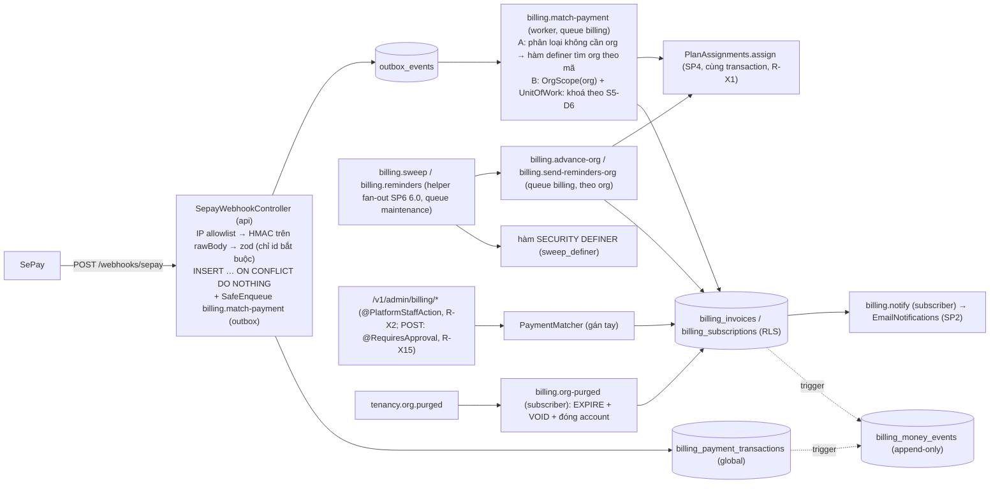

# Sub-project 5 — Billing SePay

- **Ngày:** 2026-09-28.
- **Trạng thái:** Bản thiết kế **r2, đã chốt 2026-09-29** (controller chốt theo uỷ quyền "tự chốt, tự làm hết"; các giả định chưa chạy được kiểm bằng spike ở đầu plan tương ứng). Sếp đã giao toàn quyền quyết định kỹ thuật ("tự chốt, tự làm hết"). Mục 2 ghi mọi quyết định em tự chốt. Mục 3 là ba điểm có hệ quả pháp lý/tiền; controller đã chốt theo mặc định bảo thủ (rulings 2026-09-28), vẫn báo Sếp. Mục 21 là revision log r1, mục 22 là revision log r2. Chỗ đổi ở r2 đánh dấu **(r2)**.
- **Spec cha:** `docs/superpowers/specs/2026-09-24-saas-core-architecture-design.md`. Phụ lục A (A.1 quy tắc nghiệp vụ, A.2 hợp đồng webhook, A.3 phạm vi) là ràng buộc. Chỗ nào spec này lệch spec cha thì ghi ở mục 18.
- **Nền tảng:**
  - SP1 (core), SP2 (identity, `EmailNotifications`, `email_deliveries`).
  - SP3 **r8 đã commit** `docs/superpowers/specs/2026-09-28-sp3-tenancy-access-design.md` (trích "SP3 §n", per R-X11): `OrgScope`, `app_current_org()`, pipeline `/v1/orgs/{orgId}/…`, catalogue quyền qua marker Discovery, `OrgActivityGate`/`onInactiveOrg`, event `tenancy.org.purged`, bảng tra cứu `email_templates`, mẫu migration chia theo plan.
  - SP4 Entitlements: `PlanAssignments.assign`, `PlanAssignments.defaultPlanKey()`, bảng `plans`, lớp lỗi có tên `UnknownPlanError` và `EntitlementsRowMissingError` export ở `index.ts` (SP4 §6.4, §7.2, §10), theo hợp đồng R-X1 và R-X19.
  - SP6 plan 6.0 (core): role `sweep_definer`, helper `defineOrgSweep` + `OrgSweepRunner` (hàm SQL chữ ký cố định `(after, limit)` + tham số phụ theo tên, R-X14), cờ event `audit`/`webhook` bắt buộc, hằng `DEFINER_LIMIT_MAX` (R-X3, R-X4).
  - **(r2)** SP6 plan 6D: `@RequiresApproval()` + `ApprovalGuard` của identity (R-X15).
  - **(r2)** SP7 plan 7A/7B: `markModuleLoaded`, `MODULE_REQUIRES`, `BOILERPLATE_MODULES`, metadata `.meta({ secret })` + `pnpm chart:secrets` (R-X16).
  - Identity/tenancy 3D: decorator `@PlatformStaffAction()` (R-X2).
- **Phán quyết xuyên SP áp dụng:** `.superpowers/autonomous/rulings.md` R-X1…R-X7, R-X11, **(r2)** R-X14, R-X15, R-X16, R-X18, R-X19. Chỗ nào dựa vào phía SP khác thì ghi mã phán quyết.
- **Quyết định của Sếp được giữ:** đối soát với SePay qua API **chỉ là TODO trong code**, không xây (A.3).
- **Tài liệu SePay** đối chiếu ngày **2026-09-28** (mục 11.1): `developer.sepay.vn/en/sepay-webhooks/xac-thuc`, `/vi/sepay-webhooks/xac-thuc`, `/vi/sepay-webhooks/bao-mat`, `/vi/sepay-webhooks/tong-quan`, `/vi/sepay-webhooks/tich-hop-webhook`, `/vi/sepay-webhooks/cau-hinh-ma-thanh-toan`, `/vi/dia-chi-ip`, `docs.sepay.vn/tao-qr-code-vietqr-dong.html`.
- **Ưu tiên:** đúng tiền và chống ghi có hai lần đứng trên mọi mục tiêu khác. Mọi bất biến tiền biểu diễn được ở DB thì nằm ở DB.

**Ký hiệu:** `S5-Dn` là quyết định kỹ thuật em tự chốt (mục 2). `S5-Qn` là điểm có hệ quả pháp lý/tiền (mục 3). `B-Rn` là race có tên (mục 12). `BT-*` là mã test (mục 15). `R-Xn` là phán quyết xuyên SP.

---

## 1. Mục tiêu và ngoài phạm vi

### 1.1 Mục tiêu (tiêu chí hoàn thành, mỗi dòng chứng minh bằng test trên hạ tầng thật)

1. **Không bao giờ ghi có hai lần.**
   - Một giao dịch ngân hàng (`provider`, `provider_txn_id`) được lưu đúng một lần và làm `PAID` tối đa một invoice.
   - Một invoice được trả bởi tối đa một giao dịch.
   - Cả hai bảo đảm nằm ở DB (`UNIQUE`), không chỉ ở app.
   - Test: cùng webhook gửi song song ×50; hai giao dịch khác nhau trả cùng invoice song song ×50; admin gán tay đua với job khớp tự động ×50 (mục 12).
2. **Webhook xác thực trước khi lưu, và webhook đã xác thực không bao giờ bị mất.**
   - Chữ ký HMAC-SHA256 sai, thiếu, sai định dạng, hoặc timestamp lệch quá cửa sổ → `401`, không ghi dòng nào.
   - IP ngoài allowlist → `403`.
   - Giao dịch trùng → `200 {"success": true}`, không có tác dụng phụ.
   - Webhook **đã qua chữ ký** và có `id` hợp lệ **luôn** được lưu, dù các trường khác sai định dạng: trường lỗi thành `NULL`, giao dịch vào `NEEDS_REVIEW` với lý do có tên (mục 8.1, BT-U7).
3. **Khớp đúng hoặc chuyển người xem.**
   - Điều kiện khớp: mã thanh toán hợp lệ, đúng số tiền, invoice `OPEN`, giao dịch trước hạn, account của org chưa đóng.
   - Khi khớp: giao dịch → `MATCHED`, invoice → `PAID`, trong cùng transaction với việc chuyển trạng thái subscription và gán gói (khi kỳ đã trả bắt đầu ngay lúc đó).
   - Mọi trường hợp khác → `NEEDS_REVIEW` với lý do có tên, và admin nền tảng được báo.
   - Gán gói bị SP4 từ chối **không** làm mất ghi nhận tiền: invoice vẫn `PAID`, event cảnh báo có audit (R-X1).
   - **(r2)** Kết quả khớp và kết quả gán tay chỉ phụ thuộc dữ liệu đã ký (`bank_transaction_at`, số tiền, mã) và trạng thái nghiệp vụ của invoice. Chúng **không** phụ thuộc việc sweep đã chạy hay chưa (mục 7.3).
4. **Thao tác tay có kiểm soát.**
   - Ba thao tác (gán / đã hoàn tiền / bỏ qua) chỉ chạy từ `NEEDS_REVIEW`.
   - Đòi `@PlatformStaffAction()` (R-X2) và **(r2)** `@RequiresApproval()` (R-X15). Khi dự án bật `ADMIN_DUAL_CONTROL=on`, mỗi thao tác cần phê duyệt của người thứ hai.
   - Sổ tiền được ghi trong **cùng** transaction, bằng trigger DB (mục 5.7).
5. **State machine vét cạn.**
   - Subscription, invoice và giao dịch là enum + hàm chuyển trạng thái `switch` có kiểm `never`.
   - Unit test mọi cặp (trạng thái × sự kiện).
   - DB chặn chuyển trạng thái không hợp lệ của invoice và giao dịch bằng trigger.
6. **Vòng đời gia hạn tự chạy.**
   - Invoice gia hạn được tạo trước hạn `BILLING_RENEWAL_LEAD_SEC`, và nhắc theo lịch.
   - Quá hạn → `PAST_DUE`. Hết ân hạn → `EXPIRED` + gói mặc định của SP4.
   - Giá mới có hiệu lực đúng lúc kỳ mới bắt đầu (bước `PERIOD_STARTED`, R-X1).
   - **(r2)** Billing gọi `assign` ở **mọi** lần một kỳ đã trả bắt đầu, kể cả gia hạn cùng gói (R-X18). Cùng gói, cùng nguồn `BILLING`, cùng `ref` (subscription) thì SP4 trả `UNCHANGED`.
   - Cron chạy trùng hay chạy trễ đều idempotent.
7. **Cô lập tenant.**
   - Mọi bảng billing có `org_id` bật RLS + FORCE với policy `app_current_org()`.
   - Test catalog của SP3 xanh.
   - Member org A không thấy invoice org B (`404`).
8. **Sổ tiền append-only, đầy đủ nhờ DB.**
   - Mọi `INSERT` và mọi đổi `status` của invoice và giao dịch tự sinh đúng một dòng `billing_money_events` bằng trigger.
   - **(r2)** Dòng sổ chỉ được ghi bởi hàm trigger `SECURITY DEFINER` do role hẹp `billing_ledger_writer` sở hữu. Mọi role ứng dụng (`app_user`, `app_relay`, `auth_user`) **không có** quyền `INSERT` trên sổ và không có `EXECUTE` trên hàm ghi sổ. `app_owner` thuộc lớp "credential DB", ngoài phạm vi (mục 11.3).
   - Không role ứng dụng nào đặt được `created_at`.
   - Trigger chặn `UPDATE`/`DELETE`/`TRUNCATE`. Không FK nào `CASCADE`.
   - Không bảng tiền nào bị xoá khi org bị xoá cứng (R-X5). **(r2)** Account của org đã purge bị **đóng vĩnh viễn**: không subscription nào sống lại và không invoice nào được phát hay được trả thêm (mục 8.6).
9. **Không PII trong log/metric/span.** Nội dung chuyển khoản và payload thô chỉ nằm trong DB dưới dạng mã hoá `FieldCipher`.
10. **Pipeline xanh ở từng plan** như SP3:
    - lint, type-check, unit, integration;
    - migration up → down → up + sweep S2-R57;
    - `oasdiff` chỉ thêm, luật kiến trúc;
    - prod-like trên image thật với compose `--profile app` và `NODE_ENV=production`;
    - e2e HTTP.

    E2E cuối SP5: đăng ký → tạo org → checkout → webhook SePay (payload mẫu ký bằng secret test) → invoice `PAID` → `org_entitlements` của org chuyển sang gói của giá (SP4 thật).

### 1.2 Trong phạm vi
- `src/modules/billing` (mới).
- Migration `src/migrations/billing/`, và dòng template trong `src/migrations/notifications/`.
- Bốn template email.
- Thay đổi nhỏ ở tenancy: hai export (mục 6.8).
- ADR **0019** (mới, R-X6).
- Sửa spec cha.
- **(r2)** `docker/postgres/init/01-roles.sh` thêm đúng một role: `billing_ledger_writer` (S5-D30). Lý do: đây là role **ghi** hẹp, khác mục đích với `sweep_definer` chỉ đọc. R-X4 cho phép billing có role riêng khi có lý do ngoài sweep. `sweep_definer` vẫn do SP6 6.0 tạo.
- **(r2)** Nghĩa vụ composition của SP7 (R-X16), mục 6.9.

### 1.3 Ngoài phạm vi
- **Đối soát qua API SePay:** port `PaymentReconciler` + adapter SePay ném `NotImplementedError`, có `// TODO(SP5-reconcile)` chỉ vào A.3. Không có cron (mục 9.7).
- Tài khoản ảo (VA, `subAccount`), cổng checkout/IPN của SePay: TODO trong code (A.3).
- **Hoàn tiền:**
  - Không có hoàn tiền tự động.
  - Không có hoàn tiền cho giao dịch đã `MATCHED`.
  - Hoàn tiền là việc làm tay ở ngân hàng; hệ thống chỉ ghi nhận `REFUNDED` cho giao dịch `NEEDS_REVIEW`.
- **Trả chia nhiều lần** cho một invoice: không hỗ trợ (giới hạn có chủ đích, mục 17).
- Proration khi đổi gói (S5-Q2), giảm giá, coupon, thuế, **hoá đơn GTGT/hoá đơn điện tử** (S5-Q3).
- Nhiều tiền tệ: chỉ VND.
- Đối soát tổng hợp, báo cáo doanh thu, xuất kế toán.
- **Audit tổng quát** thuộc SP6. Billing đặt cờ `audit: true` trên mọi event (R-X3). Billing có sổ tiền riêng vì A.1 đòi ghi **cùng transaction**.
- **Cơ chế phê duyệt hai người**: SP6 6D sở hữu `@RequiresApproval()`, bảng `admin_approvals` và `ApprovalGuard`. **(r2)** SP5 sở hữu việc **gắn** decorator lên ba route tiền tay (R-X15, mục 9.3). SP5 không tự dựng cơ chế riêng.

---

## 2. Quyết định em tự chốt

| # | Quyết định | Lý do (một dòng) | Phương án đã loại |
|---|---|---|---|
| S5-D1 | Giao dịch ngân hàng (`billing_payment_transactions`) là bảng **global**, không `org_id` | Lúc nhận webhook chưa biết org; giao dịch lệch có thể không bao giờ thuộc org nào | Bảng tenant với `org_id NULL` (RLS không so được NULL, phá mẫu fail-closed) |
| S5-D2 | "Bản ghi gán" của A.1 là cột `billing_invoices.payment_transaction_id UNIQUE`; `status = 'PAID'` ⇔ cột khác NULL bằng `CHECK` | Bất biến "PAID khi và chỉ khi có đúng một giao dịch" thành `CHECK` + `UNIQUE` | Bảng `invoice_payments` riêng (thêm bảng + trigger hoãn cho cùng bất biến) |
| S5-D3 | **(r1)** Hàm **đọc** `SECURITY DEFINER` của billing do role `sweep_definer` của SP6 6.0 sở hữu (R-X4). **Không** tạo `billing_definer` cho việc đọc. **(r2)** Hàm **ghi** sổ tiền do `billing_ledger_writer` sở hữu (S5-D30) | Cả ba hàm đọc đều là đọc xuyên org chỉ trả `org_id`, cùng dạng quyền với hàm sweep | `billing_definer` riêng cho đọc (thêm role mà không hẹp quyền hơn) |
| S5-D4 | Bảng billing **không** có FK `org_id → organizations`; xoá cứng org **không** xoá dữ liệu billing, và billing **không** là participant purge (R-X5) | Không bao giờ CASCADE hay xoá bảng tiền. Mã thanh toán phải duy nhất vĩnh viễn (A.1). Thời hạn lưu theo S5-Q1 (giữ vĩnh viễn) | FK `RESTRICT` + participant xoá (mất chứng từ); participant trong transaction purge (chu trình khoá với SP4, mục 12 B-R14) |
| S5-D5 | Bảng `billing_accounts (org_id PK)` là điểm tuần tự hoá mọi mutation billing của một org, và giữ `plan_assignment_seq` (R-X1). **(r2)** Nó cũng giữ trạng thái đóng (`closed_at`, `closed_reason`), được kiểm dưới chính khoá đó | Có thao tác chưa có subscription để khoá (checkout đầu, dùng thử). Billing không được chạm `organizations` của tenancy. Dãy số gán gói và trạng thái đóng phải được đọc dưới cùng khoá | Khoá dòng `organizations`; advisory lock (SP3 §6.2 đã loại); suy "org đã purge" từ `organizations` (billing không đọc bảng tenancy, và dòng đã bị xoá) |
| S5-D6 | **(r1)** Thứ tự khoá cố định toàn billing: `billing_payment_transactions` → `billing_accounts` → `billing_subscriptions` → `billing_invoices` → (`org_entitlements`, qua `PlanAssignments.assign`). Mọi khoá dòng là `FOR NO KEY UPDATE`. Billing **không bao giờ** khoá `organizations`; transaction purge **không bao giờ** chạm bảng billing | Một thứ tự duy nhất chặn deadlock giữa job khớp, admin gán, cron, route; khớp đuôi thứ tự của SP4 §3.6 (`organizations → org_entitlements → usage_counters`) mà không tạo cạnh ngược | `FOR UPDATE` như chữ của A.1 (chặn INSERT con có FK; mục 18) |
| S5-D7 | **(r2)** Subscription lưu `current_period_end` = "đã trả tới", `price_id` = giá **đang có hiệu lực**, `next_price_id` = giá của kỳ kế tiếp khi khác `price_id`, và `pending_period_start_at` = mốc bắt đầu của **kỳ đã trả mà chưa bắt đầu** (chưa gọi `assign`). Giá kế tiếp có hiệu lực từ `COALESCE(pending_period_start_at, current_period_end)`. Kỳ đã bán nằm ở invoice | R-X18 đòi gọi `assign` ở **mọi** mốc bắt đầu kỳ đã trả, kể cả gia hạn cùng giá. Mốc đó phải lưu vì trả sớm dời `current_period_end`. Một cột mốc chung thay cho `next_price_starts_at` của r1, vì r1 chỉ ghi mốc khi giá đổi. Mốc hiệu lực của giá kế tiếp suy ra được, nên không lưu riêng (3NF) | r1: `next_price_starts_at` (không có mốc cho gia hạn cùng giá, X2-6/M4); thêm cột thứ hai "mốc kỳ đã trả" cạnh `next_price_starts_at` (một giá trị suy ra từ cột kia, phi 3NF); cờ "kỳ sau đã trả" (cờ rời, dễ lệch) |
| S5-D8 | Tính kỳ bằng Postgres (`AT TIME ZONE` + `make_interval(months => n)`), neo theo `anchor_at` (không cộng dồn). **(r1)** Neo đổi sang `period_start` ngay lúc phát hành invoice khi `period_months` đổi | Postgres có sẵn phép cộng tháng có kẹp cuối tháng theo múi giờ; mốc lấy từ DB | `date-fns` 4.4.0 + `@date-fns/tz` 1.5.0 (10,9 MB unpacked, đồng hồ thứ hai); tự viết cộng tháng trong TS |
| S5-D9 | Damm check digit tự viết (bảng 10×10, khoảng 15 dòng) | npm chỉ có `damm@0.0.1` (2022, không bảo trì); Luhn không bắt mọi lỗi đổi chỗ hai chữ số liền nhau | Package `damm`; Luhn mod 10 |
| S5-D10 | Mã thanh toán = `BILLING_PAYMENT_CODE_PREFIX` (2–5 chữ in hoa) + hậu tố `BILLING_PAYMENT_CODE_SUFFIX_LENGTH` chữ số (mặc định 10 = 9 số CSPRNG + 1 số Damm) | Khớp luật mã của SePay (tiền tố 2–5 chữ, hậu tố 1–10 ký tự), nên SePay tự điền `code`. Chỉ chữ số nên không lẫn `O/0`, `I/1` | Base32; mã có dấu gạch |
| S5-D11 | Khớp tự động chỉ khi **đúng bằng** số tiền; thừa tiền cũng vào `NEEDS_REVIEW` | A.1 "thừa tiền → NEEDS_REVIEW"; gán tay mới nhận `amount ≥ invoice` | Tự khớp khi thừa |
| S5-D12 | **(r1)** Trả đúng hạn xét theo **giờ ngân hàng** (`transactionDate`): tự khớp khi `bank_transaction_at < invoice.expires_at` và invoice còn `OPEN`. Cron chỉ đóng invoice sau `expires_at + BILLING_EXPIRY_SETTLE_SEC`, với `settle` mặc định **6 h** (≥ cửa sổ retry 5 h tài liệu SePay nêu). Webhook tới sau cả cửa sổ đó mà giờ ngân hàng vẫn trước hạn → lý do riêng `INVOICE_EXPIRED_PAID_IN_TIME`, và admin **khôi phục** được (cạnh `EXPIRED → PAID`, mục 7). **(r2)** Khoảng `[expires_at, expires_at + settle)` chỉ để **nhận** khoản đã trả đúng hạn; nó không phải thời gian được trả thêm. API và thư ngừng đưa hướng dẫn trả khi `now() >= expires_at` (trường suy ra `payable`). Khoản trả với `bank_transaction_at >= expires_at` **không bao giờ** gán được vào invoice đó, dù invoice còn `OPEN` hay đã `EXPIRED` | Khách trả trước hạn không bị phạt vì độ trễ webhook. Kết quả (cả tự khớp lẫn gán tay) tất định theo dữ liệu đã ký, không theo lúc sweep chạy. Đường tay phủ phần đuôi (gửi lại tay từ dashboard) | Xét theo giờ xử lý; `settle` 30 phút của r0 (ngắn hơn cửa sổ retry, SP5-I1); r1 cho gán tay khoản trễ khi invoice còn `OPEN` (kết quả đổi theo lúc sweep chạy, SP5-R2-I2) |
| S5-D13 | Đổi gói có hiệu lực từ kỳ kế tiếp, không proration (S5-Q2 theo ruling) | Không tự đặt quy tắc tính tiền không có nguồn | Proration theo ngày; đổi ngay trả nguyên giá |
| S5-D14 | Mua lần đầu trong lúc dùng thử: kỳ trả tiền bắt đầu **lúc ghi nhận trả** (thời gian dùng thử còn lại không cộng dồn) | Đúng A.1 "kỳ mới tính từ lúc trả" cho mua mới | Kỳ bắt đầu lúc hết dùng thử |
| S5-D15 | Dùng thử tắt mặc định (`BILLING_TRIAL_SEC = 0`); bật thì mỗi org **một lần** (partial unique) | Chính sách dùng thử là quyết định sản phẩm của dự án | Tự dùng thử khi tạo org |
| S5-D16 | **(r1)** Cron billing dùng **helper fan-out dùng chung** của SP6 6.0 (R-X4): `billing.sweep` (15 phút) → job `billing.advance-org` theo org; `billing.reminders` (09:00) → job `billing.send-reminders-org` theo org. Cron thứ ba `billing.rematch-stale` (không theo org) enqueue lại giao dịch kẹt. Job theo org làm **mọi** chuyển trạng thái đã tới hạn. **(r2)** Hàm definer theo đúng chữ ký của helper: `(p_after uuid, p_limit integer, …)`; tham số phụ là `integer` giây, truyền theo tên (R-X14) | Một cơ chế quét cho cả hệ thống (một kiểu `jobId`, một vòng keyset). Job "đưa org về hiện tại" tự chữa khi cron lỡ nhịp. Tham số `integer` không cần ép kiểu ngầm từ literal không kiểu | Vòng keyset tự viết (r0: bản sao thứ tư của cùng cơ chế); năm cron riêng như spec cha; callback TS `(after, limit)` (r1, helper không có, X2-2); tham số `interval` (chỉ chạy nhờ ép kiểu ngầm) |
| S5-D17 | Webhook dùng `jsonBodyParser` của core (đã đặt `req.rawBody`, `core/http/json-body-parser.ts:142`); chữ ký tính trên `rawBody` | Core đã đọc body có giới hạn và giữ nguyên byte | Tự đọc body cho `/webhooks/*` (đổi hợp đồng một-chủ của `HTTP_BODY_PARSER_SKIP_PREFIX`) |
| S5-D18 | Không lưu giao dịch `transferType = 'out'` | Hoàn tiền tay đi ra từ tài khoản này; lưu không phục vụ query nào | Lưu với trạng thái `IGNORED` |
| S5-D19 | Payload thô (`raw_payload_enc`) lưu mã hoá `FieldCipher` cùng các cột đã tách | Giữ bằng chứng đã ký mà không để nội dung chuyển khoản ở dạng rõ | Chỉ lưu cột tách; lưu JSON rõ |
| S5-D20 | Hai secret webhook (`…_SECRET`, `…_SECRET_PREVIOUS`) | Xoay secret không mất webhook | Một secret |
| S5-D21 | Người nhận thư billing = mọi owner của org, qua port mới của tenancy | Owner là người duy nhất trả tiền được (`billing.write` `ownerOnly`) | Bảng `org_billing_contacts` (YAGNI) |
| S5-D22 | Invoice không lưu số tiền; số tiền lấy từ `billing_prices` (dòng giá bất biến) | 3NF | Cột `amount_vnd` trên invoice |
| S5-D23 | **(r1)** Dòng giá do migration **của dự án** chèn; upstream **không** ship dòng giá nào (kể cả vào `src/migrations/app/`). Test và smoke seed giá bằng fixture | Giá là cấu hình sản phẩm có review. Upstream không ghi vào vùng dự án (SP7 UP-9) | Route admin CRUD giá; migration giá mẫu trong `app/` (vi phạm vùng) |
| S5-D24 | **(r1)** Cổng quyền cho route admin billing là `@PlatformStaffAction()` do identity/tenancy sở hữu, ship ở 3D (R-X2). SP5 chỉ dùng, không định nghĩa. **(r2)** Ba route POST tiền tay mang thêm `@RequiresApproval()` của SP6 6D (R-X15) | Một decorator cho một bất biến (TOTP tươi), gồm audit truy cập admin. Thao tác chuyển tiền giữa các invoice phải chịu cùng kiểm soát hai người như thao tác admin nguy hiểm khác | Decorator riêng của SP5 (r0: ba bản khác nhau giữa SP4/SP5/SP6); r1 không gắn `@RequiresApproval()` (thao tác tiền tay chỉ cần một người khi dự án bật phê duyệt hai người, X2-3) |
| S5-D25 | QR: trả URL ảnh VietQR động của SePay dựng từ config | Không thêm dependency | Sinh EMVCo + ảnh ở server |
| S5-D26 | Không thêm package npm nào | Đủ bằng `node:crypto`, zod, Postgres | — |
| S5-D27 | **(r1)** Sổ tiền do **trigger DB** ghi. Actor lấy từ `set_config('app.billing_actor_*', …, true)` mà repository đặt đầu transaction; thiếu → `RAISE`. **(r2)** Hàm trigger ghi sổ là `SECURITY DEFINER` do `billing_ledger_writer` sở hữu; role ứng dụng không có `INSERT` trên sổ. Guard `pg_trigger_depth() >= 2` giữ làm lớp phụ | "Mọi chuyển trạng thái có dòng sổ" thành bất biến DB, kể cả SQL tay và migration dữ liệu. Không lùi ngày được. Bất biến "chỉ trigger ghi sổ" nằm ở **quyền**, không dựa vào việc `app_user` thiếu `TEMPORARY` (SP5-R2-M3) | Method `transitionWithLedger` chỉ ở app (r0, SP5-I4); r1: `app_user` có `INSERT` theo cột + guard độ sâu (đứng vững chỉ nhờ quyền nền tảng không ghi ra); constraint trigger hoãn đếm dòng sổ (phức tạp hơn, vẫn cho app tự chèn dòng giả) |
| S5-D28 | **(r1)** Gọi `PlanAssignments.assign` **đồng bộ trong transaction billing** (R-X1), `switch` vét cạn trên bốn kết quả. Kết quả từ chối và lỗi có tên của SP4 **không** rollback tiền. **(r2)** Chỉ bắt đúng hai lớp lỗi SP4 export: `UnknownPlanError`, `EntitlementsRowMissingError` (R-X19) | Tiền và gói nhất quán nguyên tử; thứ tự lệnh gán được tuần tự hoá bởi khoá `billing_accounts`. Ghi nhận tiền không phụ thuộc gán gói thành công | Subscriber gán gói (nhất quán sau, phải tự xử lý thứ tự event); rollback cả transaction khi SP4 lỗi (r0: tiền không được ghi nhận) |
| S5-D29 | **(r1)** Xoá cứng org: subscriber `billing.org-purged` (event `tenancy.org.purged`) **sau** commit purge chuyển subscription sống → `EXPIRED ORG_PURGED` và invoice `OPEN` → `VOID ORG_PURGED`. Không xoá gì, không gọi `assign` (R-X5). **(r2)** Subscriber **luôn** upsert rồi **đóng** account (`closed_at`, `closed_reason = 'ORG_PURGED'`). Đóng là vĩnh viễn và được kiểm ở app (sau khoá account) lẫn ở DB (trigger) | Billing ra khỏi transaction purge, nên không có chu trình khoá với participant SP4. `tenancy.org.purged` tới subscriber cả khi org đã mất (SP3 §9.4, T-34). Đóng account chặn mọi đường làm sống lại subscription của tenant đã mất, kể cả đường khôi phục (SP5-R2-I1). Upsert kể cả khi chưa có dòng, để một transaction billing đang chạy dở không để lại invoice mở sau subscriber | Participant `billing.close` trong transaction purge (r0; deadlock SP5-I5); r1: chỉ đổi trạng thái dòng đang sống (khôi phục invoice `EXPIRED` vẫn tạo subscription sống cho org đã mất) |
| S5-D30 | **(r2)** Role `billing_ledger_writer NOLOGIN NOBYPASSRLS`; `GRANT billing_ledger_writer TO app_owner WITH INHERIT FALSE, SET TRUE`; quyền duy nhất là `USAGE, CREATE ON SCHEMA public` (để tạo hàm dưới `SET LOCAL ROLE`, cùng mẫu `tenancy_definer` của SP3 T2) và `INSERT` theo cột trên `billing_money_events` | Chủ hàm ghi sổ phải là role hẹp. SP3 T2 đã loại hàm definer do `app_owner` sở hữu, và test catalog SP3 đòi owner của mọi hàm definer là role riêng. `sweep_definer` chỉ đọc nên không dùng được | Owner `app_owner` (trái SP3 T2 và test catalog); giữ `INSERT` của `app_user` + ghi phụ thuộc vào quyền nền tảng (phương án (b) của SP5-R2-M3, bất biến vẫn nằm ngoài spec billing) |

---

## 3. Điểm pháp lý/tiền (đã chốt mặc định theo rulings 2026-09-28, vẫn báo Sếp)

| # | Câu hỏi | Mặc định đang áp (Sếp có thể đổi) |
|---|---|---|
| S5-Q1 | **Thời hạn lưu dữ liệu tiền sau khi org bị xoá cứng.** | **Giữ vĩnh viễn**, không tự xoá (S5-D4). Nếu pháp chế chốt thời hạn N năm: thêm cron xoá theo thời hạn ở SP sau, cùng bảng "mã đã phát" global giữ lại (mục 17). |
| S5-Q2 | **Đổi gói giữa kỳ.** | Mọi đổi gói có hiệu lực **từ kỳ kế tiếp**, không proration (S5-D13). |
| S5-Q3 | **"Invoice" của SP5 không phải hoá đơn GTGT/hoá đơn điện tử.** | API và thư gọi là "yêu cầu thanh toán" trong văn bản hiển thị (field vẫn là `invoice`). README ghi rõ không phải hoá đơn thuế. Tích hợp hoá đơn điện tử ngoài phạm vi; dự án tự làm qua event `billing.invoice.paid`. |

Không có điểm pháp lý/tiền mới nào ở r1 chờ Sếp (mục 21.4). **(r2)** Cũng không có điểm mới ở r2 (mục 22.5): mọi thay đổi tiền ở r2 đều thu hẹp (từ chối nhận tự động/gán tay một khoản trả trễ, đóng account sau purge), và hệ quả với khách đi qua đường hoàn tay đã có của A.1.

---

## 4. Kiến trúc và ranh giới module

### 4.1 Vị trí và luồng

```
src/modules/billing/
  index.ts · billing.module.ts · billing.config.ts · errors.ts · events.ts · jobs.ts
  domain/        money.ts (Money VND bigint) · payment-code.ts (sinh, Damm, dò trong nội dung)
                 subscription.ts · invoice.ts · payment-transaction.ts (state machine, switch vét cạn)
                 billing-period.ts (kiểu kỳ; phép tính nằm ở SQL, S5-D8)
                 plan-assignment-outcome.ts (switch vét cạn trên kết quả SP4, mục 6.6)
  application/   checkout.service.ts · trial.service.ts · subscription.service.ts (cancel/resume/change)
                 payment-matcher.ts (dùng chung cho job khớp và admin gán) · review.service.ts
                 plan-sync.ts (gọi PlanAssignments.assign + tăng plan_assignment_seq, mục 6.6)
                 advance-org.handler.ts · reminders-org.handler.ts · rematch-stale.handler.ts
                 match-payment.handler.ts · notify.subscriber.ts · org-purged.subscriber.ts
                 price-catalog-check.ts
  ports/         billing-repository.ts · payment-transaction-repository.ts
                 billing-actor.ts (đặt GUC actor cho trigger sổ tiền, mục 5.7)
                 billing-scan.ts (hàm definer) · payment-reconciler.ts (TODO)
  http/          sepay-webhook.controller.ts · sepay-signature.ts · billing.controller.ts (tenant)
                 billing-admin.controller.ts (nền tảng) · prices.controller.ts · schemas.ts
  infra/sql/     sql-*.repository.ts (Db.execute trên EM đang gắn; không import @mikro-orm ngoài infra)
  infra/sepay/   sepay-payload.ts (zod) · sepay-reconciler.ts (NotImplementedError, TODO) · qr-url.ts
src/migrations/billing/ · src/migrations/notifications/ (dòng template)
```

**Hướng phụ thuộc:**
- `billing → tenancy (index)`, `billing → identity (index)`, `billing → notifications (index)`, `billing → entitlements (index)`, `→ core`. **(r2)** Cùng tập này là dòng `MODULE_REQUIRES` của billing (mục 6.9).
- Hướng `billing → entitlements` gọi `PlanAssignments` do SP4 sở hữu (R-X1). Entitlements không import billing.
- Không module nào import billing, trừ `features/` qua `billing/index.ts` (event, type).
- Controller mỏng: parse → service → `serialize`.



### 4.2 Thứ tự pipeline HTTP
- **Route tenant `/v1/orgs/{orgId}/billing/…`:** đúng pipeline SP3 §7.1:
  1. `OrgContextMiddleware`;
  2. AuthGuard/Throttler;
  3. `PoliciesGuard` với `TenancyPermissions.require('billing.read' | 'billing.write')`;
  4. `OrgScopeInterceptor`;
  5. `IdempotencyInterceptor`.

  `EntitlementInterceptor` route-scoped của SP4 (S4-D7) **không** gắn lên route billing: tính năng thanh toán không phụ thuộc gói.
- **Route nền tảng `/v1/admin/billing/…`:** ngoài path org (matcher SP3 §7.4 phân loại `OTHER`), có `@PlatformStaffAction()` (R-X2, kèm audit truy cập admin qua port). **(r2)** Ba route POST có thêm `@RequiresApproval()`: `ApprovalGuard` chạy sau guard của `@PlatformStaffAction()` và trước `IdempotencyInterceptor` (SP6 §8.4). Handler tự mở `OrgScope` sau khi hàm definer trả org. Đây là cùng ngoại lệ có tên với S6-A39 của SP6: nhân viên nền tảng mở `OrgScope` không qua membership, có audit trước handler.
- **Webhook `/webhooks/sepay`:** `@PublicRoute()`, `@SkipRateLimit()` (export sẵn của `core/http`, `index.ts:43`), không `@Idempotent()`. Không có credential, nên `PrincipalMiddleware` cho `ANONYMOUS` và không kiểm CSRF.

---

## 5. Mô hình dữ liệu

### 5.1 Quy ước
- **Theo SP3 §6.1:**
  - `BIGINT GENERATED ALWAYS AS IDENTITY` + `public_id UUID NOT NULL DEFAULT uuidv7()` cho bảng có định danh ra ngoài;
  - `TIMESTAMPTZ`; enum là `TEXT` + `CHECK`;
  - `created_at`, `updated_at NOT NULL DEFAULT now()`;
  - aggregate đổi được có `version INT NOT NULL DEFAULT 1 CHECK (version >= 1)`;
  - repository đặt `updated_at = now()`, `version = version + 1` ở mọi `UPDATE`.
- **Bảng tenant:**
  - `org_id UUID NOT NULL`, `ENABLE` + `FORCE ROW LEVEL SECURITY`;
  - policy `<bảng>_tenant TO app_user USING (org_id = app_current_org()) WITH CHECK (org_id = app_current_org())`;
  - `UNIQUE (org_id, id)` khi có con, và FK kép tới cha trong billing;
  - bảng nào `sweep_definer` phải đọc thì có thêm policy `<bảng>_definer_read FOR SELECT TO sweep_definer USING (true)` và grant `SELECT` theo cột (hậu tố `_definer_read` thống nhất với SP3, X-4).
- **Không FK `org_id → organizations`** (S5-D4). Đây là ngoại lệ có tên với amendment B5 của SP3 (mục 18). `org_id` vẫn luôn là một org từng tồn tại: `WITH CHECK` chỉ cho ghi dưới `OrgScope` của org đó.
- **Tiền:** `BIGINT` VND, `CHECK (> 0 AND <= 9007199254740991)`. Hằng `MAX_SAFE_VND` dùng chung cho zod và `CHECK`.
- `app_user` **không có `DELETE`** trên bất kỳ bảng billing nào. Không có FK `CASCADE` nào trong billing.
- **Grant theo cột** cho mọi `UPDATE` và mọi `INSERT`. Cột trạng thái có mặc định (`status` của invoice và giao dịch) **không** có grant `INSERT`, nên dòng mới luôn ở trạng thái đầu. Cột snapshot không có grant `UPDATE`.

### 5.2 `billing_prices` (global, catalogue giá)

| Cột | Kiểu | Ràng buộc |
|---|---|---|
| `id` | `BIGINT` identity | PK |
| `public_id` | `UUID` | `UNIQUE` |
| `key` | `TEXT NOT NULL` | `UNIQUE`; `CHECK (key ~ '^[a-z][a-z0-9-]{1,63}$')` (ví dụ `pro-monthly-2026`) |
| `plan_id` | `BIGINT NOT NULL` | **(r1)** `REFERENCES plans(id) ON DELETE RESTRICT` (bảng `plans` của SP4 §7.2, R-X1) |
| `amount_vnd` | `BIGINT NOT NULL` | `CHECK (amount_vnd > 0 AND amount_vnd <= 9007199254740991)` |
| `period_months` | `INT NOT NULL` | `CHECK (period_months BETWEEN 1 AND 36)` |
| `archived_at` | `TIMESTAMPTZ NULL` | giá đã lưu trữ không bán mới, invoice cũ vẫn trỏ tới |
| `created_at`, `updated_at` | | |

- **Quyền ghi:** chỉ migration (`app_owner`) ghi. `app_user` chỉ có `SELECT`.
- **RLS:** không có (bảng global). Thêm vào `GLOBAL_TABLES` của test catalog kèm lý do.
- **Trigger `billing_prices_immutable` (`BEFORE UPDATE`):**
  - chỉ cho đổi `archived_at` (từ `NULL` sang khác `NULL`) và `updated_at`;
  - mọi thay đổi khác → `RAISE … ERRCODE 'check_violation', CONSTRAINT 'billing_prices_immutable'`.
- **Index:**
  - `UNIQUE (key)` → tra giá ở checkout;
  - `UNIQUE (public_id)`;
  - `(plan_id)` → FK `RESTRICT` từ `plans`: SP4 xoá/đổi gói phải quét bảng này.
- `planKey` trong response lấy bằng join `plans.key` (`app_user` có `SELECT` trên `plans`, SP4 §7.2).

### 5.3 `billing_accounts` (tenant, điểm khoá theo org)

| Cột | Kiểu | Ràng buộc |
|---|---|---|
| `org_id` | `UUID` | PK |
| `plan_assignment_seq` | `BIGINT NOT NULL DEFAULT 0` | **(r1)** `CHECK (plan_assignment_seq >= 0)`; `sequence` cho `PlanAssignments.assign` (R-X1); không bao giờ đặt lại |
| `closed_at` | `TIMESTAMPTZ NULL` | **(r2)** lúc account bị đóng (org đã purge); `NULL` = đang mở |
| `closed_reason` | `TEXT NULL` | **(r2)** `CHECK (closed_reason IN ('ORG_PURGED'))`; `billing_accounts_closed_ck`: `(closed_at IS NULL) = (closed_reason IS NULL)` |
| `created_at`, `updated_at` | | |

- **Tạo lười:** `INSERT … ON CONFLICT (org_id) DO NOTHING` rồi `SELECT … FOR NO KEY UPDATE`, trong mọi mutation billing của org (race B-R6). Không thấy dòng sau upsert là lỗi lập trình (ném).
- **(r2) Kiểm đóng sau khoá.** Mọi mutation billing đọc `closed_at` trong **chính** câu `SELECT … FOR NO KEY UPDATE` đó. `closed_at IS NOT NULL` thì:
  - route tenant → `409 billing_account_closed` (thực tế không tới được: SP3 trả `404` cho org đã xoá mềm, và chỉ org đã xoá mềm mới bị purge);
  - khớp pha B → `NEEDS_REVIEW ORG_CLOSED` (mục 7.3);
  - gán tay → `409 billing_account_closed`;
  - `advance-org`, `send-reminders-org` → không làm gì (không còn gì sống).
- **(r2) Trigger `billing_accounts_close` (`BEFORE UPDATE OF closed_at, closed_reason`):**
  - `OLD.closed_at IS NOT NULL` và cột đổi → `RAISE … CONSTRAINT 'billing_accounts_closed_permanent'`. Đóng là vĩnh viễn.
  - Chuyển từ mở sang đóng mà org còn subscription sống hoặc invoice `OPEN` → `RAISE … CONSTRAINT 'billing_accounts_close_live'`. Hàm đọc hai bảng dưới quyền người gọi; subscriber luôn chạy trong `OrgScope` của org.
- **(r2) Chặn ở DB** (lớp cuối, cho cả SQL tay): hàm `billing_account_open_ck_fn` đọc `closed_at` của account (`SELECT … FOR SHARE`). Trên các đường đúng, transaction đã giữ khoá account nên câu này không chờ thêm; với SQL tay thiếu khoá, nó xếp hàng sau transaction đang đóng account. Account đóng → `RAISE … CONSTRAINT 'billing_account_closed'`. Hàm được gọi từ:
  - trigger `billing_subscriptions_account_open` (`BEFORE INSERT OR UPDATE OF status`, `WHEN (NEW.status IN ('TRIALING','ACTIVE','PAST_DUE','CANCELED'))`);
  - trigger `billing_invoices_account_open` (`BEFORE INSERT`);
  - `billing_invoices_transition_fn`, ở mọi cạnh vào `PAID` (gồm cạnh khôi phục `EXPIRED → PAID`).
- **Cấp số gán gói:** chỉ ngay trước mỗi lời gọi `assign`, bằng `UPDATE billing_accounts SET plan_assignment_seq = plan_assignment_seq + 1, updated_at = now() WHERE org_id = app_current_org() RETURNING plan_assignment_seq`.
  - Câu này chạy trên dòng đã khoá, cùng transaction, nên số tăng nghiêm ngặt theo org trên mọi transaction đã commit.
  - Rollback thì số cũng rollback.
  - Dòng account sống qua purge (S5-D4) và org id không bao giờ dùng lại, nên dãy không bao giờ lặp.
- **Grant `app_user`:** `SELECT`, `INSERT (org_id)`, `UPDATE (plan_assignment_seq, closed_at, closed_reason, updated_at)`. RLS như mục 5.1.

### 5.4 `billing_subscriptions` (tenant)

| Cột | Kiểu | Ràng buộc |
|---|---|---|
| `id` | `BIGINT` identity | PK |
| `public_id` | `UUID` | `UNIQUE (org_id, public_id)` |
| `org_id` | `UUID NOT NULL` | `REFERENCES billing_accounts(org_id) ON DELETE RESTRICT` |
| `origin` | `TEXT NOT NULL` | `CHECK (origin IN ('TRIAL','PURCHASE'))`; sự thật lúc tạo, bất biến |
| `status` | `TEXT NOT NULL` | `CHECK (status IN ('TRIALING','ACTIVE','PAST_DUE','CANCELED','EXPIRED'))` |
| `price_id` | `BIGINT NOT NULL` | `REFERENCES billing_prices(id) ON DELETE RESTRICT`; **giá đang có hiệu lực** (S5-D7) |
| `next_price_id` | `BIGINT NULL` | `REFERENCES billing_prices(id) ON DELETE RESTRICT`; `CHECK (next_price_id IS DISTINCT FROM price_id)`; có hiệu lực từ `COALESCE(pending_period_start_at, current_period_end)` |
| `pending_period_start_at` | `TIMESTAMPTZ NULL` | **(r2)** thay `next_price_starts_at` của r1. Mốc bắt đầu của kỳ **đã trả mà chưa bắt đầu** (chưa gọi `assign`, S5-D7). Đặt ở mọi `RENEWAL_PAID` và `LATE_RENEWAL_ASSIGNED`; về `NULL` ở bước `PERIOD_STARTED` |
| `anchor_at` | `TIMESTAMPTZ NOT NULL` | mốc neo tính kỳ của `price_id` (S5-D8) |
| `current_period_end` | `TIMESTAMPTZ NOT NULL` | "đã trả tới" (hoặc hết dùng thử), S5-D7 |
| `canceled_at` | `TIMESTAMPTZ NULL` | `CHECK ((status = 'CANCELED') = (canceled_at IS NOT NULL))` |
| `ended_at` | `TIMESTAMPTZ NULL` | `CHECK ((status = 'EXPIRED') = (ended_at IS NOT NULL))` |
| `end_reason` | `TEXT NULL` | `CHECK ((status = 'EXPIRED') = (end_reason IS NOT NULL))`; `CHECK (end_reason IN ('TRIAL_ENDED','GRACE_ENDED','CANCELED_PERIOD_ENDED','CANCELED_IMMEDIATELY','ORG_PURGED'))` |
| `version`, `created_at`, `updated_at` | | |

`CHECK` liên cột:
- `CHECK (status <> 'TRIALING' OR origin = 'TRIAL')`.
- `CHECK (current_period_end > anchor_at)`.
- **(r1)** `next_price_status_ck`: `next_price_id IS NULL OR status IN ('ACTIVE','PAST_DUE','CANCELED')`.
- **(r2)** `pending_status_ck`: `pending_period_start_at IS NULL OR status IN ('ACTIVE','CANCELED')`. `PAST_DUE` nghĩa là kỳ hiện tại chưa trả, nên không thể có kỳ trả trước chờ bắt đầu; `TRIALING`/`EXPIRED` cũng không.
- **(r2)** `pending_window_ck`: `pending_period_start_at IS NULL OR pending_period_start_at < current_period_end`. Kỳ chờ bắt đầu luôn nằm trong phần đã trả.
- **(r2)** `next_price_canceled_ck`: `status <> 'CANCELED' OR next_price_id IS NULL OR pending_period_start_at IS NOT NULL`. Subscription đã huỷ chỉ giữ đổi giá của kỳ đã trả.
- Cặp `next_price_pair_ck` và `next_price_window_ck` của r1 bị bỏ cùng cột `next_price_starts_at`.

Partial unique:
- `billing_subscriptions_live_uq (org_id) WHERE status IN ('TRIALING','ACTIVE','PAST_DUE','CANCELED')` → một subscription còn hiệu lực mỗi org (race B-R7).
- `billing_subscriptions_trial_uq (org_id) WHERE origin = 'TRIAL'` → dùng thử một lần mỗi org (race B-R12).

Còn lại:
- `UNIQUE (org_id, id)` cho FK kép từ invoice.
- **Trigger hoãn** `billing_subscriptions_past_due_ck` (`CONSTRAINT TRIGGER AFTER INSERT OR UPDATE OF status … DEFERRABLE INITIALLY DEFERRED`):
  - lúc commit, dòng `PAST_DUE` phải có đúng một invoice `RENEWAL` `OPEN` với `period_start = current_period_end`;
  - vi phạm → `RAISE … CONSTRAINT 'billing_subscriptions_past_due_ck'` (mẫu SP3 §3.4).
  - **(r2, SP5-R2-M5)** Bất biến này giờ được kiểm từ **cả hai phía**. Trigger hoãn thứ hai `billing_invoices_past_due_ck` nằm trên `billing_invoices` (mục 5.5) và gọi cùng hàm `billing_subscriptions_past_due_ck_fn` cho `subscription_id` của dòng invoice. Hàm đọc lại subscription lúc commit; subscription không còn `PAST_DUE` thì không có gì để kiểm.
- **(r2)** Trigger `billing_subscriptions_account_open` (mục 5.3).
- **Grant `app_user`:**
  - `SELECT`;
  - `INSERT (org_id, origin, status, price_id, anchor_at, current_period_end)`;
  - `UPDATE (status, price_id, next_price_id, pending_period_start_at, anchor_at, current_period_end, canceled_at, ended_at, end_reason, version, updated_at)`.
- **Grant `sweep_definer` (r1, SP5-M1; r2 đổi cột):** `SELECT (id, org_id, status, current_period_end, pending_period_start_at)`. `id` là cột join của nhánh (a) trong `billing_orgs_due`; `pending_period_start_at` phục vụ nhánh (a) và (d).
- **Index:**
  - `billing_subscriptions_live_uq` → tra subscription sống của org (mọi route và job);
  - `billing_subscriptions_due_idx (current_period_end) WHERE status IN ('TRIALING','ACTIVE','CANCELED')` → nhánh (a), (b) của `billing_orgs_due`;
  - **(r2)** `billing_subscriptions_period_start_idx (pending_period_start_at) WHERE pending_period_start_at IS NOT NULL` → nhánh (d) (`PERIOD_STARTED`); thay `billing_subscriptions_price_start_idx` của r1;
  - `(org_id, created_at DESC)` → lịch sử subscription của org;
  - `(price_id)`, `(next_price_id)` → FK `RESTRICT` từ `billing_prices`.

### 5.5 `billing_invoices` (tenant)

| Cột | Kiểu | Ràng buộc |
|---|---|---|
| `id` | `BIGINT` identity | PK |
| `public_id` | `UUID` | `UNIQUE (org_id, public_id)` |
| `org_id` | `UUID NOT NULL` | `REFERENCES billing_accounts(org_id) ON DELETE RESTRICT` |
| `subscription_id` | `BIGINT NULL` | FK kép `(org_id, subscription_id) → billing_subscriptions(org_id, id) ON DELETE RESTRICT` |
| `kind` | `TEXT NOT NULL` | `CHECK (kind IN ('INITIAL','RENEWAL'))` |
| `price_id` | `BIGINT NOT NULL` | `REFERENCES billing_prices(id) ON DELETE RESTRICT`; số tiền = `billing_prices.amount_vnd` (S5-D22) |
| `payment_code` | `TEXT NOT NULL` | `UNIQUE` (toàn bảng, mọi org; race B-R13); `CHECK (payment_code ~ '^[A-Z]{2,5}[0-9]{1,10}$')` |
| `status` | `TEXT NOT NULL DEFAULT 'OPEN'` | `CHECK (status IN ('OPEN','PAID','EXPIRED','VOID'))` |
| `period_start`, `period_end` | `TIMESTAMPTZ NULL` | `CHECK (period_end > period_start)`; `CHECK ((period_start IS NULL) = (period_end IS NULL))` |
| `expires_at` | `TIMESTAMPTZ NOT NULL` | hạn chót được trả (lời hứa lúc tạo) |
| `payment_transaction_id` | `BIGINT NULL` | `UNIQUE`; `REFERENCES billing_payment_transactions(id) ON DELETE RESTRICT` (5B) |
| `closed_at` | `TIMESTAMPTZ NULL` | lúc vào trạng thái cuối |
| `void_reason` | `TEXT NULL` | `CHECK (void_reason IN ('CUSTOMER_CANCELED','PRICE_CHANGED','SUBSCRIPTION_CANCELED','ORG_PURGED'))` |
| `version`, `created_at`, `updated_at` | | |

`CHECK` liên cột (mỗi cái một tên `billing_invoices_<luật>_ck`, map lỗi qua `defineConstraintErrors`):
- `paid_ck`: `(status = 'PAID') = (payment_transaction_id IS NOT NULL)` (S5-D2).
- `closed_ck`: `(status = 'OPEN') = (closed_at IS NULL)`.
- `void_ck`: `(status = 'VOID') = (void_reason IS NOT NULL)`.
- `renewal_ck`: `kind <> 'RENEWAL' OR (subscription_id IS NOT NULL AND period_start IS NOT NULL)`.
- `paid_period_ck`: `status <> 'PAID' OR (subscription_id IS NOT NULL AND period_start IS NOT NULL)`.

Partial unique:
- `billing_invoices_initial_open_uq (org_id) WHERE kind = 'INITIAL' AND status = 'OPEN'` (A.1; race B-R8).
- `billing_invoices_period_uq (subscription_id, period_start) WHERE status IN ('OPEN','PAID')` (race B-R10).

Trigger:
- **`billing_invoices_transition` (`BEFORE UPDATE`)**, các cạnh được phép:
  - `OPEN → PAID | EXPIRED | VOID`;
  - **(r1, 5B)** `EXPIRED → PAID`, chỉ khi cả ba điều sau đúng (lớp chặn cuối của đường khôi phục, S5-D12):
    - giao dịch `NEW.payment_transaction_id` đang ở `status = 'ASSIGNED'`;
    - `bank_transaction_at < OLD.expires_at`;
    - `OLD.payment_transaction_id IS NULL`.

  Mọi cạnh khác → `check_violation`. Dòng `PAID`/`VOID` không đổi được gì, kể cả `version`.

  **(r2)** Mọi cạnh vào `PAID` gọi `billing_account_open_ck_fn` (mục 5.3): account đã đóng → `billing_account_closed`.

  Cột `subscription_id`, `period_start`, `period_end` chỉ được đặt khi invoice `INITIAL` chuyển sang `PAID` (từ `NULL`). Mọi thay đổi khác của ba cột → `check_violation`.

  Bản 5A của hàm không có cạnh `EXPIRED → PAID`, vì bảng giao dịch chưa tồn tại. Migration 5B `CREATE OR REPLACE` hàm; down của 5B khôi phục bản 5A.
- **`billing_invoices_payment_ck` (`BEFORE UPDATE OF payment_transaction_id`, 5B):**
  - giao dịch được gán phải có `status IN ('MATCHED','ASSIGNED')`, đã đổi trước trong cùng transaction (thứ tự khoá S5-D6);
  - `amount_vnd >= billing_prices.amount_vnd` của invoice;
  - khớp tự động (`MATCHED`) thì phải **bằng**;
  - **(r2, SP5-R2-I2)** `bank_transaction_at < OLD.expires_at` cho **mọi** gán, cả `MATCHED` lẫn `ASSIGNED`, cả từ `OPEN` lẫn từ `EXPIRED`. Luật "khoản trả sau hạn không trả cho invoice đã hết hạn" (mục 7.3, luật 4) vì vậy là bất biến DB, không chỉ là kiểm tra của app.
- **(r2, SP5-R2-M2) Hai trigger ghi sổ dùng chung hàm `billing_ledger_from_invoice_fn`** (mục 5.7):
  - `billing_invoices_ledger_ins` (`AFTER INSERT … FOR EACH ROW`);
  - `billing_invoices_ledger_upd` (`AFTER UPDATE OF status … FOR EACH ROW WHEN (OLD.status IS DISTINCT FROM NEW.status)`).

  Không gộp thành một trigger `AFTER INSERT OR UPDATE`: Postgres không cho `WHEN` của trigger có `INSERT` tham chiếu `OLD` (`ERROR: INSERT trigger's WHEN condition cannot reference OLD values`, đã chạy thử trên 18.6).
- **(r2)** `billing_invoices_account_open` (`BEFORE INSERT`): gọi `billing_account_open_ck_fn` (mục 5.3). Account đóng thì không phát được invoice nào.
- **(r2, SP5-R2-M5) Trigger hoãn `billing_invoices_past_due_ck`** (`CONSTRAINT TRIGGER AFTER INSERT OR UPDATE OF status ON billing_invoices DEFERRABLE INITIALLY DEFERRED FOR EACH ROW WHEN (NEW.kind = 'RENEWAL')`):
  - gọi `billing_subscriptions_past_due_ck_fn` cho `NEW.subscription_id`; hàm phân nhánh theo `TG_TABLE_NAME` để lấy id subscription;
  - bắt đường làm invoice gia hạn `OPEN` rời `OPEN` (`VOID` không phát lại, `EXPIRE` không kèm `RENEWAL_INVOICE_EXPIRED`) trong khi subscription vẫn `PAST_DUE`.

**Grant `app_user`:**
- `SELECT`;
- `INSERT (org_id, subscription_id, kind, price_id, payment_code, period_start, period_end, expires_at)`: không có `status`, nên invoice mới luôn `OPEN`;
- `UPDATE (status, subscription_id, period_start, period_end, payment_transaction_id, closed_at, void_reason, version, updated_at)` (trigger giới hạn thêm).

**Grant `sweep_definer`:** `SELECT (org_id, payment_code, status, kind, subscription_id, period_start, expires_at)`.

**Index:**
- `UNIQUE (payment_code)` → hàm definer tìm org theo mã, và chống trùng;
- `(org_id, created_at DESC, id DESC)` → danh sách invoice của org;
- `(org_id, status)` → lọc `?status=`;
- `billing_invoices_open_expiry_idx (expires_at) WHERE status = 'OPEN'` → nhánh (c) của `billing_orgs_due`;
- `billing_invoices_period_uq` → tra invoice gia hạn của kỳ, và nhánh (a) (join theo `subscription_id`, `period_start`);
- `(price_id)` → FK.

### 5.6 `billing_payment_transactions` (global, sổ tiền vào; 5B)

| Cột | Kiểu | Ràng buộc |
|---|---|---|
| `id` | `BIGINT` identity | PK |
| `public_id` | `UUID NOT NULL` | `UNIQUE`; sinh ở app (v7) **trước** INSERT để dựng AAD |
| `provider` | `TEXT NOT NULL` | `CHECK (provider IN ('SEPAY'))` |
| `provider_txn_id` | `BIGINT NOT NULL` | `CHECK (provider_txn_id > 0)`; `UNIQUE (provider, provider_txn_id)` (A.2; race B-R1). **Trường bắt buộc duy nhất** của payload |
| `gateway` | `TEXT NULL` | **(r1)** `CHECK (char_length(gateway) BETWEEN 1 AND 100)`; thiếu, rỗng hoặc sai định dạng → `NULL` |
| `account_number` | `TEXT NULL` | **(r1)** tài khoản **nhận** (của ta); `CHECK (char_length(account_number) BETWEEN 1 AND 64)`; **không** regex ở DB. **(r2)** "Sai định dạng" chỉ gồm: thiếu, không phải chuỗi, rỗng sau `trim()`, chứa `U+0000`, dài quá 64 → `NULL` + lý do `MALFORMED_ACCOUNT`. Chuỗi khác (kể cả có dấu cách hay dấu gạch) được giữ nguyên và so với `BILLING_SEPAY_ACCOUNT_NUMBERS`; không khớp → `UNKNOWN_ACCOUNT` (mục 8.1) |
| `bank_transaction_at` | `TIMESTAMPTZ NULL` | `transactionDate` đổi sang UTC bằng `billing_sepay_local_ts` (mục 8.1); `NULL` khi sai định dạng hoặc ngày không tồn tại |
| `amount_vnd` | `BIGINT NULL` | `CHECK (amount_vnd > 0 AND amount_vnd <= 9007199254740991)`; `NULL` khi `transferAmount` không phải safe integer dương |
| `provider_code` | `TEXT NULL` | `CHECK (char_length(provider_code) BETWEEN 1 AND 64)` |
| `reference_code` | `TEXT NULL` | `CHECK (char_length(reference_code) BETWEEN 1 AND 128)` |
| `raw_payload_enc` | `TEXT NOT NULL` | `FieldCipher`, AAD `billing_payment_transactions:raw_payload_enc:-:<public_id>`; tài liệu mờ (byte đã ký) |
| `status` | `TEXT NOT NULL DEFAULT 'RECEIVED'` | `CHECK (status IN ('RECEIVED','MATCHED','NEEDS_REVIEW','ASSIGNED','REFUNDED','IGNORED'))` |
| `review_reason` | `TEXT NULL` | `CHECK ((status IN ('RECEIVED','MATCHED')) = (review_reason IS NULL))`; `CHECK (review_reason IN (<mục 7.3>))`; **(r2)** tập có thêm `ORG_CLOSED` (16 giá trị) |
| `enqueue_generation` | `INT NOT NULL DEFAULT 0` | `CHECK (>= 0)` |
| `last_enqueued_at` | `TIMESTAMPTZ NOT NULL DEFAULT now()` | |
| `version`, `created_at`, `updated_at` | | |
| | | `CHECK (status NOT IN ('MATCHED','ASSIGNED') OR (amount_vnd IS NOT NULL AND bank_transaction_at IS NOT NULL AND account_number IS NOT NULL))` |

**Grant `app_user`:**
- `SELECT`;
- `INSERT (public_id, provider, provider_txn_id, gateway, account_number, bank_transaction_at, amount_vnd, provider_code, reference_code, raw_payload_enc)`: không `status`, nên dòng mới luôn `RECEIVED`;
- `UPDATE (status, review_reason, enqueue_generation, last_enqueued_at, version, updated_at)`;
- không có `DELETE`.

**Trigger:**
- `billing_payment_transactions_transition` (`BEFORE UPDATE OF status`): chỉ cho các cạnh ở mục 7.3; trạng thái cuối bất biến.
- **Trigger hoãn** `billing_payment_transactions_applied_ck` (`CONSTRAINT TRIGGER AFTER UPDATE OF status … DEFERRABLE INITIALLY DEFERRED`, `WHEN NEW.status IN ('MATCHED','ASSIGNED')`):
  - lúc commit phải có đúng một invoice với `payment_transaction_id = NEW.id`;
  - hàm đọc `billing_invoices` dưới quyền người gọi (transaction khớp luôn chạy trong `OrgScope` của invoice);
  - chạy ngoài `OrgScope` thì `app_current_org()` ném `P0001` (fail loud).
- **(r2, SP5-R2-M2)** Hai trigger ghi sổ dùng chung hàm `billing_ledger_from_txn_fn` (mục 5.7): `billing_payment_transactions_ledger_ins` (`AFTER INSERT`) và `billing_payment_transactions_ledger_upd` (`AFTER UPDATE OF status … WHEN (OLD.status IS DISTINCT FROM NEW.status)`).

**Còn lại:**
- Không RLS (S5-D1); vào `GLOBAL_TABLES` kèm lý do.
- **Rủi ro chấp nhận có tên:** một câu SQLi dưới `app_user` đọc được mọi giao dịch (nội dung đã mã hoá) và `INSERT` được giao dịch không qua HMAC. Dòng như vậy vẫn phải đi qua khớp và mọi `CHECK`/trigger tiền; mục 11.3.
- **Index:**
  - `UNIQUE (provider, provider_txn_id)`;
  - `UNIQUE (public_id)`;
  - `billing_txn_review_idx (created_at, id) WHERE status = 'NEEDS_REVIEW'` → hàng đợi admin và gauge tồn đọng;
  - `billing_txn_stale_idx (last_enqueued_at) WHERE status = 'RECEIVED'` → cron `billing.rematch-stale` (B-R15).

### 5.7 `billing_money_events` (global, sổ tiền append-only)

| Cột | Kiểu | Ràng buộc |
|---|---|---|
| `id` | `BIGINT` identity | PK |
| `kind` | `TEXT NOT NULL` | `CHECK (kind IN ('TXN_RECEIVED','TXN_MATCHED','TXN_NEEDS_REVIEW','TXN_ASSIGNED','TXN_REFUNDED','TXN_IGNORED','INVOICE_ISSUED','INVOICE_PAID','INVOICE_EXPIRED','INVOICE_VOIDED'))` |
| `payment_transaction_id` | `BIGINT NULL` | `REFERENCES billing_payment_transactions(id) ON DELETE RESTRICT` (5B) |
| `invoice_id` | `BIGINT NULL` | `REFERENCES billing_invoices(id) ON DELETE RESTRICT` |
| `actor_type` | `TEXT NOT NULL` | `CHECK (actor_type IN ('user','system','provider'))` |
| `actor_id` | `TEXT NOT NULL` | `CHECK (char_length(actor_id) BETWEEN 1 AND 128)` |
| `reason_code` | `TEXT NULL` | lý do có tên, trigger lấy từ dòng nguồn (`review_reason`, `void_reason`) |
| `note` | `TEXT NULL` | `CHECK (char_length(note) BETWEEN 1 AND 1000)`; `CHECK ((kind IN ('TXN_ASSIGNED','TXN_REFUNDED','TXN_IGNORED')) = (note IS NOT NULL))` |
| `correlation_id` | `TEXT NULL` | request/job id |
| `created_at`, `updated_at` | | `CHECK (updated_at = created_at)` |
| | | `CHECK (num_nonnulls(payment_transaction_id, invoice_id) >= 1)`; `CHECK (kind NOT LIKE 'TXN\_%' OR payment_transaction_id IS NOT NULL)`; `CHECK (kind NOT LIKE 'INVOICE\_%' OR invoice_id IS NOT NULL)` |

**Ghi bằng trigger (r1, S5-D27, SP5-I4; r2 đổi owner hàm, S5-D30).** App **không** chèn dòng sổ. Mỗi dòng sinh ra từ đúng một thay đổi:

| Nguồn | Sự kiện DB | `kind` | `reason_code` |
|---|---|---|---|
| `billing_invoices` | `INSERT` | `INVOICE_ISSUED` | — |
| `billing_invoices` | `status` đổi sang `PAID` / `EXPIRED` / `VOID` | `INVOICE_PAID` / `INVOICE_EXPIRED` / `INVOICE_VOIDED` | `void_reason` khi `VOID` |
| `billing_payment_transactions` | `INSERT` | `TXN_RECEIVED` | — |
| `billing_payment_transactions` | `status` đổi | `TXN_<status mới>` | `review_reason` khi `NEEDS_REVIEW` |

- **Hàm trigger** `billing_ledger_from_invoice_fn`, `billing_ledger_from_txn_fn`. Mỗi hàm gắn vào **hai** trigger của bảng nguồn: `…_ledger_ins` (`AFTER INSERT`) và `…_ledger_upd` (`AFTER UPDATE OF status … WHEN (OLD.status IS DISTINCT FROM NEW.status)`), mục 5.5/5.6. **(r2)** Hai hàm là `SECURITY DEFINER`, owner `billing_ledger_writer` (S5-D30), `SET search_path = ''`, mọi tên bảng ghi đủ `public.`, `REVOKE ALL ON FUNCTION … FROM PUBLIC`, và `GRANT EXECUTE` **chỉ** cho `app_owner`. Postgres kiểm `EXECUTE` lúc `CREATE TRIGGER`, không kiểm lúc trigger bắn. Migration chạy bằng `app_owner` (membership `INHERIT FALSE`) nên cần grant này để gắn trigger; thiếu thì `42501 permission denied for function` (đã chạy thử). `app_owner` không bao giờ là role runtime. Hàm chỉ đọc `NEW`, `TG_OP` và GUC, không đọc bảng nào. Hàm đọc actor từ GUC transaction-local:
  - `NULLIF(current_setting('app.billing_actor_type', true), '')`;
  - `NULLIF(current_setting('app.billing_actor_id', true), '')`;
  - `NULLIF(current_setting('app.billing_note', true), '')`;
  - `NULLIF(current_setting('app.billing_correlation_id', true), '')`.

  Thiếu type hoặc id → `RAISE … ERRCODE 'check_violation', CONSTRAINT 'billing_actor_missing'`. Mọi đổi trạng thái tiền, kể cả SQL tay hay migration dữ liệu, vì vậy đều đòi khai actor. `NULLIF` cần thiết vì sau một `set_config(…, true)` ở transaction trước, `current_setting(…, true)` trong cùng session trả `''` chứ không phải `NULL`.

  `note` chỉ được ghi cho `TXN_ASSIGNED`, `TXN_REFUNDED`, `TXN_IGNORED`, và bắt buộc với ba kind đó (`CHECK`).
- **Port `BillingActor.apply(actor, note?)`** (`ports/billing-actor.ts`, cài ở `infra/sql`): một câu `SELECT set_config('app.billing_actor_type', $1, true), set_config('app.billing_actor_id', $2, true), set_config('app.billing_note', $3, true), set_config('app.billing_correlation_id', $4, true)`, gọi đầu mọi `UnitOfWork` billing có ghi.
  - Phạm vi transaction (`is_local = true`) nên an toàn với PgBouncer transaction pooling.
  - Mỗi transaction billing có đúng một actor.
  - **(r2) Actor khi thao tác chạy sau phê duyệt hai người (R-X15):** actor là **người thực thi request**, tức `principal.id`. SP6 `AdminActionApprovals.consume` đòi `requested_by = principal.id`, nên người thực thi luôn là người đã xin phê duyệt. Người duyệt nằm ở `admin_approvals.decided_by` của phê duyệt có `path` là route của chính giao dịch này (path chứa `transactionId`). Tra được mà không cần cột mới ở sổ tiền.
- **(r2) Chặn chèn thẳng, lớp chính là quyền (SP5-R2-M3):**
  - `app_user` chỉ có `SELECT` trên `billing_money_events`. Chèn thẳng → `42501 permission denied for table`.
  - `app_user` không có `EXECUTE` trên hai hàm ghi sổ, nên không gắn được chúng vào bảng nào khác, kể cả bảng tạm (`42501 permission denied for function`). Bất biến này vì vậy không còn dựa vào việc `app_user` thiếu `TEMPORARY`.
  - `billing_ledger_writer` chỉ có `INSERT (kind, payment_transaction_id, invoice_id, actor_type, actor_id, reason_code, note, correlation_id)`. Không có grant cho `id`, `created_at`, `updated_at`, nên không lùi ngày được, kể cả từ trong hàm.
  - Kiểm FK từ dòng sổ sang `billing_invoices` (bảng FORCE RLS) chạy được dưới role writer, và cột identity không đòi quyền sequence. Cả hai đã chạy thử trên 18.6 với role writer chỉ có `INSERT` theo cột.
- **Lớp phụ:** trigger `billing_money_events_guard` (`BEFORE INSERT`, `SECURITY INVOKER`): `pg_trigger_depth() < 2` → `RAISE … CONSTRAINT 'billing_money_events_trigger_only'`. Chèn từ trigger của invoice/giao dịch chạy ở độ sâu 2; chèn thẳng ở độ sâu 1.
- **Phạm vi lời hứa:** mọi role ứng dụng (`app_user`, `app_relay`, `auth_user`) không tạo được dòng sổ ngoài trigger. `app_owner` là chủ bảng và thuộc lớp "credential DB" ngoài phạm vi (mục 11.3), nên spec **không** hứa chặn nó.
- **Append-only:** trigger `billing_money_events_append_only` (`BEFORE UPDATE OR DELETE`, và `BEFORE TRUNCATE` mức statement) → `RAISE`.
- **Grant `app_user`:** chỉ `SELECT`.
- **Số tiền** không lặp ở đây: giao dịch và giá đều bất biến.
- **Index:**
  - `(payment_transaction_id, id)` → lịch sử của một giao dịch + FK;
  - `(invoice_id, id)` → lịch sử của một invoice + FK.

### 5.8 Hàm SQL

**Hàm `SECURITY DEFINER` (owner `sweep_definer`, chỉ `SELECT`; R-X4):**
- Tạo dưới `SET LOCAL ROLE sweep_definer; … ; RESET ROLE` (SP3 S3-A31), với `SET search_path = ''` và `REVOKE ALL FROM PUBLIC; GRANT EXECUTE TO app_user`.
- Tham số `NULL` hoặc ngoài biên → `RAISE` (fail loud, SP3 §6.14).
- `p_limit ∈ [1, DEFINER_LIMIT_MAX]`; hằng `DEFINER_LIMIT_MAX` export từ core ở SP6 6.0 (R-X4), không định nghĩa lại.

| Hàm | Trả | Dùng ở |
|---|---|---|
| `billing_invoice_org_by_code(p_code text)` | `uuid` (org của invoice mang mã đó, mọi trạng thái) hoặc `NULL` | job khớp, admin gán |
| `billing_orgs_due(p_after uuid, p_limit integer, p_renewal_lead_sec integer, p_expiry_settle_sec integer)` | `TABLE (org_id uuid)` tăng dần, `> p_after`, tối đa `p_limit` | cron `billing.sweep` (helper `defineOrgSweep`, R-X14) |
| `billing_orgs_with_open_renewals(p_after uuid, p_limit integer)` | `TABLE (org_id uuid)` | cron `billing.reminders` (helper `defineOrgSweep`) |

**(r2, R-X14, X2-2) Chữ ký theo helper.** Hai hàm quét có đúng dạng mà `OrgSweepRunner` của SP6 6.0 gọi: hai tham số đầu là `(p_after uuid, p_limit integer)`, tham số phụ đứng sau và được truyền **theo tên**. Runner gọi tương đương `SELECT org_id FROM public.billing_orgs_due(p_after => $1, p_limit => $2, p_renewal_lead_sec => $3, p_expiry_settle_sec => $4)`. Tham số phụ là `integer` giây, và hàm tự đổi sang `interval` bằng `make_interval(secs => …)`. Không tham số nào dựa vào ép kiểu ngầm từ literal không kiểu. Đã chạy thử trên 18.6: `PREPARE` với tham số không khai kiểu, gọi theo tên lẫn theo vị trí, đều suy đúng kiểu từ chữ ký hàm. Biên:
- `p_after`, `p_limit` như mọi hàm definer (`NULL` → `RAISE`; `p_limit ∈ [1, DEFINER_LIMIT_MAX]`);
- `p_renewal_lead_sec`, `p_expiry_settle_sec`: `NULL` hoặc `<= 0` → `RAISE`. Biên trên là việc của config (mục 10), hàm không lặp lại.

`billing_orgs_due` là `UNION` của bốn nhánh, mỗi nhánh đi một index. Kết quả lấy `DISTINCT org_id` rồi keyset theo `org_id`.
- **(a)** Tạo invoice gia hạn: subscription `ACTIVE` với `current_period_end - make_interval(secs => p_renewal_lead_sec) <= now()`, **(r2)** `pending_period_start_at IS NULL`, chưa có invoice `OPEN`/`PAID` với `subscription_id = s.id AND period_start = s.current_period_end`. Điều kiện `pending … IS NULL` giữ bất biến "mỗi subscription có tối đa một kỳ trả trước chờ bắt đầu" (mục 7.1). Hệ quả: invoice kế tiếp chỉ phát sau `PERIOD_STARTED` của kỳ đang chờ.
- **(b)** Hết dùng thử, quá hạn, hoặc hết kỳ sau huỷ: subscription `TRIALING`/`ACTIVE`/`CANCELED` với `current_period_end <= now()`.
- **(c)** Hết hạn invoice (với `RENEWAL` là hết ân hạn): invoice `OPEN` với `expires_at + make_interval(secs => p_expiry_settle_sec) <= now()`.
- **(d)** **(r2)** `PERIOD_STARTED`: `pending_period_start_at <= now()` và `status IN ('ACTIVE','CANCELED')`.

Hàm tra org theo mã không phải sweep, nhưng cùng dạng quyền (đọc xuyên org, chỉ trả `org_id`), nên cũng do `sweep_definer` sở hữu. Billing không có lý do **đọc** ngoài sweep nào đòi role riêng (S5-D3).

**(r2) Hàm ghi sổ `SECURITY DEFINER` (owner `billing_ledger_writer`, S5-D30):** `billing_ledger_from_invoice_fn`, `billing_ledger_from_txn_fn` (mục 5.7).
- Tạo dưới `SET LOCAL ROLE billing_ledger_writer; CREATE FUNCTION …; REVOKE ALL … FROM PUBLIC; GRANT EXECUTE … TO app_owner; RESET ROLE`. Đây là cùng mẫu SP3 T2.
- Hàm không nhận tham số và không đọc bảng. Nó chỉ chèn một dòng từ `NEW` và GUC.
- Không `GRANT EXECUTE` cho role runtime nào.

**Hàm thường (owner `app_owner`, `SECURITY INVOKER`, `SET search_path = ''`):**
- `billing_period_end(p_anchor timestamptz, p_after timestamptz, p_months int, p_tz text) RETURNS timestamptz` (`STABLE`, mục 7.5).
- **(r1, 5B)** `billing_sepay_local_ts(p text, p_tz text) RETURNS timestamptz` (`STABLE`, plpgsql):
  ```sql
  IF p IS NOT NULL AND pg_input_is_valid(p, 'timestamp')
    THEN RETURN (p::timestamp AT TIME ZONE p_tz);
  END IF;
  RETURN NULL;
  ```
  Ngày không tồn tại (`2026-02-30 …`) cho `NULL` thay vì lỗi `22008`.

  Viết bằng plpgsql `IF` (không `CASE` trong câu `INSERT`): với custom plan, tham số thành hằng và planner có thể tính trước biểu thức hằng ở mọi nhánh `CASE` (tài liệu PG, mục "Conditional Expressions"), nên phép ép kiểu vẫn ném. `pg_input_is_valid` có từ PG 16; dự án chạy `postgres:18.6` (`docker/images.env`).
- Hàm trigger (owner `app_owner`, `SECURITY INVOKER`): `billing_prices_immutable_fn`, `billing_accounts_close_fn` **(r2)**, `billing_account_open_ck_fn` **(r2)**, `billing_invoices_transition_fn`, `billing_invoices_payment_ck_fn`, `billing_subscriptions_past_due_ck_fn` (gắn vào **hai** bảng từ r2), `billing_payment_transactions_transition_fn`, `billing_payment_transactions_applied_ck_fn`, `billing_money_events_guard_fn`, `billing_money_events_append_only_fn`. Hai hàm ghi sổ thuộc `billing_ledger_writer` (trên).
- **(r2) Danh sách trigger:**

  | Bảng | Trigger | Hàm |
  |---|---|---|
  | `billing_prices` | `billing_prices_immutable` | `billing_prices_immutable_fn` |
  | `billing_accounts` | `billing_accounts_close` | `billing_accounts_close_fn` |
  | `billing_subscriptions` | `billing_subscriptions_account_open`; `billing_subscriptions_past_due_ck` (hoãn) | `billing_account_open_ck_fn`; `billing_subscriptions_past_due_ck_fn` |
  | `billing_invoices` | `billing_invoices_transition`; `billing_invoices_account_open`; `billing_invoices_past_due_ck` (hoãn); `billing_invoices_ledger_ins`; `billing_invoices_ledger_upd`; `billing_invoices_payment_ck` (5B) | tương ứng; hai trigger ledger dùng `billing_ledger_from_invoice_fn` |
  | `billing_payment_transactions` (5B) | `…_transition`; `…_applied_ck` (hoãn); `…_ledger_ins`; `…_ledger_upd` | tương ứng; hai trigger ledger dùng `billing_ledger_from_txn_fn` |
  | `billing_money_events` | `billing_money_events_guard`; `billing_money_events_append_only` (row + statement `TRUNCATE`) | tương ứng |

### 5.9 Bảng chuẩn hoá

| Bảng | Khoá ứng viên | Phụ thuộc hàm không tầm thường | Dạng chuẩn | Ghi chú |
|---|---|---|---|---|
| `billing_prices` | `{id}`, `{public_id}`, `{key}` | — | **BCNF** | Bất biến trừ `archived_at`; gói là FK `plan_id` (không còn chuỗi `plan_key`) |
| `billing_accounts` | `{org_id}` | — | **BCNF** | `plan_assignment_seq` và **(r2)** `closed_at`/`closed_reason` là trạng thái của account, không suy từ bảng khác (org đã purge không còn dòng `organizations` để suy) |
| `billing_subscriptions` | `{id}`, `{org_id, public_id}` | — | **BCNF** | **(r2)** `pending_period_start_at` không suy được từ cột khác: việc "đã gọi `assign` cho kỳ này chưa" không nằm ở đâu khác. Mốc hiệu lực của `next_price_id` là `COALESCE(pending_period_start_at, current_period_end)`, suy ra nên không lưu |
| `billing_invoices` | `{id}`, `{org_id, public_id}`, `{payment_code}`, `{payment_transaction_id}` (khi khác NULL) | `subscription_id → org_id` | **3NF** (`org_id` là thuộc tính khoá qua `{org_id, public_id}`); không BCNF | Ngoại lệ E1 của SP3 §6.12 (bản sao `org_id` cho RLS + FK kép) |
| `billing_payment_transactions` | `{id}`, `{public_id}`, `{provider, provider_txn_id}` | Các cột tách là hàm của `raw_payload_enc` | **3NF hình thức với ngoại lệ có tên E-B1** | xem dưới bảng |
| `billing_money_events` | `{id}` | — | **BCNF** | Append-only, chỉ trigger ghi |

**E-B1:**
- Payload thô là tài liệu mờ, đã mã hoá; các cột tách là snapshot bất biến.
- Một đường ghi duy nhất (một câu `INSERT` tính cả hai từ cùng byte); không có grant `UPDATE` trên các cột này.
- Test BT-N2 giải mã và so từng cột, kể cả khi cột là `NULL` vì sai định dạng.

### 5.10 Migration (chia theo plan, mẫu SP3 §6.13)

- Mọi migration có timestamp sau migration cuối của SP3, SP4 4A và SP6 6.0 đã merge. Plan merge sau đổi timestamp theo luật SP3 §6.13.
- Down đối xứng, xoá mọi hàm. Không `isTransactional() = false`.
- Không đọc/ghi dữ liệu trên bảng FORCE trong migration (bảng mới rỗng).
- Không migration nào ghi vào `src/migrations/app/` (S5-D23).

| Plan | Migration | Nội dung | Khoá | Down |
|---|---|---|---|---|
| 5A | `billing/…_billing_core` | kiểm `sweep_definer`, **(r2)** `billing_ledger_writer` và bảng `plans` tồn tại (`RAISE` nếu thiếu); bảng `billing_prices` (FK `plans`), `billing_accounts` (gồm `closed_*`), `billing_subscriptions` (gồm `pending_period_start_at`), `billing_invoices` (chưa có FK `payment_transaction_id`), `billing_money_events` (chưa có FK `payment_transaction_id`); RLS, policy (gồm `_definer_read`), grant theo cột (sổ: `app_user` chỉ `SELECT`, `billing_ledger_writer` `INSERT` theo cột), index; trigger giá, account (`close`), subscription (`account_open`, `past_due_ck`), invoice (transition bản 5A, `account_open`, `past_due_ck`, `ledger_ins`/`ledger_upd`), guard + append-only của sổ; `billing_period_end`; `SET LOCAL ROLE sweep_definer; CREATE FUNCTION` ×3`; REVOKE/GRANT; RESET ROLE`; **(r2)** `SET LOCAL ROLE billing_ledger_writer; CREATE FUNCTION billing_ledger_from_invoice_fn; REVOKE ALL … FROM PUBLIC; GRANT EXECUTE … TO app_owner; RESET ROLE` rồi mới `CREATE TRIGGER` | bảng mới; `SHARE ROW EXCLUSIVE` ngắn trên `plans` (FK) | `DROP TRIGGER` ledger; `SET LOCAL ROLE billing_ledger_writer; DROP FUNCTION billing_ledger_from_invoice_fn; RESET ROLE`; `SET LOCAL ROLE sweep_definer; DROP FUNCTION` ×3`; RESET ROLE`; `DROP TABLE` con trước cha; `DROP FUNCTION` mọi hàm trigger còn lại và `billing_period_end` |
| 5A | `notifications/…_billing_templates_a` | `INSERT INTO email_templates (key) VALUES ('billing-invoice'), ('billing-subscription-status')` | `ROW EXCLUSIVE` | `DELETE` (FK `RESTRICT` từ `email_deliveries` fail to khi còn thư; runbook SP3) |
| 5B | `billing/…_payment_transactions` | bảng `billing_payment_transactions` + trigger transition, `applied_ck`, `ledger_ins`/`ledger_upd` (hàm `billing_ledger_from_txn_fn` tạo dưới `SET LOCAL ROLE billing_ledger_writer` như 5A) + index; `billing_sepay_local_ts`; `ALTER TABLE billing_invoices ADD CONSTRAINT … FOREIGN KEY (payment_transaction_id)`; trigger `billing_invoices_payment_ck`; `CREATE OR REPLACE FUNCTION billing_invoices_transition_fn` (thêm cạnh `EXPIRED → PAID`); FK của `billing_money_events.payment_transaction_id` | `SHARE ROW EXCLUSIVE` trên `billing_invoices`, `billing_money_events` (ngắn; bảng còn nhỏ lúc deploy 5B) | khôi phục bản 5A của `billing_invoices_transition_fn`; `DROP CONSTRAINT` ×2, `DROP TRIGGER`, `DROP TABLE`, `DROP FUNCTION` hàm trigger và `billing_sepay_local_ts` |
| 5B | `notifications/…_billing_templates_b` | `'billing-payment-received'`, `'billing-review-alert'` | | như trên |
| 5C | — | không có migration (cột và index của 5C đã tạo ở 5A, còn rỗng tới 5C) | | |

**(r2) Role mới trong `01-roles.sh` (plan 5A, S5-D30):**
- `billing_ledger_writer NOLOGIN NOBYPASSRLS`, tạo khi thiếu (idempotent theo S2-R18);
- `GRANT billing_ledger_writer TO app_owner WITH INHERIT FALSE, SET TRUE`;
- `GRANT USAGE, CREATE ON SCHEMA public TO billing_ledger_writer` (quyền theo database, nên `migrations.spec.ts` nhận nó qua việc chạy lại script init trên database test, SP3 §5.3 R3-DB-1; bước assert (3) của spec đó thêm `has_schema_privilege('billing_ledger_writer', 'public', 'CREATE')`).

Runbook deploy của 5A ghi "DBA chạy lại `01-roles.sh` trước migration", như 3A và 6.0. Migration 5A `RAISE` có tên khi role vắng.

**Test migration mỗi plan:**
- up → down → up, và sweep S2-R57;
- quét tĩnh `CREATE FUNCTION`/`DROP FUNCTION` và `SET LOCAL ROLE`/`RESET ROLE` (test quét của SP3, thêm hằng `DEFINER_FUNCTIONS_BILLING` cho ba hàm đọc và **(r2)** `LEDGER_WRITER_FUNCTIONS_BILLING` cho hai hàm ghi);
- **(r2)** test catalog: mọi hàm `SECURITY DEFINER` của billing có owner đúng (`sweep_definer` hoặc `billing_ledger_writer`), `proconfig` chứa `search_path=""`; ma trận role có thêm `billing_ledger_writer` với quyền đúng như S5-D30, và không có `SELECT` trên bảng nào;
- test catalog RLS: 4 bảng tenant; 3 bảng global vào `GLOBAL_TABLES`;
- test `email_templates = TEMPLATE_KEYS`.

---

## 6. Hợp đồng với module khác

### 6.1 Core (dùng nguyên, không sửa)
Dùng nguyên:
- `UnitOfWork`, `OrgScope`, `Db`, `defineConstraintErrors`.
- `EventPublisher` + `defineEvent` (với cờ bắt buộc của SP6 6.0, R-X3), `@EventSubscriber` + `Inbox`.
- `SafeEnqueue`, `defineQueue`/`defineJob`/`@JobHandler`, `defineCron`, `MaintenanceQueue`.
- `FieldCipher`.
- `defineConfig`/`defineConfigRule`/`defineProductionRule`; luật theo role đọc `cfg.app.role`, mẫu có sẵn `notifications.config.ts:158`.
- `AppError` + `defineErrorCodes`, `Paginator`, `serialize`, `setLocation`, `@Idempotent()`, `@PublicRoute()`, `@SkipRateLimit()`, `ApiProblems`, `jsonBodyParser`.
- `OrgActivityGate` (qua `onInactiveOrg`).

Từ SP6 6.0 (R-X4): helper fan-out quét org và `DEFINER_LIMIT_MAX`. SP5 không đổi gì ở core.

### 6.2 Queue, job, cron
- **`BillingQueue = defineQueue('billing', { kind: 'io' })`.** **(r1)** Core `defineQueue` không có tuỳ chọn concurrency (`job-definition.ts:42`). Concurrency thấp của spec cha §6 cấu hình bằng biến có sẵn `QUEUE_CONCURRENCY_OVERRIDES=billing=2` (`queue.config.ts`):
  - đặt trong service `worker` của `compose.yaml` và trong values chart của SP7;
  - không có env `BILLING_QUEUE_CONCURRENCY`;
  - `.env.example` giữ mặc định rỗng (sinh từ zod).

  Dự án tắt module billing thì phải bỏ mục `billing=` khỏi biến đó: `WorkerHost` ném `QUEUE_CONCURRENCY_OVERRIDES contains unknown queue` (`worker-host.ts:141-147`), tức fail loud. README ghi rõ. Tính đúng không phụ thuộc concurrency (mọi mutation tuần tự hoá bằng khoá account).
- **Job** (payload chỉ chứa id, có version; mọi `jobId` có tiền tố module, không có `:`):

| Job | Queue | Payload | `meta.orgId` | `onInactiveOrg` | jobId |
|---|---|---|---|---|---|
| `billing.match-payment` | `billing` | `{ transactionId: uuid }` | không | — | **(r1)** `billing-match-<txnPublicId>-g<generation>` |
| `billing.advance-org` | `billing` | `{}` | org | `'skip'` | theo helper fan-out (R-X4) |
| `billing.send-reminders-org` | `billing` | `{}` | org | `'skip'` | theo helper fan-out (R-X4) |
| `billing.sweep` (cron, helper) | `maintenance` | `{}` | không | — | scheduler |
| `billing.reminders` (cron, helper) | `maintenance` | `{}` | không | — | scheduler |
| `billing.rematch-stale` (cron) | `maintenance` | `{}` | không | — | scheduler |

- **(r2) Cron fan-out** dùng `defineOrgSweep` + `OrgSweepRunner` của SP6 6.0 (R-X4, R-X14), chứ không tự viết vòng keyset. Hợp đồng là **tên hàm SQL**, không phải callback TS:

  ```ts
  export const BillingSweep = defineOrgSweep({
    key: 'billing.sweep',
    definerFunction: 'billing_orgs_due',
    orgJob: BillingAdvanceOrgJob,
    jobIdPrefix: 'billing-advance',
    schedule: () => ({ cron: billingConfig().sweepCron, tz: billingConfig().sweepTz }),
    batch: () => ({ size: billingConfig().sweepBatchSize, maxBatches: billingConfig().sweepMaxBatches }),
    // tham số phụ truyền theo tên (R-X14); giá trị integer giây
    extraArgs: () => ({ p_renewal_lead_sec: billingConfig().renewalLeadSec, p_expiry_settle_sec: billingConfig().expirySettleSec }),
  });
  export const BillingReminders = defineOrgSweep({
    key: 'billing.reminders', definerFunction: 'billing_orgs_with_open_renewals',
    orgJob: BillingSendRemindersOrgJob, jobIdPrefix: 'billing-remind', /* schedule, batch; không extraArgs */
  });
  ```

  - Hình dạng TS của `extraArgs` theo API đã merge của 6.0. SP6 r1 §5.3 ghi mảng theo vị trí; R-X14 chốt "theo tên". Phía SP5 chỉ cố định **tên và kiểu tham số SQL** (mục 5.8). Thứ tự khai trong hàm cũng khớp dạng theo vị trí, nên cả hai dạng gọi đều đúng.
  - Hai handler mỏng `@JobHandler(BillingSweep.job) … this.runner.run(BillingSweep)` (luật "một handler một job" của SP6 §5.3).
  - Helper sở hữu: vòng keyset, dedup `jobId` theo slot, log backlog, và queue của job cron (`maintenance`). Việc theo org chạy ở queue `billing`.
- **Payload của `billing.send-reminders-org`** là `{}`: job tự tính `localDate` từ `clock_timestamp()` theo `BILLING_TIMEZONE`. Chống gửi trùng nằm ở idempotency key của thư (B-R11), nên payload không cần mang ngày.
- **Org xoá mềm:**
  - `advance-org`/`send-reminders-org` bị gate bỏ qua; trạng thái đứng yên tới khi khôi phục hoặc purge.
  - `match-payment` không có `meta.orgId` nên vẫn chạy: tiền đã vào thì vẫn được ghi nhận.

### 6.3 Event (`billing.*`, payload version 1, chỉ id công khai, tiền là chuỗi số nguyên)

**(r1, R-X3)** Mọi event khai cờ tường minh `audit` và `webhook`:
- `audit: true` cho mọi event. Spec cha §11 và SP6 L12 đòi audit thao tác billing; event `orgId = null` đi vào audit nền tảng của SP6.
- `webhook: false` cho mọi event ở v1. Payload chưa được cam kết là hợp đồng công khai. Dự án bật sau bằng cách nâng version khi cần.

| Type | Aggregate | `data` | orgId | audit | webhook |
|---|---|---|---|---|---|
| `billing.invoice.issued` | invoice | `{ invoiceId, kind, priceKey, amount, paymentCode, periodStart, periodEnd, expiresAt }` | org | true | false |
| `billing.invoice.paid` | invoice | `{ invoiceId, transactionId, amount, method: 'AUTO' \| 'MANUAL' \| 'MANUAL_LATE', periodStart, periodEnd }` | org | true | false |
| `billing.invoice.expired` / `.voided` | invoice | `{ invoiceId }` (`voided`: `+ reason`) | org | true | false |
| `billing.subscription.started` | subscription | `{ subscriptionId, origin, planKey, currentPeriodEnd }` | org | true | false |
| `billing.subscription.renewed` | subscription | `{ subscriptionId, planKey, currentPeriodEnd, fromStatus }` | org | true | false |
| `billing.subscription.price_started` | subscription | **(r1)** `{ subscriptionId, fromPriceKey, toPriceKey, planKey, startedAt }` (bước `PERIOD_STARTED`) | org | true | false |
| `billing.subscription.reinstated` | subscription | **(r1)** `{ subscriptionId, invoiceId, currentPeriodEnd }` (khôi phục sau trả đúng hạn, webhook trễ) | org | true | false |
| `billing.subscription.past_due` | subscription | `{ subscriptionId, currentPeriodEnd, graceEndsAt }` | org | true | false |
| `billing.subscription.canceled` / `.resumed` | subscription | `{ subscriptionId, currentPeriodEnd }` | org | true | false |
| `billing.subscription.expired` | subscription | `{ subscriptionId, reason, paidThrough }` | org | true | false |
| `billing.subscription.price_change_scheduled` | subscription | `{ subscriptionId, fromPriceKey, toPriceKey, effectiveAt }` | org | true | false |
| `billing.plan_assignment.rejected` | subscription | **(r1, R-X1)** `{ subscriptionId, planKey, reason: 'RETIRED' \| 'UNKNOWN_PLAN' \| 'ORG_ENTITLEMENTS_MISSING' }` | org | true | false |
| `billing.payment.needs_review` | payment_transaction | `{ transactionId, reason }` (không số tiền, không nội dung) | `null` | true | false |
| `billing.payment.resolved` | payment_transaction | `{ transactionId, resolution: 'ASSIGNED' \| 'REFUNDED' \| 'IGNORED', invoiceId? }` | `null` hoặc org khi `ASSIGNED` | true | false |

**Actor:**
- user → `{ type: 'user', id: principal.id }`;
- job/cron → `{ type: 'system', id: 'billing.match-payment' | 'billing.sweep' | 'billing.org-purged' }`.

Actor của event trùng actor khai cho trigger sổ tiền (cùng `BillingActor.apply`). Event của org ghi dưới `OrgScope`; event giao dịch ghi ngoài org.

### 6.4 Notifications (SP2) và template

Subscriber `billing.notify` (consumer bền `billing.notify`, `Inbox` cùng transaction) gọi `EmailNotifications.request`. Người nhận là owner của org, qua port tenancy (mục 6.8). Owner có `email = null` (mode `external`) → bỏ qua, metric `billing_email_skipped_total{reason="no_email"}`.

| Template (dòng `email_templates`) | Khi | Params (`.strict()`) | Idempotency key |
|---|---|---|---|
| `billing-invoice` | `billing.invoice.issued` của `RENEWAL` (`variant: 'ISSUED'`); job nhắc (`'REMINDER'`, `'OVERDUE'`) | `{ name, variant, amount, paymentCode, bankName, accountNumber, accountName, qrUrl, dueAt, expiresAt }` | `billing-invoice:<invoiceId>:<variant>:<offsetDays>:<ownerMemberId>` |
| `billing-subscription-status` | `billing.subscription.past_due`, `.expired` (trừ `ORG_PURGED`) | `{ name, variant: 'PAST_DUE' \| 'EXPIRED', graceEndsAt? }` | `billing-subscription-status:<eventId>:<ownerMemberId>` |
| `billing-payment-received` | `billing.invoice.paid` | `{ name, amount, paymentCode, paidAt, periodEnd }` | `billing-payment-received:<invoiceId>:<ownerMemberId>` |
| `billing-review-alert` | `billing.payment.needs_review`, `billing.plan_assignment.rejected` | `{ reason, transactionId?, subscriptionId?, adminUrl }` (không số tiền, không nội dung) | `billing-review-alert:<eventId>:<index người nhận>` |

- **(r2, SP5-R2-I2)** `billing-invoice` (mọi variant) chỉ được gửi khi invoice còn **payable** (`status = 'OPEN' AND clock_timestamp() < expires_at`, mục 9.5), xét lúc job gửi chạy. Không payable → không gửi, metric `billing_email_skipped_total{reason="not_payable"}`. Thư mang hướng dẫn trả vì vậy không bao giờ mời trả sau hạn.
- `billing-review-alert` gửi tới `BILLING_REVIEW_ALERT_EMAILS`. Danh sách rỗng ở production → không khởi động (mục 10).
- Invoice `INITIAL` không có thư phát hành.
- Mỗi template có đủ `subject.hbs`/`body.mjml`/`text.hbs`. Văn bản gọi invoice là "yêu cầu thanh toán" (S5-Q3).

### 6.5 Tenancy (SP3 r8) — dùng
- `OrgScope`.
- `TenancyPermissions.require('billing.read' | 'billing.write')` (catalogue v1, SP3 §8.2).
- `OrgActivityGate` qua `onInactiveOrg`.
- event `tenancy.org.purged` (subscriber `billing.org-purged`, S5-D29).
- `email_templates`, test catalog RLS, `@RequireFreshSession()`/`@RequireVerifiedEmail()`.

**(r1, R-X5)** Billing **không** đăng ký `@OrgPurgeParticipantContributor`, nên không chiếm số `order` nào trong registry của SP3 amendments.

### 6.6 Entitlements (SP4) — hợp đồng R-X1

**Gọi gì.** `PlanAssignments.assign({ planKey, cause: { kind: 'BILLING', ref: <subscription public_id>, sequence } })` (SP4 §10.1).
- Gọi **đồng bộ** trong `UnitOfWork` + `OrgScope(org)` của transaction billing, sau khi đã khoá `billing_accounts`.
- `sequence` = giá trị vừa tăng của `billing_accounts.plan_assignment_seq` (mục 5.3).
- Actor của SP4 lấy từ `RequestContext`, tức actor của billing (SP4 §10.2 bước 4).
- ADR 0019 ghi ngoại lệ "một transaction một aggregate" mà SP4 §10.3 đòi (S5-D28).
- `EntitlementsPlanPort`, `assignPlan`, `isKnownPlan` của r0 bị xoá.

**Khi nào gọi.** Không có gán cho tương lai. Billing gọi đúng lúc gói **bắt đầu** có hiệu lực. **(r2, R-X18)** Billing gọi ở **mọi** mốc bắt đầu của một kỳ đã trả, kể cả gia hạn cùng giá, cùng gói. Kết quả thường là `UNCHANGED`: cùng gói, cùng nguồn, cùng `ref` (SP4 §10.2 bước 3–4: chỉ ghi `last_billing_seq`, không event). Hệ quả có chủ đích: một gán tay của nhân viên (`PLATFORM_ADMIN`) bị ghi đè ở mốc kỳ đã trả kế tiếp, trừ khi đó là override của SP4 (S4-D11). Mọi lời gọi đi qua `PlanSync.apply(subscription, planKey, context)` (`application/plan-sync.ts`).

| Chuyển trạng thái | `planKey` | Plan |
|---|---|---|
| Bắt đầu dùng thử (`TRIAL_START`) | gói của giá dùng thử | 5A |
| Mua lần đầu được trả (`INITIAL_PAID`, kể cả khôi phục invoice `INITIAL` hết hạn) | gói của giá invoice | 5B |
| **(r2)** `PERIOD_STARTED`: `pending_period_start_at <= clock_timestamp()` sau khoá → nếu có `next_price_id` thì `price_id := next_price_id` (và `anchor_at := pending_period_start_at` khi `period_months` đổi), rồi `next_price_id := NULL`, `pending_period_start_at := NULL` | gói của `price_id` sau bước này. **Luôn** gọi, kể cả cùng gói (R-X18) | 5B (gọi ngay trong transaction trả khi mốc đã qua), 5C (advance) |
| Khôi phục subscription `EXPIRED GRACE_ENDED` (mục 7.1) | qua `PERIOD_STARTED` ngay trong transaction | 5B |
| `EXPIRED` (mọi lý do trừ `ORG_PURGED`) | `PlanAssignments.defaultPlanKey()` | 5A (huỷ ngay khi đang dùng thử), 5C (còn lại) |
| Gia hạn được trả (`RENEWAL_PAID`) | đặt `pending_period_start_at := invoice.period_start`; rồi `PERIOD_STARTED` **ngay** nếu mốc đó `<= clock_timestamp()` | 5B |
| `ORG_PURGED` | không gọi (dòng SP4 đã bị purge) | — |

**(r2, SP5-R2-M4)** `PERIOD_STARTED` chạy ở ba chỗ, cùng một hàm, dưới cùng khoá:
- trong `advance-org` (nhánh (d) của `billing_orgs_due`);
- ngay sau **mọi** `RENEWAL_PAID`, dù từ `ACTIVE` hay `PAST_DUE`, khi `pending_period_start_at <= clock_timestamp()`. Mốc đã qua khi trả từ `PAST_DUE`, khi sweep trễ, hoặc khi org xoá mềm bị gate trong lúc `match-payment` vẫn chạy. Gói của kỳ đã trả vì vậy áp ngay trong transaction trả tiền, không đợi lượt advance sau;
- trong khôi phục (mục 7.1).

**Xử lý kết quả.** `switch` vét cạn trên `AssignmentResult` ở `domain/plan-assignment-outcome.ts`, có kiểm `never`:

| Kết quả | Hành động |
|---|---|
| `APPLIED`, `UNCHANGED` | tiếp tục |
| `STALE` | Không thể xảy ra: số tăng dưới khoá account. Đây là lỗi lập trình (dãy số hỏng): log ERROR `billing_plan_assignment_stale` và **ném**; transaction rollback là đúng |
| `REJECTED_RETIRED` | Giữ transaction tiền (invoice vẫn `PAID`). Log ERROR, metric `billing_plan_assignment_rejected_total{reason="RETIRED"}`, outbox `billing.plan_assignment.rejected` (`audit: true`) + thư `billing-review-alert`. Nhân viên xử lý bằng gán gói admin của SP4. **(r2)** Vì billing khẳng định lại gói ở mọi mốc kỳ (R-X18), subscription còn trỏ giá có gói retired sẽ nhận `REJECTED_RETIRED` ở **mỗi** kỳ. Gán tay của nhân viên lúc đó được giữ, vì SP4 không ghi gói khi từ chối. Cảnh báo lặp mỗi kỳ là chủ đích: nó nhắc chuyển subscription sang giá khác (runbook) |

**Lỗi có tên của SP4 (r2, R-X19, X2-m1).** Chỉ hai lớp mà SP4 export ở `entitlements/index.ts`: `UnknownPlanError` (SP4 §10.2 bước 1–2, F-7) và `EntitlementsRowMissingError` (org đã purge, SP4 §10.3). `EntitlementsVersionSkewError` của r1 bị bỏ: SP4 §10.2 không ném nó từ `assign`, nó chỉ thuộc đường đọc snapshot (SP4 §8.4). Bắt bằng `instanceof` trên lớp import từ index của SP4, không so tên chuỗi.
- **Trong transaction có hiệu ứng tiền** (khớp, gán tay, khôi phục, `PERIOD_STARTED` ngay sau trả):
  - bắt đúng hai lớp lỗi đó (không bắt lỗi khác);
  - ghi nhận tiền vẫn commit;
  - phát `billing.plan_assignment.rejected` với `reason` tương ứng, cùng log ERROR và metric.

  Ghi nhận tiền luôn làm **trước** lời gọi `assign` trong transaction. Thứ tự này dựa vào "hợp đồng ném lỗi" SP4 §10.2: hai lỗi trên ném trước câu ghi đầu tiên, sau nhiều nhất một câu `SELECT` thành công, nên transaction vẫn dùng tiếp và commit được. SP4 test PA-14 chứng minh phía SP4.
- **Trong transaction không có hiệu ứng tiền** (dùng thử, hết hạn do cron, **(r2)** `PERIOD_STARTED` do `advance-org`): để lỗi lan ra, rollback. Job retry và alert job failed. Với org đã purge mà subscriber chưa chạy, lỗi này tự hết khi subscriber đóng account (không còn kỳ chờ bắt đầu).

**Danh tính gói.**
- `billing_prices.plan_id` FK `plans(id)` (mục 5.2).
- Gói dự phòng là `PlanAssignments.defaultPlanKey()`; env `BILLING_FALLBACK_PLAN_KEY` bị xoá.
- `PriceCatalogCheck` (boot, api + worker) chỉ còn hai luật:
  - giá chưa lưu trữ mà gói có `retired_at` → không khởi động;
  - số giá chưa lưu trữ vượt `BILLING_PRICES_MAX` → không khởi động.

  README: lưu trữ giá trước khi retire gói.

**Purge:** billing không bao giờ gọi `assign` trong transaction purge, cũng không trong subscriber `billing.org-purged` (R-X5).

### 6.7 Identity — dùng (không thay đổi)
`@PlatformStaffAction()` do identity/tenancy sở hữu và ship ở 3D (R-X2). Hợp đồng dùng:
- session + platform admin + step-up TOTP tươi (ở `external` là `auth_time` tươi);
- audit truy cập admin ghi qua port trước handler; port mặc định no-op tới khi SP6 6B cài;
- mã lỗi theo hợp đồng của decorator;
- boot check (inventory route admin) bảo đảm mọi `/v1/admin/**` mang nó. **(r2, R-X17)** Inventory này thuộc SP6 6B, không thuộc 3D.

**(r2, R-X15) `@RequiresApproval()`** do identity export từ plan SP6 6D (SP6 §5.2, §8.4). Hợp đồng SP5 dùng:
- `ADMIN_DUAL_CONTROL=off` (mặc định) → không đòi gì thêm;
- `on` → thiếu header phê duyệt → `403 admin_approval_required`; phê duyệt không khớp `(method, path, query, body)`, sai người, hết hạn hoặc đã dùng → `403 admin_approval_invalid`;
- phê duyệt được tiêu thụ trong transaction riêng, commit **trước** handler. Handler lỗi sau đó thì phê duyệt vẫn `CONSUMED`, cần xin lại (SP6 S6-A42);
- `ApprovalGuard` chạy **trước** `IdempotencyInterceptor`. Gửi lại cùng `Idempotency-Key` sau khi đã thành công nhận `403 admin_approval_invalid`, **không** nhận response đã lưu (SP6 §8.4, D-27). Runbook review ghi: muốn biết kết quả thì đọc lại giao dịch (`GET …/payment-transactions/{id}`), không gửi lại POST.

SP5 **không** thêm export nào ở identity (r0 §6.7 bị xoá).

### 6.8 Tenancy — hai export mới (amendment SP3, mang ở plan 5A)
1. `TenancyPermissions` (catalogue của tenancy) export ở `tenancy/index.ts`, để billing dùng `require('billing.*')` mà không khai catalogue trùng key.
2. Port `OrgOwnerContacts.listForCurrentOrg(): Promise<ReadonlyArray<{ memberId: string; email: string | null; name: string | null }>>` chạy trong `OrgScope`.

Cả hai vào sổ "export của tenancy/identity" trong SP3 amendments (T-1), để xung đột merge ở `tenancy/index.ts` được biết trước.

### 6.9 (r2) Composition và secret — nghĩa vụ SP7 (R-X16, X2-4)

SP5 nhận ba nghĩa vụ mà SP7 (C1, D2) đặt cho mọi module:

| Nghĩa vụ | Nội dung ở SP5 | Plan |
|---|---|---|
| `markModuleLoaded` | Dòng đầu của `src/modules/billing/index.ts`: `markModuleLoaded('billing')` (từ `core/config`, SP7 7A) | 5A |
| `MODULE_REQUIRES` | Dòng `billing → ['entitlements', 'tenancy', 'notifications', 'identity']`, đúng tập import ở mục 4.1. Tắt một trong bốn module khi billing còn bật → composition ném lỗi có tên ngay lúc boot | 5A |
| `.meta({ secret })` | `BILLING_SEPAY_WEBHOOK_SECRET` và `BILLING_SEPAY_WEBHOOK_SECRET_PREVIOUS` mang `.meta({ secret: { roles: ['api'] } })`. Chạy `pnpm chart:secrets`, commit `files/secret-env.json` và `values.schema.json` sinh ra (CI `--check` bắt nếu quên) | 5A (secret hiện tại), 5B (dùng ở webhook) |
| `BOILERPLATE_MODULES` | Mục `billing` (loader lười) trong composition của SP7, để `disable: ['billing']` gỡ đủ config, queue, job, cron của billing (SP7 UP-12b thêm ca `billing`) | 5A |

- Không trường config nào khác của billing là secret. Số tài khoản nhận và thông tin ngân hàng là dữ liệu hiển thị cho khách, không phải secret.
- 7A (W2) và 7B (W3) merge trước 5A (W5) theo R-X7, nên cả bốn cơ chế đã có khi 5A viết. 5A liệt 7A, 7B là phụ thuộc thật (mục 16).
- Billing không import `index.ts` của module nào ngoài bốn module trong `MODULE_REQUIRES`.

---

## 7. State machine

Mọi máy là enum + một hàm `transition(state, event)` trả `{ next, effects }` hoặc lỗi có tên. `switch` vét cạn, kiểm `never`; unit test mọi cặp.

### 7.1 Subscription

```
(không có) --TRIAL_START--> TRIALING
(không có)|TRIALING --INITIAL_PAID--> ACTIVE
ACTIVE --RENEWAL_PAID--> ACTIVE (dời current_period_end; pending_period_start_at := invoice.period_start; rồi PERIOD_STARTED nếu tới hạn)
ACTIVE|CANCELED --PERIOD_STARTED--> cùng trạng thái (áp next_price_id nếu có, pending := NULL, assign luôn)
ACTIVE --PERIOD_END_REACHED--> PAST_DUE
PAST_DUE --RENEWAL_PAID--> ACTIVE (kỳ mới tính từ current_period_end cũ, A.1; rồi PERIOD_STARTED ngay)
PAST_DUE --RENEWAL_INVOICE_EXPIRED--> EXPIRED (GRACE_ENDED)
EXPIRED(GRACE_ENDED) --LATE_RENEWAL_ASSIGNED--> ACTIVE (chỉ admin, mục 7.3)
ACTIVE --CANCEL--> CANCELED --RESUME--> ACTIVE
CANCELED --PERIOD_END_REACHED--> EXPIRED (CANCELED_PERIOD_ENDED)
TRIALING --PERIOD_END_REACHED--> EXPIRED (TRIAL_ENDED)
TRIALING|PAST_DUE --CANCEL--> EXPIRED (CANCELED_IMMEDIATELY)
mọi trạng thái sống --ORG_PURGED--> EXPIRED (ORG_PURGED)
```

Bảng đầy đủ. `—` = không hợp lệ: route trả `409 subscription_state_conflict`; job/matcher coi là `STATE_CONFLICT` hoặc no-op như ghi.

| Trạng thái \ Sự kiện | TRIAL_START | INITIAL_PAID | RENEWAL_PAID | PERIOD_STARTED | PERIOD_END_REACHED | RENEWAL_INVOICE_EXPIRED | LATE_RENEWAL_ASSIGNED | CANCEL | RESUME | CHANGE_PRICE | ORG_PURGED |
|---|---|---|---|---|---|---|---|---|---|---|---|
| (không có) | → TRIALING, assign | → ACTIVE (dòng mới), assign | — (`STATE_CONFLICT`) | no-op | no-op | no-op | — | — | — | — | no-op |
| TRIALING | — (`trial_unavailable`) | → ACTIVE, `origin` giữ `TRIAL`, `anchor_at = now()`, `price_id` = giá invoice (S5-D14), assign | — | no-op | → EXPIRED `TRIAL_ENDED`, assign mặc định | no-op | — | → EXPIRED `CANCELED_IMMEDIATELY`, assign mặc định | — | — (dùng checkout) | → EXPIRED |
| ACTIVE | — | — (`STATE_CONFLICT`) | **(r2)** Assert: `invoice.period_start = current_period_end`, `invoice.price_id = COALESCE(next_price_id, price_id)`, `pending_period_start_at IS NULL`; sai → `STATE_CONFLICT`. → ACTIVE, `pending_period_start_at := invoice.period_start`, `current_period_end := invoice.period_end`; rồi `PERIOD_STARTED` **ngay** nếu `pending_period_start_at <= clock_timestamp()` (SP5-R2-M4) | **(r2)** Chỉ khi `pending_period_start_at <= clock_timestamp()` (không thì no-op): → ACTIVE; nếu có `next_price_id` thì `price_id := next_price_id` và `anchor_at := pending_period_start_at` khi `period_months` đổi; `next_price_id := NULL`; `pending_period_start_at := NULL`; assign **luôn** (R-X18) | → PAST_DUE (tạo invoice gia hạn nếu thiếu). Luôn chạy sau `PERIOD_STARTED` của cùng lượt (bước 1 của advance) | no-op | — | → CANCELED; VOID invoice gia hạn `OPEN` (`SUBSCRIPTION_CANCELED`); `next_price_id := NULL` nếu `pending_period_start_at IS NULL` (kỳ đổi giá chưa trả) | — | → ACTIVE với `next_price_id` (hiệu lực từ `current_period_end`); VOID + phát lại invoice gia hạn `OPEN` nếu có. `pending_period_start_at IS NOT NULL` (đã có kỳ trả trước chờ bắt đầu) → `409` | → EXPIRED |
| PAST_DUE | — | — | → ACTIVE như ô ACTIVE; `pending_period_start_at` (= `current_period_end` cũ) luôn đã qua, nên `PERIOD_STARTED` chạy ngay | no-op (kỳ chưa trả) | no-op | → EXPIRED `GRACE_ENDED`, `next_price_id := NULL`, assign mặc định | — | → EXPIRED `CANCELED_IMMEDIATELY`; **(r2, SP5-R2-M1)** `next_price_id := NULL`; VOID invoice gia hạn; assign mặc định | — | → PAST_DUE với `next_price_id`; VOID + phát lại invoice cho cùng kỳ, **giữ nguyên `expires_at`** | → EXPIRED |
| CANCELED | — | — | — (`STATE_CONFLICT`) | → CANCELED, như ACTIVE | → EXPIRED `CANCELED_PERIOD_ENDED`, `next_price_id := NULL`, assign mặc định | no-op | — | — | → ACTIVE nếu `current_period_end > clock_timestamp()` (sau khoá), không thì `409` | — | → EXPIRED |
| EXPIRED | — (org chưa từng dùng thử mới được) | tạo dòng **mới** | — | no-op | no-op | no-op | chỉ khi `end_reason = 'GRACE_ENDED'` và điều kiện dưới → ACTIVE; không thì `STATE_CONFLICT` | — | — | — | no-op |

**(r2) Luật chung cho bảng:**
- Mọi chuyển sang `EXPIRED` đặt `next_price_id := NULL` và `pending_period_start_at := NULL`. `next_price_status_ck` và `pending_status_ck` làm câu `UPDATE` lỗi to nếu code quên, nên lỗi hiện ra ngay trong test chứ không thành dữ liệu lệch (SP5-R2-M1 là đúng loại lỗi này).
- **Account đóng** (mục 5.3): mọi sự kiện tạo hoặc giữ subscription sống (`TRIAL_START`, `INITIAL_PAID`, `RENEWAL_PAID`, `LATE_RENEWAL_ASSIGNED`, `RESUME`, `CHANGE_PRICE`) bị từ chối **trước** bảng này. Route trả `409 billing_account_closed`, còn matcher trả `ORG_CLOSED`. Account đóng thì không còn subscription sống nào, nên các sự kiện còn lại là no-op.
- **Mỗi subscription có tối đa một kỳ trả trước chờ bắt đầu:** `RENEWAL_PAID` assert `pending_period_start_at IS NULL`, còn nhánh (a) của sweep không phát invoice khi đang có kỳ chờ (mục 5.8). Invoice kế tiếp vì vậy chỉ phát sau `PERIOD_STARTED` của kỳ đang chờ.

- **`PERIOD_END_REACHED`** so `current_period_end <= clock_timestamp()` **sau** khi khoá (SP3 §3.15).
  - Ân hạn = `expires_at` của invoice gia hạn (= `period_start + BILLING_GRACE_SEC` lúc tạo).
  - Invoice chỉ đóng sau `expires_at + BILLING_EXPIRY_SETTLE_SEC`, nên thời gian giữ gói thực tế của `PAST_DUE` là ân hạn + settle (README ghi).
- **Trả sớm** (ACTIVE, trả invoice kỳ sau trước khi hết kỳ):
  - `current_period_end` dời ngay; `pending_period_start_at` = mốc kỳ đã trả bắt đầu;
  - giá và gói **không** đổi tới `PERIOD_STARTED` (R-X1). Không có "nâng gói sớm miễn phí" hay "hạ gói sớm làm mất tính năng đã trả";
  - **(r2)** tới mốc đó, `PERIOD_STARTED` gọi `assign` kể cả khi giá không đổi (R-X18).
- **`LATE_RENEWAL_ASSIGNED`** (khôi phục, S5-D12). Chỉ admin gán giao dịch lý do `INVOICE_EXPIRED_PAID_IN_TIME` vào đúng invoice `RENEWAL` `EXPIRED` của subscription, khi đủ các điều kiện:
  - `invoice.period_start = subscription.current_period_end` (đúng kỳ đã hết);
  - `invoice.period_end > clock_timestamp()`;
  - không có subscription sống khác (`live_uq` + kiểm sau khoá);
  - `bank_transaction_at < invoice.expires_at` (trigger kiểm lại);
  - **(r2)** account chưa đóng (kiểm sau khoá; trigger `billing_subscriptions_account_open` và `billing_invoices_transition_fn` kiểm lại).

  Hiệu ứng (r2, cùng hàm `PERIOD_STARTED` như mọi đường khác):
  - `status = ACTIVE`, `ended_at`/`end_reason := NULL`, `current_period_end := invoice.period_end`;
  - `next_price_id := invoice.price_id` nếu khác `price_id`; `pending_period_start_at := invoice.period_start` (đã qua);
  - `PERIOD_STARTED` ngay: áp giá, `anchor_at := invoice.period_start` nếu `period_months` đổi, assign;
  - event `billing.subscription.reinstated`.

  Đây là cạnh duy nhất ra khỏi `EXPIRED`. Nó chỉ tồn tại vì lý do hết hạn là độ trễ webhook, trong khi khách đã trả đúng hạn theo dữ liệu đã ký.

### 7.2 Invoice

```
OPEN --PAY(txn)--> PAID
OPEN --EXPIRE (clock ≥ expires_at + BILLING_EXPIRY_SETTLE_SEC)--> EXPIRED
OPEN --VOID(reason)--> VOID
EXPIRED --PAY_LATE(txn ASSIGNED, bank_transaction_at < expires_at)--> PAID   (5B, chỉ admin)
PAID | VOID: cuối; EXPIRED: cuối trừ cạnh PAY_LATE (trigger chặn mọi UPDATE khác)
```

**(r2, SP5-R2-I2) Ba mốc của một invoice `OPEN`, và nghĩa của từng khoảng:**

| Khoảng | `status` | `payable` | Hướng dẫn trả (API, thư) | Khoản có `bank_transaction_at` trong khoảng này |
|---|---|---|---|---|
| `[created_at, expires_at)` | `OPEN` | `true` | có | tự khớp nếu đúng số tiền |
| `[expires_at, expires_at + settle)` | `OPEN` | `false` | **không** | `INVOICE_EXPIRED`, không gán được vào invoice này |
| `≥ expires_at + settle` | `EXPIRED` (sau sweep) | `false` | không | `INVOICE_EXPIRED`, không gán được vào invoice này |

- `payable` là trường **suy ra** (`status = 'OPEN' AND clock < expires_at`), không lưu. `settle` chỉ để chờ webhook của khoản **đã trả trước** `expires_at` tới muộn. Nó không kéo dài thời gian được trả.
- Khoản trả trước `expires_at` mà webhook tới trong `[expires_at, expires_at + settle)` vẫn tự khớp (invoice còn `OPEN`). Khoản đó tới sau khi sweep đã đóng invoice thì đi đường khôi phục (`INVOICE_EXPIRED_PAID_IN_TIME`). Cả hai cho cùng kết quả cuối: invoice `PAID`.
- `closesAt = expires_at + BILLING_EXPIRY_SETTLE_SEC` cũng là trường suy ra trên resource: lúc sweep sớm nhất có thể đóng invoice và nhả partial unique `billing_invoices_initial_open_uq` (mục 8.4).

- **`INITIAL`:**
  - `expires_at = now() + BILLING_INITIAL_INVOICE_TTL_SEC` (24 h, A.1);
  - `subscription_id` và kỳ để `NULL` tới khi được trả;
  - khách huỷ được (`VOID CUSTOMER_CANCELED`).
- **`RENEWAL`:** tạo khi `current_period_end - BILLING_RENEWAL_LEAD_SEC <= now()` (7 ngày, A.1) **và (r2)** `pending_period_start_at IS NULL`. Với `P = current_period_end`:
  - `period_start = P`;
  - giá `q = coalesce(next_price_id, price_id)`;
  - **(r2)** neo `A = CASE WHEN months(q) <> months(price_id) THEN P ELSE anchor_at END`;
  - `period_end = billing_period_end(A, P, months(q), BILLING_TIMEZONE)`;
  - `expires_at = P + BILLING_GRACE_SEC`.

  Vì không phát invoice khi đang có kỳ chờ bắt đầu, `next_price_id` lúc phát hành luôn là giá hẹn cho **chính** kỳ bắt đầu ở `P`. Khi đổi `period_months`, neo mới là `P = period_start` (SP5-I3). Khi kỳ đó bắt đầu, `PERIOD_STARTED` đặt `anchor_at := pending_period_start_at = P`, đúng giá trị neo đã dùng. Vì vậy mọi invoice sau đều khớp.
- Mã của invoice đã hết hạn/VOID không bao giờ dùng lại (`UNIQUE`, không xoá, A.1).

### 7.3 Giao dịch

```
RECEIVED --khớp--> MATCHED
RECEIVED --lệch--> NEEDS_REVIEW(reason)
NEEDS_REVIEW --admin gán--> ASSIGNED
NEEDS_REVIEW --admin: đã hoàn tiền tay--> REFUNDED
NEEDS_REVIEW --admin: bỏ qua kèm lý do--> IGNORED
MATCHED | ASSIGNED | REFUNDED | IGNORED: cuối
```

`review_reason` là enum đóng (DB `CHECK`, zod dùng chung hằng `REVIEW_REASONS`), kiểm theo **thứ tự** dưới và dừng ở lý do đầu tiên:

| # | Lý do | Điều kiện | Pha |
|---|---|---|---|
| 1 | `MALFORMED_ACCOUNT` | **(r1)** `account_number IS NULL` | A |
| 2 | `UNKNOWN_ACCOUNT` | `account_number` không thuộc `BILLING_SEPAY_ACCOUNT_NUMBERS` | A |
| 3 | `UNSUPPORTED_TRANSFER_TYPE` | **(r1)** `transferType` trong payload đã giải mã khác `'in'` (thiếu hoặc giá trị lạ; `'out'` không bao giờ được lưu) | A |
| 4 | `MALFORMED_AMOUNT` | `amount_vnd IS NULL` | A |
| 5 | `MALFORMED_DATE` | `bank_transaction_at IS NULL` | A |
| 6 | `NO_CODE` | không tìm được mã nào (mục 7.4) | A |
| 7 | `MULTIPLE_CODES` | nhiều hơn một mã khác nhau | A |
| 8 | `INVALID_CODE` | đúng định dạng nhưng sai check digit, hoặc `code` của SePay sai định dạng của ta | A |
| 9 | `UNKNOWN_CODE` | `billing_invoice_org_by_code` trả `NULL` | A |
| 10 | `ORG_CLOSED` | **(r2, SP5-R2-I1)** account của org đã đóng (`closed_at IS NOT NULL`, đọc sau khoá account) | B |
| 11 | `INVOICE_NOT_OPEN` | **(r2)** invoice `PAID`/`VOID` (gồm trả hai lần cùng invoice) | B |
| 12 | `INVOICE_EXPIRED` | **(r2)** invoice `OPEN` **hoặc** `EXPIRED`, và `bank_transaction_at >= invoice.expires_at` (trả sau hạn, S5-D12) | B |
| 13 | `INVOICE_EXPIRED_PAID_IN_TIME` | invoice `EXPIRED` và `bank_transaction_at < invoice.expires_at` (trả đúng hạn, webhook tới sau khi sweep đã đóng invoice) | B |
| 14 | `AMOUNT_SHORT` | `amount_vnd < giá` | B |
| 15 | `AMOUNT_OVER` | `amount_vnd > giá` (S5-D11) | B |
| 16 | `STATE_CONFLICT` | subscription không nhận được sự kiện (bảng 7.1) | B |

**(r2) Vì sao đổi thứ tự:** ở r1, cùng một khoản trả trễ nhận `INVOICE_EXPIRED` khi sweep chưa chạy nhưng `INVOICE_NOT_OPEN` khi sweep đã chạy. Ở r2, lý do chỉ phụ thuộc giờ ngân hàng so với `expires_at`, cùng các trạng thái do con người hay tiền tạo ra (`PAID`, `VOID`, account đóng). Nó không còn phụ thuộc lúc sweep chạy. Khoản trả đúng hạn vẫn cho hai kết quả khác nhau tuỳ sweep (tự khớp khi `OPEN`, lý do 13 khi `EXPIRED`), nhưng cả hai cùng đi tới invoice `PAID`.

Ba thao tác admin chỉ chạy từ `NEEDS_REVIEW`.

**Gán** (r2: luật tất định, không phụ thuộc lúc sweep chạy):
- Invoice đích lấy theo `paymentCode`. Kiểm theo thứ tự, dừng ở luật đầu tiên:
  1. Lý do của giao dịch là `MALFORMED_ACCOUNT`, `UNKNOWN_ACCOUNT` hoặc `UNSUPPORTED_TRANSFER_TYPE` → `409 payment_not_assignable` (không chứng minh được tiền vào tài khoản billing). `MALFORMED_AMOUNT` hoặc `MALFORMED_DATE` → `409 payment_not_assignable` (không có số tiền/thời điểm để kiểm).
  2. **(r2)** Account của org đích đã đóng → `409 billing_account_closed`. Tiền đi đường hoàn tay.
  3. Invoice `PAID`/`VOID` → `409 invoice_not_open`.
  4. **(r2)** `bank_transaction_at >= invoice.expires_at` → `409 invoice_payment_late`, **dù invoice còn `OPEN` hay đã `EXPIRED`**. Khoản trả sau hạn không bao giờ trả cho invoice đã hết hạn.
  5. `amount_vnd < giá` → `422 payment_amount_short`.
  6. Invoice `OPEN` (khoản trả trước hạn) → sự kiện theo `kind` (`INITIAL_PAID`/`RENEWAL_PAID`); sự kiện không hợp lệ → `409 subscription_state_conflict`.
  7. **(r1) Invoice `EXPIRED`** (khoản trả trước hạn, đường khôi phục):
     - `INITIAL` → `INITIAL_PAID`, kỳ tính từ lúc ghi nhận.
     - `RENEWAL` → `LATE_RENEWAL_ASSIGNED` (mục 7.1). `invoice.period_end <= clock_timestamp()` → `409 payment_not_assignable`: kỳ đã qua, hoàn tay.
- **Khoản trả sau hạn** (lý do 12) có hai lối ra, đều có trong runbook:
  - hoàn tay rồi `refunded`;
  - khách checkout lại (hoặc invoice gia hạn mới được phát), rồi nhân viên gán giao dịch sang invoice **mới** theo `paymentCode` của invoice đó. Luật 4 đúng với invoice mới, vì khoản trả xảy ra trước `expires_at` của invoice mới. Không có luật riêng nào cho trường hợp này.
- Thừa tiền khi gán: phần thừa hoàn tay ngoài hệ thống, ghi trong `note`.

### 7.4 Mã thanh toán
- **Sinh:** `prefix + digits(randomInt, L-1) + damm(digits)`, rồi `INSERT … ON CONFLICT (payment_code) DO NOTHING RETURNING id`. Không có dòng → sinh lại, tối đa `PAYMENT_CODE_MAX_ATTEMPTS = 5` lần, rồi ném.
- **Dò:**
  - `provider_code` khác NULL thì dùng nó (vẫn kiểm định dạng + Damm).
  - Không có thì dò trong `content`: cắt `CONTENT_SCAN_MAX_CHARS = 1000` ký tự đầu, `toUpperCase()`, tách token bằng `split(/[^A-Z0-9]+/)`.
  - Token hợp lệ khi đúng `^<PREFIX>[0-9]{L}$`, kiểm bằng `startsWith` + độ dài + `charCode`, không regex quay lui.
  - Kết quả: đúng một mã → dùng; không có → `NO_CODE`; nhiều mã → `MULTIPLE_CODES` (A.2).
  - Không dò chuỗi con trong token.
- `BILLING_PAYMENT_CODE_PREFIX`/`SUFFIX_LENGTH` phải trùng cấu hình trên dashboard SePay (runbook).

### 7.5 Tính kỳ (S5-D8)
`billing_period_end(p_anchor, p_after, p_months, p_tz)` trả mốc nhỏ nhất dạng `((p_anchor AT TIME ZONE p_tz) + make_interval(months => n * p_months)) AT TIME ZONE p_tz` lớn hơn `p_after`, với `n ≥ 1`.
- Cộng từ neo, không cộng dồn: neo ngày 31 cho ra 28/29-2 rồi 31-3.
- **(r1)** Đổi `period_months`: neo mới = `period_start` của kỳ giá mới, dùng ngay lúc phát hành invoice (mục 7.2). `PERIOD_STARTED` ghi đúng giá trị đó vào `anchor_at`.
- `p_tz` = `BILLING_TIMEZONE`.
- Test BT-P1..P8.

---

## 8. Luồng

Mọi luồng ghi đều:
- chạy trong một `UnitOfWork` (`READ COMMITTED`);
- gọi `BillingActor.apply` đầu transaction;
- khoá theo S5-D6, kiểm lại trạng thái sau khoá;
- ghi outbox cùng transaction. Sổ tiền do trigger ghi.

### 8.1 Webhook SePay (`POST /webhooks/sepay`, api)
1. **IP:**
   - `req.ip` (đã qua `HTTP_TRUST_PROXY`) phải thuộc `BILLING_SEPAY_IP_ALLOWLIST` (CIDR, `ipaddr.js` 2.5.0 đã có).
   - Không thuộc → `403 webhook_source_denied`, metric, log WARN (không body).
   - Danh sách rỗng = tắt lớp này; chỉ cho phép ngoài production.
2. **Chữ ký** (trước mọi thứ đọc payload):
   - Header `X-SePay-Signature` khớp `^sha256=[0-9a-f]{64}$`; `X-SePay-Timestamp` khớp `^[0-9]{1,12}$`.
   - `Math.abs(nowSec - ts) <= BILLING_SEPAY_TIMESTAMP_TOLERANCE_SEC`.
   - `expected = HMAC-SHA256(secret, Buffer.concat([Buffer.from(ts + '.'), req.rawBody]))`.
   - So bằng `timingSafeEqual` trên hai `Buffer` 32 byte, có kiểm độ dài trước.
   - Thử `…_SECRET` rồi `…_SECRET_PREVIOUS` (nếu có).
   - Sai hoặc thiếu → `401 webhook_signature_invalid`. `req.rawBody` vắng → ném `Error` (500: lỗi lắp ráp).
3. **Parse (zod, `sepay-payload.ts`).** **(r1)** Chỉ `id` là bắt buộc để lưu.
   - `id` phải là safe integer > 0. Không đạt → `400 malformed_request`, log ERROR `sepay_payload_invalid` (không body), metric `result="malformed"`, **không lưu**, vì không có khoá chống trùng. Alert riêng (mục 14).
   - `transferType === 'out'` → trả thành công, không lưu (S5-D18). Mọi giá trị khác (kể cả thiếu) → lưu; pha A đánh giá (lý do 3).
   - `transferAmount` là `number`, `Number.isSafeInteger` và `> 0` → `BigInt`; không thì `NULL`.
   - **(r2, SP5-R2-M6a)** `transactionDate` là chuỗi khớp `SEPAY_LOCAL_DATETIME_PATTERN = ^\d{4}-\d{2}-\d{2} ([01]\d|2[0-3]):[0-5]\d:[0-5]\d$` (giờ 00–23, phút và giây 00–59, đúng định dạng SePay công bố) → truyền nguyên chuỗi; không thì `NULL`. Regex này định nghĩa "sai định dạng về giờ". Nó loại `24:00:00` và giây `60`, là hai giá trị Postgres vẫn nhận và cuộn sang phút/ngày sau (đã chạy thử trên 18.6). Phần ngày được kiểm ở SQL bằng `billing_sepay_local_ts($d, BILLING_SEPAY_TIMEZONE)`: ngày không tồn tại (`2026-02-30`, tháng `13`) thành `NULL`, không làm câu `INSERT` lỗi.
   - **(r2, SP5-R2-M6b)** `accountNumber`: `trim()`. **Sai định dạng** chỉ gồm: thiếu, không phải string, rỗng sau `trim()`, chứa `U+0000`, hoặc dài hơn 64 → `NULL` (lý do `MALFORMED_ACCOUNT`). Mọi chuỗi khác được giữ nguyên, kể cả có dấu cách hay dấu gạch, và pha A so khớp **chính xác** với `BILLING_SEPAY_ACCOUNT_NUMBERS` (không khớp → `UNKNOWN_ACCOUNT`). Không có regex ký tự: spec không có nguồn nào về bảng ký tự số tài khoản của mọi ngân hàng. Một regex sai sẽ biến tài khoản thật thành `MALFORMED_ACCOUNT`. Cả hai lý do đều không gán được, nên định nghĩa hẹp không làm lệch tiền.
   - `gateway`, `code`, `referenceCode`: cùng luật `NULL` như `accountNumber` với giới hạn độ dài của cột. Không cắt ngắn, để một mã dài không bị cắt thành mã trông hợp lệ.
   - Không trường nào ngoài `id` làm request thất bại.
4. **Lưu (một transaction):**
   - `BillingActor.apply({ type: 'provider', id: 'sepay' })`.
   - Sinh `public_id` v7; mã hoá `rawBody` (chuỗi UTF-8 nguyên văn) với AAD. Payload thô không bao giờ vào cột văn bản rõ, nên `U+0000` trong nội dung không làm lỗi.
   - `INSERT … ON CONFLICT (provider, provider_txn_id) DO NOTHING RETURNING id, public_id`.
   - Có dòng → trigger ghi `TXN_RECEIVED`; `SafeEnqueue(billing.match-payment, { transactionId }, { jobId: billing-match-<publicId>-g0 })` đi outbox.
   - Không có dòng → trùng (B-R1), không làm gì.
5. **Trả** `200` + body đúng `{"success": true}` (`@HttpCode(200)`), cả khi trùng (A.2). Lỗi DB → `503` (SePay retry).

Ghi chú:
- Ngân sách thời gian: một câu `INSERT` + một `INSERT` outbox; mục tiêu p99 < 1 s.
- Không kiểm tài khoản nhận hay số tiền ở bước này: A.2 đặt chúng **sau** khi lưu.

### 8.2 Job khớp (`billing.match-payment`, `PaymentMatcher.autoMatch`)
- **Pha A (ngoài org, `uow.run`, actor `system:billing.match-payment`):**
  1. `SELECT … FROM billing_payment_transactions WHERE public_id = $1 FOR NO KEY UPDATE`. Không có dòng → `JobPayloadError`. `status ≠ RECEIVED` → xong (B-R2).
  2. Giải mã payload, kiểm lý do 1–8. Có lý do → `NEEDS_REVIEW` (trigger ghi sổ) + event `billing.payment.needs_review`, commit, xong.
  3. Không có lý do → `org = billing_invoice_org_by_code(code)`. `NULL` → `NEEDS_REVIEW UNKNOWN_CODE`, commit.
  4. Có org → commit, sang pha B. Pha A không vào được `OrgScope` giữa transaction (core ném), nên tách hai transaction.
- **Pha B (`OrgScope(org)` + `uow.run`, cùng actor):**
  1. Khoá lại giao dịch `FOR NO KEY UPDATE`, kiểm lại `RECEIVED`.
  2. Upsert + khoá `billing_accounts` (đọc `closed_at` trong cùng câu); khoá subscription sống (nếu có); khoá invoice theo `payment_code` `FOR NO KEY UPDATE`.
  3. Kiểm lý do 10–16 với `clock_timestamp()` (**(r2)** 10 = `ORG_CLOSED`).
  4. Áp dụng, theo thứ tự tiền trước gói:
     1. `UPDATE billing_payment_transactions SET status = 'MATCHED'`;
     2. subscription: tạo mới hoặc chuyển trạng thái theo 7.1. Kỳ của `INITIAL`: `anchor_at = now()`, `period_start = now()`, `period_end = billing_period_end(now(), now(), months, tz)`. Kỳ của `RENEWAL` là kỳ của invoice;
     3. `UPDATE billing_invoices SET status = 'PAID', payment_transaction_id, closed_at = now(), subscription_id/period_* (INITIAL)`;
     4. `PlanSync.apply` khi bảng 6.6 đòi: `INITIAL_PAID`, hoặc **(r2)** `PERIOD_STARTED` ngay sau **mọi** `RENEWAL_PAID` có `pending_period_start_at <= clock_timestamp()`. Xử lý kết quả và lỗi có tên theo mục 6.6;
     5. outbox `billing.invoice.paid`, `billing.subscription.started|renewed|price_started`. Sổ tiền `TXN_MATCHED`, `INVOICE_PAID` do trigger ghi.
  5. Lệch ở pha B → `NEEDS_REVIEW` với lý do, cùng transaction (không đổi invoice/subscription).
- **Lỗi hạ tầng** → ném, BullMQ retry. Lỗi lặp lại → job failed, giao dịch còn `RECEIVED`. Cron `billing.rematch-stale` enqueue lại với generation mới sau `BILLING_MATCH_STALE_SEC`, kèm metric/alert `billing_match_stale`. Không bao giờ tự đoán kết quả.

### 8.3 Admin (`ReviewService`, `@PlatformStaffAction()`, **(r2)** `@RequiresApproval()`, `@Idempotent()`)
- **(r2)** Khi `ADMIN_DUAL_CONTROL=on`, `ApprovalGuard` đã tiêu thụ phê duyệt trước khi handler chạy (mục 6.7). Handler không biết và không cần biết có phê duyệt hay không.
- **Gán** `{ paymentCode, note }`:
  - Actor `user:<principal.id>` (người thực thi, mục 5.7), `note` truyền vào `BillingActor.apply`.
  - Pha A như 8.2: khoá giao dịch, kiểm `NEEDS_REVIEW` và lý do cho phép (mục 7.3), tìm org. Mã lạ → `422 payment_code_unknown`.
  - Pha B dùng **cùng** `PaymentMatcher.apply` với `method = MANUAL`: `ASSIGNED` thay `MATCHED`, kiểm `amount ≥ giá` thay vì bằng. **(r2)** Luật 2–7 của mục 7.3 chạy sau khoá account và khoá invoice; luật 4 (`invoice_payment_late`) giống nhau cho `OPEN` và `EXPIRED`.
  - **(r1)** Invoice đích `EXPIRED` (khoản trả trước hạn) → đường khôi phục (mục 7.3), `method = MANUAL_LATE`.
  - Phát `billing.payment.resolved`. Trạng thái giao dịch đổi giữa hai pha → `409 payment_not_reviewable`.
- **Đã hoàn tiền** `{ note }` → `REFUNDED`; **bỏ qua** `{ note }` → `IGNORED`. Mỗi thao tác là một transaction ngoài org: khoá giao dịch, kiểm `NEEDS_REVIEW`, đổi trạng thái (trigger ghi sổ kèm `note`), event.
- **(r1)** Không còn đường ghi trạng thái nào mà không ghi sổ: bất biến nằm ở trigger (S5-D27), không phải ở một method repository.

### 8.4 Checkout, dùng thử, huỷ, tiếp tục, đổi giá (route tenant, `billing.write`)
- **Checkout** `{ priceKey }`:
  1. Giá phải tồn tại, chưa lưu trữ, và gói chưa retired; không → `422 price_not_available`.
  2. Khoá account. **(r2)** Account đóng → `409 billing_account_closed`.
  3. Subscription sống ở `ACTIVE`/`PAST_DUE`/`CANCELED` → `409 subscription_exists`.
  4. **(r2, SP5-R2-I2)** Đã có invoice `INITIAL` `OPEN` (đọc sau khoá, trước khi chèn) → `409 initial_invoice_open` với `errors: [{ path: 'invoiceId', code: '<public id của invoice đang mở>', message }]`. Đây là cùng mẫu "khoá trong `errors[0].code`" của SP4 S4-D14, không đổi `AppError` của core. Client đọc invoice đó để hiển thị `payable` và `closesAt` (mục 9.5). Partial unique `billing_invoices_initial_open_uq` vẫn là lớp chặn cuối (B-R8); khi nó bắn (race đã bị khoá account loại) thì `409` không kèm id.
  5. `TRIALING` hoặc không có → tạo invoice `INITIAL`; trigger ghi `INVOICE_ISSUED`; event `billing.invoice.issued`.
  6. Trả `201` + `Location`.
- **Huỷ invoice đầu** `POST …/invoices/{invoiceId}/void`: chỉ `INITIAL` `OPEN` (không → `409 invoice_not_open`); `VOID CUSTOMER_CANCELED`. **(r2)** Đây là lối ra có sẵn khi khách muốn checkout lại trong cửa sổ settle. README và thông điệp của route ghi hệ quả: một khoản trả **đúng hạn** còn đang trên đường cho invoice vừa huỷ sẽ vào `NEEDS_REVIEW INVOICE_NOT_OPEN`. Nhân viên gán nó sang invoice mới theo `paymentCode` (mục 7.3, luật 4 đúng vì khoản trả xảy ra trước hạn của invoice mới) hoặc hoàn tay.
- **Dùng thử** `{ priceKey }`:
  1. `BILLING_TRIAL_SEC = 0` → `409 trial_unavailable`.
  2. Khoá account (đóng → `409 billing_account_closed`). Đã có subscription sống hoặc vi phạm partial unique trial → `409 trial_unavailable`.
  3. Tạo `TRIALING`: `anchor_at = now()`, `current_period_end = now() + BILLING_TRIAL_SEC`.
  4. `PlanSync.apply` (không có hiệu ứng tiền: lỗi có tên của SP4 lan ra, rollback).
- **Huỷ / tiếp tục / đổi giá:** theo bảng 7.1. Đổi giá chỉ nhận giá khác giá hiện tại, chưa lưu trữ, gói chưa retired.

### 8.5 Sweep và job theo org (5C)
- **`billing.sweep`** (`defineOrgSweep`, `BILLING_SWEEP_CRON`/`BILLING_SWEEP_TZ`): runner gọi `billing_orgs_due` với `p_renewal_lead_sec`, `p_expiry_settle_sec` theo tên (mục 6.2); helper enqueue `billing.advance-org` với `meta.orgId` tường minh.
- **`billing.advance-org`** (một transaction, `OrgScope`, actor `system:billing.sweep`):
  - Khoá account, subscription sống, invoice `OPEN`. **(r2)** Account đóng → xong, không làm gì.
  - Lặp tới điểm bất động, tối đa `ADVANCE_MAX_STEPS = 6`; vượt → ném (fail loud). Mỗi vòng áp bước đầu tiên đang tới hạn:
    1. `PERIOD_STARTED` (`pending_period_start_at <= clock_timestamp()`; assign luôn, R-X18);
    2. tạo invoice gia hạn còn thiếu (chỉ khi `pending_period_start_at IS NULL`);
    3. `PERIOD_END_REACHED`;
    4. hết hạn invoice (`EXPIRE` khi `clock_timestamp() >= expires_at + settle`); invoice gia hạn hết hạn kéo theo `RENEWAL_INVOICE_EXPIRED`.
  - Mọi thay đổi có event; sổ tiền do trigger ghi. Chạy lại không đổi gì (B-R10).
- **`billing.reminders`** (`defineOrgSweep`, `BILLING_REMINDERS_CRON`/`BILLING_REMINDERS_TZ`, 09:00): hàm `billing_orgs_with_open_renewals`, không tham số phụ. Job `billing.send-reminders-org`:
  - tính `localDate` hôm nay theo `BILLING_TIMEZONE`;
  - với mỗi invoice `RENEWAL` `OPEN` **(r2) và payable** (`clock_timestamp() < expires_at`): `offset = localDate - local(period_start)` (ngày);
  - `offset` nằm trong `BILLING_REMINDER_OFFSETS_DAYS` → gửi thư `billing-invoice` (`REMINDER` khi `offset < 0`, `OVERDUE` khi `> 0`). Idempotency key chống gửi trùng (B-R11).
  - **(r2)** Invoice không payable → bỏ qua, metric `billing_email_skipped_total{reason="not_payable"}`. Với mặc định (ân hạn 3 ngày, offset `+1`) mọi thư `OVERDUE` đều rơi vào lúc invoice còn payable. Offset dương lớn hơn ân hạn thì không bao giờ gửi, và metric cho thấy điều đó.
- **`billing.rematch-stale`** (`BILLING_REMATCH_CRON`/`BILLING_REMATCH_TZ`, queue `maintenance`):
  - một transaction: `UPDATE billing_payment_transactions SET enqueue_generation = enqueue_generation + 1, last_enqueued_at = now() WHERE status = 'RECEIVED' AND last_enqueued_at < now() - $stale … LIMIT BILLING_REMATCH_BATCH_SIZE RETURNING`;
  - rồi `SafeEnqueue` jobId `billing-match-<id>-g<n>` cùng transaction (mẫu đối soát `email_deliveries` của SP2 §5.11).

  Cron này không theo org nên không đi qua helper.

### 8.6 Xoá mềm và xoá cứng org
- **Xoá mềm (SP3):**
  - billing không phản ứng; subscription giữ nguyên, job theo org bị gate bỏ qua;
  - tiền vào vẫn được ghi nhận;
  - khôi phục → lần sweep sau bắt kịp.
- **Xoá cứng (r1, R-X5, S5-D29).** Billing **không** là participant; transaction purge không chạm bảng billing. Subscriber `billing.org-purged` (`@EventSubscriber({ consumer: 'billing.org-purged', event: OrgPurgedEvent })`, `Inbox`, `OrgScope(event.orgId)`, actor `system:billing.org-purged`):
  1. **(r2)** upsert account (`INSERT … ON CONFLICT (org_id) DO NOTHING`) rồi khoá `FOR NO KEY UPDATE`. Account đã đóng → xong (Inbox chạy lại). Upsert cả khi org chưa từng dùng billing: dòng account đóng chặn mọi mutation billing về sau của org đó. Nó cũng buộc subscriber chờ một transaction billing đang chạy dở giữ khoá account (ví dụ checkout bắt đầu trước khi purge commit), rồi mới đọc lại trạng thái của transaction đó. Chi phí: một dòng mỗi org đã purge.
  2. subscription sống → `EXPIRED ORG_PURGED`, `next_price_id := NULL`, `pending_period_start_at := NULL`;
  3. invoice `OPEN` → `VOID ORG_PURGED`;
  4. **(r2, SP5-R2-I1)** `closed_at := now()`, `closed_reason := 'ORG_PURGED'`. Trigger `billing_accounts_close` từ chối nếu bước 2–3 còn sót gì.

  Subscriber không xoá dòng nào và không gọi `assign`. Event `.expired`/`.voided` (audit).
- **(r2) Bất biến sau subscriber:** org đã purge không có subscription sống, không có invoice `OPEN`, và **không thể có lại** (mục 5.3: app kiểm sau khoá, DB kiểm bằng trigger). Invoice `EXPIRED` từ trước purge không khôi phục được: gán tay trả `409 billing_account_closed` và cạnh `EXPIRED → PAID` bị trigger chặn. Nhờ vậy các nhánh (a)/(b) của `billing_orgs_due` không chọn lại org này.
- **Tiền tới sau purge** cho mã của org đã purge:
  - Subscriber đã chạy → **(r2)** `ORG_CLOSED` (mọi trạng thái invoice, kể cả `EXPIRED` trả đúng hạn) → admin hoàn tay (`refunded`).
  - Subscriber chưa chạy → khớp bình thường, invoice `PAID`. `assign` (nếu có) gặp `EntitlementsRowMissingError` → `billing.plan_assignment.rejected ORG_ENTITLEMENTS_MISSING`, tiền vẫn ghi nhận. Sau đó subscriber `EXPIRED ORG_PURGED`, đóng account, event mang `paidThrough`.

  Cùng lớp với "trả trong lúc xoá mềm rồi bị purge" (mục 17).

---

## 9. API

Tuân spec cha §3: problem+json, `201` + `Location`, ETag từ `version`, offset `offsetPageSchema`, cursor `cursorPageSchema`, tiền `{ "amount": "150000", "currency": "VND" }`, enum `UPPER_SNAKE`, nullable luôn có mặt.

### 9.1 Tenant (`/v1/orgs/{orgId}/billing`)

| Method + path | Quyền | Decorator | Thành công | Lỗi |
|---|---|---|---|---|
| `GET …/billing/subscription` | `billing.read` | | `200` Subscription sống (ETag) | `404 not_found` |
| `GET …/billing/subscriptions` | `billing.read` | | `200` offset, mới nhất trước | |
| `GET …/billing/invoices` | `billing.read` | | `200` offset; `?status=` | `422` |
| `GET …/billing/invoices/{invoiceId}` | `billing.read` | | `200` Invoice (+ `paymentInstructions` **(r2)** chỉ khi `payable`) | `404` |
| `POST …/billing/checkout` | `billing.write` | `@SessionOnly` `@RequireFreshSession` `@RequireVerifiedEmail` `@Idempotent({ ttlSec: BILLING_IDEMPOTENCY_TTL_SEC })` | `201` Invoice | `409 subscription_exists`, `409 initial_invoice_open` (**(r2)** kèm id invoice đang mở, mục 8.4), `409 billing_account_closed`, `422 price_not_available` |
| `POST …/billing/invoices/{invoiceId}/void` | `billing.write` | như trên | `200` Invoice | `409 invoice_not_open`, `404` |
| `POST …/billing/trial` | `billing.write` | như trên | `201` Subscription | `409 trial_unavailable`, `422 price_not_available` |
| `POST …/billing/subscription/cancel` | `billing.write` | như trên | `200` Subscription | `409 subscription_state_conflict`, `404` |
| `POST …/billing/subscription/resume` | `billing.write` | như trên | `200` Subscription | như trên |
| `POST …/billing/subscription/change-price` | `billing.write` | như trên | `200` Subscription | như trên, `422 price_not_available` |

- `billing.write` là `ownerOnly` và không `apiKeyEligible` (SP3), nên org API key và support grant không tới được route ghi. `@SessionOnly` là lớp thứ hai.
- Route billing **không** thuộc luật G-8 của SP3 (chỉ áp cho controller tenancy); bộ decorator trên là quyết định của SP5.

### 9.2 Công khai trong app
| `GET /v1/billing/prices` | user đã xác thực | `200` danh sách giá chưa lưu trữ `{ key, planKey, amount, periodMonths }` (`planKey` join `plans.key`; không phân trang, trần `BILLING_PRICES_MAX = 100` kiểm lúc boot) |

### 9.3 Nền tảng (`/v1/admin/billing`, `@PlatformStaffAction()`, R-X2)

| Method + path | Thành công | Lỗi |
|---|---|---|
| `GET …/payment-transactions?status=NEEDS_REVIEW&limit=&cursor=` | `200` cursor, cũ nhất trước | `400 invalid_cursor` |
| `GET …/payment-transactions/{transactionId}` | `200` chi tiết (có `content` giải mã, `history` từ sổ tiền) | `404` |
| `POST …/payment-transactions/{transactionId}/assign` `{ paymentCode, note }` | `200` | `409 payment_not_reviewable`, `409 payment_not_assignable`, `422 payment_code_unknown`, `422 payment_amount_short`, `409 invoice_not_open`, **(r2)** `409 invoice_payment_late`, `409 billing_account_closed`, `409 subscription_state_conflict`; **(r2)** `403 admin_approval_required`, `403 admin_approval_invalid` |
| `POST …/payment-transactions/{transactionId}/refunded` `{ note }` | `200` | `409 payment_not_reviewable`; **(r2)** hai mã `403` phê duyệt |
| `POST …/payment-transactions/{transactionId}/ignore` `{ note }` | `200` | như trên |

- **(r2, R-X15, X2-3)** Ba route POST mang, theo thứ tự: `@PlatformStaffAction()`, `@RequiresApproval()`, `@Idempotent()`. Hai route GET chỉ đọc, không mang `@RequiresApproval()`.
- **(r2)** Test kiến trúc của billing (`billing-admin-routes.spec.ts`) liệt kê đúng ba route POST này và khẳng định mỗi route có metadata của cả `@PlatformStaffAction()` lẫn `@RequiresApproval()`. Đây là lớp chặn máy, để một route tiền mới thêm sau không lọt thiếu phê duyệt. Inventory của SP6 6B chỉ kiểm `@PlatformStaffAction()`.
- Tương tác với `@Idempotent()` khi `ADMIN_DUAL_CONTROL=on`: gửi lại sau khi đã thành công nhận `403 admin_approval_invalid`, không nhận response đã lưu (mục 6.7). Runbook review ghi rõ.
- **(r1)** Việc ai xem nội dung chuyển khoản được ghi bằng audit truy cập admin của decorator (R-X2, SP6 X-2), trước handler. Log `billing_txn_viewed` của r0 bị bỏ.
- Mã lỗi khi người gọi không phải nhân viên, thiếu step-up, hoặc dùng API key theo hợp đồng của decorator ở 3D.

### 9.4 Webhook
`POST /webhooks/sepay` — mục 8.1.
- Mã có thể trả: `200`, `400 malformed_request` (chỉ khi `id` không hợp lệ), `401 webhook_signature_invalid`, `403 webhook_source_denied`, `413`, `415`, `503`.
- Body lỗi chỉ có mã, không lộ lý do chi tiết.

### 9.5 Hình dạng resource
- `Subscription { id, status, origin, price: { key, planKey, amount, periodMonths }, nextPrice: { …, startsAt } | null, currentPeriodEnd, canceledAt, endedAt, endReason, createdAt, updatedAt }`. **(r2)** `nextPrice.startsAt = COALESCE(pending_period_start_at, current_period_end)` (suy ra).
- `Invoice { id, kind, status, payable, amount, price: { key, planKey, periodMonths }, paymentCode, periodStart, periodEnd, expiresAt, closesAt, paidAt, voidReason, paymentInstructions | null, createdAt, updatedAt }`.
  - **(r2)** `payable` (suy ra) = `status = 'OPEN' AND now() < expiresAt`, tính lúc serialize.
  - **(r2)** `closesAt` (suy ra) = `expiresAt + BILLING_EXPIRY_SETTLE_SEC` khi `status = 'OPEN'`, còn lại `null`.
  - **(r2)** `paymentInstructions` khác `null` **khi và chỉ khi** `payable`. Hướng dẫn trả, QR và số tài khoản không bao giờ được trả về cho invoice đã quá hạn, kể cả trong cửa sổ settle (SP5-R2-I2).
- `PaymentInstructions { bankName, bankCode, accountNumber, accountName, amount, transferContent (= paymentCode), qrImageUrl }`.
- `PaymentTransaction { id, status, reviewReason, provider, gateway | null, accountNumber | null, amount | null, bankTransactionAt | null, providerCode, referenceCode, content (chỉ route chi tiết), invoiceId | null, history[], createdAt, updatedAt }`.

### 9.6 Lỗi (`BillingErrors = defineErrorCodes`, chủ: billing)
**Mã lỗi của billing:**

| Mã | HTTP |
|---|---|
| `subscription_exists` | 409 |
| `initial_invoice_open` | 409 |
| `invoice_not_open` | 409 |
| `subscription_state_conflict` | 409 |
| `trial_unavailable` | 409 |
| `payment_not_reviewable` | 409 |
| `payment_not_assignable` | 409 |
| `invoice_payment_late` | 409 **(r2)** |
| `billing_account_closed` | 409 **(r2)** |
| `price_not_available` | 422 |
| `payment_code_unknown` | 422 |
| `payment_amount_short` | 422 |
| `webhook_signature_invalid` | 401 |
| `webhook_source_denied` | 403 |

**`defineConstraintErrors`:**
- `billing_invoices_initial_open_uq` → `initial_invoice_open`;
- `billing_subscriptions_live_uq` → `subscription_exists`;
- `billing_subscriptions_trial_uq` → `trial_unavailable`;
- `billing_invoices_period_uq` → `conflict`;
- **(r2)** `billing_account_closed` (trigger) → `billing_account_closed` (409). Tới được từ route nghĩa là app bỏ sót kiểm tra sau khoá: log WARN;
- `billing_actor_missing`, `billing_money_events_trigger_only`, **(r2)** `billing_accounts_closed_permanent`, `billing_accounts_close_live` → `500` (lỗi lập trình, log ERROR);
- mọi `*_ck`/trigger khác → `422 validation_failed` mặc định. Tới được từ route nghĩa là app bỏ sót kiểm tra: log WARN.

### 9.7 Đối soát (TODO)
- `abstract class PaymentReconciler { abstract fetchSince(cursor: string | null): Promise<…> }`.
- `SepayPaymentReconciler` ném `NotImplementedError`, kèm `// TODO(SP5-reconcile): spec cha A.3 — chưa rõ id số của webhook ánh xạ sang since_id UUID của API v2`.
- `BILLING_RECONCILE_ENABLED` mặc định `false`; đặt `true` → lỗi config (app không khởi động). Không định nghĩa cron.

---

## 10. Config (`billing.config.ts`)

`defineConfig` + zod; `.env.example` sinh lại; secret không có mặc định.

**Nguyên tắc (r1):** mỗi env bắt buộc chỉ bắt buộc ở **role dùng nó**, qua `defineConfigRule` đọc `cfg.app.role` (mẫu `notifications.config.ts:158`). Worker không cần secret webhook. `migrate` không cần env billing nào. Khi billing bị tắt trong composition của SP7, không env nào bắt buộc. Lời hứa này dựa vào loader lười của SP7 (SP7-C1) cùng `markModuleLoaded`/`BOILERPLATE_MODULES` của billing (mục 6.9). Phía SP5 chỉ đăng ký config trong namespace của module.

| Env | Mặc định | Ràng buộc | Bắt buộc ở role |
|---|---|---|---|
| `BILLING_SEPAY_WEBHOOK_SECRET` | — | ≥ 32 ký tự; secret manager; không log; **(r2)** `.meta({ secret: { roles: ['api'] } })` | api |
| `BILLING_SEPAY_WEBHOOK_SECRET_PREVIOUS` | trống | trống hoặc ≥ 32 ký tự, khác secret hiện tại; **(r2)** `.meta({ secret: { roles: ['api'] } })` | — |
| `BILLING_SEPAY_TIMESTAMP_TOLERANCE_SEC` | `300` | 60–21600 | — |
| `BILLING_SEPAY_IP_ALLOWLIST` | 7 IPv4 + 2 IPv6 công bố ngày 2026-09-28 (mục 11.1) | danh sách IP/CIDR; **production:** không rỗng | api |
| `BILLING_SEPAY_ACCOUNT_NUMBERS` | — | danh sách tài khoản nhận hợp lệ | api, worker |
| `BILLING_SEPAY_TIMEZONE` | `Asia/Ho_Chi_Minh` | IANA (`normalizeTimezone`); múi giờ của `transactionDate` | — |
| `BILLING_BANK_ACCOUNT_NUMBER`, `BILLING_BANK_CODE`, `BILLING_BANK_NAME`, `BILLING_BANK_ACCOUNT_NAME` | — | số tài khoản phải thuộc `BILLING_SEPAY_ACCOUNT_NUMBERS` | api, worker (thư nhắc có hướng dẫn trả) |
| `BILLING_QR_IMAGE_BASE_URL` | `https://vietqr.app/img` | URL `https` tuyệt đối | — |
| `BILLING_PAYMENT_CODE_PREFIX` | `SUB` | `^[A-Z]{2,5}$` | — |
| `BILLING_PAYMENT_CODE_SUFFIX_LENGTH` | `10` | 8–10 | — |
| `BILLING_TIMEZONE` | `Asia/Ho_Chi_Minh` | IANA; **lịch nghiệp vụ** (tính kỳ, ngày nhắc) | — |
| `BILLING_INITIAL_INVOICE_TTL_SEC` | `86400` | 3600–604800 | — |
| `BILLING_RENEWAL_LEAD_SEC` | `604800` | 86400–2592000 | — |
| `BILLING_GRACE_SEC` | `259200` | 0–2592000 | — |
| `BILLING_EXPIRY_SETTLE_SEC` | **(r1)** `21600` (6 h) | **(r1)** `SEPAY_RETRY_WINDOW_SEC` (18000) – 86400 | — |
| `BILLING_TRIAL_SEC` | `0` (tắt) | 0 hoặc 86400–7776000 | — |
| `BILLING_REMINDER_OFFSETS_DAYS` | `-3,-1,1` | số nguyên −30…30, khác 0, không trùng | — |
| `BILLING_SWEEP_CRON`, `BILLING_SWEEP_TZ` | `*/15 * * * *`, `UTC` | `isValidCron`, IANA | — |
| `BILLING_REMINDERS_CRON`, `BILLING_REMINDERS_TZ` | `0 9 * * *`, `Asia/Ho_Chi_Minh` | `isValidCron`, IANA | — |
| `BILLING_REMATCH_CRON`, `BILLING_REMATCH_TZ` | `*/5 * * * *`, `UTC` | `isValidCron`, IANA | — |
| `BILLING_SWEEP_BATCH_SIZE`, `BILLING_SWEEP_MAX_BATCHES` | `100`, `20` | 1–`DEFINER_LIMIT_MAX`, 1–1000 | — |
| `BILLING_REMATCH_BATCH_SIZE` | `100` | 1–1000 | — |
| `BILLING_MATCH_STALE_SEC` | `600` | 60–86400 | — |
| `BILLING_IDEMPOTENCY_TTL_SEC` | `3600` | 60 – `IDEMPOTENCY_TTL_SEC` | — |
| `BILLING_REVIEW_ALERT_EMAILS` | trống | danh sách email; **production:** không rỗng | worker |
| `BILLING_ADMIN_REVIEW_URL` | trống | URL `https` tuyệt đối | — |
| `BILLING_RECONCILE_ENABLED` | `false` | `true` → lỗi "not implemented" (mục 9.7) | — |

- **Bị xoá ở r1:**
  - `BILLING_FALLBACK_PLAN_KEY` (thay bằng `defaultPlanKey()`, R-X1);
  - `BILLING_QUEUE_CONCURRENCY` (thay bằng `QUEUE_CONCURRENCY_OVERRIDES`, mục 6.2);
  - `BILLING_CRON_TZ` (mỗi cron một `_TZ`, theo quy ước `<X>_CRON` + `<X>_TZ` của SP1–SP3);
  - `BILLING_SWEEP_SLOT_SEC` (helper fan-out sở hữu dedup `jobId`, R-X4).
- **Vì sao giữ `BILLING_TIMEZONE` riêng:** đó là lịch nghiệp vụ (mốc kỳ, ngày nhắc theo giờ khách). `_TZ` của cron chỉ là lịch chạy. Đổi giờ chạy cron không được đổi mốc tiền.
- **(r2)** Chỉ hai trường secret có metadata `secret`. `pnpm chart:secrets` sinh allowlist của chart và enum tên cấm trong `values.schema.json` từ đó (SP7 S7-D33), nên secret billing chỉ phát cho pod api qua `secretKeyRef` và bị schema cấm đặt trong ConfigMap chung.
- **Luật mọi môi trường:**
  - `BILLING_EXPIRY_SETTLE_SEC < BILLING_INITIAL_INVOICE_TTL_SEC`;
  - số tài khoản hiển thị thuộc danh sách nhận;
  - các luật "bắt buộc ở role" trong bảng trên.
- **Luật production:** allowlist IP không rỗng (api), email cảnh báo không rỗng (worker), secret không phải giá trị mẫu của `.env.example`.
- **Hằng có tên** (không phải config): `MAX_SAFE_VND`, `CONTENT_SCAN_MAX_CHARS = 1000`, `PAYMENT_CODE_MAX_ATTEMPTS = 5`, `ADVANCE_MAX_STEPS = 6`, `BILLING_PRICES_MAX = 100`, `NOTE_MAX_LENGTH = 1000`, `SEPAY_RETRY_WINDOW_SEC = 18000`, `SEPAY_SIGNATURE_PATTERN`, `SEPAY_TIMESTAMP_PATTERN`, **(r2)** `SEPAY_LOCAL_DATETIME_PATTERN`, `ACCOUNT_NUMBER_MAX_LENGTH = 64`.
  - `SEPAY_RETRY_WINDOW_SEC` = "tới 5 giờ" theo trang bảo mật SePay, mục 11.1.
  - `DEFINER_LIMIT_MAX` lấy từ core (R-X4). `BILLING_DEFINER_LIMIT_MAX` và `BILLING_PURGE_ORDER` bị xoá.

---

## 11. Bảo mật và mô hình mối đe doạ

### 11.1 Đối chiếu tài liệu SePay (2026-09-28)

| Điểm | Tài liệu nói | So với A.2 (2026-09-24) | Thiết kế |
|---|---|---|---|
| Header, định dạng | `X-SePay-Signature: sha256={hex}`, `X-SePay-Timestamp` giây Unix | khớp | 8.1 |
| Chuỗi ký | `{timestamp}.{raw_body}`, body thô | khớp | `Buffer.concat`, không chuyển body sang string |
| So sánh | "so sánh constant-time" | khớp ý A.2 | `timingSafeEqual` trên Buffer, kiểm độ dài trước |
| Cửa sổ timestamp | từ chối quá 5 phút | khớp | cấu hình được |
| Retry có ký lại timestamp mới không | **(r1)** trang `vi/sepay-webhooks/xac-thuc` ghi: "Retries use the same signing logic (new timestamp for HMAC-SHA256)" (review money-security đã fetch 2026-09-28) | A.2 để mở; nay đã có nguồn cho retry tự động | Giữ 300 s. **Spike S5-T1** thu hẹp: chỉ đo đường "gửi lại tay từ dashboard" |
| Số lần/khoảng retry | trang tổng quan: "tối đa 7 lần (khoảng 33 phút)"; trang bảo mật: sập quá 5 giờ thì mất webhook | mâu thuẫn giữa hai trang | **(r1)** `BILLING_EXPIRY_SETTLE_SEC` ≥ 5 h (mặc định 6 h); phần đuôi có đường khôi phục (S5-D12) |
| Thành công | HTTP 200/201 + body `{"success": true}`, trong 30 giây; một trang ghi 8 giây | A.2 ghi 30 s | Trả nhanh (< 1 s), đúng body |
| IP nguồn | 7 IPv4 (`172.236.138.20`, `172.233.83.68`, `171.244.35.2`, `151.158.108.68`, `151.158.109.79`, `103.255.238.139`, `45.57.137.67`) **và 2 IPv6** (`2400:8905::2000:8cff:fe98:45cd`, `2600:3c15::2000:8aff:fedd:874b`) | A.2 chỉ có IPv4 | Mặc định config gồm cả 9 |
| Payload | `id` int, `gateway`, `transactionDate` `YYYY-MM-DD HH:mm:ss` giờ VN, `accountNumber`, `code`, `content`, `transferType`, `transferAmount` int, `referenceCode`, `accumulated`, `subAccount` | khớp | 8.1 bước 3; chỉ `id` bắt buộc |
| Mã thanh toán | tiền tố 2–5 chữ, hậu tố 1–10 ký tự | A.2 không nói | S5-D10 |
| Content-Type | mặc định `application/json` | — | chỉ nhận JSON (core trả 415) |

**Spike S5-T1** (plan 5B, trên tài khoản SePay thật hoặc staging). Dùng "gửi lại" từ dashboard cho một giao dịch cũ, rồi ghi `X-SePay-Timestamp` của lần gửi lại.
- Nếu là thời điểm gửi lại → giữ 300 s.
- Nếu là thời điểm gốc → đặt `BILLING_SEPAY_TIMESTAMP_TOLERANCE_SEC` lớn hơn khoảng gửi lại thường dùng (tối đa 21600), và ghi vào ADR 0019. Chống replay khi đó dựa vào `UNIQUE (provider, provider_txn_id)`.

### 11.2 Kẻ tấn công trong phạm vi
| Kẻ tấn công | Mục tiêu | Chặn bằng |
|---|---|---|
| Người ngoài gửi webhook giả | ghi có cho invoice không trả | HMAC trên body thô, secret chỉ ở secret manager (chỉ api nhận); IP allowlist là lớp hai |
| Người bắt được một request hợp lệ | replay | cửa sổ timestamp + `UNIQUE (provider, provider_txn_id)` |
| Kẻ đoán thời gian so sánh chữ ký | dò HMAC | `timingSafeEqual`, định dạng kiểm trước |
| Khách chuyển thiếu/thừa, sai mã, trả lại invoice đã trả | được dịch vụ khi chưa trả đủ | khớp đúng bằng; mọi lệch → `NEEDS_REVIEW`; `CHECK`/trigger ở DB |
| Nội dung chuyển khoản độc (rất dài, ReDoS, nhiều mã, ký tự NUL) | treo worker, khớp nhầm, làm mất webhook | cắt 1000 ký tự, quét tuyến tính; nội dung chỉ nằm trong bản mã hoá; cột tách lỗi → `NULL` |
| Member org A | đọc/huỷ invoice org B | RLS + `404` thống nhất của SP3 |
| Member thường, admin org, org API key, support grant | mua/huỷ/đổi gói | `billing.write` `ownerOnly`, `@SessionOnly` |
| Session nhân viên bị đánh cắp / IdP bị chiếm | gán tiền sang invoice khác | `@PlatformStaffAction()` đòi TOTP tươi (R-X2); **(r2)** `@RequiresApproval()` đòi người thứ hai khi bật `ADMIN_DUAL_CONTROL` (R-X15); audit truy cập; sổ tiền do trigger ghi kèm actor và ghi chú |
| **(r2)** Khách trả theo hướng dẫn cũ sau hạn | được ghi nhận cho invoice đã hết hạn | API và thư ngừng đưa hướng dẫn khi `!payable`; trigger `billing_invoices_payment_ck` chặn mọi gán có `bank_transaction_at >= expires_at` |
| **(r2)** Org đã purge nhận lại dịch vụ qua đường khôi phục | subscription sống cho tenant không còn | account đóng vĩnh viễn; app kiểm sau khoá, trigger DB chặn subscription sống, invoice mới và cạnh vào `PAID` |
| Client gửi lại POST tiền | tạo hai invoice | `@Idempotent()` + partial unique |
| Bug ứng dụng | ghi có hai lần, gán thiếu tiền, đổi trạng thái không ghi sổ, **(r2)** kẹt `PAST_DUE` không invoice | `UNIQUE (payment_transaction_id)`, `CHECK paid_ck`, trigger số tiền, giờ trả và chuyển trạng thái, trigger hoãn `applied_ck`, trigger hoãn `past_due_ck` ở cả hai bảng, trigger sổ tiền (writer riêng) + guard độ sâu |

### 11.3 Ngoài phạm vi (ghi rõ)
- **Tài khoản SePay hoặc secret webhook bị lộ:** kẻ có secret ký được mọi thứ. Phát hiện qua đối soát tay với sao kê.
- **Gian lận ngân hàng/đảo giao dịch:** xử lý tay.
- **Người có credential DB** (vận hành). **(r2)** Gồm `app_owner`: nó là chủ bảng sổ tiền, nên spec không hứa chặn nó chèn dòng sổ (mục 5.7).
- **Platform admin có factor TOTP lạm quyền có chủ đích:**
  - Sổ tiền ghi lại actor và ghi chú; audit truy cập ghi ai xem.
  - **(r2, R-X15)** Cơ chế phê duyệt hai người do SP6 6D sở hữu; SP5 gắn `@RequiresApproval()` lên ba route POST (mục 9.3). Khi dự án bật `ADMIN_DUAL_CONTROL=on`, một nhân viên một mình không gán, không đánh dấu hoàn, không bỏ qua được khoản tiền nào. Mặc định `off` (SP6 S6-A40): khi đó kiểm soát còn lại là sổ tiền, audit và alert. README billing ghi khuyến nghị bật ở production.
- **SQLi dưới `app_user`** (cùng lớp rủi ro SP3 §6.14 DB-M5):
  - đọc được bảng global (`billing_payment_transactions` với nội dung mã hoá, `billing_money_events`);
  - `INSERT` được dòng `billing_payment_transactions` không qua HMAC. Dòng như vậy vẫn phải qua khớp, `CHECK` số tiền và trigger, và để lại dấu `TXN_RECEIVED` với actor.

  Sổ tiền **không** chèn thẳng được và không lùi ngày được (mục 5.7). **(r2)** Lời hứa này nằm ở quyền: `app_user` không có `INSERT` trên sổ và không có `EXECUTE` trên hàm ghi sổ. Nó không dựa vào việc `app_user` thiếu `TEMPORARY`.

### 11.4 Dữ liệu cá nhân
- Nội dung chuyển khoản chỉ nằm trong `raw_payload_enc`; chỉ route chi tiết của admin giải mã, và có audit truy cập.
- Log, metric, span, `failedReason` của job không chứa: nội dung, số tiền kèm id org, số tài khoản người trả, email.
- Redact có sẵn `x-sepay-signature`.

---

## 12. Race có tên

| # | Tình huống | Cơ chế chặn |
|---|---|---|
| B-R1 | Cùng webhook tới song song | `UNIQUE (provider, provider_txn_id)` + `ON CONFLICT DO NOTHING`; chỉ bên chèn được mới enqueue |
| B-R2 | Hai job khớp cùng giao dịch (retry + rematch) | khoá giao dịch `FOR NO KEY UPDATE` + kiểm `status = 'RECEIVED'` ở cả hai pha |
| B-R3 | Hai giao dịch khác nhau trả cùng một invoice | khoá account + khoá invoice + kiểm `OPEN`; ở DB có `UNIQUE (payment_transaction_id)`, `CHECK paid_ck` và trigger chuyển trạng thái; bên thua → `INVOICE_NOT_OPEN` |
| B-R4 | Tiền tới đúng lúc sweep hết hạn invoice | khoá account; quyết định theo giờ ngân hàng + `expires_at` (tất định); sweep đợi thêm `settle` ≥ cửa sổ retry. **(r2)** Khoản trả sau hạn cho cùng lý do (`INVOICE_EXPIRED`) và cùng kết quả gán tay (`409 invoice_payment_late`) dù sweep thắng hay thua; trigger `billing_invoices_payment_ck` chặn ở DB |
| B-R5 | Admin gán ∥ job khớp cùng giao dịch | khoá giao dịch + kiểm trạng thái (`NEEDS_REVIEW` với `RECEIVED` loại trừ nhau) |
| B-R6 | Hai mutation billing cùng org | khoá dòng `billing_accounts` `FOR NO KEY UPDATE` sau upsert lười |
| B-R7 | Hai subscription sống | partial unique `billing_subscriptions_live_uq` |
| B-R8 | Hai invoice mua lần đầu `OPEN` | partial unique `billing_invoices_initial_open_uq` |
| B-R9 | Đổi giá ∥ trả invoice gia hạn cũ | khoá account. Trả trước → `pending_period_start_at` đặt, `next_price_id` trỏ giá đã trả (nếu khác); đổi giá sau đó → `409` tới khi `PERIOD_STARTED`. Đổi trước → invoice cũ `VOID`; tiền tới → `INVOICE_NOT_OPEN` |
| B-R10 | Sweep chạy trùng / hai job advance cùng org | dedup `jobId` của helper (R-X4); kiểm lại sau khoá; `billing_invoices_period_uq` |
| B-R11 | Thư nhắc gửi hai lần | idempotency key của `email_deliveries` (`UNIQUE`) |
| B-R12 | Dùng thử hai lần | partial unique `billing_subscriptions_trial_uq` + khoá account |
| B-R13 | Trùng mã thanh toán | `UNIQUE (payment_code)` + `ON CONFLICT DO NOTHING` + sinh lại |
| B-R14 | **(r1)** Purge ∥ khớp/advance/checkout có `assign` | xem chi tiết dưới bảng |
| B-R15 | Webhook đã lưu nhưng job mất | enqueue qua outbox cùng transaction; `billing.rematch-stale` enqueue lại theo generation (`UPDATE … RETURNING` atomic chọn một bên) |
| B-R16 | Huỷ ∥ trả invoice gia hạn | khoá account. Trả trước → `CANCELED` giữ kỳ đã trả (`pending_period_start_at`, và `next_price_id` nếu giá đổi). Huỷ trước → invoice `VOID` |
| B-R17 | **(r1)** Webhook đúng hạn tới sau khi invoice đã `EXPIRED` | settle ≥ 5 h phủ retry tự động. Phần đuôi → `INVOICE_EXPIRED_PAID_IN_TIME` + khôi phục của admin, dưới khoá account; trigger `EXPIRED → PAID` đòi `bank_transaction_at < expires_at` và giao dịch `ASSIGNED` |
| B-R18 | **(r1)** Hai lệnh gán gói cùng org (khớp ∥ advance ∥ huỷ dùng thử) | `plan_assignment_seq` tăng dưới khoá account, cùng transaction với `assign`; thứ tự commit = thứ tự số, nên `STALE` không xảy ra |
| B-R19 | **(r1)** Khôi phục ∥ checkout mới của cùng org | khoá account + `billing_subscriptions_live_uq`; bên sau → `409 subscription_state_conflict` / `subscription_exists` |
| B-R20 | **(r1)** `PERIOD_STARTED` ∥ đổi giá ∥ trả | khoá account; bước chạy sau khoá với `clock_timestamp()`; **(r2)** `pending_window_ck`, `pending_status_ck` và `next_price_canceled_ck` chặn trạng thái lệch ở DB. `PERIOD_STARTED` chạy trong transaction trả (khi mốc đã qua) và trong advance đều xoá `pending_period_start_at` dưới khoá, nên bên sau thấy `NULL` và không gọi `assign` lần hai cho cùng mốc |
| B-R21 | **(r2)** Subscriber purge (đóng account) ∥ khớp / gán tay / khôi phục / checkout / advance | khoá account `FOR NO KEY UPDATE` ở mọi bên, và `closed_at` đọc trong chính câu khoá. Bên chạy trước subscriber hoàn tất như bình thường; subscriber chờ khoá rồi thấy kết quả đã commit (READ COMMITTED đọc lại ở câu sau) và `EXPIRE`/`VOID` nó. Bên chạy sau thấy account đóng → `ORG_CLOSED` / `409 billing_account_closed` / no-op. Trigger `billing_account_open_ck_fn` (`FOR SHARE`) chặn đường SQL tay thiếu khoá |

**B-R14 chi tiết.** R-X5: billing không là participant.
- Transaction purge khoá `organizations` → bảng participant (gồm `org_entitlements` của SP4) và không chạm bảng billing.
- Transaction billing khoá chuỗi S5-D6, kết thúc ở `org_entitlements` qua `assign`, và không bao giờ khoá `organizations`.
- Không có cặp tài nguyên nào bị hai bên lấy theo thứ tự ngược, nên không có chu trình.
- Billing chờ purge ở `org_entitlements` → sau commit purge thấy 0 dòng → `EntitlementsRowMissingError` → xử lý theo mục 6.6.
- Subscriber `billing.org-purged` chạy sau commit purge và không gọi `assign`.
- **(r2)** Subscriber khoá `billing_accounts` rồi tới subscription, invoice: đúng thứ tự S5-D6. Trigger `billing_account_open_ck_fn` lấy `FOR SHARE` trên dòng account mà transaction đó đã giữ `FOR NO KEY UPDATE`, nên không thêm cạnh chờ mới.

---

## 13. Lỗi và chế độ hỏng

| Hỏng | Hành vi |
|---|---|
| DB sập lúc nhận webhook | `503`, không ghi gì; SePay retry; hết retry → gửi lại từ dashboard |
| Webhook đã ký có trường sai định dạng (ngày không tồn tại, tài khoản lạ, gateway rỗng, NUL) | **(r1)** vẫn lưu; trường lỗi `NULL`; `NEEDS_REVIEW` có lý do |
| Webhook đã ký có `id` hỏng | `400`, không lưu (không có khoá chống trùng); log ERROR + alert `billing_webhook_requests_total{result="malformed"}` |
| Redis sập lúc nhận webhook | `SafeEnqueue` đi outbox trong transaction; route không `@Idempotent` |
| Redis sập lúc gọi route `@Idempotent` | `503` (spec cha §3.4) |
| Worker chết giữa pha A và B | giao dịch còn `RECEIVED`; BullMQ retry hoặc rematch |
| Worker chết giữa pha B | transaction rollback; retry |
| `assign` trả `REJECTED_RETIRED` | **(r1)** tiền commit; `billing.plan_assignment.rejected` + alert; nhân viên gán gói qua SP4 admin |
| `assign` ném lỗi có tên trong transaction tiền | **(r1)** tiền commit; event rejected với lý do |
| `assign` trả `STALE` | lỗi lập trình: rollback, job failed, alert |
| `assign` ném lỗi khác (hạ tầng) | rollback cả transaction, giao dịch còn `RECEIVED`, retry; lặp lại → alert `billing_match_stale`. Tiền không bao giờ được ghi nhận "nửa vời" |
| Thiếu actor GUC khi đổi trạng thái tiền | trigger `RAISE billing_actor_missing` → rollback, `500`/job failed, log ERROR (lỗi lập trình, fail loud) |
| `FieldCipher` không giải mã được (kid bị gỡ) | job ném `FieldCipherError` → giao dịch `RECEIVED`, alert; runbook khôi phục kid |
| **(r2)** Role `billing_ledger_writer` vắng lúc migrate 5A | migration `RAISE` có tên, không tạo gì; runbook: DBA chạy lại `01-roles.sh` |
| **(r2)** Mutation billing trên account đã đóng lọt kiểm tra của app | trigger `billing_account_closed` → rollback; route `409`, job log WARN |
| **(r2)** Khoản trả sau hạn được gán nhầm (bug app) | trigger `billing_invoices_payment_ck` → rollback, log ERROR |
| **(r2)** `PERIOD_STARTED` trong advance gặp lỗi có tên của SP4 | rollback, job failed, alert; lượt slot sau chạy lại (không hiệu ứng tiền) |
| Giá chưa lưu trữ trỏ gói đã retired | api và worker không khởi động (`PriceCatalogCheck`) |
| `QUEUE_CONCURRENCY_OVERRIDES` có `billing=` khi module bị tắt | worker không khởi động (lỗi có sẵn của core) |
| Cron lỡ nhịp | lượt sau bắt kịp |
| Email lỗi | xử lý của SP2; không ảnh hưởng trạng thái tiền |
| Trigger/`CHECK` tiền bắn trong luồng tự động | rollback, job lỗi to (log ERROR có tên constraint) |
| `NEEDS_REVIEW` tồn đọng | gauge + alert theo tuổi cũ nhất |

---

## 14. Observability

- **Metric** (meter `billing`, không label `orgId`):
  - `billing_webhook_requests_total{result="accepted|duplicate|ignored_out|signature_invalid|source_denied|malformed|unavailable"}`;
  - `billing_payment_match_total{result="matched|needs_review", reason}`;
  - `billing_payment_match_seconds` (histogram; SLO spec cha §12: 99% trong 2 phút);
  - `billing_needs_review_open`, `billing_needs_review_oldest_age_seconds`;
  - `billing_match_stale_total`;
  - **(r1)** `billing_plan_assignment_total{result="applied|unchanged|rejected_retired|error"}`, `billing_plan_assignment_rejected_total{reason}`;
  - `billing_subscription_transition_total{from, to}`, `billing_invoice_transition_total{kind, to}`;
  - `billing_email_skipped_total{reason="no_email|not_payable"}`.

  Metric backlog của sweep do helper fan-out phát (R-X4).
- **Alert** (runbook mỗi cái):
  - `billing_needs_review_oldest_age_seconds > 4h`;
  - `billing_match_stale_total` tăng;
  - `billing_webhook_requests_total{result="signature_invalid"}` tăng đột biến;
  - **(r1)** `result="malformed"` > 0;
  - **(r1)** `billing_plan_assignment_rejected_total` > 0;
  - không có webhook `accepted` trong `N` giờ hành chính;
  - job `billing.*` failed;
  - cron billing không chạy.
- **Log** (pino, không PII):
  - `billing_payment_matched { transactionId, invoiceId }`;
  - `billing_payment_needs_review { transactionId, reason }`;
  - `billing_webhook_rejected { result }`;
  - `billing_plan_assignment_rejected { subscriptionId, reason }`.
- **Span:** `billing.webhook`, `billing.match.phase_a|phase_b`.

---

## 15. Test (tên ca cụ thể)

### 15.1 Unit
- **BT-U1** `subscriptionTransition`: mọi cặp trạng thái × sự kiện của bảng 7.1, kể cả `PERIOD_STARTED`, `LATE_RENEWAL_ASSIGNED`, và `—` → lỗi có tên; `never` check. **(r2)** Thêm:
  - đổi giá lúc `PAST_DUE` rồi huỷ → `EXPIRED` với `next_price_id = NULL` (SP5-R2-M1);
  - `RENEWAL_PAID` từ `ACTIVE` khi `pending_period_start_at` đã qua → hiệu ứng gồm `PERIOD_STARTED` (SP5-R2-M4);
  - `RENEWAL_PAID` cùng giá → `PERIOD_STARTED` vẫn phát lệnh assign (R-X18);
  - `RENEWAL_PAID` khi đã có kỳ chờ → `STATE_CONFLICT`;
  - mọi sự kiện tạo/giữ subscription sống trên account đóng → lỗi `billing_account_closed`.
- **BT-U2** `invoiceTransition` (gồm `EXPIRED → PAID` chỉ với `PAY_LATE`), **BT-U3** `paymentTransition`: mọi cặp.
- **BT-U4** Damm: vector chuẩn (`572` → `4`), mọi lỗi một chữ số và mọi đổi chỗ hai chữ số liền nhau trên 10⁴ mã ngẫu nhiên bị bắt.
- **BT-U5** dò mã: không mã; một mã; hai mã giống nhau; hai mã khác nhau; mã dính chữ; chữ thường; 5000 ký tự; chuỗi 1 MB thời gian tuyến tính; `provider_code` sai định dạng.
- **BT-U6** chữ ký: đúng; sai một byte body; body có khoảng trắng khác; header thiếu/sai tiền tố/hex hoa/độ dài khác; timestamp biên ±tolerance; timestamp không phải số; secret previous; không bao giờ gọi `timingSafeEqual` với độ dài khác (spy).
- **BT-U7** parse payload:
  - `transferAmount` `1e21`, `-1`, `0`, `1.5`, chuỗi → `NULL`;
  - `id` `0`/`2^53`/chuỗi → `400`;
  - `transferType: 'out'` → không lưu;
  - **(r1)** `transferType` thiếu / `'foo'` → lưu;
  - **(r2, SP5-R2-M6a)** `transactionDate`: `2026-01-01 24:00:00`, `2026-01-01 23:59:60`, `2026-01-01 23:60:00`, sai định dạng → zod cho `NULL` (regex giờ); `2026-02-30 00:00:00`, `2026-13-01 00:00:00` → zod cho qua, SQL cho `NULL` (BT-E1 kiểm phần SQL); mọi ca vẫn lưu;
  - **(r2, SP5-R2-M6b)** `accountNumber`: dài 65 ký tự, rỗng, chỉ khoảng trắng, chứa `U+0000`, không phải chuỗi → `NULL` (lý do `MALFORMED_ACCOUNT`); có dấu cách giữa hoặc dấu gạch → **giữ nguyên** (lý do `UNKNOWN_ACCOUNT` khi không có trong danh sách); vẫn lưu;
  - **(r1)** `gateway` rỗng/thiếu → `NULL`, vẫn lưu.
- **BT-U8** thứ tự lý do review (bảng 7.3, **(r2)** 16 lý do) với dữ liệu có nhiều lỗi cùng lúc. **(r2)** Thêm: khoản trả sau hạn cho cùng invoice ở trạng thái `OPEN` và `EXPIRED` → cùng lý do `INVOICE_EXPIRED`; account đóng + invoice `EXPIRED` trả đúng hạn → `ORG_CLOSED`.
- **BT-U9** config:
  - mọi luật mọi môi trường và production;
  - **(r1)** luật theo role: worker khởi động không có `BILLING_SEPAY_WEBHOOK_SECRET`, api thì không; `migrate` không cần env billing;
  - `BILLING_RECONCILE_ENABLED=true` → lỗi;
  - `BILLING_EXPIRY_SETTLE_SEC < 18000` → lỗi.
- **BT-U10** **(r1)** `planAssignmentOutcome`: bốn kết quả × {có hiệu ứng tiền, không} → hành động đúng bảng 6.6; `never` check. **(r2)** Lỗi: chỉ `UnknownPlanError` và `EntitlementsRowMissingError` (import từ index SP4) được bắt trong transaction tiền; một `Error` khác, kể cả trùng `name`, lan ra.
- **BT-U11** **(r2)** resource `Invoice`: `payable`, `closesAt`, `paymentInstructions` tại `expires_at - 1s`, `expires_at`, `expires_at + settle - 1s`, và trên `PAID`/`VOID`/`EXPIRED`. `paymentInstructions` khác `null` khi và chỉ khi `payable`.

### 15.2 Integration (Testcontainers, `app_user` qua app thật)
- **BT-P1…P5** `billing_period_end`: neo 31-1 tháng → 28/29-2, 31-3; năm nhuận 29-2 + 12 tháng; `p_after` giữa kỳ; `UTC` vs `Asia/Ho_Chi_Minh` quanh nửa đêm.
- **BT-P6…P8** **(r1)** đổi `period_months` (qua invoice gia hạn và `PERIOD_STARTED` thật):
  - P6 tháng → năm: neo 15-01, kỳ mới 15-03 → `period_end` = 15-03 năm sau (không phải 15-01);
  - P7 năm → tháng;
  - P8 neo 31 đổi sang gói 3 tháng; và kỳ giá mới trả trước rồi tới `PERIOD_STARTED` → `anchor_at` = `pending_period_start_at` cũ (= `period_start` của invoice), invoice kế tiếp khớp.
  - **(r2)** P9 kỳ 1 tháng tháng 2 (28 ngày) với `BILLING_RENEWAL_LEAD_SEC` = 30 ngày: invoice kế tiếp **không** phát khi kỳ trả trước chưa bắt đầu; phát ngay sau `PERIOD_STARTED`, và vẫn trước hạn.
- **BT-D1** RLS:
  - 4 bảng tenant: org A không thấy/sửa org B; `INSERT` org khác → `42501`; không org → `P0001`;
  - 3 bảng global trong `GLOBAL_TABLES`; test catalog SP3 xanh.
- **BT-D2** ràng buộc:
  - `paid_ck` hai chiều; `UNIQUE (payment_transaction_id)`;
  - trigger số tiền (thiếu → lỗi, MATCHED thừa → lỗi, ASSIGNED thừa → được);
  - chuyển trạng thái cấm của invoice và giao dịch; trạng thái cuối bất biến;
  - **(r1)** `EXPIRED → PAID`: giao dịch `ASSIGNED` + giờ trước hạn → được; giờ sau hạn, giao dịch `MATCHED`, hoặc từ `VOID` → lỗi;
  - **(r2)** `OPEN → PAID` với giao dịch `ASSIGNED` có `bank_transaction_at >= expires_at` → lỗi (SQL tay, không qua app);
  - `past_due_ck` và `applied_ck` lúc commit; `billing_prices_immutable`;
  - **(r2, SP5-R2-M5)** `VOID` invoice gia hạn của subscription `PAST_DUE` mà không phát lại, rồi commit → `billing_subscriptions_past_due_ck`; `EXPIRE` invoice đó mà không đổi subscription → cùng lỗi; `VOID` + phát lại cùng transaction → commit được;
  - **(r2)** `pending_status_ck`, `pending_window_ck`, `next_price_status_ck`, `next_price_canceled_ck`;
  - **(r2, SP5-R2-I1)** account đóng: `INSERT` subscription sống, `UPDATE` subscription `EXPIRED → ACTIVE`, `INSERT` invoice, `EXPIRED → PAID` → `billing_account_closed`; mở lại account → `billing_accounts_closed_permanent`; đóng khi còn subscription sống → `billing_accounts_close_live`;
  - **(r2, SP5-R2-M2)** catalog trigger: invoice và giao dịch mỗi bảng có đúng hai trigger ledger (`…_ins`, `…_upd`) dùng chung một hàm.
- **BT-D2L** **(r1)** sổ tiền:
  - mỗi `INSERT` và mỗi đổi `status` của invoice/giao dịch → đúng một dòng với `kind`, `reason_code`, actor đúng;
  - đổi `version` không đổi `status` → không có dòng;
  - thiếu GUC actor → `billing_actor_missing`, rollback;
  - GUC của transaction trước không lọt sang transaction sau trên cùng connection (`''` → `NULL` → lỗi);
  - **(r2, SP5-R2-M3)** `app_user` `INSERT` thẳng vào sổ → `42501` (không có quyền `INSERT`); catalog quyền: `has_table_privilege('app_user', 'billing_money_events', 'INSERT') = false`, `has_function_privilege('app_user', '<hàm ghi sổ>()', 'EXECUTE') = false` cho cả hai hàm, và cùng hai khẳng định cho `app_relay`, `auth_user`;
  - **(r2)** owner hai hàm ghi sổ là `billing_ledger_writer`, `prosecdef = true`, `proconfig` chứa `search_path=""`; `billing_ledger_writer` không có `SELECT` trên bảng nào và không có `INSERT (created_at)`;
  - **(r2)** lớp phụ: dưới `SET ROLE billing_ledger_writer` (role test), `INSERT` thẳng → `billing_money_events_trigger_only`;
  - `UPDATE`/`DELETE`/`TRUNCATE` → lỗi;
  - `app_user` không có `DELETE` trên mọi bảng billing, và không có `INSERT (status)` trên invoice/giao dịch (catalog quyền).
- **BT-D3** hàm definer:
  - đúng org theo mã; mã lạ → `NULL`;
  - `billing_orgs_due` đủ **bốn** nhánh, keyset không lặp;
  - **(r1)** chạy thật dưới owner `sweep_definer` với grant cột đúng như mục 5.4/5.5 (bắt `42501` nếu thiếu cột join);
  - tham số `NULL`/ngoài biên → `RAISE`;
  - **(r2)** nhánh (a) bỏ subscription có `pending_period_start_at` khác `NULL`; nhánh (d) theo `pending_period_start_at`;
  - **(r2, X2-2) test hợp đồng helper:** `OrgSweepRunner` thật của 6.0 chạy `BillingSweep` trên DB thật (không mock), với tham số phụ truyền theo tên. Lô đầu trả đúng org đến hạn; `sweepBatchSize` biên (`1`, `DEFINER_LIMIT_MAX`) không `RAISE`. Chữ ký lệch (đổi tên tham số phụ) → lỗi to lúc chạy, không âm thầm;
  - `EXPLAIN (ANALYZE, BUFFERS)` trên seed 10.000 org cho `billing_orgs_due` và danh sách invoice dùng đúng index.
- **BT-N2** E-B1: giải mã `raw_payload_enc`, so từng cột tách, kể cả cột `NULL` vì sai định dạng.
- **BT-A1** **(r1)** gán gói với SP4 thật:
  - `INITIAL_PAID` → `org_entitlements` đổi gói, `last_billing_seq` = `plan_assignment_seq`;
  - gói retired (fixture) → invoice `PAID`, event rejected, gói không đổi;
  - org entitlements bị xoá giữa chừng (fixture purge) → tiền commit, event `ORG_ENTITLEMENTS_MISSING`;
  - dùng thử với gói lạ → rollback;
  - trả sớm với giá khác → gói **không** đổi tới `PERIOD_STARTED`, rồi đổi đúng một lần.
  - **(r2, R-X18)** gia hạn cùng giá: tới `PERIOD_STARTED` → `assign` được gọi, kết quả `UNCHANGED`, `last_billing_seq` = `plan_assignment_seq` mới, không event `entitlements.plan.changed`;
  - **(r2, R-X18)** nhân viên gán tay gói khác (`PLATFORM_ADMIN`) giữa kỳ → tới mốc kỳ đã trả kế tiếp, gói trở về gói của giá (`APPLIED`); với override SP4 thì override vẫn thắng;
  - **(r2, SP5-R2-M4)** `ACTIVE` có kỳ đã trả trước, mốc đã qua mà advance chưa chạy (org xoá mềm bị gate), trả invoice kế tiếp → gói của kỳ đã bắt đầu được gán ngay trong transaction trả.
- **BT-R1…R21** mỗi race mục 12, lặp ×50 với barrier (mẫu SP3). Kết quả cuối đúng một bên thắng, không lỗi 500, sổ tiền đúng số dòng.
  - **BT-R21 (r2):** subscriber purge ∥ checkout đang giữ khoá account ∥ khớp ∥ gán tay khôi phục → sau cùng: account đóng, không subscription sống, không invoice `OPEN`; bên thua nhận `ORG_CLOSED`/`409 billing_account_closed`; không `40P01`.
  - **BT-R14 (r1):** purge thật của SP3 (participant SP4 thật) đua với match-payment có `assign` → không `40P01`, kết quả theo mục 12.
  - **BT-R17:** webhook đúng hạn tới sau khi invoice `EXPIRED` → lý do `INVOICE_EXPIRED_PAID_IN_TIME`, rồi admin khôi phục.
- **BT-M1** migration: up → down → up; down 5B khôi phục bản 5A của hàm transition; sweep S2-R57; quét tĩnh hàm/role; down template khi còn thư → `23503`. **(r2)** Migration 5A trên DB thiếu `billing_ledger_writer` → `RAISE` có tên; `down` xoá hai hàm ghi sổ dưới `SET LOCAL ROLE billing_ledger_writer` (`app_owner` trần → `42501`, như SP3 T2).

### 15.3 E2E (supertest, app thật, Postgres + PgBouncer + Redis + Mailpit)
- **BT-E1** webhook:
  - ký đúng → `200 {"success": true}` và một dòng; gửi lại → `200`, vẫn một dòng;
  - ký sai → `401` và 0 dòng; IP ngoài allowlist → `403`;
  - `out` → `200`, 0 dòng; `text/plain` → `415`;
  - **(r1)** ký đúng + ngày `2026-02-30` → `200`, một dòng `NEEDS_REVIEW MALFORMED_DATE`;
  - DB cắt (Toxiproxy) → `503`, 0 dòng.
- **BT-E2** mua đầu: checkout → webhook đúng mã/số tiền → invoice `PAID`, subscription `ACTIVE`, `org_entitlements` sang gói của giá (SP4 thật), thư `billing-payment-received` trong Mailpit, sổ tiền đúng 4 dòng (`INVOICE_ISSUED`, `TXN_RECEIVED`, `TXN_MATCHED`, `INVOICE_PAID`) với actor `provider:sepay` / `system:billing.match-payment`.
- **BT-E3** mỗi lý do review (**(r2)** 16) → `NEEDS_REVIEW` đúng lý do + thư `billing-review-alert`.
- **BT-E4** admin:
  - gán: đúng, thiếu tiền `422`, invoice không mở `409`;
  - **(r2, SP5-R2-I2)** khoản trả sau hạn: gán vào invoice đó **trước** sweep (invoice `OPEN`) và **sau** sweep (invoice `EXPIRED`) → cả hai `409 invoice_payment_late`; gán cùng giao dịch sang invoice mới của cùng org → `200`;
  - thiếu step-up, không phải admin, API key → mã theo hợp đồng decorator 3D (R-X2); có dòng audit truy cập khi port đã cài;
  - hoàn tiền; bỏ qua (thiếu `note` → `422`);
  - `ADMIN_DUAL_CONTROL=off`: gọi lại cùng Idempotency-Key → response đã lưu;
  - **(r2, R-X15, X2-3)** `ADMIN_DUAL_CONTROL=on`, cho cả ba route POST: thiếu header → `403 admin_approval_required`, giao dịch không đổi, sổ không có dòng mới; phê duyệt của người thứ hai khớp `(method, path, body)` → `200`, actor sổ tiền = người thực thi; body khác (`paymentCode` khác) → `403 admin_approval_invalid`; gửi lại cùng Idempotency-Key sau thành công → `403 admin_approval_invalid`.
- **BT-E5** vòng đời (đồng hồ DB điều khiển bằng dữ liệu seed):
  - invoice gia hạn ở T-7; nhắc ở −3/−1/+1, cron chạy hai lần vẫn một thư;
  - `PAST_DUE` ở T; trả trong ân hạn → `ACTIVE`;
  - không trả → `EXPIRED` + gói mặc định (`defaultPlanKey()`);
  - huỷ → `CANCELED` → hết kỳ `EXPIRED`; tiếp tục;
  - đổi giá khi đã có invoice gia hạn `OPEN`;
  - **(r1)** trả sớm giá mới → gói đổi đúng lúc `PERIOD_STARTED`.
- **BT-E6** phân quyền: MEMBER không đọc; ADMIN đọc, không ghi (`403`); org API key đọc được, không ghi; owner session cũ ghi → `403 reauthentication_required`; org B → `404`.
- **BT-E7** org xoá mềm và purge:
  - xoá mềm: job theo org bị bỏ qua; tiền vào vẫn khớp; khôi phục → sweep bắt kịp;
  - **(r1)** purge → subscriber `billing.org-purged`: subscription `EXPIRED ORG_PURGED`, invoice `VOID`, **mọi dòng billing còn nguyên**, không có participant billing trong registry;
  - **(r2, SP5-R2-I1)** subscriber đóng account (`closed_reason = 'ORG_PURGED'`), kể cả org chưa từng dùng billing (dòng account được tạo ở trạng thái đóng);
  - **(r2, SP5-R2-I1)** org có invoice `RENEWAL` `EXPIRED` (subscription `EXPIRED GRACE_ENDED`) và một invoice `INITIAL` `EXPIRED` từ trước purge → purge → subscriber → webhook trả đúng hạn cho từng invoice → `NEEDS_REVIEW ORG_CLOSED`; gán tay khôi phục → `409 billing_account_closed`; `refunded` → `200`; `billing_orgs_due` không trả org này ở lượt sweep sau.
- **BT-E8** ba `AUTH_MODE`: `external` có decorator theo `auth_time`; owner không có email → thư bị bỏ qua có metric.
- **BT-E9** **(r1)** khôi phục: `RENEWAL` hết hạn sau settle, webhook đúng hạn tới trễ → admin gán → subscription `ACTIVE`, gói khôi phục, `billing.subscription.reinstated`; kỳ đã qua → `409 payment_not_assignable`.
- **BT-E10** **(r2, SP5-R2-I2)** cửa sổ settle:
  - `GET` invoice ở `expires_at + 1s` (còn `OPEN`) → `payable = false`, `paymentInstructions = null`, `closesAt = expires_at + settle`;
  - job nhắc chạy lúc invoice không payable → không có thư, metric `not_payable`;
  - webhook trả với `transactionDate` trước `expires_at`, tới trong cửa sổ settle → tự khớp `PAID`; với `transactionDate` sau `expires_at` → `NEEDS_REVIEW INVOICE_EXPIRED`;
  - checkout khi invoice `INITIAL` đang ở cửa sổ settle → `409 initial_invoice_open` với `errors[0].code` = id invoice đó; `void` invoice đó rồi checkout lại → `201`.

### 15.4 Chaos, prod-like, kiến trúc
- Giết worker giữa pha B ×20 → không giao dịch nào `MATCHED` mà invoice không `PAID` và ngược lại.
- **Prod-like:** image thật, `docker compose --profile app`, `NODE_ENV=production`, worker có `QUEUE_CONCURRENCY_OVERRIDES=billing=2`.
  - **(r1)** worker chạy không có secret webhook.
  - Smoke seed một dòng `plans`/`billing_prices` bằng `psql` với `app_owner` (S5-D23), rồi checkout → `curl` webhook ký bằng secret smoke → invoice `PAID`.
  - Ghi kích thước image vào ADR 0013 (không đổi: không package mới).
- **(r2) Composition (R-X16):** SP7 UP-12b/UP-12c có ca `billing` thật: `disable: ['billing']` → không env billing nào bắt buộc, không queue/cron/config của billing; tắt `entitlements` khi billing bật → lỗi `MODULE_REQUIRES` có tên; `pnpm chart:secrets --check` xanh, và `files/secret-env.json` chứa hai secret billing chỉ cho vai trò `api`.
- **(r2) Kiến trúc route tiền:** `billing-admin-routes.spec.ts` (mục 9.3).
- **dependency-cruiser:**
  - billing chỉ import `index.ts` của tenancy/identity/notifications/entitlements;
  - `node:crypto` HMAC chỉ ở `http/sepay-signature.ts` và `domain/payment-code.ts`;
  - không `@mikro-orm` ngoài `infra/`.

---

## 16. Chia plan (per R-X7)

Mỗi plan xanh toàn bộ pipeline (mục 1.1 tiêu chí 10) trước khi plan sau bắt đầu. Vị trí trong thứ tự toàn cục (R-X7):
- **W5:** 5A;
- **W6:** 5B;
- **W7:** 5C.

```
3A,3B,3D + 4A + 6.0 + 7A,7B ──► 5A Nền billing ──► 5B Nhận tiền (+6D) ──► 5C Vòng đời gia hạn
```

| Plan | Phụ thuộc thật (và lý do) | Nội dung |
|---|---|---|
| **5A Nền billing** (W5) | **3A**: `OrgScope`, catalogue `billing.*`, `email_templates`, test catalog. **3B**: role/owner cho `OrgOwnerContacts` và `billing.write` `ownerOnly`. **3D**: org API key trong BT-E6. **4A**: bảng `plans` (FK), `PlanAssignments.assign`/`defaultPlanKey`, **(r2)** hai lớp lỗi export (R-X19). **6.0**: `sweep_definer`, cờ event bắt buộc (R-X3), `DEFINER_LIMIT_MAX`. **(r2) 7A**: `markModuleLoaded`, `MODULE_REQUIRES`, `BOILERPLATE_MODULES`. **(r2) 7B**: metadata `secret` + `pnpm chart:secrets` (R-X16) | xem dưới bảng |
| **5B Nhận tiền** (W6) | **5A**. **3D**: `@PlatformStaffAction()` (R-X2). **(r2) 6D**: `@RequiresApproval()` + `ApprovalGuard` (R-X15, X2-3). 6D ở W5 < W6, nên thứ tự sóng không đổi | xem dưới bảng. **Sau 5B mua lần đầu chạy trọn E2E** |
| **5C Vòng đời gia hạn** (W7) | **5B**: gia hạn được trả đi qua `PaymentMatcher`. **6.0**: helper fan-out (R-X4) | xem dưới bảng |

**5A Nền billing:**
- **(r2)** `01-roles.sh`: role `billing_ledger_writer` (S5-D30); `migrations.spec.ts` bước assert thêm quyền `CREATE` của nó; runbook deploy ghi bước chạy lại script.
- **(r2)** Nghĩa vụ SP7 (mục 6.9): `markModuleLoaded('billing')`, dòng `MODULE_REQUIRES`, mục `BOILERPLATE_MODULES`, `.meta({ secret })`, `pnpm chart:secrets`.
- Migration `…_billing_core` (gồm sổ tiền + writer + trigger invoice + guard + đóng account) + templates a.
- Domain: `Money`, state machine 7.1/7.2, mã thanh toán + Damm + dò mã, kiểu kỳ, `planAssignmentOutcome`.
- `billing_period_end`, hàm definer, `BillingActor`, `PlanSync`, repository + contract test, `PriceCatalogCheck`.
- Route 9.1: GET, checkout, void, dùng thử, cancel/resume/change-price ở mức trạng thái (chưa có invoice gia hạn). Route 9.2. `paymentInstructions` + QR.
- Subscriber `billing.org-purged` (gồm đóng account); hai export tenancy (6.8); config phần 5A (luật theo role); event invoice/subscription/plan_assignment (cờ R-X3); subscriber `billing.notify` (chỉ `billing-subscription-status`).
- Test: BT-U1/U2/U4/U5/U9/U10/U11, BT-P1..P5, BT-D1/D2/D2L/D3 (phần 5A), BT-A1 (dùng thử, huỷ dùng thử), BT-R6/R7/R8/R12/R13/R18, BT-E6, BT-E7 (purge + đóng account; phần khôi phục chạy ở 5B), BT-M1, test composition (mục 15.4).
- Dùng thử bật trong 5A chưa tự hết hạn tới 5C (không có `advance-org`). Mặc định `BILLING_TRIAL_SEC = 0` nên không ảnh hưởng.

**5B Nhận tiền:**
- Spike S5-T1 (chỉ gửi lại tay).
- Migration `…_payment_transactions` (+ `billing_sepay_local_ts`, trigger giao dịch, cạnh `EXPIRED → PAID`) + templates b.
- Webhook (8.1); job khớp (8.2) + `PaymentMatcher` (gồm `PERIOD_STARTED` ngay sau mọi `RENEWAL_PAID`); review/admin (8.3, 9.3) kèm khôi phục, **(r2)** `@RequiresApproval()` trên ba route POST và `billing-admin-routes.spec.ts`.
- Port `PaymentReconciler` + adapter TODO + luật config.
- Thư `billing-payment-received`, `billing-review-alert`; metric webhook/khớp/gán gói.
- Test: BT-U3/U6/U7/U8, BT-N2, BT-D2/D2L (phần giao dịch), BT-A1 (khớp), BT-R1/R2/R3/R4/R5/R14/R17/R19/R21, BT-E1..E4, BT-E7 (khôi phục trên account đóng), BT-E8, BT-E9 (`INITIAL`), BT-E10 (phần webhook, checkout), chaos; smoke mua đầu.

**5C Vòng đời gia hạn:**
- `billing.sweep` + `billing.reminders` qua `defineOrgSweep` (chữ ký R-X14, test hợp đồng helper BT-D3); `billing.rematch-stale`; `advance-org` (gồm `PERIOD_STARTED` với assign ở mọi kỳ, R-X18).
- Invoice gia hạn (neo khi đổi `period_months`); `PAST_DUE`/ân hạn/`EXPIRED` + gói mặc định; nhắc.
- Huỷ/tiếp tục/đổi giá đầy đủ với invoice gia hạn; trigger `past_due_ck` có hiệu lực thật.
- Thư `billing-invoice`; alert cron.
- Test: BT-P6..P9, BT-A1 (trả sớm, `PERIOD_STARTED`, gia hạn cùng giá, gán tay bị ghi đè, trả khi mốc kỳ chờ đã qua; cần invoice gia hạn nên chạy ở 5C), BT-R9/R10/R11/R15/R16/R20, BT-E5, BT-E7 (xoá mềm), BT-E9 (`RENEWAL`), BT-E10 (phần thư nhắc).

**Sửa code của plan trước:**
- 5B tạo `PaymentMatcher` (5A không có).
- 5C sửa `SubscriptionService` (5A) để cancel/change-price thao tác invoice gia hạn, và sửa `billing.notify` (5A) để thêm thư của 5C.
- `billing.rematch-stale` thuộc 5C. Trước 5C, giao dịch kẹt chỉ được BullMQ retry. Chấp nhận có tên: 5B → 5C là hai wave liền nhau, alert `billing_match_stale` có từ 5B.

**Rủi ro thứ tự:** SP3 r8 T7(h) có thể dừng 3D. Khi đó 5A/5B đứng theo (mục 17).

---

## 17. Điểm mở rộng và rủi ro

| Rủi ro / giới hạn | Xử lý |
|---|---|
| Lỗi có tên của `assign` (SP4) ném mà không kèm câu SQL lỗi, nên transaction tiền vẫn commit được | **(r2)** Đã là hợp đồng ở SP4 r1 §10.2 ("hợp đồng ném lỗi") và có test PA-14 phía SP4. SP5 BT-A1 kiểm lại với SP4 thật trước khi 5B merge. Nếu sai: core cần savepoint (chưa có, `src/core` không có `SAVEPOINT`), là thay đổi core có tên, báo lại |
| **(r2) Giả định yếu nhất:** SP4 r2 export `UnknownPlanError`, `EntitlementsRowMissingError` ở `index.ts` đúng tên đó (R-X19; SP4 r1 §6.4 chưa liệt kê) | SP4 đang sửa song song. Nếu tên khác: SP5 đổi import, không đổi thiết kế. BT-U10 và dependency-cruiser bắt lệch lúc compile |
| SP3 r8 T7(h) dừng 3D | 5A (org key test), 5B (decorator) đứng. 4A/6.0 không phụ thuộc 3D |
| **(r2)** Hình dạng TS của `extraArgs` ở 6.0 (mảng theo vị trí ở SP6 r1, "theo tên" ở R-X14) | Phía SP5 chỉ cố định chữ ký SQL: tham số phụ đặt tên, đứng sau `(p_after, p_limit)` đúng thứ tự khai. Cả hai dạng gọi đều đúng (đã chạy thử). Test hợp đồng helper ở BT-D3 bắt lệch |
| **(r2)** Gán tay của nhân viên bị billing ghi đè ở mốc kỳ đã trả kế tiếp (R-X18) | Chủ đích theo phán quyết. README và runbook `REJECTED_RETIRED`/hỗ trợ ghi: muốn giữ ưu đãi qua kỳ thì dùng override của SP4 |
| **(r2)** Khách bị chặn checkout lại tối đa `settle` (6 h) sau khi invoice `INITIAL` quá hạn | `409` kèm id invoice; resource có `closesAt`; khách tự huỷ invoice được (hệ quả ghi ở mục 8.4) |
| **(r2)** Thêm một role DB (`billing_ledger_writer`), trái câu "6.0 là lần sửa `01-roles.sh` duy nhất" của SP6 | R-X4 cho phép role billing khi có lý do ngoài sweep; đây là role ghi hẹp. SP6 §5.3 và runbook deploy cần sửa câu đó (mục 18) |
| Retry thủ công của SePay giữ timestamp gốc | Spike S5-T1 trước khi bật production |
| Tài liệu SePay tự mâu thuẫn (retry 33 phút vs 5 giờ) | settle mặc định 6 h ≥ giá trị lớn hơn; phần đuôi có khôi phục |
| Mất webhook quá cửa sổ retry, chưa có đối soát tự động | TODO A.3; alert "không có webhook trong N giờ"; runbook đối chiếu sao kê hằng ngày |
| `PAST_DUE` giữ gói thêm `settle` (6 h) sau ân hạn | Chủ đích (không phạt khách trả đúng hạn); README ghi; cấu hình được, sàn 5 h |
| **Trả chia nhiều lần** (hạn mức chuyển khoản) → hai `AMOUNT_SHORT` | **(r1)** Giới hạn có chủ đích, đúng A.1 ("thiếu tiền thì không gán"). Runbook: admin đánh dấu `REFUNDED` cả hai sau khi hoàn tay; khách checkout lại (invoice `INITIAL` hết hạn hoặc tự huỷ) và trả một lần. Không đổi schema |
| Org bị purge còn thời gian đã trả (kể cả tiền vào ngay trước subscriber) | Không hoàn tự động (A.1). Tiền giữ (S5-Q1); `billing.subscription.expired { reason: ORG_PURGED, paidThrough }` có audit; hoàn tay nếu chính sách dự án đòi. **(r2)** Tiền tới sau subscriber → `ORG_CLOSED`, luôn đi đường hoàn tay |
| Bảng global lộ qua SQLi dưới `app_user` | Nội dung mã hoá; sổ tiền không giả được; cùng lớp rủi ro SP3 |
| Giữ dữ liệu billing vĩnh viễn sau purge (S5-Q1) | Nếu có thời hạn xoá: thêm bảng global "mã đã phát" giữ vĩnh viễn |
| Không proration (S5-Q2) | Điểm mở rộng: invoice kind `PRORATION` + cột tiền riêng |
| Khách chuyển thừa/thiếu thường xuyên | Metric theo lý do; "số dư tín dụng" ở SP sau nếu cần |
| Đổi tài khoản nhận khi còn invoice `OPEN` | Runbook: thêm tài khoản mới trước, giữ tài khoản cũ tới khi mọi invoice cũ đóng |
| Cộng tháng phụ thuộc `tzdata` của Postgres | `Asia/Ho_Chi_Minh` không có DST; test BT-P5 |
| Plan bị retire khi giá đã lưu trữ vẫn còn subscription dùng | `PERIOD_STARTED`/khôi phục trả `REJECTED_RETIRED` → event + alert; README: di chuyển subscription trước khi retire |
| VA, checkout/IPN SePay | TODO trong code (A.3) |

---

## 18. Sửa spec cha và SP trước

**Spec cha (`2026-09-24-saas-core-architecture-design.md`):**
1. §2 context map: "Billing là upstream của Entitlements" → "Billing gọi `PlanAssignments.assign` do Entitlements sở hữu, đồng bộ trong transaction billing, `sequence` từ `billing_accounts.plan_assignment_seq` (R-X1, ADR 0019)".
2. §4: ngoại lệ có tên với quy ước FK `RESTRICT` tới `organizations` (amendment B5 của SP3): bảng billing không FK tới `organizations`, không là participant purge, không bị xoá khi purge (S5-D4, R-X5).
3. §4.1: **(r2)** billing thêm đúng một role, `billing_ledger_writer` (ghi sổ tiền, S5-D30). Hàm definer **đọc** của billing do `sweep_definer` (SP6 6.0) sở hữu.
4. **(r1)** §5: thêm **thứ tự khoá toàn hệ thống**. Chuỗi tenancy: `organizations` → bảng tenancy/participant. Chuỗi billing: `billing_payment_transactions` → `billing_accounts` → `billing_subscriptions` → `billing_invoices` → `org_entitlements` → `usage_counters`. Billing không bao giờ khoá `organizations`; transaction purge không bao giờ chạm bảng billing.
5. §5 bảng race:
   - "Hai subscription đang sống" → partial unique thêm `CANCELED`;
   - "Hai job khớp": jobId `billing-match-<txnId>-g<n>`, khoá `FOR NO KEY UPDATE`;
   - "Cron chạy trùng": `UNIQUE (subscription_id, period_start) WHERE status IN ('OPEN','PAID')`.
6. §6 cron: năm cron billing thành hai cron qua helper fan-out (`billing.sweep`, `billing.reminders`) + `billing.rematch-stale`; nhắc T-7 là thư phát hành invoice.
7. Phụ lục A.1:
   - "FOR UPDATE cả giao dịch lẫn invoice" → `FOR NO KEY UPDATE` theo S5-D6;
   - "bản ghi gán" là cột `payment_transaction_id UNIQUE`;
   - "audit cùng transaction" do trigger DB bảo đảm (S5-D27);
   - thêm "trả đúng hạn theo giờ ngân hàng mà webhook tới sau khi hết hạn → admin khôi phục" (S5-D12);
   - **(r2)** thêm "khoản trả sau `expires_at` không bao giờ trả cho invoice đó; hướng dẫn trả ngừng hiển thị ở `expires_at`" (S5-D12);
   - **(r2)** thêm "org đã purge: account billing đóng vĩnh viễn, tiền tới sau đó → hoàn tay" (S5-D29);
   - **(r2)** "gói theo trạng thái" thêm: billing khẳng định lại gói ở mọi mốc kỳ đã trả (R-X18).
8. Phụ lục A.2:
   - thêm 2 IPv6;
   - ghi mâu thuẫn retry/timeout;
   - retry tự động ký lại timestamp mới (có nguồn), spike S5-T1 chỉ đo gửi lại tay;
   - chỉ `id` bắt buộc để lưu.
9. Phụ lục A.3: đối soát → không định nghĩa cron; bật config thì app không khởi động.
10. §15 ADR: **0019 "Billing SePay"** (mới, R-X6). Nội dung: giao dịch global; sổ tiền bằng trigger với writer `SECURITY DEFINER` riêng; gọi `assign` đồng bộ (ngoại lệ "một transaction một aggregate") ở mọi mốc kỳ; S5-D12 + khôi phục + `payable`; đóng account sau purge; spike S5-T1. Không có ADR 0008.
11. §17: `date-fns`/`@date-fns/tz` không cài; không package mới cho billing.

**SP3 (amendments):**
- export `TenancyPermissions` và port `OrgOwnerContacts` (6.8), ghi vào sổ export T-1;
- `rls-catalog.spec.ts` thêm `GLOBAL_TABLES` billing, hằng `DEFINER_FUNCTIONS_BILLING`, policy `_definer_read` cho `sweep_definer`;
- **(r2)** luật catalog "mọi hàm `SECURITY DEFINER` trong `public` có owner `tenancy_definer`" (SP3 §18.1, DB-M9; SP6 mở rộng cho role của 6.0) thêm `billing_ledger_writer`; ma trận role thêm dòng của nó (S5-D30);
- **(r2)** `migrations.spec.ts` bước assert (3) thêm `has_schema_privilege('billing_ledger_writer', 'public', 'CREATE')`;
- registry participant purge **không** có billing (R-X5);
- participant/subscriber: billing phản ứng purge bằng subscriber `tenancy.org.purged`.

**Identity (3D):** không có thay đổi từ SP5 (R-X2). **(r2)** Inventory route admin thuộc SP6 6B (R-X17).

**Notifications:** 4 dòng `email_templates` + `TEMPLATE_KEYS`/`TEMPLATE_PARAMS`.

**SP4:** phía SP5 của R-X1 như mục 6.6. SP5 dựa vào SP4 §10.2 r1 ("hợp đồng ném lỗi") ghi hai điều:
- `assign` không I/O ngoài;
- lỗi có tên ném mà không để transaction ở trạng thái lỗi.

**(r2)** SP5 cần thêm từ SP4 r2:
- export `UnknownPlanError` và `EntitlementsRowMissingError` ở `index.ts` (R-X19);
- câu "Gia hạn cùng gói, cùng subscription → `UNCHANGED`" ở §10.3 giờ đúng với luồng thật (R-X18). S4-D11/AD-5 ("lệnh `BILLING` mới hơn ghi đè gán tay") được SP5 thực thi ở mọi mốc kỳ đã trả.

**SP6:**
- 6.0 cung cấp `sweep_definer`, `defineOrgSweep`/`OrgSweepRunner` (tham số phụ theo tên, R-X14), `DEFINER_LIMIT_MAX`, cờ event bắt buộc;
- 6B cài port audit truy cập của decorator và inventory route admin (R-X17);
- 6D cung cấp `@RequiresApproval()`; **(r2)** SP5 gắn nó lên ba route tiền tay (R-X15). SP6 §2.1, §8.4, §18.4 đã ghi đúng hướng này; phía SP5 nay khớp;
- **(r2)** SP6 §5.3 dòng `01-roles.sh` ("lần sửa duy nhất của SP4…SP7") đổi thành "6.0 tạo `partition_owner`, `sweep_definer`; 5A tạo `billing_ledger_writer`". Runbook "chạy lại `01-roles.sh`" áp cho 3A, 6.0 và 5A.

**SP7:**
- chart values đặt `QUEUE_CONCURRENCY_OVERRIDES=billing=2` cho nhóm worker tiêu thụ `billing`;
- **(r2)** allowlist secret sinh từ `.meta({ secret: { roles: ['api'] } })` của hai trường secret billing (`pnpm chart:secrets`), không viết tay;
- **(r2)** composition: mục `billing` trong `BOILERPLATE_MODULES`, dòng `MODULE_REQUIRES` `billing → entitlements, tenancy, notifications, identity`, `markModuleLoaded('billing')` (mục 6.9);
- **(r2)** runbook 7E: bước chạy lại `01-roles.sh` cho 5A; runbook review billing ghi tương tác `@RequiresApproval()` × `@Idempotent()`.

---

## 19. Giả định chưa kiểm chứng

1. **(r2)** SP4 r2 export `UnknownPlanError` và `EntitlementsRowMissingError` ở `index.ts` (R-X19). Hợp đồng "ném trước câu ghi đầu tiên, transaction còn dùng được" **đã** có ở SP4 r1 §10.2, kèm test PA-14; ở r1 đây là giả định, nay không còn.
2. **(r2)** `OrgSweepRunner` của SP6 6.0 gọi hàm definer với `(p_after, p_limit)` rồi tới tham số phụ theo tên (R-X14), và chạy job cron ở `maintenance`. Chưa có code; SP6 r1 §5.3 mô tả tham số phụ theo vị trí. Chữ ký SQL của SP5 đúng với cả hai dạng (đã chạy thử).
3. **(r1)** Mã lỗi của `@PlatformStaffAction()` (không phải admin, API key, thiếu step-up) do 3D chốt (R-X2, addendum R-X17); BT-E4 theo đó.
4. **(r2) Không còn là giả định:** `pg_trigger_depth()` đã được kiểm (reviewer vòng 2 và lần chạy của r2 trên 18.6). Giá trị là 2 trong guard khi chèn từ trigger `AFTER` của bảng nguồn (kể cả khi hàm ghi là `SECURITY DEFINER`), và 1 khi chèn thẳng. Giữ số mục để các chỗ trích không lệch.
5. SePay gửi lại tay từ dashboard có ký lại timestamp mới hay không (S5-T1).
6. URL ảnh QR động là `https://vietqr.app/img` (theo `docs.sepay.vn` ngày 2026-09-28); cần mở thử trước khi chốt mặc định.
7. SePay gửi `transferAmount` là số JSON và `id` luôn là số nguyên.
8. Ngân hàng giữ nguyên chuỗi mã trong `content` như token riêng.
9. `resolveJobOrgId` cho phép enqueue job có `meta.orgId` tường minh từ context không có org (đã đọc `job-meta.ts`: đúng).
10. **(r2)** Luật tiền "trả đúng hạn = giờ ngân hàng < `expires_at`" có từ r1 (S5-D12) và theo A.1. r2 không đổi luật đó; r2 chỉ làm cho API, thư, tự khớp và gán tay cùng áp nó. Hệ quả mới với khách: khoản trả trong cửa sổ settle **không** còn gán tay được vào invoice cũ, mà phải gán sang invoice mới hoặc hoàn tay. Không có nguồn nào đòi nhận khoản trễ; review vòng 2 đề xuất từ chối.
11. **(r2)** SP6 6D ship `@RequiresApproval()` với hành vi như SP6 r1 §8.4 (tiêu thụ trước handler, trước `IdempotencyInterceptor`). BT-E4 theo đó.

Đã kiểm với code:
- `defineQueue` không có concurrency (`job-definition.ts:42`);
- `QUEUE_CONCURRENCY_OVERRIDES` và kiểm queue lạ (`queue.config.ts`, `worker-host.ts:141-147`);
- `CronDef.schedule` trả `{ cron, tz }` cho từng cron (`cron-definition.ts`);
- `MaintenanceQueue` do module dùng cho cron (`identity/jobs.ts`);
- luật config theo role qua `c.app?.role` (`notifications.config.ts:158`);
- `defineEvent` hiện chưa có cờ (`event-definition.ts:21`), SP6 6.0 thêm;
- `jsonBodyParser` đặt `rawBody`;
- `ipaddr.js` 2.5.0;
- image `postgres:18.6`;
- không có hỗ trợ savepoint trong `src/core`;
- **(r2)** `AppError` chỉ nhận `detail`, `fields` (`{ path, code, message }`), `headers`, `expected`, `cause` (`src/core/errors/app-error.ts`), nên id invoice của `409 initial_invoice_open` đi qua `fields` (mục 8.4);
- **(r2)** `01-roles.sh` hiện tại: `REVOKE TEMPORARY … FROM PUBLIC`, `GRANT TEMPORARY … TO app_owner`, `ALTER DEFAULT PRIVILEGES FOR ROLE app_owner REVOKE EXECUTE ON FUNCTIONS FROM PUBLIC`; chưa có `tenancy_definer`/`sweep_definer` (tạo ở 3A/6.0).

**(r2) Đã kiểm trên Postgres 18.6** (container dev, mọi câu trong `BEGIN … ROLLBACK`, role và schema thử tạo trong transaction):
- trigger `AFTER INSERT OR UPDATE OF status … WHEN (OLD.status …)` → `ERROR: INSERT trigger's WHEN condition cannot reference OLD values`; tách hai trigger dùng chung hàm → tạo được, ghi đúng một dòng cho `INSERT` và cho mỗi lần đổi `status`, không dòng nào khi chỉ đổi cột khác;
- hàm ghi sổ `SECURITY DEFINER` do role writer (chỉ `INSERT` theo cột trên sổ) sở hữu, `REVOKE ALL FROM PUBLIC`: role app không có `EXECUTE` vẫn kích được trigger; role app chèn thẳng → `permission denied for table`; role app có `TEMPORARY` gắn hàm vào bảng tạm của mình → `permission denied for function`; FK từ sổ sang bảng FORCE RLS và cột identity không đòi thêm quyền; writer ghi `created_at` → `permission denied`;
- role migration có membership `INHERIT FALSE, SET TRUE`: `CREATE TRIGGER` với hàm của writer → `permission denied for function` khi chưa `GRANT EXECUTE`, được sau khi grant; `DROP FUNCTION` không `SET ROLE` → `must be owner of function`;
- `BEFORE INSERT OR UPDATE OF status … WHEN (NEW.status IN (…))` và `CONSTRAINT TRIGGER AFTER INSERT OR UPDATE OF status … DEFERRABLE INITIALLY DEFERRED … WHEN (NEW.kind = 'RENEWAL')` → tạo được;
- hàm `(p_after uuid, p_limit integer, p_renewal_lead_sec integer, p_expiry_settle_sec integer)` với `make_interval(secs => …)`: `PREPARE` không khai kiểu, gọi theo tên và theo vị trí → đều chạy; `p_limit` ngoài biên → `RAISE`;
- `pg_input_is_valid('2026-01-01 24:00:00','timestamp')` = `t` (thành `2026-01-02 00:00:00`), `… 23:59:60` = `t`: lý do regex giờ ở zod (M6a).

---

## 20. Tự review

- **Placeholder:** không có TODO nào ngoài các TODO do A.3 yêu cầu (đối soát, VA, checkout/IPN). Không có "TBD".
- **Mâu thuẫn đã rà (r1, cập nhật r2):**
  - (a) `paid_period_ck` với invoice `INITIAL` `OPEN`/`EXPIRED` không có kỳ: nhất quán (chỉ ép khi `PAID`). Cạnh `EXPIRED → PAID` của `INITIAL` đặt kỳ cùng lúc.
  - (b) **(r2)** `pending_window_ck`: `RENEWAL_PAID` đặt `pending = invoice.period_start < invoice.period_end = current_period_end` mới, nên luôn thoả. `pending_status_ck`: mọi đường sang `PAST_DUE` (`PERIOD_END_REACHED`) chạy sau `PERIOD_STARTED` cùng lượt, và `pending < current_period_end <= clock` nên kỳ chờ đã được xử lý trước; mọi đường sang `EXPIRED` xoá `pending`.
  - (c) `next_price_canceled_ck` với CANCEL: CANCEL xoá `next_price_id` khi không có kỳ chờ, nên thoả.
  - (d) `past_due_ck` với đổi giá lúc `PAST_DUE`: VOID rồi phát lại cùng transaction; trigger hoãn chỉ kiểm lúc commit.
  - (e) Thứ tự khoá: không đường nào lấy `billing_*` sau `org_entitlements`, không đường nào của billing lấy `organizations`, purge không lấy `billing_*`.
  - (f) Sổ tiền: mọi dòng đi qua trigger; app không có đường chèn thẳng; test catalog quyền kiểm `INSERT (status)` vắng.
  - (g) Kết quả `assign`: `STALE` ném kể cả trong transaction tiền. Đó là lỗi lập trình duy nhất được rollback tiền, vì nó chứng tỏ dãy số hỏng (theo R-X1/C-1 mục 4).
  - (h) Plan: `PERIOD_STARTED` chỉ có đường chạy tự động ở 5C. Trong 5B, kỳ trả trước không thể xảy ra, vì invoice gia hạn chỉ có từ 5C.
  - **(r2)** (i) Đóng account ↔ các trigger: subscriber `EXPIRE`/`VOID` trước khi đặt `closed_at` trong cùng transaction. `billing_subscriptions_account_open` chỉ bắn khi trạng thái mới là sống, nên đường `EXPIRE` không bị chặn; `billing_accounts_close` kiểm không còn gì sống.
  - **(r2)** (j) `past_due_ck` hai phía ↔ subscriber purge / huỷ `PAST_DUE` / đổi giá `PAST_DUE`: mọi đường đổi invoice gia hạn đều kèm đổi subscription trong cùng transaction, hoặc phát lại invoice, nên lúc commit bất biến đúng.
  - **(r2)** (k) `bank_transaction_at < expires_at` ở `billing_invoices_payment_ck` ↔ tự khớp trong cửa sổ settle: tự khớp chỉ xảy ra khi khoản trả trước hạn, nên không bị chặn nhầm.
  - **(r2)** (l) R-X18 ↔ kết quả `UNCHANGED` của SP4: `ref` = subscription public id, không đổi qua các kỳ của cùng subscription, nên gia hạn cùng giá cho `UNCHANGED`. Subscription mới sau `EXPIRED` có `ref` mới, nên cho `APPLIED` cùng gói (có event), là đúng nghĩa.
- **Mơ hồ còn lại:** thừa tiền khi gán tay chỉ ghi trong `note` (không có số dư), chủ đích.
- **Phạm vi:** r2 chỉ thêm những gì review vòng 2 và phán quyết R-X14…R-X19 đòi. Không package mới. Thêm một role DB (ghi hẹp), một cột account (`closed_*`), đổi một cột subscription (`next_price_starts_at` → `pending_period_start_at`), không env mới.
- **(r2) Điểm em kém chắc nhất:** mô hình `pending_period_start_at` thay `next_price_starts_at`. Nó đụng nhiều ô của bảng 7.1 cùng lúc. Đường kiểm là BT-U1 (mọi cặp), BT-D2 (bốn `CHECK` mới), BT-P6..P9 và BT-A1 với SP4 thật; cả bốn chạy trước khi merge 5C.

---

## 21. Revision log r1

Nguồn: `sp4-7-review-money-security.md` (MS), `sp4-7-review-interfaces.md` (IF), `sp4-7-review-ops.md` (OPS), rulings R-X1…R-X11. Mỗi dòng: mã finding — cách sửa — mục đã đổi.

### 21.1 Money/security (MS)
- **MS SP5-C1** (Critical): áp R-X1 đầy đủ:
  - `PlanAssignments.assign` đồng bộ;
  - `billing_accounts.plan_assignment_seq`;
  - không gán tương lai; bước `PERIOD_STARTED` với `next_price_starts_at`;
  - `switch` vét cạn bốn kết quả;
  - `defaultPlanKey()`.

  Mục đổi: §1.1, S5-D5, S5-D7, S5-D28, §5.3, §5.4, §6.6, §7.1, §8.2, §8.4, §8.5, §10, §13, §15, §16, §18.
- **MS SP5-I1** (Important): webhook muộn sau khi invoice hết hạn.
  - `BILLING_EXPIRY_SETTLE_SEC` mặc định 6 h, sàn `SEPAY_RETRY_WINDOW_SEC` = 5 h.
  - Lý do mới `INVOICE_EXPIRED_PAID_IN_TIME`.
  - Admin khôi phục: cạnh invoice `EXPIRED → PAID` kiểm ở trigger; cạnh subscription `LATE_RENEWAL_ASSIGNED`.

  Mục đổi: S5-D12, §5.5, §7.1, §7.2, §7.3, §8.3, §10, §11.1, §12 B-R17/B-R19, §15 BT-D2/BT-R17/BT-E9.
- **MS SP5-I2** (Important): webhook đã xác thực bị từ chối và mất.
  - Chỉ `id` bắt buộc.
  - `billing_sepay_local_ts` (plpgsql `IF` + `pg_input_is_valid`; không dùng `CASE` vì hằng có thể bị tính trước lúc lập kế hoạch).
  - `account_number`/`gateway` nullable, bỏ regex ở `CHECK`.
  - Lý do `MALFORMED_ACCOUNT`, `UNSUPPORTED_TRANSFER_TYPE`; chuỗi có NUL → `NULL`.

  Mục đổi: §1.1, §5.6, §5.8, §7.3, §8.1, §9.4, §13, §15 BT-U7/BT-E1.
- **MS SP5-I3** (Important): neo kỳ khi đổi chu kỳ.
  - Neo mới = `period_start` của kỳ giá mới, tính lúc phát hành invoice.
  - `PERIOD_STARTED` ghi `anchor_at` cùng giá trị.

  Mục đổi: S5-D8, §7.2, §7.5, §15 BT-P6..P8.
- **MS SP5-I4** (Important): bất biến sổ tiền ở DB.
  - Sổ ghi bằng trigger `AFTER INSERT OR UPDATE OF status` trên invoice và giao dịch; actor qua GUC `SET LOCAL`, thiếu → `RAISE`.
  - Guard `pg_trigger_depth() >= 2`; grant `INSERT` theo cột (không `created_at`).
  - `status` không có grant `INSERT`.
  - SQLi chèn giao dịch ghi vào §11.3.

  Mục đổi: §1.1, S5-D27, §5.1, §5.5, §5.6, §5.7, §8.3, §11.3, §15 BT-D2L.
- **MS SP5-I5** (Important): deadlock purge/khớp và thứ tự khoá.
  - R-X5: billing không là participant; subscriber `tenancy.org.purged` sau commit.
  - Thứ tự khoá toàn hệ thống ghi ở S5-D6 và spec cha.

  Mục đổi: S5-D4, S5-D6, S5-D29, §6.5, §8.6, §12 B-R14, §15 BT-R14, §18.
- **MS SP5-I6** (Important): `billing_prices.plan_id` FK `plans(id)` `RESTRICT` + index; bỏ `plan_key` và `isKnownPlan`. Mục đổi: §5.2, §5.9, §6.6, §9.2.
- **MS SP5-M1** (Minor): grant `sweep_definer` thêm `id` (và `next_price_starts_at`); BT-D3 chạy dưới owner thật. Mục đổi: §5.4, §15.
- **MS SP5-M2** (Minor): trả chia nhiều lần ghi là giới hạn có chủ đích + runbook. Mục đổi: §1.3, §17.
- **MS SP5-M3** (Minor): trích tài liệu retry ký lại; spike chỉ đo gửi lại tay. Mục đổi: §11.1, §18.
- **MS SP5-M4** (Minor): phê duyệt hai người do SP6 sở hữu; SP5 ghi tường minh không tự làm. Mục đổi: §1.3, §11.3, §18.
- **MS SP4-I1 / SP6-I5** (phần SP5): dùng `@PlatformStaffAction()` duy nhất (R-X2); route admin billing có audit truy cập và nằm trong boot check. Mục đổi: S5-D24, §4.2, §6.7, §9.3.
- **MS SP4-I2** (phần SP5): billing không chiếm `order` (R-X5). Mục đổi: §6.5, §10 (xoá `BILLING_PURGE_ORDER`).

### 21.2 Interfaces (IF)
- **IF C-1**: như MS SP5-C1.
- **IF C-2**: kết quả và lỗi của SP4 không rollback tiền (trừ `STALE`); tiền trước, gói sau trong transaction. Mục đổi: S5-D28, §6.6, §8.2, §13.
- **IF C-3**: như MS SP5-I6; xoá `BILLING_FALLBACK_PLAN_KEY`. Mục đổi: §10.
- **IF X-1**: dùng `@PlatformStaffAction()` của 3D (R-X2), xoá §6.7 cũ. Mục đổi: S5-D24, §6.7, §16.
- **IF X-2**: audit truy cập qua decorator; bỏ `billing_txn_viewed`; trích S6-A39. Mục đổi: §4.2, §9.3, §14.
- **IF X-3**: mọi event có `audit: true`, `webhook: false` tường minh (R-X3). Mục đổi: §6.3.
- **IF X-4**: bỏ `billing_definer`; ba hàm do `sweep_definer` sở hữu; hậu tố `_definer_read`; `DEFINER_LIMIT_MAX` của core (R-X4). Mục đổi: §1.2, S5-D3, §5.1, §5.8, §5.10, §10.
- **IF X-5**: billing không là participant (R-X5, thay bảng `order` của review). Mục đổi: §6.5.
- **IF X-6** (phần SP5): upstream không ship dòng giá vào `src/migrations/app/`; test/smoke seed bằng fixture. Mục đổi: S5-D23, §5.10, §15.4.
- **IF X-8**: phụ thuộc thật theo plan (R-X7). Mục đổi: §16.
- **IF X-9**: ADR 0019 (R-X6, thay bảng số của review). Mục đổi: §1.2, §11.1, §18.
- **IF X-10**: helper fan-out dùng chung (R-X4); bỏ vòng keyset và `BILLING_SWEEP_SLOT_SEC`. Mục đổi: S5-D16, §6.2, §8.5, §10.
- **IF X-11**: trích SP3 r8; thay `EntitlementGuard` bằng `EntitlementInterceptor` (không gắn cho billing); thêm rủi ro 3D. Mục đổi: đầu tài liệu, §4.2, §17.
- **IF T-1**: hai export tenancy ghi vào sổ export. Mục đổi: §6.8, §18.
- **IF N-2**: cron billing chạy ở `maintenance`, việc theo org ở `billing`. Mục đổi: §6.2.
- **IF N-3**: `BILLING_CRON_TZ` và `BILLING_DEFINER_LIMIT_MAX` bị xoá. Mục đổi: §10.
- **IF §3** (purge participant `UPDATE`): hết áp dụng vì billing không còn là participant. Mục đổi: §8.6.

### 21.3 Ops (OPS)
- **OPS SP5-I** `BILLING_QUEUE_CONCURRENCY`: thay bằng `QUEUE_CONCURRENCY_OVERRIDES=billing=2` trong compose và chart; ghi hệ quả khi tắt module. Mục đổi: §6.2, §10, §13, §15.4, §18.
- **OPS SP5-I** (chung với SP7-C2), secret webhook trên worker: luật bắt buộc theo role; worker và migrate không cần secret. Mục đổi: §10, §15 BT-U9, §18.
- **OPS SP5-M** naming:
  - mỗi cron một `_CRON` + `_TZ` (`BILLING_SWEEP_*`, `BILLING_REMINDERS_*`, `BILLING_REMATCH_*`);
  - lý do giữ `BILLING_TIMEZONE`;
  - jobId có tiền tố `billing-match-…`.

  Mục đổi: §6.2, §8.1, §8.5, §10, §18.
- **OPS SP5-M** chỗ chạy cron: như IF N-2.
- **OPS** "không cần egress tới SePay": không có thay đổi (đã đúng).

### 21.4 Tổng kết
- **Đã sửa:** 35 finding.
  - MS: 13 (SP5-C1, I1–I6, M1–M4, và phần SP5 của SP4-I1/SP6-I5, SP4-I2).
  - IF: 17 (C-1..C-3, X-1..X-6, X-8..X-11, T-1, N-2, N-3, §3).
  - OPS: 5 (gồm dòng "không egress" không cần đổi).
- **Bác:** 0.
- **Thay bằng phán quyết:** ba đề xuất của review được thay bằng phán quyết; bản chất finding vẫn được sửa:
  - bảng `order` (IF X-5, MS SP5-I5 "billing 50");
  - số ADR (IF X-9);
  - mã `403` cho người không phải admin (IF X-1): theo 3D.
- **Điểm mới chờ Sếp:** không có điểm pháp lý/tiền mới không có nguồn. Khôi phục sau hết hạn dựa trên chính dữ liệu đã ký và A.1 (người xem quyết); settle 6 h là cấu hình. S5-Q1..Q3 vẫn theo mặc định của rulings và vẫn báo Sếp.

---

## 22. Revision log r2

Nguồn:
- `sp5-review-r2-money.md` (review vòng 2, slice tiền): SP5-R2-I1, I2, M1–M7;
- `sp4-7-review-r2.md` (review hội tụ vòng 2), phần SP5: X2-2, X2-3, X2-4, X2-6, X2-m1;
- rulings R-X13…R-X19 (bắt buộc).

Mỗi dòng: mã finding — cách sửa — mục đã đổi.

### 22.1 Review tiền vòng 2

- **SP5-R2-I1** (Important), khôi phục tạo subscription sống trên org đã purge:
  - `billing_accounts.closed_at` + `closed_reason ('ORG_PURGED')`, cặp `NULL` cùng nhau. Đóng là vĩnh viễn (trigger `billing_accounts_close`), và không đóng được khi còn gì sống.
  - Subscriber `billing.org-purged` luôn upsert rồi đóng account (kể cả org chưa từng dùng billing) sau khi `EXPIRE`/`VOID`.
  - Mọi mutation đọc `closed_at` trong câu khoá account. Lý do review mới `ORG_CLOSED` (#10, trước mọi lý do về invoice). Mã `409 billing_account_closed`.
  - Chặn ở DB: `billing_account_open_ck_fn` (`FOR SHARE`) trên subscription sống (`BEFORE INSERT OR UPDATE OF status`), invoice mới (`BEFORE INSERT`) và mọi cạnh vào `PAID`.
  - Test: BT-E7 (webhook đúng hạn cho invoice `EXPIRED` sau subscriber → `ORG_CLOSED`, khôi phục `409`), BT-D2, BT-R21, BT-U1/U8.

  Mục đổi: §1.1, S5-D5, S5-D29, §5.3, §5.4, §5.5, §5.8, §5.9, §7.1, §7.3, §8.2, §8.3, §8.4, §8.5, §8.6, §9.1, §9.3, §9.6, §11.2, §12 B-R21, §13, §15, §17, §18.
- **SP5-R2-I2** (Important), trong cửa sổ settle API vẫn mời trả, và kết quả gán tay đổi theo lúc sweep chạy:
  - Trường suy ra `payable` (`OPEN` và `now() < expires_at`) và `closesAt` trên `Invoice`. `paymentInstructions` khác `null` khi và chỉ khi `payable`. Thư `billing-invoice` chỉ gửi khi payable.
  - Gán tay tất định: `bank_transaction_at >= expires_at` → `409 invoice_payment_late`, dù invoice `OPEN` hay `EXPIRED`. Luật này cũng thành bất biến DB ở `billing_invoices_payment_ck` (mọi gán, cả `MATCHED` lẫn `ASSIGNED`).
  - Lý do review đổi thứ tự: `INVOICE_EXPIRED` áp cho cả `OPEN` và `EXPIRED` khi trả sau hạn; `INVOICE_NOT_OPEN` chỉ còn `PAID`/`VOID`. Lý do không còn phụ thuộc lúc sweep chạy.
  - Lối ra cho khoản trả sau hạn: gán sang invoice mới hoặc hoàn tay (runbook).
  - `409 initial_invoice_open` kèm id invoice đang mở qua `errors[0]` (mẫu SP4 S4-D14, `AppError` không có trường mở rộng). Resource có `closesAt`. Hệ quả của việc khách tự huỷ invoice trong cửa sổ settle được ghi.
  - Test: BT-U11, BT-U8, BT-D2, BT-E4, BT-E10.

  Mục đổi: §1.1, S5-D12, §5.5, §6.4, §7.2, §7.3, §8.3, §8.4, §8.5, §9.1, §9.3, §9.5, §9.6, §11.2, §12 B-R4, §13, §14, §15, §17, §18, §19.
- **SP5-R2-M1** (Minor): ô `PAST_DUE × CANCEL` thêm `next_price_id := NULL`; luật chung "mọi chuyển sang `EXPIRED` xoá `next_price_id` và `pending_period_start_at`". Test BT-U1. Mục đổi: §7.1, §15.
- **SP5-R2-M2** (Minor): mỗi bảng nguồn có hai trigger sổ (`…_ledger_ins AFTER INSERT`, `…_ledger_upd AFTER UPDATE OF status … WHEN (OLD.status IS DISTINCT FROM NEW.status)`) dùng chung một hàm. Lỗi của dạng gộp đã được tái hiện trên 18.6. Mục đổi: §5.5, §5.6, §5.7, §5.8, §5.10, §15.
- **SP5-R2-M3** (Minor): chọn phương án (a) của review.
  - Hàm ghi sổ `SECURITY DEFINER`, owner là role hẹp mới `billing_ledger_writer` (chỉ `INSERT` theo cột trên sổ + `USAGE, CREATE` trên `public`). Owner không phải `app_owner` như bản kiểm của review, vì SP3 T2 đã loại hàm definer do `app_owner` sở hữu, và test catalog SP3 §18.1 đòi owner riêng.
  - `REVOKE ALL FROM PUBLIC`, `GRANT EXECUTE` chỉ cho `app_owner`, vì migration cần quyền này để `CREATE TRIGGER` (đã tái hiện lỗi khi thiếu).
  - `app_user` chỉ còn `SELECT` trên sổ. Guard độ sâu giữ làm lớp phụ.
  - Câu "kể cả `app_owner`" đổi thành "mọi role ứng dụng; `app_owner` ngoài phạm vi".
  - Test BT-D2L, BT-M1.

  Mục đổi: §1.1, §1.2, S5-D3, S5-D27, S5-D30 (mới), §5.7, §5.8, §5.10, §11.3, §13, §15, §16, §17, §18.
- **SP5-R2-M4** (Minor): `PERIOD_STARTED` chạy ngay sau **mọi** `RENEWAL_PAID` khi mốc kỳ chờ đã qua, không chỉ từ `PAST_DUE`. Test BT-A1, BT-U1. Mục đổi: §6.6, §7.1, §8.2, §15.
- **SP5-R2-M5** (Minor): trigger hoãn thứ hai `billing_invoices_past_due_ck` trên `billing_invoices` (lọc `kind = 'RENEWAL'`) gọi cùng hàm kiểm. Bất biến "`PAST_DUE` ⇔ đúng một invoice gia hạn mở" nay kiểm từ cả hai phía. Test BT-D2. Mục đổi: §5.4, §5.5, §5.8, §15.
- **SP5-R2-M6** (Minor):
  - (a) zod kiểm giờ 00–23, phút/giây 00–59 (`SEPAY_LOCAL_DATETIME_PATTERN`); `24:00:00` và giây `60` thành `NULL`.
  - (b) Định nghĩa "sai định dạng" của `accountNumber` hẹp lại: thiếu, không phải chuỗi, rỗng, NUL, quá 64. Dấu cách/gạch được giữ → `UNKNOWN_ACCOUNT`. BT-U7 sửa theo.

  Mục đổi: §5.6, §8.1, §10, §15.
- **SP5-R2-M7** (Minor): như X2-3 dưới đây, cộng actor khi chạy sau phê duyệt: actor = người thực thi (= người xin phê duyệt, vì SP6 `consume` đòi `requested_by = principal.id`). Người duyệt tra được qua `admin_approvals` theo `path`. Mục đổi: §5.7, §8.3.

### 22.2 Review hội tụ vòng 2 (phần SP5)

- **X2-2** (Important), R-X14: bỏ callback TS. `billing_orgs_due(p_after uuid, p_limit integer, p_renewal_lead_sec integer, p_expiry_settle_sec integer)` dùng `make_interval(secs => …)`. Tham số phụ truyền theo tên qua `defineOrgSweep`; `billing_orgs_with_open_renewals` không có tham số phụ. Test hợp đồng helper chạy runner thật (BT-D3). Gọi theo tên và theo vị trí đều đã chạy thử. Mục đổi: S5-D16, §5.8, §6.2, §8.5, §15, §16, §17, §19.
- **X2-3** (Important), R-X15: `@RequiresApproval()` trên ba route POST tiền tay; 5B phụ thuộc 6D (W5 < W6). Ghi tương tác với `@Idempotent()`. Test kiến trúc `billing-admin-routes.spec.ts`. BT-E4 có ca `ADMIN_DUAL_CONTROL=on`. Mục đổi: đầu tài liệu, §1.1, §1.3, S5-D24, §4.1, §4.2, §6.7, §8.3, §9.3, §11.2, §11.3, §15, §16, §18.
- **X2-4** (Important), R-X16: `markModuleLoaded('billing')`, dòng `MODULE_REQUIRES` `billing → entitlements, tenancy, notifications, identity`, mục `BOILERPLATE_MODULES`, `.meta({ secret: { roles: ['api'] } })` trên hai secret webhook, `pnpm chart:secrets`. 5A phụ thuộc 7A, 7B (đều ở sóng sớm hơn). Mục đổi: đầu tài liệu, §1.2, §4.1, §6.9 (mới), §10, §15.4, §16, §18.
- **X2-6** (Important), R-X18: billing gọi `assign` ở mọi mốc kỳ đã trả.
  - Cột `next_price_starts_at` được thay bằng `pending_period_start_at`, là mốc chung cho mọi kỳ đã trả chưa bắt đầu. Nó được đặt ở mọi `RENEWAL_PAID`/khôi phục và xoá ở `PERIOD_STARTED`.
  - `PERIOD_STARTED` luôn gọi `assign`, và kết quả thường là `UNCHANGED`.
  - Bốn `CHECK` được viết lại (`pending_status_ck`, `pending_window_ck`, `next_price_canceled_ck`, bỏ `next_price_pair_ck`/`next_price_window_ck`); index và grant `sweep_definer` đổi cột.
  - Bất biến "tối đa một kỳ trả trước chờ bắt đầu" giữ bằng nhánh (a) và assert. Neo khi phát invoice đơn giản thành `P`.
  - Hệ quả "gán tay bị ghi đè ở kỳ sau, trừ override" được ghi.

  Mục đổi: §1.1, S5-D7, §5.4, §5.8, §5.9, §6.6, §7.1, §7.2, §8.2, §8.5, §9.5, §12 B-R9/B-R20, §15 (BT-A1, BT-P8/P9, BT-U1), §17, §18, §20.
- **X2-m1** (Minor), R-X19: bỏ `EntitlementsVersionSkewError` (SP4 chỉ ném nó ở đường snapshot). Chỉ bắt `UnknownPlanError`, `EntitlementsRowMissingError` bằng `instanceof` trên lớp SP4 export. 5A phụ thuộc SP4 r2 export hai lớp này. Mục đổi: đầu tài liệu, S5-D28, §6.6, §15 BT-U10, §16, §17, §18, §19.

### 22.3 Sửa kèm theo (thấy khi đối chiếu, không thuộc finding nào)

- §6.7: inventory route admin là của SP6 6B (R-X17), không phải "boot check của 3D".
- §19 giả định 1 và 4 không còn là giả định. Giả định 1 đã có trong SP4 r1 §10.2 + PA-14; giả định 4 đã kiểm trên 18.6.
- §17 giả định yếu nhất chuyển sang việc SP4 r2 export đúng tên lớp lỗi.
- §18: SP6 §5.3 cần sửa câu "`01-roles.sh` chỉ sửa ở 6.0"; runbook 7E thêm bước cho 5A.

### 22.4 Tổng kết

- **Đã sửa:** 14 finding.
  - Review tiền vòng 2: 9 (I1, I2, M1–M7).
  - Hội tụ vòng 2: 5 (X2-2, X2-3, X2-4, X2-6, X2-m1).
- **Bác:** 0.
- **Sửa khác đề xuất của review (bản chất giữ nguyên):**
  - SP5-R2-M3: owner hàm ghi sổ là role hẹp `billing_ledger_writer`, không phải `app_owner` như bản kiểm của review. Lý do: SP3 T2 và test catalog SP3 §18.1.
  - SP5-R2-I2: `409 initial_invoice_open` mang id invoice (qua `errors[0]`), không mang thẳng thời điểm đóng; thời điểm đóng nằm ở `closesAt` của resource. Lý do: `AppError` của core không có trường mở rộng, và không đổi core cho một use case.
  - X2-6: chọn phương án (a) theo R-X18, qua mốc `pending_period_start_at` thay cho nhánh sweep riêng "kỳ đã trả chưa khẳng định". Lý do: dùng lại nhánh (d) và bước `PERIOD_STARTED` sẵn có; không thêm nhánh thứ năm.

### 22.5 Điểm chờ Sếp

Không có điểm pháp lý/tiền mới **không có nguồn**:
- Từ chối gán khoản trả sau hạn vào invoice cũ theo đúng luật "đúng hạn = giờ ngân hàng < `expires_at`" đã có (S5-D12, A.1). Lối ra là gán sang invoice mới hoặc hoàn tay.
- Đóng account sau purge làm tiền tới sau đó đi đường hoàn tay đã có (A.1 "không hoàn tự động"; S5-Q1 giữ dữ liệu).
- Ghi đè gán tay ở kỳ sau là R-X18.

S5-Q1..Q3 vẫn theo mặc định của rulings và vẫn báo Sếp.
